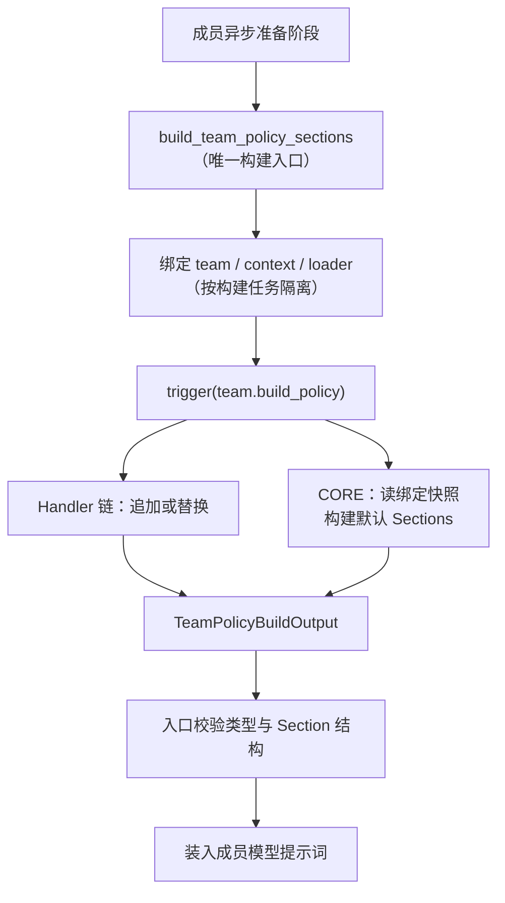

# team.build_policy 团队协作规则构建事件契约设计方案

## 1. 元信息

| 项 | 值 |
| --- | --- |
| 类型、编号 | feature，`F_08 / team-build-policy` |
| 建档日期 | 2026-10-31 |
| 范围 | Events 的 `team.build_policy` 事件契约、统一构建入口与三种成员类型的构建点；追加与完全替换两种使用方式 |
| 方案成熟度 | 已确认；实现与端到端验证完成 |
| 计划条目 | 无对应 EV 条目；team 扩展整体接线与进度见 [F_100](../../../../agent_teams/docs/features/F_100_team-extension-wiring.md) |
| 设计依据 | [S_01 Events 公共契约](../specs/S_01_events-contract.md)（注册、匹配、分发与容错语义均沿用）；[S_09 Prompts 与 Rails](../../../../agent_teams/docs/specs/S_09_prompts-and-rails.md)（PromptSection 与默认 Sections 体系的主责规约） |
| 关联 feature | [F_100 Team 扩展机制接入](../../../../agent_teams/docs/features/F_100_team-extension-wiring.md)（契约层实现与成员接线）；[F_07 team.monitor_event](F_07_team-monitor-event.md)；[F_76 Leader 渐进披露](../../../../agent_teams/docs/features/F_76_leader-progressive-policy-disclosure.md)（leader 前缀白名单的出处） |
| 验证摘要 | 追加 / 替换两种模式、三种成员类型与 Pattern 筛选经单元及端到端验证，见第 8 节 |
| Refs | #2163 |

## 2. 背景、目标与范围

### 2.1 背景与问题

团队成员的协作规则（角色契约、任务流转规则、消息协议、入站标签说明等 Prompt Sections）
此前由框架在构建成员时固定生成：插件无法追加业务协作约定，也无法替换整套规则。
团队提示词的"协作约定层"对扩展不可定制。

本事件没有 Claude Code 对应物——Claude Code 无团队协作 Policy 概念，`team.build_policy`
是 openjiuwen Team 子系统的原生扩展点。

### 2.2 目标与关键场景

| 场景 / 触发条件 | 此前行为 | 目标行为 |
| --- | --- | --- |
| 插件追加业务规则 | 不支持 | Handler 经 `next_handler` 取默认集后追加 Section，进入成员 system prompt / leader 披露 |
| 完全替换协作规则 | 不支持 | Handler 短路返回自定义 Sections，默认集完全不构建 |
| 按角色 / 团队 / 成员筛选 | — | Pattern 三字段收窄生效范围 |
| 无插件（含接通 bus） | 基线提示词 | 提示词与不接扩展逐字一致（内容等价） |

### 2.3 本次范围与非目标

- 本次包含：`team.build_policy` 的事件契约（触发位置、输入 / 上下文快照 / 输出、Pattern、
  失败与取消）、统一构建入口、三种成员类型的构建点、追加与完全替换两种使用方式。
- 本次不包含：默认 Policy 的模板体系（[S_09](../../../../agent_teams/docs/specs/S_09_prompts-and-rails.md)
  与 `agent_teams/prompts/` 管辖）；工具描述、平台基础 prompt、技能列表等其余提示词层——
  均不经本事件（见 7.2 管辖边界）。

## 3. 设计约束与已核实前提

- 事件注册、Handler 链、Pattern 匹配、校验与容错沿用 [S_01](../specs/S_01_events-contract.md) 公共契约。
- 构建发生在成员的异步准备阶段（会话已绑定、首次模型请求前）；三种成员类型的构建点
  不同，但入口唯一（D-01）。
- leader 系统提示词前缀必须逐字稳定（KV cache）：前缀只放行 `team_bootstrap`（身份与
  建队指引）和 `team_extra`（调用方自定义指令）两个 Section，其余协同准则一律经
  `build_team` 工具结果披露（[F_76 渐进披露](../../../../agent_teams/docs/features/F_76_leader-progressive-policy-disclosure.md)定下的前缀边界）；
  插件产物同样只进披露视图。
- CORE 与所有 Handler 必须基于同一份实际生效配置构建（不能各读各的）。
- 无未决问题（子进程 teammate 的接线缺口见第 9 节遗留）。

## 4. 总体方案与设计取舍

### 4.1 方案概览



Handler 可经 `next_handler` 取得 CORE 构建的默认 Sections 再追加，或不调 `next_handler`
直接短路返回替代 Sections。同一份构建结果按成员角色以两种形态投递给 leader：
前缀视图（仅 `team_bootstrap` + `team_extra`，进系统提示词）与披露视图（其余全部，经 `build_team` 工具结果下发）。
非 leader 成员的全部 Sections 直接进入该成员的 system prompt。

### 4.2 关键决策

#### D-01 统一构建入口

- 选择与依据：进程内成员（leader / teammate）、外部 CLI / 三方 harness 成员、inprocess
  teammate 的唯一构建入口都是 `build_team_policy_sections`——Handler 无需感知成员类型差异；
  消费方差异经输入的 `workspace_prompt_variant` 字段标注。
- 代价：无（三种成员原构建点收敛为一处调用）。
- 实现体现：`events.py` 构建入口；三种成员的调用点见 5.1；验证场景 F_08-V-02 / V-05。

#### D-02 构建上下文按构建任务隔离

- 选择与依据：构建入口把 team / context / loader 绑定为 task 级隔离的上下文（contextvar），
  CORE 与所有 Handler 读同一份快照，保证链上各方基于一致配置构建；并发构建互不串扰。
  Handler 另可经 `ops.team.policy_context()` 读取同一份快照（见 5.3）。
- 代价：CORE 处理程序依赖绑定的存在（未绑定时构建入口直接报错，不静默降级）。
- 实现体现：`ops.py` 绑定原语；验证场景 F_08-V-06。

#### D-03 输出强校验、失败上抛

- 选择与依据：入口校验输出类型与 Section 结构；CORE 或 Handler 抛错、返回 `None` 或
  错误类型时，该成员准备失败——不使用半成品 Policy，不静默回退默认集。半成品提示词
  比显式失败更难排查。
- 代价：插件缺陷会阻断成员启动（错误信息明确指向构建链）。
- 实现体现：`events.py` 入口校验；验证场景 F_08-V-07。

#### D-04 leader 双视图投递

- 选择与依据：CORE 对 leader 返回全量 Sections，前缀视图仅放行
  `team_bootstrap` + `team_extra`——[F_76 渐进披露](../../../../agent_teams/docs/features/F_76_leader-progressive-policy-disclosure.md)
  定下的前缀边界：建队前成立的内容才进前缀，建队后才确定的协同准则经 `build_team`
  披露（"同一套 sections、两个投递时机"），由此保持前缀逐字稳定。插件追加的
  Section 落披露视图，不进前缀。
- 代价：leader 需调用 `build_team` 才能看到全部协作规则。
- 实现体现：`policy.py` 的视图选择函数；验证场景 F_08-V-03 / V-04。

#### D-05 每个成员每准备期构建一次

- 选择与依据：成员启动 / 冷恢复 / 运行时重建时各构建一次；普通模型迭代与压缩重投递
  不重新触发（历史文本原样重注入）。
- 代价：运行中修改 Pattern 或插件配置需等成员重建才生效。
- 实现体现：rail 惰性构建门（lock + 双检幂等，实现细节见 F_100）。

### 4.3 替代方案与排除理由

| 候选 | 与采用方案的差异 | 排除原因 | 重新评估条件 |
| --- | --- | --- | --- |
| context / loader 经参数透传给 CORE | 不用上下文绑定 | CORE Handler 签名固定为 `(event, ops, next_handler)`，无额外参数通道；`ops.team.policy_context()` 只覆盖配置不覆盖 loader | 无 |
| 构建失败静默回退默认集 | 插件缺陷不阻断成员 | 掩盖插件错误，产出非预期提示词且难以排查 | 无 |
| 每次模型迭代重建 Sections | 规则可热更新 | 浪费构建开销，且破坏 leader 前缀 KV cache 稳定 | 无 |
| 强制调用 `next_handler`（禁止短路） | 只允许追加 | 剥夺完全替换能力——实验性协议 / 领域自定义规则集是真实需求 | 无 |

## 5. 事件契约

### 5.1 触发位置与粒度

| 成员类型 | 构建位置 | Sections 消费方式 |
| --- | --- | --- |
| 进程内（leader + teammate） | `TeamPolicyRail` 惰性构建门（`before_model_call`） | 前缀视图进 SystemPromptBuilder；披露视图经 `build_team` 工具结果 |
| 外部 CLI / 三方 harness | `external_cli_spawn._build_member_system_prompt` | 全量渲染为字符串，经 CLI 注入参数下发 |
| inprocess teammate | 同进程内路径（leader 的 spec 对象经 derive 携带 bus） | 同进程内 |

三种成员均经 `build_team_policy_sections`（D-01）。粒度：每个成员每次准备构建一次（D-05）。
触发前：会话已绑定、成员身份已确定、实际生效配置已可读取。

### 5.2 输入

| 字段 | 类型 | 可改写 | 说明 |
| --- | --- | --- | --- |
| `team_name` | `str` | 否 | 构建目标所属团队 |
| `role` | `TeamRole` | 否 | 构建目标角色（leader / teammate / human_agent / bridge_agent） |
| `member_name` | `str \| None` | 否 | 目标成员标识；角色级构建（如 leader 前缀）无具体成员时为 `None` |
| `workspace_prompt_variant` | `str` | 否 | 消费方类型：`"native"`（进程内）或 `"external"`（CLI 成员） |

### 5.3 上下文快照（不属于 EventInput）

Handler 通过 `await ops.team.policy_context()` 读取本次构建的实际生效配置。CORE 与所有
Handler 读到的是同一份快照（D-02）。`TeamPolicyContext` 是 frozen dataclass，Handler 不可修改：

| 字段 | 类型 | 说明 |
| --- | --- | --- |
| `language` | `str` | 语言（`"cn"` / `"en"`） |
| `lifecycle` | `str` | 团队生命周期（`"temporary"` / `"persistent"`） |
| `team_mode` | `str` | 团队模式 |
| `dispatch_mode` | `str` | 任务派发模式（`"autonomous"` / `"scheduled"`） |
| `teammate_mode` | `str` | 成员执行模式 |
| `bootstrap_mode` | `str` | 建队路径（`"leader"` / `"framework"`） |
| `hitt_enabled` | `bool` | 实际生效的 HITT 开关 |
| `base_prompt` | `str \| None` | 调用方自定义指令 |
| `swarmflow_enabled` | `bool` | Swarmflow 能力开关 |
| `expose_human_agents_to_teammates` | `bool` | 人类成员可见性开关 |

### 5.4 输出

| 字段 | 类型 | 说明 |
| --- | --- | --- |
| `sections` | `tuple[PromptSection, ...]` | 有稳定名称的 PromptSection 元组；仅含团队协作 Policy |

每个 `PromptSection` 含 `name`（稳定标识，如 `"team_role"`）、`content`（`{"cn": ..., "en": ...}`
字典）、`priority`（排序用整数）。插件追加的 Section 建议使用插件命名空间作为 name
（如 `"my-plugin.business_rules"`），避免与框架保留名冲突。

### 5.5 Pattern 字段

| 字段 | 匹配来源 | 说明 |
| --- | --- | --- |
| `role` | Input 的 `role.value` | 构建目标角色 |
| `team_name` | Input 的 `team_name` | 团队名称 |
| `member_name` | Input 的 `member_name` | 目标成员；`None` 时指定该字段不匹配 |

多字段 AND 组合、精确值比较、不支持通配符或正则；省略某字段即不限该维度。

### 5.6 失败与取消

- CORE 或 Handler 抛错：该成员准备失败，不使用半成品 Policy，不静默回退默认（D-03）。
- Handler 返回 `None` 或错误类型：入口报 `AGENT_TEAM_STATE_INVALID` 扩展调用错误。
- 取消：按框架规则传播。

## 6. Handler 示例（追加模式）

```python
from openjiuwen.agent_teams.extensions.models import TeamPolicyBuildOutput
from openjiuwen.core.single_agent.prompts.builder import PromptSection


async def append_business_policy(event, ops, next_handler):
    """Append a business collaboration rule after the default sections."""
    output = await next_handler(event)  # 取得 CORE 构建的默认 Sections
    extra = PromptSection(
        name="my-plugin.business_rules",
        content={
            "cn": "# 业务规则（来自 my-plugin）\n- 每完成一个阶段性产出，向 team-leader 发送一句话进展简报。\n",
            "en": "# Business rules (from my-plugin)\n- After each milestone, send team-leader a one-line progress note.\n",
        },
        priority=60,
    )
    return TeamPolicyBuildOutput(sections=(*output.sections, extra))


event_bus.register_event_handler(
    "team.build_policy",
    append_business_policy,
    match_pattern={"team_name": "research-team", "role": "teammate"},
    handler_level=HandlerLevel.USER,
)
```

此示例只对 `research-team` 的 `teammate` 构建生效；追加的规则段出现在该成员的 system
prompt，或 leader 的 `build_team` 披露文本中。

## 7. 使用方式：追加与完全替换

### 7.1 追加模式注意事项

- **Section name 冲突**：追加的 Section 使用插件命名空间前缀（如 `"my-plugin.xxx"`），
  不使用 `team_*` 前缀——追加集和默认集会同时进入 SystemPromptBuilder，同名互相覆盖。
- **priority 选择**：团队 Sections 占 11-18，harness 内置占 20-60。建议追加的 Section
  放 50-60 区间。
- **双语内容**：`content` 字典须同时提供 `cn` 和 `en` 键。
- **前缀最小化**：追加的 Section 不进 leader 前缀（前缀只放行 `team_bootstrap` +
  `team_extra`，见 D-04）。

### 7.2 完全替换（短路返回整个 Sections）

Handler 不调 `next_handler` 直接返回自定义 Output，即完全替换默认协作规则——CORE 不执行，
默认 Sections 不产生。适用场景：实验性团队协议、特定领域的完全自定义规则集。

```python
async def replace_entire_policy(event, ops, next_handler):
    """Replace the entire policy with a custom section set."""
    return TeamPolicyBuildOutput(sections=(my_section_a, my_section_b))
    # 不调 next_handler → CORE 不执行 → 默认 Sections 完全不构建
```

#### 默认 Sections 清单

完全替换前先了解默认集包含什么——替换集若缺少某项对应的能力，成员在该维度的行为
将没有指引：

| Section 名称 | Priority | 内容 | 适用角色 | 替换时缺失的影响 |
| --- | --- | --- | --- | --- |
| `team_bootstrap` | 11 | Leader 身份 + 协作机制选择 + "先调 `build_team`"指引 | 仅 Leader | Leader 前缀中无团队内容（白名单过滤的确定结果） |
| `team_role` | 11 | 角色契约：任务认领规则、消息协议、"收到 from=user 必须回复" | 除 Leader 外全部 | 成员缺少角色契约和消息协议指引 |
| `team_hitt` | 12 | HITT 协作契约（与人类成员交互的规则） | 全部（gate `hitt_enabled`） | 成员缺少与人类成员交互的规则指引 |
| `team_bridge` | 12 | Bridge avatar 自契约（relay 语义） | 仅 Bridge Agent | Avatar 缺少转发语义的自契约指引 |
| `team_workflow` | 13 | Leader 工作流：建队 → 建任务 → spawn → 等通知 | 仅 Leader | Leader 前缀中无操作流程指引 |
| `team_lifecycle` | 14 | 团队收尾语义（temporary 解散 / persistent 待命） | 仅 Leader | Leader 缺少收尾语义指引 |
| `team_dispatch` | 15 | 任务到达方式：autonomous 认领 / scheduled 等指派 | 全部 | 成员缺少任务到达方式的指引 |
| `team_extra` | 17 | 调用方自定义指令（`base_prompt`） | 全部 | 调用方的自定义指令不进入成员提示词 |
| `team_inbound_tags` | 18 | 入站消息 XML 标签体系说明 | 全部 | 成员缺少入站标签体系的说明 |

完全替换的三个后果：

| 对象 | 后果 | 应对 |
| --- | --- | --- |
| leader 前缀 | 替换集若不含 `team_bootstrap` / `team_extra`，leader 系统提示词中无任何团队内容 | 需要保留 leader 基本行为时，在替换集中包含 `team_bootstrap` 的等价内容 |
| 非 leader 成员 | 全量 Sections 直接进 system prompt，协作规则完全由插件决定 | 确认替换集覆盖成员协作所需的全部约定 |
| 披露视图 | leader 的 `build_team` 工具结果中的协作规则也来自替换集 | 替换集应包含核心协作规则，否则 leader 看到的与成员收到的可能不一致 |

#### 管辖边界

`team.build_policy` 管辖的只是成员 system prompt 中**团队协作规则那一层**：

| 层 | 替换后是否受影响 | 原因 |
| --- | --- | --- |
| 团队协作 Policy Sections | 完全由替换集决定 | 本事件的管辖范围 |
| 工具描述（`claim_task` / `send_message` / `view_task` 等） | 不受影响 | 工具 Schema 由 `create_team_tools` 注册，不经本事件 |
| 平台基础 prompt（通用行为指引、安全原则等） | 不受影响 | 由平台 / harness / 安全 rail 注入 |
| 技能列表、子智能体规则、运行环境说明 | 不受影响 | 由 Skill 系统 / harness 内置 rail 注入 |

因此完全替换的实际效果是**成员缺少协作约定层的指引**，而非"不能干活"。缺少协作约定后
成员的具体行为取决于模型对工具描述和上下文的理解，本设计不做确定性的行为承诺；如果
需要成员按协作协议自主运转，替换集应覆盖相应约定。

不建议在未理解默认 Sections 全集的情况下做完全替换；多数场景追加比替换更安全。

### 7.3 兼容性

- **无 bus**：所有成员走本地默认构建，行为与不接扩展逐字一致。
- **有 bus 无插件**：CORE 即默认构建，提示词与无 bus 时内容等价（时序可能不同——
  惰性构建 vs 构造期构建）。
- **已有第三方 harness 成员**：`member_runtime` 分支跳过 DeepAgent / rail 装配，
  `_build_member_system_prompt` 是唯一构建点，不存在重复触发。

## 8. 验证设计、执行记录与结论

### 8.1 验证设计与通过条件

| 验证 ID | 场景 / 前置状态与输入 | 预期结果 |
| --- | --- | --- |
| F_08-V-01 | 无插件 + bus 接通 | 提示词与无 bus 逐字一致 |
| F_08-V-02 | 插件追加规则段 | teammate system prompt 含追加内容 |
| F_08-V-03 | leader 前缀不受影响 | 前缀内容不变（追加段只进披露） |
| F_08-V-04 | `build_team` 披露含规则 | leader 建队后工具结果含插件规则段 |
| F_08-V-05 | 外部 CLI 成员 | system prompt 含规则段（`workspace_prompt_variant="external"` 路径） |
| F_08-V-06 | Pattern 按 role 筛选 | 仅指定角色的构建经过 Handler |
| F_08-V-07 | 构建失败传播 | 成员准备失败，不回退默认集 |
| F_08-V-08 | 完全替换（短路） | 默认 Sections 不在结果中，自定义 Sections 全量生效 |
| F_08-V-09 | 完全替换后成员仍可执行任务 | 协作规则被替换，工具描述与平台基础 prompt 不受影响 |

### 8.2 实际执行与证据

| 日期、范围 | 环境与入口 | 实际结果 |
| --- | --- | --- |
| 2026-10-30，契约与接线单测 | `tests/unit_tests/agent_teams/extensions/`（真 bus 端到端：链 / 短路 / 校验器 / 容错；leader rail 惰性构建与前缀视图；披露经链；外部 CLI 构建路径） | 全部通过 |
| 2026-10-30，端到端运行（追加模式） | 真实宿主进程 + 追加验证插件（mock LLM 请求日志三方对比） | teammate 前缀 +86 字符（追加规则段），leader 前缀逐字不变 |
| 2026-10-30，端到端运行（替换模式） | 真实宿主进程 + 完全替换验证插件 | 默认 Sections 消失，任务仍正常完成（V-08 / V-09） |

### 8.3 验证结论

- 已证明范围：追加与替换两种模式、三种成员类型构建点、Pattern 筛选、失败传播、
  无插件零变化。
- 未覆盖项：无。
- 可支持的交付判断：本事件契约满足"插件可追加或完全替换团队协作规则"的承诺。

## 9. 已知遗留

| 遗留项 | 未处理原因 | 影响与现有处置 |
| --- | --- | --- |
| 子进程 teammate | 依赖统一框架的"进程分发"（spawn payload 携带扩展加载指令 + 子进程自 init），单侧不可闭环 | 当前走本地默认构建，行为正确 |

## 10. 参考资料

- 事件契约实现：`openjiuwen/agent_teams/extensions/models.py`、`events.py`、`policy.py`
- 成员接线：`openjiuwen/agent_teams/rails/team_policy_rail.py`、`tools/tool_team.py`、`spawn/external_cli_spawn.py`
- 默认 Sections 与 PromptSection 体系：[S_09](../../../../agent_teams/docs/specs/S_09_prompts-and-rails.md)
- 整体接线：[F_100](../../../../agent_teams/docs/features/F_100_team-extension-wiring.md)；监控事件侧：[F_07](F_07_team-monitor-event.md)
