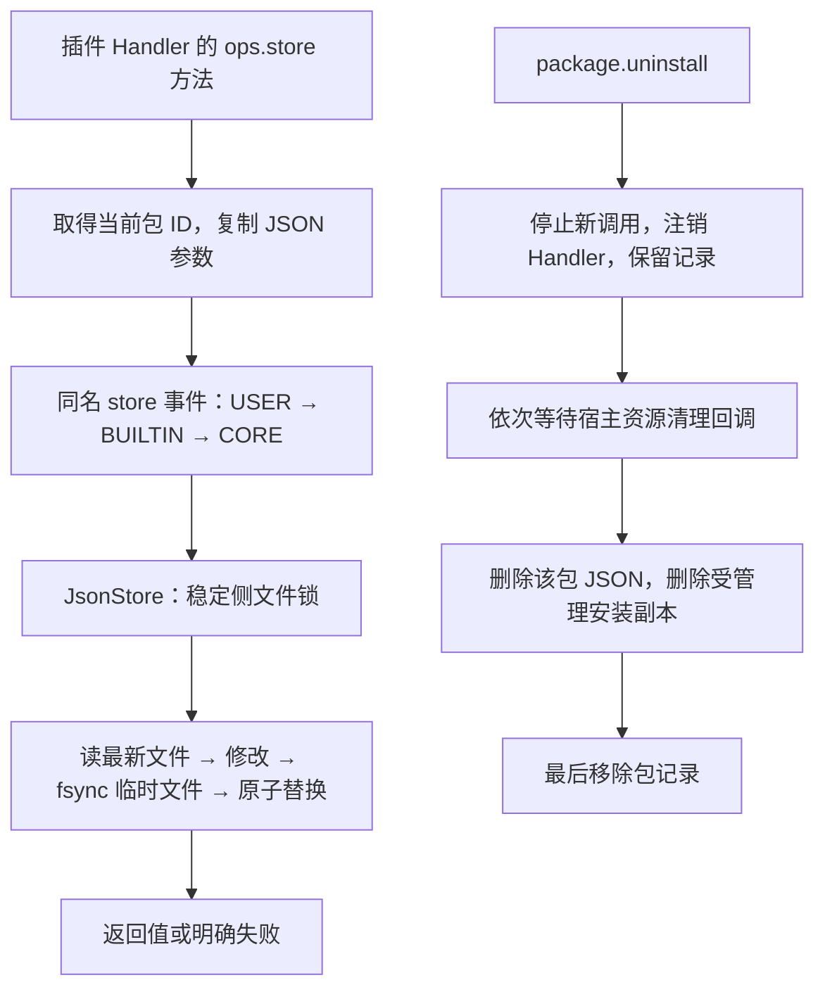

# store 持久化能力设计方案

## 1. 元信息

| 项 | 值 |
| --- | --- |
| 建档日期 | 2026-11-02 |
| 范围 | Core store CRUD、事件与 Ops、卸载清理及文档测试 |
| 设计依据 | 用户指定设计第二部分第 1 节及第 4 节的 store 内容 |
| 方案成熟度 | 已确认；不实施 state、package 内置身份调整或具体宿主接线 |
| 进度维护 | [Events 开发计划 EV-14](../designs/events-development-plan.md#ev-14-store-持久化与卸载清理) |

## 2. 能力与范围

`ops.store` 为当前扩展包保存 JSON 配置。同一包跨会话、重载、升级及进程重启共享数据，
不同包隔离。`store.get/set/delete/keys` 接受类型化请求，USER、BUILTIN 可拦截，CORE 完成默认文件操作。
Ops 内部触发独立事件，不推进调用方原事件链。业务入口和应用目录配置由宿主接入。

方法与输入输出的唯一契约见 [S_02 store 规约](../specs/S_02_store.md)。
卸载协作契约见 [Extension S_02](../../../extension/docs/specs/S_02_registry-and-bus.md)。

## 3. 方案与取舍



- 存储服务放在 `core/extension/data`，不导入 Events 或任何具体应用。
  宿主创建 `JsonStore(directory)`，通过 `Registry.init(store=...)` 注入；Core 不推导应用路径。
- 每个包一个 JSON 对象文件，直接保留 key 插入顺序。无内存缓存，每次持锁读取最新文件，
  避免多服务实例或多进程读取过期缓存。跨进程使用与数据文件分离的稳定锁文件。
- 阻塞锁及文件 I/O 整段在线程中完成。取消等待线程收尾后传播，防止锁提前释放。
- 不增加渲染调用上下文：store 没有面板依赖，现有可选 SessionContext 已支持无会话调用。
- 不把无包 Handler 改成 builtin 身份；store 要求真实包信息。保持 package 方法和 manifest 规则。
- 不把 get/计算/set 扩为事务，不增加 CAS、state 或自动刷新。

## 4. 实施影响与验收设计

事件定义与默认 CORE 位于 `events/builtins/event_types/store.py`，能力函数与 Build Handler 位于
`events/builtins/handler_ops/store.py`。二者由现有 bootstrap 扫描登记，无业务触发点新增。
服务绑定位于 `events/ops_impl/store.py`，Registry 在 Build 前注入。

Runtime 负责在途计数、卸载期间停止新调用及清理回调。卸载持包级管理锁，注销失败保留未注销 ID，
资源或副本清理失败保留包记录供重试。直接清理接口支持 reload/shutdown 原因并保留 store 文件。
Ops 的 store 调用只在其 Handler 执行期间有效，结束后保存的旧 Ops 不得重新写回卸载数据。
扩展 Runtime 在发布的 Handler 执行期间记录 Ops 归属，store 嵌套调用由 begin/end 成对计数。
Handler 结束后继续使用其旧 Ops 会被 Runtime 拒绝；独立 Bus 的宿主自行管理调用生命周期。
不增加通用 EventBus、基础 Ops 或调用上下文的接口，也不修改它们的执行机制。

| 验收组 | 前置与操作 | 预期 |
| --- | --- | --- |
| 数据 | CRUD、缺失/null、自定义默认值、重开服务、修改返回值 | 持久化正确，副本隔离，keys 有序 |
| 文件 | 并发写、多进程、容量、非法 JSON、损坏文件、路径越界 | 不丢 key，不覆盖损坏文件，拒绝非法参数 |
| 失败 | 替换前失败、提交结果不确定、取消 | False 仅表示确定未提交；未知抛异常；取消传播 |
| 事件 | 生产登记、Matcher、Validator、继续、改值、短路 | 四事件可用，默认动作次数正确 |
| Ops | 真实 Build 后调用、并发包/会话、无会话及旧 Ops | 归属不串包，结果保留，禁止失效调用 |
| 生命周期 | 重载、忙时卸载、注销/回调/副本失败后重试、未激活副本 | 重载保留，成功卸载删除，失败可重试 |

## 5. 验证记录与遗留

2026-11-02 首轮 Core 与 callback 回归为 641 passed、2 skipped，store 模块覆盖率 92%。
后续检视撤回通用 Ops 生命周期 API、对应框架改动和无关异常类型注解包装；将归属校验收敛到扩展 Runtime。
以下单独记录当前修订的回归结果，不以首轮结果代替修订后的验证。

修订后验证：Core Events、Extension、store 及 callback 合跑为 **640 passed、2 skipped**，
store 模块覆盖率 **92%**；新增的 7 个生产模块通过 `mypy --follow-imports=silent`，
改动 Python 文件的 Ruff 与拼写检查通过。暂存/未暂存差异检查通过，两个跳过均为符号链接环境限制。
通用 EventBus、基础 Ops、原异常类和已有公共接口快照测试均已恢复原状。

这不是应用集成文档。目录策略、宿主资源回调、示例扩展包和真实业务接入由消费方维护。
保留以下 SDK 边界：无业务默认目录；无 state 或自动刷新；锁不把多次 CRUD 组成事务；
多个进程共享数据时，宿主还须协调全局卸载准入。Windows 验证不覆盖 POSIX 目录 fsync 和网络文件系统。

2026-11-03 基线集成：上游 Events F_12、F_13 已分别用于 FS/MCP，本文顺延为 F_14，计划为 EV-14，
store 专项规约仍为未被占用的 S_02。保留远端两份 F_12 历史文档，不重编号已合入的特性。
卸载冲突合并后，先停止包调用并撤销 Handler，再清理 MCP 连接、宿主资源、store 和安装副本；
成功后撤销 MCP 声明并移除包记录。新增用例验证 MCP 清理失败保留 store 和声明，重试成功后才删除。

rebase 后使用本地 Core 环境验证新增 store 三组测试为 **68 passed、1 skipped**，包括上述 MCP 清理重试。
Events、Extension、store 和 callback 扩大回归为 **732 passed、2 skipped、30 failed**；
30 项失败均为远端 `mcp_ops` 与 `mcp_register` 重复添加 mcp 命名空间，导致 connect/call 未构建。
在原始 `hu/rsi_native_agent_os` 基线 `d36f76f1f` 的隔离 worktree 中，两个 MCP 测试文件复现完全相同的
30 项失败（其余 13 项通过）。该上游问题未混入 store 提交，不能将扩大回归记为全通过。
重验命令：

```powershell
.venv/Scripts/python.exe -m pytest -q -rs -o addopts= `
  tests/unit_tests/core/events tests/unit_tests/core/extension `
  tests/unit_tests/core/extension/data tests/unit_tests/core/runner/callback
```

## 2026-11-03 Windows 文件回归修复

State 回归暴露 store 的两项已有失败：并发访问偶发把正常路径判为越界，卸载后旁路锁文件消失。
本机 filelock 3.29 的 Windows 实现会在释放锁后尝试删除锁文件，与本文和 S_02 要求的稳定旁路文件不一致。
同时，Windows Path.resolve 在并发目录变化时可能保留扩展长度前缀，导致同一目录的比较结果不同。

本轮复用共享 files 模块的 resolve_data_path、package_data_path 和 package_file_lock：
统一规范路径前缀、继续拒绝重定向和别名，采用项目已声明依赖 portalocker 的公开 Lock 保留旁路文件，
并在取得锁后重新校验数据路径。store CRUD、取消等待、提交未知和卸载顺序保持原契约。

验证入口为 test_store.py 的并发、跨进程、旁路锁保留、路径前缀、提交未知用例，
以及 Events、Extension、callback 的扩大回归。锁释放故障注入同步针对新的公开 Lock.release 执行。

修复后 store、store Ops 与 state 文件回归为 **78 passed、1 skipped**；
Events、Extension、callback 扩大回归为 **810 passed、2 skipped，0 failed**。
跳过均由当前 Windows 账户不能创建符号链接导致；没有通过跳过原失败用例来使结果通过。
新增确定性用例覆盖扩展路径前缀和锁获取失败，原并发、跨进程、锁保留及提交未知用例均通过。
