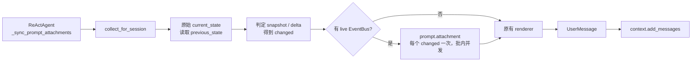

# `prompt.attachment` Agent Loop 事件特性设计

## 1. 范围、状态与依据

| 项 | 值 |
| --- | --- |
| 文档状态 | 已实现；Core 事件契约、登记和 Harness Agent Loop 接入已完成，真实宿主扩展包联调未执行 |
| 参考版本 | agent-core `release/v0.1.20.post3` |
| 对应 Claude 事件 | Claude Code Mods `prompt.attachment`；仅作业务语义和字段形态对照，不承诺实现完全一致 |
| 范围 | `prompt.attachment` 事件定义、CORE、Matcher、PromptAttachmentManager 触发边界及显式 EventBus 注入 |
| 关联 spec | [S_01 Events 公共契约](../specs/S_01_events-contract.md)；[S_06 Prompts 与 i18n](../../../../harness/docs/specs/S_06_prompts-and-l10n.md) |
| 关联 feature | [F_26 Prompt Attachment Agent Loop 接入](../../../../harness/docs/features/F_26_prompt-attachment-event-agent-loop.md) |
| 设计依据 | `2026-11-03-openjiuwen-prompt-attachment-event-agent-loop-plan`；Obsidian `openjiuwen 事件与方法特性文档编写指南` |
| 进度维护 | 本文维护 Core 事件契约与验证证据，Harness 的运行时注入细节由 F_26 维护 |
| 验证摘要 | 事件、manager、DeepAgent 冷构建和 Core Events 定向回归 `317 passed`；完整 `test_deep_agent.py` 因环境缺少 `opentelemetry.exporter` 未能收集 |

本特性让扩展在 DeepAgent 将 prompt attachment 写入 context history 前，逐条观察、改写或省略
attachment 的文本。事件结果由原有 renderer 消费，最终形成原有 `UserMessage`；attachment 的
收集、snapshot/delta 判断、排序、截断和 provider role projection 仍由原流程负责。

## 2. 能力说明与 Claude 对照

### 2.1 能力说明

`prompt.attachment` 在 `PromptAttachmentManager.sync_to_context()` 确定本次真正需要写入的
attachment 集合后触发，一次处理一个 attachment。Handler 接收不可变的
`PromptAttachmentInput`，可以继续当前事件链、替换 `text`，或返回 `text=None` 省略当前渲染片段，
最终返回 `PromptAttachmentOutput`，由 manager 交给原 renderer 和
`context.add_messages()`。

该事件只有事件链，没有同名或等价的 `EventHandlerOps` 方法。它不能通过返回值新增 attachment；
如果扩展需要产生新的 attachment，应使用产生该 attachment 的业务入口，而不是在本事件中伪造新条目。

### 2.2 与 Claude Code Mods `prompt.attachment` 对照

| 对照项 | Claude Code Mods 语义 | OpenJiuwen 当前实现 |
| --- | --- | --- |
| 处理粒度 | 按随模型请求携带的单个文本 attachment 处理，不等同于每个 Turn 一次 | 按 manager 的 snapshot/delta changed 集合逐个触发；首次 snapshot 全量，delta 仅 changed |
| 输入字段 | `type`、`text`、`origin`、可选 `agentId` / `detail` | 对齐字段含义；Python 字段为 `agent_id`，输入是 frozen DTO，`detail` 为递归只读快照 |
| 输出字段 | `{ text: string \| null }` | `PromptAttachmentOutput(text: str \| None)`；`None` 只省略当前 renderer 片段 |
| 来源模型 | `origin` 使用 `engine`、`hook`、`plugin` 分支 | 沿用 Mods 风格；当前 manager 默认 `{ "kind": "engine" }`，hook/plugin producer 必须显式传入来源 |
| 历史语义 | Claude 对照资料区分模型视图和引擎原始 transcript | OpenJiuwen 当前选择把改写文本写入本次 history `UserMessage`；history state 仍按原始 attachment 内容计算 |
| 新增条目 | `prompt.attachment` 只处理已经产生的 attachment | 相同；本事件无 `attachments` / `add` 输出，也不提供同名 Ops |

上述对照用于说明使用者可迁移的业务理解；事件注册、handler 故障处理、history 写入和 bus 注入
仍以本仓库的 S_01、S_06 及下文契约为准。

## 3. 事件契约

### 3.1 触发时机、粒度与消费方

ReActAgent 的 `_admit_user_message()` 和 `_build_model_context_window()` 都经过同一个
`_sync_prompt_attachments()`，由 manager 统一触发事件，避免两个调用点重复实现或重复触发：



事件发生在原始 state/hash 和 snapshot/delta 判定之后、原 renderer 和
`context.add_messages()` 之前。具体边界如下：

| 场景 | 是否触发 | 处理对象 |
| --- | --- | --- |
| 首次非空 snapshot | 是 | 当前 session 的全部 attachment |
| 已有 snapshot 的 delta | 是 | 仅 hash/state 发生变化的 attachment |
| unchanged attachment | 否 | 不创建事件 |
| removed section | 否 | 只有 removal notice，不存在可传入的 attachment 文本 |
| 无变化且无删除 | 否 | 不创建 history message |

有 bus 时，同一批候选使用 `asyncio.gather()` 并发等待，但结果按候选原顺序交给 renderer。
只有整批事件完成后才允许写入 history；因此事件仍未完成时，`context` 中不会出现本批新消息。

### 3.2 输入类型与字段

事件类型和 DTO 从 `openjiuwen.core.events.builtins.event_types.prompt_attachment` 导入：

```python
from openjiuwen.core.events.builtins.event_types.prompt_attachment import (
    PROMPT_ATTACHMENT,
    PromptAttachmentInput,
    PromptAttachmentOutput,
)
```

`PROMPT_ATTACHMENT` 的值为 `"prompt.attachment"`。输入字段如下：

| 字段 | 类型 | 必填 / 默认值 | 当前 manager 的值 | Handler 约束 |
| --- | --- | --- | --- | --- |
| `type` | `str` | 必填 | `PromptAttachment.kind` 的字符串值 | 用于区分 attachment 类型；可被 Matcher 使用，不应由 handler 改写 |
| `text` | `str` | 必填 | `PromptAttachment.content`；`None` 按 `""` 传入 | 唯一允许通过事件结果改变的业务正文 |
| `origin` | `Mapping[str, str]` | 默认 `{ "kind": "engine" }` | attachment 的显式来源；默认由 `PromptAttachment` 提供 | 递归冻结为只读快照；表示产生通道，不因 handler 改写而变化 |
| `agent_id` | `str \| None` | 非必填，默认 `None` | 当前 manager 没有真实 agent id 时保持 `None` | 只能使用宿主已有的真实身份；宿主不得凭空补值 |
| `detail` | `Mapping[str, object]` | 非必填，默认空映射 | `id`、`section`、`priority`、`source`、`content_kind` 和 `metadata` 快照 | 递归冻结为只读事实；不传 `PromptAttachment` 实例或可变 context |

`origin` 只接受以下形状：

```text
{"kind": "engine"}
{"kind": "hook", "event": "<上游事件名>"}
{"kind": "plugin", "event": "<上游事件名>"}
```

`hook` / `plugin` 的 `event` 表示产生该 attachment 的上游事件，不是当前正在执行的
`prompt.attachment`。如果扩展只是监听或改写已有 engine attachment，必须保留原来的
`origin`；只有扩展自己产生并提交新 attachment 时才使用 hook/plugin 分支。

### 3.3 输出、匹配与 Handler 用法

输出类型为：

| 字段 | 类型 | 语义 |
| --- | --- | --- |
| `text` | `str \| None` | 字符串替换本次 renderer 的正文；`None` 省略本次 attachment 片段。输出不携带 `type`、`origin` 或 `detail` |

Matcher 支持以下字段；空模式 `{}` 匹配全部输入。`origin` 和 `detail` 为部分字段匹配，未知
匹配字段会被判定为非法：

| Matcher 字段 | 匹配来源 |
| --- | --- |
| `type` | 输入 `type` |
| `agent_id` | 输入 `agent_id` |
| `origin_kind` / `origin_event` | `origin.kind` / `origin.event` |
| `section` / `source` / `content_kind` | `detail` 中对应字段 |
| `origin` / `detail` | 对应映射中的指定键值 |

扩展 handler 可以继续当前链、加工 CORE 结果，或直接返回合法输出短路后续链。下面的示例只改写
`memory` 类型；其它类型继续由下游 handler 和 CORE 处理：

```python
from dataclasses import replace

from openjiuwen.core.events import Event, EventHandlerOps, ExtensionEventBus
from openjiuwen.core.events.builtins.event_types.prompt_attachment import (
    PROMPT_ATTACHMENT,
    PromptAttachmentInput,
    PromptAttachmentOutput,
)
from openjiuwen.core.events.event_next import EventNext
from openjiuwen.core.events.types import HandlerLevel


async def rewrite_memory(
    event: Event,
    ops: EventHandlerOps | None,
    event_next: EventNext,
) -> PromptAttachmentOutput:
    del ops
    event_input = event.event_input
    if not isinstance(event_input, PromptAttachmentInput):
        return await event_next(event)
    if event_input.type != "memory":
        return await event_next(event)
    rewritten = replace(event_input, text=f"[memory]\n{event_input.text}")
    return await event_next(Event(PROMPT_ATTACHMENT, rewritten))


def register(bus: ExtensionEventBus) -> None:
    bus.register_event_handler(
        PROMPT_ATTACHMENT,
        rewrite_memory,
        {"type": "memory"},
        HandlerLevel.USER,
    )
```

宿主按既有 EventBus 生命周期完成 handler 注册和 `ops.build`；扩展 handler 不需要自行注册
`prompt.attachment` 的 CORE。若要省略当前片段，handler 可直接返回
`PromptAttachmentOutput(text=None)`；若要只观察而不改写，则继续传递原 `event`。

### 3.4 默认、短路、失败与取消

- EventBus 自动登记的 CORE 只校验输入并返回 `PromptAttachmentOutput(text=event_input.text)`，不产生外部副作用，也不修改 manager 状态。
- USER / BUILTIN handler 直接返回合法 output 时，可以短路 CORE；调用 `event_next()` 时，继续当前链并取得下游结果。
- manager 收到非法最终 output 或单个 attachment 的普通异常时，记录 warning 并回退该 attachment 原文，不阻断同批其它 attachment。
- `asyncio.CancelledError` 不被吞掉；取消会在 history 写入前传播给调用方。
- 当 handler 返回 `text=None` 时只过滤当前渲染片段。若同批还有 removal notice，仍会写入 removal notice；若没有任何可写内容，则本次同步返回 `None`。

## 4. 方法契约

本特性不新增 `EventHandlerOps` 方法，不提供 `ops.prompt.attachment`、
`ops.prompt_attachment` 或其它等价调用入口。扩展开发者通过 `ExtensionEventBus` 注册
`prompt.attachment` handler；事件输入和输出由第 3 节定义。

## 5. 接入与兼容方案

### 5.1 Core 登记与 Agent Loop 接入

`openjiuwen/core/events/builtins/event_types/prompt_attachment.py` 的 `register(bus)` 注册
事件类型、Matcher、输入/输出 Validator 和唯一 CORE。`ExtensionEventBus()` 构造时由
`register_builtins()` 自动发现并登记该模块；构造过程只登记，不触发普通事件。宿主完成自身
handler 注册后，按既有机制显式执行一次 `ops.build`。

Agent Loop 的 live bus 由宿主创建，并通过以下路径显式传给 manager：

```text
BuildContext.extension_bus / extras
  → DeepAgentSpec.resolve_parts()
  → DeepAgentParts.extension_bus
  → factory / apply_deep_agent_parts()
  → DeepAgent.set_extension_bus()
  → PromptAttachmentManager.event_bus
```

`DeepAgent`、`PromptAttachmentManager` 和 `Runner` 不会为本事件隐式创建或查找 bus；不使用
`ContextVar`。EventBus 是不可序列化的 live runtime handle，不进入 `DeepAgentSpec` 或配置数据。
冷恢复、跨进程或重建 agent 时，宿主需要重新提供 `BuildContext` / bus。

### 5.2 无扩展时的兼容行为

| 运行状态 | 事件行为 | 对既有 attachment 流程的影响 |
| --- | --- | --- |
| 没有注入 bus | `_run_attachment_events()` 直接返回原候选列表，不调用 `trigger()`，不创建事件任务 | 走原 renderer、history、hash/state、排序、截断和 provider projection；结果与旧路径一致 |
| 注入 bus，但没有 USER / BUILTIN handler | 只执行自动登记的 CORE pass-through | attachment 文本、顺序、framing、history metadata、state 和 provider projection 的语义不变；会增加一次事件链的异步空载开销 |
| 存在 USER / BUILTIN handler | 事件结果可改写或省略当前片段 | 这是显式扩展行为，不再属于“无用户扩展”路径；结果按 handler 契约变化 |

因此，“没有用户扩展”需要区分是否由宿主注入了 bus：没有 bus 时连事件阶段都不执行；有 bus
但没有 USER / BUILTIN handler 时由 CORE 原样透传。两条路径都不会改变现有 DeepAgent
attachment 的业务结果和状态逻辑，但后一条不是零执行成本。

### 5.3 状态、历史和结果提交

`sync_to_context()` 在触发事件前按原始 attachment 内容计算 `current_state`，并用它判断
snapshot/delta。handler 改写只生成用于本次 renderer 的 PromptAttachment 深拷贝：

- 改写文本进入本次 `UserMessage` history，后续 ContextEngine 按既有 history 流程消费。
- 原始 `current_state`、delta 判断和 `hash_prompt_attachment()` 语义不变，改写不会制造新的 delta。
- `PromptAttachment.content_sha256` 是框架原有字段；事件改写时只为临时副本重新计算该字段，
  不修改 manager 中保存的原始 attachment，也不改变状态 hash。
- handler 改写不改变 `origin`、attachment 生命周期、renderer framing、稳定排序、截断策略或
  provider role projection。

## 6. 验收与未决问题

### 6.1 验收场景

| 场景 | 输入与前置条件 | 操作 | 预期结果 | 证明方式 |
| --- | --- | --- | --- | --- |
| F16-V-01 CORE 透传 | 已构造 `ExtensionEventBus`，无 USER / BUILTIN handler | 触发 `prompt.attachment` | CORE 返回同一 `text` | `test_prompt_attachment_core_is_registered_and_passes_text_through` |
| F16-V-02 无 bus 回归 | manager 未注入 event bus，有 snapshot/delta attachment | 调用 `sync_to_context()` | 不调用 `trigger()`，沿用原 history 写入逻辑 | `tests/unit_tests/harness/test_prompt_attachment_manager.py` 既有回归 |
| F16-V-03 snapshot / delta | 首次有多个 attachment，后续只修改一个 section | 多次同步 context | 首次逐个触发；delta 只触发 changed；unchanged/removed 不触发 | `test_prompt_attachment_event_integration.py` 与 manager 回归 |
| F16-V-04 并发与顺序 | 同批有多个候选，handler 暂停等待 | 并发触发并释放 handler | 批内并发；全部完成前无 history message；renderer 顺序保持 | `test_attachment_events_run_concurrently_before_history_write_and_preserve_order` |
| F16-V-05 改写与 state | handler 改写 `text` | 完成 snapshot 后再次同步 | history 使用改写文本；原始 state 不制造新的 delta | `test_attachment_event_rewrite_uses_history_and_hashes_original_state` |
| F16-V-06 失败、删除和取消 | handler 分别抛普通异常、返回 `None` 或被取消 | 同批执行事件 | 异常 attachment 回退；`None` 省略；取消传播且不提前写 history | integration test 对应 failure/omission/cancellation 用例 |
| F16-V-07 显式注入 | `BuildContext(extension_bus=bus)` 或 `DeepAgent(..., extension_bus=bus)` | 构造 agent / resolve spec | bus 传到 manager；不进入 spec 序列化数据 | `test_deep_agent_receives_prompt_attachment_bus_explicitly`、`test_build_context_passes_bus_through_deep_agent_spec` |

### 6.2 执行记录与结论

在 agent-core `release/v0.1.20.post3`、本地 Python/uv 环境执行：

```text
uv run pytest -q tests/unit_tests/core/events \
  tests/unit_tests/harness/test_prompt_attachment_event_integration.py \
  tests/unit_tests/harness/test_prompt_attachment_manager.py \
  tests/unit_tests/harness/test_deep_agent_cold_build.py
```

结果：`317 passed, 2 warnings`。另执行了受影响 Python 文件的 `compileall` 和
`git diff --check`，均通过。

该结果证明事件定义与登记、CORE 默认结果、Matcher、manager 触发边界、handler 改写/省略/失败/
取消、显式 bus 传递和无 bus 既有路径回归成立；不等同于真实宿主扩展包、跨进程恢复或模型服务联调
已完成。

### 6.3 未决问题与验证边界

- 没有执行 JiuwenSwarm 真实宿主创建 bus、注册用户扩展、运行完整模型请求的联调；该接入由消费方负责。
- “无 bus”旧路径和“有 bus 但只有 CORE”透传分别有测试证据，但当前没有一个逐字段比较两条路径最终
  `UserMessage` 的专门 A/B 测试；因此无扩展兼容结论来自 manager 回归与 CORE 透传测试的组合证据。
- `tests/unit_tests/harness/test_deep_agent.py` 在当前环境因缺少 `opentelemetry.exporter` 未能完成收集，
  不把该文件的未执行范围描述为通过。
- 跨进程或冷恢复不会自动携带 live EventBus；宿主未重新注入时，按无 bus 语义运行。

## 7. 参考资料

- [S_01 Events 公共契约](../specs/S_01_events-contract.md)
- [S_06 Prompts 与 i18n](../../../../harness/docs/specs/S_06_prompts-and-l10n.md)
- [F_26 Prompt Attachment Agent Loop 接入](../../../../harness/docs/features/F_26_prompt-attachment-event-agent-loop.md)
- [事件扩展开发指南](../designs/events-extension-development-guide.md)
- [事件类型实现](../../builtins/event_types/prompt_attachment.py)
- [PromptAttachmentManager 实现](../../../../harness/prompts/prompt_attachment_manager.py)
- [ReActAgent 触发入口](../../../single_agent/agents/react_agent.py)
- Obsidian 设计方案：`2026-11-03-openjiuwen-prompt-attachment-event-agent-loop-plan`
- Obsidian 写作规范：`openjiuwen 事件与方法特性文档编写指南`
- [Claude Code Mods `prompt.attachment` 类型声明](https://raw.githubusercontent.com/anthropics/claude-code/main/mods/types/claude-code.d.ts)
