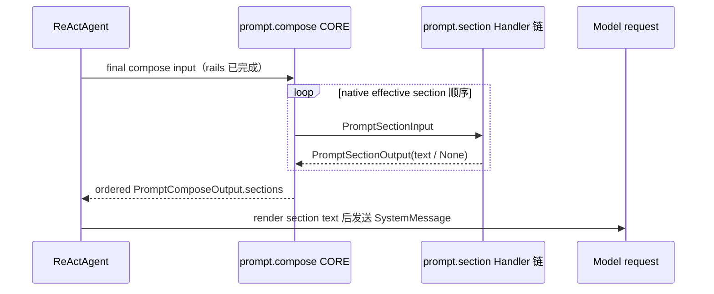

# `prompt.section` 事件特性设计

## 1. 范围、状态与依据

| 项 | 内容 |
| --- | --- |
| 类型、编号 | feature，`F_17 / prompt-section-event` |
| 建档日期 | 2026-11-07 |
| 计划条目 | [Events 开发计划 EV-16](../designs/events-development-plan.md#ev-16-promptsection-事件) |
| 方案状态 | 已实现；事件契约、CORE 透传、`prompt.compose` 子阶段和 Agent Loop 最终渲染接入已完成 |
| 设计依据 | 用户指定的 `2026-11-03-openjiuwen-prompt-compose-section-event-agent-loop-plan`；事件与方法特性文档编写指南 |
| 关联 feature | [F_18 `prompt.compose` 事件与 Ops](F_18_prompt-compose-event.md)；本事件是其内部逐 section 子阶段 |
| 验证摘要 | 事件契约、逐 section 顺序、文本改写/省略和真实模型请求边界已由定向 pytest 验证 |
| 实现范围 | agent-core Core Events、Harness `DeepAgent`、single-agent `ReActAgent`；不包含 JiuwenSwarm 业务入口 |

## 2. 能力、范围与 Claude 对照

`prompt.section` 在一次 `prompt.compose` 的 CORE 过程中处理一个当前有效的 system prompt section。Handler 收到当前语言下的 section 名称、原始文本和只含值的诊断信息，可以通过返回 `PromptSectionOutput(text=...)` 改写可见文本；返回 `text=None` 表示本次模型请求省略该 section。事件 CORE 只透传输入文本，不直接访问 builder、ContextWindow 或 Agent 状态。

本事件按设计稿对齐 Claude Code Mods 的 section 级 prompt 处理语义，但采用 OpenJiuwen 的 EventBus 三层 Handler 链和 Python frozen dataclass。OpenJiuwen 的 `name`、priority、category、carrier 以及 builder 生命周期仍由 CORE/DeepAgent 持有，不能通过 section 输出改写；本期没有同名 `ops.prompt.section` 方法。事件是 compose 的内部子阶段，不是一个供宿主在其它位置重复触发的独立模型请求入口。

本期完成的是 Core/Harness 能力，不代表 JiuwenSwarm 已经把某个真实业务请求改成新的触发入口。业务宿主后续只需发布已构建的 EventBus；最终模型请求的接入点由 `ReActAgent` 负责。

## 3. 事件契约

### 3.1 触发位置、粒度与顺序

`prompt.section` 不在 section 注册、builder `add_section()`/`remove_section()` 或 preview 阶段触发。每次最终模型请求在所有 `BEFORE_MODEL_CALL` rail 完成后，`ReActAgent._build_model_context_window()` 触发一次 `prompt.compose`；compose CORE 再按 builder 的 effective section 原生顺序逐个触发本事件。没有 Bus，或 standalone `ReActAgent` 没有绑定可提供 composition 入口的 DeepAgent 时，沿用原生 builder 渲染，不触发本事件。

一次 `prompt.compose` CORE 调用中，section 事件串行执行，触发数量等于该次 builder 取得的有效 section 数量；原生空文本也会以 `text=None` 进入 section 事件，handler 可以明确保留或省略。一个 section 被省略后，不会影响后续 section 的处理。



### 3.2 输入与输出

事件常量为 `PROMPT_SECTION = "prompt.section"`。

```python
@dataclass(frozen=True, slots=True)
class PromptSectionInput:
    name: str
    text: str | None
    detail: Mapping[str, object]


@dataclass(frozen=True, slots=True)
class PromptSectionOutput:
    text: str | None
```

| 字段 | 类型与约束 | 语义及可修改范围 |
| --- | --- | --- |
| `name` | 非空 `str` | 对应原生 `PromptSection.name`，用于匹配和观察；不作为输出身份的可改字段 |
| `text` | `str | None` | 当前 builder language 下的原始正文；Handler 只能通过输出返回新的正文或 `None` |
| `detail` | `Mapping[str, object]` | 只含递归可验证的 `None`、标量、列表/元组和字符串键映射；不允许 Agent、builder、rail、EventBus、ContextWindow 等运行时对象 |
| 输出 `text` | `str | None` | 字符串进入对应 `PromptSectionSpec`；`None` 或空白文本不进入最终 system prompt |

CORE 会保留原生 section 的 `id/name`、effective priority、category、carrier 和 detail。Handler 不应尝试借助修改输入 detail 改变这些字段；DeepAgent 以原生 builder 快照生成最终 spec。

### 3.3 Matcher、Handler 链与短路

Matcher 支持两种模式：`{}` 匹配全部 section，`{"name": "identity"}` 只匹配指定 name。其它字段或非字符串 name 会在注册/触发时按 Events 错误契约拒绝。事件仍遵循 USER → BUILTIN → CORE 的已有执行顺序；空匹配不会新增独立 Handler。

普通 Handler 可以在 `event_next(event)` 返回后加工 `PromptSectionOutput`：

```python
from dataclasses import replace

from openjiuwen.core.events.builtins.event_types.prompt_section import (
    PROMPT_SECTION,
    PromptSectionOutput,
)


async def append_evidence(event, ops, event_next):
    del ops
    output = await event_next(event)
    if event.event_input.name != "identity" or output.text is None:
        return output
    return replace(output, text=output.text + "\n请说明结论依据。")


event_bus.register_event_handler(PROMPT_SECTION, append_evidence, {})
```

Handler 也可以直接短路返回合法的 `PromptSectionOutput`，此时下游 CORE 不执行。非法输入/输出、CORE 异常和取消按 EventBus 既有规则传播；本特性不吞掉取消、不重试 section 链，也不为 builder 变更提供回滚。

### 3.4 没有同名 Ops

`prompt.section` 没有 `ops.prompt.section`。它只能由 `prompt.compose CORE` 通过显式注入的 Bus，在当前 compose 的 SessionContext 中串行触发。增加独立 Ops 会允许调用方绕过完整 compose facts 和 native section 生命周期，破坏两个事件的边界，因此不属于本期契约。

## 4. 接入与兼容方案

### 4.1 CORE 与 DeepAgent

`openjiuwen/core/events/builtins/event_types/prompt_section.py` 定义 DTO、Matcher、输入/输出 Validator 和 pass-through CORE。`openjiuwen/harness/deep_agent.py` 的 `DeepAgent.compose_prompt_sections()` 负责：

1. 从共享的 `SystemPromptBuilder.get_effective_sections()` 取得当前 mode、language、priority registry 和稳定顺序下的 section 快照；
2. 将当前语言正文和值型 detail 组合为 `PromptSectionInput`；
3. 通过显式 `bus.trigger(Event(PROMPT_SECTION, section_input), session_context)` 串行调用 section 链；
4. 只把输出文本映射为 `PromptSectionSpec.text`，`None`/空白文本直接省略；
5. 返回给外层 compose CORE，不修改共享 builder。

不会使用 `ContextVar` 保存当前 Agent、builder 或 compose 状态，也不会把这些运行时对象放入事件 DTO。`prompt.compose CORE` 通过显式 `ops.session_context.session_id` 查找已绑定的 DeepAgent；section CORE 自身不做 Runtime 查找。

### 4.2 ReActAgent 最终请求

外层 `prompt.compose` 返回的 section snapshot 是本次请求的唯一渲染来源。`ReActAgent` 使用纯函数式 `SystemPromptBuilder.render_sections()` 按返回顺序连接非空正文，不再次调用无参 `builder.build()` 覆盖结果，也不重新按 priority 排序。最终文本进入 `SystemMessage` 和 ContextWindow；同一份 snapshot 同时用于 system prompt usage sections。

没有 EventBus 时，`ReActAgent` 保留既有 `prompt_builder.build()` 路径，因此既有无扩展调用方保持兼容。`FULL`、`MINIMAL`、`NONE` 的筛选仍由 builder 的 `get_effective_sections()` 决定；section 事件只处理筛选后的本次请求视图。

### 4.3 自动注册与生命周期

新建 `ExtensionEventBus` 时，现有 `bootstrap.register_builtins()` 会自动扫描 `builtins/event_types/prompt_section.py` 并登记事件；宿主仍按公共契约显式执行一次 `ops.build`。事件注册不创建全局 section 缓存；每次 compose 都重新取当前 native section 快照，顺序与本次触发输入一致。Session 释放、Agent unbind、Bus 重建和 Handler 注销沿用既有 Events 生命周期。

## 5. 实施影响与文件

| 文件 | 变化及责任 |
| --- | --- |
| `openjiuwen/core/events/builtins/event_types/prompt_section.py` | 新增事件 DTO、Matcher、Validator 和 pass-through CORE |
| `openjiuwen/harness/deep_agent.py` | 新增 compose 内部逐 section 适配入口 |
| `openjiuwen/core/single_agent/prompts/builder.py` | 增加 effective section 快照和纯文本 renderer |
| `openjiuwen/harness/prompts/builder.py` | 保留 `FULL/MINIMAL/NONE` 过滤语义并暴露 effective sections |
| `openjiuwen/core/single_agent/agents/react_agent.py` | 由 `prompt.compose` 结果构建最终 model request 和 usage sections |
| `openjiuwen/core/events/docs/features/F_17_prompt-section-event.md` | 本特性文档 |

本期不修改 `prompt.attachment`，不新增真实 JiuwenSwarm 触发入口，不将 section 事件接到 ContextEngine 内部，也不改变工具注册/执行事件。

## 6. 验收与验证记录

### 6.1 代表性场景

| 场景 | 前置与操作 | 预期结果 |
| --- | --- | --- |
| 默认透传 | 无 USER/BUILTIN Handler，compose CORE 取得一个 section | 输出 text 与输入相同；原生无业务变化 |
| 文本改写 | USER Handler 匹配 `{"name": "identity"}`，在 `event_next` 后替换 text | 改写后的正文进入最终 provider `SystemMessage` |
| 省略 section | Handler 返回 `PromptSectionOutput(text=None)` | 对应 section 不进入最终 system prompt，后续 section 仍继续处理 |
| 原生顺序与 mode | 使用 priority、priority registry 或 `FULL/MINIMAL/NONE` 构造 builder | section 事件顺序等于 native effective 顺序，过滤规则不被事件重复实现 |
| 取消/失败 | Handler、CORE 或下游触发取消/异常 | 按 EventBus 既有传播规则结束，不伪造成功输出 |
| Ops 边界 | 查询 `ops` 能力目录 | 存在 `ops.prompt.compose`，不存在 `ops.prompt.section` |

### 6.2 实际验证

在目标 worktree、Windows、Python 3.11.9 环境执行：

```text
uv run pytest -q tests/unit_tests/core/events/test_prompt_events.py tests/unit_tests/core/events/test_prompt_compose_ops.py tests/unit_tests/agent/react_agent/test_prompt_event_integration.py
```

该命令覆盖事件 Validator/Matcher、CORE 绑定和顺序、section 省略、PromptMode、Ops 注册/独立触发，以及真实 mock provider 的最终 system message 接入。实际结果为 **12 passed、2 warnings、0 failed，4.26s**；warning 为既有 Pydantic 配置弃用提示。

## 7. 已知限制与参考资料

- 当前没有 JiuwenSwarm 生产业务触发点；本特性证明的是 agent-core/Harness 事件链和模型请求边界。
- `PromptSectionInput.detail` 只提供本次 composition 的值型诊断事实，不承诺跨请求缓存、依赖 fingerprint 或稳定历史快照。
- Handler 返回 `PromptSectionOutput` 只能影响文本和是否省略；新增、重排或删除 section 属于外层 `prompt.compose` 输出语义，见 [F_18](F_18_prompt-compose-event.md)。
- 本期不对 preview message 触发事件；preview 仍是 rail 前的 native builder 视图。

参考资料：[Events 公共契约](../specs/S_01_events-contract.md)、[Events 开发计划](../designs/events-development-plan.md)、[F_18 `prompt.compose`](F_18_prompt-compose-event.md)、用户指定的 prompt compose/section Agent Loop 设计稿。
