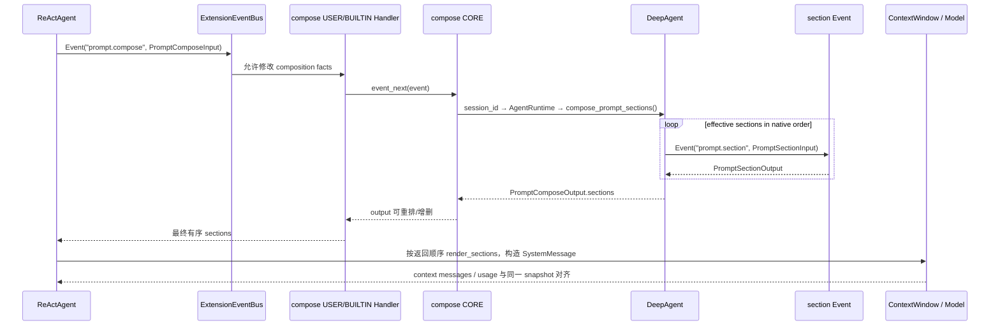

# `prompt.compose` 事件与 `ops.prompt.compose` 特性设计

## 1. 范围、状态与依据

| 项 | 内容 |
| --- | --- |
| 类型、编号 | feature，`F_18 / prompt-compose-event` |
| 建档日期 | 2026-11-07 |
| 计划条目 | [Events 开发计划 EV-17](../designs/events-development-plan.md#ev-17-promptcompose-事件与-ops) |
| 方案状态 | 已实现；事件 CORE、同名 Ops、`prompt.section` 子阶段和 Agent Loop 最终渲染接入已完成 |
| 设计依据 | 用户指定的 `2026-11-03-openjiuwen-prompt-compose-section-event-agent-loop-plan`；事件与方法特性文档编写指南 |
| 关联 feature | [F_17 `prompt.section`](F_17_prompt-section-event.md)；本事件 CORE 在每个 native section 上触发该子事件 |
| 验证摘要 | compose 输入/输出契约、CORE AgentRuntime 查找、Ops 新链、输出重排和真实模型请求接入已由定向 pytest 验证 |
| 实现范围 | agent-core Core Events、Harness `DeepAgent`、single-agent `ReActAgent`；不包含 JiuwenSwarm 业务入口 |

## 2. 能力、范围与 Claude 对照

`prompt.compose` 在所有 `BEFORE_MODEL_CALL` rail 完成后、最终 system prompt 渲染前触发一次。它接收描述本次组装条件的 `PromptComposeInput` facts，不把原生 section 列表放入输入；CORE 根据显式 SessionContext 找到当前 DeepAgent，从共享 builder 生成有效 section，再串行触发 `prompt.section`，最后返回本次请求要发送的有序 `PromptComposeOutput.sections`。外层 ReActAgent 按返回顺序渲染最终 system prompt，并将同一份结果交给 usage report。

`ops.prompt.compose(request)` 是与事件同名但职责不同的能力方法：它接收显式的 `PromptComposeInput`，使用当前 Handler 的 `ops.session_context` 触发一条新的 `prompt.compose` 事件链，并返回 `PromptComposeOutput`。它不推进当前事件链，不读取隐式当前 Agent，也不被 agent-loop 用来组成自身请求。

本事件按设计稿对齐 Claude Code Mods 的 `prompt.compose` / compose-core 语义：输入是 composition facts，输出是有序 sections；OpenJiuwen 用 EventBus 的 USER → BUILTIN → CORE 和显式 SessionContext 实现 continuation。当前实现的差异包括：section 生成由已绑定的 DeepAgent 内部入口承担，`prompt.section` 是显式 Bus 子事件，OpenJiuwen 没有额外的 Mods continuation 参数，也不提供跨请求 prompt cache contract。

本期是 agent-core/Harness 的平台能力，不等于 JiuwenSwarm 已接入某个生产业务调用点。

## 3. 事件契约

### 3.1 触发边界与主链路



触发点是 `ReActAgent._build_model_context_window()`，发生在所有 before-model-call rail 完成后。preview 消息仍在 rail 前使用 `prompt_builder.build()`，不触发 compose；attachment 同步也不重新触发 compose。没有 EventBus，或 standalone `ReActAgent` 没有绑定可提供 composition 入口的 DeepAgent 时，直接沿用原生 builder，保持旧调用方兼容；只有存在可解析的 session-bound composition owner 时才触发该事件。

一次最终模型请求只组成一次 request-local prompt snapshot。`prompt.compose` 返回后，渲染器不能调用无参 `builder.build()` 覆盖返回结果，也不能按 priority 再排序；返回顺序就是最终语义。

### 3.2 输入类型与字段

事件常量为 `PROMPT_COMPOSE = "prompt.compose"`。

```python
@dataclass(frozen=True, slots=True)
class PromptOutputStyle:
    name: str
    is_keeping_coding_instructions: bool


@dataclass(frozen=True, slots=True)
class PromptComposeInput:
    model: str
    prompt_model: str | None
    surfaces: tuple[str, ...]
    tools: tuple[str, ...]
    output_style: PromptOutputStyle | None
    traits: tuple[str, ...]
    detail: Mapping[str, object]
```

| 字段 | 类型 | 语义与当前来源 | Handler 修改边界 |
| --- | --- | --- | --- |
| `model` | `str` | 本次实际模型标识，来自 ReActAgent 配置；不是 Model/provider 实例 | 可作为组装事实被观察或改写，但不会偷偷切换已选模型 |
| `prompt_model` | `str | None` | 独立 prompt 模型标识；当前没有独立来源时为 `None` | 不放模型对象；当前默认 `None` |
| `surfaces` | `tuple[str, ...]` | 交互 surface 标识；当前没有统一来源时为空元组 | 只允许稳定字符串标识 |
| `tools` | `tuple[str, ...]` | rail 完成后模型可见的工具名称；不包含 Tool 实现或 schema | 可观察为 facts，不隐式注册或执行工具 |
| `output_style` | `PromptOutputStyle | None` | 回答风格标识及是否保留编码指令；当前无独立 style 来源时为 `None` | 非空 style 的 name 必须是非空字符串，不能承载完整 prompt 文本 |
| `traits` | `tuple[str, ...]` | 组装分支标签；当前默认空元组 | 只作为 composition facts；不自动把 `FULL/MINIMAL/NONE` 伪装成 Mods trait |
| `detail` | `Mapping[str, object]` | 当前包含 language、prompt mode 等值型事实；CORE 还将其复制到 section detail | 递归值必须是 `None`、标量、列表/元组或字符串键映射；禁止运行时对象和 sections |

`PromptComposeInput` 不包含 `sections`。原始 sections 属于 CORE 根据当前 Agent builder 取得的运行时事实，只有作为 `PromptComposeOutput` 才离开 CORE 内部。事件输入和 detail 不放 DeepAgent、ReActAgent、SystemPromptBuilder、PromptSection、rail、ContextWindow 或 EventBus。

### 3.3 输出类型与字段

```python
@dataclass(frozen=True, slots=True)
class PromptSectionSpec:
    id: str
    text: str | None
    priority: int
    category: str | None
    carrier: str
    detail: Mapping[str, object]


@dataclass(frozen=True, slots=True)
class PromptComposeOutput:
    sections: tuple[PromptSectionSpec, ...]
```

| 字段 | 类型与约束 | 结果语义 |
| --- | --- | --- |
| `sections` | `tuple[PromptSectionSpec, ...]` | 本次请求最终要消费的有序 section 列表；允许为空元组，表示本次不发送 system section |
| `id` | 非空 `str`，一次 output 内唯一 | 对齐原生 `PromptSection.name`；Handler 新增 section 时应使用自己的稳定命名空间 |
| `text` | `str | None` | 非空正文进入渲染；`None`/空白表示省略，不会发送给模型 |
| `priority` | 非 bool 的 `int` | 保留 native effective priority；外层 renderer 不根据它重新排序 |
| `category` | `str | None` | 保留原生分类用于 usage/诊断；不因 Handler 改写而自动切换 carrier |
| `carrier` | 非空 `str` | 当前 section 的承载标识，默认 `system_message` |
| `detail` | 递归值型映射 | 只承载解释本次 section 的事实；不能伪造 builder 或运行时句柄 |

Output Validator 拒绝错误类型、空 id、重复 id、非法 detail、空 carrier 和非 tuple sections。Handler 可以在 CORE 返回后重排、删除或加入合法 `PromptSectionSpec`；直接新增的 section 不会回到 `prompt.section` 再处理一次，这是为避免重复触发和递归。

### 3.4 Matcher、Handler 顺序与输入/输出加工

Matcher 支持 `{}`、`{"model": "..."}`、`{"trait": "..."}` 及二者组合；未知字段或非字符串 matcher 值按 Events 错误契约拒绝。匹配集合在触发时固定，Handler 通过 `event_next(Event(PROMPT_COMPOSE, replace(input, ...)))` 改写 facts 后，CORE 使用新输入，但不会重新计算已经选定的 Handler 集合。

```python
from dataclasses import replace

from openjiuwen.core.events import Event, HandlerLevel
from openjiuwen.core.events.builtins.event_types.prompt_compose import (
    PROMPT_COMPOSE,
    PromptComposeOutput,
)


async def select_prompt_model(event, ops, event_next):
    del ops
    data = replace(event.event_input, traits=(*event.event_input.traits, "analysis"))
    return await event_next(Event(event.event_type, data))


event_bus.register_event_handler(
    PROMPT_COMPOSE,
    select_prompt_model,
    {"model": "gpt-4o-mini"},
    HandlerLevel.USER,
)
```

Handler 可以在 `event_next` 前改写 composition facts，在返回后加工 section output，也可以短路返回合法 `PromptComposeOutput`。短路时 CORE 和其后的 Handler 不执行。普通异常、非法 Handler 输出、CORE 异常和取消按 EventBus 既有故障隔离与传播规则处理：USER/BUILTIN Handler 自身的非法输出遵循固定 skip 恢复，入口/CORE Validator 失败则拒绝调用；compose 不自动重试，不把部分结果写入全局缓存。

## 4. 方法契约：`ops.prompt.compose`

### 4.1 签名与调用场合

```python
await ops.prompt.compose(request: PromptComposeInput) -> PromptComposeOutput
```

适合在某个扩展 Handler 已经拥有完整 composition facts、需要显式请求一次新的 prompt 组合时调用。例如扩展需要根据自有值型策略选择 traits，然后观察平台返回的有序 section snapshot。它不是当前 Handler 的 `event_next` 替代品，调用方仍需自行决定是否继续正在处理的外层事件。

方法要求 `ops.session_context` 存在且包含非空 `session_id`。方法只接受 `PromptComposeInput`；输入非法、会话缺失、事件链失败或输出不合法时抛出对应 Events 错误/取消，不返回伪造的空成功值。

### 4.2 方法到事件的转换

```text
PromptComposeInput
  → ops.prompt.compose(request)
  → 校验 request 和 ops.session_context
  → bus.trigger(Event("prompt.compose", request), ops.session_context)
  → USER → BUILTIN → CORE → prompt.section 子链
  → PromptComposeOutput
```

该方法由 `openjiuwen/core/events/builtins/handler_ops/prompt_compose.py` 在 `ops.build` 链中登记到 `prompt` namespace。方法使用绑定的同一个 Bus 触发新链，但不调用当前链的 `event_next`，也不把隐式 agent/builder 注入请求。

`prompt.compose CORE` 不调用 `ops.prompt.compose()`，否则会递归触发同名事件；CORE 只调用显式注入的 Bus 触发 `prompt.section`。当前没有隐式 compose 深度、Session cache 或跨请求结果复用契约。

## 5. CORE、Agent Loop 与兼容方案

### 5.1 CORE 的显式 AgentRuntime 链

`openjiuwen/core/events/builtins/event_types/prompt_compose.py` 的 CORE 先从 `ops.session_context.session_id` 读取会话，再使用已有 `get_agent_runtime().get(session_id)` 查找绑定的 `DeepAgent`。未绑定、已释放或类型不是 `DeepAgent` 时失败。找到后调用 `DeepAgent.compose_prompt_sections(compose_input, bus, session_context)`；CORE 不直接操作 builder。

DeepAgent 内部 composition 入口：

1. 读取与 ReActAgent/rails 共享的 `system_prompt_builder`；
2. 用 `get_effective_sections()` 保留当前 language、PromptMode、effective priority 和 native tie-break；
3. 对每个 section 构造 `PromptSectionInput`，并通过显式 Bus 串行触发 [F_17 `prompt.section`](F_17_prompt-section-event.md)；
4. 将原生元数据与处理后的文本组合成 `PromptSectionSpec`，`None`/空白文本直接省略；
5. 返回 `PromptComposeOutput`，不修改 builder 和其它共享运行时状态。

该链路不使用 ContextVar 保存当前 Agent、builder 或 compose state。`AgentRuntime` 仍是现有显式 session-id 到 Agent 的进程内弱引用映射；生命周期由 DeepAgent 的 bind/unbind 负责。

### 5.2 最终 system prompt 与 usage 一致

ReActAgent 将 compose 输出保存到本次 `AgentCallbackContext.extra` 的 request-local 字段 `_prompt_compose_sections`，随后：

- `SystemPromptBuilder.render_sections()` 按 output 原顺序过滤 `None`/空白并用原有两个换行拼接；
- `SystemMessage`、ContextWindow 和 `ctx.inputs.messages` 看到该渲染结果；
- context usage sections 从同一个 `PromptSectionSpec` tuple 投影 category/text/carrier；
- 不再次读取 builder 生成 system prompt，不按 priority 覆盖 Handler 的重排/增删结果。

这份 tuple 只属于当前显式调用链，不是全局缓存、ContextVar 或 Agent 字段。没有 EventBus 时不产生该字段，直接沿用原有 builder.build()。

### 5.3 自动注册与不涉及范围

Bootstrap 自动扫描并登记新的 event type 和 `prompt` Ops Build Handler；宿主仍需按公共契约显式触发一次 `OPS_BUILD_EVENT_TYPE`。本期不修改 EventBus 公共 trigger 签名，不新增 `prompt.section` Ops，不把 compose 放进 ContextEngine，不实现 prompt cache/dependency fingerprint，也不新增 JiuwenSwarm 的 server/channel/plugin 生产业务触发。

## 6. 实施影响与文件

| 文件 | 变化及责任 |
| --- | --- |
| `openjiuwen/core/events/builtins/event_types/prompt_compose.py` | 新增 compose DTO、Matcher、Validator、AgentRuntime CORE |
| `openjiuwen/core/events/builtins/handler_ops/prompt_compose.py` | 新增 `ops.prompt.compose` 的 Build Handler 和新链触发方法 |
| `openjiuwen/harness/deep_agent.py` | 读取 native builder、串行触发 section 子链并返回 output |
| `openjiuwen/core/single_agent/agents/react_agent.py` | rails 后触发 compose、渲染最终 prompt、复用 usage snapshot |
| `openjiuwen/core/single_agent/prompts/builder.py` | 新增 `get_effective_sections()`、`render_sections()` |
| `openjiuwen/harness/prompts/builder.py` | 在 PromptMode 下提供一致的 effective section view |
| `openjiuwen/core/events/docs/features/F_18_prompt-compose-event.md` | 本特性文档 |

## 7. 验收与验证记录

### 7.1 代表性场景

| 场景 | 前置与操作 | 预期结果 |
| --- | --- | --- |
| 无扩展/无 Bus | 直接执行 ReActAgent 最终模型准备 | native builder 输出保持不变，不触发 compose |
| CORE 正常组合 | 绑定 DeepAgent，触发 compose | 通过 Runtime 找到 Agent，section 子事件按 native 顺序执行并返回合法 tuple |
| compose 前置改写 | USER Handler 在 `event_next` 前替换 facts | CORE/section detail 看到改写后的 composition facts |
| compose 后置加工 | USER Handler 在 `event_next` 后反转、增删 output sections | ReActAgent 按返回顺序消费；不再次按 priority 排序 |
| section 文本改写/省略 | section Handler 返回新 text 或 `None` | 最终 provider 请求只看到处理后的有效正文 |
| Ops 独立新链 | 在有 SessionContext 的 Handler 中调用 `ops.prompt.compose()` | 触发完整新链并返回 Output，不自动推进外层链；无 `ops.prompt.section` |
| 非法或重复输出 | Handler 返回重复 id、非法 detail 或错误类型 | EventBus output Validator 拒绝，错误/取消不被吞掉 |

### 7.2 实际验证

在目标 worktree、Windows、Python 3.11.9 环境执行：

```text
uv run pytest -q tests/unit_tests/core/events/test_prompt_events.py tests/unit_tests/core/events/test_prompt_compose_ops.py tests/unit_tests/agent/react_agent/test_prompt_event_integration.py
```

该命令覆盖 PromptCompose DTO/Matcher/Validator、AgentRuntime CORE、`FULL/MINIMAL/NONE`、`prompt.section` 子链顺序与省略、Ops 独立新链，以及最终 provider request 对 compose 重排和 section 改写的消费。实际结果为 **12 passed、2 warnings、0 failed，4.26s**；warning 为既有 Pydantic 配置弃用提示。

## 8. 已知限制与参考资料

- ReActAgent 当前能够稳定提供 model、可见 tool names、language、prompt mode 等事实；surfaces、prompt_model、output_style、traits 没有统一业务来源时按契约传空/None，后续宿主接入应提供真实稳定值，不能把运行时对象塞入 detail。
- `PromptComposeOutput` 的新增 section 若由 compose Handler 在 CORE 返回后直接加入，不会再次触发 `prompt.section`；需要二次 normalize 时必须形成新的明确契约。
- 当前不提供跨请求缓存、依赖 fingerprint、幂等重放或隐式重入保护；每次 compose 都建立新的 request-local snapshot。
- standalone ReActAgent 只有在 session 显式绑定到提供 composition 入口的 DeepAgent 时才进入 compose 事件链；否则保持 native builder fallback。这是兼容 core-only AgentLoop 的边界，不是隐式 Runtime 兜底。
- 事件与 Ops 的 Core/Harness 定向验证不代表 JiuwenSwarm 生产渠道、Server、插件装卸或真实远程模型联调已完成。

参考资料：[F_17 `prompt.section`](F_17_prompt-section-event.md)、[Events 公共契约](../specs/S_01_events-contract.md)、[Events 开发计划](../designs/events-development-plan.md)、用户指定的 prompt compose/section Agent Loop 设计稿。
