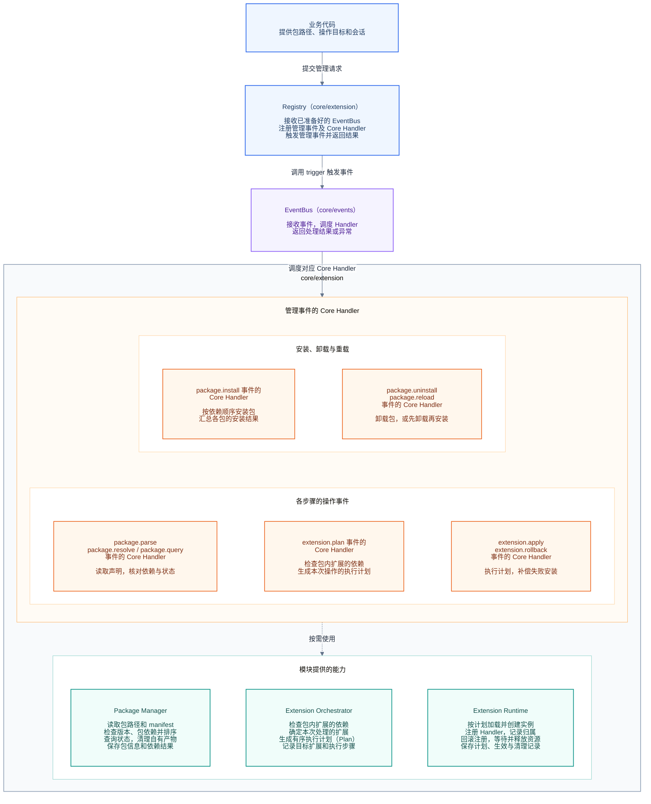
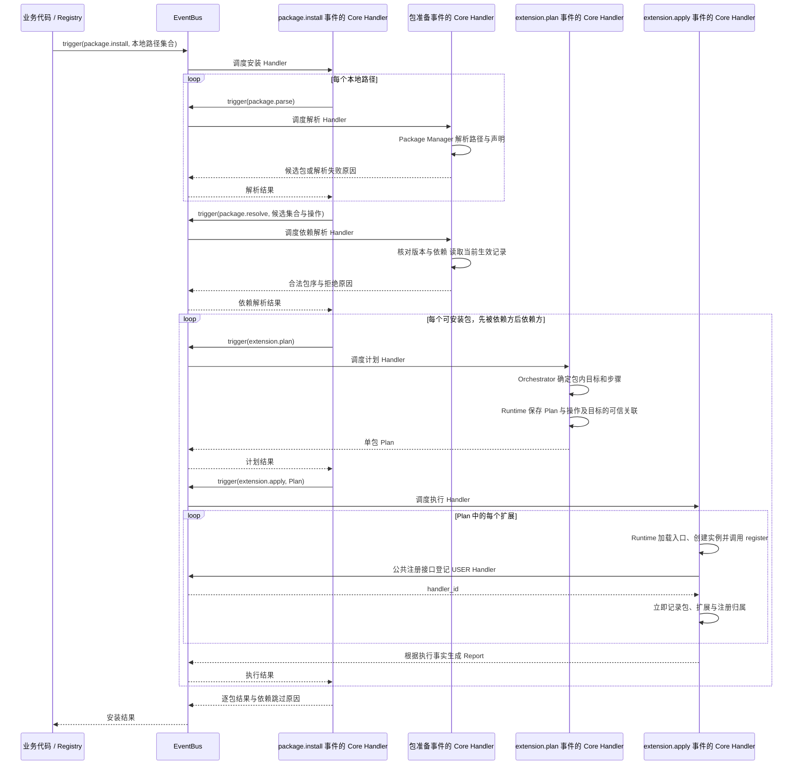
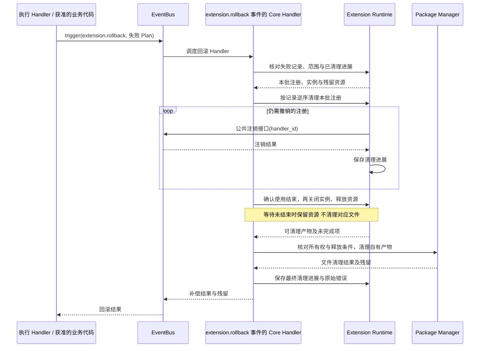
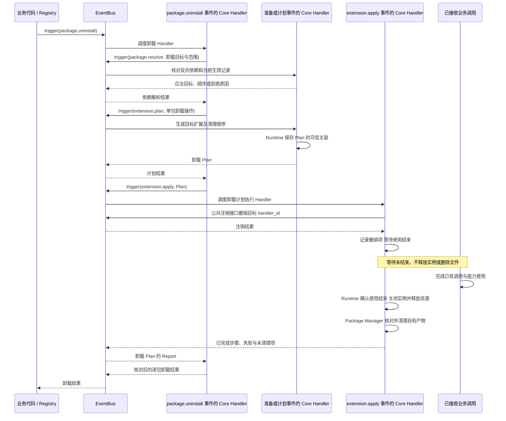
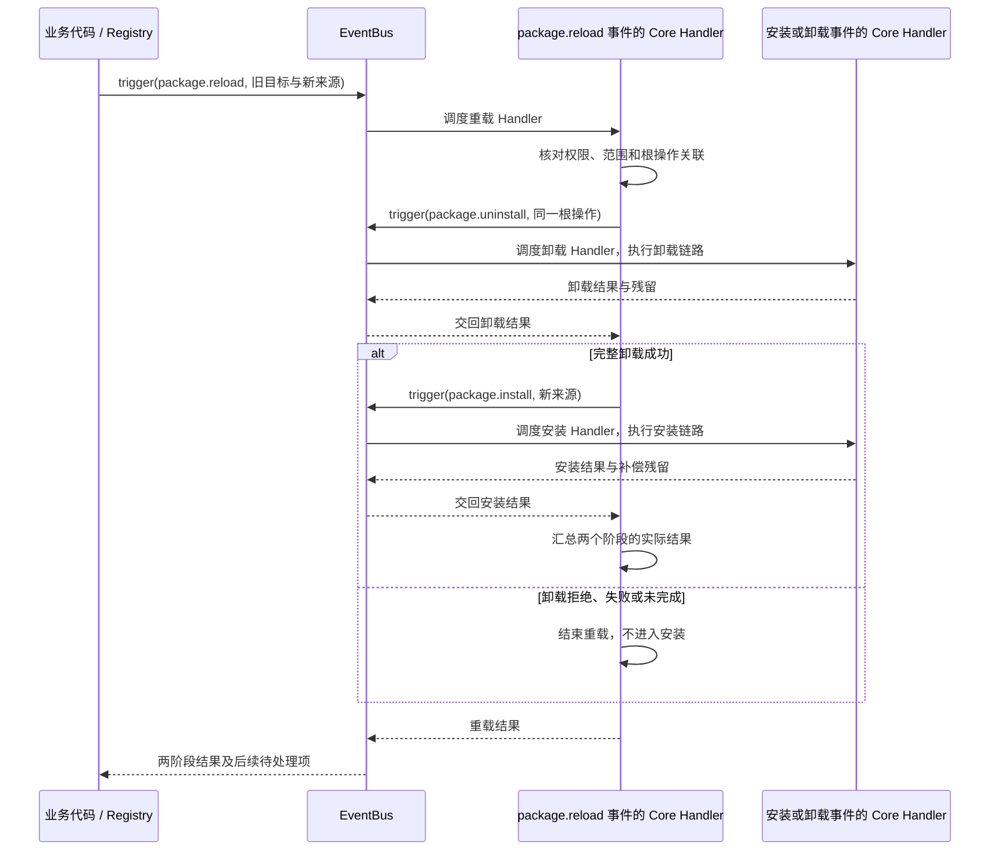
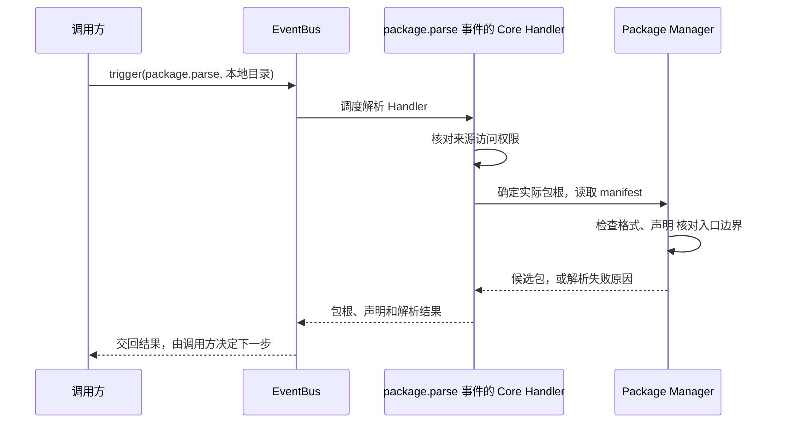
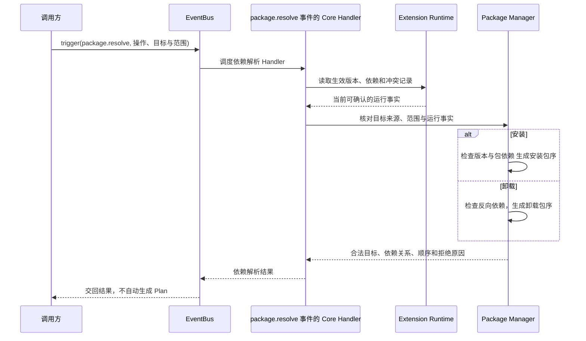
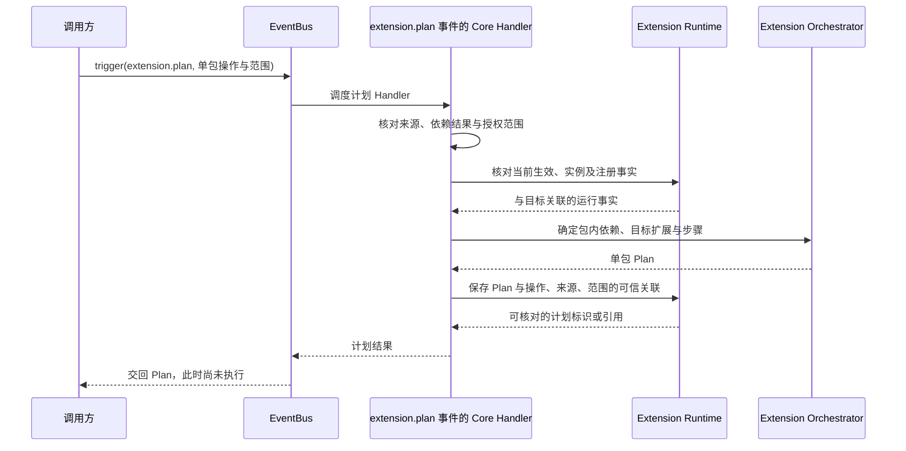
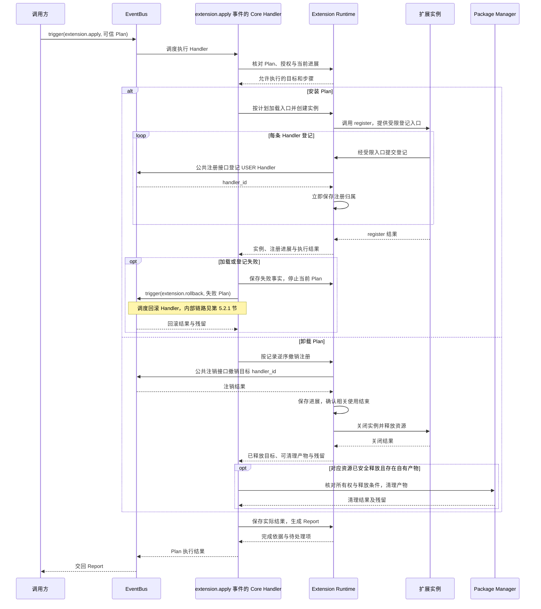
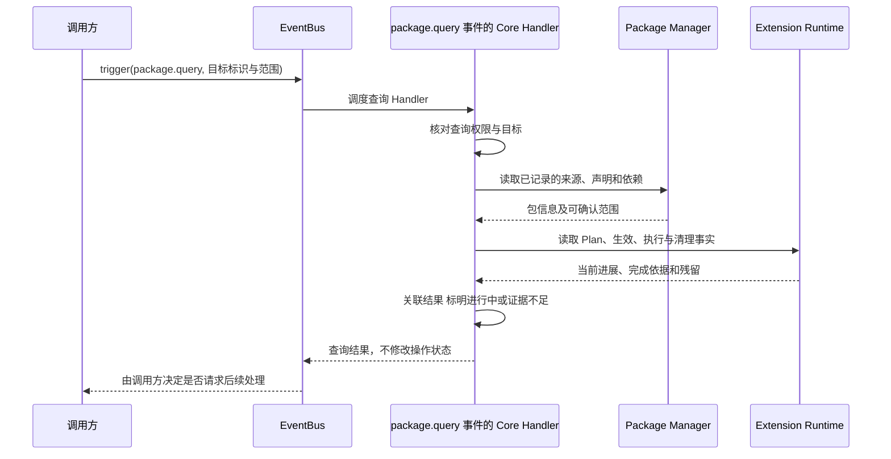

# Extension 扩展包机制详细架构设计

| 项 | 内容 |
| --- | --- |
| 文档类型 | 目标设计草案；尚未确定的内容标为补充建议或待确认项 |
| 最近一次修订日期 | 2026-10-21 |
| 责任人 | Core Extension 模块维护者；与 Events 的协作由双方维护者共同确认 |
| 所属模块 | `agent-core/openjiuwen/core/extension/` |
| 配套文档 | [设计概览](extension-overview.md)、[Core 公共规范](../../../AGENTS.md) |
| 协作模块设计 | [Events 概览](../../../events/docs/designs/events-overview.md)、[Events 详细架构](../../../events/docs/designs/events-architecture.md) |
| 模板依据 | [架构模板](../../../docs/templates/architecture-template.md)；概览采用 [Overview 模板](../../../docs/templates/overview-template.md) |

本文以企业报告包为例，说明 agent-core 如何解析扩展包、注册事件处理器，以及在失败、重载和卸载时如何处理。重点是各模块分别做什么、如何协作、依据哪些记录判断操作结果，以及何时可以释放资源。

包管理和真实业务操作通过事件执行，由业务代码或 Handler 在明确的调用点发起。Registry 是业务调用的便捷封装，各管理事件的 Core Handler 负责决定是否触发下一项包操作。EventBus 提供通用事件服务，不承担包流程编排。事件机制的具体设计以 Events 文档为准。

本文仅讨论 agent-core 内的机制。“调用方”指使用 agent-core 接口的代码；产品配置、默认目录、启动框架和跨仓接入不在本文范围内。本文用 **Extension** 指扩展包管理模块，用“扩展单元”（manifest 中的 extension）指包内可以独立声明和加载的扩展。**Handler** 是响应事件的处理函数，**Ops** 是 Handler 使用平台能力的入口。

**Core Handler** 指 Events 中 CORE 层级的默认处理器，每个事件有且只有一个。Extension 的 Package Manager、Extension Orchestrator 和 Extension Runtime 为管理事件的 Core Handler 提供能力，一个处理器可以按需使用多个模块。下文将 **Extension Orchestrator** 和 **Extension Runtime** 简称为 Orchestrator 和 Runtime。

**实现状态：** 当前 `core/extension/` 尚未发现本方案的 Python 实现、公共导出或相应单元测试。本文中的接口名称、Plan / Report 和 manifest 示例用于说明目标设计，不能直接作为可运行 API 使用。完整加载与卸载仍需结合 Events 接口完成实现和验证。

完整的数据格式（Schema）、错误码和接口契约由后续规约（spec）维护；代码组织、具体实现和验证记录由特性方案（feature）维护。

| 阅读目的 | 章节入口 |
| --- | --- |
| 了解定位、核心概念和模块分工 | 第 1～3 节 |
| 理解各模块的工作方式、协作流程和完成条件 | 第 4～6 节 |
| 核对数据、故障、安全和升级处理 | 第 7～10 节 |
| 推演完整场景，查阅验证要求和待确认问题 | 第 11～12 节 |

## 1. 定位、目标与范围

### 1.1 定位与目标

Extension 负责扩展包的管理和加载：读取包声明，检查来源与依赖，确定加载顺序，再注册或撤销包中的 Handler。这部分管理职责也称为“控制面”。注册后的事件匹配和 Handler 执行由 Events 负责。

例如，企业报告包依赖公共报告包，包内的 `enterprise-report` 又依赖 `report-base`。调用方先登记平台事件和能力构建处理器，再请求安装这两个包。系统先加载公共包，再加载企业包；进入企业包后，先处理 `report-base`，再处理 `enterprise-report`。Runtime 调用各扩展单元的注册方法，将报告扩展的 USER Handler 注册到 Bash 工具事件上。

后续工具调用由 Events 选择并执行 Handler。Extension 则通过生效记录和操作报告说明哪些注册已完成、哪些失败、还有哪些资源待清理。安装成功和一次业务调用成功是不同的结果，需要分别确认。

设计需要保证：包来源与依赖选择一致，包与包内扩展的顺序分别管理，每条注册都有明确归属，失败时知道应撤销哪些注册，卸载时不会提前释放仍在使用的资源。

### 1.2 范围与外部责任

| 范围 | 本期目标及责任边界 |
| --- | --- |
| 包来源 | 接收调用方明确传入的本地目录路径，检查包声明及同 ID 来源冲突 |
| 运行域 | 处理 manifest 声明为 `backend` 的 Python 扩展；其他运行域应拒绝，支持方式另行设计 |
| 管理操作 | 初始化时接收调用方准备好的 EventBus，注册 Extension 管理事件；包管理操作均经对应事件执行，`package.reload` 事件的 Core Handler 先触发卸载再触发安装，期间包可能不可用 |
| 包管理 | 校验 manifest 和版本，分别确定包与包内扩展的加载顺序，并检查依赖；不自动联网寻找依赖 |
| 事件执行 | 使用 Events 的公共注册和调用接口；通用事件机制由 Events 文档维护 |
| 业务协作 | Core 业务模块提供事件定义、默认处理、能力和会话资料；Extension 管理包注册与资源生命周期 |
| 暂缓内容 | 远程仓库、自动依赖安装、多版本同时生效、前端 Runtime、沙箱、跨进程互斥和无中断切换 |

可选参数 `extension_id` 用于表达只操作某个扩展单元的意图。但需要一并处理哪些依赖、部分操作的结果如何表示，仍待 Q05 确认。本节说明计划支持的范围，不表示这些能力已经实现。

### 1.3 关键需求与对应设计

| 要求及依据 | 对应设计 | 限制 |
| --- | --- | --- |
| 从明确的本地路径加载包，由 `package.install` 完成安装 | 第 4.1～4.2、5.1 节 | 同 ID 冲突策略待确认，不约定产品来源优先级 |
| 管理请求和独立可复用操作经过事件入口，内部步骤由所属 Core Handler 执行 | 第 2.2、4.1、5 节 | 按业务边界设置 9 类目标事件，不按函数、模块或状态更新拆分 |
| manifest 声明包和扩展入口，工厂创建实例，`register` 注册 Handler | 第 2.1、4.2～4.4 节 | 公共模型及最终导出仍待确认 |
| 通过 Plan / Report 管理执行、回滚、重载和卸载 | 第 3～8 节 | 回滚范围、报告格式和卸载等待机制仍需细化 |
| [Events 架构第 3 节](../../../events/docs/designs/events-architecture.md#3-模块划分与依赖方向)：公共模型归属及依赖方向 | 第 3.2、4.5 节 | Events 不导入包管理或调用方实现 |
| [Events 资源与停止约定](../../../events/docs/designs/events-architecture.md#83-资源与停止)：卸载时确认相关使用结束 | 第 3.4、4.5、5.2 节 | 需要协作取得使用结束确认后，才能释放包资源 |

### 1.4 核心设计取向

Extension 管理包，Events 执行事件。两者通过公共接口协作，同一公共模型只在所属模块维护。

| 设计主题 | 采用的方案与原因 |
| --- | --- |
| 管理入口 | Registry 初始化时接收 EventBus，只装配 Extension 自己的管理事件及处理器，并提供安装、重载和卸载的便捷方法；最终类名和公开导出待定 |
| EventBus 装配 | 调用方先准备 EventBus 并注册业务事件与 Handler，再将同一实例传给 Registry；业务注册不依赖 Registry 的初始化回调 |
| 操作执行方式 | Registry 和上层 Core Handler 通过事件发起独立操作；事件内部可以调用相关模块的辅助能力 |
| 事件触发责任 | 业务代码和 Handler 发起包管理及业务事件；EventBus 不根据 Plan、包依赖或结果安排下一项包操作 |
| 能力模型 | 使用 Events 的 EventHandlerOps，避免在 Extension 中重复定义能力基础层 |
| 两类加载依赖 | `requires.packages` 表示包之间的依赖，`extensions[].requires` 表示包内扩展之间的依赖 |
| 同 ID 多来源 | 由 Package Manager 检查冲突，不预设默认目录与配置文件的覆盖关系 |
| 事件调用范围 | 沿用 Events 的进程内调用方式 |
| 后续新增操作 | 只有出现独立调用场景、完成结果或不同处理责任时才评估新增事件；复制文件等辅助步骤不预先设为事件 |

本方案首先要求注册和清理过程可追踪。目前没有性能实测数据，不承诺启动耗时、吞吐量或卸载等待时长。哈希排序的算法及跨进程稳定性也未确定，因此“按 hash 排序”暂不意味着每次启动都能得到相同顺序。

## 2. 核心概念与共同规则

### 2.1 核心概念、关系与生命周期

一个包可以包含多个扩展单元，每个扩展单元可以注册多个 Handler。Plan 描述本次要做的工作，Runtime 执行后维护注册和资源记录，Report 再将处理结果交给调用方。

| 对象 | 表示什么，由谁管理 | 使用范围与生命周期 |
| --- | --- | --- |
| 候选来源 | 调用方提供的本地包路径，由 Package Manager 解析 | 用于本次包选择，不直接决定 Handler 执行顺序 |
| Package / PackageRef | 包的 ID、版本和选定包根；PackageRef 是对选定包的引用 | Package Manager 管理；同一 Registry 对同 ID 只选择一个生效版本 |
| 扩展单元 / ExtensionRef | 包内的加载单元及其引用，入口返回提供 `register` 方法的实例 | Runtime 持有实例；身份由包 ID 和包内扩展 ID 共同确定 |
| Plan | 单个包的本次操作、目标扩展、步骤和计划标识 | Orchestrator 创建，Runtime 保存可信操作关联并核对执行；不是可跨重启恢复的任务 |
| Report | 单包 Plan 及上层管理请求的处理结果 | Runtime 提供执行事实，管理 Core Handler 汇总逐包结果，Registry 交回；不替代生效记录 |
| 注册批次 | 本次 Plan 已成功注册的 `handler_id` 及注册顺序 | Runtime 记录；失败时逆序注销，成功后并入生效记录 |
| 生效记录 | 包和扩展实例与 `handler_id`、资源、待清理项的对应关系 | Runtime 在当前 Registry 实例中维护 |
| 包关联信息 | 当前 Handler 所属包的可信来源信息 | Runtime 核实后通过 Events 公共登记约定关联到 Handler |
| EventHandlerOps（Ops） | Handler 访问平台能力、包信息和会话资料的入口 | 公共模型归 Events；Extension 直接使用既有接口 |

同一回调函数注册多次，也会产生不同的注册记录。卸载必须使用实际返回的 `handler_id`，不能只按函数名删除。包名称来自 `manifest.package.id`，包根来自解析后的绝对路径；最终公共类型仍待确定，最小包关联模型由 Events 维护。

Extension 维护包、实例、计划和注册归属记录，不维护 Events 的内部执行状态。双方的接口协作与责任见第 4.5 节。

### 2.2 共同规则索引

下列 EX-A 规则是本草案需要满足的要求。补充建议确认后，再写入对应的正式规约，作为长期维护的契约。

| 规则 | 适用范围与负责模块 | 不满足时如何处理 | 详细说明 |
| --- | --- | --- | --- |
| EX-A01 先明确包来源，再校验和排序 | 本次安装集合；Package Manager | 来源冲突或版本不满足时拒绝相应包，不自动改选其他来源 | 第 4.2 节 |
| EX-A02 分别处理包与包内扩展的依赖 | Package Manager 排列包，Orchestrator 排列包内扩展 | 拒绝缺失、循环或超出允许范围的依赖；依赖失败时跳过依赖方 | 第 4.2～4.3 节 |
| EX-A03 每条成功注册都有可信归属 | Runtime 的受限登记入口 | 拒绝来源不明或层级不合法的注册，不留下没有归属的记录 | 第 4.4 节 |
| EX-A04 失败时撤销本次安装 Plan 的注册 | Runtime；建议以单包安装 Plan 为范围 | 触发回滚后按相反顺序注销，记录未清理项，不报告成功；正常卸载失败保留卸载进展 | 第 5.2.1 节 |
| EX-A05 先准备 EventBus，再初始化 Registry | 调用方负责业务注册；Registry 接收同一 EventBus 并装配管理事件 | 装配失败时不受理包操作；初始化不读取用户 manifest、不加载或安装扩展，也不触发 `ops.build` | 第 4.1 节 |
| EX-A06 不提前释放仍在使用的包资源 | Runtime 协调 Events 和调用方 | 等待使用结束；无法确认时保留资源并报告未完成 | 第 5.2.2 节 |
| EX-A07 卸载成功后才能继续重载中的安装 | `package.reload` 事件的 Core Handler | 卸载失败即停止；新安装失败不能宣称旧版仍可用 | 第 5.2.3 节 |
| EX-A08 报告必须反映实际注册和清理情况 | Runtime 提供记录，管理事件的 Core Handler 核对，Registry 交回 | 提前返回、取消或未收到结果时先核对，不凭空报告 SUCCESS | 第 6.3、8 节 |
| EX-A09 独立操作经过事件，内部步骤归所属 Core Handler | Registry 及各管理事件的 Core Handler | 不绕过已定义的独立事件；解析检查、加载登记、注销等待和资源清理按第 4.1.3 节归并，不能按方法随意新增事件 | 第 4.1、5 节 |
| EX-A10 包管理事件由业务代码或 Handler 显式发起 | 业务入口、Registry 便捷方法和管理事件的 Core Handler | 不把安装、解析、回滚或下一步骤的业务编排写入 EventBus；通用事件调用约定沿用 Events | 第 3.2、4.1.2、4.5 节 |

## 3. 架构总览与模块分工

### 3.1 系统与外部的关系

调用方先准备 EventBus，通过公共注册接口装配 Core 业务模块提供的业务事件、Core Handler、BUILTIN Handler 和 Ops Build Handler，再将该 EventBus 传给 `Registry.init`。Registry 在同一实例上注册 Extension 管理事件及其 Core Handler，不接收或执行业务注册回调。

初始化完成后，调用方通过 Registry 的便捷入口或受控事件入口提交包管理请求，两种入口都触发同一组管理事件。Registry 不直接执行包解析、安装或卸载。用户扩展包提供 manifest、入口工厂及注册实现；它的 `register` 方法只获得 USER Handler 的登记能力。

管理操作从可信入口发起。包代码与调用方运行在同一进程，加载前需要校验声明和路径，但这些校验不能隔离恶意 Python 代码。若要执行不可信代码，需要单独设计隔离机制。工具或外部系统的实际执行结果，仍由所属业务模块核对。

### 3.2 内部组成与依赖

本图在 [overview 第 2.1 节](extension-overview.md#21-总体关系)的基础上，展开管理事件分组、模块能力及关键记录，并标明与 Events 公共接口的协作关系。Registry 与下方事件处理区域都属于 `core/extension`，为突出入口和执行职责而分开展示，不限定类或服务的具体拆分。



蓝色表示调用与管理入口，紫色表示 Events 提供的事件服务，橙色表示事件的 Core Handler，青绿色表示 Extension 模块能力。实线表示调用或事件调度，虚线表示 Core Handler 按需使用模块能力。图中按职责合并展示部分事件，每个事件仍有各自的 Core Handler；完整事件列表见第 4.1.1 节。

一个 Core Handler 可以使用多个模块，同一模块也可以支持多个事件的 Core Handler。模块卡片说明它提供哪些能力、生成或保存哪些记录；计划、生效记录和清理记录均保存在当前进程中，不代表持久存储。解析、依赖解析、计划、执行、回滚和查询分别设有事件，加载与清理的具体步骤由执行或回滚 Handler 在内部完成。事件划分见第 4.1 节，协作顺序见第 5 节。

图中的 EventBus 由调用方预先准备并传入 Registry，业务调用、管理操作、扩展 USER 注册和 Ops 发起的新事件均使用这一实例。图中调用箭头展示管理请求的执行关系；初始化时的实例传入与注册顺序见第 4.1 节。

EventBus 只提供事件调用服务，不根据 Plan、包依赖或处理结果安排下一项包操作。业务代码和 Handler 决定何时发起包管理事件；Registry 在管理方法被调用时显式转发。Extension 与 Events 的协作边界见第 4.5 节。

包管理事件、Core Handler 及包生命周期逻辑由 Extension 维护；事件公共模型和通用执行机制由 Events 维护，业务事件和能力实现由所属业务模块维护。源码依赖保持 `core/extension → core/events`；图中的回调调度表示运行时调用，不表示反向源码依赖。

### 3.3 各模块负责什么

| 参与方 | 职责与协作方式 | 交出什么、负责到哪里 |
| --- | --- | --- |
| Registry | 接收调用方传入的 EventBus，装配管理事件及其 Core Handler；业务代码调用便捷方法时，在同一实例上显式触发对应事件 | 确认管理组件就绪，等待并交回管理结果 |
| 管理事件的 Core Handler | 执行对应事件的默认逻辑，按需使用一个或多个模块的能力；涉及另一项独立操作时触发对应事件 | 核对操作结果，决定是否继续后续步骤 |
| Package Manager | 提供来源与声明解析、包依赖和排序、包信息查询与自有产物清理能力 | 支持解析、依赖解析和查询事件；也供执行、回滚 Handler 在满足条件后清理自有产物 |
| Extension Orchestrator | 提供包内扩展依赖分析、操作范围与计划生成能力 | 支持 `extension.plan`；根据解析后的包信息和必要的 Runtime 记录返回单包 Plan |
| Extension Runtime | 提供可信计划关联、实例、受限登记、计划执行、回滚、注销、等待和资源释放能力 | 支持执行与回滚事件，为计划事件保存可信关联，向依赖解析、计划及查询事件提供当前运行事实 |
| EventBus / 执行器 | 提供公共注册、事件调用及 Handler 调度服务 | 交回处理结果或异常，不编排包管理步骤；内部机制见 Events 文档 |
| 调用方与 Core 业务模块 | 准备 EventBus 并完成业务事件与 Handler 注册，提供路径、会话、业务入口、资源权限和停止信号 | 确认业务依赖就绪，从受控事件入口发起操作，核对管理与业务结果 |

上表区分事件处理职责与模块能力职责，不限定一个 Core Handler 只能使用一个模块。安装、卸载和重载事件的 Core Handler 可以通过子事件协调多个模块；具体协作顺序见第 5 节。Core Handler 内部可以复用所需模块的纯计算或底层辅助函数，但进入另一项具有独立语义的包管理操作时，必须触发对应事件。

### 3.4 已有基础与需要补齐的部分

Extension 目前尚无本设计的执行实现。[Events 架构](../../../events/docs/designs/events-architecture.md)提供所需公共接口的设计依据。Extension 在其上补充包管理事件、Core Handler 和生命周期管理；Plan / Report、manifest 和包生命周期仍需形成对应规约。

Core 业务模块需要提供所属事件的默认行为和能力处理器。Extension 与 Events 则要共同实现可信包信息关联、注册追踪和资源使用结束确认，才能支持完整的加载与卸载流程。

## 4. 关键模块设计

### 4.1 Registry：统一管理入口

业务代码调用 `Registry.install`、`uninstall` 或 `reload` 时，对应方法体内显式调用受控 `trigger`，发起 `package.install`、`package.uninstall` 或 `package.reload`，并等待结果。Registry 不观察包状态、不自主扫描，也不驱动下一事件。业务代码直接调用受控 `trigger` 时，遵守相同授权及准入规则；解析、查询等请求也由业务或 Handler 明确发起。

**先完成业务注册，再把同一个 EventBus 传给 Registry。** `init` 是业务代码显式调用的装配方法，只负责 Extension 自己的初始化，不接收或执行 Core 业务模块的注册回调。

装配按以下顺序进行：

1. **调用方准备 EventBus。** 按 Events 公共约定准备事件注册和调用入口，以及 `ops.build` 等基础定义。基础定义由 Events 维护，不由 Registry 或业务模块重复注册。
2. **调用方注册业务内容。** Core 业务模块提供事件类型、匹配函数、唯一 Core Handler、BUILTIN Handler 和 Ops Build Handler；调用方通过 EventBus 公共接口完成注册，并确认必需的业务服务可用。具体注册代码可以汇总为业务侧函数，但由调用方直接调用。
3. **Registry 接收 EventBus 并装配管理能力。** 调用方将已准备好的实例传给 `Registry.init`。Registry 准备 Package Manager、Orchestrator 和 Runtime，在传入的 EventBus 上注册第 4.1.1 节的管理事件及其 Core Handler；内部模块和处理器使用同一实例，不另建或替换 EventBus。
4. **确认完成后再提交包路径。** Registry 确认自身管理组件和管理事件就绪；调用方另行确认业务注册及所需服务就绪，然后提交安装请求。用户包在安装过程中才获得受限 USER 注册入口。

下面的代码只说明实例传递与装配顺序，函数名和参数形式不是已实现的公共 API：

```python
# Prepare Events infrastructure, including its own base event definitions.
bus = EventBus()

# Register business event types, Core / BUILTIN Handlers and Ops Build Handlers.
# This function belongs to the caller, not to Registry.
register_business_events_and_handlers(bus, services)

# Register Extension management events on the same EventBus.
registry = Registry()
await registry.init(event_bus=bus)

# Only after both business and management initialization have succeeded.
report = await registry.install(local_package_paths)
```

上述准备与初始化只建立组件和注册关系，不读取用户 manifest、不加载用户代码、不执行包安装，也不触发 `ops.build`。注册 Ops Build Handler 与执行能力构建是两个阶段；能力构建仍由 Events 在运行时按公共约定发起。

**初始化失败与清理。** 业务注册失败时，调用方停止后续装配，负责核对并清理本次业务注册，不向 Registry 提交包操作。Registry 自身的装配失败时不能标为就绪，应记录并清理本次初始化已建立的管理注册和自有资源；不能清空 EventBus，也不能删除调用方预先注册的业务事件或 Handler。注销顺序遵循 Events 约定，清理不完整时保留原始错误和残留记录，由调用方协调后续处理；本期不承诺整次装配原子回滚。

目前建议拒绝对同一 Registry 重复 `init`，也不支持在初始化后更换 EventBus。调用方应在确认失败装配的清理完成后重建相关实例，不能在有残留的 EventBus 上盲目重试。EventBus 的创建和最终释放由调用方协调；Registry 就绪只说明管理入口可用，不代表所有业务模块或用户包已经就绪。具体初始化接口和清理结果表达由 Q08 形成规约。

#### 4.1.1 包管理事件与 Core Handler 职责

事件围绕可独立请求、判断完成并处理失败的操作设置。跨模块、包含多个辅助函数或发生一次状态变化，本身都不是新增事件的理由。本期采用下列 9 类目标事件；事件标识用于说明架构，最终公开名称、类型和错误码由规约维护，不表示已有可调用 API。

本目录只包含 Extension 管理事件。工具等真实业务事件由所属业务模块维护，Events 自身的基础事件也不计入这 9 类事件。

| 事件 | 独立设置的理由与适用范围 | Core Handler 的功能与完成依据 | 使用的模块能力 |
| --- | --- | --- | --- |
| `package.install` | 安装是调用方直接请求的管理操作，承担批量包之间的推进与失败隔离 | 接收本地路径集合，触发解析、依赖解析，再逐包生成和执行计划；根据实际生效记录汇总成功、失败和依赖跳过 | Package Manager、Orchestrator、Runtime；分别通过相应子事件协作 |
| `package.uninstall` | 卸载具有独立的依赖保护、资源退出和完成条件 | 接收目标包与允许的操作范围，触发依赖解析、计划和执行；注册撤销、相关使用结束及应清理产物处理完毕后才报告完成 | Package Manager、Orchestrator、Runtime；分别通过相应子事件协作 |
| `package.reload` | 卸载与安装需要保持同一根操作关联、准入范围和整体结果 | 触发卸载，完整成功后触发安装；任一步失败即停止并汇总实际状态，不自动恢复旧版 | Package Manager、Orchestrator、Runtime，通过安装和卸载子事件使用其能力 |
| `package.parse` | 路径与声明解析可以在不导入代码的情况下独立检查和复用 | 接收一个本地目录，确定包根，读取 manifest 并检查基本格式、必填字段与入口边界，返回候选包；不检查整批包的依赖是否可满足 | Package Manager：来源、路径与声明解析 |
| `package.resolve` | 包之间的依赖判断和顺序选择具有独立结果，安装与卸载均需使用 | 接收操作类型、候选包或待卸载目标及当前生效集合；安装时检查版本、冲突和包依赖并给出包序，卸载时检查反向依赖和允许范围；返回合法选择、顺序及拒绝原因，不导入或注销代码 | Package Manager：版本、包依赖和包级排序；Runtime：当前生效与注册事实 |
| `extension.plan` | 单包的目标扩展和步骤应在产生加载或清理影响前确定，供安装与卸载复用 | 接收经依赖解析确认的包、操作类型和目标范围，检查包内依赖，生成并保存可信关联的单包 Plan；卸载时核对实例和注册归属，计划生成不代表执行成功 | Orchestrator：包内依赖、范围与计划；Runtime：可信 Plan 关联、当前实例和注册记录 |
| `extension.apply` | 执行计划具有独立的授权检查、副作用和结果核对要求 | 只接受来源及目标已核实的 Plan；安装时依序加载、创建实例和注册，卸载时依序注销、等待和释放；保存执行事实并生成 Report，安装失败时显式触发回滚 | Runtime：计划、实例、注册和资源；Package Manager：清理已确认所有权的安装产物 |
| `extension.rollback` | 安装失败后的补偿可能在原调用结束后仍有残留，需要独立核对和重试入口 | 接收本次失败 Plan 的标识和可信执行记录，逆序撤销本批注册，等待使用结束，再释放实例、资源及自有产物；返回逐项清理结果和残留，不撤销其他已成功包或外部副作用 | Runtime：注册归属、使用结束和资源清理；Package Manager：自有产物的所有权与清理 |
| `package.query` | 管理调用超时、取消或返回失败后，需要独立读取事实来判断下一步 | 按包、操作或 Plan 标识读取当前包信息、生效状态、执行进展与待清理项；返回查询时可确认的事实，不补跑或修复操作，也不将进行中状态当作最终结果 | Package Manager：包来源和依赖信息；Runtime：生效、执行与清理记录 |

表中的模块依赖包含 Core Handler 内部使用的能力，以及通过子事件取得的能力。例如安装 Handler 需要三个模块，但应通过解析、依赖解析、计划和执行事件使用它们，不直接越过这些独立事件的入口。仅接收另一个模块产出的数据，不等于必须再次调用该模块。Plan 由 Orchestrator 生成，执行时由 Runtime 核对和使用，不重新生成计划。各事件的处理步骤和模块调用时序见[第 5 节](#5-模块协作与处理流程)，依赖关系汇总见[第 5.5 节](#55-事件之间的依赖与调用约束)。

#### 4.1.2 父子事件、准入和完成条件

| 发起事件 | Core Handler 明确触发的后续事件 | 推进条件 |
| --- | --- | --- |
| `package.install` | 每个路径触发 `package.parse`，集合触发 `package.resolve`，再逐包触发 `extension.plan`、`extension.apply` | 子事件结果有效；被依赖包安装失败时跳过依赖方，独立包可继续 |
| `package.uninstall` | `package.resolve` → `extension.plan` → `extension.apply` | 操作范围合法；前一个包清理未完成时不宣称卸载完成 |
| `package.reload` | `package.uninstall` → `package.install` | 只有完整卸载成功才进入安装 |
| `extension.apply` | 安装失败时触发 `extension.rollback` | 依据已保存的执行记录补偿，保留原始错误与清理残留；卸载失败保留进展，不触发安装回滚来恢复旧实例 |
| `extension.rollback` | 默认不再拆分子事件 | 根据同一失败 Plan 的可信记录完成清理，不重新进入安装流程 |

以上箭头表示 Handler 代码中的业务顺序，不表示 EventBus 自动推进。业务代码也可以通过受控入口请求解析、依赖解析、计划、执行、回滚或查询，但不能绕过各事件的授权及前置条件；尤其不能提交自行拼装的 Plan，或借回滚入口清理无关包。

各事件输入至少需要明确操作目标、允许范围以及可信的父操作或 Plan 关联。输入中的包名、路径和标识只用于定位，仍要与 Package Manager、Runtime 维护的记录核对。事件结果需要区分已完成、未执行、失败及仍有残留，并提供对应目标、结果和事实依据；具体字段由规约维护。

父 Core Handler 检查子事件结果的类型、目标和完成依据，再决定下一步。事件被提前返回、拒绝或取消时，不能据此认定默认工作已经完成；必要时触发 `package.query` 核对。事件化不额外提供事务或外部副作用回滚。

目前建议在单个 Registry 内协调根管理操作。合法子事件复用同一可信操作关联和准入范围，不能再次等待父操作持有的同一把锁，也不能只因事件名不同就当作无关请求。需要避免同一操作递归调用自身。管理事件的可介入范围、根操作协调和递归限制由 Q06 确认。

解析、依赖解析、计划和查询均不导入扩展代码、不改变 Handler 注册，但仍需检查调用方权限。准备结果必须在执行前重新核对；查询只能返回读取时已保存的事实，可以反映操作进行中，不承诺不同模块记录构成全局一致快照。只读请求的准入与读写协调由 Q04 / Q06 细化，不以查询触发隐式补偿。

停止时拒绝外部新请求，但为已接收操作所必需的子事件、回滚和清理保留受控执行范围。取消、超时或清理失败后保留已经发生的记录，不能直接重放整次安装或整份计划，具体查询与续清理协议由 Q04 确认。

#### 4.1.3 事件与内部步骤的界限

| 不单列事件的工作 | 在哪里完成 | 合并理由 |
| --- | --- | --- |
| 字段、格式与路径检查 | `package.parse` 的 Core Handler | 与一次候选包解析共同决定返回结果，单项检查没有独立交付结果 |
| 版本检查、包依赖检查与包级排序 | `package.resolve` 的 Core Handler | 必须基于同一组选定包和当前生效事实共同判断；单独排序结果不足以证明依赖可满足 |
| 包内依赖检查与扩展排序 | `extension.plan` 的 Core Handler | 共同决定同一份 Plan，不在排序后重新选择目标 |
| 导入入口、调用工厂、执行实例 `register`、调用 Events 注册接口 | 安装 Plan 的 `extension.apply` Core Handler | 属于一次计划执行的连续步骤；每条成功注册立即记录归属，不把可取消的登记与记录捕获再拆成事件 |
| 注销、等待使用结束和释放资源 | 卸载 Plan 的 `extension.apply`，或失败 Plan 的 `extension.rollback` Core Handler | 共同完成卸载或补偿这一管理结果；等待未结束时不得进入释放，任一步失败保留残留 |
| 自有安装产物的所有权核对与清理 | 上述卸载或回滚 Core Handler 内，使用 Package Manager 能力 | 文件清理必须依附于注册撤销和使用结束条件；本期不提供任意路径删除或独立包文件回收业务 |
| 更新进展、保存 `handler_id`、生成报告 | 所属操作的 Core Handler | 属于执行事实的记录步骤，不因一次内存更新新增事件 |

这些内部步骤仍在受控事件的 Core Handler 内执行，可以复用多个模块的辅助函数，不构成绕过事件。将来只有出现独立调用场景、完成条件或不同处理责任时，才重新评估是否新增事件；不提前保留占位事件。

### 4.2 Package Manager：来源、声明与包级定序

#### 4.2.1 来源选择和路径校验

Package Manager 的来源与声明解析能力由 `package.parse` 的 Core Handler 使用；版本、包依赖与包级排序能力由 `package.resolve` 的 Core Handler 使用。调用方和安装 Handler 通过这两个独立事件取得结果，不在事件入口前先执行同一项操作。

Package Manager 从调用方明确传入的本地路径解析包根，读取候选声明。本文不约定默认目录扫描、配置文件合并或来源优先级。同一包根如何去重、不同根声明同一 `package.id` 时如何处理，由 Q01 确认。目前建议对不同根的同 ID 冲突报错，避免加载结果取决于偶然的输入或目录遍历顺序。

包来源明确后，再检查版本和依赖。如果选定包不满足要求，不自动从其他路径改选一个版本。运行中已生效的同 ID 包，也不会因为传入新路径就被替换，必须经过明确的卸载、重载等管理操作。

`extensions[].module` 必须是相对于包根的入口路径。加载前，将它解析为实际绝对路径，处理 `..`、符号链接和 Windows 目录联接（junction），确认最终入口仍位于选定包根内。不支持的运行域、文件缺失或入口越界，都应在导入代码前拒绝。

一次操作使用的包根、manifest 和执行计划应保持固定。如何防止校验后包内容被替换，还需要在 Q02 中确定，例如是否使用固定内容的副本；本文不把路径校验当作已经解决这一问题。

#### 4.2.2 manifest 的职责和最小示例

每个包根只有一个 `manifest.yaml`，声明包身份、版本、包依赖和扩展入口。具体 Handler 由扩展代码注册，不列在 manifest 中。下例仅说明对象关系，不是完整 Schema；版本范围的解析语法仍需规约化。

```yaml
schemaVersion: 1
package:
  id: org.example.enterprise-report
  version: 1.0.0
  displayName: Enterprise Report
  description: 企业报告扩展
requires:
  packages:
    - id: org.example.report-common
      version: ">=1.0.0 <2.0.0"
extensions:
  - id: report-base
    runtime: backend
    module: extensions/report-base/extension.py
  - id: enterprise-report
    runtime: backend
    module: extensions/enterprise-report/extension.py
    requires:
      - id: report-base
```

核心字段包括 `schemaVersion`、`package.id`、`package.version`，以及每个扩展单元的 id、runtime 和 module。展示名与描述只用于说明包的用途。

两类依赖分别处理：`requires.packages` 表示包之间的依赖，由 `package.resolve` 分析；`extensions[].requires` 只表示当前包内扩展之间的依赖，由 `extension.plan` 分析。包内扩展 ID 不能用于引用另一包的扩展单元。

遇到不支持的 `schemaVersion`、无效或重复的扩展 ID、缺失入口或无效依赖声明时，应拒绝加载。未知可选字段如何处理、版本范围如何解析，由正式 manifest 规约确定，不默认兼容所有未知内容。

#### 4.2.3 包级定序和依赖结果

`package.resolve` 的 Core Handler 在同一次依赖解析中完成版本与包依赖检查、冲突判断和包级排序。输入包括候选包或卸载目标、操作类型及 Runtime 提供的当前生效事实；输出是合法包集合、处理顺序及拒绝原因。检查与排序不再各设事件，以免基于不同选择结果继续执行。

Package Manager 根据本次选定的包和已经生效的兼容依赖检查加载条件。依赖另一个待安装包时，必须先处理被依赖包，再处理依赖方；这种按依赖关系排列顺序的方式称为拓扑排序。没有包依赖时，按 `hash(package.id)` 升序排列。

如果多个包都已满足前置依赖，它们之间如何排序，以及哈希算法、碰撞和跨进程稳定性如何处理，见 Q03。无论采用什么并列排序规则，都不能破坏依赖先后的要求。

依赖缺失、存在循环或版本不满足时，不加载受影响的计划，并记录原因。目前建议让不受影响的包继续安装。例如，A 注册失败，依赖 A 的 B 就不进入 Runtime；独立的 C 可以继续，其他已成功包也不因此回滚。

本次候选包与既有生效包发生同 ID 冲突时，处理策略仍待 Q02 确认。磁盘上存在一个包，不代表它是可用的生效依赖。安装 Handler 根据 `package.resolve` 的包序，逐包触发 `extension.plan`，不混排多个包的扩展单元，也不自动联网获取依赖。卸载时同一事件检查反向依赖和授权范围，并给出允许的处理顺序。

### 4.3 Orchestrator：单包计划与结果协调

Extension Orchestrator 提供包内扩展依赖分析、排序和计划生成能力。`extension.plan` 的 Core Handler 根据依赖解析确认的包和操作范围生成单包 Plan，卸载时同时核对 Runtime 的实例与注册记录。安装或卸载 Handler 取得计划后，再独立触发 `extension.apply`，由 Runtime 核对并执行；计划生成不等于已经加载、注册或清理。

Orchestrator 每次接收一个选定包和本次操作，检查包内扩展单元的依赖，确定执行顺序。有依赖时先处理被依赖的扩展；没有依赖时按 `hash(extension.id)` 升序排列。依赖缺失或循环必须在 Runtime 加载代码前拒绝。

计划 Handler 将生成的 Plan 与当前操作、已核实包来源和目标范围交给 Runtime 保存为可信计划记录。执行 Handler 以该记录核对输入中的计划标识或引用，不能仅因输入包含合法格式的 Plan 就接受执行。保存关联是计划事件的内部步骤，不另设计划登记事件；最终公共模型和传递方式由 Q08 确认。

跨包的来源选择和失败影响由包级流程处理，Orchestrator 不重新选择包来源。它生成的 Plan 固定本次操作、PackageRef、目标 ExtensionRef 和有序步骤。Runtime 只能执行计划中的目标，不能在加载过程中临时扫描目录、增加扩展。

Plan ID 用于关联报告和诊断记录，本期不提供持久任务队列，也不保证进程重启后重复提交同一计划不会再次执行。

安装时按依赖顺序执行。卸载时建议按相反顺序处理扩展单元，再逆序注销各自的 `handler_id`，先停止依赖方。如果其他生效包仍依赖目标包，应拒绝整包卸载；只卸载某个扩展单元时，也要检查本包内是否还有扩展依赖它。

是否允许一次操作同时处理所有受影响的依赖方，见 Q05。在确认之前，不能悄悄卸载调用方未指定的扩展或包。

`extension.apply` 返回 Report 后，上层安装或卸载事件的 Core Handler 需要分清：注册成功、失败但已清理、失败且仍有残留，以及因依赖问题未执行。SUCCESS / FAILED 只是架构层面的结果表达；具体字段、逐项明细和跳过原因由 Q04 定稿，本文没有定义已生效的 SKIPPED 等公共状态值。

### 4.4 Runtime：受限登记、归属和资源

Runtime 提供计划执行和失败补偿能力，分别由 `extension.apply` 与 `extension.rollback` 的 Core Handler 使用。执行前根据可信计划记录核对 Plan 来源、操作关联、目标、授权和当前状态，不接受仅凭调用方输入拼装的计划。条件已经变化时停止并报告，由上层决定是否重新解析依赖和生成计划。

安装 Plan 由 `extension.apply` 的 Core Handler 按顺序处理每个扩展：核实入口，加载模块，调用 `create_extension` 创建实例，再调用实例 `register` 完成登记。这些是同一次执行的内部步骤，不再拆分加载与注册事件。Handler 可以定义在独立的 handler.py 中，由入口模块导入。

实例 `register` 只能取得 Runtime 提供的受限入口，用于登记经授权的 USER Handler。每次 Events 注册成功后，立即保存 `handler_id`，关联可信计划中的包、扩展单元和实例；登记成功与记录捕获之间不插入可被取消打断的异步等待。个人扩展不能替换事件定义、平台处理器或自行声明其他包身份，回调与包关联方式沿用 Events 公共约定。

任一加载或登记步骤失败时，执行 Handler 停止当前安装 Plan，保存已创建实例、已注册标识和资源事实，再显式触发 `extension.rollback`。回滚 Handler 仅处理这份失败 Plan 的实际记录：逆序注销、等待相关使用结束、关闭实例并释放资源。即使 `register` 未正常返回，也依据已经捕获的标识清理；回滚失败保留原始错误及残留。

卸载 Plan 同样由 `extension.apply` 的 Core Handler 执行。它根据现有归属记录依次注销、确认相关使用结束、关闭实例并释放资源；等待失败时不得继续释放。存在已确认所有权的安装产物时，最后使用 Package Manager 核对并清理。正常卸载失败不触发安装回滚来重建旧实例，而是保留卸载进展和未完成项。

注销、等待、关闭和记录更新可以复用 Runtime 的辅助函数，文件核对与清理使用 Package Manager 的辅助能力；这些步骤受当前执行或回滚事件统一约束。安装文件清理与注册撤销分别记录，不能因目录还在就再次注册，也不能因注册已移除就认为资源已经释放。

整个安装 Plan 成功后，Runtime 根据实际记录确认生效状态并产出 Report。重复 `install` 或 `apply` 时，先核对已生效、正在执行及待清理记录，不能盲目重放计划；重复请求与续清理的公共协议由 Q02 / Q04 确认。

导入的模块、扩展实例、能力函数和包资源可能在不同时刻结束使用。删除 `sys.modules` 条目不能证明引用已释放，卸载也不会自动终止扩展自行创建的任务。相对导入、同名模块、导入缓存和资源退出分别在 Runtime 特性方案中验证，关闭资源的约定仍待 Q07 确认。

### 4.5 与 Events 的协作边界

Extension 使用 Events 的公共接口完成事件装配、操作调用和 Handler 注册。事件匹配、处理器执行、会话适配及 Ops 构建由 [Events 详细架构](../../../events/docs/designs/events-architecture.md)统一说明，本文只维护扩展机制需要提供和取得的内容。

| 协作事项 | Extension 负责什么 | 从 Events 取得什么 |
| --- | --- | --- |
| 初始化装配 | Registry 接收调用方已准备好的 EventBus，只注册管理事件及其 Core Handler，不执行业务注册回调 | 同一实例的公共注册和调用入口；基础定义归 Events 维护 |
| 管理操作 | 业务代码或 Handler 显式触发对应事件，核对结果后决定是否继续 | 事件处理结果或异常 |
| 扩展注册 | Runtime 限制登记范围，关联可信包身份，保存每条 `handler_id` | Handler 注册标识和注销入口 |
| 平台能力 | 提供可信包来源；具体能力由所属业务模块提供，Handler 使用公开 Ops 接口访问 | Events 提供的能力访问接口 |
| 卸载协作 | Runtime 指定等待范围，确认相关调用与能力使用结束后再释放资源 | 按 Events 生命周期约定取得的使用结束确认 |

第 4.1.1 节的独立操作均经过对应事件。业务代码或 Handler 显式发起解析、计划执行、查询和回滚等请求；注销、等待、释放和产物清理由执行或回滚 Handler 在内部按条件推进。EventBus 不读取 Plan 或包依赖来安排下一项包操作。

管理事件的名称、输入输出、可介入范围和结果核对要求由 Extension 规约维护。通用事件接口与 Handler 协议直接沿用 Events；卸载所需的使用结束确认见 [Events 资源与停止约定](../../../events/docs/designs/events-architecture.md#83-资源与停止)，具体协作接口待 Q07 确认。

## 5. 模块协作与处理流程

本节按事件说明处理逻辑和模块交接。第 5.1、5.2 节展开安装、回滚、卸载和重载，第 5.4 节展开解析、依赖解析、计划、执行和查询，第 5.5 节汇总事件之间的依赖。第 4 节维护模块能力及事件边界，本节说明这些能力在一次请求中如何被使用。

以下时序图使用同一约定：实线箭头表示调用，虚线箭头表示返回；`trigger(...)` 是业务代码或 Handler 显式发起的事件调用，其他调用表示当前事件内部使用模块能力。EventBus 只展示公共调度、注册和注销接口，不展开其内部执行机制。图中的模块名称是逻辑职责，不是已实现的类名或方法签名。事件输入、结果和关联记录均为目标设计，完整字段及接口仍由后续规约确定。

### 5.1 启动与安装主流程

启动时，调用方先准备 EventBus 并注册业务事件与 Handler，再调用 `Registry.init(event_bus=bus)`，由 Registry 在该实例上注册第 4.1.1 节的管理事件及其 Core Handler。具体装配及失败处理见第 4.1 节。下图从初始化完成后的安装请求开始，不重复展示启动注册。

业务代码调用 `Registry.install` 后，在同一 EventBus 上触发 `package.install`。该事件接收本地包路径集合和允许的安装范围，负责把各子事件的结果组织为一次安装结果，不直接调用其他独立事件的内部实现。

**Core Handler 的处理逻辑：**

1. 核对调用方权限、Registry 就绪状态和根操作准入，确定本次路径集合及允许范围。来自重载的合法子调用复用父操作关联，不重新等待父操作持有的准入。
2. 逐路径触发 `package.parse`，保留候选包及解析失败原因。候选不足以证明整批可安装，继续触发一次 `package.resolve`，取得合法包集合、依赖关系和包序。
3. 按包序处理目标。每个包开始前核对其依赖是否实际可用；本批被依赖包失败或仍有残留时，跳过依赖方。独立包可以继续。
4. 对可执行包依次触发 `extension.plan` 和 `extension.apply`。计划不合法时不执行；执行失败时核对其补偿结果，不再为当前包推进安装。
5. 按实际记录汇总每个包的成功、失败、依赖跳过和清理残留。只有满足第 6.3 节的完成条件，才能将该包计为安装成功。

Package Manager 的能力通过解析和依赖解析事件使用，Orchestrator 的能力通过计划事件使用，Runtime 的能力通过依赖解析、计划和执行事件使用。以下时序图只展示正常执行路径；子事件内部怎样调用模块见第 5.4 节，安装失败的补偿见第 5.2.1 节。



P 合并展示 `package.parse` 与 `package.resolve` 的 Core Handler，两个事件各有独立处理器。T 内部加载、创建实例和登记属于 `extension.apply` 的执行步骤；公共注册接口是 Events 提供的基础能力，不为每条注册新增包管理事件。模块依赖与执行边界见第 4.1 节。

业务代码先确认初始化就绪，再提交安装。只有解析、依赖解析和计划结果有效，才允许导入代码；整个单包 Plan 的注册和生效记录完整后才能报告该包成功。依赖包失败时跳过其依赖方，独立包可继续。最后是否开放业务入口，由调用方根据所需包的实际结果决定，不能把批量请求返回等同于全部安装成功。

### 5.2 关键协作机制

#### 5.2.1 失败登记回滚与可见性

建议以“单个包的本次安装 Plan”作为回滚范围。例如，report-base 已注册 H1，enterprise-report 又注册 H2 后抛错。`extension.apply` 的 Core Handler 保存执行进展并触发 `extension.rollback`，回滚 Handler 使用 Runtime 逆序注销 H2、H1，确认相关使用结束后释放本批实例和资源；存在自有安装产物时，再使用 Package Manager 核对和清理。其他已成功包保留，依赖该失败包的后续包跳过。

**输入与前置条件：** `extension.rollback` 接收失败安装 Plan 的标识及操作关联。Runtime 中必须存在对应的可信计划和实际执行记录；调用方填写的注册列表不能作为删除依据。执行 Handler 可以在失败处理中发起，也可以由获准的业务代码在查询后请求继续清理。

**Core Handler 的处理逻辑：**

1. 使用 Runtime 核对失败 Plan、授权范围、原 Plan 是否已停止推进安装，以及已经完成的清理。父执行事件可以仍在等待本次回滚，不要求它先返回；但不能与仍在创建实例或注册的安装步骤并发清理。拒绝正常生效包、卸载 Plan 或与失败安装无关的目标。
2. 根据实际捕获的 `handler_id` 逆序注销本批注册；即使实例 `register` 抛错，也不能漏掉抛错前已成功登记的项。
3. 对注册已安全撤销的目标，使用 Runtime 确认相关调用和能力使用结束，再关闭实例、释放本批资源。某项失败时记录残留，其他可安全清理项可以继续；仍在用的共享资源必须保留。
4. 只有对应资源满足释放条件后，才使用 Package Manager 核对并清理本次拥有的安装产物。保存每步结果，返回清理结果及未完成项，保留原安装错误。

下面展示目标可完整清理的路径。注销和等待的失败分支统一按第 8 节保留记录，不能越过失败条件释放资源。



回滚可以独立发起，但目标必须是可信的失败 Plan 及其残留，不能代替正常卸载或撤销无关注册。某个注销、等待或释放步骤失败时，回滚 Handler 记录原始错误、逐项结果和残留，不把事件返回当作清理完成。原管理调用结束后，可以先查询事实，再通过同一回滚事件请求继续清理；具体续清理协议由 Q04 确认。

**回滚与同时生效是两件事。** 一条 Handler 注册成功后，就可能被业务调用使用。本设计不保证整包注册统一对外可见，撤销注册也不能撤销已发生的业务影响。首期建议在启动安装完成前不接收外部业务调用；运行期间的注册可见范围和批次发布仍待 Q04 确认。

#### 5.2.2 卸载与资源释放

`Registry.uninstall` 显式触发 `package.uninstall`。卸载 Handler 先通过 `package.resolve` 检查反向依赖与允许范围，再触发 `extension.plan` 和 `extension.apply`。注销、等待使用结束、释放资源及自有产物清理是执行 Handler 内的有序步骤，不另设等待、释放或文件删除事件。

**输入与处理逻辑：**

1. 接收目标包标识及允许的卸载范围，核对权限、准入和 Runtime 的当前记录。目标以进程内生效及残留记录定位，不要求重新导入或重新解析磁盘上的旧代码。
2. 触发卸载模式的 `package.resolve`，检查目标的反向依赖并取得合法卸载顺序。仍有范围外的包依赖目标时拒绝，不自行扩大卸载范围。
3. 对允许处理的每个包，触发 `extension.plan` 生成单包卸载 Plan，再触发 `extension.apply`。多个目标先处理依赖方，再处理被依赖方；某个依赖方尚未清理完成时，不继续移除它仍需要的包。
4. 核对每份执行报告中的注册撤销、使用结束、资源释放和自有产物清理。未完成项保留记录并报告，只有全部必要条件成立才返回该目标卸载成功。

该 Handler 通过依赖解析、计划和执行事件使用三个模块。图中将多包循环简化为一个目标包；解析和计划事件的模块交接见第 5.4.2、5.4.3 节，执行内部步骤见第 5.4.4 节。



`extension.apply` 执行卸载、`extension.rollback` 清理失败安装时，都必须等待尚未结束的 Handler、已被选中但尚未执行的 Handler，以及仍会访问包资源的能力。该条件属于清理步骤的前置要求，不构成独立等待业务。具体使用结束确认遵循 [Events 资源与停止约定](../../../events/docs/designs/events-architecture.md#83-资源与停止)，协作接口待 Q07 确认。

注销、等待、释放或文件清理任一步失败时，保留进展、资源和未清理项。不能跳过失败条件继续删除文件，也不能将部分注销的包描述为完整生效；后续先查询，再按原卸载 Plan 的记录受控续清理，不能重新执行已完成的注册或清理步骤。

当前管理调用或父调用仍使用目标包时，同步等待自身退出可能死锁。首期建议拒绝这类卸载，或由调用方在相关使用结束后重新提交卸载请求，不能绕过检查直接调用清理函数。

#### 5.2.3 重载与停止

`Registry.reload` 触发 `package.reload`。`package.reload` 事件的 Core Handler 先触发 `package.uninstall`，检查完整卸载结果成功后再触发 `package.install`。卸载失败或只完成部分清理就停止，不能直接调用安装逻辑继续。如果旧包已卸载而新包安装失败，目标包可能尚未生效或仍有待核对项；不自动恢复旧版、旧实例或无中断服务。回退也由调用方明确选择旧版本，再触发安装事件。

**输入与 Core Handler 的处理逻辑：**

1. 接收旧包目标、新安装来源和允许范围，建立同一根操作关联。后续卸载与安装分别保留子操作结果，子事件不能扩展原授权范围。
2. 显式触发 `package.uninstall` 并等待完整结果。拒绝、失败、取消或存在未清理项时结束本次重载，不进入安装。
3. 完整卸载成功后，显式触发 `package.install`，由它重新完成解析、依赖解析、计划和执行，不复用旧 Plan、旧实例或旧注册标识。
4. 汇总旧包清理和新包安装两阶段的事实。只有两者均完成才报告重载成功；新安装失败时保留安装报告和补偿残留，不自动恢复旧包。

重载 Handler 通过两个子事件使用 Package Manager、Orchestrator 和 Runtime，不直接重复它们的工作。下图中的“安装或卸载 Core Handler”合并展示两个独立处理器，内部链路分别见第 5.1、5.2.2 节。



其他包仍依赖目标包时，不能绕过卸载保护直接 `reload`。应先明确需要停止和重新安装哪些依赖方，见 Q05。重载还会重新登记 USER Handler，可能改变同层执行顺序，不能假定它保留原来的注册位置。

停止由业务代码发起。调用方先关闭外部新请求入口，再显式触发正常包的卸载事件，或针对失败安装触发回滚事件；已接收操作仍可按授权完成必要子事件和内部清理。EventBus 不监听停止状态自动发起包操作。确认相关使用结束后，业务代码再释放平台资源；停止不等于删除源码。

### 5.3 个人扩展登记与使用

扩展作者在 manifest 声明入口，提供 `create_extension` 工厂及实例 `register` 方法。`extension.apply` 的 Core Handler 使用 Runtime 加载并创建实例，在同一次计划执行中调用 `register`；扩展只取得受限的 USER Handler 登记能力，不能直接提交自制 Plan 或借包管理事件扩大权限。

Handler 签名、平台能力访问和通用事件接口遵循 [Events 接入约定](../../../events/docs/designs/events-architecture.md)。Extension 负责将登记和后续使用关联到正确的包、扩展单元与注册批次，不展开 Events 内部机制。

这些是目标接入方式，目前没有可直接运行的公共 import。集成验证要覆盖解析、依赖解析、计划、执行及真实业务调用，确认扩展参与、注册归属和操作结果一致，不能只验证 `register` 被调用。

### 5.4 准备、执行与查询事件的处理链路

下面展开另外五种事件。它们既可供上层管理 Handler 复用，也可由获准的业务代码独立请求；独立请求仍需满足同样的前置条件。图中的“调用方”指本次事件的实际发起者，可能是业务代码，也可能是父 Handler。

#### 5.4.1 package.parse：解析单个包

**输入与结果：** 输入一个本地目录及允许的访问范围；输出明确的包根、经过基本检查的 manifest 和候选包信息，或具体解析失败原因。候选包只证明来源和声明可解析，不证明包依赖可满足。

**Core Handler 的处理逻辑：**

1. 核对来源访问权限，使用 Package Manager 将输入目录解析为实际包根，处理路径规范化、符号链接和目录联接。
2. 使用 Package Manager 读取 `manifest.yaml`，检查版本格式、必填字段、扩展 ID、运行域和入口声明；核对实际入口未越出包根。这里只检查声明的格式与边界，不判断整批包之间的版本兼容性。
3. 将包根与本次解析出的声明一起返回。任何必要检查失败，都返回对应失败原因；不导入代码、不创建实例、不注册 Handler，也不自动触发依赖解析。



解析失败由发起者决定是否继续处理其他路径。解析成功后，安装 Handler 才将候选集合交给 `package.resolve`；这里不自动选择其他目录或下载缺失依赖。具体路径与内容一致性限制见第 4.2.1 节。

#### 5.4.2 package.resolve：确认包依赖与处理顺序

**输入与结果：** 输入操作类型、安装候选集合或卸载目标及允许范围。Core Handler 自行从 Runtime 读取当前生效与残留事实，不把调用方提交的“已安装列表”作为事实依据。输出合法目标、包级顺序、依赖关系及拒绝原因，不执行安装或卸载。

**Core Handler 的处理逻辑：**

1. 核对目标与授权范围。安装使用已解析的包根和声明；卸载使用 Runtime 中的目标记录，不依赖旧 manifest 文件仍然可读。
2. 使用 Runtime 读取当前生效版本、依赖关系及与本次操作冲突的执行和清理记录，再将必要事实交给 Package Manager。
3. 安装模式下，Package Manager 检查同 ID 冲突、版本与包依赖、缺失和循环，确定可执行包集合及先被依赖方后依赖方的顺序。被拒绝目标及受影响的依赖方分别保留原因。
4. 卸载模式下，Package Manager 检查反向依赖和允许范围，先排列依赖方，再排列被依赖方；存在范围外依赖方时拒绝对应卸载，不自动加入未授权目标。
5. 交回选择结果。该结果只是在读取到的事实下成立；实际执行前条件已变化时，后续 Handler 应停止，由父流程重新请求依赖解析和计划。



Package Manager 负责声明和包级依赖判断，Runtime 负责当前运行事实，两者的记录不能互相代替。排序规则及冲突策略见第 4.2.3 节；尚未确定的版本或冲突处理不能解释为默认允许替换。

#### 5.4.3 extension.plan：生成可信单包计划

**输入与结果：** 输入已通过依赖解析的一个包、操作类型、目标范围及可信操作关联；输出 Runtime 可核对的单包 Plan 标识或引用。计划生成不加载代码，也不改变注册关系。

**Core Handler 的处理逻辑：**

1. 核对包来源、依赖解析结果与本次范围的关联，使用 Runtime 确认当前生效、实例和注册事实。准备结果已过期或目标不再满足条件时拒绝生成可执行计划。
2. 将选定包、允许范围和必要运行事实交给 Orchestrator。安装按包内依赖确定扩展及顺序；卸载依据实际实例和注册归属确定清理目标，建议按相反依赖顺序处理。
3. Orchestrator 返回单包 Plan 后，将它与根操作、已核实包根和目标范围一起交给 Runtime 保存可信关联。关联保存失败就不返回可执行计划；不把调用方自行构造的 Plan 登记为可信计划。
4. 将计划标识或引用返回给发起者。由发起者决定是否触发 `extension.apply`，计划 Handler 本身不自动执行计划。



包级来源与包序由前一阶段确定，Orchestrator 不重新选择版本或扩大目标。计划失败只拒绝本次计划，不触发安装回滚，因为尚未加载或注册；计划及关联记录的保存限制见第 4.3、7.1 节。

#### 5.4.4 extension.apply：执行安装或卸载计划

**输入与结果：** 输入可信 Plan 的标识或引用及操作关联；Runtime 核对原计划、授权、目标和当前进展后执行，输出基于事实的 Report。该事件承担计划的副作用，不能仅凭 Plan 格式合法就执行，也不重新生成计划。

**Core Handler 的处理逻辑：**

1. 使用 Runtime 核对 Plan 是否属于当前操作、来源与目标是否一致，以及是否已执行或存在冲突。已完成、正在执行和残留待清理不能当作新的安装计划直接重放；续清理须依据保存的进展受控进行，协议仍待 Q04 确认。
2. 安装模式下，使用 Runtime 逐扩展核实入口、导入模块、创建实例，并调用实例的受限 `register`。Runtime 使用 Events 公共注册接口，每次成功后立即捕获 `handler_id` 及其包、扩展和 Plan 归属，再继续下一步。
3. 安装失败时停止当前 Plan，保存失败和已发生的事实，由本 Core Handler 显式触发 `extension.rollback`，等待并保留其结果。补偿不能把原安装失败改成成功；取消或超时中断清理时保留残留，后续先查询，见第 8 节。
4. 卸载模式下，使用 Runtime 按记录注销、确认相关使用结束、关闭实例并释放资源；条件满足后再使用 Package Manager 清理自有安装产物。失败时保存进展，不触发安装回滚来恢复旧实例。
5. 使用 Runtime 保存完成与残留事实，生成 Report。只有第 6.3 节的相应完成条件全部满足，才返回该 Plan 成功。

下图展开安装与卸载的模块调用。失败安装的回滚内部链路见第 5.2.1 节；“扩展实例”是 Runtime 管理的包内实例，受限登记入口不能让它修改事件定义或冒用其他包身份。



图中安装实例步骤按每个目标扩展重复，卸载注销步骤按目标记录重复。发生异常或等待未结束时，不再进入依赖其成功的后续步骤；图中的关闭和清理箭头只在相应前置条件成立时执行。Events 注册返回与 Runtime 捕获归属之间不插入异步等待。如何核对使用结束和资源关闭见第 4.4、5.2.2 节，不在本节展开 Events 的生命周期实现。

#### 5.4.5 package.query：读取包与操作事实

**输入与结果：** 输入包、操作或 Plan 标识，以及允许查询的范围；输出查询时可确认的包来源、生效状态、执行进展和残留信息。查询可独立发起，不要求先成功完成某个管理事件。

**Core Handler 的处理逻辑：**

1. 核对查询权限及目标范围，将输入标识与模块记录匹配。标识只用于定位，不证明调用方可以读取其他包或操作。
2. 使用 Package Manager 读取已保存的包来源、声明和依赖信息，使用 Runtime 读取可信 Plan、生效、执行及清理事实。按查询目标选择必要记录，不为查询导入代码或执行注册。
3. 将两类信息关联返回，区分进行中、已经完成、失败残留、记录不存在或证据不足。某项无法读取时明确说明，不能用空记录推断未执行，也不承诺跨模块读取是全局一致快照。
4. 由发起者根据结果决定是否请求失败安装回滚、卸载续清理或新的管理操作。查询 Handler 不补跑步骤、不修改操作进度，也不自动触发后续事件。



例如，安装事件已经完成注册，但外层 Handler 返回时抛错，查询应能反映已有生效事实，调用方据此避免重复安装。查询可见性和继续清理的具体接口仍待 Q04 / Q06 确认；记录保存范围见第 7 节。

### 5.5 事件之间的依赖与调用约束

事件之间有两种关系：**调用依赖**表示某个 Core Handler 显式触发并等待另一个事件；**结果依赖**表示执行前必须取得并核对已有结果或运行事实。结果依赖不要求由 EventBus 连续执行一串事件，也不意味着每次查询都要重新解析和规划。

| 事件及处理说明 | 本 Core Handler 触发的子事件 | 执行前依赖的结果或事实 | 向后续交付什么 |
| --- | --- | --- | --- |
| [`package.install`](#51-启动与安装主流程) | 逐路径 `package.parse`，再 `package.resolve`，逐包 `extension.plan`、`extension.apply` | Registry 就绪、安装授权与准入；每个包开始时，其依赖已经实际可用 | 逐包安装结果、依赖跳过和清理残留 |
| [`package.uninstall`](#522-卸载与资源释放) | `package.resolve`，逐包 `extension.plan`、`extension.apply` | 当前生效及残留记录、合法卸载范围；不能先移除仍被未退出目标依赖的包 | 逐包清理结果；完整成功后才允许重载进入安装 |
| [`package.reload`](#523-重载与停止) | `package.uninstall`，完整成功后 `package.install` | 同一根操作关联、旧目标与新来源；不能仅凭注销成功进入安装 | 旧包清理与新包安装两个阶段的结果 |
| [`package.parse`](#541-packageparse解析单个包) | 无 | 可访问的本地来源、支持的声明格式和合法入口 | 候选包，供依赖解析使用 |
| [`package.resolve`](#542-packageresolve确认包依赖与处理顺序) | 无 | 安装候选包或卸载目标；Runtime 当前生效、依赖及冲突记录 | 合法目标、包序与拒绝原因，供单包计划使用 |
| [`extension.plan`](#543-extensionplan生成可信单包计划) | 无 | 已确认的包与范围、有效依赖结果；Runtime 当前实例和注册事实 | 保存可信关联的单包 Plan，供执行核对 |
| [`extension.apply`](#544-extensionapply执行安装或卸载计划) | 仅安装失败时 `extension.rollback` | 可信 Plan、当前权限、可执行状态及已保存进展 | 执行 Report、生效或清理事实；失败时保留补偿结果 |
| [`extension.rollback`](#521-失败登记回滚与可见性) | 无 | 失败安装 Plan、实际执行与清理记录，原 Plan 不再推进安装；清理对象与权限匹配 | 补偿结果与残留，供管理汇总、查询和后续清理 |
| [`package.query`](#545-packagequery读取包与操作事实) | 无 | 查询授权及可定位的模块记录；不要求前序管理调用成功 | 当前可确认的事实，由发起者决定下一步 |

正常安装的结果交接顺序为“解析 → 包依赖确认 → 单包计划 → 计划执行”，但解析事件不触发依赖解析，计划事件也不触发执行；这些推进都由安装 Handler 决定。卸载复用后三个事件，依据已生效记录确定目标，不重新加载旧代码。重载复用完整卸载与安装链路，不跳过其中任何必要阶段。

失败安装时，执行 Handler 在停止当前 Plan 后触发回滚，并等待补偿结果；回滚不反向触发执行或安装，避免形成恢复循环。查询是独立读入口，只提供决策依据。合法父子调用共享受控操作关联并保持或收紧范围；外部直接请求下层事件时也必须满足同等前置条件，不能因绕过上层便捷方法而免于校验。准入、递归和取消规则见第 4.1.2、6.2、8 节。

## 6. 状态、事件与完成条件

### 6.1 状态分类与转换

下面的状态用于解释一个操作走到了哪一步，不表示最终 API 已经定义了这些枚举值。

| 状态类别 | 何时变化、由谁确认 | 对后续流程的影响 |
| --- | --- | --- |
| Registry 未就绪 / 就绪 / 停止中 | Registry 确认自身管理组件与事件装配；调用方另行确认业务注册及服务就绪，并控制准入 | 未就绪时拒绝管理操作；停止中拒绝外部新操作；Registry 就绪不代表业务或用户包已就绪 |
| 包已解析 | 解析事件确认包根、声明格式与入口条件 | 可以进入依赖解析，不代表依赖已满足或可以导入代码 |
| 包依赖已确认 | 依赖解析事件返回合法包集合、包序及拒绝原因 | 可以为选定包生成单包 Plan；条件变化时需重新核对 |
| 计划已生成 | 计划事件确认包内目标与有序步骤 | 可以请求执行，仍需核对当前授权和记录，此时尚未注册 |
| 计划登记中 / 已生效 | Runtime 逐条保存标识，整个计划完成后确认生效记录 | 全部要求满足后，才能出具安装成功报告 |
| 回滚或卸载清理中 / 清理完成 | 分别确认注册撤销、相关使用结束和资源清理结果 | 清理结束前保留待处理记录，不发起与之冲突的重装 |
| 操作失败且有残留 | Runtime 保存原始错误和未完成清理项 | 限制会产生冲突的后续操作，继续核对并清理 |

文件是否存在、Handler 是否仍注册、资源是否仍在使用，需要分别记录。例如，注销后新调用已无法选中 Handler，但旧调用还在使用它的包资源。这时不能只用一个“已卸载”布尔值概括全部情况。

### 6.2 事件传递、确认与流量控制

包管理和业务操作都是显式发起的进程内调用。父 Handler 决定是否触发、等待及处理子操作，EventBus 不根据包依赖或结果生成下一项包操作，也不自动安排重试或回滚。通用事件调用方式直接遵循 Events 公共接口。

没有收到管理结果时，通过 `package.query` 查询 Runtime 的实际记录，再决定是否重试。对同一路径再次触发 `package.install`，并不天然保证结果不变或不会重复注册。子事件的成功、短路、失败和未完成需要区分，不能以 `trigger` 正常返回替代核心步骤的完成依据。

目前建议在单个 Registry 对应的运行实例内协调独立的根管理操作，并限制等待数量；该约束也覆盖直接触发事件的入口。父操作派生的合法子事件继承同一受控操作关联，不重新争用父操作持有的串行准入。业务并发和取消仍遵循 Events，超时由调用方与能力实现处理，具体协调方式与容量限额由 Q06 及实现方案确定。

### 6.3 完成与结果交接

单包安装要报告 SUCCESS，必须同时满足：

- Plan 内所有目标均正常完成注册。
- Runtime 已记录全部注册的所属包、扩展单元和计划。
- 生效记录完整，本计划没有尚未报告的失败。

Report 概括 Plan 中的实际注册、资源变化与清理结果。解析、依赖解析、计划、执行和回滚事件分别提供自己的完成依据；加载、登记和等待等内部步骤的结果由执行或回滚 Handler 记录并汇总。上层核对目标与事实，必要时触发 `package.query`，不能把未执行或无效返回当作已完成。

卸载要报告 SUCCESS，则必须确认依赖检查通过、目标注册已撤销、相关使用已结束，且本次应清理的资源和安装产物都已处理完成。调用方拥有的源码目录不一定属于安装产物，因此“清理完成”不等于删除源码，见第 7.2 节。

批量操作要逐包保留成功、失败和因依赖问题未执行的原因。各操作事件的输入输出应明确前置条件、目标身份、操作结果、未执行或清理残留；父 Core Handler 根据这些结果决定是否触发下一步。具体结构和最终公共类型由 Q04、Q06 定稿。

如果默认安装已完成，而外层 Handler 处理结果时失败，调用可能报错，但包已经生效。调用方应先触发 `package.query` 核对，不直接重新注册。重试卸载或回滚时，也根据保存的进展继续清理，不能绕过事件直接重放内部步骤。

## 7. 数据管理与保存规则

### 7.1 数据由谁维护，以什么记录为准

表中的管理者表示数据归属。对应事件的 Core Handler 可以使用多个模块的能力完成一项操作；读取记录、更新进展和捕获 `handler_id` 属于该事件内部步骤。独立状态查询通过 `package.query`，自有文件清理则在卸载执行或失败回滚中完成，边界见第 4.1.3 节。

| 数据 | 提供或维护方 | 使用和保存范围 |
| --- | --- | --- |
| 本地包路径 | 调用方提供，Package Manager 解析和校验 | 用于本次管理操作；Extension 不定义产品配置文件 |
| manifest 和选定包根 | 包提供声明，Package Manager 校验实际选定内容 | 同次计划保持固定；是否复制或采用不可变包内容仍待确认 |
| 包依赖和选择结果 | Package Manager 根据选定声明与已生效版本核对 | 用于本次安装及后续卸载依赖检查 |
| Plan | Orchestrator 生成，Runtime 保存其与操作、来源及目标的可信关联 | 内存中的单包操作计划，不是可恢复队列 |
| 事件与 Handler 注册记录 | Events | 由 Events 公共接口管理；Registry 记录自身初始化建立的管理注册，Runtime 保存用户包 Handler 的注册标识与包归属 |
| 实例、注册归属、资源与待清理项 | Runtime | 当前实例的内存记录，清理完成前不能丢弃 |
| Report 与诊断日志 | Runtime 提供执行事实，管理 Core Handler 汇总，调用方决定留存方式 | 用于结果交接和排查，不替代注册及资源使用记录 |

### 7.2 文件所有权与非事务交接

本期“装包”首先表示解析并准备本地包，是否复制到托管目录尚未确定。因此，必须区分调用方提供的源码目录与 Package Manager 自己创建、拥有的安装产物。包文件清理只能处理已确认所有权的产物，不能直接删除任意输入目录。

磁盘文件准备、Events 注册、Runtime 记录更新和 Report 返回，是分别完成的步骤。目前没有保证它们全部同时成功的跨存储事务。Runtime 每次注册成功就保存标识，失败时根据本批记录撤销注册，补偿已发生的部分步骤。

这些记录目前只在内存中，进程崩溃后无法靠它们恢复完整清理过程。要支持崩溃恢复，需要另行设计可核对的包内容和操作记录；普通日志不能当作事务日志使用。

卸载计划在 `extension.apply` 的 Core Handler 内依次完成注销、使用结束确认、资源释放和自有产物清理；失败安装的同类清理由 `extension.rollback` 完成。文件删除前使用 Package Manager 核对所有权和释放条件，不设置独立文件删除事件。文件清理与注册撤销分别记录，文件仍在不表示 Handler 仍生效。

## 8. 故障处理与继续执行

### 8.1 故障范围与责任

下表中的模块名称表示故障处理所需的能力和记录由谁提供。启动装配失败由调用方或 Registry 按各自的注册归属处理；包管理操作失败由对应事件的 Core Handler 处理，必要时协调多个模块。EventBus 仅返回结果或传播异常；决定查询、回滚、重试或清理的是接收结果的业务代码或 Handler，并由其显式触发对应事件。不存在 EventBus 自动执行的异常补偿路径。

| 故障 | 谁处理、怎样处理 | 后续需要注意什么 |
| --- | --- | --- |
| 业务注册或 Registry 初始化失败 | 调用方停止后续启动，清理自身业务注册；Registry 自身装配失败时按第 4.1 节清理本次管理注册和自有资源，保留错误及未清理项 | 不提交包操作，不清空调用方传入的 EventBus；确认清理完成后再重建 |
| manifest 无效、入口越界、运行域不支持或版本不兼容 | Package Manager / Orchestrator 在加载前拒绝相关目标 | 不受影响的包可继续，依赖失败目标的包跳过 |
| 模块导入、工厂或 `register` 失败 | Runtime 停止当前计划，逆序注销本批已完成的注册 | 无法撤销导入产生的外部影响 |
| 回滚时注销失败 | Runtime 保留原始错误和残留标识，继续尝试其他可清理项 | 不能报告回滚完成，也不能直接重复安装 |
| 安装事件的 Core Handler 已完成，外层事件却失败 | Registry / 调用方核对生效记录 | `trigger` 报错不等于包未安装 |
| 卸载等待超时或包资源无法关闭 | Runtime 保留资源和记录，报告未完成 | 不删除在用文件，不进入重载的安装阶段 |
| 文件清理失败 | Package Manager 记录残留产物，Runtime 保留其关联 | 注册可能已经撤销，后续只需补文件清理 |
| 取消请求与操作完成同时发生 | Runtime 核对已经执行的步骤，清理未完成批次 | 取消不等于从未执行；清理被打断时保留相关记录 |
| 进程退出或崩溃 | 调用方重启后根据包路径重新登记，并按自身策略或人工核对残留 | 本期不能自动续接 Plan 或补偿外部操作 |

### 8.2 外部副作用与重试条件

导入 Python 模块、执行 `create_extension` 或 `register` 时，都可能运行任意代码。Runtime 只能撤销自己记录的注册、清理自己管理的资源，无法自动撤销文件写入、网络请求或扩展自行创建的后台任务。这些已经产生的外部影响也称为“副作用”。

扩展作者应让注册阶段只声明注册关系。确实需要外部操作时，由所属能力提供操作回执和避免重复执行的依据。

管理请求超时或失败后，先触发 `package.query` 核对注册、生效与待清理记录，外部业务回执由所属能力核对。失败安装的残留交给 `extension.rollback`，卸载残留交给原卸载 Plan 的受控续清理；只剩文件时也只处理已记录的自有产物，不再次注册。续清理协议待 Q04 确认，不能凭日志缺失或文件仍在就判断操作未执行。

### 8.3 可以重建什么

在同一进程中，先查询真实记录，再选择正常卸载、失败安装回滚或原 Plan 的受控续清理。直接调用扩展实例 `register`，或重新执行整份 Plan，都不能代替结果核对，否则可能重复注册或重复外部操作。具体查询和重试协议由 Q04 确认。

进程重启后，调用方重新准备 EventBus、注册业务内容并传入新的 Registry；初始化完成后，再由 `package.install` 及其子事件重新解析、校验和登记扩展。这只能重建注册关系，不能恢复旧 Plan 的执行位置、Handler 的局部变量、运行中的工具操作或旧 Ops。

缺少持久操作记录、必要隔离和可查询的外部回执时，不能保证自动接管旧操作，也不能保证外部动作恰好执行一次。

## 9. 权限、隔离与资源限制

### 9.1 身份与权限检查

Registry 和直接 `trigger` 的受控入口使用相同授权检查，核对谁发起操作、允许处理哪些包。子事件保留原授权范围；各操作 Core Handler 在实际导入、注册、释放或删除前再次核对目标及资源条件。上层事件获准执行，不代表可以跳过下层事件或扩大权限。

包信息回答的是“当前执行的代码来自哪个包”，不能回答“原请求获准做什么”。用户填写的包名、Session metadata 和 USER 层级都不是授权依据。

个人扩展只能使用受限的 USER 登记入口，事件定义和平台处理器由可信代码登记。必需的授权检查应由受控业务入口或实际资源访问入口执行，不能只依赖扩展 Handler 拦截。

发起子操作时，只能保持或收紧原请求的权限。平台 Core Handler 的包关联信息不能代替调用方授权，也不能使子操作获得额外权限。通用身份和授权约定见 [Events 第 9 节](../../../events/docs/designs/events-architecture.md#9-错误与安全边界)。

撤销包权限与卸载包是两件事。即使旧 Handler 仍在执行，后续资源访问也应按当前权限拒绝。已经发出的外部请求能否撤回，由相应业务能力决定。

### 9.2 共享与隔离

建议由调用方为每个运行域准备一个 EventBus，交给对应的一个 Registry 使用，并由该 Registry 维护一套生效记录。业务事件、包管理事件、USER Handler 和 Ops 发起的新事件使用同一 EventBus；多个独立 Registry 共享一个 EventBus 的管理归属与清理不在本期设计范围内。

不通过全局可变的“当前包”或“当前会话”传递身份。注册归属应绑定到当前加载任务，或由该任务专用的受限入口保存，避免把一个计划的 `handler_id` 记到另一个计划名下。

不同租户需要不同扩展集合时，应使用独立实例，或由调用方提供经过确认的隔离方案。使用受限能力入口，并不自动隔离 Python 模块全局变量、文件系统、连接池或扩展自己保存的状态。共享资源在并发使用时是否安全，由资源提供方负责。

受限登记入口用于约束正常集成方式，不是隔离恶意代码的沙箱。

### 9.3 容量与使用条件

Package Manager 和 Runtime 应在导入前限制声明大小、包内扩展数量和入口规模，并限制单个扩展能够注册的 Handler 数。调用方负责管理操作的等待数量、业务并发和停止等待时间。具体数值需要根据负载验证，目前没有经过测量的默认保证。

加载耗时、注册数量、资源占用和卸载等待成本需要在集成环境中测量。平台共享资源由能力提供模块管理，Extension 只管理其负责的包实例和资源；本模块不新增模型额度或工具并发预算管理器。

## 10. 运行保障与版本维护

### 10.1 保证范围与成立条件

正确加载、失败回滚和安全卸载分别依赖不同条件：加载顺序依赖完整的依赖检查和明确的并列排序规则；回滚依赖每条注册标识都被保存且能够注销；资源释放依赖对相关调用和能力使用结束的确认。

这些机制尚未实现或验证时，只能作为设计目标，不能开放依赖它们的运行期间资源删除，也不能宣称整包注册可以同时生效。

本期不保证整个批次全成功或全失败、运行期间的整包原子安装、无中断重载、崩溃自动恢复、全局串行或外部副作用回滚。启动安装期间暂不开放业务入口，可以限制部分注册被业务看到的范围，但仍需要 Runtime 完成失败清理。

### 10.2 问题发现与定位

建议记录包管理和业务事件的触发入口或发起 Handler，并用根操作标识、父子调用标识和 Plan ID 关联包及扩展 ID、`handler_id`、失败步骤及待清理项。包管理诊断重点区分操作是否执行、注册是否生效和资源是否仍在使用；事件内部执行日志由 Events 维护。

日志使用 Core 既有入口，不写凭据、完整工具输入输出或未经筛选的 manifest 内容。包根等路径按调用方日志策略处理。日志写入失败不意味着注册未发生，不能因此重复注册。指标、告警阈值和审计记录留存方式由后续方案确定。

### 10.3 保留、删除与升级

`schemaVersion` 表示声明格式版本，`package.version` 和依赖范围表示包版本是否兼容，二者不能互相替代。不支持的格式或依赖版本应在加载前拒绝，哪些未知字段可以忽略由 Q02 确认。

不能直接覆盖仍在使用的包目录，就认定已经完成重载。目前建议准备内容和版本明确的包，先卸载旧版，再安装新版。需要回退时，明确选择旧版包重新安装。Python 导入缓存和不同包的同名模块仍需验证，替换文件本身不能保证后续执行的就是新代码。

与待清理项和仍在使用的资源有关的记录，必须保留到确认处理结束。停止 Registry 不自动删除源码、业务数据或外部工具结果。本方案也没有独立的备份恢复协议：备份包文件和路径记录不能恢复旧调用栈，更不能证明备份之后没有发生外部操作。

## 11. 完整场景与验证要求

### 11.1 代表性场景

**先注册业务内容，再初始化包管理。**调用方准备 EventBus，注册业务事件及其 Core Handler、BUILTIN Handler 和 Ops Build Handler，再将该实例传给 `Registry.init`。Registry 只补充 Extension 管理事件，不重复注册业务内容，也不触发能力构建；后续安装、USER 注册和业务事件调用均使用该实例。

**初始化中途失败。**Registry 已注册部分管理事件，后续注册因冲突或其他错误失败。Registry 保持未就绪，清理本次已建立的管理注册并保留未清理项，不删除调用方已有的业务注册或冲突定义。调用方停止启动，确认清理后再重建，不直接重复初始化。

**正常加载并参与 Bash 调用。**业务代码触发 `package.install`；安装 Handler 依次通过包解析、依赖解析、单包计划和计划执行事件推进。执行 Handler 在内部加载、创建实例并注册，保存生效记录后交回 Report。后续业务入口触发 Bash 工具事件，调用方核对扩展参与和实际结果。

**包版本不满足依赖。**调用方传入公共包 1.0.0，企业包却要求至少 1.2.0。Package Manager 检查后不加载企业包，也不自动扫描其他目录寻找替代版本。其他不受这项依赖影响的包可以继续处理。

**包内注册中途失败。**`extension.apply` 的 Core Handler 已记录 H1、H2，随后实例 `register` 抛错。执行 Handler 触发 `extension.rollback`，回滚 Handler 在内部先撤销 H2、H1，再确认使用结束并释放资源。任一步失败都保留原始错误和残留，不能跳过等待释放资源。依赖该包的后续包跳过，独立包可继续。

**事件报错，但包可能已经生效。**安装事件的 Core Handler 已执行完计划，外层可信 Handler 在处理返回结果时抛错。Registry 不能据此判断“尚未安装”。调用方触发 `package.query` 核对生效记录，再决定是否只需重新取得报告，避免再次注册。

**解析事件被提前返回。**`package.parse` 返回但没有满足契约的候选包结果。安装 Handler 核对目标与完成依据后停止对应包，不触发依赖解析、计划或执行。不能把任意正常返回都视为解析完成，替代结果的允许范围由 Q06 细化。

**重载与根操作协调。**`package.reload` 事件的 Core Handler 在同一受控操作中触发 `package.uninstall`，成功后再触发 `package.install`。两个子事件均经过 EventBus，但不重新等待父操作持有的根管理锁。它们仍检查各自目标、授权和执行条件，不直接调用模块实现。

**未显式触发就没有下一项包操作。**初始化、注册变化、某个业务事件返回或异常，都不会让 EventBus 自行安排安装、解析、重试或清理。下一项包操作必须有明确的业务代码或 Handler 调用点。

**失败后的回滚有明确发起者。**扩展注册是 `extension.apply` 的内部步骤。该步骤失败后，由执行 Handler 保存事实并显式触发 `extension.rollback`；即使原执行调用已经结束，受控业务入口也可在查询后请求继续回滚。EventBus 不因异常自行补发回滚事件。

**卸载与旧业务调用同时发生。**调用 A 已开始使用企业包。注销后，A 仍可能继续使用包资源。Runtime 需要确认 A 及相关能力使用均已结束后才清理资源；等待超时则保留资源并报告未完成，不能先删除包目录。

**重载一个仍被依赖的包。**企业包仍依赖公共包时，直接重载公共包会在卸载检查阶段被拒绝。调用方需要先明确处理范围，停止受影响的依赖方，再按确认的依赖顺序重新安装。公共包的新安装失败时，不自动恢复旧实例。

**停止期间仍有子调用。**调用方关闭外部新入口后，已接收的 Handler 仍可能需要发起必要子操作。停止流程要保留受控的执行和清理范围；Runtime 确认相关调用和能力使用都结束后才释放资源，无法确认时保留记录和资源。

### 11.2 架构要求与验证归属

| 主题 | 需要证明什么 | 设计位置 | 后续验证归属 |
| --- | --- | --- | --- |
| EventBus 传入与初始化 | 业务注册先于 Registry 初始化；管理、业务和 USER 注册使用同一 EventBus；不执行业务注册回调、不触发 `ops.build`；重复初始化、事件冲突及部分失败不破坏已有注册，残留可核对 | 第 4.1、4.5、9.2、11.1 节 | Registry、Events 与调用方集成验证 |
| 来源与声明 | 路径解析、同 ID 冲突和依赖检查有明确结果；拒绝无效版本、入口和运行域，入口路径不超出选定包根 | 第 4.2 节 | Extension 的 manifest 与来源特性方案 |
| 统一事件入口与粒度 | 9 类目标事件均有独立入口与完成依据；内部检查、加载登记、等待释放和文件清理归所属事件，不出现绕行或无理由的额外事件 | 第 4.1、5 节 | Extension 事件契约与全过程集成验证 |
| 包流程编排 | 包管理及真实业务事件有明确业务或 Handler 触发点；EventBus 不编排下一项包步骤 | 第 2.2、4.5、6、11.1 节 | Extension 与 Events 协作验证 |
| 父子操作协作 | 子操作保持可信操作关联，不扩大权限、不重复争用根准入；未执行、取消或无效结果不能误推进 | 第 4.1.2、6、9 节 | Extension 管理流程与故障验证 |
| 两级定序 | 包与包内扩展分别检查依赖；被依赖方先加载；并列及 hash 排序规则明确 | 第 4.2～4.3 节 | Package Manager / Orchestrator 特性方案 |
| 注册归属 | 标识不会丢失，包信息可信，个人扩展只能注册 USER，同一函数的多条注册可分别处理 | 第 4.4 节 | Runtime 与 Events 协作特性方案 |
| 回滚与批量失败 | 逆序撤销本计划注册，保留清理失败项，依赖方跳过，独立包继续 | 第 5.2.1、8 节 | Runtime 与管理流程特性方案 |
| 注册可见性 | 安装期间的业务准入控制有效，运行期间可能看到部分注册的限制明确，不误报事务能力 | 第 5.2.1 节 | 调用方与 Extension 集成验证 |
| 包关联与能力接入 | Handler 使用的包关联信息与 Runtime 核实的来源一致；平台能力通过既有公共接口接入，不因子操作丢失或扩大授权 | 第 4.4～4.5、9 节 | Runtime、Events 与能力提供方集成验证 |
| 卸载与重载 | 仍被依赖的目标不能直接卸载，相关使用结束后才清理，卸载失败不继续安装 | 第 5.2.2～5.2.3 节 | Runtime、Events 与调用方生命周期特性方案 |
| 失败与重试 | Core Handler 成功后外层失败、取消、超时和文件残留，不导致重复注册或误删资源 | 第 6～8 节 | 管理流程的故障注入验证 |
| Python 加载 | 相对导入、模块重名、缓存、新版本代码和资源退出符合约定 | 第 4.4、10.3 节 | Runtime 特性方案 |
| Core 业务协作 | 实际工具入口接入事件，扩展参与情况和业务结果可核对，资源权限符合约定 | 第 5.3、11.1 节 | Extension、Events 与 Core 工具模块集成验证 |

这些是需要完成的验证，当前还没有执行证据。具体步骤、环境、模块版本、故障注入方式和实际结果写入后续特性方案，开发安排由统一计划维护。文档结构和链接检查不能代替执行测试或集成验收。

## 12. 设计选择与待确认事项

### 12.1 重要设计选择及理由

| 设计问题 | 当前方案及理由 | 代价与限制 | 状态 |
| --- | --- | --- | --- |
| 管理逻辑放在哪里 | 在 `core/extension` 维护，通过 Events 公共接口完成注册和执行协作 | Events 不反向依赖包管理或业务实现 | 目标设计 |
| 谁准备 EventBus 与业务注册 | 调用方先准备 EventBus 并注册业务内容，再传给 Registry；业务装配由调用方直接完成，使 Registry 专注 Extension 管理职责 | 调用方协调启动与 EventBus 生命周期，需区分业务就绪和管理就绪；初始化失败只清理本次自有注册 | 目标设计；最终接口归 Q08 |
| 操作如何执行 | 管理请求和独立可复用操作经过 9 类事件；内部步骤由所属 Core Handler 使用模块能力完成 | 每类事件要能说明独立意义、结果、模块依赖和失败责任 | 本方案的目标事件划分；公开标识及契约待规约化 |
| Core Handler 如何使用模块 | 处理器按需使用 Package Manager、Extension Orchestrator 和 Extension Runtime 的能力，一个处理器可以使用多个模块；独立操作仍经过对应事件 | 模块分工与事件处理职责需要分别明确，不按一个处理器对应一个模块划分 | 与 overview 第 2.1 节一致 |
| 谁编排包流程 | 业务代码及 Handler 显式触发包管理或业务事件，Registry 提供便捷方法；EventBus 不决定下一项包操作 | 包流程与通用事件服务的责任需要分开维护 | 基于 Events 的设计边界 |
| 谁确定加载顺序 | Package Manager 排列包，Orchestrator 排列当前包内扩展 | 不跨包混合排列扩展单元 | 目标设计 |
| 怎样让扩展生效 | 加载入口、调用工厂和受限 `register`，并保存每条注册标识 | 注销无法撤销 Python 导入产生的外部影响 | 目标设计；受限入口待细化 |
| 失败时撤销哪些注册 | 建议撤销本次单包 Plan 的全部注册 | 不提供整个批次事务，运行期间可能看到部分注册 | 补充建议，Q04 确认 |
| 怎样重载 | 卸载成功后再安装 | 存在不可用窗口，新安装失败不自动恢复旧版 | 目标设计 |
| 管理操作怎样并发 | 建议在单个 Registry 内按顺序协调 | 不解决跨进程竞争，也需避免嵌套管理调用产生冲突 | 补充建议，Q06 确认 |
| 何时删除包文件 | 确认产物所有权，注销并等待使用结束后再清理 | 等待可能超时，调用方提供的源码目录保留 | 补充建议，Q07 确认 |

本表记录当前方案和理由，不表示尚未讨论的方案已经被评审或否决。正式契约确认后写入 spec，具体实现取舍和验证记录写入 feature。

### 12.2 未验证的前提与待确认问题

#### 12.2.1 尚未验证的重要前提

这些是设计成立所需、但目前还缺少实现或验证证据的条件。

| 前提 | 需要补充的验证 | 不成立时会怎样 | 确认责任 |
| --- | --- | --- | --- |
| Events 能提供所需的注册、调用和使用结束确认接口 | 包来源关联、注册与注销、卸载等待的集成验证 | 无法安全卸载，也无法准确判断还有哪些残留 | Events 与 Runtime 维护者 |
| Core 调用入口能协调安装和停止期间的业务准入 | 父子调用、工具入口和管理调用的协作测试 | 无法限制部分注册被业务看到，也无法保证停止时安全清理 | Extension、Events 与 Core 业务模块维护者 |
| Python 扩展可以按计划加载，并在使用结束后清理 | 相对导入、模块重名、缓存和资源退出测试 | 重载后可能仍执行旧代码，或影响其他包 | Runtime 维护者 |
| 从校验到加载期间，包内容保持一致 | 托管副本、不可变包根或等效机制及版本检查 | 校验的声明可能与真正执行的代码不一致 | Package Manager、Runtime 与调用方维护者 |

#### 12.2.2 尚未确定的设计问题

下列问题需要进一步选择方案并形成契约。确认之前，正文中的建议不能作为已实现能力使用。

| 编号与问题 | 还需要明确什么 | 责任与维护位置 | 需要达到的结果 |
| --- | --- | --- | --- |
| Q01 来源与重复选择 | 本地路径解析、同根去重、不同根同 ID 的处理；目前建议冲突报错 | Extension；来源 / manifest spec | 包来源唯一明确，重复输入的处理可解释 |
| Q02 版本、制品与格式 | 包版本范围、schema 校验、已生效同 ID 包的处理，以及如何固定待加载的包内容 | Package Manager 与 Runtime；manifest spec / feature | 校验版本与实际导入内容一致，不悄悄降级或替换 |
| Q03 hash 和拓扑并列 | 稳定摘要算法、编码、哈希碰撞、ID 次级排序和多个就绪节点的顺序；建议避免依赖带进程随机化的内置字符串 hash | Package Manager / Orchestrator；排序 spec | 排序规则明确；确认前不保证不同进程顺序相同 |
| Q04 登记批次与报告 | 单包回滚范围、受限入口、包关联、报告与 Output 明细、依赖跳过、重复 `install` 和结果查询；整包原子发布尚不具备 | Runtime、Events、Registry；生命周期 / 注册 spec | 注册可撤销，未完成清理可继续，报告可核对，部分注册的可见范围明确 |
| Q05 定向操作与依赖保护 | `extension_id` 选中目标后需要一并处理哪些依赖方，以及部分卸载和被依赖包重载的范围 | Orchestrator / Package Manager；生命周期 spec | 不留下仍依赖已卸载目标的扩展，卸载顺序和影响范围明确 |
| Q06 管理事件与并发 | 第 4.1.1 节 9 类事件的标识、输入输出、可介入与替代结果、可信父子关联、根操作准入、停止清理及递归限制 | Extension、Events、调用方；控制事件 / 生命周期 spec | 保持事件边界；独立操作均有完成依据，内部步骤不另设事件；根操作不等待自身，停止时保留必要清理范围 |
| Q07 等待、退出与文件所有权 | 运行中调用与能力使用的结束确认、扩展关闭资源的约定、超时和取消，以及托管产物与源码的清理范围 | Runtime、Events、Package Manager 与调用方；生命周期 feature | 确认无人使用后才释放资源，有残留时保留记录和后续处理入口 |
| Q08 最终公开接口 | `Registry.init` 接收已准备好的 EventBus 的参数与检查方式、重复初始化及失败清理结果；业务便捷方法、受控事件入口、管理事件目录与导出、可信包及 Plan 关联，以及 Plan / Report 模型和传递方式 | Extension 与 Events；接口 spec / 集成 feature | 初始化不再接收业务注册回调，同一 EventBus 的使用与清理归属可核对；执行只接受可信计划，复用 Events 公共接口和能力模型，扩展接口仅补充包管理职责 |

问题解决后，应将结果写回相关正文、图表、概览和对应规约，不能只在本表标为完成。负责人认领、排期、PR 和验证进展由后续开发计划统一维护；本表只说明还缺哪些设计结论及其影响。

### 12.3 相关文档

| 文档 | 阅读用途 |
| --- | --- |
| [Extension 设计概览](extension-overview.md) | 了解整体定位、主要流程和能力开放条件 |
| [Events 详细架构](../../../events/docs/designs/events-architecture.md) | 查阅公共事件接口、扩展接入与生命周期约定；事件机制的详细设计在该文档维护 |
| [Core 公共规范](../../../AGENTS.md) | 查阅模板使用、规约与特性方案分工，以及交付检查要求 |

Extension 的正式规约、实现方案、验证记录和统一开发计划尚未建立。需要由谁补充、缺少它们会影响什么，见第 11.2 和 12.2 节。
