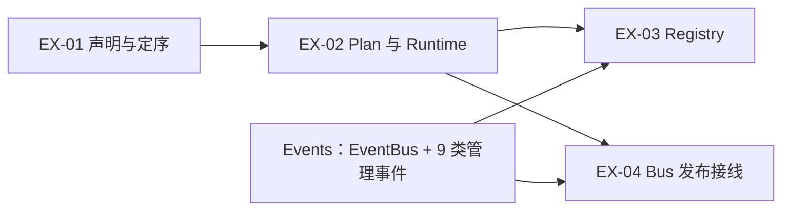

# Extension 特性开发计划

## 1. 计划范围与维护规则

- **目标：** 用 4 个可认领、可验证的工作项交付 Extension 包加载能力。
- **本期工作项：** EX-01～EX-04，共 4 项。
- **负责人：** 当前 4 项统一由李志远负责；未开发项认领后，将本表负责人改为认领人。
- **模块边界：** Extension 负责包声明、安装目录、依赖与顺序、单包计划、candidate 准备、生效记录，以及后续的 Registry 入口与向 EventBus 发布 Handler。注册后的匹配与执行由 Events 负责。
- **与 Events 的分工：**
  - 9 类包管理事件（`package.install` / `uninstall` / `reload` / `parse` / `resolve` / `query`，`extension.plan` / `apply` / `rollback`）的事件类型登记与 Core Handler，在 `openjiuwen/core/events/` 开发，并在 EventBus 初始化时登记。
  - Extension 提供这些 Handler 调用的包管理、计划与 Runtime 能力；本计划不把上述 9 类事件本身列为 EX 工作项。
  - Events 侧进度见 [Events 开发计划](../../../events/docs/designs/events-development-plan.md)。
- **公共契约：** 已落地的控制面以 [S_01](../specs/S_01_package-loading.md) 为唯一来源。Registry 与 Bus 发布的正式契约在对应工作项实现时再建规约。
- **feature 建档：** 仅已完成或开工中的工作项在 `docs/features/` 建档。未开发项的 feature 在认领并开工时再建。
- **维护日期：** 2026-10-21。
- **进度摘要：** 完成 2/4；EX-01、EX-02 已完成；EX-03、EX-04 未开发。

当前状态和证据只在第 4 节维护。

## 2. 实际开发工作项

### EX-01 包声明、安装目录与依赖定序

- **目标与范围：** 读本地目录或 zip 的 manifest，把合法包装进安装目录，并对一批候选做接受/拒绝与包级排序。
- **交付范围：**
  1. `manifest.yaml` 校验与入口路径边界检查。
  2. 安装目录复制与删除；不删除用户来源。
  3. zip 解压防护：拒绝符号链接、路径逃逸，以及超出文件数/体积/路径深度上限的包。
  4. `resolve_install_set`：同批重复 id、已生效同 id、宿主版本、包依赖与环检测。
  5. 无依赖边时的 `SHA-256(UTF-8 id)` 稳定排序。
  6. `EXTENSION_*` 号段（`201000`～`201099`）及本项用到的失败码；`ExtensionFailure` / `OperationError`。
- **不交付：** 单包 Plan、代码加载、Registry、EventBus 发布、9 类管理事件 Handler。
- **开工硬前置：** 无。
- **验收标准：**
  1. EX-01-V-01：合法目录/zip 可读出 manifest；非法声明或越界入口被拒绝。
  2. EX-01-V-02：复制落在 `<install_dir>/<package.id>/<version>/`；用户来源仍在；同版本目录不覆盖。
  3. EX-01-V-03：同批重复 id 整批失败；已生效同 id 不覆盖。
  4. EX-01-V-04：依赖拓扑与 SHA-256 序稳定；环与无关包隔离正确。
  5. EX-01-V-05：含符号链接或超限 zip 被拒绝，且不留下逃逸文件。
- **特性文档：** [F_01](../features/F_01_package-source.md)

### EX-02 单包 Plan、candidate 与生效记录

- **目标与范围：** 为单个包生成有序 Plan，加载入口并收集 candidate，维护生效记录，并给出重载兼容与卸载可否判断。
- **交付范围：**
  1. `Orchestrator.build_plan`（install / reload / uninstall）。
  2. `Runtime.prepare`：新模块名加载、包内相对导入、受限登记（仅 USER / BUILTIN）。
  3. 生效记录、`begin_calls` / `end_calls`、`uninstall_decision`、`evaluate_reload` / `check_reload`。
  4. prepare 失败或 `abort` 时清理本次模块；不删安装副本与用户来源。
- **不交付：** 把 candidate 写入 EventBus；Registry；管理事件 `trigger`。
- **开工硬前置：** EX-01。
- **验收标准：**
  1. EX-02-V-01：Plan 扩展顺序正确；卸载为反序；包内成环被拒绝；install 在已有生效记录时拒绝。
  2. EX-02-V-02：prepare 成功得到 candidate；CORE 与非法登记被拒绝；相对导入可用。
  3. EX-02-V-03：prepare 失败或 `abort` 不留下本次模块。
  4. EX-02-V-04：被依赖或在途调用时卸载判断立即失败；重载时依赖方不兼容则拒绝。
- **特性文档：** [F_02](../features/F_02_plan-runtime.md)

### EX-03 Registry 管理入口

- **目标与范围：** 提供 `Registry.init` / `install` / `uninstall` / `reload`，在方法内显式 `trigger` 对应管理事件并等待结果。
- **交付范围：**
  1. `init`：接收已初始化的 EventBus（其上已由 Events 登记含 9 类管理事件在内的 core 内置事件），再登记 jiuwenswarm 内置事件；不读用户 manifest，不安装扩展，不触发 `ops.build`。
  2. `install` / `uninstall` / `reload`：触发 `package.install` / `package.uninstall` / `package.reload`，交回管理结果。
  3. `init` 之后由调用方传入安装目录路径，触发批量 `package.install`。
- **不交付：** 9 类事件的 Core Handler 本体（归属 Events）；Bus 注册表实现；宿主 `config.yaml` 解析。
- **开工硬前置：** EX-01、EX-02；Events 侧 EventBus 可 `trigger`，且 9 类管理事件已登记。
- **验收标准：**
  1. EX-03-V-01：`init` 只装配，不安装包。
  2. EX-03-V-02：便捷方法触发对应根事件并返回可核对的管理结果。
  3. EX-03-V-03：重复 `init` 或装配失败时的行为符合架构约定。
- **特性文档：** 开工后建立。

### EX-04 candidate 发布与 Runtime–Bus 接线

- **目标与范围：** 在 `extension.apply` / `extension.rollback` 路径上，由 Runtime 完成 candidate 的一次同步发布或丢弃，并向 Bus 传入已核实的包身份。
- **交付范围：**
  1. 整包 Handler 一次同步写入 EventBus；写入前对业务 `trigger` 不可见。
  2. 调用 `register_event_handler(..., package_metadata=...)`，`PackageMetadata` 取自 Plan 上已核实的包信息（含包根）。
  3. 失败时丢掉 candidate，不改已生效注册表；重载时热切换该包 Handler，不先卸载。
  4. 与在途计数的配合接口（供事件层在 `trigger` 进出时调用）。
- **不交付：** 9 类管理事件的编排逻辑（在 Events 的 Core Handler 内）；通用 Bus 匹配与执行引擎。
- **开工硬前置：** EX-02；Events 提供可调用的登记/注销及 `package_metadata` 参数。
- **验收标准：**
  1. EX-04-V-01：成功 apply 后新快照可见整包 Handler；失败无半套 Handler。
  2. EX-04-V-02：登记时带上正确的 `PackageMetadata`。
  3. EX-04-V-03：重载热切换后，旧快照调用仍跑旧代码，新调用用新 Handler。
  4. EX-04-V-04：回滚只清理未发布 candidate。
- **特性文档：** 开工后建立。

## 3. 依赖关系与开发顺序



1. EX-01、EX-02 已完成，控制面可在无 EventBus 的情况下单测。
2. EX-03 与 EX-04 都依赖 Events 的 EventBus 与 9 类管理事件登记；Events 就绪后可并行。
3. 完整安装链路还需 Events 侧 Core Handler 调用本模块 API。

### 不属于本计划的工作

| 工作 | 归属 | 说明 |
| --- | --- | --- |
| 9 类包管理事件类型与 Core Handler | Events | 在 `core/events` 实现，EventBus 初始化时登记 |
| 通用注册表、匹配、执行链、Builder/Ops | Events | 见 Events 开发计划 EV-01～EV-04 |
| 宿主安装目录配置解析 | jiuwenswarm | Extension 只接收调用方传入的路径 |

## 4. 开发计划与进展

| ID / 名称 | 状态 | 负责人 | 硬前置 | 验收状态 | 进展说明 |
| --- | --- | --- | --- | --- | --- |
| EX-01 包声明、安装目录与依赖定序 | 完成 | 李志远 | 无 | EX-01-V-01～05 通过 | [F_01](../features/F_01_package-source.md)；`tests/unit_tests/core/extension/test_package_source.py` |
| EX-02 Plan、candidate 与生效记录 | 完成 | 李志远 | EX-01 | EX-02-V-01～04 通过 | [F_02](../features/F_02_plan-runtime.md)；`tests/unit_tests/core/extension/test_plan_runtime.py` |
| EX-03 Registry 管理入口 | 未开发 | 李志远 | EX-01、EX-02；Events Bus 与 9 类事件 | 未执行 | 认领开工后再建 feature |
| EX-04 candidate 发布与 Bus 接线 | 未开发 | 李志远 | EX-02；Events 登记接口 | 未执行 | 认领开工后再建 feature |

本期进度只统计 EX-01～EX-04。

## 附录 A. 验证命令基线

```text
pytest tests/unit_tests/core/extension/ -q
ruff check openjiuwen/core/extension
git diff --check
```

控制面单测不能代替 Registry / Bus 接线后的联调。

## 附录 B. 变更记录

| 日期 | 版本 | 变更 | 未解决项 |
| --- | --- | --- | --- |
| 2026-10-21 | 1.0 | 建档 EX-01～EX-04；EX-01、EX-02 记为完成；明确 9 类管理事件归属 Events | EX-03、EX-04 待 Events 就绪后开工 |
| 2026-10-21 | 1.1 | 未开发项不预建 feature；补充 zip/符号链接验收；测试按工作项分文件 | EX-03、EX-04 仍未开发 |
