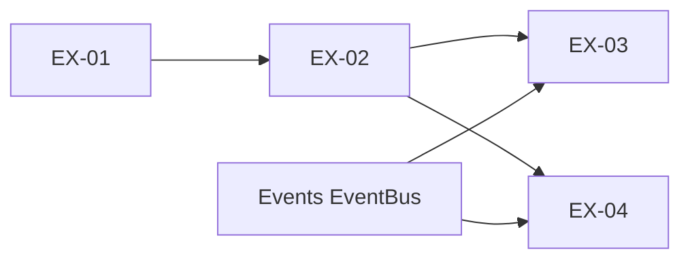

# Extension 特性开发计划

## 1. 计划范围与维护规则

- **目标：** 用 4 个可认领、可验证的工作项交付 Extension 包加载能力。
- **本期工作项：** EX-01～EX-04，共 4 项。
- **负责人：** 李志远。
- **模块边界：** Extension 负责包声明、安装目录、依赖与顺序、单包计划、candidate 准备、生效记录、Registry 入口与向 EventBus 发布 Handler。注册后的匹配与执行由 Events 负责。
- **与 Events 的分工：**
  - EventBus、匹配、执行链、Builder/Ops 由 Events 提供。
  - 九类包管理事件的 **CORE Handler 编排** 在 extension 实现；`events/builtins` 仅登记事件类型并转发，避免 `events` 包加载时反向依赖 extension。
  - 九类事件的 feature / spec 放在 **extension/docs**（Events 开发计划未单列该项工作量）。
- **公共契约：** 控制面 [S_01](../specs/S_01_package-loading.md)；Registry 与 Bus 发布 [S_02](../specs/S_02_registry-and-bus.md)。
- **维护日期：** 2026-10-21。
- **进度摘要：** 完成 4/4。

当前状态和证据只在第 4 节维护。

## 2. 实际开发工作项

### EX-01 包声明、安装目录与依赖定序

- **目标与范围：** 读本地目录或 zip 的 manifest，把合法包装进安装目录，并对一批候选做接受/拒绝与包级排序。
- **交付范围：** manifest 校验、安装目录、zip 防护、`resolve_install_set`、SHA-256 排序、`EXTENSION_*` 错误码。
- **不交付：** Plan、代码加载、Registry、Bus 发布。
- **开工硬前置：** 无。
- **验收标准：** EX-01-V-01～05。
- **特性文档：** [F_01](../features/F_01_package-source.md)

### EX-02 单包 Plan、candidate 与生效记录

- **目标与范围：** 单包 Plan、prepare candidate、生效记录、重载与卸载判断。
- **交付范围：** `Orchestrator.build_plan`、`Runtime.prepare`、生效记录与在途计数。
- **不交付：** 写入 EventBus；Registry。
- **开工硬前置：** EX-01。
- **验收标准：** EX-02-V-01～04。
- **特性文档：** [F_02](../features/F_02_plan-runtime.md)

### EX-03 Registry 管理入口

- **目标与范围：** `Registry.init` / `install` / `uninstall` / `reload`；九类包管理事件登记与编排。
- **交付范围：**
  1. `init`：接收已初始化的 EventBus（其上已有九类管理事件），登记宿主内置事件，然后触发一次 `ops.build`；不安装包。
  2. 便捷方法显式 `trigger` 根事件并交回结果。
  3. builtins 薄封装 + extension 内 Core Handler 编排。
- **不交付：** Bus 注册表实现；宿主配置解析。
- **开工硬前置：** EX-01、EX-02；Events EventBus 可 `trigger`（含 `ops.build` 门禁）。
- **验收标准：** EX-03-V-01～03。
- **特性文档：** [F_03](../features/F_03_registry.md)

### EX-04 candidate 发布与 Runtime–Bus 接线

- **目标与范围：** candidate 同步发布、失败丢弃、重载热切换、`package_metadata` 填入。
- **交付范围：** Runtime `publish` / `replace_published` / `unpublish`；apply/rollback 路径接线。
- **不交付：** 通用匹配与执行引擎。
- **开工硬前置：** EX-02；Events 登记接口含 `package_metadata`。
- **验收标准：** EX-04-V-01～04。
- **特性文档：** [F_04](../features/F_04_bus-wiring.md)

## 3. 依赖关系与开发顺序



EX-01～EX-04 均已完成。安装从 `Registry.init` 开始，随后由调用方触发 `package.install`。

## 4. 开发计划与进展

| ID / 名称 | 状态 | 负责人 | 硬前置 | 验收状态 | 进展说明 |
| --- | --- | --- | --- | --- | --- |
| EX-01 包声明、安装目录与依赖定序 | 完成 | 李志远 | 无 | EX-01-V-01～05 通过 | [F_01](../features/F_01_package-source.md)；`test_package_source.py` |
| EX-02 Plan、candidate 与生效记录 | 完成 | 李志远 | EX-01 | EX-02-V-01～04 通过 | [F_02](../features/F_02_plan-runtime.md)；`test_plan_runtime.py` |
| EX-03 Registry 管理入口 | 完成 | 李志远 | EX-01、EX-02；EventBus | EX-03-V-01～03 通过 | [F_03](../features/F_03_registry.md)；`test_registry.py`、`test_package_events.py` |
| EX-04 candidate 发布与 Bus 接线 | 完成 | 李志远 | EX-02；登记接口 | EX-04-V-01～04 通过 | [F_04](../features/F_04_bus-wiring.md)；`test_bus_wiring.py` |

## 附录 A. 验证命令基线

```text
pytest tests/unit_tests/core/extension/ -q
ruff check openjiuwen/core/extension openjiuwen/core/events/builtins
git diff --check
```

## 附录 B. 变更记录

| 日期 | 版本 | 变更 | 未解决项 |
| --- | --- | --- | --- |
| 2026-10-21 | 1.0 | 建档 EX-01～EX-04 | EX-03、EX-04 未开发 |
| 2026-10-21 | 1.1 | 测试分文件；未开发项不预建 feature | EX-03、EX-04 未开发 |
| 2026-10-21 | 2.0 | EX-03、EX-04 完成；九类事件文档归 extension；新增 S_02 | 无 |

## EX-05 按域启动与共享安装报告

负责人：李志远。状态：完成（Core 模块范围）。最近更新：2026-11-05。

范围与验收：[F_05](../features/F_05_domain-install-report.md)。包含根目录启动、通用域、YAML、并发保护与真实子进程验证。2026-11-05 扩展与事件回归 458 passed、2 skipped，扩展覆盖率 85%，报告模块 84%；命令及场景见 F_05；Gateway 产品接线不在本仓验收范围。

## EX-06 扩展包启用状态

负责人：李志远。状态：完成。最近更新：2026-11-08。

范围与验收：[F_06](../features/F_06_package-enable.md)。包含可选 `enable` 字段、旧受管安装副本默认值补写、启用/禁用编排和单元测试。已执行包加载与包事件测试 60 通过、1 跳过，以及变更文件的 Ruff。产品交互、恢复历史和跨进程恢复入口由宿主仓维护。
