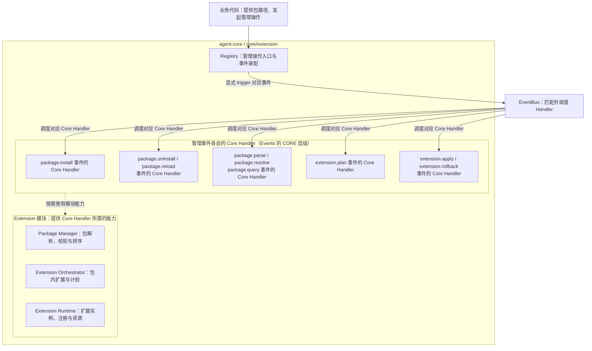

# Extension 扩展包机制设计概览

## 文档状态与阅读说明

| 项 | 说明 |
| --- | --- |
| 类型 | 目标设计草案；尚未完成实现与验收 |
| 最近一次修订日期 | 2026-10-22 |
| 责任人 | Core Extension 模块维护者；与 Events 的协作由双方维护者共同确认 |
| 所属模块 | `agent-core/openjiuwen/core/extension/` |
| 详细设计 | [Extension 详细架构](extension-architecture.md) |
| 协作设计 | [Events 设计概览](../../../events/docs/designs/events-overview.md)、[Events 详细架构](../../../events/docs/designs/events-architecture.md) |
| 编写依据 | [Core 公共规范](../../../AGENTS.md)、[Overview 模板](../../../docs/templates/overview-template.md)及 Events 设计 |
| 待确认问题 | 只操作包内某一个扩展单元时要连带处理哪些依赖，以及管理操作如何并发，见[详细架构第 12 节](extension-architecture.md#12-设计选择与待确认事项) |

本文说明 agent-core 如何加载扩展包、注册事件处理器，以及在安装失败、重载和卸载时如何处理，供开发人员和设计评审人员阅读。文中的“调用方”指使用 agent-core 接口的代码；具体产品的启动方式、配置格式和目录约定不在本文范围内。

本文用 **Extension** 指扩展包管理模块，用“扩展单元”（manifest 中的 extension）指包内可以独立声明和加载的扩展。**Registry** 是拟议的管理入口：它接收已经初始化好的 EventBus（其上已登记 core 内置事件，包括 9 类管理事件及其 Core Handler），在 `init` 时登记 jiuwenswarm 的内置事件，并提供安装、重载和卸载的便捷方法。事件处理器通过 Events 提供的 **EventHandlerOps（简称 Ops）** 使用平台能力。这些名称用于说明设计，目前还没有可直接调用的本模块公共 API。

**Core Handler** 指 Events 中 CORE 层级的默认处理器，每个事件有且只有一个。Extension 模块为这些处理器提供包管理、计划和运行时能力，一个处理器可以使用多个模块。下文将 **Extension Orchestrator** 和 **Extension Runtime** 简称为 Orchestrator 和 Runtime。

第 1 节介绍目标与范围，第 2 节解释核心对象和职责，第 3 节说明工作流程及完成条件，第 4 节说明状态、资源和安全约束，第 5 节介绍现状与后续实现条件。具体机制见详细架构。工作项与进度见 [开发计划](extension-development-plan.md)。已实现能力见 [S_01](../specs/S_01_package-loading.md)、[S_02](../specs/S_02_registry-and-bus.md)、[F_01](../features/F_01_package-source.md)～[F_04](../features/F_04_bus-wiring.md)。

## 1. 目标与范围

### 1.1 定位与目标

Extension 负责把本地扩展包中的处理逻辑注册到 Events 已有的事件类型上，并管理这些注册和包资源的生命周期。它读取包声明、检查依赖、确定加载顺序，再加载代码并完成注册。

包管理请求和需要独立复用的操作统一通过事件执行。业务代码或 Handler 决定何时发起请求，EventBus 只调度对应处理器。读取字段、导入入口、登记 Handler 和清理资源等内部步骤，在所属事件的 Core Handler 内完成，不逐项设置事件。

例如，调用方将企业报告包的本地路径交给 Registry。包内的基础扩展先注册，报告扩展随后注册一个匹配 Bash 工具调用的事件处理器（Handler）。之后，业务入口触发 `tool.call` 事件时，Events 找到匹配的 Handler，报告扩展便可以处理工具的输入和返回结果。

这个过程分为两步：Extension 先完成注册，Events 再在业务调用中选择并执行 Handler。因此，安装成功只说明包已完成注册；扩展是否参与某次工具调用，还取决于业务入口是否触发事件，以及匹配条件是否满足。

本模块要解决的核心问题是：调用方提供包路径后，系统能按依赖顺序加载，知道每条注册属于哪个扩展，并在失败或卸载时撤销注册、清理资源。模块依赖保持为 `core/extension → core/events`。

### 1.2 职责与范围边界

业务代码可以直接使用受控 `trigger`，也可以调用 Registry 的便捷方法；这些方法只是业务入口的封装，在被调用时显式触发对应事件并返回结果。每个管理事件的默认逻辑由对应的 Core Handler 执行，所需能力由 Package Manager、Extension Orchestrator 和 Extension Runtime 提供。一个 Core Handler 可以使用多个模块，例如安装事件需要协作完成包解析与校验、计划生成、扩展加载与注册。具体分工见第 2 节。

EventBus 提供通用事件注册和调用服务，交回处理结果或异常。事件执行、平台能力和会话等公共约定以 Events 文档为准，本模块聚焦包管理事件及其 Core Handler 与模块能力的协作。

调用方提供包来源和安装目录。包来源可以是本地包目录或 zip；安装目录通过 `open_install_dir(install_dir: Path, ...)` 传入。安装目录的选择、配置解析和默认值由调用方负责，Extension 只使用传入的路径。前端和 Gateway 的转发协议也由调用方适配。

### 1.3 当前范围与后续扩展

本期设计面向带 `manifest.yaml` 的本地目录和 zip，支持 `backend` Python 扩展，以及安装、卸载和无中断重载。重载先把新代码装进 candidate，再将该包的全部 Handler 一次写入 EventBus 注册表。之后开始的 `trigger` 读到新注册表；开始得更早的调用继续使用自己的注册表快照。一个包可以包含多个扩展单元，每个扩展单元可以注册多个 Handler。加载时先确定包之间的顺序，再确定每个包内扩展单元的顺序。

批量安装时，如果某个包失败，依赖它的包也失败并写明依赖没有满足，没有依赖关系的包可以继续处理。只操作包内某个扩展单元时，需要一并处理哪些依赖、如何报告结果，仍待确认，目前不能视为已支持任意局部重载。

远程包市场、自动下载依赖、多版本同时生效、前端运行时、进程外执行、恶意代码隔离和跨进程协调不在当前设计范围内。

## 2. 核心模型与职责

### 2.1 总体关系

图中实线表示调用或事件调度，虚线表示 Core Handler 使用模块能力的关系，不表示执行顺序。一个 Core Handler 可以使用多个模块，同一模块也可以支持多个事件的 Core Handler。例如，`package.install` 事件的 Core Handler 使用 Package Manager 解析、校验和排序，使用 Extension Orchestrator 生成计划，再使用 Extension Runtime 加载扩展并完成注册。图中部分节点合并展示职责相近的 Handler，每个事件仍有各自的 Core Handler。

本图只展示管理入口、事件的 Core Handler 与模块的能力关系，不展开子事件调用或 Events 内部机制。一个独立事件可以包含多个内部步骤；哪些需要单独触发、哪些留在 Handler 内，见第 2.4 节。具体协作顺序见[详细架构第 5 节](extension-architecture.md#5-模块协作与处理流程)。

| 参与方 | 主要工作 | 负责确认的结果 |
| --- | --- | --- |
| 调用方与 Core 业务模块 | 提供包路径、可信登记回调和业务事件入口 | 调用方核对管理操作结果，业务模块确认实际业务结果 |
| Registry | 接收已初始化 EventBus（含 9 类管理事件）；`init` 登记 jiuwenswarm 内置；提供 install / uninstall / reload 便捷封装并显式触发对应事件 | 等待并交回管理结果 |
| 管理事件的 Core Handler | 执行对应事件的默认逻辑，按需使用一个或多个模块的能力；涉及另一项独立操作时触发对应事件 | 核对操作结果，决定是否继续后续步骤 |
| Package Manager | 提供来源与声明解析、版本与包依赖检查、包级排序、包信息和自有产物清理能力 | 解析和依赖选择结果明确，文件清理满足所有权及资源释放条件 |
| Extension Orchestrator | 为计划事件提供包内扩展依赖、操作范围与单包计划能力 | 计划中的目标扩展和步骤明确 |
| Extension Runtime | 保存计划的可信关联，为执行与回滚提供加载、注册、等待和资源管理能力，并支持依赖解析、计划及查询核对事实 | 每条注册有归属，计划、执行、清理和残留可核对 |
| EventBus | 接收业务代码或 Handler 的显式事件调用，调度处理器并交回结果 | 不编排下一项包管理或业务操作，内部机制由 Events 文档维护 |

### 2.2 对象及事实权威

理解主流程时，需要区分包声明、加载的实例、注册记录和操作报告。它们分别说明不同阶段的情况，不能只凭其中一项就判断整个操作已经完成。

| 对象或记录 | 表示什么 | 由谁提供或维护 | 判断时需要注意 |
| --- | --- | --- | --- |
| Package / manifest | 包的身份、版本、依赖和扩展入口 | 包根目录的 `manifest.yaml` 提供声明，Package Manager 负责校验 | 文件存在不等于包已生效 |
| 扩展单元（extension） | 包内提供 `create_extension()` 工厂和实例 `register(...)` 方法的加载单元 | Runtime 管理其实例和执行记录 | 实例创建成功不等于所有 Handler 都已注册 |
| Plan | 单个包的本次操作、目标扩展及有序步骤 | Orchestrator 生成，Runtime 保存可信操作关联并核对执行 | 计划生成不等于执行成功，调用方不能自行拼装计划绕过准备步骤 |
| `handler_id` | Events 返回的一条 Handler 注册记录的标识 | Events 维护注册记录，Runtime 记录其所属包、扩展和注册批次 | 已注册不等于某次事件一定匹配或执行了该 Handler |
| 生效记录 | 包、扩展实例、`handler_id` 和待清理资源之间的关系 | Runtime | 注册被移除后，先前开始的调用仍可能使用包资源 |
| Report | 单包 Plan 的执行结果，以及管理请求中各包的成功、失败或跳过原因 | Runtime 提供执行事实，管理 Core Handler 汇总，Registry 交回 | 报告应反映实际注册和清理情况，不能代替这些记录 |

Handler 的包身份使用 Events 的 `PackageMetadata`（`package_id`、`package_version`、`root`）。扩展作者的受限 `register` 不接收该参数；`extension.apply` 在向 EventBus 调用 `register_event_handler(..., package_metadata=...)` 时由 Runtime 填入 Plan 上已核实的包信息。业务 `trigger` 进入该 Handler 时，Ops 按登记时保存的 `PackageMetadata` 提供包上下文。业务输入或 Session metadata 中自行填写的包身份不能作为依据。

### 2.3 贯穿设计的原则

1. **先明确来源，再确定加载顺序。** 先解析目录或 zip，确认每个 `package.id` 对应的包，再检查版本和依赖。同一批里 `package.id` 重复时，整批失败。已经生效的同 ID 再安装，直接失败，不能覆盖。调用方的源码目录和 zip 不被删除。
2. **分别处理三种顺序。** Package Manager 决定包的加载顺序，Orchestrator 决定包内扩展的加载顺序，Events 按层级和注册顺序执行匹配的 Handler。包先加载，并不表示它的 Handler 每次都会先执行或一定执行。没有依赖时，顺序是 SHA-256(UTF-8 id) 的十六进制升序，重启后保持不变。
3. **一个包的 Handler 一起可见。** prepare 只把 Handler 收进 candidate，不写入 EventBus。该包的扩展全部成功后，commit 在一次没有 `await` 的同步更新里，把整套 Handler 写入 Bus 注册表。业务 `trigger` 开始时读取注册表快照，所以要么看见旧的整套，要么看见新的整套。
4. **复用公共事件与能力接口。** Runtime 核实扩展 Handler 的包来源，业务入口提供授权及会话资料；通用事件、Ops 与平台能力访问沿用 Events 约定，不在本模块重复定义。
5. **有调用就拒绝卸载，不等待。** 这个包仍有调用在执行时，卸载失败，注册表和安装目录都保持原样。没有在途调用、也没有别的已生效包依赖它时，才从注册表移除并删除安装目录中的对应版本。重载成功后，已经开始的调用继续用当时的模块；这些调用结束后再丢掉旧模块，重载的返回不等这一步。
6. **按独立操作设置事件。** 安装、解析、依赖解析、计划、执行和回滚经过对应事件。加载、收集 candidate、一次写入注册表，以及丢掉未发布的 candidate，是所属 Core Handler 的内部步骤。不能绕过已经定义的独立事件，直接调用模块把包发布出去。
7. **包流程由业务代码或 Handler 推进。** 所有管理事件都应有明确的业务或 Handler 调用点，EventBus 不根据包状态、返回值或异常自动安排下一项操作。

### 2.4 事件类型与粒度

本期按独立操作设置 9 类目标事件。它们分别承担明确的请求、结果或失败处理责任；不因跨模块、调用辅助函数或更新一次记录就新增事件。这里仅统计 Extension 管理事件，工具等业务事件和 Events 基础事件不在此目录中。

| 事件类别 | 目标事件 | 为什么独立设置 | Core Handler 的模块协作 |
| --- | --- | --- | --- |
| 管理请求 | `package.install`、`package.uninstall`、`package.reload` | 分别交付安装、卸载和重载结果。重载不先卸载；依赖它的包仍接受新版本时，直接切换该包在 Bus 上的 Handler | 通过相应子事件使用 Package Manager、Orchestrator 和 Runtime |
| 包准备 | `package.parse`、`package.resolve` | 包解析返回来源与声明，依赖解析返回版本、依赖和包序；可在导入代码前独立检查，并供管理流程复用 | Package Manager 为主，依赖解析同时读取 Runtime 的生效事实 |
| 计划生成 | `extension.plan` | 先确定单包的目标扩展和有序步骤，再产生加载或清理影响 | Orchestrator 生成计划，Runtime 保存可信关联；卸载时另核对实例和注册归属 |
| 执行与补偿 | `extension.apply`、`extension.rollback` | 分别执行可信 Plan、清理失败安装；补偿可能有残留，需要独立核对和继续处理 | Runtime 为主；自有安装产物的核对与清理由 Package Manager 提供能力 |
| 状态核对 | `package.query` | 超时、取消或失败后独立读取事实，避免重复注册和误删资源 | Package Manager 提供包信息，Runtime 提供执行、生效和清理记录 |

版本检查与包级排序合并在依赖解析事件中，避免以不同的包集合继续执行。加载、创建实例、注册、注销、等待和释放资源分别归计划执行或回滚 Handler 内部；自有文件清理也只有在对应清理条件满足后才执行，不提供任意路径删除事件。

模块依赖包含通过子事件取得的能力，不要求一个 Handler 只使用一个模块，也不允许绕过已有独立事件直接调用其实现。事件的功能、输入结果、依赖和划分理由见[详细架构第 4.1 节](extension-architecture.md#411-包管理事件与-core-handler-职责)，概览不重复定义字段和错误码。

## 3. 关键流程与完成语义

### 3.1 入口与正常链路

从提交本地包路径到扩展参与业务，共有以下六个确认步骤。事件名和接口均用于说明目标设计。

1. **初始化装配。** 进程启动时，EventBus 的初始化登记 core 内置事件，包括 9 类管理事件及其 Core Handler。随后调用一次 `Registry.init`。它只拿到这份已经初始化好的 EventBus，并登记 jiuwenswarm 的内置事件。这一步不读取用户 manifest，不安装扩展。宿主回调返回后，`init` 触发一次 `ops.build`。
2. **启动时批量安装。** `init` 返回后，jiuwenswarm 读出安装目录路径，把该目录下的包目录作为一批路径传给 `package.install`。Extension 只接收这些路径。进程重启后靠这一步重新装上已经放进安装目录的包。
3. **接收安装请求。** `Registry.install` 显式触发 `package.install`。zip 会先解压到临时目录，再进入解析。安装 Handler 负责推进子事件并汇总结果。
4. **解析包和依赖。** 安装 Handler 逐路径触发 `package.parse`，再触发 `package.resolve`。Package Manager 读取声明并排列包序。Runtime 提供已经生效的包、版本和依赖，用来判断新包能不能装。
5. **生成单包计划。** 按包序触发 `extension.plan`。Orchestrator 确定这个包里的扩展顺序、目标和 generation。计划返回时还没有加载代码。
6. **执行并记录结果。** 触发 `extension.apply`。Runtime 加载入口、调用 `register`，把 Handler 收进 candidate。全部成功后，一次写入 Bus 注册表，并在 Runtime 记下生效记录。失败时触发 `extension.rollback`，只丢掉 candidate。
7. **参与真实业务。** 业务入口显式触发工具等业务事件。EventBus 在这次 `trigger` 开始时固定注册表快照。安装成功和业务成功要分开确认。

### 3.2 完成与交付的确认点

“已读取包”“已注册”和“业务调用完成”是不同的结果，分别由对应模块确认。

| 确认点 | 判断依据 | 接下来可以做什么 |
| --- | --- | --- |
| 初始化完成 | Registry 确认管理组件和必需的平台事件、处理器均已准备好 | 受理 `install`；此时不一定有用户包 |
| 包解析完成 | `package.parse` 返回明确包根、格式有效的声明和合法入口信息 | 进入包版本、依赖及顺序判断，此时不能认定可安装 |
| 包依赖确认 | `package.resolve` 返回合法包集合、依赖检查与处理顺序 | 为选定包生成 Plan；运行中条件变化仍需重新核对 |
| 安装成功 | 该包计划内的 Handler 已一次写入 Bus 注册表，Runtime 的生效记录完整，Report 为 SUCCESS | 后续 `trigger` 的新快照可以选中这些 Handler |
| 业务调用结束 | Events 返回整条事件链的合法结果或异常 | 调用方处理结果；涉及外部操作时，还需核对实际执行结果 |
| 卸载完成 | 卸载开始时没有在途调用，反向依赖检查通过，Handler 已从注册表移除，安装目录里的对应版本已删除 | 返回卸载成功。重载不把卸载完成当作前置条件 |

包文件准备好、某个扩展单元注册成功，或者管理事件正常返回，都不能单独证明整包安装成功。管理 Core Handler 核对目标和完成依据，必要时触发 `package.query` 读取实际记录；内部步骤的结果由执行或回滚 Handler 汇总，Registry 只交回事件结果。

### 3.3 控制、失败与重试

解析或依赖解析失败时，不执行相应加载。candidate 还没写入 Bus 就失败时，`extension.apply` 触发 `extension.rollback`，丢掉这次加载的模块和 candidate。已经生效的注册表不变。回滚范围是当前这个包的本次计划。

批量安装时，如果 B 依赖 A，而 A 安装失败，B 的结果是 FAILED，原因是依赖没有满足。与它们没有依赖关系的 C 可以继续处理。报告状态只有 SUCCESS 和 FAILED。`trigger` 仍然可能抛出异常；异常不等于这个包一定没有生效，调用方可以用 `package.query` 读取 Runtime 的生效记录。

`package.reload` 重新读取安装目录中的代码。依赖它的包如果仍接受新版本，就触发 `extension.plan` 和 `extension.apply`，一次换上新 Handler。新版本不被依赖方接受，或者准备失败时，当前注册表保持不变。取消或超时后先查询，再决定是否回滚尚未发布的 candidate。具体处理见[架构第 8 节](extension-architecture.md#8-故障处理与继续执行)。

### 3.4 各事件的处理链路与依赖

上层管理 Handler 负责推进子事件；下层事件负责完成一项明确操作，并交回可核对的结果。安装依次取得候选包、依赖选择、单包 Plan 和执行结果。卸载依据 Runtime 的生效记录检查反向依赖和在途调用，通过后才移除注册并删除安装目录。重载在依赖方仍接受新版本时直接切换该包的 Handler。失败且尚未发布的安装由执行 Handler 请求回滚。查询独立读取事实，由调用方决定后续处理。

| 事件 | 处理链路及主要依赖 | 详细逻辑与时序图 |
| --- | --- | --- |
| `package.install` | 触发解析、依赖解析，再逐包计划和执行；依赖包实际可用后才处理依赖方 | [架构 5.1](extension-architecture.md#51-启动与安装主流程) |
| `package.uninstall` | 触发依赖解析、计划和执行；核对反向依赖及全部清理条件 | [架构 5.2.2](extension-architecture.md#522-卸载与资源释放) |
| `package.reload` | 核对依赖方是否仍接受新版本，再计划和执行；一次替换该包在 Bus 上的 Handler | [架构 5.2.3](extension-architecture.md#523-重载与停止) |
| `package.parse` | 使用 Package Manager 确定包根并检查声明，返回候选包 | [架构 5.4.1](extension-architecture.md#541-packageparse解析单个包) |
| `package.resolve` | 使用 Runtime 的生效事实和 Package Manager 的包依赖能力，返回合法目标与包序 | [架构 5.4.2](extension-architecture.md#542-packageresolve确认包依赖与处理顺序) |
| `extension.plan` | Orchestrator 生成单包 Plan，Runtime 保存与操作、来源及范围的可信关联 | [架构 5.4.3](extension-architecture.md#543-extensionplan生成可信单包计划) |
| `extension.apply` | Runtime 核对并执行可信 Plan；安装失败时触发回滚，卸载时在资源释放后由 Package Manager 清理自有产物 | [架构 5.4.4](extension-architecture.md#544-extensionapply执行安装或卸载计划) |
| `extension.rollback` | 丢掉尚未写入 Bus 的 candidate，并卸载这次加载的模块。不删除调用方的源码目录 | [架构 5.2.1](extension-architecture.md#521-失败登记回滚与可见性) |
| `package.query` | 关联 Package Manager 与 Runtime 的已保存事实，不补跑操作 | [架构 5.4.5](extension-architecture.md#545-packagequery读取包与操作事实) |

“触发子事件”和“使用前序结果”是两种不同的依赖。例如计划必须依据有效的依赖解析结果，但计划 Handler 不因此自动触发解析或执行。所有事件仍由业务代码或 Handler 显式发起；直接请求下层事件也必须核对授权及前置条件。完整依赖关系见[架构第 5.5 节](extension-architecture.md#55-事件之间的依赖与调用约束)。概览保留整体链路，各事件的具体处理和模块交接在架构第 5 节维护。

## 4. 持续状态与关键约束

### 4.1 状态与资源生命周期

包文件和调用方保存的包路径可以在进程退出后保留。Events 注册表、扩展实例、Plan、Report 和生效记录则是进程内状态；本方案尚未设计将这些状态持久保存并在崩溃后恢复的机制。

Runtime 负责扩展实例及注册归属，Package Manager 负责自己创建和拥有的安装产物。调用方提供的源码目录不一定属于安装产物，不能未经所有权确认就递归删除。

建议每个 Registry 管理一个 EventBus 和一套生效记录，同一实例内的安装、重载和卸载操作按顺序协调。业务调用仍按 Events 的规则独立执行。这项建议不提供跨进程互斥，也不要求所有业务调用串行。

### 4.2 恢复与一致性

注册被撤销后，先前已经开始或选中的调用仍可能使用包资源。Runtime 必须通过与 Events、调用方的协作，确认相关调用和能力使用已经结束，再释放资源；这项等待是卸载执行或回滚事件的内部步骤。协作机制尚未实现前，不能开放运行期间的包资源删除。

进程重启后，可以重新传入包路径，解析并登记扩展，但这只能重建注册关系，不能从旧 Handler 中断的位置继续执行。导入模块、创建实例或执行 `register` 时产生的外部影响，需要由扩展作者和调用方核对，注册回滚无法自动补偿。

### 4.3 授权、隔离与资源约束

调用方检查谁有权发起安装、重载和卸载。Runtime 检查包根、入口路径和运行域。扩展的 `register` 只拿到受限入口，可以登记 USER 和 BUILTIN，不能登记 CORE，也不能发起安装、重载或卸载。事件类型和 CORE 由可信代码登记。

必须执行的权限检查应放在业务入口或实际资源访问入口。USER Handler 可以直接返回结果，也可以跳过 BUILTIN，因此不能只依赖 BUILTIN 完成这些检查。

可信包信息和受限 Ops 入口用于约束正常的扩展调用，但扩展代码在进程内运行，不能据此隔离恶意 Python 代码。不同租户需要不同扩展集合时，应使用独立的 Registry / EventBus，或由调用方提供经过确认的隔离方案。

包大小、扩展数量、注册数量、并发量和停止等待时间等限制，需要维护者根据实际负载确定；目前没有经过验证的数值保证。

## 5. 现有基础与落地边界

### 5.1 可复用基础与待建设能力

目前，EX-01～EX-04 均已实现：控制面、Registry、九类管理事件编排与 Bus 发布。

Events 的[目标架构](../../../events/docs/designs/events-architecture.md)提供公共 Bus、匹配与 Ops。九类包管理事件的编排在 extension；`events/builtins` 负责登记转发。通用事件机制由 Events 文档维护。

Core 已有[工具抽象](../../../foundation/tool/base.py)，可作为工具事件接入的基础；仍需将实际工具调用接入事件入口，才能验证扩展是否参与执行。

### 5.2 能力开放条件

不同能力需要满足不同条件。先完成注册和回滚验证，才能开放基本加载；要支持业务调用或在线卸载，还需要补齐对应的执行与资源管理机制。

| 能力范围 | 目标 | 开放前需要验证什么 |
| --- | --- | --- |
| 启动时加载 | 从本地包完成注册，并能追踪每条注册 | 9 类独立事件及其完成依据明确；解析、两级依赖与顺序、受限登记、回滚和报告符合约定，内部步骤不额外拆事件 |
| 真实业务扩展 | 企业报告 Handler 参与 Bash 调用 | 管理与业务事件的触发点明确；扩展注册归属、平台能力接入、实际工具入口和权限符合约定 |
| 在线卸载与重载 | 撤销注册，并安全释放包资源 | 能追踪相关调用和能力使用，依赖保护有效，等待退出及清理失败的处理通过验证 |

这些是能力开放前的验证要求，目前还没有对应的验收记录。验证分工见[架构第 11 节](extension-architecture.md#11-完整场景与验证要求)，具体步骤和实际结果由后续特性方案（feature）维护。

### 5.3 详细设计与实施文档索引

| 文档 | 用途 |
| --- | --- |
| [Extension 详细架构](extension-architecture.md) | 包解析与加载顺序、模块设计、生命周期、故障处理和待确认问题 |
| [Extension 开发计划](extension-development-plan.md) | EX-01～EX-04 工作项、进度及与 Events 的分工 |
| [Events 详细架构](../../../events/docs/designs/events-architecture.md) | 公共事件模型、执行控制、Ops 构建、注册快照和调用退出规则 |
| [Core 公共规范](../../../AGENTS.md) | 模块依赖、文档分工，以及后续规约和验证要求 |

包加载控制面的契约与方案见 [S_01](../specs/S_01_package-loading.md)、[F_01](../features/F_01_package-source.md)、[F_02](../features/F_02_plan-runtime.md)。9 类管理事件的登记与 Core Handler 在 Events 目录开发；Registry 与 Bus 发布见 [开发计划](extension-development-plan.md) EX-03、EX-04。概览保留整体设计说明。
