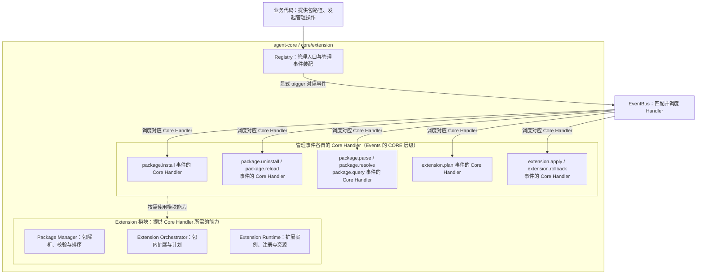

# Extension 扩展包机制设计概览

## 文档状态与阅读说明

| 项 | 说明 |
| --- | --- |
| 类型 | 目标设计草案；尚未完成实现与验收 |
| 最近一次修订日期 | 2026-10-21 |
| 责任人 | Core Extension 模块维护者；与 Events 的协作由双方维护者共同确认 |
| 所属模块 | `agent-core/openjiuwen/core/extension/` |
| 详细设计 | [Extension 详细架构](extension-architecture.md) |
| 协作设计 | [Events 设计概览](../../../events/docs/designs/events-overview.md)、[Events 详细架构](../../../events/docs/designs/events-architecture.md) |
| 编写依据 | [Core 公共规范](../../../AGENTS.md)、[Overview 模板](../../../docs/templates/overview-template.md)及 Events 设计 |
| 待确认问题 | 哈希排序规则、版本冲突、操作报告、整包注册能否同时生效，以及卸载时如何等待运行中的调用结束，见[详细架构第 12 节](extension-architecture.md#12-设计选择与待确认事项) |

本文说明 agent-core 如何加载扩展包、注册事件处理器，以及在安装失败、重载和卸载时如何处理，供开发人员和设计评审人员阅读。文中的“调用方”指使用 agent-core 接口的代码；具体产品的启动方式、配置格式和目录约定不在本文范围内。

本文用 **Extension** 指扩展包管理模块，用“扩展单元”（manifest 中的 extension）指包内可以独立声明和加载的扩展。**Registry** 是拟议的管理入口，初始化时接收调用方准备好的 EventBus，装配 Extension 自己的管理事件，并提供安装、重载和卸载的便捷方法。事件处理器通过 Events 提供的 **EventHandlerOps（简称 Ops）** 使用平台能力。这些名称用于说明设计，目前还没有可直接调用的本模块公共 API。

**Core Handler** 指 Events 中 CORE 层级的默认处理器，每个事件有且只有一个。Extension 模块为这些处理器提供包管理、计划和运行时能力，一个处理器可以使用多个模块。下文将 **Extension Orchestrator** 和 **Extension Runtime** 简称为 Orchestrator 和 Runtime。

第 1 节介绍目标与范围，第 2 节解释核心对象和职责，第 3 节说明工作流程及完成条件，第 4 节说明状态、资源和安全约束，第 5 节介绍现状与后续实现条件。具体机制见详细架构；正式接口规约、实现方案和开发计划尚未建立。

## 1. 目标与范围

### 1.1 定位与目标

Extension 负责把本地扩展包中的处理逻辑注册到 Events 已有的事件类型上，并管理这些注册和包资源的生命周期。它读取包声明、检查依赖、确定加载顺序，再加载代码并完成注册。

包管理请求和需要独立复用的操作统一通过事件执行。业务代码或 Handler 决定何时发起请求，EventBus 只调度对应处理器。读取字段、导入入口、登记 Handler 和清理资源等内部步骤，在所属事件的 Core Handler 内完成，不逐项设置事件。

例如，调用方将企业报告包的本地路径交给 Registry。包内的基础扩展先注册，报告扩展随后注册一个匹配 Bash 工具调用的事件处理器（Handler）。之后，业务入口触发 `tool.call` 事件时，Events 找到匹配的 Handler，报告扩展便可以处理工具的输入和返回结果。

这个过程分为两步：Extension 先完成注册，Events 再在业务调用中选择并执行 Handler。因此，安装成功只说明包已完成注册；扩展是否参与某次工具调用，还取决于业务入口是否触发事件，以及匹配条件是否满足。

本模块要解决的核心问题是：调用方提供包路径后，系统能按依赖顺序加载，知道每条注册属于哪个扩展，并在失败或卸载时撤销注册、清理资源。模块依赖保持为 `core/extension → core/events`。

### 1.2 职责与范围边界

业务代码可以直接使用受控 `trigger`，也可以调用 Registry 的便捷方法；这些方法只是业务入口的封装，在被调用时显式触发对应事件并返回结果。每个管理事件的默认逻辑由对应的 Core Handler 执行，所需能力由 Package Manager、Extension Orchestrator 和 Extension Runtime 提供。一个 Core Handler 可以使用多个模块，例如安装事件需要协作完成包解析与校验、计划生成、扩展加载与注册。具体分工见第 2 节。

EventBus 提供通用事件注册和调用服务，交回处理结果或异常。事件执行、平台能力和会话等公共约定以 Events 文档为准，本模块聚焦包管理事件及其 Core Handler 与模块能力的协作。

调用方准备 EventBus，并在传给 Registry 之前，注册 Core 业务模块提供的业务事件、Core Handler、BUILTIN Handler 和 Ops Build Handler。Registry 只在传入的 EventBus 上补充 Extension 管理事件，不接收或执行业务注册回调。业务服务、包路径和业务准入由调用方协调，实际资源访问的授权检查由所属业务模块负责。Extension 不规定产品默认目录、配置文件格式或进程启动流程。

### 1.3 当前范围与后续扩展

本期设计面向使用 `manifest.yaml` 声明的本地目录包，支持 `backend` Python 扩展，以及安装、卸载和“先卸载、再安装”的重载方式。一个包可以包含多个扩展单元，每个扩展单元可以注册多个 Handler。加载时先确定包之间的顺序，再确定每个包内扩展单元的顺序。

批量安装时，如果某个包失败，依赖它的包会被跳过，没有依赖关系的包可以继续处理。只操作包内某个扩展单元时，需要一并处理哪些依赖、如何报告结果，仍待确认，目前不能视为已支持任意局部重载。

远程包市场、自动下载依赖、多版本并存、前端运行时、进程外执行、恶意代码隔离、跨进程协调和无中断热更新不在当前设计范围内。

## 2. 核心模型与职责

### 2.1 总体关系

图中实线表示调用或事件调度，虚线表示 Core Handler 使用模块能力的关系，不表示执行顺序。一个 Core Handler 可以使用多个模块，同一模块也可以支持多个事件的 Core Handler。例如，`package.install` 事件的 Core Handler 使用 Package Manager 解析、校验和排序，使用 Extension Orchestrator 生成计划，再使用 Extension Runtime 加载扩展并完成注册。图中部分节点合并展示职责相近的 Handler，每个事件仍有各自的 Core Handler。

本图只展示管理入口、事件的 Core Handler 与模块的能力关系，不展开子事件调用或 Events 内部机制。图中的 EventBus 由调用方预先完成业务注册后传入 Registry，管理操作、扩展注册和业务事件调用使用同一实例；初始化顺序见第 3.1 节。一个独立事件可以包含多个内部步骤；哪些需要单独触发、哪些留在 Handler 内，见第 2.4 节。具体协作顺序见[详细架构第 5 节](extension-architecture.md#5-模块协作与处理流程)。

| 参与方 | 主要工作 | 负责确认的结果 |
| --- | --- | --- |
| 调用方与 Core 业务模块 | 准备 EventBus 并注册业务事件与 Handler，再将同一实例传给 Registry；提供包路径与业务入口 | 调用方确认业务依赖就绪、核对管理操作结果，业务模块确认实际业务结果 |
| Registry | 接收 EventBus，装配管理事件及其 Core Handler，提供业务入口的便捷封装，在业务代码调用时显式触发对应事件 | 确认管理组件就绪，等待并交回管理结果 |
| 管理事件的 Core Handler | 执行对应事件的默认逻辑，按需使用一个或多个模块的能力；涉及另一项独立操作时触发对应事件 | 核对操作结果，决定是否继续后续步骤 |
| Package Manager | 提供来源与声明解析、版本与包依赖检查、包级排序、包信息和自有产物清理能力 | 解析和依赖选择结果明确，文件清理满足所有权及资源释放条件 |
| Extension Orchestrator | 为计划事件提供包内扩展依赖、操作范围与单包计划能力 | 计划中的目标扩展和步骤明确 |
| Extension Runtime | 保存计划的可信关联，为执行与回滚提供加载、注册、等待和资源管理能力，并支持依赖解析、计划及查询核对事实 | 每条注册有归属，计划、执行、清理和残留可核对 |
| EventBus | 接收业务代码或 Handler 的显式事件调用，调度处理器并交回结果 | 不编排下一项包管理或业务操作，内部机制由 Events 文档维护 |

### 2.2 对象及事实权威

理解主流程时，需要区分包声明、加载的实例、注册记录和操作报告。它们分别说明不同阶段的情况，不能只凭其中一项就判断整个操作已经完成。

| 对象或记录 | 表示什么 | 由谁提供或维护 | 判断时需要注意 |
| --- | --- | --- | --- |
| Package / manifest | 包的身份、版本、依赖和扩展入口 | 包根目录的 `manifest.yaml` 提供声明，Package Manager 负责校验 | 文件存在不等于包已生效 |
| 扩展单元（extension） | 包内提供 `create_extension()` 工厂和实例 `register(...)` 方法的加载单元 | Runtime 管理其实例和执行记录 | 实例创建成功不等于所有 Handler 都已注册 |
| Plan | 单个包的本次操作、目标扩展及有序步骤 | Orchestrator 生成，Runtime 保存可信操作关联并核对执行 | 计划生成不等于执行成功，调用方不能自行拼装计划绕过准备步骤 |
| `handler_id` | Events 返回的一条 Handler 注册记录的标识 | Events 维护注册记录，Runtime 记录其所属包、扩展和注册批次 | 已注册不等于某次事件一定匹配或执行了该 Handler |
| 生效记录 | 包、扩展实例、`handler_id` 和待清理资源之间的关系 | Runtime | 注册被移除后，先前开始的调用仍可能使用包资源 |
| Report | 单包 Plan 的执行结果，以及管理请求中各包的成功、失败或跳过原因 | Runtime 提供执行事实，管理 Core Handler 汇总，Registry 交回 | 报告应反映实际注册和清理情况，不能代替这些记录 |

Handler 的包信息由 Runtime 核实后关联：名称来自 `package.id`，根路径来自解析后的绝对包根。业务输入或 metadata 中自行填写的包身份不能作为依据。Events 使用的最小包信息模型仍待确定。

### 2.3 贯穿设计的原则

1. **先明确来源，再确定加载顺序。** 先解析本地路径，确认每个 `package.id` 对应的包，再检查版本和依赖。同 ID 冲突如何处理仍待确认，不能假定某个目录或配置来源会自动覆盖另一个。
2. **分别处理三种顺序。** Package Manager 决定包的加载顺序，Orchestrator 决定包内扩展的加载顺序，Events 按层级和注册顺序执行匹配的 Handler。包先加载，并不表示它的 Handler 每次都会先执行或一定执行。
3. **每条注册都要有记录。** Runtime 保存每次注册返回的 `handler_id`，发生失败时按相反顺序注销本批注册。这个回滚只撤销注册，无法撤销代码导入、文件写入或工具执行已经产生的影响。
4. **复用公共事件与能力接口。** Runtime 核实扩展 Handler 的包来源，业务入口提供授权及会话资料；通用事件和平台能力访问沿用 Events 约定，不在本模块重复定义。
5. **确认无人使用后再释放资源。** 注销后，新调用不再选中该 Handler；先前已选中它的调用仍可能继续执行。Runtime 必须等相关调用和能力使用结束后，才能释放包资源。
6. **按独立操作设置事件。** 安装、解析、依赖解析、计划执行和回滚等独立操作经过对应事件；加载、登记、注销、等待和资源清理是所属 Core Handler 的内部步骤。一个 Handler 可以使用多个模块，不能以直接调用内部方法绕过已定义的独立事件。
7. **包流程由业务代码或 Handler 推进。** 所有管理事件都应有明确的业务或 Handler 调用点，EventBus 不根据包状态、返回值或异常自动安排下一项操作。

### 2.4 事件类型与粒度

本期按独立操作设置 9 类目标事件。它们分别承担明确的请求、结果或失败处理责任；不因跨模块、调用辅助函数或更新一次记录就新增事件。这里仅统计 Extension 管理事件，工具等业务事件和 Events 基础事件不在此目录中。

| 事件类别 | 目标事件 | 为什么独立设置 | Core Handler 的模块协作 |
| --- | --- | --- | --- |
| 管理请求 | `package.install`、`package.uninstall`、`package.reload` | 分别交付安装、卸载和重载结果；重载的卸载与安装保持同一操作关联和准入范围 | 通过相应子事件使用 Package Manager、Orchestrator 和 Runtime |
| 包准备 | `package.parse`、`package.resolve` | 包解析返回来源与声明，依赖解析返回版本、依赖和包序；可在导入代码前独立检查，并供管理流程复用 | Package Manager 为主，依赖解析同时读取 Runtime 的生效事实 |
| 计划生成 | `extension.plan` | 先确定单包的目标扩展和有序步骤，再产生加载或清理影响 | Orchestrator 生成计划，Runtime 保存可信关联；卸载时另核对实例和注册归属 |
| 执行与补偿 | `extension.apply`、`extension.rollback` | 分别执行可信 Plan、清理失败安装；补偿可能有残留，需要独立核对和继续处理 | Runtime 为主；自有安装产物的核对与清理由 Package Manager 提供能力 |
| 状态核对 | `package.query` | 超时、取消或失败后独立读取事实，避免重复注册和误删资源 | Package Manager 提供包信息，Runtime 提供执行、生效和清理记录 |

版本检查与包级排序合并在依赖解析事件中，避免以不同的包集合继续执行。加载、创建实例、注册、注销、等待和释放资源分别归计划执行或回滚 Handler 内部；自有文件清理也只有在对应清理条件满足后才执行，不提供任意路径删除事件。

模块依赖包含通过子事件取得的能力，不要求一个 Handler 只使用一个模块，也不允许绕过已有独立事件直接调用其实现。事件的功能、输入结果、依赖和划分理由见[详细架构第 4.1 节](extension-architecture.md#411-包管理事件与-core-handler-职责)，概览不重复定义字段和错误码。

## 3. 关键流程与完成语义

### 3.1 入口与正常链路

从准备事件服务、提交本地包路径到扩展参与业务，共有以下六个确认步骤。事件名和接口均用于说明目标设计。

1. **准备 EventBus 并初始化 Registry。** 调用方先按 Events 约定准备 EventBus 及其基础定义，注册业务事件及 Core Handler、BUILTIN Handler 和 Ops Build Handler，再将同一实例传给 `Registry.init`。Registry 只装配 Extension 管理组件、管理事件及其 Core Handler；此时不读取用户 manifest、不安装扩展，也不触发 `ops.build`。
2. **接收安装请求。** `Registry.install` 显式触发 `package.install`，安装 Handler 负责整个请求的推进和结果汇总。
3. **解析包和依赖。** 安装 Handler 逐路径触发 `package.parse`，再触发 `package.resolve`。Package Manager 完成来源、声明、版本、包依赖与包级排序，Runtime 提供已有生效事实。
4. **生成单包计划。** 按包序触发 `extension.plan`，由 Orchestrator 确定本包内的目标扩展和步骤，Runtime 保存可信操作关联；卸载时另核对当前实例和注册记录。计划返回不代表已加载或已注册。
5. **执行并记录结果。** 触发 `extension.apply`，其 Core Handler 使用 Runtime 按序加载入口、创建实例、调用 `register` 并立即保存每条注册归属。这些是事件内部步骤。失败时显式触发回滚，成功时核对生效记录并生成 Report。
6. **参与真实业务。** 业务入口显式触发工具等业务事件，调用方核对扩展是否实际参与，以及业务结果是否符合预期；安装成功与业务成功分别确认。

业务注册与 Registry 初始化都只建立组件和注册关系。Ops Build Handler 在启动时被注册，运行时才由 Events 调用来收集能力。Registry 初始化不代替调用方确认业务依赖就绪；具体装配示例与失败清理见[架构第 4.1 节](extension-architecture.md#41-registry统一管理入口)。

### 3.2 完成与交付的确认点

“已读取包”“已注册”和“业务调用完成”是不同的结果，分别由对应模块确认。

| 确认点 | 判断依据 | 接下来可以做什么 |
| --- | --- | --- |
| 初始化完成 | Registry 确认传入 EventBus 上的管理组件和管理事件就绪；调用方另行确认业务注册与所需服务就绪 | 调用方确认上述条件后提交 `install`；此时尚未证明用户包已生效 |
| 包解析完成 | `package.parse` 返回明确包根、格式有效的声明和合法入口信息 | 进入包版本、依赖及顺序判断，此时不能认定可安装 |
| 包依赖确认 | `package.resolve` 返回合法包集合、依赖检查与处理顺序 | 为选定包生成 Plan；运行中条件变化仍需重新核对 |
| 安装成功 | Runtime 确认计划内的注册全部完成，生效记录完整，Report 没有失败项 | 将该包列为已生效 |
| 业务调用结束 | Events 返回整条事件链的合法结果或异常 | 调用方处理结果；涉及外部操作时，还需核对实际执行结果 |
| 卸载完成 | 注册已撤销，相关调用和能力使用已结束，本次应清理的资源与文件已清理 | 返回卸载成功；如果正在重载，可以进入安装阶段 |

包文件准备好、某个扩展单元注册成功，或者管理事件正常返回，都不能单独证明整包安装成功。管理 Core Handler 核对目标和完成依据，必要时触发 `package.query` 读取实际记录；内部步骤的结果由执行或回滚 Handler 汇总，Registry 只交回事件结果。

### 3.3 控制、失败与重试

业务注册失败时，调用方停止启动，负责核对并清理本次业务注册；Registry 自身初始化失败时保持未就绪，只清理本次建立的管理注册和自有资源，不清空 EventBus 或删除调用方已有的注册。清理不完整时保留错误和残留，确认清理完成后再重建相关实例，不能盲目重复初始化。

解析或依赖解析失败时，不执行相应加载。安装 Plan 中途失败时，`extension.apply` 的 Core Handler 显式触发 `extension.rollback`，由回滚 Handler 在内部注销本批注册、等待使用结束并释放资源，必要时清理已确认所有权的安装产物。建议以单包安装 Plan 为回滚范围，具体范围和注册可见性由详细设计确认。

批量安装时，如果 B 依赖 A，而 A 安装失败，就跳过 B；与它们没有依赖关系的 C 可以继续处理。如果回滚时注销失败，报告必须说明仍有哪些注册残留，不能宣称已恢复到安装前的状态。调用方根据报告决定后续是否继续。

`package.reload` 的 Core Handler 先触发卸载，完整成功后才触发安装。卸载通过依赖解析、计划和执行事件完成；注销、等待、释放和自有产物清理不再各设事件。卸载失败即停止，新安装失败也不自动恢复旧版。取消或超时后先查询，再选择失败安装回滚或卸载续清理，不能重放已完成步骤。具体处理见[架构第 8 节](extension-architecture.md#8-故障处理与继续执行)。

### 3.4 各事件的处理链路与依赖

上层管理 Handler 负责推进子事件；下层事件负责完成一项明确操作，并交回可核对的结果。安装依次取得候选包、依赖选择、单包 Plan 和执行结果，卸载依据已有运行记录进入依赖解析、计划和执行。重载复用完整的卸载与安装流程，失败安装由执行 Handler 请求回滚。查询独立读取事实，由调用方决定后续处理。

| 事件 | 处理链路及主要依赖 | 详细逻辑与时序图 |
| --- | --- | --- |
| `package.install` | 触发解析、依赖解析，再逐包计划和执行；依赖包实际可用后才处理依赖方 | [架构 5.1](extension-architecture.md#51-启动与安装主流程) |
| `package.uninstall` | 触发依赖解析、计划和执行；核对反向依赖及全部清理条件 | [架构 5.2.2](extension-architecture.md#522-卸载与资源释放) |
| `package.reload` | 先完整卸载，再重新安装；两阶段保持同一根操作关联 | [架构 5.2.3](extension-architecture.md#523-重载与停止) |
| `package.parse` | 使用 Package Manager 确定包根并检查声明，返回候选包 | [架构 5.4.1](extension-architecture.md#541-packageparse解析单个包) |
| `package.resolve` | 使用 Runtime 的生效事实和 Package Manager 的包依赖能力，返回合法目标与包序 | [架构 5.4.2](extension-architecture.md#542-packageresolve确认包依赖与处理顺序) |
| `extension.plan` | Orchestrator 生成单包 Plan，Runtime 保存与操作、来源及范围的可信关联 | [架构 5.4.3](extension-architecture.md#543-extensionplan生成可信单包计划) |
| `extension.apply` | Runtime 核对并执行可信 Plan；安装失败时触发回滚，卸载时在资源释放后由 Package Manager 清理自有产物 | [架构 5.4.4](extension-architecture.md#544-extensionapply执行安装或卸载计划) |
| `extension.rollback` | 依据失败安装记录，使用 Runtime 逆序撤销并释放资源，再使用 Package Manager 清理自有产物 | [架构 5.2.1](extension-architecture.md#521-失败登记回滚与可见性) |
| `package.query` | 关联 Package Manager 与 Runtime 的已保存事实，不补跑操作 | [架构 5.4.5](extension-architecture.md#545-packagequery读取包与操作事实) |

“触发子事件”和“使用前序结果”是两种不同的依赖。例如计划必须依据有效的依赖解析结果，但计划 Handler 不因此自动触发解析或执行。所有事件仍由业务代码或 Handler 显式发起；直接请求下层事件也必须核对授权及前置条件。完整依赖关系见[架构第 5.5 节](extension-architecture.md#55-事件之间的依赖与调用约束)。概览保留整体链路，各事件的具体处理和模块交接在架构第 5 节维护。

## 4. 持续状态与关键约束

### 4.1 状态与资源生命周期

包文件和调用方保存的包路径可以在进程退出后保留。Events 注册表、扩展实例、Plan、Report 和生效记录则是进程内状态；本方案尚未设计将这些状态持久保存并在崩溃后恢复的机制。

Runtime 负责扩展实例及注册归属，Package Manager 负责自己创建和拥有的安装产物。调用方提供的源码目录不一定属于安装产物，不能未经所有权确认就递归删除。

建议调用方为每个运行域准备一个 EventBus，交给对应的一个 Registry 使用，由 Registry 维护一套生效记录。业务调用、管理操作、扩展 USER 注册和 Ops 发起的新事件使用同一实例，多个独立 Registry 共享一个 EventBus 不在本期范围内。EventBus 的创建和最终释放由调用方协调；Registry 不能据此清空调用方已有的业务注册。

同一 Registry 内的安装、重载和卸载操作按顺序协调，业务调用仍按 Events 的规则独立执行。这项建议不提供跨进程互斥，也不要求所有业务调用串行。

### 4.2 恢复与一致性

注册被撤销后，先前已经开始或选中的调用仍可能使用包资源。Runtime 必须通过与 Events、调用方的协作，确认相关调用和能力使用已经结束，再释放资源；这项等待是卸载执行或回滚事件的内部步骤。协作机制尚未实现前，不能开放运行期间的包资源删除。

进程重启后，可以重新传入包路径，解析并登记扩展，但这只能重建注册关系，不能从旧 Handler 中断的位置继续执行。导入模块、创建实例或执行 `register` 时产生的外部影响，需要由扩展作者和调用方核对，注册回滚无法自动补偿。

### 4.3 授权、隔离与资源约束

调用方检查谁有权发起安装、重载和卸载；Runtime 检查包根、入口路径和运行域，并将个人扩展限制在 USER 注册范围内。事件定义和平台处理器的登记由可信代码负责，个人扩展不能据此获得管理权限。

必须执行的权限检查应放在业务入口或实际资源访问入口。USER Handler 可以直接返回结果，也可以跳过 BUILTIN，因此不能只依赖 BUILTIN 完成这些检查。

可信包信息和受限 Ops 入口用于约束正常的扩展调用，但扩展代码在进程内运行，不能据此隔离恶意 Python 代码。不同租户需要不同扩展集合时，应使用独立的 Registry / EventBus，或由调用方提供经过确认的隔离方案。

包大小、扩展数量、注册数量、并发量和停止等待时间等限制，需要维护者根据实际负载确定；目前没有经过验证的数值保证。

## 5. 现有基础与落地边界

### 5.1 可复用基础与待建设能力

目前，`core/extension/` 和 `core/events/` 主要维护设计文档，尚未发现本方案所需的 Registry、Package Manager、Runtime 或 EventBus 的 Python 实现及相应单元测试。本文说明的是待实现方案。

Events 的[目标架构](../../../events/docs/designs/events-architecture.md)提供公共接口和生命周期协作的设计依据。Extension 在其上补充本期 9 类包管理事件及其 Core Handler，实现时需要验证事件边界、可信包关联、结果核对和使用结束确认，通用事件机制由 Events 文档维护。

Core 已有[工具抽象](../../../foundation/tool/base.py)，可作为工具事件接入的基础；仍需将实际工具调用接入事件入口，才能验证扩展是否参与执行。

### 5.2 能力开放条件

不同能力需要满足不同条件。先完成注册和回滚验证，才能开放基本加载；要支持业务调用或在线卸载，还需要补齐对应的执行与资源管理机制。

| 能力范围 | 目标 | 开放前需要验证什么 |
| --- | --- | --- |
| 启动时加载 | 从本地包完成注册，并能追踪每条注册 | 先业务注册、后传入同一 EventBus 初始化 Registry；初始化失败不破坏已有注册；9 类独立事件及其完成依据明确；解析、两级依赖与顺序、受限登记、回滚和报告符合约定，内部步骤不额外拆事件 |
| 真实业务扩展 | 企业报告 Handler 参与 Bash 调用 | 管理与业务事件的触发点明确；扩展注册归属、平台能力接入、实际工具入口和权限符合约定 |
| 在线卸载与重载 | 撤销注册，并安全释放包资源 | 能追踪相关调用和能力使用，依赖保护有效，等待退出及清理失败的处理通过验证 |

这些是能力开放前的验证要求，目前还没有对应的验收记录。验证分工见[架构第 11 节](extension-architecture.md#11-完整场景与验证要求)，具体步骤和实际结果由后续特性方案（feature）维护。

### 5.3 详细设计与实施文档索引

| 文档 | 用途 |
| --- | --- |
| [Extension 详细架构](extension-architecture.md) | 包解析与加载顺序、模块设计、生命周期、故障处理和待确认问题 |
| [Events 详细架构](../../../events/docs/designs/events-architecture.md) | 公共事件模型、执行控制、Ops 构建、注册快照和调用退出规则 |
| [Core 公共规范](../../../AGENTS.md) | 模块依赖、文档分工，以及后续规约和验证要求 |

Extension 的 manifest、生命周期和注册归属规约，以及实现方案和统一开发计划尚未建立，后续由 Extension 与 Events 维护者共同补齐。概览保留整体设计说明，接口契约、实现细节和开发进展分别由对应文档维护。
