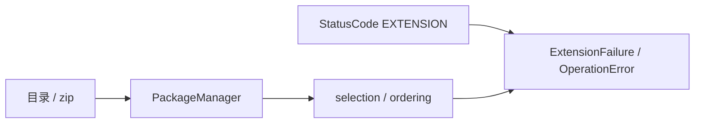

# EX-01 包声明、安装目录与依赖定序

## 1. 元信息

| 项 | 值 |
| --- | --- |
| 建档日期 | 2026-10-19 |
| 最近修订 | 2026-11-10 |
| 范围 | manifest 校验、安装目录、zip 包根识别与防护、受管包目录清理、一批候选的接受与包级排序、`EXTENSION_*` 基础错误码 |
| 方案成熟度 | 已确认。契约以 [S_01](../specs/S_01_package-loading.md) 第 2～3 节为准 |
| 计划条目 | [EX-01](../designs/extension-development-plan.md#ex-01-包声明安装目录与依赖定序) |
| 设计依据 | [概览](../designs/extension-overview.md)、[架构](../designs/extension-architecture.md)、[S_01](../specs/S_01_package-loading.md) |
| 关联 feature | 加载与生效记录见 [F_02](F_02_plan-runtime.md) |
| 验证摘要 | `test_package_source.py` 覆盖 EX-01-V-01～05。详见第 7 节 |

## 2. 背景、目标与范围

扩展包要先通过声明检查、落进安装目录，再决定这一批里谁能装、按什么顺序装。这些步骤不依赖 EventBus。

| 场景 | 目标行为 |
| --- | --- |
| 打开目录或 zip | 合法声明得到 `Manifest`；ZIP 支持包根、版本根和包 ID/版本根；非法字段、越界入口、符号链接、超限或歧义包根失败 |
| 复制到安装目录 | 落在 `<install_dir>/<package.id>/<version>/`；已有同版本不覆盖；用户来源不删；成功卸载清理整个受管 `<package.id>` 目录 |
| 一批候选进入 `resolve_install_set` | 有序可装列表与拒绝原因；同批重复 id 整批失败 |

**包含：** `manifest.py`、`PackageManager`、`selection` / `ordering` / `versions`、本项相关错误码与异常类型。

**不包含：** Plan、prepare、生效记录、Registry、Bus 发布。

## 3. 设计约束

- 安装目录路径由调用方传入，本模块不读 `config.yaml`。
- 包树与 zip 成员不得含符号链接；zip 受 S_01 第 2.3 节上限约束。
- 无依赖边时排序键为 `SHA-256(UTF-8 id)` 的十六进制，不用 Python `hash()`。
- 错误码 scope `EXTENSION`，号段 `201000`～`201099`。
- 同 id 已生效则拒绝覆盖，不静默替换。
- ZIP 只接受根目录、单层版本目录或两层包 ID/版本目录中的唯一包根；不扫描任意深度的 manifest。
- `<install_dir>/<package.id>` 是受管目录。全部版本和资源释放后，删除失败不能报告卸载成功。

## 4. 方案概览

| 决策 | 选择 | 理由 |
| --- | --- | --- |
| D-01 | 已生效同 id 返回 `EXTENSION_PACKAGE_EXISTS` | 不把 install 当成覆盖升级 |
| D-02 | 并列排序用 SHA-256 | 进程重启后顺序不变 |
| D-03 | 错误码进统一 `StatusCode` | 不维护第二套字符串码表 |
| D-04 | zip/目录拒绝符号链接并设解压上限 | 降低路径逃逸与 zip 炸弹风险 |
| D-05 | ZIP 最多兼容两层唯一包装目录 | 支持直接分享已安装副本，同时拒绝猜测多包或任意深度来源 |
| D-06 | 成功卸载递归删除包 ID 目录 | 清理 macOS 元数据等残留，统一跨平台结果 |

## 5. 模块与主路径

| 模块 | 责任 | 不负责 |
| --- | --- | --- |
| `manifest.py` / `PackageManager` | 读声明、定位 ZIP 包根、复制/删除安装副本与包目录、zip 防护 | 生效判断、事件触发 |
| `selection` / `ordering` / `versions` | 一批安装的接受与包序、版本条件 | 写 Bus、生成 Plan |

主路径：

1. `PackageManager(install_dir).open_source` → manifest 与可读根目录。
2. 需要持久化时 `copy_into_store`。
3. 一批 manifest 与当前生效记录、可选宿主版本进入 `resolve_install_set`。

字段、上限与错误码以 S_01 为准，本文不重复完整 Schema。

## 6. 影响面

| 位置 | 内容 |
| --- | --- |
| `common/exception/codes.py` 等 | `EXTENSION` 号段与映射 |
| `extension/manifest.py`、`package_manager.py` | 声明、安装目录、zip 防护 |
| `selection.py`、`ordering.py`、`versions.py` | 依赖与排序 |
| `errors.py` | 异常类型 |

## 7. 验证

| 验收 ID | 覆盖要点 | 测试文件 |
| --- | --- | --- |
| EX-01-V-01 | manifest 合法/非法、入口越界 | `test_package_source.py` |
| EX-01-V-02 | 复制路径、不删来源、不覆盖同版本 | 同上 |
| EX-01-V-03 | 同批重复 id、已生效同 id | 同上 |
| EX-01-V-04 | SHA-256 序、依赖拓扑、环与隔离 | 同上 |
| EX-01-V-05 | 符号链接、zip 逃逸与超限 | 同上 |
| EX-01-V-06 | 已安装副本 ZIP、歧义/过深包装与整包目录清理 | 同上及 `test_package_events.py` |

| 日期 | 命令 | 结果 |
| --- | --- | --- |
| 2026-10-21 | `pytest tests/unit_tests/core/extension/ -q` | 51 passed, 1 skipped（目录符号链接在无权限环境跳过） |

**结论：** 来源校验、安装目录与依赖定序可按 S_01 使用。加载与生效记录见 F_02。
