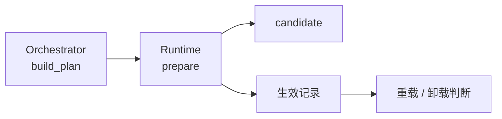

# EX-02 单包 Plan、candidate 与生效记录

## 1. 元信息

| 项 | 值 |
| --- | --- |
| 建档日期 | 2026-10-19 |
| 最近修订 | 2026-10-21 |
| 范围 | 单包 Plan、prepare candidate、生效记录、重载兼容与卸载判断 |
| 方案成熟度 | 已确认。契约以 [S_01](../specs/S_01_package-loading.md) 第 4 节为准 |
| 计划条目 | [EX-02](../designs/extension-development-plan.md#ex-02-单包-plancandidate-与生效记录) |
| 设计依据 | [概览](../designs/extension-overview.md)、[架构](../designs/extension-architecture.md)、[S_01](../specs/S_01_package-loading.md) |
| 关联 feature | 前置 [F_01](F_01_package-source.md)；Bus 发布见开发计划 EX-04 |
| 验证摘要 | `test_plan_runtime.py` 覆盖 EX-02-V-01～04。详见第 7 节 |

## 2. 背景、目标与范围

定序之后，需要为单个包生成执行计划、加载入口并收集 Handler 声明，同时记住哪些包已经生效，以便后续依赖检查和卸载判断。把 Handler 写进 EventBus 属于 EX-04，本项只做到 candidate 与生效事实。

| 场景 | 目标行为 |
| --- | --- |
| `Orchestrator.build_plan` | 得到有序扩展列表与 generation；卸载为反序 |
| `Runtime.prepare(plan)` | 成功则含 USER/BUILTIN 声明的 candidate；失败清理本次模块 |
| 卸载前 `uninstall_decision` | 被依赖或在途调用时给出稳定错误码，不删生效记录 |

**包含：** `orchestrator.py`、`runtime.py`、相关 schema。

**不包含：** Registry、`trigger`、candidate 写入 Bus。

## 3. 设计约束

- 生效记录只由 Runtime 维护；Package Manager 的 `list_installed()` 只反映磁盘副本。
- 每次 prepare 使用新的模块根名，包根内相对导入必须可用。
- 受限登记只接受 `user` / `builtin`；不接收 `PackageMetadata`（发布时由 Runtime 填入，见 EX-04）。
- 卸载遇在途调用立即失败，不等待。

## 4. 方案概览

| 决策 | 选择 | 理由 |
| --- | --- | --- |
| D-01 | 生效记录归 Runtime | 避免「有目录即已生效」 |
| D-02 | prepare 用独立模块根名 | 相对导入可用；旧 callable 仍执行创建时的代码 |
| D-03 | 受限入口不收 `PackageMetadata` | 包身份由 Runtime 在发布时核实填入 |

## 5. 模块与主路径

| 模块 | 责任 | 不负责 |
| --- | --- | --- |
| `orchestrator.py` | 单包有序 Plan 与 generation | 执行 Plan、发布 Handler |
| `runtime.py` | prepare、生效记录、在途计数、卸载可否 | 管理事件 `trigger`、注册表提交 |

主路径：

1. 对可装包：`build_plan` → `prepare`。
2. 发布成功后由上层调用 `record_active`（发布在 EX-04）。
3. 重载前 `evaluate_reload` / `check_reload`；卸载前 `uninstall_decision`，通过后 `drop_active` 并由上层删安装副本。

必须保证（完整条文见 S_01）：

- prepare 失败不留下本次模块。
- 成功 candidate 在发布前对业务 `trigger` 不可见（发布见 EX-04）。
- 卸载遇在途或反向依赖立即失败。

## 6. 影响面

| 位置 | 内容 |
| --- | --- |
| `orchestrator.py`、`schema/` | Plan 生成 |
| `runtime.py` | prepare、生效记录、卸载判断 |

## 7. 验证

| 验收 ID | 覆盖要点 | 测试文件 |
| --- | --- | --- |
| EX-02-V-01 | 扩展序、卸载反序、成环、install 已生效拒绝 | `test_plan_runtime.py` |
| EX-02-V-02 | USER/BUILTIN、CORE 拒绝、相对导入、非法登记 | 同上 |
| EX-02-V-03 | prepare 失败清模块、`abort` | 同上 |
| EX-02-V-04 | 忙/被依赖卸载、重载兼容 | 同上 |

| 日期 | 命令 | 结果 |
| --- | --- | --- |
| 2026-10-21 | `pytest tests/unit_tests/core/extension/ -q` | 51 passed, 1 skipped（与 F_01 同次执行） |

**结论：** Plan、candidate 与生效/卸载判断可按 S_01 使用。写入 EventBus 见开发计划 EX-04。
