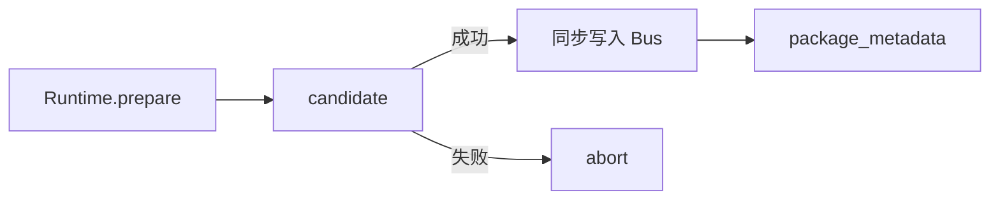

# EX-04 candidate 发布与 Runtime–Bus 接线

## 1. 元信息

| 项 | 值 |
| --- | --- |
| 建档日期 | 2026-10-21 |
| 最近修订 | 2026-10-21 |
| 范围 | candidate 一次写入 EventBus、失败丢弃、重载热切换、包身份传入登记接口 |
| 方案成熟度 | 已确认。契约见 [S_02](../specs/S_02_registry-and-bus.md) |
| 计划条目 | [EX-04](../designs/extension-development-plan.md#ex-04-candidate-发布与-runtimebus-接线) |
| 设计依据 | [架构](../designs/extension-architecture.md) 第 4.4、5.2 节；[S_01](../specs/S_01_package-loading.md) 第 4.2 节 |
| 关联 feature | prepare 见 [F_02](F_02_plan-runtime.md)；Registry 见 [F_03](F_03_registry.md) |
| 验证摘要 | 2026-10-21：`test_bus_wiring.py` 9 passed；全量 extension 82 passed, 1 skipped。详见第 7 节 |

## 2. 背景、目标与范围

EX-02 已能 prepare 出 candidate。本项由 Runtime 在 apply 成功时把整包 Handler 一次写入 EventBus，失败时丢掉 candidate；重载时热切换该包 Handler。

| 场景 | 目标行为 |
| --- | --- |
| 安装 apply 成功 | 整包 Handler 同步写入 Bus；`record_active` |
| 安装 apply 失败 | 丢掉 candidate；Bus 上无半套 Handler |
| 重载 | 新 candidate 替换该包旧 Handler；旧快照调用仍跑旧代码 |
| 卸载 apply | 无在途且无反向依赖时从 Bus 移除该包 Handler |

**包含：** Runtime 发布/替换/移除；`register_event_handler(..., package_metadata=...)`。

**不包含：** 事件匹配与执行引擎（Events）；Registry 便捷方法（F_03）。

## 3. 设计约束

- prepare 只进 candidate；全部成功后同步写入，中间无 `await`。
- 受限 `register` 仍不接收 `PackageMetadata`；发布时由 Runtime 从 Plan 填入。
- 有在途调用时卸载立即 `EXTENSION_PACKAGE_BUSY`。
- Events 已提供带 `package_metadata` 的登记接口，本项直接调用。

## 4. 方案概览

| 决策 | 选择 | 理由 |
| --- | --- | --- |
| D-01 | 逐条同步 `register_event_handler`，失败则回滚已登记 | Bus 无批量原子 API；同步调用仍满足“一次可见” |
| D-02 | Runtime 持有 `package_id → handler_ids` | 卸载/重载时精确注销 |
| D-03 | 重载先登记新再注销旧（同包） | 缩小窗口；失败则清掉新登记，保留旧 |

## 5. 模块与主路径

| 模块 | 责任 |
| --- | --- |
| `runtime.py` | `publish` / `replace_published` / `unpublish` / `abort` |
| `extension.apply` Handler | 调用上述接口并生成 Report |

## 6. 影响面

| 位置 | 内容 |
| --- | --- |
| `runtime.py` | 发布与按包替换/移除 |
| `management/` | apply / rollback 调用发布接口 |
| `test_bus_wiring.py` | Fake/真实 EventBus 上的半套不可见、热切换、回滚 |

## 7. 验证

| 验收 ID | 覆盖要点 | 测试文件 |
| --- | --- | --- |
| EX-04-V-01 | 成功可见整包；失败无半套 | `test_bus_wiring.py` |
| EX-04-V-02 | 登记带正确 `PackageMetadata` | `test_bus_wiring.py` |
| EX-04-V-03 | 重载后旧快照旧代码、新调用新 Handler | `test_bus_wiring.py`、`test_package_events.py` |
| EX-04-V-04 | 回滚只清理未发布 candidate | `test_bus_wiring.py` |

| 日期 | 命令 | 结果 |
| --- | --- | --- |
| 2026-10-21 | `pytest tests/unit_tests/core/extension/ -q` | 82 passed, 1 skipped |
