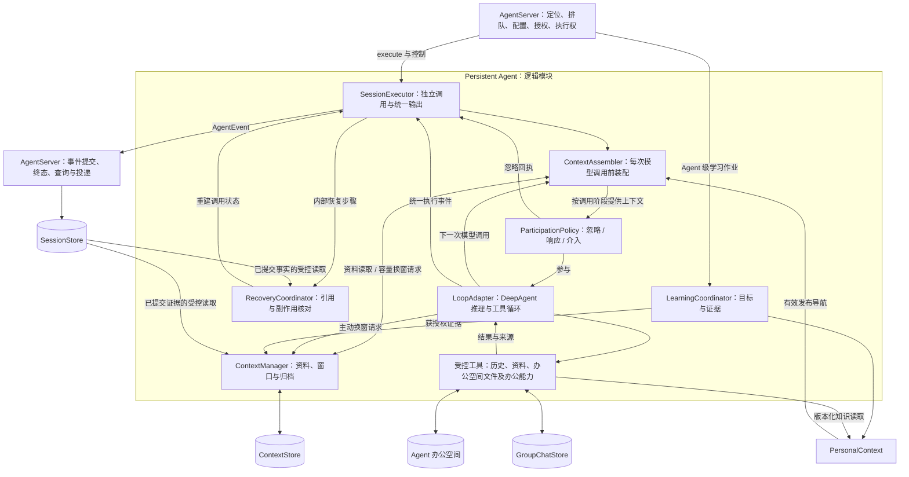
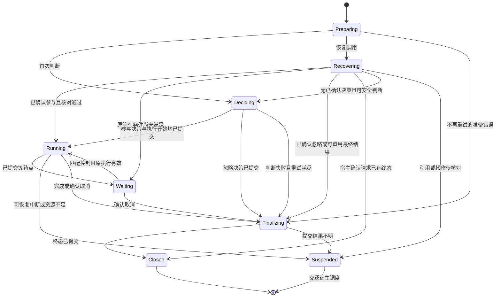
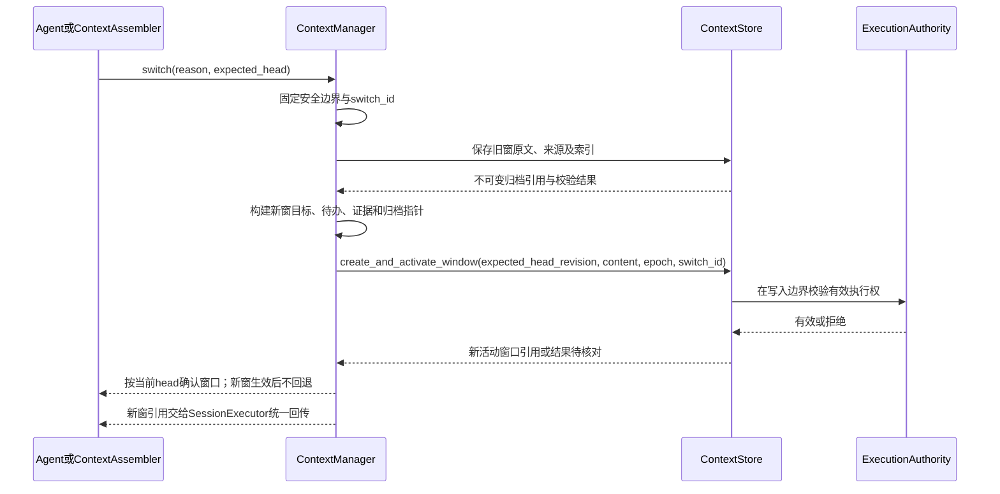
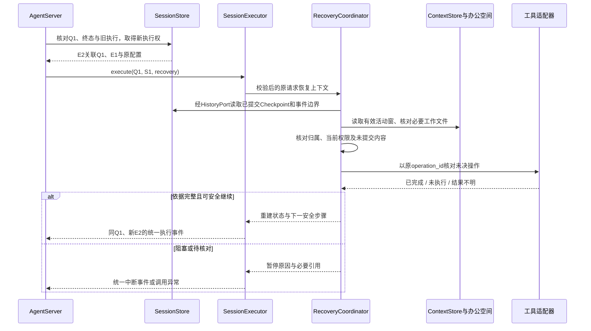
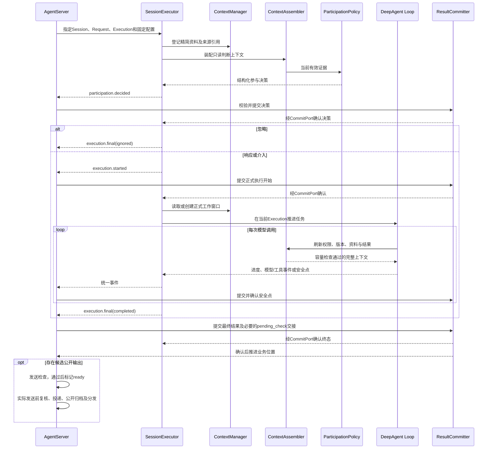

# Persistent Agent 详细架构设计

| 项 | 内容 |
| --- | --- |
| 文档类型 | 目标架构设计草案，尚非已实现接口或已生效规约 |
| 最近一次修订日期 | 2026-09-24 |
| 责任人 | henry hu |
| 所属模块 | `openjiuwen.harness.persistent_agent` |
| 配套文档 | [Persistent Agent 设计概览](persistent-agent-overview.md)、[文档归档约定](../AGENTS.md) |

本文展开[设计概览](persistent-agent-overview.md)确定的目标、职责边界和关键原则，沿用 AgentTeam 文档的“架构总览、模块结构、核心对象、状态机、事件、数据、执行流程、扩展点与设计决策”组织方式，细化 Persistent Agent 的模块契约与故障边界。概览不另立一套协议；模块、字段、步骤和故障分支以本文为准。Team 的角色、跨 Session 团队迁移、消息 Topic、动态表结构不直接复用到本方案。

**实现状态：当前 `persistent_agent/` 只有设计文档。** 下文的新类型、文件、方法、事件名和逻辑记录均为拟议设计，不可直接 import 或调用；已有基础会单独说明。逻辑记录不要求一记录一张数据库表，逻辑模块也不要求独立部署。本文不修改 DeepAgent、PersonalContext 或 JiuwenMate 已有公共 API。

阅读顺序：第 1～4 节定义目标、边界与状态归属；第 5～8 节定义调用、控制与提交协议；第 9～14 节展开上下文、办公空间、学习和恢复；第 15～20 节给出完整场景、集成约束和验收依据。全文中的“提交”须带明确对象：业务事实由 SessionStore 确认，活动窗口由 ContextStore 指针确认，工作文件由办公空间保存，PersonalContext 知识由其发布指针确认，投递由服务端记录及渠道回执确认。工作文件存在或被修改，不等于业务进度已提交。

## 1. 概述与需求落点

Persistent Agent 在 DeepAgent 的推理、规划和受控工具能力之上，提供指定 Session 内的连续执行、上下文长程管理、办公空间文件读写和中断后的现场重建。同一业务 Agent 的身份与办公空间文件可以长期存在；一个活动运行实例仅处理一个 Session，并行的 Session 使用不同实例。

核心关系为 **Agent → Session → Request → Execution**。Agent 代表长期身份；Session 保存隔离的会话与工作状态；Request 是一次已可靠接收的业务输入；Execution 是该请求的一次实际执行登记。Window 是上下文容器，Checkpoint 是已提交恢复依据，两者都不构成新的业务任务。

| 需求 | 架构落点 | 验收边界 |
| --- | --- | --- |
| 多入口使用同一数字同事 | Agent 身份与会话范围分离 | Web 私聊、原生群、飞书群及定时任务使用独立 Session |
| 自主判断 | ParticipationPolicy + SessionExecutor | 人类与 Agent 公开消息同流程；@ 不强制响应；忽略保留私有判断和用量 |
| 连续办公 | ContextAssembler + ContextManager | 换窗不改变 Session、Request、Execution，也不删除群公开历史 |
| 工作文件复用 | Agent 办公空间 + 现有 Workspace 文件工具 | 新会话按当前权限直接读写可访问文件，不继承来源会话的待办与私有上下文 |
| 主动学习 | LearningCoordinator + PersonalContext 适配 | Agent 级独立作业；知识缺口和高优领域均可成为目标 |
| 执行恢复 | RecoveryCoordinator + CheckpointBuilder | 以已提交事实及工具回执恢复，投递失败不重跑任务 |
| 启停 | 宿主控制 + 执行安全点 | 停止不解绑、不退群；再次启动不自动补答、补跑 |
| 私聊管理与办公室 | AgentServer 使用结构化事件建立管理投影 | 日报、任务、Token、产物可追溯；决定忽略不进入正式任务看板 |

本模块不实现渠道 SDK、配置发布管理、分布式排队、租约调度、群内模型调用额度管理、管理查询、定时计划管理和办公室页面；其中可信调用、执行权、预算准入与提交确认是必需的宿主能力，通过端口提供。模型参数训练、Team 整体入群、群 Leader 和本地智能体接入属于后续扩展，不作为基础执行闭环的前提。

## 2. 架构总览与责任边界

下图展示一次已指定 Session 调用涉及的模块，以及独立的 Agent 级学习入口。若同一业务 Agent 的其他 Session 同时运行，各调用分别创建执行实例；可共享已授权的持久化资料和只读依赖，不共享可变执行状态。



| 模块 | 负责 | 不承担 |
| --- | --- | --- |
| AgentServer | 可信身份、会话定位与顺序、执行权、配置快照、资源配额、控制和恢复调度、业务提交、投递、管理查询与定时计划 | 不直接修改 Persistent Agent 的模型消息序列 |
| SessionExecutor | 校验调用、创建调用私有对象、组织判断和执行、统一事件出口、清理运行资源 | 不选取下一个请求，不确认业务终态，不建立第二套持久化事件日志 |
| ContextAssembler | 从有效资料、状态、导航和工具结果组织一次模型输入，检查完整装配大小 | 不归档、不分配各类内容配额、不按 Token 配额静默裁剪内容 |
| ContextManager | 资料登记、窗口原文与索引、受控检索、换窗的实际保存与指针更新 | 不决定何时主动换窗，不维护请求队列或权威执行日志 |
| LoopAdapter | 把一次私有 DeepAgent 调用接入上下文、控制、工具与事件协议 | 不让 DeepAgent 自行切换到其他业务 Session |
| Workspace 文件工具 | 在当前 Agent 与调用授权范围内直接读写办公空间；文件写入按工具副作用协议核对 | 不提供办公资产发布 API，不以目录名称授予私有历史访问权 |
| RecoveryCoordinator | 验证已提交恢复引用，核对工具效果，构建继续执行状态 | 不登记恢复 Execution，不恢复旧线程或模型隐藏推理 |
| LearningCoordinator | 按 Agent 分析授权证据、识别目标、跟踪学习反馈 | 不调度业务会话，不实现采集 Provider，不更改工具权限 |
| PersonalContext | 来源发现、采集处理、来源元数据、游标与知识发布 | 不保存 Session 的业务执行状态 |

依赖方向：执行器依赖内部组件与宿主端口；组件依赖协议而非 `jiuwenswarm` 类；服务端实现端口并注入。`agent-core` 不反向 import `jiuwenswarm`。图中跨存储交互不暗示存在统一事务。

SessionExecutor 是新执行与恢复执行的唯一业务入口。上图展示依赖与数据流，不意味着每轮装配都重新做参与判断：首次决策后直接服务当前 Loop，恢复仅在不存在已提交决策且可安全重试时重新判断。Agent 级学习使用独立作业入口，不调用业务 Session 的 `execute`。

## 3. 模块结构与现有基础

### 3.1 建议目录

下列为建议落地结构，**除 `docs/` 外均待实现**。优先按职责组织，不为每种业务消息建立子类。

```text
persistent_agent/
├── __init__.py                  # 审定后导出最小公开表面
├── factory.py                   # 配置、端口和 DeepAgent 构造器装配
├── agent.py                     # PersistentAgent 门面；仅保留只读依赖
├── schema/
│   ├── config.py                # PersistentAgentConfig
│   ├── execution.py             # ExecutionContext / InvocationState / RecoveryInput
│   ├── events.py                # AgentEvent / Result / Error
│   ├── context.py               # EvidenceRef / Window / ContextSnapshot
│   ├── workspace.py             # 工作文件引用与读取时状态
│   └── learning.py              # LearningGoal / LearningJobContext
├── ports.py                     # 宿主服务协议；存储协议见 context/store.py
├── execution/
│   ├── executor.py              # SessionExecutor
│   ├── loop_adapter.py          # 组合 DeepAgent
│   ├── participation.py         # 结构化参与判断
│   ├── event_emitter.py          # 调用内编号、有界事件流与确认
│   ├── checkpoint.py            # 安全点快照与引用核验
│   └── recovery.py              # 已提交事实和外部回执核对
├── context/
│   ├── assembler.py             # 阶段化装配与容量检查
│   ├── manager.py               # 资料快照及归档操作
│   ├── window.py                # 换窗协议与活动指针
│   ├── retrieval.py             # 索引查询、原文回查与事件关联
│   └── store.py                 # ContextStore 协议与记录
├── workspace/access.py          # 复用 Harness Workspace 的调用范围与文件工具适配
├── learning/coordinator.py      # 学习目标识别与结果跟踪
├── rails/                      # 模型/工具安全点的适配，不复制基础 Rail
├── tools/                      # 历史检索、资料读取与办公空间文件工具适配
└── docs/                       # designs / specs / features
```

### 3.2 复用与缺口

| 现有基础 | 可复用部分 | 需补齐的适配 |
| --- | --- | --- |
| [DeepAgent](../../../deep_agent.py)、[factory](../../../factory.py) | 模型与工具循环、交互、状态序列化 | 调用级实例隔离；模型前完整装配；事件和受控恢复 |
| `DeepAgent.save_state/load_state` | 向 Session 写入和读取 DeepAgentState | 不等于跨 Store 原子提交或持久化完成；增加 Checkpoint 引用确认 |
| [任务循环规约](../../../docs/specs/S_03_task-loop.md) | 执行中控制与单轮推进基础 | 宿主负责普通业务请求的 FIFO；不能继承其他场景的最新输入优先策略 |
| [PersonalContextRail](../../../rails/personal_context.py) | 模型前检查使用开关、添加根导航附件，模型后与调用后清理 | 授权隔离、不可变发布版本选择、失效依赖传播及单一注入点 |
| [PersonalContext](../../../personal_context/personal_context.py) | 采集、处理与知识组织基础 | 与服务端共同落实版本发布、来源关联及多主体访问契约 |
| [Workspace](../../../workspace/workspace.py)、[权限规约](../../../docs/specs/S_08_security-engine.md) | 工作路径与工具执行安全基础 | Agent / Session / 主体资源交集和子进程隔离，不能仅依赖共享根路径 |

任务执行和普通流式结果优先复用 DeepAgent 的 `invoke`/`stream`、任务循环及工具调用。`LoopAdapter` 只接入指定 Session 的上下文、控制和受控工具，`SessionExecutor` 将已有执行输出与本模块新增的判断、确认和终态要求映射到统一事件流；不另写一套模型与工具循环。DeepAgent 的流式片段本身不充当已提交业务事件，稳定事件编号与提交确认仍由本模块适配。

当前 DeepAgent 存在 `_bound_session_id`、`_loop_session`、交互与控制状态，因此采用**每个活动调用一个独立运行实例，实例只绑定当前 Session**。AgentServer 的 AgentManager 负责决定实例创建时机、为并行 Session 分配不同实例和管理生命周期；Persistent Agent 提供构造入口，并在实例内部校验 Session 归属、隔离可变状态和限定资源清理范围。AgentManager 只缓存只读定义、构造依赖和经验证线程安全的客户端，不把同一个活动 Persistent Agent 或 DeepAgent 实例交给第二个 Session。若以后复用已结束调用的实例，须先解除 Session、Rail 附件、工具上下文和取消令牌绑定并完成隔离验证；当前阶段按新建实例落地。

独立实例还必须隔离资源注册。`Runner.resource_mgr` 为进程级共享状态；现有 DeepAgent 支持以 `tool_owner_id` 区分有状态工具的归属。构造时保持业务 Card 身份稳定，为每个活动运行实例分配独立的 `tool_owner_id`，并将清理操作限定到该归属；否则相同 Agent 的工具实例可能相互覆盖。Rail、工具包装器及带凭证的客户端也不得作为可变对象跨调用共享。资源句柄不可直接写入 Checkpoint。

构造仍经 `create_deep_agent`，新增 Persistent Agent 配置走独立 Config 组合；不绕过 [S_01 构造规约](../../../docs/specs/S_01_public-api-and-construction.md)直接装配 DeepAgent 私有成员。

## 4. 核心对象、身份与不变量

### 4.1 归属层次

| 对象 | 关键关联 | 保存位置与有效性 |
| --- | --- | --- |
| Agent | `namespace_id, agent_id, config_version` | 身份和配置由宿主管理；办公空间保存工作文件 |
| Session | `agent_id, session_id, source_scope` | 宿主保存稳定会话键；ContextStore 保存私有窗口 |
| Request | `session_id, request_id, source_ref, config_version` | SessionStore 权威；首次执行固定配置与启动权限上限 |
| Execution | `request_id, execution_id, previous_execution_id, epoch` | 宿主登记实际运行及执行代次；控制与恢复关联不得覆盖原请求 |
| Window | `session_id, window_id, window_revision, event_refs` | ContextStore 保存不可变内容版本及唯一活动指针；head_revision 单独表示指针修订 |
| Checkpoint | `checkpoint_id, request_id, execution_id, applied_request_event_seq` | 正文先保存；SessionStore 已提交引用决定能否用于恢复 |
| Operation | `operation_id, request_id, target_ref, args_hash` | SessionStore 的操作意图与回执；跨恢复 Execution 保留同一逻辑操作标识 |
| WorkFileRef | `workspace_scope, relative_path, observed_hash, source_refs` | 定位并核对当时读取的工作文件；当前文件状态仍须重新读取，引用本身不是授权 |

`namespace_id` 表示可信租户或团队命名空间，具体字段映射由宿主确定。每次查询、缓存命中和写入必须校验完整归属，不允许仅凭 `session_id`、文件路径或消息显示名授予访问权。

### 4.2 不变量

1. 同 Session 同时只有一个有效写入者；旧执行者不能提交进度、更新活动窗口或发起新文件写入。在途文件写入仍按操作回执核对。
2. 跨 Session 的消息、工具状态、等待交互、取消信号、Checkpoint 和未完成工作隔离。
3. Request 配置固定；有效权限不超过启动上限，当前撤权立即收紧可用范围；新增授权不扩大本请求的能力上限。
4. 事件发出、流结束、文件存在与模型完成均不等于请求终态已提交。
5. Window 切换不推进业务处理位置；Checkpoint 提交不替代 ContextStore 活动指针。
6. 非幂等外部操作结果不明时先核对，不因重启重新生成操作标识执行一次。
7. 同 Agent 的 Session 可按当前权限直接使用办公空间文件；会话私有消息、待办、Checkpoint 和轨迹不因同用空间而共享。
8. 摘要、导航与索引保留证据引用，不能替代原文，也不能绕过当前撤权。
9. 公开输出仅来自已提交且允许发送的内容；私有判断和工具轨迹不随群消息传播。

### 4.3 配置、知识与授权的生效时间

| 变化 | 当前 Request | 下一 Request |
| --- | --- | --- |
| 人设、模型、工具、Skill、Plugin 发布新版本 | 保持原快照；恢复亦然 | 取得执行权后固定当时版本 |
| PersonalContext 发布知识或来源关联更新 | 下一次模型调用前刷新；受原启动上限限制 | 使用有效版本及本请求权限 |
| 办公空间文件变化 | 下一次装配重新读取必要文件及其当前状态，使依赖旧内容的结论待核验；精确历史证据引用保留 | 按当前工作空间权限读取文件 |
| 资源撤权、Agent 停止、群成员移除 | 立即阻止后续依赖操作，在安全点收敛；发送前复核 | 拒绝不再获准的调用 |
| 增加授权 | 不扩大已固定的启动上限 | 新请求重新计算权限 |

### 4.4 状态事实的权威来源

| 状态 | 唯一权威来源 | 其他位置的记录用途 |
| --- | --- | --- |
| 请求顺序、正式执行、终态、已提交用量与操作事实 | SessionStore | 内存注册表用于定位；ContextStore 仅引用，不据此覆盖业务状态 |
| 当前活动窗口及内容版本 | ContextStore 的 SessionContextHead | Checkpoint 保存精确引用用于定位，不能充当第二个活动指针 |
| 办公空间文件内容 | 当前工作空间中的文件 | ContextStore 和 Checkpoint 只保留必要引用及当时状态；文件内容不证明业务任务完成 |
| 上下文知识发布版本、来源和采集游标 | PersonalContext 及其发布适配 | 业务记录保存使用版本和证据，不复制形成第二套知识库 |
| 发送检查、投递意图与平台回执 | 服务端投递记录 | Agent 结果只是候选输出；模型生成文字不证明已送达 |

“事实已提交”表示系统已可靠记录该断言及依据，不保证断言在业务上一定正确。来自模型的结论仍须按来源校验，工具回执也须核验目标与操作关联。

### 4.5 来源身份与输入重放

Session 的稳定键由宿主按入口类型、渠道、来源范围、Agent 和必要主体身份确定；一个群中的不同 Agent 使用不同 Session，私聊与同 Agent 的群工作也不合并。定时计划使用该 Agent 的专用 Session，计划触发是新 Request，而不是对上一任务的隐式恢复。具体键格式属于 JiuwenMate，但执行器必须能核验传入 `session_id` 与 `source_scope` 的归属一致。

宿主先可靠保存原始输入及平台来源标识，再分配 `request_id`。平台回调重试、Bot 自发消息回执和服务端重放须按稳定来源关联去重；同一来源标识若正文或附件摘要不同，报告冲突或显式记录修订，不能静默覆盖已固定的 Request。接收顺序和普通队列位置以宿主已提交记录为准，不用平台时间戳、网络到达顺序或模型读到的群历史重排。

| 输入变化 | Request 与执行语义 |
| --- | --- |
| 相同平台事件重复到达 | 定位已接收 Request，返回已知接收或处理状态；不新建并发 Execution |
| 原消息被编辑、撤回或附件访问撤销 | 保留原输入标识及修订关系；执行安全点重新核对继续和发送条件，失效内容不能继续使用 |
| 新消息明确匹配当前审批或补充交互 | 宿主鉴权、去重并持久化为控制；不越过原 Request 的普通队列位置 |
| 新消息不匹配当前交互 | 作为新 Request 排队；即使出现在近期公开背景中，也不能成为当前 Request 的新指令 |
| 定时任务重复触发 | 按计划运行标识去重；错过的触发由宿主策略处置，不由执行器补造任务 |

输入正文、附件和公开群材料必须保留来源、版本、可见范围与完整性。发送者显示名、@ 文本及模型从内容中读到的身份不能取代宿主解析的稳定主体与授权；无法证明来源关联的请求在模型或工具调用前拒绝。

## 5. 调用 API 与宿主端口

### 5.1 逻辑公开表面

```text
create_persistent_agent(config, ports, deep_agent_factory) -> PersistentAgent
PersistentAgent.execute(input, session_id, execution_context)
    -> AsyncIterator[AgentEvent]
```

以上为拟议入口，最终导出需在实现时审定。`input` 是 Request 的内容值，不是新的持久化输入对象；恢复仍调用同一 `execute`，由 `execution_context.recovery` 区分。管理启停、创建 Session、队列选取和投递重试没有 Agent 侧公开 API。

| ExecutionContext 部分 | 拟议字段或能力 | 校验要求 |
| --- | --- | --- |
| 关联 | `namespace_id, agent_id, session_id, request_id, execution_id` | 与可信 input 来源和 Session 元数据一致 |
| 配置 | `config_version, config_fingerprint, capability_snapshot` | 不可变，完整匹配运行对象；原版本缺失不得降级到最新版 |
| 权限 | `principal_ref, startup_scope, source_scope, policy_revision` | 由宿主生成，凭证与授权对象不进入模型输入 |
| 执行权 | `epoch, authority_handle` | 每个安全点及受控写入检查有效代次与租约 |
| 资料 | `initial_materials, source_cursor, completeness` | 保留范围、时间、版本和不完整标记 |
| 运行 | `budget, control, commit, history, resource_access` | 受控端口；不可由模型更换实现 |
| 恢复 | `checkpoint_ref, previous_execution_id, recovery_command_id` | 关联原 Request，读取有效窗口并核对已提交事实 |

ExecutionContext 是本次调用的不可变能力集合；动态控制、授权与版本由端口查询，不原地修改配置快照。调用前校验失败时返回结构化入口错误，不伪造有效 Execution 事件；已开始的有效调用统一通过事件回传处理结果。异常断流后，宿主仍须查询权威记录，不能把 Python 异常直接转换成已确认业务终态。

### 5.2 端口契约

| 端口（拟议） | 主要操作 | 宿主承诺 |
| --- | --- | --- |
| `ExecutionAuthority` | `check_current()`、提供受控写入围栏 | 读检查用于快速停止；真正写入时仍须原子校验有效执行权 |
| `CommitPort` | `wait_committed(event_id)`、`lookup_event()`、`lookup_request()`、`lookup_operation()` | 只确认统一事件流的提交，不形成另一写入通道；返回已提交、拒绝或结果未知及可核验序号 |
| `ControlPort` | 接收 `cancel / stop / approve / supplement` | 已鉴权、持久化、去重且定位到目标 interaction / Execution |
| `BudgetPort` | 为模型调用申请准入并回传实际用量 | AgentServer 管理预算账户、原子预占、幂等结算和未知用量核对；执行器不维护余额 |
| `ContextStore` | 资料与窗口读写、归档检索、同窗 `advance_head(...)` 与换窗 `create_and_activate_window(...)` | 新窗条件创建与活动指针更新作为一个逻辑操作；写入边界校验执行权 |
| `HistoryPort` | 当前 Session 已提交事件、Checkpoint 与原文关联读取 | 分页水位与事件范围明确，不授予跨 Session 读取能力 |
| `Workspace` 与文件工具 | 当前办公空间内直接读取、创建、修改和列举文件 | 校验当前调用的工作空间边界、工具权限和资源当前权限；返回可核对的文件状态 |
| `KnowledgePort` | 解析可读发布版本、根导航与正文引用 | 一次装配使用一致版本；撤权与来源变更可被发现 |
| `GroupMaterialPort` | 公开消息、成员、公告和文档导航查询 | 以群和资源授权过滤，返回完整性与版本 |

学习使用独立注入的 `LearningJobPort`：提供专门授权的证据读取、目标状态条件更新、来源关联与 PersonalContext 作业交接，普通业务调用不取得该端口。读取知识的 `KnowledgePort` 不具备发布、采集或修改来源权限。

版本冲突不得自动覆盖；权限不明默认不读取。适配器不得将存储异常伪装成“资料为空”。协议承诺的原子性必须由后端实现验证，不能靠接口命名认定成立。

### 5.3 配置与资源生命周期

PersistentAgentConfig 只描述执行策略与技术限制，如参与策略、模型调用与重试限制、事件队列容量、确认期限、工具收敛期限和支持的快照版本；Agent 身份归 Card，动态权限、余额和运行状态归宿主端口。构造器校验数值范围、必需端口及启用能力组合，缺失原子围栏或操作恢复能力时不得静默开启相应能力。

一次调用按“取得宿主执行权 → 校验上下文 → 创建独立实例和资源归属 → 执行 → 提交/安全中断 → 清理本调用资源”结束。停止信号处理不依赖输出队列能否写入；清理不能删除持久化窗口、办公空间文件或其他调用的资源。释放计算名额不等于释放业务队列位置，租约的续租和最终释放由宿主负责。

### 5.4 端口结果与降级边界

端口方法须区分 `applied/committed`、`rejected/conflict`、`unknown` 和读操作的 `not_found`；这些是拟议逻辑结果，不要求直接成为同名 Python 枚举。只有在查询范围、完整性和水位均可证明时，`not_found` 才能表示对象不存在。超时、连接断开或副本落后返回 `unknown/unavailable`，不能转成空列表、零用量、无终态或“外部操作未执行”。

| 能力 | 必需保证 | 缺失时的行为 |
| --- | --- | --- |
| 业务事件与终态 | 原 Request 内稳定顺序、按事件标识去重、终态条件提交及已提交水位查询 | 不推进依赖步骤；结果未知时查询，不能由流结束推断完成 |
| 执行权与受控写入 | Session 事实和 ContextStore head 在写入边界拒绝失效 epoch；文件工具在派发与实际写入前检查执行权，未决写入记录操作标识 | 无法约束旧进程在途文件写入时，禁用该空间的自动多实例接管或文件写能力，不能用事前读检查冒充围栏 |
| Checkpoint 与事件读取 | 能读到已提交引用及从快照边界到权威水位的完整结构化事件尾部 | 阻塞恢复；不能仅凭旧快照重跑缺失步骤 |
| 外部操作核对 | 稳定操作 ID、受控参数引用、回执查询或外部幂等能力 | 不开放该写工具的自动恢复；结果不明时人工核对 |
| 候选输出交接 | 终态与必要候选在同一事务或可恢复提交单元确认，投递按 output_id 去重 | 不能声明处理完成后直接发送；交接未知时先查询原 Request |
| 授权与资料读取 | 返回当前授权、版本、完整性和来源；读取与使用点可重新鉴权 | 权限未知时不读取或发送；必要资料不可用时明确暂停 |

ContextStore、Checkpoint 和候选公开输出仍采用“保存可读正文 → 校验引用 → 条件提交权威指针或事件 → 故障后查询权威结果”的模式。办公空间文件由 Agent 的受控工具直接写入，写入成功不说明 Request 终态或 Window head 已提交；恢复按文件当前状态和原操作回执核对。任何能够发起外部副作用的路径必须在宿主事件提交不可用时停下，不允许为继续运行而退化为内存日志。

宿主提供的凭证、执行权秘密、内部端口句柄和完整授权对象只在受控适配层使用，不写入模型消息、Checkpoint 正文或工具可编辑文件。端口适配器返回可审计的脱敏关联与错误类别，供运行轨迹定位，而不泄露凭证和无权资源是否存在。

## 6. SessionExecutor 与状态机

### 6.1 调用私有运行对象

`InvocationState` 只存在于本次调用，包含阶段、独立消息序列、目标与待办、当前 Window 引用、工具操作引用、事件本地序号、待确认事件、有界输出缓冲、控制邮箱及取消状态。恢复只重建这些对象，不反序列化旧 asyncio Task、连接或锁。



这是正常主线阶段图，**不新增或改写服务端 ExecutionStatus 枚举**。换窗是 Running 或 Recovering 内的受控操作，完成后回到原阶段；Deciding 使用只读装配，不通过换窗改变正式工作状态。跨阶段异常和控制遵循下表，不要求在图中重复每条异常边。

| 任一活动阶段的条件 | 转移与处理 |
| --- | --- |
| 可恢复存储错误、预算不足、换窗失败、提交结果未知 | 转 Suspended；有权时提交中断依据，无法提交时由宿主核对，不谎称快照有效 |
| Agent 停止 | 收敛到 Suspended，标记需明确恢复；不自动变为 cancelled |
| 用户取消且工作已停止、外部效果已核对 | 转 Finalizing，提议 cancelled；未决操作存在时先 Suspended |
| 执行权失效 | 停止后续调用和权威写入，退出并由宿主接管；旧执行者不能提交自己的新终态 |
| 不可重试错误 | 有效执行者进入 Finalizing，提议 failed-final；入口归属不合法则直接拒绝 |

Finalizing 与取消并发时，由宿主对原请求进行条件提交，只有一个终态获胜；另一方读取并接受已确认结果，不能回退已完成状态。收尾期间禁止产生新的业务副作用。

进入 Finalizing 后，先核对在途操作与已确认进度，保存必要上下文和结果引用，再发出终态事件；确认后仅清理本调用内存资源，不继续更新窗口或发起文件写入。终态提交失败或结果未知时保留同一候选结果关联，查询后完成收尾，不能重新执行已完成步骤来“再生成一次”。

### 6.2 执行阶段与业务状态的区别

| 情况 | 执行器行为 | 宿主是否可推进下一普通请求 |
| --- | --- | --- |
| Preparing / Deciding / Running / Recovering（含换窗） | 保持当前调用与执行权，按安全点回传 | 否 |
| Waiting | 提交等待条件和 Checkpoint；匹配控制走独立控制通道 | 否 |
| Suspended / 可重试失败 | 保存可确认依据，停止后归还资源 | 否 |
| Finalizing | 发出终态提议，等待或查询提交结果 | 未确认前否 |
| 已提交 completed / ignored / cancelled / failed-final | 清理活动对象 | 是 |
| 已完成但投递失败 | Agent 调用已经结束 | 是，仅重试投递 |

暂停可以归还计算名额，但不能越过原请求处理位置。取消必须等待实际停止及确认；超时或删除内存句柄不代表停止。原执行已释放或丢失后，后续继续由服务端新建恢复 Execution。

### 6.3 停止与交互

停止 Agent 时，宿主关闭新调用和新模型调用准入，向所有活动执行传递停止信号。执行器在模型前、工具前、提交前、换窗前检查；可取消工具发起取消，不可取消工具保留在途状态及实际结果。停止完成前状态维持“停止中”，不能虚报回滚或已取消。

停止不关闭渠道连接、不删除窗口和办公空间文件。再次启动只恢复新工作准入；被中断任务、停止期间消息及错过的定时触发均不自动重跑。继续旧工作须由明确的恢复操作关联原 Request，且通过新执行权和授权检查。

被停止的未完成请求仍占用原 Session 的处理位置。重启后同 Session 新请求可以接收但继续排队；宿主必须提供“继续原任务”或“明确结束原任务”的操作，不能一边保留旧请求为可恢复状态、一边跳过它处理下一条。只有已确认取消或其他终态才能释放该位置，其他 Session 不受此阻塞影响。

审批控制绑定 `interaction_id + request_id + execution_id` 及允许动作，重复回复返回已知结果，过期或错配回复拒绝。普通补充消息排队；只有明确关联当前交互的补充才进入控制通道。原 Execution 有效时可继续原调用，服务端控制子 Execution 不取得第二个会话写入者身份。

审批还须绑定操作目标、参数摘要、授权范围与有效期；参数变化后原确认不可复用。运行对象丢失时，宿主先持久化并验证回复与原交互的关联，再交给新恢复 Execution 消费，不能把旧 execution_id 的回复当作新执行控制直接注入。控制消费状态进入已提交事件，恢复不得重复应用同一回复。

等待分为保留运行对象的短等待和释放运行对象的持久化等待。前者保持有效执行权且可继续原 Execution；后者提交等待条件与 Checkpoint 后收敛为 Suspended，由宿主后续新建恢复 Execution。恢复策略明确为 `automatic / explicit / none`，停止和人工待核对不得被通用故障扫描自动唤醒。

## 7. 参与决策、响应与预算

### 7.1 结构化参与决策

```text
ParticipationDecision {
  decision: ignore | respond | intervene,
  reason_summary, goal, source_message_refs,
  evidence_refs, material_versions, model_call_id
}
```

`reason_summary` 是可审计的简要说明，不保存隐藏思维链。判断仅提供职责、当前输入、近期公开消息、必要会话状态与资料导航；不允许业务写工具。需要补充证据时只开放有界、受控的只读工具，结果进入下一次装配。

群公开消息使用 ignore / respond / intervene 策略；已明确受理的私聊指令与定时计划采用直接任务策略，完成合法性与能力检查后记录 respond，必要时澄清或报告失败，不因“无需群内发言”而忽略已委托任务。策略由可信入口与配置确定，不能由消息正文自行选择；这也不意味着被 @ 的群消息必须响应。没有模型判断时 `model_call_id` 可空，并记录决策来源为 deterministic，不伪造模型用量。

| 输入情况 | 判断规则 |
| --- | --- |
| 人类或其他 Agent 的公开消息 | 使用同一判断流程，身份只是证据 |
| @、回复关系 | 强意图信号，不是固定路由、优先级或必须回答规则 |
| 已有充分回答 | 可忽略；参与不意味着一定公开发送 |
| 非直接请求但发现风险或缺少事实 | 可主动介入，需说明拟产生的新增价值 |
| 格式无效、模型异常 | 有限重试后报告错误，不写成忽略 |
| 原请求已提交决策 | 恢复复用该决策；若决策为忽略则完成提交核对，不进入 Loop |

判断记录进入私有事件；忽略不创建正式任务投影，不改变正式工作目标与待办。参与决策先提交，再提交 `execution.started` 以建立正式执行投影，确认后在当前 Execution 内进入 Agent Loop，无需创建第二个业务请求。恢复已有已提交决策时不重新判断；预算与权限仍重新检查。

`execution.started` 按 execution_id 幂等：新恢复 Execution 真正进入正式 Loop 前登记新的尝试并确认，Request 的业务任务仍只有一个。仅做恢复核对、返回已有终态或继续等待的调用不伪造正式执行开始。

### 7.2 普通响应与发送检查

Agent 通过原群公开消息提出目标、输入、预期成果、负责人候选和依赖。提出分工不等于对方承接；收到明确回复及成果后才更新协作事实。该事实保留公开消息和资产来源，不能读取对方私有轨迹。

`Collaboration Guard` 属于服务端发送链路：候选输出转为可投递状态前查看最新授权群记录，检查重复回答、增量价值及目标可见性；实际发送前再检查启停与权限。若需要模型判断，使用宿主独立的发送检查调用及同一群预算账户，关联原结果，但不重开已完成的业务 Execution。抑制发送不撤销已经完成的文件工作，也不能把已正式执行的 Request 改写为“判断忽略”。执行终态与尚未完成的发送检查通过第 8.3 节的交接记录解耦。

Agent 对群消息的回复是普通响应，经现有统一事件出口返回，沿用相同的 `output_id`、发送检查和投递流程，不新增群内协作特性。事件提交仅确认候选已记录，平台成功回执才证明已发送。Loop 不使用通用 IM 工具绕过此链路发送到当前协作群；其他业务系统写操作仍走工具副作用协议。

本系统 Bot 发送成功后，宿主幂等保存公开消息，并分发受控引用给其他有权接收的 Agent。平台回调与成功回执按平台消息标识合并；发送者不因自己的发送回执再次响应。接收者 B 以 B 自己的专用身份和该群授权范围执行，不继承 A 或原人类发起者的凭证。

飞书只能处理已可靠接入且获授权的消息；非 @ 消息依赖平台权限，Bot 间事件不能假定自动完整送达。渠道覆盖与补充分发归服务端，Persistent Agent 不模拟缺失的输入。

### 7.3 与服务端群预算的交接

群内模型调用额度由 AgentServer 管理：按 Agent 与群维护账户，统一核算参与判断、任务执行和发送前模型检查，负责预占、结算、余额恢复以及未知用量的对账。新消息、新 Session 或重启不自动重置额度；Agent 级学习使用独立预算。Persistent Agent 不保存群预算余额，也不实现额度策略。

Persistent Agent 在每次模型调用前，通过宿主预算端口携带稳定 `model_call_id` 和本次用量上限申请准入。准入被拒绝时不调用模型，保留已有结果并回传可恢复的额度不足状态；调用后将可获得的实际用量及结果状态交给宿主。真实重试使用新调用标识，结果未知时不自行把用量记为零或释放预占。发送前模型检查由 AgentServer 自行使用同一预算账户，不进入本模块业务执行循环。

预算端口的预占与结算、SessionStore 的用量事实由 AgentServer 对账；执行器只保留本次调用关联和已收到的确认，不假定跨存储事务。业务结果已确认而用量仍待核对时，不重跑模型或改写已提交的业务终态。

## 8. 统一事件、提交确认与背压

### 8.1 事件信封

```text
AgentEvent {
  schema_version, event_id, event_type,
  namespace_id, agent_id, session_id, request_id, execution_id,
  epoch, local_seq, occurred_at, visibility,
  correlation_refs, payload
}
```

`local_seq` 在本次 Execution 内递增，`event_id` 重传不变；宿主分配的 `request_event_seq` 在原 Request 续传流内递增，可跨恢复 Execution。三者不能互相替代。同事件标识携带不同负载属于冲突，迟到的旧 epoch 事件不能覆盖当前状态。

| 拟议事件 | 负载重点 | 是否为业务终态 |
| --- | --- | --- |
| `participation.decided` | 决策、有限说明、证据版本、用量关联 | 否；忽略还需提交最终回执 |
| `execution.started` | 本次正式执行的目标及已提交参与决策引用 | 否；用于任务投影，不等于模型已成功执行 |
| `progress.updated / reply.delta` | 脱敏进度或允许展示的片段 | 否，群聊默认不投递片段 |
| `output.proposed` | 稳定 output_id、目标引用、候选公开内容及来源依赖 | 否；仅形成发送检查交接，不表示已公开 |
| `model.completed` | 调用标识、模型版本、实际用量 | 否 |
| `tool.intent / tool.completed` | 操作标识、目标、参数摘要、结果引用与回执 | 否 |
| `checkpoint.proposed` | 已保存正文及所引用对象、事件边界 | 否，确认后才有效 |
| `control.waiting / execution.suspended` | 等待条件、恢复引用、原因 | 否 |
| `window.activated` | 已生效窗口内容版本、前驱引用与 head_revision | 否，事件提交不决定窗口生效 |
| `execution.final` | completed / ignored / cancelled / failed-final、产物及候选输出引用 | 服务端确认后为终态；发送许可另行确认 |

诊断事件可记录失败阶段；可重试错误通过暂停或中断结果表示，不能误发 `failed-final` 推进请求。只有文件产物的正常任务仍为 completed。

并发模型/工具任务由一个 EventEmitter 串行编号；`occurred_at` 只供展示，不参与排序或权限决策。事件 visibility 是建议标签，宿主仍按当前权限与脱敏策略决定展示。进度和片段不直接作为恢复状态；用于继续执行的业务状态变化须包含结构化增量或有效 Checkpoint。

### 8.2 确认与事件流的协作

1. `EventEmitter` 分配稳定事件标识和本地序号，将事件交给唯一输出流。
2. AgentRuntime 持续消费，ResultCommitter 校验、去重、持久化，并完成 `CommitPort` 确认。
3. 参与决策、正式执行开始、工具副作用意图与回执、Checkpoint、等待状态和最终结果在推进依赖步骤前必须取得确认；普通展示事件可异步汇聚。确认超时先查询事件或 Request 状态，不立即重复业务操作。
4. 确认拒绝时停止依赖步骤；确认结果未知时保留可恢复关联，由宿主核对。

`execute` 的输出消费与内部执行必须可并行：可采用内部生产协程和有界队列。不能在事件尚未交给消费者前同步等待其提交，也不能让宿主等调用结束才提交，避免互相等待。这里的协程是调用实现细节，不是独立业务调度器。

队列上限、提交等待期限、排空期限由配置提供并设合理缺省值；不在本文指定未验证数值。队列满时背压生产者，禁止丢弃工具回执或最终事件、禁止无限堆积。宿主消费链路断开时停止新副作用并收敛在途调用；Web 用户断线不等于宿主消费链路断开，也不自动取消后台执行。

内存队列不是持久化保障。进程故障可能丢失未提交的展示片段或结果；已确认事件由宿主续传，未确认安全点通过已提交意图、操作回执和恢复记录核对后再决定继续。保持原生产者且保留事件负载时可重传同一 event_id；生产者丢失后，不伪造旧事件标识或承诺补齐旧本地序号。宿主封存旧 Execution 的已确认前缀及中断位置，新 Execution 使用自己的序号继续原 Request 的持久化流，不能永久等待无法恢复的序号缺口。

事件确认超时不会自动释放租约；生产者退场和租约移交由宿主协调。旧 epoch 的进度写入拒绝，但可信工具回执仍可作为待核验证据进入宿主核对流程，不能因拒绝旧状态提交而丢弃实际外部效果。

### 8.3 处理完成与发送交接

处理完成、允许发送和送达是三个不同事实。最终结果已经生成时，不应因渠道断开、发送检查模型无预算或用户离线而重跑业务工作。

服务端在同一事务或可恢复提交单元中保存：最终结果、可查询产物引用，以及需要公开的候选输出交接记录。仅在办公空间写入文件或返回文件路径，不会令群内人类或其他 Agent 感知该文件。需要群内共享时，执行器交接文件引用、目标群及共享方式（上传群空间，或作为群消息附件／可访问引用发送）；服务端核验目标群权限和文件可读性后执行渠道动作。每个输出项有稳定 `output_id`，交接记录按 `output_id + target_ref + share_mode` 去重，初始状态可为 `pending_check`；此时不是可发送消息，也不是已上传的群文件，不出现在群公开历史。完整确认后即可推进原 Request，执行器结束。

| 投递阶段（服务端逻辑状态） | 允许动作 | 与业务终态的关系 |
| --- | --- | --- |
| pending_check / held | 等待检查、预算、恢复渠道或明确用户操作 | 不重开原执行，不发送 |
| ready | 相应的发送或上传检查通过且结果仍获授权，可排队 | 实际发送或上传前仍复核当前状态 |
| sending / unknown | 查询平台回执并核对稳定输出关联 | 结果不明不盲目重复发送 |
| delivered | 保存发送或上传成功回执，幂等归档公开消息或群文件 | 公开分发可重试，不重跑业务 |
| suppressed / failed-final | 留存不发送或无法投递的原因 | 不把 completed 改为 ignored 或执行失败 |

群空间上传以平台确认的文件记录证明可查，群消息发送以渠道回执证明已公开；只有确认后的受控引用才进入群公开记录并供其他获授权 Agent 读取。上传或发送失败时保留原文件与待交接记录，按同一输出标识重试交接，不重新执行生成文件的任务。不需要公开消息或群文件、以及 ignored 的结果没有投递交接。停止后交接记录维持 held，再次启动不自动发送旧结果；授权撤销后依赖该来源的内容不可继续投递。服务端发生分阶段写入时，提交标记完成前不能推进请求或发送候选，恢复只补齐交接，不能重新调用 Agent。

## 9. 上下文装配与 Prompt 接入

### 9.1 阶段化装配

| 阶段 | 上下文内容 |
| --- | --- |
| 判断 | 固定职责、当前消息及 @ / 回复、精简资料、近期公开回应和必要本会话状态 |
| 执行 | 判断所需事实，加目标、约束、待办、相关历史证据、办公空间文件导航和知识导航 |
| 恢复 | 当前有效执行内容，加已提交 Checkpoint、已核对操作、必要文件状态及归档指针 |

每次模型调用前均执行：校验执行权与控制 → 读取当前授权和版本 → 排除失效片段及派生内容 → 按任务相关性选择必要资料 → 固定层次装配 → 注入运行时附件一次 → 检查完整模型请求大小 → 预占模型额度 → 调用。

固定层次为：配置与权限边界、目标与待办、当前输入与近期消息、必要历史证据、Agent 项目空间导航、PersonalContext 导航、已返回的完整工具消息组。模型处理的公告、网页和知识属于带来源业务数据，不能提升为系统规则。

装配不直接执行跨历史索引搜索；历史由模型按需调用检索工具，返回后在下一轮装配。群资料默认仅包含相关成员、公告要点及少量文档导航；完整成员名单和正文按需分页读取。未获取、部分获取与空结果分别表示。

装配固定一个 `ContextSnapshot`，至少记录阶段、Window 内容版本、业务事件边界、资料游标、本轮实际读取的必要工作文件路径及内容状态、各知识发布根的版本映射及授权修订。跨存储不要求全局事务快照，但每份引用必须自洽、可解析且符合当前权限；读取中发现必要资料或文件变化时重新装配，避免无限重试，持续冲突则暂停。权限撤销始终优先于快照稳定性。

当前任务指令来自本 Request 和已提交的匹配控制，后续排队消息不因进入“近期群消息”就变成本请求的新指令。Agent 可把最新公开讨论作为带时间/游标的背景，不能替未调度 Request 执行工作。若来源消息被编辑或撤回，保持原输入及修订关联，在安全点核对继续条件，不静默改写原 Request；新增工作仍由宿主定位为控制或新请求。

### 9.2 容量检查与 Rail 顺序

容量检查覆盖系统指令、工具描述、消息、工具结果、PersonalContext 导航及最终附件，不能在 Rail 注入前检查一次便直接发送。适配层在模型请求最终成形后执行容量门禁；其回调注册遵循 [Rails 契约](../../../docs/specs/S_04_rails-contract.md)，实现时验证实际事件路由及优先级，不能只定义一个未被触发的方法。

模型适配器给出可用输入容量（考虑协议开销和输出预留）。ContextAssembler 只检查总量，不分配内容预算或截断关键事实。正式执行或恢复装配达到上限时发起换窗，只读判断按第 10.2 节处理；若最小必要输入或工具描述本身仍超限，返回 `CONTEXT_UNFIT` 并暂停，不无限换窗。大附件通过有界工具读取；换窗摘要若需模型，使用可容纳的分段输入并计费，不能把超限原窗直接再次发给模型。

Token 估算需使用对应模型的计量器或保守上界，覆盖多模态和工具协议开销。模型服务仍返回上下文超限时，将拒绝视为容量信号，调整有效上限后在安全点重新装配；仅允许有限次数修正。LoopAdapter 同时约束其他上下文压缩/截断机制，不能在容量检查前后静默丢弃应归档的证据。无法接管完整模型入口时，该适配器不得声明支持可靠换窗。

PersonalContext 导航由单一适配点注入：Assembler 选定权限与版本，PersonalContextRail 负责运行时附件。调用后清理附件；已保存工具结果仍由上下文管理维护。现有 Rail 尚不足以证明多主体授权或版本一致性，需增加 KnowledgePort 绑定适配后才能接入本契约。

### 9.3 来源与缓存失效

每个片段至少关联 `source_id, revision/hash, observed_at, visibility_scope, completeness`，派生摘要和结论登记依赖。缓存键包含命名空间、Agent、必要 Session/主体、授权修订、来源和版本；不能仅按路径缓存。

成员退出、文档撤权、公告更新或知识发布时，使依赖导航、正文片段、工具缓存和派生摘要失效；每轮仍主动核对版本，通知仅作加速。新模型调用不携带已撤权内容。在途模型结果若依赖失效资料，禁止直接用于后续操作或发送，先重新核验；无法确认时暂停。

## 10. ContextStore、逻辑数据模型与索引

### 10.1 记录设计

以下记录均携带 `schema_version` 和完整归属，内容允许保存才持久化；凭证、执行权秘密及隐藏思维链不落入业务正文。

| 逻辑记录 | 主要字段 | 一致性规则 |
| --- | --- | --- |
| SessionContextHead | `session_id, active_window_id, active_window_revision, head_revision, authority_epoch` | 唯一活动指针，条件更新同时验证执行权 |
| WindowRecord | `window_id, window_revision, predecessor_ref, content_ref, content_hash, source_refs, event_refs` | 同一 window_id 下可保存多个不可变内容版本；Window 可覆盖多 Request，一个 Request 可跨多 Window |
| MaterialSnapshot | `source_id, source_revision, cursor, completeness, scope, content_ref` | 增量更新不以旧版本覆盖新版本，不能从发言反推当前成员 |
| ArchiveManifest | `archive_id, old_window_id, body_ref, index_refs, ranges, checksum, switch_id` | 原文、索引、范围与完整性可核验；重试稳定标识 |
| EvidenceIndex | `session_id, dimension, key, source_pointer, version` | 支持日志、事件、实体、时间；派生数据可重建，命中再鉴权 |
| CheckpointBody | `checkpoint_id, request_id, execution_id, config_version, applied_request_event_seq, window_ref, state, operation_refs, work_file_refs, pending_interactions` | 应用到快照的事件边界明确；文件引用仅定位与核对，不充当文件版本的权威发布记录 |
| LearningGoal | `agent_id, goal_id, kind, evidence_refs, scope, priority, budget, completion_criteria, state, revision` | 经 LearningJobPort 持久化，与业务 Session 及来源采集进度分离 |

SessionContextHead 的完整指针为 `(active_window_id, active_window_revision, head_revision)`，指针的 head_revision 不同于内容的 window_revision。唯一性至少覆盖会话 head、`namespace + agent + session + window_id + window_revision`、稳定写入/切换标识及学习范围内的目标去重键。按 Session 和事件范围检索应有复合索引；实体、主题索引必须带相同权限范围，禁止先输出全局命中数量再过滤。

### 10.2 活动窗口的普通保存

不能只在换窗时保存上下文。ContextManager 在已确认步骤、请求收尾、等待或暂停安全点，将需要长期保留的消息、事实引用和资料依赖保存为当前 Window 的新内容版本，再通过 `advance_head` 更新当前版本。此时 window_id 不变，window_revision 和 head_revision 前进；第 11 节的换窗才创建新的 window_id。

首次获准正式执行时若不存在活动窗口，以“预期 head 为空”创建首窗；并发创建冲突时重新读取，不能覆盖现有窗口。判断阶段使用调用内只读上下文及可选既有窗口，忽略只提交私有决策、不创建或推进正式工作窗口；过大的判断材料应改用有界读取，最小必要判断输入仍超限时报告错误。判断证据通过私有决策事件保存来源引用和必要快照，不要求修改工作窗口才能审计。

内容先不可变保存，head 条件更新成功后才成为当前上下文版本。写入和换窗都带稳定幂等标识，响应丢失后先查询确认。保存前提交依赖的业务事件，并保留来源事件标识；业务事实已提交但最新内容版本尚未保存时，可从已提交事件与精确引用重建。无法重建的必要数据必须在相应业务事件提交前保存可读引用，不能只存在内存中。

Checkpoint 引用精确 `(window_id, window_revision)`；创建 Checkpoint 前应把该安全点所需的窗口内容保存可读，但 head 与 Checkpoint 仍是两个独立确认点，不建立跨 Store 隐式事务。恢复可使用当前活动容器加已确认事实补齐内容，不把未确认快照当作完成证据。

### 10.3 原文、摘要和轨迹

ContextStore 保存实际进入窗口且允许归档的原文与必要快照；大型内容只保存受控引用。未进入窗口的全部群消息仍在 GroupChatStore，全部执行事件仍在 SessionStore。`event_refs` 关联宿主已提交事件和原调用本地事件，不能将窗口内未提交文字视为执行事实。

摘要提供导航；索引定位原文；需要判断事实、执行工具或写入工作文件时回查来源。索引未命中不代表从未发生，可在授权归档内进行有界关键词回查。索引损坏先修复或回查原文，不生成虚构证据。

### 10.4 保留与版本兼容

活动窗口、有效 Checkpoint 和未决操作引用的对象受保护，清理前检查引用。未引用的上下文候选在宽限期后按策略回收；办公空间文件按工作空间自身的保留与删除规则管理，不能由 ContextStore 候选回收流程清理。权限撤销覆盖正文、索引、摘要与缓存的访问，不依赖物理文件立即删除。因保留期无法保留必要依据时，显式使相关恢复点不可用。

恢复读取支持明确的 Schema 版本集合；版本迁移生成新副本并校验，不原地改写已提交快照。未知主版本返回 `SCHEMA_UNSUPPORTED`。Checkpoint 只含可序列化、可校验状态，禁止序列化任意 Python 对象后盲目执行。

## 11. 活动窗口与安全换窗

### 11.1 触发与协议

已有工作窗口时仅有两个换窗触发者：Agent 按任务阶段主动请求；ContextAssembler 检查完整输入达到上限后请求。无正式窗口的只读判断遵循第 10.2 节，不为忽略分支创建工作状态。ContextManager 负责执行，不另设基于时间或消息数量的独立自动触发器。



图中的执行权验证是事务内围栏要求，不是“先远程检查、再无条件写入”。后端应将租约/代次状态与指针条件更新放入同一可验证边界，或由宿主提供具备同等线性化保证的写入能力。仅把 epoch 复制到 ContextStore 后比较大小，不能防止首次接管前旧执行者写入。

初期建议将执行权记录和 SessionContextHead 的可变元数据放在同一事务后端，窗口正文可存对象存储；head 写事务同时检查有效 epoch、租约有效期与预期修订。执行权使用宿主可信时间源，不由模型或客户端时间判定。办公空间文件不在该事务内，其在途写入由文件工具和第 14.2 节的操作协议核对；若无法阻止失权执行者继续写文件，则限制为单写入宿主并禁用该空间的自动多实例接管或写能力。

执行步骤：固定安全边界 → 保存旧窗原文 → 构建并验证必要索引 → 准备继续工作内容并确认引用可读 → 根据预期 head 修订及有效执行权条件创建并激活新窗。新窗携带目标、约束、已确认结论与依据、待办、操作状态及归档指针；工具调用与结果成组保留，未决操作作为结构化引用，不能构造孤立工具结果消息。新窗创建并生效是正常路径，不设计“切回旧窗”的补偿动作；活动指针是当前窗口的依据。

安全边界由执行器与 LoopAdapter 协作建立：暂停新模型调用和工具派发，收拢本轮消息与回执，再执行保存。存在尚未核对的写操作时不得继续依赖它的模型步骤；允许在暂停快照中保存该操作引用。并行只读工具的结果可统一汇聚，写操作默认串行；需并行写入时必须证明资源独立且逐项保留操作状态。换窗工具本身只登记请求，待其工具调用/结果完整配对后再实际切换，避免在新窗制造悬空消息。

**ContextStore 指针更新成功即生效，无须服务端确认。** Window 事件只是关联信息；原 Request 的工作进度、Checkpoint 和终态仍由 SessionStore 确认。

### 11.2 故障分支

| 故障位置 | 处理 |
| --- | --- |
| 旧窗原文或必要索引未保存 | 尚未创建新窗；暂停或重试前置归档，不清空旧窗 |
| 创建并激活新窗的结果未知或条件冲突 | 查询当前 head；新窗已生效则沿新窗继续，尚未生效才按同一 switch_id 核对或重试；旧执行失权时停止，不强制改回旧窗 |
| 指针成功、Window 事件未提交 | 新窗仍有效；恢复时结合已提交事件边界核对其中事实 |
| 前置归档尚未完成且旧窗已无法容纳模型调用 | 暂停并报告可恢复错误，不先清空旧消息 |
| 已生效新窗仍超限或后续步骤失败 | 以新窗为活动窗口，检查最小输入和有界资料读取；无法容纳则报 CONTEXT_UNFIT 或暂停，不回退旧窗 |

重试复用同一归档与切换标识；未成为活动窗口的暂存内容可复用或回收，不把它视为已创建的新 Window。已生效窗口不因后续事件提交或执行失败而回退。换窗对群聊静默，不发送无意义提示，也不改动群公开记录。

## 12. 工具系统、办公空间与知识边界

### 12.1 工具能力面

| 工具类别（逻辑名称） | 输入 | 输出及约束 |
| --- | --- | --- |
| `search_session_history / read_evidence` | 主题、实体、时间、事件类型或证据引用 | 当前 Session 的有界片段、来源、版本、完整性；不支持裸路径越界 |
| `query_group_materials` | 获准群、成员/公告/文档条件、游标 | 公开记录及导航；跨群默认关闭，文档另验权限 |
| Harness 文件工具 | 当前办公空间内的相对路径与读写操作 | 直接读取或写入文件；按调用范围与当前权限校验，写入保留操作回执 |
| `read_context_knowledge` | 发布版本与受控相对引用 | 同一发布版本的正文及来源，实时鉴权 |
| `request_window_switch` | 阶段与继续工作要点 | 由 ContextManager 完成，模型不直接写活动指针 |
| Skill / CLI / MCP / 文件工具 | 已启用能力的参数 | 继续沿用 Harness 工具与安全契约 |

统一结果至少包含 `status, content_or_ref, source_refs, version, completeness, next_cursor`，写操作另含 `operation_id, receipt`。明确区分 forbidden、not_found、partial、version_conflict、unavailable；面向无权限调用方不得用不同错误泄露资源是否存在。

模型工具调用 ID 只用于消息配对；具有副作用的逻辑操作使用独立稳定 operation_id。工具声明只读、幂等键支持、外部查询、取消与补偿能力，恢复按能力执行，不基于工具名称猜测安全性。

### 12.2 办公空间文件直接读写

`inbox/`、`work/`、`sessions/<session_id>/`、`knowledge/`、`templates/`、`practices/` 是可调整的初始化目录。Agent 在获授权的办公空间中用文件工具直接读取、创建、修改和整理内容；无需候选资产、发布元数据或发布指针。目录可调整，已进入 Checkpoint 或工具回执的必要文件路径与当时内容状态须能核对；系统元数据和在途引用不能由模型任意改写。

同一 Agent 的不同 Session 可以按当前工作空间权限使用同一文件。会话专属草稿、未完成计划与待办应留在受限的会话目录或 ContextStore，不因共享空间可见就变成其他 Session 的工作指令。文件移动、覆盖或并发写入遵循现有文件工具及底层文件系统语义；当调用依赖旧内容时重新读取并核对，冲突不以“最新文件就是已确认结论”掩盖。

文件写入属于工具副作用，按第 14.2 节使用稳定 operation_id 记录意图与回执。外部调用结果不明时核对原文件状态或工具回执，不直接重做覆盖操作。文件已经落盘与 Request 是否 completed 分开判断；后续任务失败也不会自动回滚已经写入的文件。需要“整项工作成功后再替换文件”时，Agent 应通过获授权的文件操作明确执行该步骤，不引入办公资产发布协议。

脚本或 SOP 保存成功不自动安装 Skill，也不增加运行权限。Shell、CLI 和子进程必须受 Agent 专用身份及本次主体/Session 资源范围约束，不能因工具通过入口校验而获得整个宿主文件系统权限。办公空间文件访问权与群消息、私有轨迹、会话资产投递权分别检查。

### 12.3 两类知识

| 类别 | 保存位置 | 更新与消费 |
| --- | --- | --- |
| Agent 会话沉淀知识 | Agent 办公空间文件 | Agent 直接写入和维护，读取时按当前工作空间权限与文件状态核对；文件内容不替代来源事实 |
| PersonalContext 上下文知识 | 独立 PersonalContext 实例或发布根 | 来源采集、页面、来源元数据与游标由 PersonalContext 管理；KnowledgePort 提供版本化读取 |

项目空间可引用 PersonalContext 发布版本和 source_id，不复制其页面、来源元数据与采集游标形成第二份知识库。PersonalContext 布局可包含 `workspace/context/description.md`、主题页、`workspace/source-meta/src_*.md` 和 `state/cursors/<service_id>.json`；Persistent Agent 只通过适配器访问已授权发布视图，不直接修改这些内部文件。

### 12.4 复用 DeepAgent 子代理时的调用边界

子代理的创建、运行和并行调度复用 DeepAgent 现有实现，Persistent Agent 不新增子代理运行时或单独开发特性。若配置启用子代理，它们仍是当前 Request/Execution 内受控的工作单元，不生成另一个业务 Session 或绕过宿主队列。父调用已有的权限、预算、事件与写工具协议同样约束其对外操作；子调用的可变状态沿用 DeepAgent 的隔离机制。

| 边界 | 设计要求 |
| --- | --- |
| 事件与进度 | 子代理结果经父执行的 EventEmitter 汇聚并串行编号；用于恢复的状态增量、工具意图和回执仍走统一提交确认 |
| 工作文件与对外输出 | 子代理在父调用获授权的办公空间范围内读写文件并返回路径或受控引用；当前协作群的公开消息走 `output.proposed` 交接，不直接发送 |
| 并行只读调用 | 可并行执行，但每项结果保留来源、版本和完成状态；换窗前收拢完整模型工具消息组 |
| 并行写调用 | 默认串行；只有资源独立、操作标识各自稳定且回执可逐项核对时才允许并行 |
| 停止与恢复 | 父执行停止时阻止子代理发起新步骤并收敛在途调用；不能序列化旧子代理线程当作 Checkpoint |

恢复只使用已提交的子任务目标、结果引用和外部操作事实。无法证明子代理阶段可安全重建时，暂停或要求人工核对，不重新派发可能重复副作用的工作。初期如果尚无上述汇聚与恢复适配，对需要可靠恢复的任务应禁用子代理写工具；不能因为父执行有 Checkpoint 就认定子代理内部状态已持久化。

## 13. Agent 级主动学习

学习由 AgentServer 按 agent_id 单独调度，并为交互执行保留资源；不是外部业务消息类型，也不占用某个业务 Session 的处理位置。学习作业内部执行标识用于审计与幂等，不扩展 Agent → Session → Request → Execution 的业务关系。

LearningCoordinator 接受 `run_learning(job_context)` 这一内部作业入口，返回目标及结果引用；不持有常驻定时器。job_context 包含稳定作业标识、Agent、证据授权范围、预算、取消信号和 LearningJobPort，不伪造业务 Session/Request。学习目标的业务语义归本模块，记录经宿主提供的持久化仓库保存，状态推进带预期修订；采集进度仍只归 PersonalContext。同一目标的重复调度不得产生并行更新者，同一发布根还须由发布方协调跨目标/跨 Agent 的写入。

```text
专门授权的历史窗口与已提交轨迹
  -> 缺口补全 / 高优领域目标
  -> PersonalContext 来源发现与验证
  -> 来源登记和目标 Agent 关联配置确认
  -> 增量采集、处理与候选发布
  -> 页面及来源元数据一致发布、游标提交
  -> 相关上下文失效、下次模型调用刷新
  -> 已提交任务反馈与目标评价
```

| 学习阶段 | 输入/输出 | 失败或权限处理 |
| --- | --- | --- |
| 证据获取 | ContextStore 窗口 + SessionStore 已提交事实，按范围组织引用 | 跨 Session 需专门分析授权，不获取其他 Agent 私有过程 |
| 目标识别 | gap / domain、证据、岗位相关性、价值、时效、频率、成本及完成条件 | 网络错误、工具故障与缺少权限不能直接归为知识缺口 |
| 目标合并 | 同 Agent、主题、授权范围内稳定目标标识 | 不合并不同可见范围的材料 |
| 来源验证 | 优先既有来源；评估相关性、可信度、时效与 Provider 支持 | 需新凭证或扩大授权时保留候选，等待配置确认 |
| 来源关联 | 稳定 source_id + AgentConfigManager 预期修订提交 | 未确认关联不开放导航；不改写在途能力快照 |
| 采集发布 | PersonalContext 管理批次、内容、元数据与游标 | 未发布内容不推进游标；发布失败保留仍获授权的旧版本 |
| 反馈 | 后续任务覆盖率、引用有效性、有效纠正及重复检索情况 | 反馈先提交，再作为下轮证据；不以单次输出自证知识正确 |

学习目标状态可为待验证、采集中、已更新、暂停、失败；每轮有明确停止条件，持续领域在后续调度增量处理。分析授权不等于共享发布授权，派生知识继承来源可见范围。

同一 PersonalContext 发布根的更新由宿主串行化并检查基础版本；页面与来源元数据形成不可变版本，原子切换可读指针。每次装配固定版本，正文引用携带版本；下一次装配发现更新时替换旧导航、相关正文及派生摘要。`collection_enabled` 和 `agent_use_enabled` 分别控制采集和使用，均不代替身份授权。

内容发布与来源游标提交不假定为跨介质事务：以稳定采集批次标识记录发布版本及待推进游标。版本已发布但游标未推进时，重试核对该批次后补齐游标，不能重新整理并重复发布；未发布的批次不得推进成功游标。来源关联失败、发布失败和权限失效分别保留状态，恢复只推进尚未完成且仍获授权的阶段。

## 14. Checkpoint、外部副作用与恢复

### 14.1 安全点与提交顺序

建议在已确认工具步骤后、等待控制前、主动暂停前、可恢复阶段结束时生成 Checkpoint。换窗可以附带生成 Checkpoint，但两者没有互相替代的生效条件。Checkpoint 保存目标、约束、已确认事实及来源、待办、等待条件、窗口、必要工作文件引用与当时状态、操作状态；不保存模型内部推理或逐 Token 现场。

正文与被引用对象先落盘 → 核验可读性、哈希和关联 → 经统一事件发出 `checkpoint.proposed` → ResultCommitter 检查有效 epoch 与已提交事件边界 → 提交引用。只有最后一步成功才更新有效恢复点。未确认的模型结论和工具状态须标记 pending，不得混入“已确认进度”。

`applied_request_event_seq` 表示已应用到快照的本 Request 事件前缀，必须不超过宿主已提交水位；Checkpoint 自身的提交事件可位于它之后。窗口跨多个 Request 时，其他请求的事实以带 request_id 的来源引用保存，不能把不同请求的序号相互比较。所有恢复所需的状态增量必须可确定性应用；展示文本和 reply.delta 不参与状态归约。

### 14.2 副作用协议

```text
prepare(operation_id, target, args_hash)
  -> tool.intent 进入统一事件流并等待提交
  -> 检查执行权、授权、取消及必要业务确认
  -> 使用原幂等键调用外部系统
  -> tool.completed(回执、结果引用)
  -> 确认提交后推进依赖步骤
```

操作意图与回执的权威记录归 SessionStore。适配器负责外部查询，不在 Persistent Agent 另建业务日志。目标或关键参数变化是新操作，不能复用旧幂等键。

仅保存 args_hash 不足以重试：操作意图还需保留规范化参数的受控引用、工具及协议版本、目标身份、授权/审批引用和恢复能力声明。可恢复参数排除明文凭证，凭证执行时按当前授权重新取得；无法安全保留重试参数的工具只允许查询或人工核对。哈希用于冲突检查，不用来猜测或重建参数。

工具超时仅表示调用方未获确定结果，不能证明外部未执行。宿主对失去执行权的旧调用回执先验证真实性与 operation_id，再由当前有效执行或专门核对流程提交已核对事实；禁止以旧 epoch 回执直接改变终态或窗口。在途文件写入的真实结果还须检查办公空间文件状态，不能因旧执行失权就假定文件未变。

| 核对结果 | 恢复动作 |
| --- | --- |
| 只读操作或已证明可安全重试 | 在当前授权内有限重试；新模型或工具费用照实记录 |
| 支持外部幂等键 | 查询或以原键重试，校验目标和参数摘要 |
| 明确已成功 | 复用已有回执与结果 |
| 明确尚未执行 | 检查当前授权与前置条件后继续 |
| 结果不明且无法查询/幂等 | 暂停依赖步骤并报待核对，不盲目重放 |
| 需要补偿 | 作为独立且获授权操作执行，取消不自动授予补偿权 |

租约过期可阻止后续受控写入，不能撤回已发出的外部请求。不承诺任意外部副作用恰好执行一次。

### 14.3 恢复过程



恢复顺序如下：

1. 查询原 Request 的当前权威记录。已提交终态则不启动 Loop，仅返回已知结果关联，由宿主处理投递或资源清理。
2. 校验原配置、启动权限上限与当前授权，读取最近已提交 Checkpoint 及其精确引用。无 Checkpoint 时从持久化输入和已提交事实构建初始状态，只有能够证明安全时才允许重新执行。
3. 读取本 Request 从 `applied_request_event_seq + 1` 到当前已提交水位的事件，按顺序归约控制消费、操作回执及结构化进度。仅加载旧 Checkpoint 会遗漏其后已完成工作，因此事件尾部不能省略；尾部缺失则阻塞或核对，不自动重做。
4. 读取有效活动 Window，按当前权限核对继续任务必需的工作文件及其状态，再核对未决外部操作和等待条件。文件现状不能替代已提交进度；已有等待条件未满足时保持等待，已满足的控制只应用一次。已形成且可核验的最终结果优先完成提交，不重新生成。
5. 排除撤权、过期资料并重建消息组，刷新当前知识版本；从最近确认的安全步骤继续。只复原可验证状态，不重放历史模型推理或所有工具调用。

Window 新于 Checkpoint 时，新窗仍是合法容器，但其中超出已提交事件边界的内容逐项核对或排除；Checkpoint 引用旧窗仅用于证据定位。不得用最新文件修改时间选择恢复点，不得回滚合法活动指针以掩盖未提交进度。

原请求 Q1 的恢复命令 R1 自有幂等记录；E2 仍关联 Q1，保留 `previous_execution_id=E1`、`recovery_command_id=R1`。新事件沿 Q1 的续传流提交。原执行只是有效等待控制时继续 E1，不需要新建 E2。

### 14.4 恢复准入与扫描策略

宿主先围栏旧写入者，再决定能否建立恢复 Execution。恢复命令按原 Request、前次 Execution 与稳定命令标识去重；接管期间若旧工具返回真实回执，先作为待核验证据保存并关联原 operation_id，不能让旧 epoch 直接提交新业务进度。反复扫描不会因为同一异常而无限创建 Execution；重试次数和总等待受配置及预算约束。

| 当前权威事实 | 恢复准入 | 处理 |
| --- | --- | --- |
| Request 已有终态 | 无需恢复业务执行 | 查询并恢复必要的投递交接；不重开 Loop |
| 原 Execution 有效且只是短等待 | 不建立新 Execution | 匹配控制在原调用继续；普通新请求仍排队 |
| 持久化等待，原运行对象已释放 | 匹配控制被鉴权并持久化后 | 新 Execution 消费该控制一次，沿原 Request 继续 |
| 可重试基础设施中断，引用完整且副作用可核对 | 可配置 `automatic`，由宿主带退避调度 | 新 Execution 校验原配置、授权、预算和已提交尾部后继续 |
| Agent 停止、人工暂停或明确要求用户介入 | `explicit` | 再次启动不自动唤醒；需明确继续或结束原请求 |
| 外部结果不明且无查询/幂等能力，必要引用缺失或 Schema 不支持 | `none`，直至外部状态变化 | 保留原处理位置和待核对原因，不猜测或重做 |

`automatic / explicit / none` 是恢复策略，不是 Request 终态或新的服务端 ExecutionStatus。宿主判断自动恢复前必须重新检查 Agent 启停、执行权、当前权限、配置版本、预算和未决操作；仅有“进程已重启”不足以启动。人工处置若确认外部已成功或未执行，应作为可审计的核对事实提交，再由新执行权继续。无法确定的请求不能为疏通队列而悄悄标记完成或跳过。

## 15. 端到端场景

### 15.1 普通群请求与忽略分支



服务端按第 8.3 节可靠交接最终结果与候选输出；发送检查完成前候选只在私有记录中存在，不能宣告可投递。图中的 CommitPort 确认是独立回传能力，不是让 SessionStore 直接操作执行器。忽略分支没有公开回复或投递事项。

### 15.2 两个 Session、换窗与故障接管

| 步骤 | 会话 A：报销群 | 会话 B：私聊 |
| --- | --- | --- |
| 起始 | Q1 / E1 固定配置 v1，读取制度 k3 | 独立 Q2 / E3，读取获授权办公文件 |
| 新资料 | E1 换窗 W1 → W2，Q1 不变 | 不读取 W1、W2 或 Q1 的未完成待办 |
| 知识更新 | 发布 k4 后下次装配更新相关依据，能力仍 v1 | 同样按自己的权限读取 k4 |
| 外部写入后崩溃 | E2 恢复 Q1，核对原 operation_id | E3 正常执行，不继承 A 的取消信号 |
| 产物完成 | Agent 将产物写入获授权办公空间，提交终态 | 独立任务按当前权限读取该文件，不继承 Q1 的进度 |
| 渠道投递失败 | 仅重试原身份和原目标投递 | 不触发重新执行 Q1 |

### 15.3 AgentServer 管理与定时入口边界

日报、群工作与资产汇总由 AgentServer 进行管理查询与授权过滤。Persistent Agent 只提供已提交的结构化执行事件，不实现管理查询端口，也不借普通历史工具读取其他 Session 的私有上下文或恢复状态。

定时计划的创建、修改、确认、保存、触发和重复触发处理均由 AgentServer 负责。到期后，AgentServer 按计划与 Agent 的专用 Session 提交一条已受理 Request；Persistent Agent 像执行其他已指定任务一样处理它，不创建或修改计划。

会话工作要求默认仅影响本 Session；长期要求先形成具体修改并确认，再交配置或知识管理接口。人设、模型和能力发布仍归服务端，不能通过项目文件写入偷偷改变全局能力。

### 15.4 等待审批、停止与原位置恢复

以下场景展示控制路径与普通队列、执行权和投递的关系；每一步均以宿主已提交事实为准。

| 时刻 | 宿主与执行器的动作 | 必须保持的事实 |
| --- | --- | --- |
| Q1 / E1 准备写入外部系统 | 执行器形成操作目标与参数摘要，请求审批并提交等待条件及可读 Checkpoint | 尚未提交工具意图或获得有效审批前，不发起外部写入 |
| 同 Session 的 Q2 到达 | 宿主可靠接收并排入普通队列 | Q2 不抢占 Q1，也不把正文当成 Q1 的补充指令 |
| 用户回复审批 | 宿主按 interaction_id、Request、目标、参数摘要与有效期鉴权去重 | 匹配的控制绕过普通队列；旧参数或过期回复不能执行写入 |
| E1 运行对象已释放 | 宿主持久化控制并围栏旧执行，建立仍归属 Q1 的 E2 | E2 只消费审批一次；Q2 继续等待，E1 不成为第二写入者 |
| Agent 随后停止，外部工具已在途 | 停止新模型与工具步骤，保留真实回执或待核对操作状态 | 停止不等于取消或回滚；启动 Agent 不自动恢复 Q1 |
| 明确继续 Q1 | 宿主建立关联 Q1 的 E3；执行器先查原操作结果，再按已提交事件尾部和有效 Window 重建 | 原操作已成功则复用回执；结果不明则暂停，不以新工具调用 ID 重新写入 |
| Q1 终态与候选输出提交 | 宿主推进原处理位置，随后独立检查并投递候选 | Q2 此时才可调度；投递失败只重试投递，不重跑 Q1 |

如果用户明确结束 Q1，宿主先确认实际执行已停止并核对外部效果，再条件提交 cancelled 或其他适当终态；不能仅删除内存任务或跳过队列位置。Q1 的审批即使在 E2 建立前后重复到达，也按同一控制标识去重，并在恢复事件尾部中只归约一次。

## 16. 安全、可见性与可观测性

有效权限取配置允许范围、启动上限、当前执行主体、Session/群授权、资源当前权限的交集。资料读取、模型使用、办公空间文件及其他工具执行、最终发送分别检查。同群、同 Agent 或同项目根均不自动获得其他私有资料。

| 输出面 | 可展示内容 | 必须过滤 |
| --- | --- | --- |
| 群公开消息 | 明确允许发送的进度、协作请求、最终回复和公开附件 | 私有参与判断、工具参数结果、未公开产物 |
| 私聊消息 | 当前用户当前会话内的输入、回复与可见产物 | 其他用户或其他会话内容 |
| 执行轨迹 | 脱敏结构化事件、耗时、用量、错误与结果引用 | 隐藏思维链、凭证、未脱敏内容、无权资源 |
| AgentServer 办公室与报表 | 授权范围内的任务、Token、产物与来源汇总 | 无权记录的标题、数量、摘要和缓存 |

AgentServer 的群轨迹查询同时要求群消息访问权与该 Agent 管理/轨迹权限。列表、搜索、统计、深层链接和下载均重新鉴权。Persistent Agent 回传的轨迹可记录决策简要原因，不把模型原始推理直接转成日志。

诊断关联至少包括 `agent_id, session_id, request_id, execution_id, epoch`，按需附加 Window、Checkpoint、operation_id、model_call_id、工作文件路径摘要/内容哈希和 source_id。使用结构化日志记录阶段和错误，不默认倾倒上下文全文。

建议指标：准备/判断/执行/提交耗时、事件积压、提交确认未知次数、换窗成功与失败、恢复成功与阻塞、未决操作数、文件写入冲突或状态变化、撤权阻止次数、按阶段模型用量、学习目标覆盖与有效引用。指标标签避免放入全文、用户姓名及大量资源 ID；详细关联留在受控事件中。

Token 由稳定模型调用标识计数，产物按文件结果引用或投递标识及统计口径去重；重新执行产生新 Execution 和实际新用量，事件重放与纯投递重试不增加模型用量，重新进行模型发送检查则记录实际消耗。AgentServer 的办公室正式任务投影由已提交的 `execution.started` 形成，以 Request 聚合业务任务并保留各 Execution 尝试明细；同一来源触发不同 Agent 时分别统计，判断忽略只存在私有轨迹。

## 17. 异常分类与重试边界

下表为拟议逻辑错误，不直接新增项目 StatusCode；实现时映射现有错误体系。

| 错误 | 含义 | 处置 |
| --- | --- | --- |
| `INVALID_SCOPE` | Agent / Session / Request 归属不一致 | 模型调用前拒绝，返回脱敏定位信息 |
| `CONFIG_UNAVAILABLE` | 原固定版本或必要依赖不可用 | 保留请求并阻塞恢复，不静默升级 |
| `AUTH_REVOKED / AGENT_STOPPED` | 当前授权或运行准入失效 | 停止后续使用和发送，收敛在途操作 |
| `STALE_EXECUTION` | 代次或执行权失效 | 拒绝所有受控写入，交宿主接管 |
| `BUDGET_EXHAUSTED` | 对应账户不足以预占 | 暂停该范围的新模型调用，其他范围不受影响 |
| `CONTEXT_UNFIT` | 判断的最小输入或换窗后的必要输入仍超限 | 暂停并说明来源，不无限换窗或截断 |
| `VERSION_CONFLICT` | 窗口条件更新或受控文件写入检测到内容冲突 | 重新读取与核对，不盲目覆盖 |
| `REFERENCE_UNAVAILABLE` | Checkpoint 或内容引用不可读 | 必要引用缺失阻塞；非必要资料明确缺失后可降级 |
| `OPERATION_UNKNOWN` | 外部副作用无法确认 | 暂停依赖步骤，等待查询或人工核对 |
| `COMMIT_UNKNOWN` | 提交响应丢失或超时 | 按稳定事件标识查询，不重跑操作 |
| `DECISION_INVALID` | 判断格式或语义无效 | 有限重试，耗尽后失败，不记为忽略 |
| `SCHEMA_UNSUPPORTED` | 恢复快照版本不能读取 | 明确阻塞或执行已验证迁移 |
| `EVENT_HISTORY_INCOMPLETE` | Checkpoint 之后的必要事件范围缺失 | 查询权威水位并核对，不能只用旧快照继续 |
| `CONTROL_MISMATCH` | 交互目标、参数摘要或有效期不匹配 | 拒绝控制，不把它降级为已同意执行 |
| `DELIVERY_CHECK_PENDING` | 候选结果尚未通过发送检查 | 仅为投递等待原因，不转换成业务执行失败 |

重试策略需按错误、操作幂等能力和预算决定，并限制次数/总等待；不以异常捕获后统一重试全部调用。取消、租约失效与明确撤权不自动重试。

## 18. 跨仓集成与扩展点

### 18.1 JiuwenMate 对接

现有服务端基础位于 `jiuwenswarm` 仓的 [RuntimeSessionCoordinator](../../../../../../jiuwenswarm/jiuwenswarm/runtime/session/coordinator.py)、[ExecutionRegistry](../../../../../../jiuwenswarm/jiuwenswarm/runtime/session/execution_registry.py)、[WorkScheduler](../../../../../../jiuwenswarm/jiuwenswarm/runtime/session/work_scheduler.py) 与 [SessionManager](../../../../../../jiuwenswarm/jiuwenswarm/server/runtime/session/session_manager.py)。这些是集成位置，不表示已经满足本文要求的持久化队列、分布式租约和可靠投递目标。

| 交接点 | 服务端提供 | Persistent Agent 提供 |
| --- | --- | --- |
| 配置与实例 | 固定快照、指纹、构造依赖 | 按调用创建的私有执行对象；只读依赖可共享 |
| 调度准入 | 指定请求、有效执行权、当前权限和配额 | 校验后执行，不竞争服务端队列 |
| 事件提交 | 唯一持久化顺序、去重、提交确认和续传 | 稳定事件 ID、本地顺序、结构化结果 |
| 控制与恢复 | 持久化控制、恢复命令、新 Execution | 安全停止、等待条件、现场重建 |
| 群响应交接 | 群空间上传或群消息发送、身份保持、回执核对与公开分发 | 普通响应事件、证据、文件引用、目标群及共享方式 |
| 学习 | Agent 级调度、专门授权、来源关联和资源隔离 | 目标、证据与学习反馈，不直接管理平台凭证 |

### 18.2 可替换能力

ContextStore、KnowledgePort 和宿主端口通过协议注入；办公空间访问复用 Harness Workspace 与文件工具。参与判断实现可替换，但必须保持三分决策和事件语义；DeepAgent 适配可扩展执行能力，但不放宽状态隔离。更换存储后端必须验证条件更新、执行权围栏、不可变引用和故障恢复，而非只通过读写 happy path。

公共 Harness 契约继续引用 [DeepAgent 架构](../../../docs/specs/S_02_deep-agent-architecture.md)、[工具契约](../../../docs/specs/S_05_tools-contract.md)、[Prompt 规约](../../../docs/specs/S_06_prompts-and-l10n.md)和 [Workspace 规约](../../../docs/specs/S_09_workspace.md)。实现改变公共行为时再修订对应归属规约，本文不复制这些模块的内部实现。

### 18.3 版本演进、对账与灰度启用

配置快照、事件信封、Checkpoint 和 Window 内容分别带可识别版本；工作文件保留必要路径和内容核对信息，受文件格式与当前权限约束。它们不是一个可以整体替换的“Agent 版本”。部署新代码前，应列出读写兼容矩阵：新读者可读取哪些已提交旧版本、旧读者是否可能遇到新写入、哪些版本需要显式迁移。原 Request 仍需能取得其固定配置及构造依赖；仅保存配置版本号而删除对应 Plugin、Skill 或模型适配依赖，不能视为可恢复。

| 对象 | 升级约束 |
| --- | --- |
| 事件与服务端投影 | 先让消费者理解新增事件或字段，再启用生产者；未知非关键展示事件可忽略，未知恢复必需状态增量须阻塞而非跳过 |
| Checkpoint 与 Window | 保留已提交原件和哈希；迁移生成新副本并校验精确引用，条件提交新引用，不原地改写活动内容或已确认恢复点 |
| 固定能力配置 | 原版本与必要加载物按可恢复请求的保留期保存；无法加载时返回 `CONFIG_UNAVAILABLE`，不以最新版替代 |
| 办公空间文件与知识版本 | 文件按工作空间当前状态读取，依赖旧内容的步骤先核对；PersonalContext 发布版本不覆盖旧知识引用，撤权优先于保留期 |
| 端口与存储后端 | 新旧实例并存时仍共享原子执行权围栏和幂等键范围；不能让旧实例绕过新写入规则 |

灰度启用按第 19 节阶段门槛逐项放开能力，默认关闭尚未通过故障注入的写工具、持久化审批和子代理写入。回退代码前先确认旧版本能读取新事件和快照；不能通过数据库回滚删除已提交业务事实。必要时冻结新请求准入、保留原队列位置，使用兼容读者完成现有 Request 的核对。

宿主对账作业定期查找提交结果未知的事件、未决操作、待检查或结果不明的投递、未结算模型预算、未引用候选对象及学习批次游标缺口。对账只补齐可证明的事实或触发相应查询，使用稳定标识和当前授权；不能把显式停止的任务自动唤醒，也不能因外部结果不明就重复非幂等操作。每类积压有可查询原因和人工处置入口，修复动作自身保留审计关联。

## 19. 验证矩阵与落地顺序

以下为**后续实现的测试设计与验收要求，尚未运行或通过**。单测建议位于 `tests/unit_tests/harness/persistent_agent/`；跨仓可靠性测试由两侧使用可控制的提交、租约、存储与工具适配器联合验证。V20、V22 是 AgentServer 对端用例，不作为本模块开发项。

| 编号 | 场景或故障注入 | 必须观察到的结果 |
| --- | --- | --- |
| V01 | 同一业务 Agent 的两个 Session 使用不同实例并发，取消其中一个；尝试让同一活动实例接入第二个 Session | 不同实例的消息、窗口、工具、取消和 Checkpoint 无交叉；复用活动实例被拒绝 |
| V02 | 同 Session Q1 等待，Q2 普通消息和审批同时到达 | Q2 等待；审批仅推进 Q1；控制不产生第二写入者 |
| V03 | @、非 @、人类和 Agent 消息 | 同判断链路；允许 0/1/多 Agent 响应 |
| V04 | 忽略、判断失败、仅文件产物 | 分别为 ignored、失败、completed；忽略无公开消息和正式任务 |
| V05 | 重复事件、序号缺口、旧 epoch 迟到 | 不重算用量、不覆盖终态；缺口核对后再确认依赖结果 |
| V06 | 工具意图确认丢失 | 查询提交状态，未确认前不执行副作用 |
| V07 | 外部成功后回执尚未提交即崩溃 | 以原 operation_id 核对，结果不明暂停 |
| V08 | 旧窗归档未完成、新窗激活结果未知或后续事件失败 | 前置失败时尚未换窗；查询 head 确认已生效新窗并继续，不切回旧窗、不重复创建 |
| V09 | Window 指针成功但事件/Checkpoint 未提交 | 新窗有效，业务进度按已提交事实恢复 |
| V10 | epoch 校验与实际写入之间发生接管 | 原子围栏拒绝旧写入，不仅依赖预先检查 |
| V11 | 新窗最小输入仍超限或导航后追加内容超限 | 最终模型门禁生效，不无限换窗、不发送超限请求 |
| V12 | 知识 k3 → k4，同时撤销一个来源 | 单次输入版本一致，下一轮刷新，失效正文及摘要不再使用 |
| V13 | 两 Session 并发写同一工作文件、移动路径和越界读取 | 文件结果与冲突可核对；引用按当前路径/权限重新解析；会话私有记录不可读 |
| V14 | 原配置丢失、Schema 不兼容、必要引用过期 | 明确阻塞，不使用新配置或最新文件猜测恢复 |
| V15 | 最终结果提交后确认丢失，再重启 | 查询已知终态；不再启动模型或工具 |
| V16 | 群回复发送失败或 Web 订阅断开 | 仅投递/订阅恢复；已提交工作不重跑 |
| V17 | AgentServer 群预算耗尽、新消息、新 Session、重启 | 服务端不自动恢复额度且隔离其他账户；Persistent Agent 收到拒绝后不发起模型调用 |
| V18 | 停止时外部调用在途，再启动 | 保留真实结果；不自动补答、补跑或投递 |
| V19 | 跨 Session 学习与派生知识发布 | 仅专门授权材料进入学习，发布不扩大范围 |
| V20 | AgentServer 对端：跨群日报、重名成员、定时任务缺少时区 | 报表按授权投影；稳定身份消歧；计划不猜测参数、不提前生效 |
| V21 | 消费者变慢、输出队列满、确认服务断开 | 有界背压，进程存活时不丢关键事件；故障后按已提交依据核对，无确认死锁或无限等待旧序号 |
| V22 | AgentServer 对端：搜索/统计/深层链接访问被撤权记录 | 不泄露正文、标题或数量，缓存不能绕权 |
| V23 | 同一 Card 的两个执行注册同名有状态工具 | tool_owner_id 独立，注册、调用与清理不覆盖另一执行 |
| V24 | 无换窗时连续保存、首窗并发创建、保存响应丢失 | window_id 保持或唯一创建，内容版本与 head 条件推进，查询可确定已生效版本 |
| V25 | Checkpoint 后工具回执及审批消费已提交，再崩溃 | 应用事件尾部恢复，既不重复操作也不丢失已确认进度 |
| V26 | completed 与取消并发，或发送检查预算耗尽 | 终态只有一个；候选可靠保存，等待发送不重开业务执行 |
| V27 | 普通群回复、仅在办公空间的文件、上传群空间或发群消息的文件、重复回执、同群其他 Agent 接收 | 工作文件不自动公开；按目标群与共享方式交接，只有确认发送或上传的文件进入群公开资料；重复回执不重复共享或泄露私有工具过程 |
| V28 | 停止后重启且原 Session 有新请求 | 原位置不被跳过，明确继续或结束旧任务后才处理后续请求 |
| V29 | 原交互审批在恢复 Execution 建立前后到达 | 回复按原交互校验且只消费一次，参数变化不复用审批 |
| V30 | 办公空间文件写入成功但工具回执事件确认丢失 | 按原 operation_id、文件当前状态与工具回执核对，不盲目重写或自动回滚 |
| V31 | 知识已发布而批次游标提交失败 | 核对发布批次并补齐游标，不重复发布、不跳过未发布内容 |
| V32 | 普通私聊指令、定时触发、排队新群指令混入公开背景 | 显式委托不被群参与策略忽略，后续请求不偷渡到当前执行 |
| V33 | 模型 SDK 重试、AgentServer 预算结算失败、模型调用结果未知 | 执行器上报真实尝试与可得用量；服务端预占、结算和事件可对账，不重复扣费或错误释放 |
| V34 | 同轮工具并发、换窗工具返回、旧执行回执迟到 | 消息配对完整，写操作状态可核对，旧回执不直接更新权威状态 |
| V35 | 平台回调重传、原消息编辑或撤回、定时计划重复触发 | 来源关联去重或显式修订；不新建并发 Request，失效内容不继续使用 |
| V36 | 权威查询超时、副本落后、端口把 unavailable 返回为空 | 结果未知与真正不存在可区分；不推进依赖步骤或错误释放预算 |
| V37 | 子代理执行中停止、并行只读与写操作混合、父执行崩溃 | 子调用归属和预算受限；事件汇聚有序，写回执逐项核对，不重派未决副作用 |
| V38 | 自动扫描遇到已终结、显式停止、人工待核对与持久化等待 | 仅符合策略的原 Request 建立一次恢复 Execution；停止和待核对不被自动唤醒 |
| V39 | 新旧版本并存、旧快照迁移、原配置依赖缺失后回退 | 兼容读者先行；迁移保留原件，缺失则阻塞，不让旧实例绕过围栏 |
| V40 | 对账扫描发现未知提交、待发候选、预算悬挂和学习游标缺口 | 只补齐可证明事实；幂等且保留审计，不重新执行非幂等操作 |
| V41 | Q1 等待审批、Q2 排队、控制重复到达、E2 停止后 E3 明确恢复 | Q2 不抢占；审批只消费一次，停止不自动重跑；终态提交后才推进 Q2 |

| 阶段 | 交付范围 | 退出条件 |
| --- | --- | --- |
| P1 最小安全闭环 | 私有实例与工具归属、判断/直接任务策略、最小上下文保存、事件确认、宿主群预算准入对接、停止及响应交接 | V01～V05、V15～V18、V21、V23、V24、V26～V28、V32、V33、V35、V36 及已启用格式的 V39、对账能力的 V40 通过；群预算账户与结算由 AgentServer 对端验收；只开放只读任务，未具备持久化控制恢复时明确禁用 |
| P2 长程与副作用恢复 | 可靠换窗、Checkpoint 与事件归约、办公空间文件读写、操作核对、持久化等待及恢复 | V06～V11、V13、V14、V25、V29、V30、V34、V38、V41 及已启用子代理的 V37、恢复格式的 V39 通过后，才开放写工具与需持久化审批的任务 |
| P3 知识使用 | KnowledgePort 与知识失效传播；办公空间读写已在 P2 验证，群回复复用 P1 响应交接 | V12 通过；V20、V22 属 AgentServer 对端验收 |
| P4 主动学习 | 学习目标作业、来源联动、增量发布与反馈 | V19、V31、学习批次的 V40 及完整持续办公场景通过 |

分阶段不降低启停、权限与副作用安全要求；尚未具备安全协议的能力不提前开放。性能目标与队列配置在实际存储和模型适配确定后测量，不将本文的架构推导当作吞吐或延迟保证。

## 20. 关键决策与待统一事项

| 决策 | 选择及原因 | 不采用的替代方案 |
| --- | --- | --- |
| 持久化对象 | 保存身份、引用和已提交事实，实例可重建 | 依赖常驻进程或序列化整个执行线程 |
| 并发隔离 | 每调用独立可变 DeepAgent 与状态 | 多 Session 并发共享一个消息列表和控制器 |
| 执行边界 | 指定 Session 调用，宿主负责队列与执行权 | 在 Agent 内新增调度中心或持久化业务日志 |
| Window 生效 | ContextStore 指针 CAS；进度另由 SessionStore 确认 | 等待请求提交才启用窗口，或把切窗当任务完成 |
| 长程上下文 | 必要资料、可核验归档、有界按需读取 | 全量注入所有历史，或无来源摘要永久替代原文 |
| 办公空间与学习 | Agent 在获授权空间直接读写；PersonalContext 知识仍独立发布并需专门分析授权 | 因为同 Agent 就开放全部私有历史，或给工作文件增加一套发布门槛 |
| 外部一致性 | 稳定操作 ID、先记录意图、回执核对 | 宣称数据库事务可保证外部操作恰好一次 |
| 知识更新 | 能力快照固定，知识版本按轮刷新 | 冻结所有知识直到新请求，或中途替换模型能力配置 |
| 群协作控制 | AgentServer 负责发送前增量价值检查和群内总 Token 预算；执行器遵守预算准入 | 强制 @ 路由、按发送者过滤、按交流链限制轮数 |
| 结果与发送 | 终态和候选交接可靠提交，检查后才允许发送 | 发送检查失败后重跑已完成任务，或未检查就公开结果 |
| 恢复进度 | Checkpoint + 已提交事件尾部 + 已核对工具效果 | 仅加载快照，遗漏其后已完成操作与控制 |
| 窗口更新 | 同窗内容版本与新窗切换分开建模 | 仅换窗落盘，或原地覆盖不可核验的历史内容 |
| 输入归属 | 宿主先可靠接收、固定来源关联并去重，再指定执行 | 以消息显示名或模型所见群历史创建执行 |
| 子代理归属 | 子调用受父 Request 权限、预算和事件出口约束 | 子代理绕过父调用范围写文件、发送消息或建立第二个业务日志 |
| 升级方式 | 兼容读者先行、保留已提交原件与原能力配置 | 用新版本覆盖旧快照或回滚已确认事实 |

仍需在实现前确认的事项：

1. **服务端状态投影。** 以 participation.decided、execution.started、业务终态和独立投递状态映射现有运行记录与办公室视图；确认兼容字段及迁移策略，避免判断登记和恢复尝试被重复计作业务任务。
2. **原子执行权围栏。** 按第 11.1 节选择共用事务元数据后端或证明等价写入保证；另行验证办公空间文件工具对旧执行者的写入阻断、在途操作核对及单实例降级范围，实施前完成接管竞争验证。
3. **端口与事件具体 Schema。** 固化 RuntimeEvent 映射、确认回执、`unknown` 与 `not_found` 的可验证区别、状态增量归约、控制关联、模型用量及投递交接字段，明确兼容版本；本文逻辑协议不能直接视为当前 SDK。
4. **知识发布与管理查询边界。** 细化多发布根版本解析、来源依赖失效和学习批次对账；管理查询的授权与投影由 AgentServer 确定，本模块不设置管理查询端口。
5. **运维参数。** 以各阶段验收结果确定引用保留期、缓冲容量、确认/收敛期限、恢复扫描频率及性能目标；持久化后端故障和不支持查询的外部工具须有明确人工处置入口。
6. **入口与重放映射。** 在 JiuwenMate 确定各渠道和定时计划的稳定 Session 键、来源去重键、编辑撤回语义与 Bot 自发消息合并规则；执行器只消费核验后的关联。
7. **现有子代理复用与版本迁移。** 若启用 DeepAgent 子代理，验证其对外操作遵守父调用的事件、预算和写工具恢复协议；建立配置、事件和快照的读写兼容矩阵与灰度回退条件。不另建子代理实现。

上述协议确认后，按主题形成本模块 `specs/`；实现时归档 `features/` 并同步相关公共规约与 JiuwenMate 对端文档。本文与概览保留为目标架构入口。
