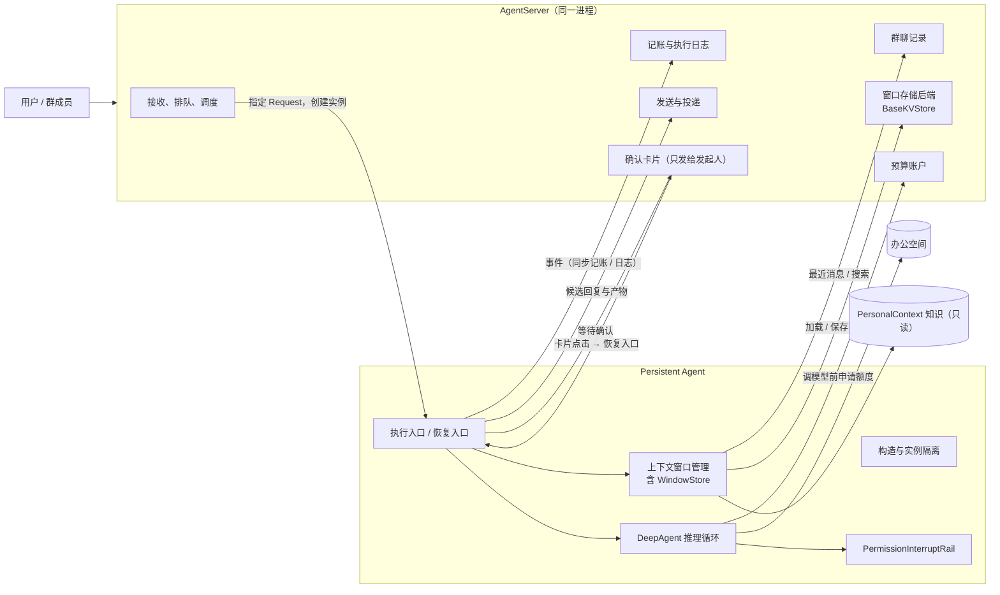
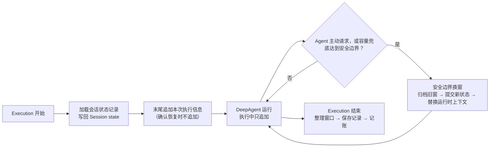
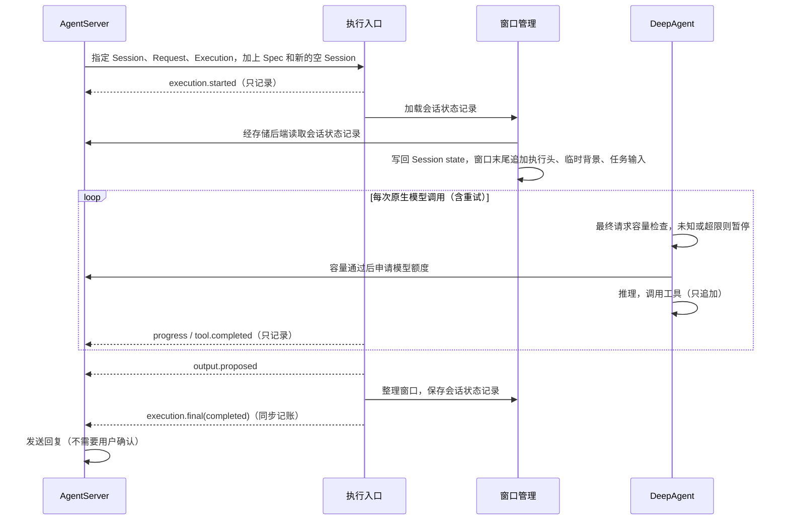
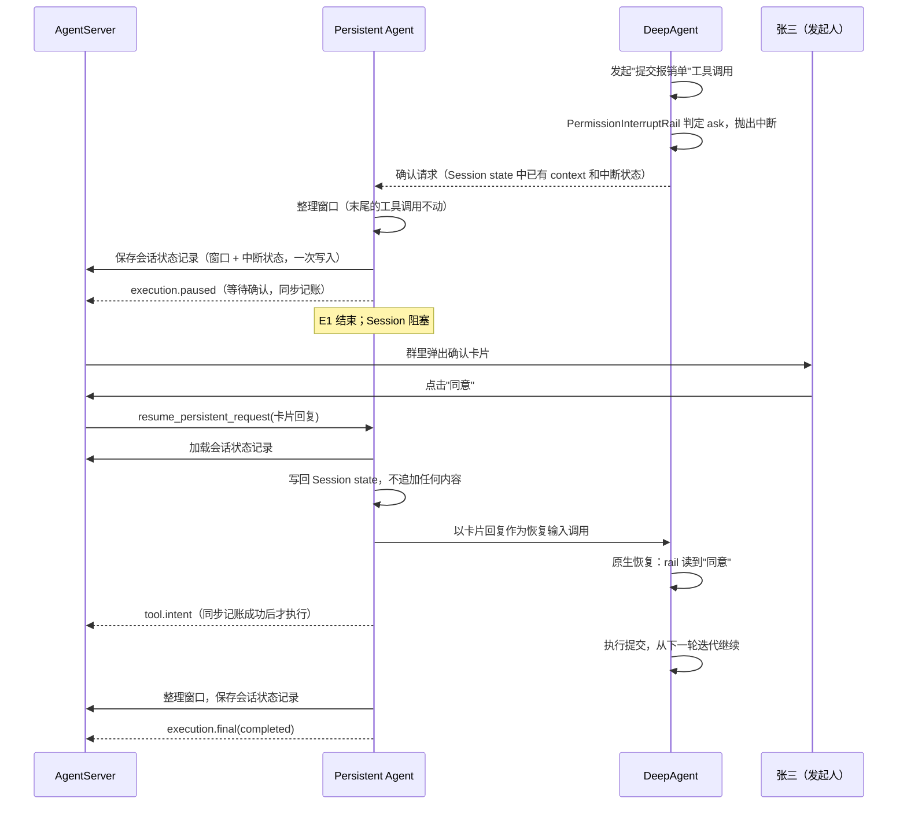
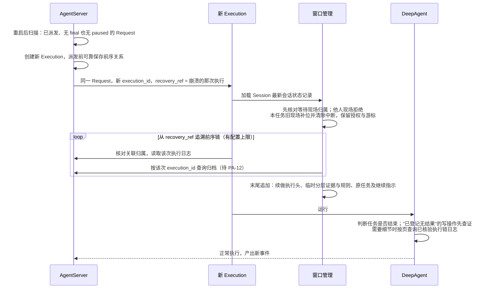

# Persistent Agent 详细架构设计

| 项 | 内容 |
| --- | --- |
| 类型 | 当前详细架构设计；标注"已实现"的部分以代码为准，其余均为拟议 |
| 最近一次修订日期 | 2026-10-17 |
| 关联模块 | `openjiuwen.harness.persistent_agent` |
| 设计概览 | [Persistent Agent 设计概览](persistent-agent-overview.md) |
| 文档定位 | 描述 Persistent Agent 的架构方案，作为后续开发的设计依据 |
| 开发计划 | [persistent-agent-development-plan.md](persistent-agent-development-plan.md) |
| 责任人 | henry hu |

本文说明 Persistent Agent 的定位、核心概念、模块设计、协作流程、状态、数据与故障处理。Agent 侧说明怎样执行；AgentServer 侧说明必须提供的保证，具体实现由服务端所属模块设计。

**实现状态：** 构造、实例隔离、执行入口编排、群参与判断、写前意图、PA-06 新 Request 窗口组装、PA-10 V1 会话状态记录及 PA-08 候选交接（最终回答分段、`share_file` 文件交接、结束事件补交重试）已有组件实现；PA-11 的逐轮 checkpoint、最终 V1 记录结构、主动换窗、容量兜底、归档和精确恢复已在 agent-core 接入 Persistent Agent 执行链并通过组件测试；真实 BaseKVStore、provider 容量边界和 JiuwenSwarm 联调仍待完成。工具执行中途结束时原生保留真实事实的 core 改动已有组件实现、待 core 维护者评审；PA-17 执行日志整理与 PA-18 续做（执行链追溯、分层材料与 `read_execution_record`、最终请求容量检查）已有组件实现，续做在正式入口的开放条件满足前仍拒绝，最终请求检查的 core 接缝待 core 维护者评审；PA-06 容量验收、交互适配及真实宿主联调仍待完成。当前支持范围、负责人和证据以[统一开发计划](persistent-agent-development-plan.md)为准。

PA-11 的 agent-core 组件实现与测试证据见 [F_11](../features/F_11_window-management.md)、[S_03](../specs/S_03_context-and-windows.md) 和统一开发计划；生产持久化及跨仓闭环仍待验证。

PA-23 的当前群背景读取器、Agent 级跨群搜索契约及 Persistent 专用只读工具已有 agent-core 实现；组件与个人版隔离验证见 [F_23 §8](../features/F_23_group-chat-history-retrieval.md#8-验收设计)。JiuwenSwarm 的实际群历史存储、实时授权 Provider 和跨仓验证仍待完成，不作为已闭环能力。

| 阅读目的 | 章节入口 |
| --- | --- |
| 定位、范围、概念与分工 | 第 1～3 节 |
| 模块、协作与完成条件 | 第 4～6 节 |
| 数据、恢复、权限与运行保障 | 第 7～10 节 |
| 场景、验证入口、设计选择与待确认问题 | 第 11～12 节 |
| 规则清单、后续扩展点与历史变更 | 附录 A～C |

## 1. 定位、目标与范围

### 1.1 定位与目标

**一句话：** Persistent Agent 给原生 `DeepAgent` 加一层"在指定 Session 里执行"的外壳。它让同一个 Agent 能同时服务多个群聊、私聊和定时任务：各会话的工作互不干扰，执行过程可追溯，中断后能接着做。

它**不是**新的 Agent 类型：推理、规划、调用工具仍然是 DeepAgent。外壳只做四件事：

1. 把一次执行固定到一个 Session（隔离）；
2. 管理这个 Session 的上下文窗口和跨执行状态（上下文）；
3. 把执行过程报告给 AgentServer（记账与日志）；
4. 关键操作前请发起人确认（用户确认）。

#### 1.1.1 贯穿全文的例子

> "报销助手"是一个 Agent，同时出现在三个地方：
>
> - **报销群**：张三在群里说"帮我把这周的发票整理成报销单，提交到财务系统"；
> - **和李四的私聊**：李四让它查一下差旅标准；
> - **每天 9 点的定时任务**：汇总前一天未处理的报销。
>
> 三处各是一个独立的 Session，使用同一份 Agent 配置和同一个办公空间，但各自的上下文、待办和进度互不可见。
>
> 张三这件事里，"提交到财务系统"是对外写操作，执行前群里会弹出确认卡片，只有**张三本人**点击才有效。执行到一半如果服务重启，新的执行会读上一次的日志，发现"发票已整理完、报销单已生成、提交操作已登记但没有结果"，于是先去财务系统查证，再决定是否提交。

### 1.2 范围与外部责任

| 本期做 | 本期不做 |
| --- | --- |
| 指定 Session 内执行；群消息参与判断；上下文窗口管理与换窗 | 跨 Session 共享私有状态 |
| 记账与执行日志；发起人确认；停止和取消 | 程序层面的精确崩溃恢复（续做由 Agent 读日志判断进度） |
| 办公空间文件读写；PersonalContext 知识只读；群聊记录查询 | 主动学习（独立扩展，见附录 B） |
| 向 AgentServer 交出候选回复和产物 | 渠道发送、排队调度、预算账户、群消息存储、管理报表（属于 AgentServer） |
| 单轮执行（一次执行内可多次调用模型和工具） | task-loop、同步子代理、异步及持久子代理（验证后逐项开放，见第 4.2.2 节和附录 B） |

上表是本期设计范围，不等于已经全部实现。能力开放前提见第 4.2.2 节，AgentServer 的职责与依赖保证见第 3 节。

### 1.3 关键需求与对应设计

| 关键要求 | 对应设计 | 支持范围与限制 |
| --- | --- | --- |
| 一个 Agent 服务多个独立对话 | 第 2.1、3.4、4.1、9.2 节 | 实例与私有状态按 Session、Execution 隔离 |
| 长期保留、保护前缀缓存 | 第 4.4、5.2.2、7 节 | 执行中只追加；Agent 主动换窗为主、模型容量 hard-limit 兜底；持久化由后端提供 |
| 确认与写操作可追溯 | 第 4.8、5.2.1、6.2、9.1 节 | 发起人确认，写操作先记账 |
| 中断后接续原任务 | 第 5.2.4、8.3 节 | 确认恢复保留现场；其他续做依赖日志和查证 |
| 候选输出可靠交接 | 第 6.3、7.2 节 | paused / final 引用的候选输出须保存；发送失败只重试发送 |
| 模式和配置受控 | 第 3.4、4.2.2、4.8.2 节 | 原 Request 固定 Spec，一期只开放单轮 |

### 1.4 影响架构选择的因素

**前提假设：** Persistent Agent 运行在 AgentServer 进程内，端口都是进程内的直接调用。将来如果拆成跨进程部署，需要单独升级记账协议（引入超时查询和执行者代次），见第 12.2.2 节。

Session 隔离、前缀缓存、工具调用与结果配对、单一执行者，以及“先保存状态、后确认结束”的顺序决定模块划分。可靠性优先保护写操作意图、执行结局与最终输出，普通日志允许缺失。设计选择和代价见第 12.1 节。PA-11 采用 Agent 主动换窗为主、模型容量 hard-limit 兜底的策略；不同模型的 token 计量误差、输出预留、近期原文预算和安全余量仍须在实现验证中校准，不采用跨模型固定百分比。总体并发能力、吞吐和恢复时间的数值目标尚待确定，待确认责任见第 12.2 节。

## 2. 核心概念与共同规则

### 2.1 核心概念、关系与生命周期

| 概念 | 白话 | 例子 |
| --- | --- | --- |
| **Agent** | 数字同事本人：长期身份加上能力配置 | 报销助手 |
| **Session** | 它参与的一段独立对话 | 报销群、和李四的私聊、定时任务，各算一个 |
| **Request** | Session 里的一件具体事情 | "整理发票并提交报销单" |
| **Execution** | 处理这件事的一次实际执行 | 第一次执行在等待确认时结束，第二次接着做：Request 只有一件，Execution 有两次 |
| **Window（窗口）** | 模型能看到的工作上下文，每个 Session 任意时刻只有一个当前窗口 | 太长时换窗：旧窗归档，生成新窗 |
| **会话状态记录** | 跨 Execution 需要保留的 Session 状态，按白名单保存为一条记录 | 当前窗口、等待确认时的中断状态、"本会话记住"的确认选择 |
| **执行日志** | 每次 Execution 做过什么的记录 | "整理发票 → 成功；提交操作已登记 → 无结果" |
| **办公空间** | Agent 的工作目录，多个 Session 共用 | 报销模板、整理好的报销单 |

上下文和跨 Execution 状态由会话状态记录负责，一次执行之内的进度通过执行日志追溯。

#### 2.1.1 Session、Request、Execution、Window 的关系

**一句话：Session、Request、Execution 是"做事"的层级；Window 是"上下文"的层级。两者按 Session 对齐，在时间上交错，互不嵌套。**

| 关系 | 数量 | 说明 |
| --- | --- | --- |
| Session : Request | 1 : N | 同一 Session 的 Request 串行处理 |
| Request : Execution | 1 : N | 确认恢复、崩溃续做、停止后继续，都会产生新的 Execution |
| Session : 当前窗口 | 1 : 1 | 窗口按 Session 组织，和 Request 无关 |
| Session : 窗口（含归档） | 1 : N | 每换一次窗，链上就多一个 |
| Window : Request | N : M | 一个窗口可以覆盖多件事；一件长的事也可以跨越多个窗口 |
| Execution : Window | 1 : N | 一次执行中可以换多次窗，同一时刻只用一个 |
| 同一 Session 的活动 Execution | 最多 1 | 由 AgentServer 保证，所以窗口存储不需要并发控制 |

Session 是长期隔离单位；Request 是一件事，暂停后可沿用；Execution 是一次实际处理，创建新实例，结束后清理。当前窗口跨 Request 使用，换出后归档；完整 ReAct 轮次继续执行前先覆盖保存活动 checkpoint，Execution 结束时再覆盖保存终态记录，日志按 Execution 归档。完整时间线见第 11.1.1 节，归属见第 7.1 节。

### 2.2 共同规则索引

附录 A 汇总共同规则；下表列出适用范围、责任、失败处理和主要维护位置。

| 规则（附录 A 条目） | 适用范围 | 责任与检查位置 | 不满足时怎么办 | 详细说明 |
| --- | --- | --- | --- | --- |
| 实例绑定与单一执行者（1） | 同一 Session、一次 Execution | 绑定检查与服务端调度 | 拒绝实例并发；旧执行退出、清理后再调度 | 第 3.4、4.1 节 |
| 写意图与不明结果（2、8） | 写工具及未声明副作用工具 | 执行侧记账、续做查证 | 意图失败不执行，结果不明先查证 | 第 6.2、8.2 节 |
| 完成与交接（3、4、18） | paused / final 引用的候选输出 | 入口与服务端保存、投递 | 候选缺失不能记账结束；投递失败只重试发送 | 第 6.3 节 |
| 发起人确认（5～7） | 等待确认的 Request | rail、恢复入口、服务端卡片 | 无效点击或回复拒绝；超时按规则回复 | 第 4.8、5.2.1 节 |
| 排队与停止（9、11） | 补充消息、活动执行与暂停任务 | 服务端、控制与执行入口 | 补充另建 Request；停止不自动续做 | 第 5.2.3、8.3.2 节 |
| 私有状态与安全存储（10、16、17） | 状态、归档、日志、草稿 | WindowStore、服务端与权限检查 | 后端契约不符合时拒绝构造；状态加载失败不开始执行 | 第 7.1、7.3、9.2 节 |
| 上下文、换窗与收尾（12～15） | 当前窗口及一次 Execution | 窗口管理、执行入口 | 归档失败不换；必要内容放不下则暂停 | 第 4.4、5.2.2、7.2 节 |
| 事件独立可靠性（18） | 同一 Execution | record 与服务端事件存储 | 普通失败诊断后继续；关键失败停止 | 第 6.2、8.1 节 |
| 三种继续方式（19） | 确认、崩溃、非确认暂停 | 入口与服务端调度 | 续做处理过期中断，正常确认保留现场 | 第 5.2.4、8.3 节 |

#### 2.2.1 窗口共同规则

**规则：**

1. **窗口只由 Execution 读写**；Request 和 Session 不直接操作窗口。
2. **加载的永远是 Session 的当前窗口**，不存在"加载某个 Request 的窗口"。
3. **执行中只追加**；换窗是唯一的改写点。
4. **完整 ReAct 轮次继续前先保存 checkpoint；换窗时旧窗先归档；Execution 结束时保存终态记录。** 崩溃时恢复最近一次成功提交的活动窗口；本轮尚未检查点化的副作用由执行日志查证。
5. **被忽略的群消息不进入窗口。**

## 3. 架构总览与模块分工

### 3.1 系统与外部的关系

用户和群成员经 AgentServer 提交消息、接收回复与确认卡片；Persistent Agent 在服务端进程内复用原生 DeepAgent，并调用群聊、预算、记账、知识和存储能力。办公文件、财务系统等外部写入结果需要从实际状态或回执查证；本模块交出候选回复与产物，渠道发送由服务端负责。

### 3.2 内部组成与依赖



图中箭头表示输入交接、能力调用或读写，不表示跨存储事务。构造模块提供隔离实例，入口协调窗口管理、原生循环与确认；WindowStore 是内部组件，服务端提供后端。模块是逻辑职责，不要求各自独立部署。

### 3.3 各模块负责什么

| AgentServer 负责 | Persistent Agent 负责 |
| --- | --- |
| 收消息，判定属于哪个 Session，排队 | 接到指定的一件事，然后执行 |
| **保证同一 Session 同时只有一个执行者** | 一个实例只绑定一个 Session 和一次 Execution |
| 每次执行提供一个新的空 Session (runtime)，服务端不额外调用 `pre_run / post_run` | 隔离原生执行路径的 checkpointer 状态读写，自己加载和保存会话状态记录 |
| 存储群聊记录，提供最近消息和搜索接口 | 执行开始时取最近消息作为背景；执行中按需搜索 |
| 提供窗口存储后端（`BaseKVStore`），负责命名空间隔离、保留期和删除 | 实现窗口存储（`WindowStore`）：会话状态记录和归档的格式、读写与检索；决定窗口内容、何时换窗 |
| 预算账户：预占、结算 | 每次调模型前申请额度，调用后回报实际用量 |
| 保存事件和执行日志 | 产出事件；关键事件等待记账成功后再继续 |
| 向发起人展示确认卡片，鉴别点击人身份，回调恢复入口 | 关键操作前中断并给出确认内容，恢复后继续或跳过 |
| 发送回复、上传文件到群 | 交出候选回复和产物引用，不直接发送 |
| 重启后对中断的执行发起续做 | 读取上一次的执行日志，接着做 |
| 发布 Agent 配置（含确认规则） | 提供"可配置操作"查询接口，按 Spec 中的规则执行 |

### 3.4 AgentServer 必须提供的保证

本部分只写 Persistent Agent 依赖的保证，实现由 AgentServer（jiuwenswarm 仓）自行设计。

1. **单一执行者**：同一 Session 同时只有一个活动 Execution。这是会话状态记录不需要并发控制的前提。
2. **排队**：同一 Session 的 Request（包括补充消息）串行执行；**有任务等待确认时，Session 阻塞**，直到确认完成或超时。其他暂停不阻塞后续 Request，继续时重新排队。
3. **Session 的使用方式**：每次执行提供一个新的空 Session，创建时显式注入 `NoopCheckpointer`，服务端不额外调用 `pre_run / post_run`。原生执行路径仍会调用 Session 生命周期方法，但 checkpointer 的恢复和保存不读写存储；流关闭、取消收敛和资源清理照常，个人版默认行为不变。跨 Execution 的状态只由 `WindowStore` 保存和加载，见第 7.3 节。
4. **固定配置**：一件事从开始到结束使用同一版本的 Spec（含确认规则），包括确认恢复和续做。
5. **记账**：同一 Execution 的事件经 record 顺序提交，服务端按 local_seq 维护已保存日志，允许序号缺口。普通事件接收入队后返回；普通日志入队或保存失败只记诊断，可跳过，不阻塞后续关键记账。`tool.intent`、`execution.paused`、`execution.final` 等待自身落盘后返回；paused 与 final 还须确认 output_refs 所引用的候选内容与交接信息已可靠保存（文件候选按逻辑路径读取，核对大小与内容摘要后留存不可变版本），否则抛异常，不能记账结束。按 event_id 去重，重交候选内容沿用原 event_id / output_id。record 是唯一持久化通道，入口流只展示；队列不随 Agent 实例清理而取消；已保存事件按 execution_id 查询、按 local_seq 返回，返回非空不保证日志完整。执行之间的前序关系不是事件，由第 9 条的派发元数据提供。
6. **群聊记录**：存储群消息，提供近期读取和历史搜索。近期读取按当前 Session 的群定位；历史搜索按 Agent 当前获授权的群定位；宿主按授权状态、Agent 入群时间和消息撤回状态过滤。
7. **窗口存储后端**：提供持久化的 `BaseKVStore` 实例，并满足第 7.3 节的三条要求；保证 Session 之间的命名空间隔离；按 Agent 配置的保留期清理归档；Agent 或 Session 删除时清空对应数据。服务端不需要理解其中存储的内容。
8. **确认卡片**：只根据 `execution.paused(awaiting_confirmation)` 生成确认卡片，只发给发起人、只接受发起人点击；点击后以 `ConfirmReply` 调用 `resume_persistent_request`，并把回复关联到对应的交互 ID；权限确认超时以"拒绝，原因：确认超时"调用，主动提问超时以 `outcome=timed_out` 调用。回复被拒绝（无效）时保持等待，等待有效回复或超时。
9. **续做**：重启后对最近一次已派发的 Execution 无 `final` 也无 `paused`、且未被主动停止的 Request 自动发起续做；被停止的任务只在明确继续时重新排队；预算、容量或可恢复错误导致的暂停，在明确继续或服务端确认对应条件恢复时重新排队，条件未变化时不反复自动续做。以上均沿用原 Request、传入对应的 `recovery_ref` 和原任务输入，走第 5.2.4 节。服务端保留停止事实、原任务及其最近一次待接续的执行关联，停止收尾失败也不能误判为自动续做；继续指示先定位原 Request，再填写恢复引用，见第 11.1.6 节。派发每个 Execution 之前，服务端可靠保存它的前序关系（确认恢复、崩溃续做与非确认暂停后继续各自指向的上一次执行，只限同一 Session、同一 Request），作为派发元数据，不经 `record`，也不改变 Agent 事件统一经 `record` 持久化的规则；通过可选查询 `read_execution_link` 提供（第 3.5 节）。
10. **发送**：只处理被已落盘的 paused / final 引用的 `output.proposed`，按 output_refs 顺序发送回复和上传文件，按 output_id、目标与共享方式去重。发送失败只用已留存的版本重试发送，不重新执行任务。
11. **预算**：管理模型额度账户，额度不足时拒绝准入。
12. **事件流消费**：服务端持续消费执行入口返回的事件流，直到流结束或明确抛出异常；收到 `execution.final` 或 `execution.paused` 后仍继续消费，让入口完成收尾和资源清理。消费任务独立于前端连接生命周期；前端只订阅服务端转发的展示通道，断开只结束订阅，不关闭 Agent 事件流，也不取消服务端消费任务。用户明确停止或取消时，由独立控制任务调用 `abort_persistent_request`，由执行入口完成收尾。
13. **执行异常**：接住执行或确认恢复入口抛出的异常（包括记账失败），核对本次 Execution 已成功落盘的 `final / paused`。已有结束记录，保留结果并按对应状态处理；没有结束记录、且未被主动停止或取消，按崩溃中断处理，沿用原 Request，传入指向本次中断执行的 `recovery_ref`，走第 5.2.4 节，不必等服务重启。续做时机由服务端决定，发起前确认旧执行已退出、相关清理完成。主动停止或取消按第 5.2.3 节处理，收尾异常不触发自动续做。

### 3.5 端口与交接契约

执行通过端口集合（[`PersistentPorts`](../../ports.py)）访问依赖能力；下表定义各契约的方向、操作与失败语义。

| 端口 | 方向 | 操作 | 失败语义 |
| --- | --- | --- | --- |
| **窗口存储后端** | Server → Agent（必需注入） | `BaseKVStore`（`set / get / delete / get_by_prefix / delete_by_prefix` 等） | 读写失败按第 7.3 节 `WindowStore` 的失败语义处理 |
| **群聊记录** `GroupChatPort` | Agent → Server | `recent_messages(execution, cursor=None, limit=20) -> GroupMessagesResult` 读取当前 Session 的群；`search_messages(execution, query: GroupMessageQuery) -> GroupMessageSearchResult` 按 Agent 当前获授权群搜索。近期读取结果中的 `scanned_through` 是服务端确认的扫描位置。Persistent 私聊或群聊 Execution 可注入该端口供显式搜索；只有群消息 Request 自动读取当前群近期消息 | 近期读取区分确定没有与没查完；历史搜索区分 found / empty / incomplete / forbidden / unavailable / failed；错误或授权不确定不能伪装为空 |
| **记账** | Agent → Server | `record(event)`：普通事件接收入队后返回，普通日志缺失不阻塞；关键事件等待自身落盘后返回，paused 与 final 还须确认所引用的候选输出已可靠保存（第 6.2 节） | 普通日志失败：只记诊断并继续；关键事件自身或必要候选输出保存失败：停止当前执行 |
| **执行日志** | Agent → Server | `read_execution_log(execution_id)`：按 local_seq 返回该次执行的已保存事件，允许缺口；只允许读取同一 Session、同一 Request 下的执行 | 读不到：提示 Agent "上一次记录缺失"；非空日志也可能不完整，工具结果缺失时先查证，查不清时可询问发起人，是否询问由模型判断 |
| **执行前序关系**（可选） | Agent → Server | `read_execution_link(execution_id)`：返回该执行的前一次执行与关系（`first` / `confirmation_resume` / `continuation`），只允许读取同一 Session、同一 Request 下的执行；只在续做时需要，续做开放时检查宿主是否提供 | 读取失败或不合规：停止继续追溯，写明更早执行未知，已读到的日志照常使用 |
| **预算** | Agent → Server | `admit(model_call_id)`、`report(model_call_id, usage)` | 拒绝准入：不调用模型，产出 `execution.paused(budget_denied)` |
| **知识** `KnowledgePort` | Agent → Server | 解析授权和知识版本、读取正文 | 无权限与不存在要能区分 |
| **执行与恢复** | Server → Agent | `execute_persistent_request(RequestInput)`、`resume_persistent_request(ConfirmReply)`、`abort_persistent_request(reason)`（第 4.2.1 节） | 校验拒绝：不自动续做，同一份无效输入不重试，无效交互回复保持等待；运行异常：服务端按第 3.4 节核对本次执行的结束记录，符合条件的按第 5.2.4 节续做；停止与取消按第 5.2.3 节处理 |
| **确认规则查询** | Server → Agent | `describe_confirmable_operations(spec)` | — |

`GroupChatPort` 的两个方法均接收 `ExecutionContext`，但资源定位范围不同：`recent_messages` 根据 Session 定位当前群；`search_messages` 根据可信 `ExecutionContext.agent_id` 解析 Agent 当前获授权的群集合。群 ID / 群名只是搜索过滤条件，不能扩大授权；不要求当前提问者属于目标群，也不接收模型传入的 Agent 身份或授权列表。宿主在每次搜索及后续分页时重新校验授权。

`WindowStore` 是本模块的内部组件，不是对外端口（第 7.3 节）。在同一 Session 只有一个执行者的前提下，存储读写无需版本号、条件更新或执行者代次（epoch）校验。

## 4. 关键模块设计

### 4.1 构造与实例隔离（已实现）

这部分已经在代码中实现，本节只按代码现状描述。

- **配置**：[`PersistentAgentSpec`](../../schema/spec.py) 继承 `DeepAgentSpec`，是一份扁平配置，带 `fingerprint()` 用于校验版本。
- **构造**：[`create_persistent_agent(spec, context=...)`](../../factory.py) 返回**原生 `DeepAgent`**，不新建 Agent 类。构造过程不调用模型，也不调用端口。
- **一次执行的上下文**：[`PersistentBuildContext`](../../schema/build_context.py) 携带 [`ExecutionContext`](../../schema/execution.py)（身份与权限快照）、Session 和端口集合。它只能使用一次，并为这次执行分配独立的 `tool_owner_id`，避免同名有状态工具相互覆盖。
- **恢复引用**：`ExecutionContext.recovery_ref` 指向同一 Session、同一 Request 下待接续的 Execution；续做关联规则见第 5.2.4 节。
- **隔离**：[`execution/binding.py`](../../execution/binding.py) 提供内部的 `invoke_bound / stream_bound / abort_bound / close_bound`：
  - 调用前校验 Agent、Session、Execution 是否都匹配；
  - 拒绝同一实例的并发调用；
  - 停止和清理只影响自己这次执行的资源。

**结论：一个 Execution 对应一个实例。** 实例用完即清理；同一 Session 的下一次执行（包括确认恢复）由新实例加上新的空 Session，再由窗口管理放回会话状态记录。

释放实例只清理所属 Execution 的资源，不删除持久记录，也不改变已落盘结局。AgentServer 持续消费原流至结束或异常，旧执行退出并完成清理后再安排同一 Session，见第 3.4 节。

### 4.2 执行入口与原生推理循环

#### 4.2.1 三个入口及调用约定（拟议）

```text
execute_persistent_request(spec, context, inputs: RequestInput) -> AsyncIterator[AgentEvent]
resume_persistent_request(spec, context, confirm_reply: ConfirmReply) -> AsyncIterator[AgentEvent]
abort_persistent_request(context, *, reason: "cancel" | "stop") -> None
```

两个执行入口返回的事件流由 AgentServer 持有并持续消费，直到流结束或明确抛出异常；收到 `final` 或 `paused` 后仍继续消费，让执行入口完成收尾和资源清理。前端只订阅服务端转发的展示通道，断开只结束订阅，见第 3.4 节。

| 入口 | 用于 | 调用方 |
| --- | --- | --- |
| `execute_persistent_request` | 新的 Request、崩溃续做、非确认暂停后继续 | AgentServer 调度 |
| `resume_persistent_request` | 确认恢复（权限确认或主动提问的回复，以及超时） | AgentServer 的卡片回调 |
| `abort_persistent_request` | 取消或停止正在执行的这件事（第 5.2.3 节） | AgentServer 的独立控制任务 |

**任务输入 `RequestInput`：**

| 字段 | 说明 |
| --- | --- |
| `kind` | `group_message / direct_message / scheduled`；只有 `group_message` 走参与判断，私聊和已触发的定时任务直接执行 |
| `text` | 原任务正文 |
| `source` | 消息来源：群消息复用 `GroupMessage`；私聊保留必要来源信息；定时任务没有触发消息 |
| `reply_target` | 回复投递目标 |
| `attachment_refs` | 附件引用 |
| `continue_instruction` | 可选的续做指示；只有存在 `recovery_ref` 时才能使用 |

触发消息 ID 用于来源关联、去重和从背景消息中排除当前消息，也用于读取触发消息之后至本次读取上界的回补消息；Session 增量游标采用服务端确认的扫描位置（见第 4.4.3 节）。续做时服务端重新传入原任务输入，另外附带 `continue_instruction`。

**交互回复 `ConfirmReply`：** 由若干回复项组成，每项包含 `tool_call_id`（中断输出中的交互 ID，通常即工具调用 ID）、`kind: permission | answer` 和对应内容，统一转换为原生 `InteractiveInput`，按交互 ID 关联被中断的调用：

| 回复类型 | 内容 | 转换 |
| --- | --- | --- |
| `permission` | 同意 / 同意并本会话记住 / 拒绝（可附反馈） | 转换为 `ConfirmPayload`；本会话记住为 `approved=True, auto_confirm=True, persist_allow=False`，不开放永久允许 |
| `answer` | `outcome: answered / timed_out`，`answers` 为“问题文本 → 回答” | 转换为 `AskUserPayload.answers`；漏答的问题填“（未回答）”，超时时每个问题填“（超时未获得回答）”，原生 rail 照常生成工具结果，不扩展原生类型 |

- 入口只校验回复结构、交互 ID 和问题对应关系，不判断答案是否合理；允许部分回答和自由文本，“不知道”也是有效回答。
- 交互 ID 必须属于当前等待现场且不重复，答案键必须对应原问题；同一次提问中的问题文本应唯一。
- 等待现场（中断状态、所属 Request 和回复目标）来自会话状态记录：恢复入口先加载记录，核对所属 Request 与本次执行上下文一致，再校验回复，校验通过才调用原生恢复。
- 无效回复只拒绝本次恢复，不保存、不记账，原任务继续等待有效回复或超时。
- Agent 可以先推进不依赖缺失信息的工作；必要信息未取得时不能猜测后执行，也不自动重复同一问题。

内部组合与执行顺序见第 5.1.1 节，失败分类见第 8.1 节。

#### 4.2.2 执行模式、配置校验与能力开放

**一期执行模式：** 只开放单轮执行，一次执行内可以多次调用模型和工具。Persistent Spec 须显式填写 `enable_task_loop=False`，并且 `subagents` 为空、`enable_async_subagent=False`、`enable_subagent_runtime=False`、`add_general_purpose_agent=False`（它会在子代理列表为空时自动注入子代理）。配置声明和实际装配结果都要检查，不支持的模式在执行前明确拒绝，不在运行时悄悄关闭已发布的开关。task-loop、同步子代理、异步及持久子代理验证后逐项开放（附录 B）。

**能力开放：** 正式入口只开放已接入并验证的能力。参与判断接入前拒绝群消息；会话状态记录接入前不能执行，加载失败不降级为空窗口；续做接入前拒绝带 `recovery_ref` 的执行，不按新任务重跑；写工具在意图记账接入后开放。

原 Request 从开始到结束固定 Spec，包括确认恢复与续做；每次 Execution 使用新的空 runtime Session，业务 Session 身份不变。窗口、知识和授权的生效范围分别见第 4.4、7.3、9.1 节。

### 4.3 群消息参与判断

只有**群消息**需要判断；私聊指令和已触发的定时任务直接执行。

- 三选一：**忽略 / 回应 / 主动插话**。被 @ 是强信号，但不代表必须回答。
- 判断是**一次独立的轻量模型调用**：只带职责、当前消息和少量最近群消息（来自 `GroupChatPort`），不加载窗口、不写入窗口，也不开放写工具。
- 选择忽略：产出 `execution.final(ignored)` 后结束，不生成正式任务，也没有回复。被忽略的消息不会进入窗口，下次执行时作为最近群消息的背景出现。
- 判断失败（模型异常、输出格式不对）：有限次重试后报失败，**不能记为忽略**。

本期每条群消息都作为 Request 进入 Session 的串行队列，轮到时再判断。Agent 忙于长任务时判断会滞后；不占用 Session 的轻量参与判断路径列入后续扩展（附录 B）。

### 4.4 上下文窗口管理

#### 4.4.1 工作方式与前缀缓存原则

**为什么不复用现有的上下文 rail。** harness 现有的 `ContextAssembleRail`、`PersonalContextRail` 和 `ContextProcessorRail` 的默认压缩链，都是为"每次模型调用都刷新一遍、按阈值自动压缩"设计的：

- 往系统提示词里写动态片段（例如 `tools` 片段），内容一变，整个前缀缓存失效；
- 默认压缩链会自动改写历史，和 Persistent Agent 自己决定的换窗时机冲突；
- 卸载和压缩归档写在共享的办公空间里，同一 Agent 的其他 Session 可以用文件工具读到。更严重的是，**状态记录如果放在 Agent 工具可访问的任何位置，模型就能改写中断状态或"本会话记住"的选择，从而绕过发起人确认**。

因此 Persistent Agent **自建一套按 Execution 生命周期的窗口管理**，并且在 Persistent Agent 中**不挂载**上述三个 rail：Persistent 构造遇到它们（含子类）时明确拒绝。同理，原生 context engine 按条数截断窗口的三个参数（`max_context_message_num`、`default_window_message_num`、`default_window_round_num`）在 Persistent 中也不允许启用。

**执行中动态内容的追加通道。** `PromptAttachmentManager` 的"只在末尾追加增量"通道（[prompt_attachment_manager.py](../../../prompts/prompt_attachment_manager.py)）符合"执行中只追加"的要求，可以作为执行中追加动态内容的实现手段。

**前缀缓存原则：**

1. 一次 Execution 内，**系统提示词和工具定义固定不变**：不增删工具，不往系统提示词里放动态内容。
2. **动态内容只追加到末尾**，不改写已有内容。
3. 每次 Execution 只需要做一次的事情（续做日志、知识版本、最近群消息），**在开头一次性注入**。
4. 撤权**在下一个 Execution 生效**。确实需要立即生效的，主动换窗，接受一次缓存失效。
5. **换窗是唯一计划内的改写点**：Agent 在阶段边界主动请求为主；若 Agent 未请求，Persistent Agent 按下一次模型调用的容量估算在接近 hard limit 时兜底。两种触发使用同一转换流程，不使用跨模型固定百分比。
6. 参与判断用独立调用，有自己的短前缀，不污染窗口。

#### 4.4.2 窗口生命周期



图中的开始和结束归属 Execution，当前窗口归属 Session。确认恢复不追加消息；换窗步骤见第 5.2.2 节，结束保存见第 7.2 节。

#### 4.4.3 Execution 开始：窗口的组成

顺序原则是：**越稳定的放越前面，越临时的放越后面**。

```text
┌ 系统提示词 + 工具定义       ← 由 Spec 固定，所有 Execution 相同
├ 已保存的窗口（历史段落）     ← 上一次 Execution 保存的内容，可缓存的前缀
├ 本次执行头                   ← request_id、execution_id、执行类型
├ 临时背景块（标记为临时）     ← 最近群消息、知识导航、续做日志等
└ 本次任务输入                 ← 放在最后，离模型生成最近
   ↓ 执行中只追加：模型回复、工具调用和结果……
```

| 执行类型 | 本次执行头 | 临时背景块 | 任务输入 |
| --- | --- | --- | --- |
| **新的 Request** | 类型为"新任务" | 最近群消息（含被忽略的消息）、知识导航 | 用户的新请求 |
| **确认恢复** | **不追加**（执行信息记在结束标记里） | **不追加** | 卡片回复**作为中断恢复的输入**，不作为消息 |
| **崩溃续做、非确认暂停后继续** | 类型为"续做"，注明 `recovery_ref` 指向的 `execution_id` | 最近群消息、知识导航，以及沿执行链整理的分层日志摘要、归档引用和续做规则 | **重新注入原任务输入**，有继续指示时一并追加 |
| **群消息参与判断** | 不加载窗口，见第 4.3 节 | — | — |

**确认恢复为什么不追加任何内容：** 等待确认时，窗口末尾是模型发起、还在等结果的工具调用。按模型协议，工具结果必须紧跟在工具调用后面，中间插入任何消息都会被模型 API 拒绝。

**续做为什么要先处理旧中断状态：** 确认恢复后如果崩溃，加载到的可能仍是更早的等待确认记录；必须先补齐悬空工具结果、清除过期中断状态，再追加执行头和背景，不能直接把日志插在工具调用后面。正常确认恢复不做这个处理，见第 5.2.4 节。

**其他规则：**

- 同一 Session 的第一个 Execution 没有会话状态记录，就创建一个空窗口。
- **去重**：触发本次执行的消息已经是任务输入，组装最近群消息时要排除它。
- **增量获取群消息**：执行结束标记里记下服务端确认已扫描到的消息位置（`last_group_message_id`）。下次执行从该游标增量读取，同时回补当前 Request 触发消息之后至本次读取上界的消息，两部分合并去重、排除触发消息。排队的 Request 处理时，触发消息可能早于游标，期间针对它的补充只出现在当时的临时背景里。例：R2 由 M120 触发；R1 执行期间，群里在 M130 补充了 R2 的要求；R1 结束时游标为 M180。R2 执行时须读到 M130：它不在游标之后，也只出现在 R1 的临时背景里，已随结束整理删除。游标以可信扫描进度为准，与实际展示的消息分开：正文暂缺但位置可信时照常前移，并在背景中注明正文缺失；查询失败或进度不可信时保留原游标。不建立跨 Request 的自动缺口追补，更早的内容由模型按需搜索。
- **群消息 Execution 与消息形式**：Persistent 群聊或私聊 Execution 可注入 `GroupChatPort` 以支持显式历史搜索；端口是否注入不决定 Session 类型。只有 `request.kind == group_message` 时，才读取当前群近期消息并装配群消息背景；私聊或定时任务不因端口存在而自动读取或注入群历史。执行头和临时背景块以带 `persistent_window_part` 标记的用户消息追加，一期标签和说明为中文，正文不翻译。
- **兜底检查**：加载后若有等待中的调用，或窗口有未配对的工具调用，新 Request 以校验拒绝结束，不追加任何内容。这两种拒绝发生在 `execution.started` 之后，服务端不续做（见第 8.1 节校验拒绝规则）。
- **知识版本**：PersonalContext 的授权范围和知识版本在 Execution 开始时解析一次，知识导航放进临时背景块，执行中不再刷新（前缀缓存原则 3、4）。

#### 4.4.4 执行中：只追加

- 模型回复、工具调用和结果，按 DeepAgent 原有方式追加到窗口末尾；
- 执行中需要新增的动态内容，通过附件通道以增量形式追加；
- 查询群聊记录和历史归档的结果，作为工具结果进入窗口（第 4.6 节）；
- 不改写、不删除已有内容；系统提示词和工具定义保持不变。

#### 4.4.5 换窗后的内容与容量边界

**新窗的内容：**

| 内容 | 来源 |
| --- | --- |
| 系统提示词与工具定义 | 仍由当前 Spec 固定；不属于可由 Agent 改写的交接内容 |
| 当前 Request 原始任务输入 | 重新注入，避免原输入随旧窗归档后丢失 |
| WindowSeed（有界交接要点） | 主动路径由 Agent 提交；容量兜底由窗口管理组件从已保存目标、执行事实和最近完整交互构造；包括目标、进度、下一步、约束 / 决策、未决问题及经核验的副作用 / 证据引用 |
| 近期完整消息组 | 按 token 预算选取；工具调用与对应结果必须成组保留 |
| 必要的未交接登记与待核实线索 | 保留当前确认链中尚未交出的 `share_file` 登记依据和未确认副作用引用，不能由 WindowSeed 伪装成成功事实 |
| 旧窗归档引用 | 指向已持久化的完整旧窗；归档供恢复 / 查证，Agent 历史检索另由 PA-12 提供 |

如果新窗的最小必要内容仍然放不下，产出 `execution.paused(context_unfit)` 并说明原因，不静默截断。

换窗不调用额外模型生成长摘要。触发与安全边界见第 5.2.2 节，归档的保存理由与分类见第 7.4 节。

### 4.5 WindowStore 内部组件

WindowStore 负责会话状态格式、读写、归档、按 Execution 查询归档与历史检索，接收 Session 身份、状态或旧窗口、检索条件。它是本模块内部组件，不是对外端口；后端持久化、隔离、备份与清理由服务端负责。加载、保存白名单、checkpointer 隔离、存储键和操作失败语义集中在第 7.3 节。

### 4.6 群聊记录与历史检索

群聊记录**存在 AgentServer**，由 JiuwenSwarm 保存并提供查询。agent-core 不维护群聊历史副本，也不直接依赖飞书 API、数据库或宿主文件格式。`GroupChatPort` 的两种读取分别处理当前群执行背景和 Agent 级历史搜索：

| 操作 | 用途 | 调用时机 |
| --- | --- | --- |
| `recent_messages` | 读取当前 Session 所属群近期消息；窗口读取按游标取增量，并以触发消息为游标回补其后的消息 | 群消息 Request 开始时供窗口组装；PA-07 在加载窗口前另行独立读取近期消息进行参与判断 |
| `search_messages` | 在当前 Agent 获授权的一个或多个群内搜索已保存历史 | Persistent Agent 执行中由模型显式调用，包装为 `search_group_messages` 工具；可从私聊或另一群的 Execution 发起 |

**近期读取和历史搜索的范围不同：** `recent_messages` 由 `ExecutionContext.session_id` 定位当前群，不能借此读取其他群；`search_messages` 由可信 `ExecutionContext.agent_id` 确定 Agent，再由宿主读取该 Agent 当前获授权群的范围。没有群过滤条件时搜索全部获授权群；传入群 ID / 群名只缩小范围，按精确值解析。同名群不随机选择，需消歧。当前提问者是否属于目标群不参与群历史授权判断；能与该 Agent 对话的用户可能通过 Agent 查询其获授权群历史，这是明确的产品隐私边界。

**搜索来源与查询方式：** 模型向 `search_group_messages` 提交关键词及可选时间、发送者、群 ID / 群名和分页条件。关键词按字面子串匹配、大小写不敏感，不进行语义扩展；结果按服务端接收时间从新到旧，同一时间按 `group_id`、`message_id` 稳定排序。JiuwenSwarm 从可信 Execution 解析 Agent，在每次查询和分页时校验当前 Agent—群授权，再从宿主持久化的群消息记录 / 检索索引中检索；物理存储和索引实现由服务端决定。返回的命中包含稳定群 ID、群名、消息引用和消息内容 / 状态。结果仅覆盖宿主实际保存且可读取的历史，不能推断未保存时段也已检索。

搜索结果使用独立的 `GroupMessageSearchResult`，不复用近期消息的 `GroupMessagesResult.scanned_through` 表达多群查询完整性：

| status | 语义 |
| --- | --- |
| `found` | 一个或多个命中，查询范围已完成扫描 |
| `empty` | 无命中，授权范围和查询条件均已完整扫描 |
| `incomplete` | 部分群、时间范围或分页未完成；可含部分命中和继续游标，必须给出原因 |
| `forbidden` / `unavailable` | 显式群目标不可访问或无法安全解析；不返回内容，且不泄露目标是否存在 |
| `failed` | 授权解析或历史查询失败；不能伪装为确定无结果 |

授权来源不可验证、索引覆盖范围不明或查询失败时不得返回确定的 `empty`。撤权后旧游标不能继续读取被撤权群。搜索命中和查询状态作为普通工具结果进入当前执行上下文，不自动写入目标群 Session 的历史或窗口。

每条消息包含：`message_id`、发送者（稳定身份 ID 加显示名，并标明是人还是 Agent）、服务端接收时间、正文、@ 了谁、回复的是哪条、附件引用、状态（正常 / 已编辑 / 已撤回 / 正文暂缺；已撤回和正文暂缺的都不返回正文，正文暂缺表示消息存在但暂时读不到）、是否属于排队中的请求。

**扫描位置与展示范围分开：** 读取结果除消息外，还带服务端确认已扫描到的消息位置 `scanned_through`。它与分页用的 `next_cursor` 不同，也与实际展示给模型的消息无关。正文暂缺但扫描位置可信时，位置照常前移，并在背景中注明哪些消息正文缺失；查询失败或进度不可信时不返回该位置，读取方保留原游标。缺失的正文不建立跨 Request 的自动追补清单，更早的内容由模型按需搜索。

**排队中的请求只能作为背景，不能成为当前任务的指令。** 历史搜索结果必须区分 found、完整扫描后的 empty、incomplete、forbidden / unavailable 与 failed；未完整查询或查询失败不能当作“没有”。

**两个检索工具要分开：**

| | 群聊记录 | 历史窗口归档 |
| --- | --- | --- |
| 内容 | 群里所有公开消息 | Agent 自己的工作过程 |
| 归属 | 群 | Session 私有 |
| 工具 | `search_group_messages` | `search_session_history` |

合并成一个工具，可能会把 Agent 的私有工作过程当成群公开内容引用出去。需要跨群搜索的私聊 Persistent Execution 可以注入 `GroupChatPort`，但不会自动读取群消息；私聊对话自身的窗口和归档不属于本工具的搜索范围。

### 4.7 办公空间与知识

- **办公空间**：复用 harness 的 Workspace 和文件工具，读写都受权限引擎约束。文件写入属于写操作，按第 6.2 节记账。会话私有的草稿放在 `sessions/<session_id>/` 下，其他 Session 不能访问。
- **PersonalContext**：只读。通过 `KnowledgePort` 在 Execution 开始时解析授权和版本，导航放进临时背景块（第 4.4.3 节），正文由模型按需读取。不挂载 `PersonalContextRail`。
- 文件写好了，**不代表任务完成**，也不代表群里能看到。需要群里看到时，Agent 调用 `share_file` 登记该文件并写明共享方式（上传群空间或作为附件发送）；执行结束时程序按文件当时的内容交出 `output.proposed`，由 AgentServer 核对、留存并上传或发送。登记不等于已发送；写进办公空间但未登记的文件不会交出（第 6.3 节）。`share_file` 随办公空间读取能力装配，登记与交出时都检查读授权；读授权不代表允许公开，发送检查由服务端负责。

### 4.8 用户确认与权限配置

#### 4.8.1 直接复用 PermissionInterruptRail

确认能力**完全复用** harness 现有实现，Persistent Agent 不写确认相关的 rail 代码：

- [`PermissionInterruptRail`](../../../rails/security/tool_security_rail.py) 是 [`ConfirmInterruptRail`](../../../rails/interrupt/confirm_rail.py) 的子类，由权限引擎按工具、路径、shell 命令和风险等级判定 `allow / ask / deny`（[permission_engine](../../../security/permission_engine/core.py)）；
- DeepAgent 在配置中 `permissions.enabled` 为真时**自动创建并挂载**这个 rail（[deep_agent.py:774](../../../deep_agent.py#L774)）；
- 判定为 `ask` 时，rail 抛出中断，ReAct 把上下文和中断状态写进 Session state，返回确认请求；
- 恢复时，ReAct 读出中断状态，带着回复执行被拦截的工具调用，再从下一轮迭代继续（[handler.py:310](../../../../core/single_agent/interrupt/handler.py#L310)）。

**Persistent Agent 只负责一件事：** 在两次执行之间，把白名单里的 Session state 字段保存好、再放回去（第 7.3 节）。

#### 4.8.2 确认规则的配置接口

| 接口 | 用途 | 实现 |
| --- | --- | --- |
| **查询** `describe_confirmable_operations(spec)` | 列出这个 Agent 的工具及默认确认级别，供 Agent 负责人在服务端界面查看和设置 | 根据 Spec 中的工具列表和权限引擎的默认风险等级生成 |
| **配置** `PersistentAgentSpec.permissions` | 服务端发布 Agent 配置时写入确认规则 | 使用 `PermissionsSection` 格式，构造时传入 DeepAgent 配置，纳入配置指纹 |

规则随 Spec 下发，每次执行按发布时的版本生效。`permissions` 由 `PersistentAgentSpec` 显式定义；配置禁止额外字段。

## 5. 模块协作与处理流程

### 5.1 主流程

#### 5.1.1 执行入口怎样组合已有能力

两个执行入口内部组合已有的函数，不另写一套推理循环：

1. `create_persistent_agent(spec, context)`：构造实例；
2. （仅 `execute`，且为群消息）参与判断（第 4.3 节）；选择忽略的直接结束；
3. **加载会话状态记录**，写回 Session state（第 7.3 节）；崩溃续做与停止后继续先处理旧中断状态、读取执行日志，再追加本次执行信息（第 5.2.4 节）；新的 Request 按第 4.4.3 节追加，`resume` 保留中断状态，不追加任何内容；
4. `stream_bound(...)`：运行 DeepAgent（`resume` 以交互回复作为恢复输入），把原生流式输出映射成 `AgentEvent`；执行中需要时换窗（第 5.2.2 节）；
5. **整理窗口 → 保存会话状态记录 → 记账 `paused` / `final`**，顺序固定（第 7.2 节）；再调用 `close_bound` 清理资源。

服务端负责接收、排队与构造执行上下文，入口负责运行与收尾，关键记录确认后服务端处理投递。异常由服务端核对本次落盘结局，已有 final / paused 保持不变，无结局且满足条件时按第 8.3 节续做。

#### 5.1.2 正常执行的主干时序（李四的私聊请求）



带确认、换窗、崩溃的完整流程见第 11.1 节。

图中普通日志只记录；final 成功还要求引用的候选输出可靠保存（paused 同理）。发送是后续交接，发送失败不重新执行李四的任务，见第 6.3 节。

### 5.2 关键协作机制

#### 5.2.1 确认卡片、等待与原生恢复

**触发与参与：** 权限引擎判定 ask 或 Agent 主动提问时，原生 rail 产生中断，入口保存现场并结束本次 Execution，服务端展示卡片并等待发起人或超时。模块内部机制见第 4.8.1 节，回复结构与校验见第 4.2.1 节。

| 环节 | 做法 |
| --- | --- |
| **卡片内容** | 服务端只根据 `execution.paused(awaiting_confirmation)` 中被拦截的工具名和参数生成确认卡片；rail 默认的提示语不直接展示给用户 |
| **卡片选项** | **同意 / 同意并本会话记住 / 拒绝（可附反馈）**，经 `ConfirmReply` 转换为 `ConfirmPayload`（第 4.2.1 节）。不提供"永久允许"：全局规则由服务端通过 Spec 发布，不能被一次点击改写，因此服务端也不提供 `persist_allow_rule` 回调 |
| **谁能点** | 只有这件事的发起人；服务端鉴别点击人身份，其他人的点击无效 |
| **恢复** | 服务端回调 `resume_persistent_request`，传入 `ConfirmReply`；新实例放回会话状态记录，校验回复后以其作为恢复输入调用 DeepAgent。**不往窗口追加任何消息**，回答通过工具结果进入上下文 |
| **同意** | 执行被拦截的工具调用；写操作照常先记账 `tool.intent` |
| **拒绝** | 跳过该工具，rail 把发起人的反馈作为工具结果交给模型 |
| **本会话记住** | 选择被写入 `INTERRUPT_AUTO_CONFIRM_KEY`，随会话状态记录保存，本 Session 后续同类操作自动放行 |
| **超时** | 权限确认超时，服务端以"拒绝，原因：确认超时"调用恢复入口；主动提问超时，以 `outcome=timed_out` 调用。Agent 照常收尾，不猜测答案、不视为授权、不自动重复同一问题 |
| **记入日志** | 确认请求和发起人的决定都是事件，续做时 Agent 能看到 |

**等待确认期间，Session 阻塞**：同一 Session 的其他 Request 继续排队，直到确认完成或超时。这样恢复时窗口末尾一定还是那个等待结果的工具调用。允许等待期间处理其他请求列入后续扩展（附录 B）。

续做规则中"查不清时可问发起人"，复用同一套机制里的 `AskUserRail`，走相同的卡片和恢复路径。

**结束与失败：** 有效回复由新实例交给原生恢复；无效回复保持等待。状态保存或 paused 记账失败按第 8.1 节抛异常，服务端核对落盘记录；正常确认恢复保留现场，不能使用第 5.2.4 节的过期现场清理。完整时序见第 11.1.3 节。

#### 5.2.2 运行中换窗：主动交接、容量兜底与状态提交

**触发：** Agent 在阶段边界通过内部 `new_context` 控制动作主动提交有界 WindowSeed，是主路径。若当前回合没有主动请求，Persistent Agent 按当前上下文、将加入的用户 / 工具结果、系统指令与工具定义、输出预留和安全余量估算下一次调用；接近适用模型 hard-limit 保护边界时触发容量兜底。容量边界由模型能力信息和测量校准确定，不使用全局固定的 70%。缺少可靠 token 信息时采用注入的保守预留；仍无法证明调用安全则在下一次模型调用前暂停。单个工具结果可能造成容量突增时，也需在结果进入窗口前检查。

上述估算用于提前触发换窗；实际模型调用仍须通过第 9.3 节的最终请求容量检查，不能用保守估算代替可靠计数。

**主动交接的事实边界：** `new_context` 是 Persistent Agent 内部控制动作，不是用户业务工具或公共 Python API；模型发出请求不等于切换已提交。WindowSeed 有界且字段经过校验，表达目标、进度、下一步、约束 / 决策、未决问题、待核实副作用和稳定证据引用。它是交接建议，不是工具回执、授权或事实权威。容量兜底无 Agent 提供的 seed 时，由窗口管理组件依据已保存任务目标、执行事实和最近完整交互构造最小交接，不额外调用模型生成摘要。

**安全边界：** 当前模型回复已结束，并行工具已结束或收敛，所有工具调用与结果完整成组后才可切换；不能截断仍在执行的工具。新窗内容见第 4.4.5 节，必要任务输入和事实仍无法适配时产出 `execution.paused(context_unfit)`，不静默截断。

**步骤（顺序固定）：**

1. 准备新窗候选，包含固定系统提示词 / 工具定义、本次原始 Request、校验后的 WindowSeed 和预算内近期完整消息组；保留必要的未交接文件登记与未决副作用线索。
2. 以 WindowStore 派生的稳定 `archive_ref` 幂等保存旧窗完整规范化内容及切换元数据。元数据关联 Session、旧 / 新 window ID 与序号、触发类型、WindowSeed、近期消息组引用、token 用量、`request_id` / `execution_id` 与原 Spec 指纹。相同写入可复用；内容冲突不得覆盖。
3. 将候选新窗口、`current_window_id`、`window_seq` 和 `last_rollover` 写入 PA-10 使用的同一条 Session 状态记录。只有状态写入成功，候选新窗才成为持久化的当前窗口。
4. 持久化成功后替换 ContextEngine 的运行时上下文，再尽力记录普通 `window.switched` 通知。通知失败不回滚状态或运行时切换。

**部分成功与恢复：** 归档失败时保持当前状态、不切换；状态写入失败或结果未知时停止当前执行，不继续在新候选窗或旧内存窗调用模型。恢复先加载 Session 状态：若指针已指向新窗，加载该窗；若仍指向旧窗，仅在归档中的 Session、旧窗口完整快照、旧 / 新窗口标识、Request、recovery_ref、Spec 指纹及轮次序号精确匹配时，才从旧窗快照、seed 和保留项引用确定性重建候选，并校验归档保存的候选指纹。校验通过后先将修复后的状态记录持久化，再暴露新窗口；不直接从归档读取另一份完整候选，也不重新计数。身份、内容或指纹不匹配则失败关闭并由 PA-18 结合执行日志查证。若状态提交成功但内存替换前中断，状态记录仍是权威，下一次加载新窗。普通 `window.switched` 事件不作为恢复依据。

**责任与保证边界：** Persistent Agent 负责 WindowSeed 校验、容量估算、归档 / 状态提交流程和运行时替换；AgentServer 必须提供同一 Session 单执行者、持久隔离的 BaseKVStore 单键写入及适用模型 hard limit 或可用的保守策略。归档和 Session 状态是先后执行的单键写入，不构成跨键事务；PA-11 不提供跨进程接管或分布式租约保证。

#### 5.2.3 停止、取消与补充消息

同进程运行，AgentServer **直接调用**执行侧的包装入口 `abort_persistent_request(context, reason=...)`，不需要轮询控制端口。包装入口根据已有的 `context` 定位实例，内部复用 `abort_bound`：

| 控制 | 做法 | 结果 |
| --- | --- | --- |
| 取消这件事 | `reason="cancel"` | 保存会话状态记录，`execution.final(cancelled)`，原 Request 终结、不自动继续；已发生的外部效果不自动撤销 |
| 停止 Agent | 对所有活动执行调用，`reason="stop"` | 保存会话状态记录，`execution.paused(stopped)`，原 Request 保留；重启后**不自动续做**，需要明确继续或结束 |

- **先记原因，再中断：** 控制原因属于本次执行的运行时信息，控制使用进程内调用。控制入口只请求中断；等待原生退出、整理窗口、保存状态、记账结束事件和清理资源都由执行入口统一完成，两者不能分别发出结束事件。
- **幂等：** 同一种控制请求重复到达不再重复取消正在收尾的任务，首次接受的原因保留。已落盘的结束结果保持不变。
- **结局锁定：** 执行入口在原生调用退出、确定执行结果后，同步锁定本次 Execution 的结局。锁定前接受的控制参与结局判定；锁定后不再接受活动执行的停止或取消，不修改控制原因，也不调用 `abort_bound`。结局锁定不代表持久化成功，状态保存和结束记账仍按原失败规则处理。锁定后到达的控制由服务端按结束事件处理：已完成的无需取消，已暂停的由服务端修改调度状态。异常退出进入清理前同样关闭控制接收：保留已有控制原因和原异常，不产生结束事件。
- **尚未进入原生调用：** 执行已启动但还没有进入原生调用时，先记下原因，在进入模型或工具前检查并收尾。
- **服务端职责：** 用独立控制任务调用；控制入口返回不代表保存、记账和清理已完成，服务端继续消费原事件流直到结束或明确异常，旧执行退出、清理完成后才安排同一 Session 的下一次执行。排队中或已经暂停的任务由服务端修改调度状态，不为取消它而重新创建 Agent。主动停止 / 取消的事实由服务端保存，收尾失败不能触发自动续做。

**被停止的任务不阻塞后续 Request。** Agent 重新接收任务后，同一 Session 可以先做其他事情，再明确继续原任务；继续时加载的仍是 Session 最新窗口，不回退到停止时的旧窗口。等待确认的任务仍按第 5.2.1 节阻塞 Session。

**补充消息一律作为新的 Request。** 张三在 Q1 执行过程中说"只算本月的"，这条消息按普通 Request 排队；等 Q1 结束后，Agent 结合当前窗口和历史归档，自己判断它是对 Q1 的补充还是一件新事情。不使用 DeepAgent 的 `follow_up / steer`。代价是补充信息无法作用于正在执行的任务，必要时 Agent 会修改上一件事的结果。

#### 5.2.4 崩溃续做与非确认暂停后继续的统一流程

**触发与参与：** 服务端定位原 Request 并选择 recovery_ref，窗口管理恢复最新记录并处理过期现场，服务端事件存储与 WindowStore 提供日志与归档，DeepAgent 按规则查证进度。触发与允许条件统一见第 8.3 节。

**恢复引用：** `recovery_ref` 指向同一 Session、同一 Request 下本次要接续的 Execution，由 AgentServer 根据原任务的执行记录填写。继续过后再次暂停或异常中断，下次引用更新为该任务最近一次待接续的执行，不能取 Session 中其他任务的执行。新的 Request 或尚未执行过的任务没有恢复引用；续做时无法定位引用的，先按"上一次记录缺失"处理，不猜造 ID，也不当作新任务直接重做。

**步骤（顺序固定）：**

1. 沿用原 Request，由 AgentServer 提供新的 `execution_id`、原 Request 的 Spec 和 `recovery_ref`。
2. 加载 **Session 最新的会话状态记录**，写回新的空 Session。即使暂停期间执行过其他任务，也不加载原任务的旧窗口。
3. **如果加载的记录带有中断状态，先核对等待现场归属**：属于其他 Request 则拒绝，保护其现场；只有本 Request 的旧等待现场才继续处理。为窗口里每个缺少结果的工具调用补一条匹配 `tool_call_id` 的工具结果，沿用停止补位的说明"结果未取得，实际效果需核实"与 `stopped_tool_placeholder` 标记；已有真实结果原样保留，不重复补齐。把补齐的消息写回 Session，清掉 `__react_agent_interruption__` 和本次加载结果的 waiting，保留会话授权 `__interrupt_auto_confirm__` 与群消息游标。
4. 从 `recovery_ref` 开始沿前序关系（`read_execution_link`）追溯执行链，每一步核对归属，调用 `read_execution_log` 读取该次日志，并按 `execution_id` 查询归档，按第 8.3.3 节整理分层摘要。达到配置的追溯上限、关联断裂或某次日志缺失时分别写明，不推断操作未执行，也不宣称取得了完整进度；是否询问发起人由模型判断。
5. 在窗口末尾追加续做执行头（含 `recovery_ref` 指向的执行 ID）、临时背景块（执行链、分层摘要与续做规则）和原任务输入；有用户的继续指示时一并追加。
6. 调用 DeepAgent，**先由模型按续做规则判断进度**。其他任务可能改变了文件或外部状态，需要重新查证；"已登记意图、无结果"的写操作不能直接重做。

**为什么清除旧中断状态：** E1 等待确认时保存的记录包含中断状态；E2 收到同意后可能已经执行写操作，但在保存新记录前崩溃，E3 加载到的仍是 E1 的记录。原生 ReAct 发现中断状态后，会先恢复保存的工具调用，再进入模型循环（[react_agent.py:2775](../../../../core/single_agent/agents/react_agent.py#L2775)、[handler.py:344](../../../../core/single_agent/interrupt/handler.py#L344)）。若不先处理，日志里的"结果不明先查证"来不及生效；会话内已记住的授权还可能让旧调用直接放行。

**补结果只修复上下文，不代表工具执行成功或失败。** 不把这条说明记成实际工具执行的 `tool.completed`，真实进度以执行日志和查证结果为准。会话授权保留，但是否需要执行某个操作仍由续做规则判断。

**正常确认恢复不做第 3 步。** `resume_persistent_request` 保留中断现场，以卡片回复交给原生恢复；没有崩溃时，恢复执行正常保存的新记录会覆盖旧记录。不能仅因加载到中断状态就清除它。

统一续做流程在接入并验证前不开放；恢复引用与日志读取契约本身不代表具备续做能力。

## 6. 状态、事件与完成条件

### 6.1 状态分类与转换

#### 6.1.1 Request、Execution、窗口与投递分别确认

| 状态类别 | 表示什么 | 变化与确认依据 | 对其他流程的影响 |
| --- | --- | --- | --- |
| Request | 原事情是否终结，是否可接续 | AgentServer 依据落盘 final / paused 与主动控制事实管理 | 等待确认阻塞 Session，其他暂停不阻塞后续 Request |
| Execution | 一次实际执行运行、暂停或终结 | 入口锁定结局，保存状态后记账；以服务端落盘记录为准 | 锁定不等于持久化；新执行前旧执行须退出并清理 |
| 当前窗口与归档 | 下次可加载的上下文、换出的原文 | PA-11 先保存归档，再提交含新窗口与检查点的 Session 状态，之后替换运行时上下文；Execution 结束仍按 PA-10 保存整理结果 | 新窗成为持久当前窗以状态记录提交成功为准；崩溃恢复按当前指针及归档元数据对账，普通事件不作权威 |
| 候选输出 | 完整回复或登记的文件可交接 | paused / final 记账前服务端保证引用候选可靠保存 | 流式片段与文件存在不能替代完成记录 |
| 投递 | 回复或文件送达目标 | 服务端负责发送与重试 | 发送失败只重试发送，不重跑任务 |

#### 6.1.2 暂停原因与可接续条件

**暂停原因（固定枚举）：**

| 原因 | 含义 |
| --- | --- |
| `awaiting_confirmation` | 等待发起人确认，保留中断现场 |
| `stopped` | 被主动停止，需要明确要求继续 |
| `budget_denied` | 模型额度准入被拒，本次不调用模型 |
| `context_unfit` | 换窗后最小必要内容仍无法放入上下文；换窗接入前，最终请求超过可用输入时也直接以此暂停 |
| `error` | 可恢复的异常导致执行暂停，条件恢复后仍可接续原任务 |

`execution.paused` 结束当前 Execution，原 Request 仍可接续；继续方式见第 8.3 节。**`paused(error)` 与 `final(failed)` 按任务是否仍可接续区分**：例如模型服务持续不可用、恢复后还能继续原任务，用 `paused(error)`；已确定原任务无法完成、需要结束并告知用户，用 `final(failed)`。

事件契约校验暂停原因及其负载，执行入口负责暂停收尾与事件映射；非确认暂停后继续使用第 5.2.4 节的统一流程。

### 6.2 事件传递、确认与流量边界

#### 6.2.1 三级处理与唯一持久化通道

| 级别 | 事件 | 处理方式 |
| --- | --- | --- |
| **用户确认** | 权限引擎判定为 `ask` 的操作；Agent 主动提问 | 复用中断机制，见第 5.2.1 节 |
| **同步记账** | `tool.intent`（仅限写操作）、`execution.paused`、`execution.final` | 本事件落盘成功才继续；paused 与 final 还须确认所引用的候选输出已可靠保存；失败就停止当前执行（结束事件先按原事件补交候选并重试一次） |
| **只记录** | 其他所有事件 | 服务端接收入队后即可继续，不等待落盘；普通日志允许缺失；候选输出的可靠交接单独由 paused / final 保证 |

**唯一持久化通道：** Persistent Agent 对所有事件统一 `await record(event)`；入口返回的事件流只用于实时展示，AgentServer 消费流时不再次保存同一事件。

**记账调用边界：** `record(event)` 是同一进程内的直接调用，关键事件按成功返回或异常处理，不设置记账“结果未知”状态；跨进程部署需另行定义超时查询与执行者代次协议。

**事件如何排队：** 同一 Execution 的事件按产生顺序调用 record，服务端按 local_seq 维护日志顺序，允许序号缺口。普通事件入队或保存失败后可以记诊断并跳过，其重试不得卡住后续关键记账；关键事件不等待无关的前序普通日志全部落盘。不同 Execution 可以分别处理；队列由 AgentServer 维护，具体实现由服务端决定。

| 情况 | 处理方式 |
| --- | --- |
| 普通事件 | `record(event)` 在接收入队后返回，由服务端异步保存 |
| 关键事件 | `record(event)` 等待本事件落盘后返回；paused 与 final 还须确认 output_refs 所引用的候选内容及交接信息已可靠保存 |
| 普通事件调用失败 | `record(event)` 抛异常，Agent 只记诊断并继续；普通日志缺失不导致后续关键事件失败 |
| 关键事件调用失败 | `record(event)` 抛异常，Agent 停止当前执行；paused / final 先按原事件补交所引用的候选一次、再按原事件重试一次，仍失败才停止 |
| 保存失败 | 普通日志异步保存失败由服务端记诊断，可以重试或跳过，不阻塞后续关键事件；关键事件自身或 paused / final 所引用的候选输出无法保存时，关键记账抛异常 |
| 实例清理 | 不取消服务端已经接收的事件，队列不随 Agent 实例销毁 |

**候选输出单独保障：** paused 与 final 通过 output_refs 引用候选输出，不在结束事件中另加完整候选正文。需要交接的候选回复或文件必须列入 output_refs；AgentServer 在结束事件记账成功前确认这些引用对应的候选内容、目标和共享方式已可靠保存，文件候选还须按逻辑路径读取、核对大小与内容摘要并留存不可变版本。候选缺失或不符时结束事件必须失败，不能删除引用后宣告完成。结束事件首次记账失败时，执行入口在同一 Execution 内按原事件补交被引用的候选一次，再按原事件重试结束记账一次，服务端按 event_id 去重；仍失败则停止当前执行并抛异常，不能改为重跑业务任务。此要求只覆盖结束事件引用的输出，不扩展为所有前序日志的落盘屏障。

**执行日志尽力保存，不保证完整。** 普通日志即使永久缺失，也不阻塞后续关键事件；无需在关键事件前重发所有失败的普通日志。local_seq 缺口用于日志诊断，不作为关键记账的失败条件。paused 与 final 成功证明本事件及其所引用的候选输出已保存，不能推断全部前序日志完整。续做仍按第 8.3.2 节查证结果不明的写操作。

**为什么写操作必须先记账：** 防止"写操作已经执行，但没留下任何记录就崩溃了"。执行前登记了意图，续做时就一定能发现这一项没有结果，从而先查证、再决定，而不是盲目重做。

**哪些算写操作：** 以工具声明的副作用属性为准（只读或有副作用）。没有声明的一律按写操作处理。

服务端队列和消费任务不随前端展示订阅结束。关键记账不以全部前序日志落盘为条件；队列容量、积压处理和限流策略尚待确定，由服务端运行方案定义，见第 12.2.2 节。

#### 6.2.2 事件类型

| 事件 | 用途 | 级别 |
| --- | --- | --- |
| `participation.decided` | 参与判断结果 | 只记录 |
| `execution.started` | 正式开始及执行目标，用于任务展示 | 只记录 |
| `progress.updated` | 进度，以及模型在工具调用之间输出的**中间结论**（每条约 500 字以内） | 只记录 |
| `reply.delta` | 流式回复片段 | 只记录 |
| `model.completed` | 模型调用及实际用量 | 只记录 |
| `tool.intent` | 写操作意图：`operation_id`、工具名、目标、参数哈希，以及**可读的参数摘要**（敏感参数脱敏） | **同步记账** |
| `tool.completed` | **所有工具**的调用结果：工具名、可读的参数摘要、状态（成功 / 失败 / 未知）、**必填的非空白结果摘要**（每条约 500 字以内，成功 / 失败 / 未知均需提供，引用不能替代摘要）、结果引用 | 只记录 |
| `window.switched` | 换窗：旧窗归档引用、新窗序号 | 只记录 |
| `output.proposed` | 候选回复或文件交接：`output_id`、`target_ref`、共享方式，回复正文或文件的逻辑路径、大小与内容摘要 | 只记录（入队后返回；paused / final 成功前须可靠保存其引用的候选输出，再由服务端处理） |
| `execution.paused` | 暂停原因：`awaiting_confirmation / stopped / budget_denied / context_unfit / error`；等待确认时附带被拦截的工具名和脱敏参数摘要（超出事件容量时截断并标记），供生成卡片；非停止暂停可引用本次交出的文件候选（`output_refs`） | **同步记账** |
| `execution.final` | 最终结果：completed / ignored / cancelled / failed | **同步记账** |

`window.switched` 只包含旧窗归档引用和新窗序号，不携带完整归档结构；归档格式由 WindowStore 定义。

**事件容量检查：** 事件同时按字符数和完整事件的序列化字节数检查容量，不能只用正文字符数代替字节数。超长最终回答的分段交接见第 6.3 节；具体容量范围由事件契约与对应方案定义。

### 6.3 完成与结果交接

完成以 execution.final 成功记账为准，final 的结局还可为 ignored、cancelled 或 failed；paused 只表示当前 Execution 暂停，原 Request 可接续。状态保存先于结束记账，候选输出可靠保存先于 paused / final 确认，实际发送另由服务端完成；结束记录不证明全部普通日志完整。

**交接什么：** 候选只来自两处：执行结束时实际交接的最终回答（取 `after_invoke` Rail 之后的结果），以及模型调用 `share_file` 显式登记的文件。`reply.delta` 只用于实时展示，不能作为唯一的最终回复来源；中间结论、工具日志、错误与暂停说明、推理内容都不能当作候选，写进办公空间但未登记的文件也不交出。候选的 `target_ref` 一律由程序设为当前 Request 的回复目标（确认恢复时取等待现场），模型不能指定；文件的共享方式为上传群空间或作为附件发送。

**什么时候交：** completed 交最终回答和登记的文件；`awaiting_confirmation / budget_denied / context_unfit / error` 暂停只交登记的文件，列入 `execution.paused.output_refs`；被接受的停止与取消不交接。收尾顺序为“锁定结局 → 整批准备候选 → 交出 `output.proposed` → 整理窗口 → 保存会话状态记录 → 记账 paused / final → 清理资源”。没有文本回答不等于任务失败，只有文件结果的任务也可以完成。

**整批准备：** 结局锁定后先准备整个批次：回答按单事件容量拆分；每个登记文件重新取得读授权、解析路径，分块读取并计算内容摘要与实际大小，超过配置的上限即失败；核对引用数与每个事件的容量。任一项失败则整批不交：原本 completed 的改为 `paused(error)`，在 detail 中写明文件与原因；其他暂停保留原结局并补充原因。恢复依据保存在窗口中（实际交接的正文、`share_file` 的登记结果、结束标记中的交接摘要与未交接原因），不另建按 Request 保存的集合。交出哪些文件以收尾时最终窗口中当前确认链内的有效登记结果为准：被宿主 Rail 改写或阻断、被说明替换的结果不算，确认恢复时窗口本身包含同一确认链的登记；停止、崩溃和其他暂停后的继续由 Agent 查证后决定是否重新登记。

**候选身份：** `output_id` 由租户、Agent、Session、Request、目标、共享方式和实际交付内容派生：同一 Request 内相同成果身份相同，服务端去重；内容或影响发送的信息变化则生成新身份，已交出的版本不撤回、不替换。新 Execution 不逐字重放旧回答，由 Agent 按第 8.3.2 节续做规则查证后决定是否再次交出。

**超长回答：** 回答超过单事件容量时拆成多个按顺序引用的 message 候选，每段同时满足字符与完整事件字节限额，拼接后与原文一致，照常 `final(completed)`；不截断后宣告完成，也不以暂停结束。

reply.delta 结束、文件写好、窗口有结束标记或页面显示完成都不能单独替代 final。补交候选使用原 event_id / output_id 去重，补交失败不改为重跑业务；已有 final 后清理失败保持结局，发送失败只重试发送。详细设计见 [F_18](../features/F_18_output-handoff.md)。

## 7. 数据管理与保存规则

### 7.1 数据由谁维护，以什么记录为准

| 归属 | 内容 | 存在哪 |
| --- | --- | --- |
| **Session 私有** | 会话状态记录（当前窗口、中断状态、本会话确认选择、DeepAgent 运行状态） | 窗口存储（本模块实现，后端由 AgentServer 提供） |
| | 历史窗口归档 | 窗口存储（本模块实现，后端由 AgentServer 提供） |
| | 执行日志 | AgentServer 的事件存储 |
| | 会话草稿 | 办公空间的 `sessions/<session_id>/` 子目录 |
| **Agent 共享** | Agent 配置（Spec，含确认规则） | AgentServer 发布 |
| | 办公空间（除各会话草稿目录） | 文件系统，按权限读写 |
| | PersonalContext 知识 | 只读，按授权读取发布版本 |
| **群所有** | 群聊记录 | AgentServer；Session 只能按授权读取 |

**Session 私有**指其他 Session 不能读取，即使是同一个 Agent 的其他 Session 也不行。

会话状态记录是跨 Execution 状态的唯一保存来源；当前 Session state 是运行现场，群聊以服务端记录为准，执行日志以已保存事件为准，外部写入以源系统状态与回执查证。来源引用重新读取时检查权限；索引不替代归档原文或业务结果。

### 7.2 Execution 结束：整理、保存与记账

**顺序固定：整理窗口 → 保存会话状态记录 → 记账 `paused` / `final`。**

| 顺序 | 在中间崩溃的后果 |
| --- | --- |
| 先记账，再保存 | 服务端认为已完成，但窗口里没有这次的工作内容，下一件事加载时这段上下文永久丢失 ❌ |
| **先保存，再记账** | 窗口已有完整内容和结束标记，只是没收到记账；触发崩溃续做时，Agent 看到"已经产出最终结果"，直接整理交出 ✅ |

**每个完整 ReAct 轮次结束且 Execution 将继续时，先将当前完整窗口作为活动 checkpoint 覆盖写入；成功后才允许下一次模型调用。** 不按 token 或未完成工具批次写盘。Execution 结束时仍执行“整理窗口 → 保存终态记录 → 记账”，不为每次 Execution 另存独立快照。若该轮触发 PA-11 换窗，归档旧窗并将新活动窗口及 rollover 元数据提交到同一 Session 状态记录，这次写入同时满足本轮 checkpoint，不重复保存快照。只有成功提交的窗口才是可恢复的当前窗口。需要审计时使用执行日志和旧窗归档。

| 内容 | 处理 | 理由 |
| --- | --- | --- |
| 已保存的历史段落 | **原样保留** | 保持前缀不变 |
| 本次执行头 | 保留，压缩成一行 | 标记"这是哪件事的第几次执行" |
| **临时背景块** | **删除** | 群消息和知识导航下次会重新注入最新版本；续做日志用完即失效 |
| 用户输入、确认结果 | 保留 | 对话事实 |
| 模型回复、工具调用和结果 | 保留；可以重新获取的大结果换成来源引用 | 工作过程，后续 Request 可能用到 |
| **执行结束标记** | **新增** | 简短记录：结局（完成 / 暂停并注明原因 / 取消 / 失败）、交出的产物、服务端确认已扫描到的群消息位置（下次读取的游标） |

**等待确认时的特殊规则：** 末尾那个等待结果的工具调用**一律不动**，结束标记记在会话状态记录的元信息里，不追加到窗口中。临时背景块在工具调用之前，可以照常删除。

**中途结束后的窗口安全：** 停止、取消或执行中报错时，原生执行路径保留已发出的工具调用组（由 Persistent 显式启用，个人版沿用原有清理）：后续处理（含安全 Rail 的替换）全部完成的结果按最终结果保留；工具已返回或已抛错、但后续处理被停止、取消或报错打断的调用只保留说明（调用已返回或已抛错，内容未纳入窗口，实际效果需核实），不保存未经处理的内容。这里的“处理完成”指事件链走完，不等于安全检查成功：回调框架对 Rail 的普通异常只记日志、继续执行其余 Rail，内容照常保留；宿主安全 Rail 要拦截内容，须先替换成安全说明，再请求强制结束。PA-10 保存时保证窗口可以安全追加，加载结局为停止、取消或失败的旧记录时做幂等修补。已有真实工具结果必须保留；缺失结果的工具调用补一条带 `stopped_tool_placeholder` 标记的结果，内容为“结果未取得，实际效果需核实”，不冒充真实结果，也不认定工具失败，具体结束原因由结束记录说明；原生自带的“已中断”结果不重复补位；正常等待确认的调用不补位。例如工具甲已上传成功，工具乙执行中被停止或报错：甲的结果保留，乙补位说明结果未知，下一任务可以继续，但不能据此认定乙失败或自动重做。这些事实能帮助下一任务避免盲目重做，但不能保证绝不重复执行，也不能证明外部操作成功。“停止、取消或报错 → 保存 → 重新加载 → 执行下一任务”列为完整联调验收。加载、保存和关键记账失败仍按原有规则报错，不因能够补位而当作普通结束。

被删掉的临时块位于本次执行段落的开头，已保存的历史段落不受影响，下次执行的前缀命中不受影响。

| 结局 | 是否保存 |
| --- | --- |
| 完成、取消、失败 | 保存；取消和失败同样保证窗口可以安全追加（见上文“中途结束后的窗口安全”） |
| 暂停等待确认 | 保存，并包含中断状态 |
| 被停止 | 保存真实执行事实，并保证窗口可以安全追加（见上文“中途结束后的窗口安全”） |
| 预算不足、容量不足、可恢复错误导致的暂停 | 保存 |
| 参与判断后忽略 | 没有写入窗口，无需保存 |
| 崩溃 | 未到 PA-11 成功提交点的内存变化无法保存；已提交的当前窗口从 Session 状态记录恢复，已换出的窗口从归档恢复，并结合执行日志续做 |

状态保存和事件落盘分别确认，不构成跨存储事务。先保存而结束记账缺失时，续做结合窗口、结束标记与日志判断已有结果；保存或关键记账失败时，由服务端按第 8 节核对调度。

### 7.3 会话状态记录、checkpointer 隔离与存储后端

**Persistent Agent 不使用 agent-core 的 checkpointer。** 原因：

- 现有中断恢复只读写 Session state，并不直接依赖 checkpointer（[handler.py:279](../../../../core/single_agent/interrupt/handler.py#L279)）；checkpointer 只是把 Session state 存到外部再读回来的工具；
- checkpointer 保存的是整个 Session state，如果再由窗口管理另存一份当前窗口，就会出现两份上下文，加载时不知道以哪份为准；
- 默认的内存实现重启即丢失，而且数据格式完全跟随 core 内部实现。

**做法：** AgentServer 每次执行都提供**新的空 Session**，服务端不额外调用 `pre_run / post_run`。跨 Execution 的状态只由窗口管理（`WindowStore`）保存和加载：执行开始时把会话状态记录写回 Session state；每个完整 ReAct 轮次若将继续，按白名单 checkpoint 当前活动窗口；Execution 结束时按原终态规则整理后保存；PA-11 换窗提交的新活动窗口与切换检查点替代该轮普通 checkpoint。

**服务端不调用，不等于原生执行路径不调用。** ReAct 流式路径仍会调用 `pre_run` 和 `commit`（[react_agent.py:2984](../../../../core/single_agent/agents/react_agent.py#L2984)、[react_agent.py:3050](../../../../core/single_agent/agents/react_agent.py#L3050)），进入 checkpointer 的恢复和保存逻辑。新的空 Session 仍可能按 Session ID 读回旧记录，覆盖 `WindowStore` 加载的状态。

**执行路径隔离：** `Session` 和 `create_agent_session` 接收可选参数 `checkpointer`。显式传入时，`pre_run` 的状态加载和 `commit` 的状态保存都使用注入的实现；未传入时使用默认实现（内部 Session 在构造时取得默认实现，`pre_run` 在执行时取得全局实现），个人版默认行为不变。AgentServer 为每次 Execution 创建新的空 Session 并显式注入不读写存储的 `NoopCheckpointer`；`InMemoryCheckpointer` 仍会恢复和保存状态，不能当作空实现。隔离按 Session 生效，不修改全局 checkpointer 配置；执行入口在执行前检查隔离配置，不符合就拒绝开始。原生 `pre_run`、`commit` 等生命周期照常运行，保留 Session 创建回调、流关闭、取消收敛和资源清理，只是其中的 checkpointer 恢复和保存不读写存储；执行过程中仍正常读写当前 Session state。正常结束、确认暂停与恢复、取消、停止、异常和提前关闭流都按此执行。

| Session state 字段 | 作用 | 什么时候存 |
| --- | --- | --- |
| `context` | 当前窗口（ContextEngine 从这里加载上下文） | PA-10 每个完整 ReAct 轮次 checkpoint 和每次 Execution 终态保存；PA-11 换窗提交替代该轮普通 checkpoint |
| `__react_agent_interruption__` | 中断状态：被拦截的工具调用、迭代轮次、原始请求 | 等待确认时 |
| `INTERRUPT_AUTO_CONFIRM_KEY` | "本会话记住"的确认选择 | 每次完整轮次 checkpoint 和终态保存 |
| `deepagent`（DeepAgent 状态快照） | `DeepAgentState` 的可序列化快照：plan_mode、task_plan 等 | 每次完整轮次 checkpoint 和终态保存（先同步运行中的缓存） |
| `checkpoint` | 当前 Execution 最近一次完整 ReAct 轮次的 Request / Execution 身份、轮次序号、类型与群消息游标 | 每次非终态完整轮次；换窗时与新 ActiveWindow 一次提交 |
| `ending` | 已结束 Execution 的结局及交接信息 | 只在终态保存时填写；活动 checkpoint 不伪造 ending |
| `current_window_id` | Session 当前活动窗口的唯一标识；状态记录是唯一持久当前指针 | 初始窗口创建及每次成功换窗；与 `context` 同一条记录写入 |
| `window_seq` | Session 内单调递增的当前窗口序号 | 初始窗口创建及每次成功换窗；与 `current_window_id` 同一条记录写入 |
| `last_rollover` | 最近一次成功切换检查点：旧 / 新 window ID、`archive_ref`、触发类型和 token 用量 | 每次成功换窗；与新 `context` 同一条记录写入 |

PA-11 复用 PA-10 的 Session state 键和一次 `set` 写整条记录，不增加 `replacement_history` 或另一份当前窗口指针。schema_version=1 记录将活动 `checkpoint` 与可选 `ending` 分开：活动检查点只表示已提交的完整轮次，`ending` 只表示已结束 Execution；记录同时保存顶层群消息扫描游标。PA-10/PA-11 尚未启用真实持久化，故直接调整未发布的 V1 结构，不兼容此前组件级旧 V1 记录；未知版本或损坏记录失败关闭，启用前须检查后端并显式迁移或清理任何旧结构记录。checkpoint 与换窗现有 agent-core 组件实现和测试通过，生产后端仍待联调。PA-11 归档保存完整旧窗口及重建新候选所需的 seed、保留项引用、身份元数据和候选指纹，不重复保存完整新窗口；稳定 `archive_ref` 由 WindowStore 根据 Session 和旧窗口身份派生。AgentServer 提供持久、隔离的 BaseKVStore 单键写入，并保证同一 Session 单一执行者。

会话状态记录的结构、白名单与序列化方式由状态保存组件定义；归档记录与归档索引的结构及序列化方式由归档组件定义。PA-11 对 state 增加窗口标识和 rollover 检查点字段；PA-10 的逐轮 checkpoint 扩展记录到 F_17 D-11，直接扩展 schema_version=1 的未启用格式，不提供旧 V1 映射。`MaterialQuery / MaterialSnapshot / MaterialReadResult` 只用于知识端口，群消息使用 `GroupChatPort` 的专用消息结构。

**白名单以外的字段一律不保存。** 所有字段**写在同一条记录里，一次写入**，不存在"窗口存了、中断状态没存上"的情况。

**窗口存储（`WindowStore`）的分工：** 存储逻辑由本模块实现，存储后端由 AgentServer 注入。

| 职责 | 归属 | 内容 |
| --- | --- | --- |
| 数据格式与逻辑 | **Persistent Agent**（内部组件 `WindowStore`） | 会话状态记录的结构与序列化；归档的组织方式；按 `execution_id` 查询归档；归档原文检索 |
| 存储基础设施 | **AgentServer**（注入存储后端） | 数据库或 Redis、多节点共享、备份、命名空间隔离、按保留期清理、删除 Agent 或 Session 时清空数据 |

这样划分的原因：记录里存的是 ContextEngine 上下文和 ReAct 中断状态等 agent-core 内部格式，检索也要理解消息结构，这些应由本模块掌握；而存储基础设施本来就由服务端运维。本模块可以用内存实现的后端完成全部单元测试。

**存储后端（本期只支持 `BaseKVStore`）：**

| 后端 | 适用场景 | 要求 |
| --- | --- | --- |
| [`BaseKVStore`](../../../../core/foundation/store/base_kv_store.py) | 服务端通过统一 KV 接口提供 Redis、数据库等存储实现 | 服务端注入实例，保证持久化和隔离 |

窗口存储后端是必需依赖，构造时检查其符合 `BaseKVStore` 契约，不读取或写入存储。接口类型符合不等于数据持久化，跨重启保存由服务端提供的具体实现保证；内存后端只用于测试。专用 SysOperation 文件系统后端不在本期开发和验收范围。

**后端必须满足三条：**

1. **Agent 的工具访问不到**：不在办公空间里，也不在 Agent 工具所用的 SysOperation 里。否则模型可以改写中断状态或"本会话记住"的选择，绕过发起人确认。
2. **持久化**：跨 Request、跨重启都在。沙箱是计算环境，容器会按配置回收，不能用作窗口存储。
3. **会话状态记录一次写入**：用 `set` 写整条记录。

**键的设计（由本模块定义）：** `agent_id` 与 `session_id` 分别做标准百分号编码（冒号、百分号均转义）后拼接，不同身份组合不会得到相同的键；记录中保留原始 ID。本模块导出 `session_key_prefix(agent_id, session_id)`，返回 `pa:{编码后的 agent_id}:{编码后的 session_id}:`，下表的“前缀”即指它。

| 键 | 内容 |
| --- | --- |
| `{前缀}state` | 会话状态记录 |
| `{前缀}archive:{序号}` | 一份完整旧窗归档及切换元数据；稳定 `archive_ref` 由被换出窗口身份派生 |
| `{前缀}archive_index` | 归档索引：序号、`archive_ref`、旧 / 新窗口标识、`execution_id`、覆盖的 `request_id`、时间 |

服务端清理某个 Session 的全部数据只需按 `session_key_prefix` 返回的前缀删除，按保留期清理归档只需读取索引按时间删除，不需要理解其中存储的内容。

**`WindowStore` 的操作与失败语义：**

| 操作 | 失败时 |
| --- | --- |
| `load_state(session_id)` | 读取并校验当前状态；后端失败或记录无效时不开始执行。PA-11 还要对账与当前指针精确匹配的未完成切换；不能确认身份时失败关闭 |
| `save_state(session_id, record)` | PA-10 结束保存或 PA-11 中途提交失败时停止当前执行；PA-11 不在候选新窗或旧内存窗继续调用模型，恢复时重新加载并对账 |
| `archive(session_id, execution_id, old_window, transition_metadata)` / `list_archives(session_id, execution_id)` | 归档失败：不提交新窗口，必要时暂停并说明原因；同一 `archive_ref` 的相同内容幂等复用，冲突不得覆盖 |
| `search(session_id, query)` | PA-12 后续提供历史检索；检索时区分"确定没有"和"没查完或失败"，不以索引未命中断言历史不存在 |

普通 checkpoint 的确认顺序为“本轮完整收敛 → 单条 state 写入成功 → 下一次模型调用”。PA-11 中途切换则为“旧窗归档成功 → 新窗口及本轮 checkpoint 写入 state 成功 → 替换运行时上下文 → 尽力发出普通 `window.switched`”。归档与 state 是两个顺序单键写入，不构成跨键事务；若归档已写而 state 仍指向旧窗，恢复只有在归档元数据与 Session、旧窗快照、原 Request、recovery_ref、Spec 指纹及轮次序号精确匹配时，才从旧窗、seed 与保留项引用重建候选并校验候选指纹，然后先补写 state 再加载到 Session。身份、内容或指纹不匹配时失败关闭。若 state 写入已成功而运行时替换前中断，加载 state 中的新窗口。普通事件可能缺失，不参与提交确认。

### 7.4 旧窗归档的保存理由与内容分类

**旧窗持久化**，不能只作为当前 Execution 的临时文件，原因有三：

1. 窗口跨 Request：几天后问到的事情，答案可能在早已换出的旧窗里；
2. 新窗的 WindowSeed / 证据引用可能指向归档：归档如果是临时的，交接依据就无法回查原文；
3. 崩溃续做需要它：那次执行期间的工作，只有归档和执行日志里还有记录。

**归档什么：**

| 内容类型 | 例子 | 归档方式 |
| --- | --- | --- |
| 可以从源头重新获取的 | 读文件、读网页、查知识库、查群聊记录的结果；临时背景块 | **只存来源引用**（路径、URL、消息 ID、版本），需要时重新读取，读取时会重新检查权限 |
| 无法重新获取的 | 用户消息、模型回复、写操作回执、外部接口返回的一次性结果 | **持久化原文** |

归档存放在窗口存储里，属于 Session 私有，**不放在共享的办公空间，也不放在 Agent 工具可访问的任何位置**（第 7.3 节）。

## 8. 故障处理与继续执行

**校验拒绝与运行异常分开处理：** `ValidationError` 类的校验拒绝即使发生在 `execution.started` 之后也不自动续做，同一份输入不重试。PA-06 加载到等待中的调用或未配对工具调用时不追加窗口；只有运行异常及关键记账失败适用下文的中断续做核对。

### 8.1 故障影响、错误分类与结局

| 故障 | 影响、责任与处理边界 |
| --- | --- |
| 进程崩溃 | 未提交的运行时窗口变化不能保存；已提交的 Session 当前指针和旧窗归档可用于恢复，服务端扫描未终结执行后由入口结合日志与归档续做 |
| 模型、工具或原生运行错误 | 入口区分可接续和明确无法完成，按下文确定结局 |
| 状态与关键事件失败 | 入口停止并抛异常，服务端核对本次已保存结束记录 |
| PA-11 归档或 Session 状态提交失败 | 归档失败不提交新窗口；状态写入失败或结果未知时停止当前执行，恢复时按当前 state 与精确匹配的归档元数据对账；无法安全对账则失败关闭 |
| 执行日志读取失败或缺失 | 提示 Agent“上一次记录缺失”；非空日志也可能不完整，工具结果缺失时先查证，不能据此认定操作未发生，见第 3.5、8.3.3 节 |
| 群聊或历史归档查询失败 | 区分“确定没有”和“没查完或失败”，不能把查询失败当作没有结果，见第 3.5、7.3 节 |
| 知识查询 | 知识端口须区分无权限与不存在，见第 3.5 节 |
| 预算、发送失败 | 准入不可确认不调用模型；报告失败诊断对账；发送失败只重试发送 |

**错误与结局：**

- **明确原因优先：** 主动停止为 `paused(stopped)`，取消为 `final(cancelled)`，等待确认为 `paused(awaiting_confirmation)`，额度拒绝为 `paused(budget_denied)`，容量不足为 `paused(context_unfit)`，不归入普通错误。
- **普通运行错误默认暂停：** 可恢复或尚无明确终结依据的原生运行错误产出 `paused(error)`，包括模型调用失败、最大迭代次数耗尽，以及原生以 `result_type="error"` 返回的结果；错误文本不能当作正常回答记为 `completed`。收尾顺序同样是“整理窗口 → 保存状态 → 记账”，原 Request 保留，继续时走统一续做流程；条件未变化时服务端不反复自动续做。
- **明确无法完成才终结：** 只有存在明确终结依据、决定结束原 Request 时才产出 `final(failed)` 并说明原因。单个工具失败、用户拒绝某个操作、重试次数耗尽都不等于任务失败；参与判断失败的结局由参与判断按原因确定，不得记为忽略。
- **预算端口调用失败：** `admit` 抛异常时无法确认额度，不调用模型，产出 `paused(error)`，与 `budget_denied` 区分；`report` 抛异常时模型已经调用，只记诊断并继续，由服务端对账。
- **关键失败向外抛异常：** 会话状态记录加载失败时不开始原生执行；会话状态保存失败、`tool.intent` 记账失败（不执行对应写操作）、`paused / final` 记账失败时停止执行，入口抛异常，由服务端按第 3.4 节核对落盘记录。普通事件记账失败只记诊断并继续。关键失败即使被原生内部捕获并转换为普通错误结果，也必须保留原始分类、阻止后续执行并最终抛出，不能降级为 `paused(error)`。已落盘结束结果之后的清理错误，不能导致重新执行已经结束的任务。
- **致命错误后的执行边界：** 致命错误登记后，跳过尚未开始的工具调用，阻止后续业务执行；入口按原始错误分类抛出并清理资源。
- **校验拒绝单独处理：** 接受执行前发现输入或 Spec 不合法、能力未开放或交互回复无效时，入口明确拒绝，错误类型与运行异常区分，服务端不对同一份无效输入自动续做。接受任务后查证业务条件、确定任务无法完成的，产出 `final(failed)`。

进程卡死未退出时不具备安全自动接管保证。日志无结果只表示证据不足，不能证明工具未执行，见第 8.3.2、12.2 节。

### 8.2 外部操作与重试条件

工具声明有副作用或没有声明时按写操作处理。执行前 tool.intent 必须落盘；tool.completed 即使成功、失败或未知也必须有可读非空结果摘要，但仍属于允许缺失的普通日志。实际文件或外部系统结果应从源状态与回执查证，不能只凭窗口和日志有无记录。

续做规则在第 8.3.2 节维护：已成功的步骤不重做；不确定的只读步骤可重做；已登记而无结果的写操作先查证，查不清时可用 AskUserRail 问发起人，是否询问由模型判断。取消不自动撤销已有外部效果。本期不支持程序层面精确恢复或跨进程结果未知协议，也不承诺外部系统能够去重。

### 8.3 根据什么恢复，什么时候可以继续

#### 8.3.1 三种继续方式

| | 确认恢复 | 崩溃续做 | 非确认暂停后继续 |
| --- | --- | --- | --- |
| **性质** | 计划内的暂停 | 计划外的中断 | 主动停止、预算或容量限制、可恢复错误 |
| **触发** | 发起人点击卡片，或确认超时 | 服务端重启后自动发起 | 主动停止须明确要求继续；其余原因可明确继续，或由服务端确认条件恢复后发起 |
| **现场** | **完整保存**：窗口和中断状态在同一条记录里 | 加载最后保存的记录，可能仍带有更早的中断状态 | 加载最新记录；暂停时保存失败或中间执行其他任务时，现场可能不完整 |
| **从哪里继续** | 精确地从被拦截的工具调用继续 | Agent 根据最新窗口、执行日志和归档判断进度 | 与崩溃续做相同 |
| **入口** | `resume_persistent_request` | `execute_persistent_request`，`recovery_ref` 指向待续做的执行 | 与崩溃续做相同 |
| **是否读执行日志** | 不需要 | **需要** | **需要** |
| **复用的机制** | harness 中断恢复 | 最新窗口 + 执行日志 + 续做规则 | 与崩溃续做相同 |

"轮与轮之间"（上一件事正常结束，下一件事开始）不属于以上任何一种，只是正常加载窗口。

#### 8.3.2 续做触发、调度前提与规则

**触发（简单方案）：** 服务端重启后，对最近一次已派发的 Execution 既没有 `final` 也没有 `paused`、且未被主动停止的 Request **自动续做**，不按停机时长区分，也不额外询问用户。被停止的任务不在此列。

**入口异常不必等服务重启。** 执行或确认恢复入口抛出异常（包括记账失败）时，服务端核对**本次 Execution** 已成功落盘的结束记录：已有 `final` 或 `paused`，保留结果并按对应状态处理；没有结束记录、且原任务未被主动停止或取消，按崩溃中断处理，沿用原 Request，走第 5.2.4 节。主动停止或取消按第 5.2.3 节处理，不能因收尾异常自动续做。

**续做时机由 AgentServer 决定。** 安排新的 Execution 前，必须确认旧 Execution 已退出、相关清理完成，保证同一 Session 仍只有一个执行者；`recovery_ref` 指向本次异常中断的执行。已落盘 `final` 后清理报错，不能因此重新执行已完成任务。

停止后继续必须有人明确要求；停止事实由 AgentServer 保存，即使停止时保存窗口或暂停记账失败，也不因此自动续做。

`budget_denied / context_unfit / error` 暂停后，可以明确要求继续，或由服务端确认对应条件恢复后发起。判断与调度由 AgentServer 自行设计，条件未变化时不反复自动续做，不能仅因服务重启就再次执行。

**非确认暂停不阻塞后续 Request。** 继续时重新排队，沿用原 Request；崩溃续做和所有非确认暂停后继续都走第 5.2.4 节，使用既有执行入口与 `recovery_ref`。`awaiting_confirmation` 仍阻塞 Session，走第 5.2.1 节的原生确认恢复。

**续做规则（写入提示词）：**

1. 日志里**已成功**的步骤不再重做；只读步骤如果不确定，可以重做。
2. 写操作**已登记意图但没有结果**的：先查证（读文件状态、查外部系统）。查不清时可用 `AskUserRail` 问发起人，是否询问由模型判断，**不能直接重做**。
3. 日志或窗口显示**已经产出最终结果**的：直接整理结果交出，不重新生成。

**代价：** 进度是"尽力记录"，不是"已确认"。最坏情况是部分只读步骤被重做，多花一些 token；写操作有意图记账兜底，不会被悄悄重复执行。

**已知风险：** 进程崩溃后的发现仍依赖服务端重启扫描，入口异常可按上述规则直接处理。如果进程卡死而没有退出或抛出异常，服务端不会触发续做；一旦人工另起执行，可能出现两个执行者。这属于跨进程部署要解决的问题（第 12.2.2 节事项 1）。

#### 8.3.3 执行日志的读取、整理与能力边界

**事件流本身就是执行日志**，由 AgentServer 保存，不在本地另写日志文件。

| 方面 | 做法 |
| --- | --- |
| 保存 | 所有事件交给 AgentServer，按 `execution_id` 归档，读取时按 local_seq 返回已保存事件；普通日志允许缺失，关键记账成功不保证日志完整 |
| 用途 | 崩溃后，本次未保存的窗口内容可能丢失；结合已保存日志、窗口和归档了解进度，信息缺失时查证，不推断操作未执行 |
| 读取权限 | 只能读取**同一 Session、同一 Request** 下的执行日志 |
| 为什么不写本地文件 | 本地文件放在 Agent 工具可访问的位置，模型可以改写（与附录 A 第 17 条冲突）；换机器或沙箱回收后可能丢失；和事件流是两份记录，可能不一致 |

**Agent 怎么看到日志：** 分两层。崩溃续做和非确认暂停后继续的 Execution 开始时，由 Persistent Agent（程序）从 `recovery_ref` 开始沿 AgentServer 保存的前序关系追溯执行链，逐次核对归属并读取各次执行的日志，把关键进度、已有成果、所有未决写操作的必要信息以及缺失或不完整的提示整理成分层摘要，作为临时背景块追加到窗口末尾。模型需要核实具体步骤或候选正文时，用受控工具 `read_execution_record` 分页读取完整记录：该工具由 Spec 固定声明，只在续做中回答，且只回答本次已核验的执行链，查询仅限当前 Session、当前 Request。停止清理可能删除没有结果的工具调用，所以即使窗口保存成功，也要读日志，不能只根据窗口判断写操作的进度。

**日志非空也可能不完整。** 缺少 tool.completed 时，已登记的写操作仍按“有意图、无结果”先查证；查不清时可询问发起人，是否询问由模型判断，不能因为没有结果记录而直接重做。中间结论缺失可能需要重新分析；model.completed 缺失不代替预算端口的用量回报，实际用量仍由 BudgetPort.report 负责。

**整理规则：**

1. 丢弃对判断进度无用的事件：`reply.delta`、`model.completed`、`execution.started` 与参与判断；
2. 意图和结果只在能唯一关联时合并成一行；operation_id 复用或调用身份不一致时分开列出并注明；
3. 保留中间结论（`progress.updated`）、交出的候选及其是否被结束记录引用；
4. 列出本次执行期间的归档（按 `execution_id` 查询待 PA-12 接入）；
5. 自动提供的摘要中**写操作一条不省略**，`share_file` 登记逐条保留；其余只读操作只给次数，候选正文只给字数，并注明可用 `read_execution_record` 查询；序号缺口、记录缺失、关联断裂与材料省略分别说明。

**整理后的样子：**

```text
执行链：E2（首次执行） → E4（续做） → E5（本次续做）
执行 E4（请求 Q3）的执行日志摘要：
本摘要省略了只读操作的明细与候选正文，完整记录可用 read_execution_record 按执行 ID 分页查询。
1. [结论] 审批停在财务复核环节
2. [已登记，无结果] submit_reminder(单号=BX-0930)（写操作 op_12，调用 call-12）：结果不明，先查证，不能直接重做
3. [只读操作] read_file 1 次（明细未列出）
结局：未记录结束；无法仅凭日志确定执行是否已结束。
归档：archive#7（仅为日志中的归档引用，尚未按 execution_id 查询，可能不全）
```

需要比摘要更完整的结果时，模型可以用 `read_execution_record` 分页读取完整执行记录、重新执行只读操作（续做规则允许），或者到当次执行的归档里检索。

崩溃续做查找归档**不依赖 `window.switched` 事件**，而是直接按 `execution_id` 查询窗口存储（第 5.2.2 节）。

统一协作步骤见第 5.2.4 节：加载最新记录、修复悬空工具结果与清除过期中断、取日志与归档、追加原任务输入、由模型查证进度。正常确认恢复保留现场，不执行该清理步骤。

## 9. 权限、隔离与资源限制

### 9.1 身份与权限检查

对于 `recent_messages`，AgentServer 根据 ExecutionContext 的 Session 定位当前群并按该群授权过滤，覆盖 Agent 入群时间和撤回状态。对于 `search_messages`，服务端根据可信 `ExecutionContext.agent_id` 获取当前 Agent 获授权的群集合，每次搜索 / 分页都重新校验；不要求发起请求的用户属于目标群，群过滤参数不能扩大授权，无法确认授权时失败关闭。卡片只接受发起人点击，恢复入口另行校验 Request、交互 ID 与问题对应关系。工具和办公空间沿用 harness 权限引擎的 allow / ask / deny，知识授权与版本在 Execution 开始解析。

Spec 固定配置与动态授权的范围不同。本期撤权在下一个 Execution 生效，需要立即生效时主动换窗并接受缓存失效；调用级撤权作为附录 B 扩展，不能写成已开放。来源引用重新读取仍检查权限，相关内部机制见第 4.4、4.8 节。

### 9.2 共享与隔离

Agent 配置、办公空间公共部分和授权发布知识可共享；Session 状态、归档、日志与 sessions/<session_id>/ 草稿互不可见，日志只允许同一 Session、同一 Request 读取。群公开历史与私有工作过程分开检索。

状态与归档不能放在模型工具可访问的位置，命名空间由服务端隔离，草稿由权限机制限制；共享 Agent 身份不授予跨 Session 私有访问。该限制不适用于 PA-23 明确授权的群公开历史：任何能与 Agent 对话的人都可能查询该 Agent 获授权的群历史。查询统计与直接详情链接的完整权限检查方案尚待确定，待确认见第 12.2.2 节。

### 9.3 预算、容量与使用条件

服务端管理额度预占与结算，执行侧每次模型调用前申请额度、结束后报告用量，包括独立参与判断；配置了容量检查时，额度在最终请求容量检查通过之后才申请；PA-11 不额外调用模型生成换窗摘要。准入拒绝为 budget_denied；admit 异常不能确认额度，不调用模型并 paused(error)；report 异常时模型已调用，只记诊断，由服务端对账。model.completed 日志不能替代用量回报。

同一 Session 串行，其他 Execution 可由服务端分别处理，不要求全局串行。PA-11 以 Agent 主动换窗为主；未主动请求时按下一次调用所需容量接近模型 hard-limit 的保护边界兜底。必要内容放不下或无法判断调用安全性时暂停，不静默截断。token 估算误差、输出预留和近期消息预算由模型能力及实现验证校准，不采用固定全局百分比。事件容量检查见第 6.2.2 节，超长最终回答的分段交接见第 6.3 节。

**最终请求容量检查：** PA-06、PA-11、PA-18 共用同一套计数与判断规则。每次模型调用（含重试）在最终请求装配之后、预算准入之前检查，顺序为“最终请求 → 容量检查 → 预算准入 → 模型调用”；检查由原生调用路径上按实例注入、默认关闭的接缝执行，阻断是明确的结束结果，不经过模型错误重试或上下文恢复。计入系统提示、工具定义、窗口、任务、续做证据、群背景和附件，缓存命中的内容照常计入；须满足“预计输入 + 输出预留 + 安全余量 ≤ 模型总容量”，且不超过模型单独的输入上限。模型总容量与输出预留复用模型请求配置的 `context_window`、`max_tokens`，输入上限与安全余量由 Spec 显式配置，不设默认数值；所有正式 execute / resume（新任务、正常确认恢复与续做）必须完整配置，缺失、不完整或组合不可能成立时，在任何事件和构造之前拒绝。低层构造与通用 core 的默认关闭行为不变。只有计数器自报为非估算、没有降级，且计入的就是实际发送的内容时才算可靠；计数器自报为估算（core 当前的 tiktoken 计数即如此）、经过降级、内容不是文本，或会被计数器改写（例如把文本中的图片 data URL 换成占位）时，按容量未知处理，暂停为 `paused(error)`，不假定容量足够。超过可用输入时不申请额度、不调用模型；换窗（PA-11）接入前直接暂停为 `context_unfit`，接入后先换窗再复查。续做材料只含必需层，详细日志通过受控工具按需分页读取；装配阶段暂不单独计数，装配阶段的材料筛选随 PA-06 的可选背景接入，换窗候选的容量检查随 PA-11 接入。事件容量检查见第 6.2.2 节，超长最终回答的分段交接见第 6.3 节；具体数值范围由事件契约与对应方案定义。

## 10. 运行保障与版本维护

### 10.1 系统保证及成立条件

保证依赖同进程、单一执行者、持久化且隔离的 BaseKVStore、唯一 record 通道、候选输出可靠保存和独立流消费。WindowStore 的存储读写无需版本号、条件更新或 epoch 校验，依赖上述前提成立；符合接口不单独证明持久化。

普通日志尽力保存且可永久缺失；崩溃续做依赖模型判断与查证；内存后端只用于测试。跨进程、安全自动接管和卡死检测本期不支持，条件不足时按第 4.2.2、7.3、8 节拒绝、暂停或限制能力，性能与恢复时间的数值目标尚待验证。

### 10.2 怎样发现和处理运行问题

通过 Agent、Session、Request、Execution 身份关联事件，以 local_seq 排序已保存日志，缺口用于诊断。工具参数摘要脱敏，结果与中间结论保留可读摘要，流式片段只展示。整理规则见第 8.3.3 节。

普通事件入队与保存失败由服务端诊断、重试或跳过；队列不随实例清理取消。入口异常核对结束记录，重启扫描发现未终结执行，主动停止事实单独保存。卡死、队列积压、未完成交接和投递重试的监控阈值与处置时限尚待确定，服务端需按第 12.2.2 节补齐。

### 10.3 保留、删除、备份与升级

服务端负责后端备份、命名空间隔离、按 Agent 配置保留期清理归档，删除 Agent 或 Session 时清空对应数据。WindowStore 定义键前缀和归档索引，服务端按前缀和索引时间清理，无需理解内部内容。沙箱资源回收不能代替窗口保留策略。

原 Request 固定 Spec，确认与续做沿用原版本。状态保存 ContextEngine 与 ReAct 内部格式，序列化还原需验证。跨版本兼容、迁移回退、未完成任务依赖的删除协调、备份后外部效果核对方案尚待确定，见第 12.2.2 节；后端清理和备份责任不构成完整恢复保证。

## 11. 完整场景与验证要求

### 11.1 代表性场景

#### 11.1.1 报销群：多个 Request、确认、换窗与崩溃的时间线

**时间线（报销群）：**

| 时刻 | 发生的事 | Request / Execution | 窗口操作 | 当前窗口 |
| --- | --- | --- | --- | --- |
| 1 | 张三："整理发票并提交" | Q1 / E1 开始 | 加载当前窗口（新 Session 则创建 W1），末尾追加本次执行信息 | W1 |
| 2 | 整理发票，Agent 在阶段边界主动请求换窗；若未请求则由容量保护兜底 | Q1 / E1 | 等工具调用与结果成组；归档 W1，提交包含 W2 与切换检查点的 Session state，再替换运行时上下文 | W2 |
| 3 | 准备提交，触发确认 | Q1 / E1 暂停 | **保存会话状态记录**（W2 + 中断状态），E1 结束；Session 阻塞 | W2 |
| 4 | 张三点击"同意" | Q1 / E2（确认恢复） | 放回 W2 和中断状态，**不追加任何内容**，原生恢复 | W2 |
| 5 | 提交完成 | Q1 / E2 完成 | 整理并保存 | W2 |
| 6 | 王五在群里闲聊 | Q2 / E3，判断为忽略 | **不写入窗口** | W2 |
| 7 | 张三："再查一下审批进度" | Q3 / E4 开始 | 加载 W2，把王五的闲聊作为最近群消息背景追加 | W2 |
| 8 | 执行中换窗后进程崩溃 | Q3 / E4 | W2 先归档；W3 与 `last_rollover` 已提交后再切换。若提交后崩溃，Session state 当前指向 W3；若在两次写入之间崩溃，则由归档元数据对账 | W3；或按精确匹配结果完成对账 |
| 9 | 服务端重启后续做 | Q3 / E5 | 加载最新已提交窗口；结合 E4 的执行日志和归档查证副作用，再追加续做信息 | W3；或对账后得到的唯一当前窗口 |

#### 11.1.2 接收消息并进入执行

1. 群里来了一条消息，AgentServer 存入群聊记录，判断它属于哪个 Session（群 + Agent），去重后创建 Request 并排队。
2. 轮到这个 Session（没有活动 Execution，也没有等待确认的任务）时，服务端创建 Execution，提供新的空 Session，调用 `execute_persistent_request`。
3. Persistent Agent 构造实例，用一次独立调用做参与判断。
4. 选择忽略：记账 `final(ignored)`，结束，不写入窗口。
5. 选择回应：记录 `execution.started`；加载会话状态记录；在窗口末尾追加执行头、临时背景（最近群消息，已排除触发消息；知识导航）和任务输入；开始运行。
6. 结束时：整理窗口 → 保存会话状态记录 → 记账 `final`；服务端处理 `output.proposed`，发送回复。

私聊和定时任务跳过第 3、4 步。

#### 11.1.3 执行中需要用户确认（确认恢复）



图中保存先于 paused，E1 结束后等待张三，E2 原生恢复。final 与输出交接还须满足第 6.3 节的候选输出保存要求。

#### 11.1.4 运行中触发换窗

1. Agent 可在阶段边界主动提交 `new_context` 与 WindowSeed；若本回合没有主动请求，窗口管理组件在下一模型调用接近容量 hard-limit 保护边界时触发兜底，不使用固定 70%。
2. 等当前模型回复结束、并行工具收敛且工具调用与结果完整成组；构造含固定指令 / 工具、原始 Request、校验后的 seed 和预算内近期完整消息组的新窗口候选。
3. **先归档旧窗**及切换元数据；归档失败时不提交新窗口。
4. 将新窗口、`current_window_id`、`window_seq` 和 `last_rollover` 一次写入 PA-10 的 Session state 记录；状态写入失败或结果未知时停止当前执行，不继续模型调用。
5. 状态写入成功后替换 ContextEngine 上下文，再尽力记录普通 `window.switched` 通知；通知失败不回滚。
6. 中断后以 Session state 当前指针恢复；归档已保存而 state 仍指向旧窗时，仅在旧窗快照、Session、Request、recovery_ref、Spec 指纹和轮次均匹配时，才从旧窗、seed 与保留项引用重建候选并校验指纹；先持久化修复状态再加载，任何不匹配均失败关闭。PA-11 不调用独立模型生成旧窗摘要。

#### 11.1.5 崩溃续做



扫描还须遵守第 8.3.2 节：主动停止或取消不自动续做，已有 paused 按原因处理，旧执行退出清理后才开始新执行。

#### 11.1.6 停止后继续

1. 停止时，服务端记录原任务的停止事实，再对活动执行调用 `abort_persistent_request(context, reason="stop")`；Persistent Agent 尽量保存会话状态记录，记账 `paused(stopped)`。停止收尾失败也不自动续做。
2. 被停止的任务退出活动队列，保留待继续状态；同一 Session 可以执行其他 Request。有人明确要求继续时，服务端先关联到原 Request：卡片可以直接携带 `request_id`；自然语言指示可以用独立的轻量模型调用，根据停止任务的列表和摘要匹配，无法确定时向用户澄清。
3. 服务端校验目标 Request 的 Session 归属和状态，取该任务最近一次待接续的 Execution 作为 `recovery_ref`，沿用原 Request 创建新的 Execution，调用 `execute_persistent_request`。
4. 按第 5.2.4 节统一流程加载最新窗口、处理旧中断状态、读取日志和归档，再追加续做信息。停止时保存成功或失败都走这个流程，不只根据窗口判断进度。

### 11.2 需要检查哪些要求，由哪里验证

本节给出架构检查入口。实现验证点见第 12.2.1 节；完整测试、负责人、进度与证据由[统一开发计划](persistent-agent-development-plan.md)及对应方案维护。

| 检查主题 | 应证明什么 | 对应章节 | 验证入口 |
| --- | --- | --- | --- |
| 绑定与私有隔离 | 实例拒绝并发，清理和访问不影响其他执行 | 第 3.4、4.1、9.2 节 | 实例绑定与服务端集成方案 |
| 确认现场与输入 | 中断可还原，卡片回复匹配，工具调用配对 | 第 4.2.1、5.2.1、7.3 节 | 第 12.2.1 节验证点 1～3 |
| 状态保存与停止 | 上下文可保存，停止清理不代替日志查证 | 第 5.2.3、7.2、8.3.3 节 | 验证点 4、5；状态保存与统一续做方案 |
| 换窗和缓存 | Agent 主动请求优先；容量兜底按模型 hard limit 校准；安全边界、归档 / state 提交顺序、幂等对账及失败关闭符合契约 | 第 4.4、5.2.2、7.3 节 | PA-11 组件验证与真实 AgentServer 联调；开发计划证据 |
| 续做与写操作 | 清理旧中断并保留授权，结果不明先查证 | 第 5.2.4、8.2 节 | 验证点 7；统一续做方案 |
| 记账、输出和生命周期 | 普通失败不阻塞关键事件，paused / final 覆盖候选，前端断开不终止执行 | 第 3.4、6.2、6.3、7.3 节 | 入口、记账与服务端集成方案 |

## 12. 设计选择与待确认事项

### 12.1 设计选择、理由与限制

| 选择 | 理由 | 代价与限制 | 说明位置 |
| --- | --- | --- | --- |
| 原生 DeepAgent 加外壳 | 复用推理循环，不新建 Agent 类型 | 验证原生生命周期与中断格式 | 第 4.1、4.2、7.3 节 |
| Execution 窗口管理 | 默认 rail 改动态前缀、自动压缩并写共享归档，冲突缓存和隔离 | 自建管理逻辑，换窗接受缓存失效 | 第 4.4、5.2.2 节 |
| 白名单单条状态记录 | 避免 checkpointer 与窗口两份来源和分开写入 | 依赖内部格式，须验证还原 | 第 7.3 节 |
| 同进程与单一执行者 | 以同一 Session 单一执行者保证为基础，存储无需并发版本校验 | 不支持跨进程安全接管与卡死检测 | 第 3.4、8.3.2 节 |
| 原生确认并阻塞 Session | 保持等待工具调用的恢复现场 | 等待其他请求，永久允许不开放 | 第 4.8、5.2.1 节 |
| 关键事件与候选可靠、普通日志尽力 | 日志丢失不应阻断业务，但写意图与输出不能丢 | 续做接受不完整日志并查证 | 第 6.2、6.3、8.3 节 |
| 补充另建 Request、模式逐项开放 | 避免运行边界变化，扩展先验证 | 补充不能立刻作用于当前任务，扩展暂缓 | 第 4.2.2、5.2.3 节 |

### 12.2 未验证的前提与待确认的问题

#### 12.2.1 尚未验证的重要前提与实现验证点

**实现阶段需要验证：**

| # | 验证点 | 为什么 |
| --- | --- | --- |
| 1 | `ToolInterruptionState` 序列化后能正确还原，包括其中的工具调用消息和子代理中断 | 确认恢复依赖它 |
| 2 | 卡片回复能转换成 DeepAgent 识别的恢复输入（`InteractiveInput`，按工具调用 ID 对应），task loop 能识别出这是一次恢复 | 确认恢复依赖它 |
| 3 | 中断时上下文末尾的结构（工具调用消息是否在上下文里、有没有占位的工具结果） | 整理规则不能碰到它们 |
| 4 | 调用方传入 Session 时，正常结束的执行是否会把上下文写回 Session state；不会的话由窗口管理主动调用 `save_contexts` 或直接从 ContextEngine 读取 | 结束时保存依赖它 |
| 5 | 停止（`abort_persistent_request` 内部复用 `abort_bound`）路径须能取得当时的上下文并保存，并验证不完整工具调用的清理；模型调用中途停止已有部分验证，工具执行中途停止的清理仍待验证 | 停止后继续仍须读日志，不能因窗口缺少调用就遗漏已登记意图的写操作 |
| 6 | Agent 主动换窗与 hard-limit 容量兜底、token 估算、输出预留及近期完整消息组预算 | 按模型能力和真实请求测量校准；不使用跨模型固定比例 |
| 7 | 确认恢复后崩溃，续做加载旧中断记录时能否补齐工具结果、清除旧中断状态并保留会话授权 | 防止原生恢复分支直接重放写操作；正常确认恢复不受影响 |

| 验证点 | 负责模块与记录位置 | 验证前影响与限制 |
| --- | --- | --- |
| 1～3 | Persistent Agent 窗口与确认维护者；对应方案和计划 | 不能宣称完整恢复，子代理与 task-loop 仍按本期范围关闭 |
| 4 | 窗口维护者；状态保存方案 | 原生流结束不能单独证明上下文已保存 |
| 5 | 状态保存与统一续做维护者；对应方案与计划 | 工具执行中途停止未验证，继续必须读日志 |
| 6 | 窗口维护者与 AgentServer；模型容量信息和真实调用测量 | 容量保护边界、保守策略和近期消息预算未验证前，不宣称 hard-limit 防护已开放 |
| 7 | 统一续做维护者；对应方案与计划 | 验证前不开放依赖旧现场安全处理的续做 |

单一执行者、持久化与隔离、候选可靠保存和独立流消费也是必须兑现的协作前提。服务端与 Persistent Agent 集成维护者应在对应方案记录集成证据；接口形状和架构要求不能替代实测。

#### 12.2.2 尚未确定的设计问题

**待确认：**

| # | 事项 | 当前建议 | 备选 |
| --- | --- | --- | --- |
| 1 | 跨进程部署 | 本期不支持 | 将来引入超时查询和执行者代次，同时解决进程卡死的检测问题 |
| 2 | 归档保留期 | 由 AgentServer 按 Agent 配置决定，本模块只提供清理接口 | 固定天数 |
| 3 | 确认超时时长 | 由 AgentServer 按 Agent 配置决定 | 固定时长 |
| 4 | 系统提示词中的 `tools` 片段随工具列表变化 | Persistent Agent 内固定工具列表即可规避 | 作为 harness 层面的问题单独跟进，影响所有 DeepAgent 场景 |

| 问题 | 类型 | 谁负责、写在哪里 | 影响与确认条件 |
| --- | --- | --- | --- |
| 事项 1：跨进程与卡死 | 后续架构 | 双方维护者；扩展方案 | 本期不支持，开放前确认超时查询、代次和旧执行者失效处理 |
| 事项 2：保留期 | 服务端数据配置 | 服务端维护者；保留与清理方案 | 明确期限与未完成任务依赖 |
| 事项 3：确认超时 | 服务端交互约定 | 服务端维护者；卡片方案 | 明确时长及拒绝、提问超时回调 |
| 事项 4：tools 片段 | harness 实现选择 | harness 与 Persistent Agent 维护者；缓存方案 | 固定工具列表，验证执行内提示和定义不变 |
| 队列容量、限流、观测与告警 | 待确定的运行方案 | 服务端维护者；事件和运行方案 | 明确容量、限流、告警阈值及责任，并保证前端订阅与执行流独立 |
| 查询统计及直接详情权限 | 待确定的查询方案 | 服务端维护者；权限方案 | 证明入口遵守私有访问限制 |
| 删除依赖、备份核对、格式兼容、迁移与回退 | 待确定的数据和版本方案 | 双方维护者；存储、升级与运维方案 | 明确任务依赖保留、兼容与迁移规则，以及外部效果核对方式 |
| 具体维护人及数值质量目标 | 维护与验证依据 | 模块维护者；元信息和对应方案 | 维护人及吞吐、恢复时限等数值目标需明确并提供验证依据 |

### 12.3 相关文档与阅读用途

| 文档 | 阅读用途 |
| --- | --- |
| [Persistent Agent 设计概览](persistent-agent-overview.md) | 定位、目标与原则 |
| [统一开发计划](persistent-agent-development-plan.md) | 特性负责人、验收、进度与证据 |

源码链接用于定位实现；具体规约、方案和验证记录从开发计划查阅。源码引用不替代能力验收证据。

## 附录 A：规则清单

1. 一个实例只服务一个 Session 的一次 Execution。
2. 写操作执行前必须记账成功。
3. `execution.final` 记账成功，这件事才算完成；流式输出结束不等于完成。
4. 文件写好不等于任务完成，也不等于群里可见。
5. 需要确认的操作由这件事的发起人点击卡片确认；对外发送不需要确认。
6. 等待确认期间 Session 阻塞；超时视为拒绝。
7. 确认恢复的执行不往窗口追加任何内容。
8. 续做时，写操作结果不明就先查证，查不清时可问发起人，不盲目重做。
9. 排队中的消息和补充消息都是新的 Request，不能成为当前任务的指令。
10. Session 私有状态（会话状态记录、归档、执行日志、会话草稿）互不可见。
11. 停止不等于取消；重启后不自动续做被停止的任务。
12. 窗口只由 Execution 读写；模型流和工具批次中只追加，完整 ReAct 轮次间提交 checkpoint，换窗是窗口整体替换点。
13. 每个完整 ReAct 轮次继续前先保存；换窗时先归档旧窗并用新窗提交替代该轮 checkpoint；Execution 结束时按"整理 → 保存 → 记账"的顺序收尾。
14. 一次 Execution 内系统提示词和工具定义不变；撤权在下一个 Execution 生效。
15. 窗口装满且换窗后最小必要内容仍放不下时，暂停并说明原因，不静默截断。
16. 不使用 checkpointer；跨执行状态只保存白名单字段，一次写入。
17. 会话状态记录和归档不能放在 Agent 工具可访问的位置（办公空间、Agent 工具所用的 SysOperation）。
18. 普通日志允许缺失，不阻塞关键事件；关键事件须保证自身落盘，paused 与 final 还须保证其引用的候选输出已可靠保存；local_seq 缺口不作为关键记账失败条件。
19. 崩溃续做与停止后继续统一读取执行日志；带旧中断状态时先补齐工具结果、清除中断状态，正常确认恢复保留中断现场。

## 附录 B：后续扩展点

- **参与判断不占用 Session**：本期每条群消息都排进 Session 队列等判断；后续可提供服务端在排队前调用的轻量判断路径，只有选择回应时才创建 Request。
- **等待确认期间不阻塞 Session**：本期阻塞；后续如需在等待期间处理其他请求，窗口要支持"挂起的工具调用"。
- **崩溃续做的细化**：例如停机时间较长时，先用卡片问发起人是否继续。
- **主动学习**：独立作业，单独调度、单独预算，不占用业务 Session。
- **更强的恢复**：如果"Agent 读日志自行判断"在实际运行中不够可靠，再引入程序层面的进度存档。
- **执行中撤权立即生效**：本期撤权在下一个 Execution 生效；有强需求的资料可以单独做调用级检查，并主动换窗。
- **执行模式扩展**：一期只开放单轮执行。task-loop、同步子代理、异步及持久子代理分别作为后续特性，验证生命周期、预算、记账、确认恢复和 checkpointer 隔离后逐项开放。

## 附录 C：历史变更记录

按时间与主题合并记录。被后续决策替代的方案仅用于说明演变，当前设计以正文为准；特性编号、实施进度和验证证据由开发计划维护。

| 日期 | 主题与关键变更 | 原因与结果 |
| --- | --- | --- |
| 2026-10-04 | 确立原生 DeepAgent 外壳与双方职责：删除自建 Checkpoint，以会话状态记录保存跨执行状态，以日志支持服务重启后的自动续做；AgentServer 负责调度、存储、预算与投递 | 降低精确恢复的设计复杂度，明确执行侧与服务端的边界 |
| 2026-10-04 | 上下文按 Execution 生命周期管理：开始加载、执行中只追加、70% 安全换窗；旧窗先归档再摘要，结束按“整理 → 保存 → 记账”收尾。WindowStore 为内部组件，后端由服务端注入，状态和归档不得放在 Agent 工具可访问的位置 | 保护前缀缓存、避免默认压缩链冲突与跨 Session 泄露，并防止模型篡改确认状态；早期后端可为 BaseKVStore 或专用持久化文件系统，10-07 限定为 BaseKVStore |
| 2026-10-04 | 确认复用 PermissionInterruptRail 和原生恢复，窗口与中断状态按白名单一次写入；确认恢复不追加消息，等待期间阻塞 Session，超时按拒绝处理；补充消息另建 Request | 保持工具调用与结果配对，保证发起人确认和恢复现场完整 |
| 2026-10-04 | 群聊以服务端记录为来源，经 GroupChatPort 读取；执行日志使用服务端事件流，续做时由程序整理并注入。所有工具结果包含可读参数和结果摘要，progress.updated 记录中间结论 | 区分群公开消息与 Session 私有工作过程，提供可用于判断进度的日志，避免可篡改的本地副本 |
| 2026-10-06 | 事件进入服务端有序队列；当时要求关键事件等待全部前序事件与本事件落盘 | 曾用于保障前序日志和候选输出完整；该屏障在 10-07 审阅中再次确认后，最终由下述独立可靠性方案替代 |
| 2026-10-06～07 | 统一崩溃续做与非确认暂停后继续：沿用 Request 和 recovery_ref，加载最新窗口、读日志及归档；先补齐悬空工具结果并清除过期中断，保留会话授权。停止不阻塞后续任务且须明确继续，其余暂停按条件恢复调度 | 覆盖停止清理遗漏写操作与旧中断现场重放风险；固定五种暂停原因，区分 paused(error) 与 final(failed) |
| 2026-10-07 | 存储后端限定为必需注入的 BaseKVStore；构造只检查契约，持久化和隔离由服务端保证。群消息使用专用结构及 GroupMessageQuery，按 ExecutionContext 定位群；状态与归档格式由各自组件定义，知识使用 Material 系列结构 | 固定注入与数据归属边界，避免预设内部存储格式或同时维护两套后端 |
| 2026-10-07 | checkpointer 按 Session 注入 NoopCheckpointer；保留原生 pre_run、commit 和资源清理，个人版默认行为不变。服务端持续消费事件流至结束，前端断开仅结束展示订阅，控制使用独立任务 | 防止默认 checkpointer 覆盖窗口状态，避免前端连接或提前关闭流中断执行收尾 |
| 2026-10-07 | 记账确定为独立可靠性：所有事件 await record；普通日志允许失败和缺口；关键事件保证自身落盘，final 额外保证引用的候选输出可靠保存，不等待无关前序日志 | 避免普通日志丢失阻断业务，同时保留写意图、执行结局和输出交接的可靠性；结果摘要在全部工具状态下必填 |
| 2026-10-07 | 明确 RequestInput、ConfirmReply 和 abort_persistent_request；权限确认与主动提问统一按交互 ID 恢复，漏答与超时显式标记。最终完整回答通过 output.proposed 交接并列入 final.output_refs | 服务端可独立发起停止或取消，避免缺失回答导致重复提问，最终输出不依赖展示片段 |
| 2026-10-07 | 一期仅开放单轮执行，task-loop 与子代理待验证后开放；普通运行错误默认暂停，明确无法完成才失败，关键失败抛异常。入口异常由服务端核对本次落盘结局，符合条件时续做，无需等待重启 | 保留可接续任务，区分校验拒绝、预算端口失败与关键失败；已有结局不重跑，新执行前确保旧执行退出并清理 |
| 2026-10-08 | 锁定执行结局，锁定后停止或取消不再改写原因或中断实例；异常清理前同样关闭控制接收，致命错误后跳过尚未开始的工具调用 | 避免原生返回后的迟到控制与保存收尾并发，阻止致命错误后继续执行 |
| 2026-10-08 | 事件容量同时检查字符数与完整事件字节数；最终回答超限时 paused(error)，完整答案由会话状态记录保存 | 覆盖四字节字符与转义导致的大小增长，避免回答截断或错误宣告完成 |
| 2026-10-08～09 | 统一文档名称，按架构模板组织为十二章；修正章节引用、相对链接和查询失败语义，补充解释、索引与待确认议题 | 提升阅读和核对效率，保持核心设计及图和文本块；文档整理不代表实现或验收完成 |
| 2026-10-10 | 正文直接描述方案，移除新旧对照、改造清单与重构说明；有效约束并入对应章节，历史按时间与主题合并 | 将当前方案与演变记录分开，保留设计理由、能力边界、待确认事项及关键历史决策 |
| 2026-10-15 | PA-11 窗口管理按 [F_11](../features/F_11_window-management.md) 同步：Agent 主动换窗为主、模型容量 hard-limit 兜底；新窗与 `last_rollover` 在 PA-10 Session state 单记录提交后才切换运行时上下文；旧窗归档幂等并支持基于 state 的恢复对账，`window.switched` 仅作普通通知 | 替代未落地的固定 70% 自动换窗与额外摘要模型方案；PA-11 仍未实现。PA-10 schema_version 1 记录兼容和 PA-11 新写入版本策略须在实现前定稿 |
| 2026-10-17 | PA-10 / PA-11 逐轮 checkpoint 初始方案：完整 ReAct 轮次结束且 Execution 继续时，在下一次模型调用前保存活动窗口；完整快照不按 token 或未完成工具批次写盘；换窗提交替代该轮普通 checkpoint；Execution 结束仍按原终态顺序保存。初始记录格式曾提出 v2 与 v1 兼容读取 | 确保完整轮次在继续推理前可恢复，同时区分活动检查点和已结束 Execution；存储版本策略已被同日下一条记录替代；checkpoint 与 PA-11 loop 接入、测试尚未完成，见 [F_17 D-11](../features/F_17_session-state-record.md) 和 [F_11](../features/F_11_window-management.md) |
| 2026-10-17 | PA-10 / PA-11 存储版本策略修订 | 由于代码尚未启用真实持久化且没有须保留的线上记录，checkpoint、ending 分离及顶层游标直接作为 schema_version=1 的唯一最终结构；不兼容此前组件级旧 V1 结构，启用前须检查并显式迁移或清理旧记录 | 省去上线前不必要的双格式读取与迁移层；记录结构扩展与 PA-11 loop 接入仍未实现，个人版行为、PA-10 终态语义及负责人/进度不变；替代同日早先的 v2 决策，见 [F_17](../features/F_17_session-state-record.md) |
| 2026-10-16 | PA-23 群聊历史检索按 [F_23](../features/F_23_group-chat-history-retrieval.md) 与 [S_09](../specs/S_09_group-chat-and-knowledge.md) 同步：近期消息读取按当前 Session 群定位；历史搜索按 Agent 当前获授权群跨群检索，可从私聊或其他群发起；搜索权限不依赖当前提问者的群成员身份；新增独立跨群搜索结果完整性语义，且搜索不自动注入群历史 | 分离当前群背景与 Agent 级群历史检索；保持 PA-07 参与判断独立。真实群历史存储、授权 Provider 与跨仓联调仍待实现 |

| 2026-10-12 | 群聊读取契约：`GroupMessagesResult` 增加服务端确认的扫描位置 `scanned_through`，与分页位置和展示范围分开；消息状态增加“正文暂缺”；回补以触发消息为游标读取其后的消息，`recent_messages` 签名不变（同日修正：最初设想的“触发消息之前的回补”方向错误，已撤销） | 群消息游标应以可信扫描进度为准：正文暂时读不到不能卡住游标，查询失败不能推进游标；排队的 Request 处理时，触发消息可能早于游标，期间针对它的补充须从触发消息之后读回 |
| 2026-10-12 | PA-06 第二轮：群消息游标改为服务端确认的扫描位置，增量读取与“触发消息之后至本次读取上界”的回补合并去重；停止后由 PA-10 保证窗口可安全追加，缺失结果以 `stopped_tool_placeholder` 补位；PA-06 兜底检查发现未配对的工具调用时校验拒绝；校验拒绝即使晚于 `execution.started` 也不续做；拒绝启用按条数截断窗口的参数；服务端只为群 Session 注入 `GroupChatPort` | 触发消息曾在下次执行被重复读作背景；停止中途的工具调用会留下未配对的调用，新 Request 追加执行头会破坏配对；误派与记录损坏属于极端情况，不新增错误分类，避免改动 core 错误体系 |
| 2026-10-14 | 中途结束的窗口安全扩展到停止、取消和执行中报错：原生执行路径保留已取得的真实工具结果（Persistent 显式启用），PA-10 对缺失结果统一补“结果未取得，实际效果需核实”；状态与归档键对 agent_id、session_id 分别百分号编码，宿主经 `session_key_prefix` 按前缀清理；DeepAgent 状态快照纳入会话状态记录 | 报错清理与停止、取消一样会删除已执行工具的事实；身份中含冒号时不同组合可能得到相同的键；详见 [F_17](../features/F_17_session-state-record.md) |
| 2026-10-14 | 结果交接（PA-08）：候选只来自最终回答与 `share_file` 登记的文件，目标固定为当前回复目标；非停止暂停也可交出文件并在 `execution.paused.output_refs` 中引用，服务端保证与 final 相同；身份在 Request 范围内按内容派生；超长回答拆成有序分段，不再以 `paused(error)` 结束，也不再单独写入 `ending.pending_answer`，完整正文仍随窗口保存；整批准备失败一项不交；结束事件首次记账失败时按原事件补交候选并重试一次；确认事件参数改为可截断并标记的脱敏摘要 | 原方案的身份按 Execution 派生，后续 Execution 再交同一成果会重复投递；暂停前完成的文件无处交出；超长回答保存在会被下一次保存覆盖的字段里；详见 [F_18](../features/F_18_output-handoff.md) |
| 2026-10-14 | 中途结束时后续处理未完成的工具结果只保留说明，不保存未经安全 Rail 等处理的内容；会话状态记录按调用组配对工具结果，并核对等待现场与中断状态 | 停止或取消发生在安全 Rail 处理期间时，原始内容可能进入窗口和记录；调用 ID 可能被后续调用重用；详见 [F_17](../features/F_17_session-state-record.md) |
| 2026-10-16 | 续做沿 AgentServer 派发前保存的前序关系（`read_execution_link`）追溯执行链，提供分层摘要，详细记录由 Spec 固定声明的 `read_execution_record` 分页读取；补位复用停止补位说明；是否询问发起人由模型判断；每次模型调用在最终请求装配后、预算准入前检查容量，阻断不经重试 | 连续中断时找回更早执行的未决写操作；工具定义保持一致；容量检查看到的是实际请求（PA-18，见 [F_20](../features/F_20_continuation.md)） |
| 2026-10-16 | 同步已确认的全部正式 execute / resume 强制容量配置、等待现场归属保护及清理顺序；时序图补齐派发前关联、分层材料和容量检查；清除遗留的强制询问表述 | 落实 F_20 Q-08、Q-09 和第 3 节三项决定，不新增方案；低层构造与通用 core 默认行为保持原范围 |

**停止路径的既有验证说明（非本次验证）：** 模型调用中途停止时，Session state 中已有的上下文（含已完成的工具调用及结果）能经会话状态记录接入点保存，再记 `paused(stopped)`；第一次模型调用中途停止时，原生会在上下文末尾追加“[Request cancelled by user]”占位回复。工具执行中途停止后不完整工具调用的处理尚未验证。
