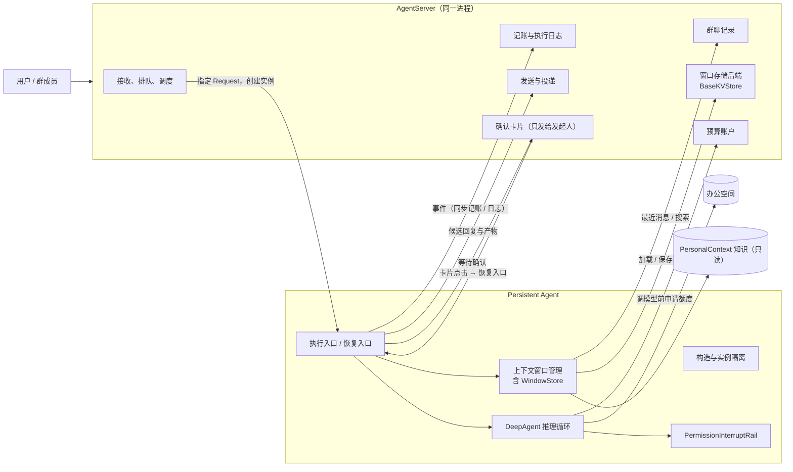
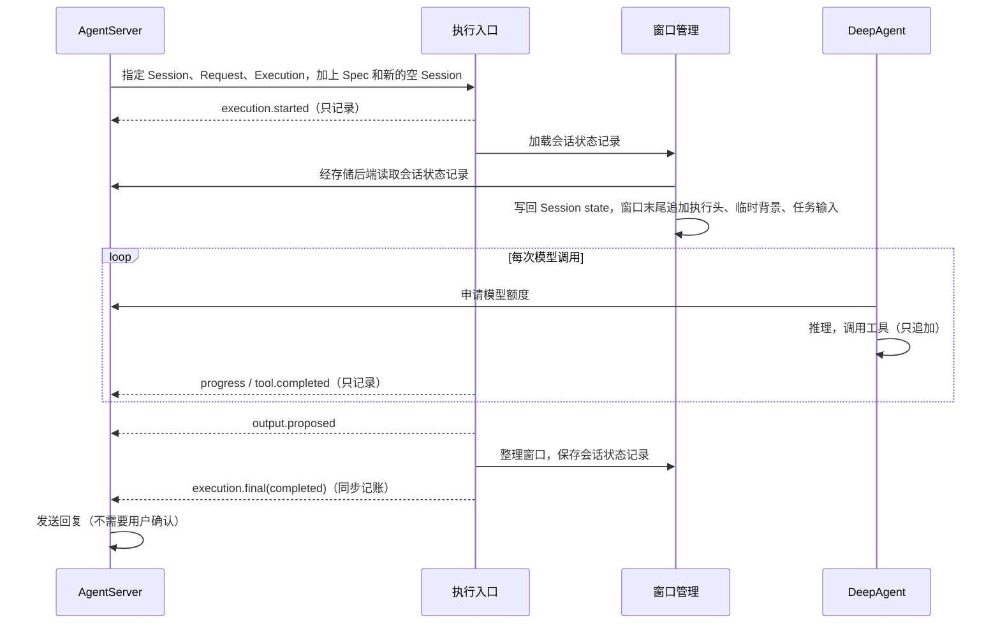
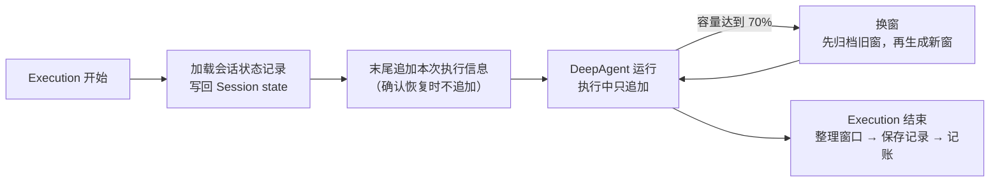
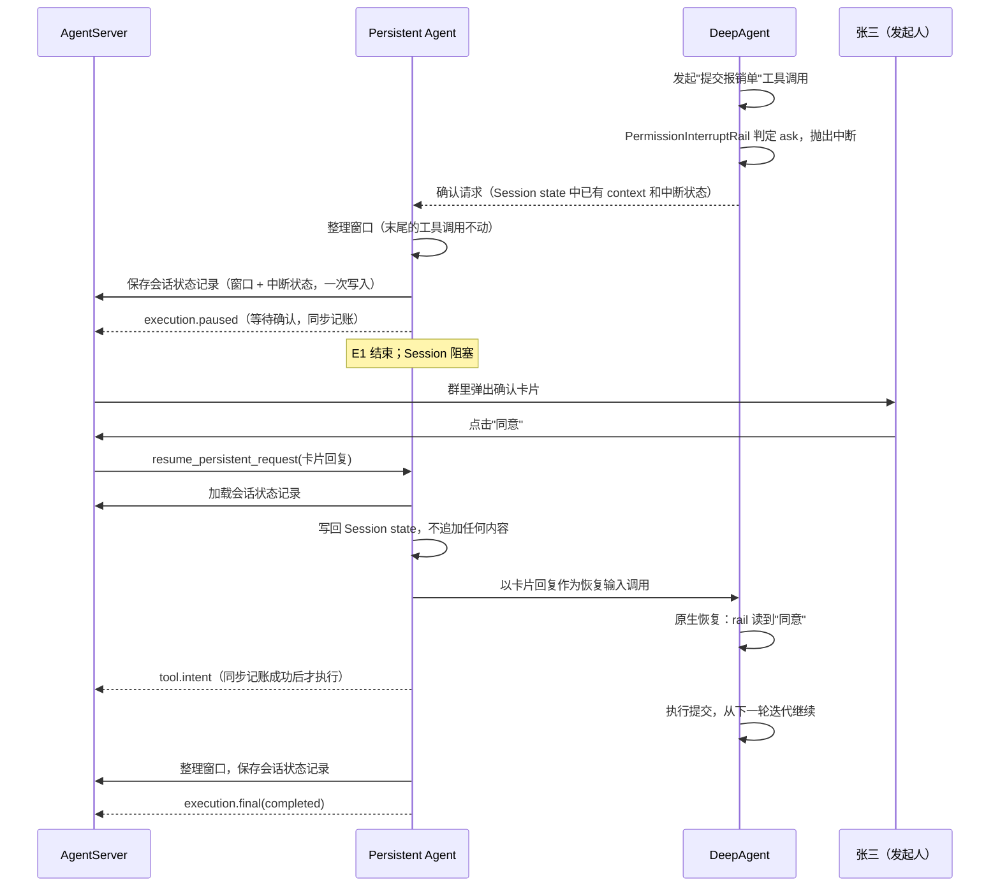
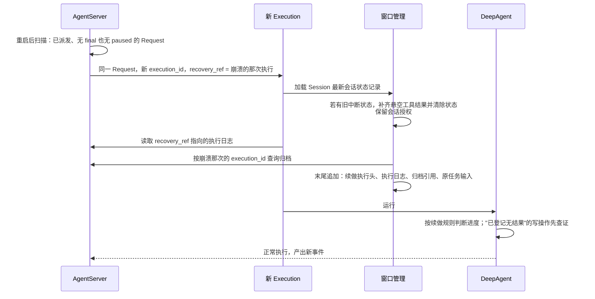

# Persistent Agent 设计（v2）

| 项 | 内容 |
| --- | --- |
| 类型 | 目标设计草案；标注"已实现"的部分以代码为准，其余均为拟议 |
| 最近一次修订日期 | 2026-10-07 |
| 关联模块 | `openjiuwen.harness.persistent_agent` |
| 设计概览 | [Persistent Agent 设计概览](persistent-agent-overview.md)（目标与原则不变） |
| 旧版详细设计 | [persistent-agent-architecture.md](persistent-agent-architecture.md)（保留不改，本文替代其作为详细设计讨论稿） |
| 开发计划 | [persistent-agent-development-plan-v2.md](persistent-agent-development-plan-v2.md) |

**本文与旧版的核心区别**（详见附录 B）：

1. **不再按"每一步都必须能从崩溃中恢复"来设计。** 执行中正常记录日志；崩溃后由新的 Execution 读取上一次的日志，让 Agent 自己判断进度并继续。
2. **删除旧版自建的 Checkpoint，也不使用 agent-core 的 checkpointer。** 跨 Execution 需要保留的状态，由窗口管理按白名单保存为一条"会话状态记录"。
3. **Persistent Agent 与 AgentServer 分成两部分写。** AgentServer 部分只写"必须保证什么"，不写怎么实现。
4. **前提假设**：Persistent Agent 运行在 AgentServer 进程内，向服务端直接调用记账接口；所有事件统一 `await record()`；普通日志允许缺失，失败只记诊断，不阻塞后续关键事件；关键事件等待自身落盘，final 还须确认所引用的候选输出已保存，失败停止，不设计记账"结果未知"状态。
5. **用户确认直接复用 harness 现有的 `PermissionInterruptRail` 和中断恢复机制**，由这件事的发起人在群里点击确认卡片。
6. **上下文按 Execution 的生命周期管理**：开始时加载窗口，执行中只追加，容量达到 70% 时换窗，结束时保存。不再像旧版那样每次模型调用都重新组装，以保护模型的前缀缓存。

---

## 1. 这是什么

**一句话：** Persistent Agent 给原生 `DeepAgent` 加一层"在指定 Session 里执行"的外壳。它让同一个 Agent 能同时服务多个群聊、私聊和定时任务：各会话的工作互不干扰，执行过程可追溯，中断后能接着做。

它**不是**新的 Agent 类型：推理、规划、调用工具仍然是 DeepAgent。外壳只做四件事：

1. 把一次执行固定到一个 Session（隔离）；
2. 管理这个 Session 的上下文窗口和跨执行状态（上下文）；
3. 把执行过程报告给 AgentServer（记账与日志）；
4. 关键操作前请发起人确认（用户确认）。

### 贯穿全文的例子

> "报销助手"是一个 Agent，同时出现在三个地方：
>
> - **报销群**：张三在群里说"帮我把这周的发票整理成报销单，提交到财务系统"；
> - **和李四的私聊**：李四让它查一下差旅标准；
> - **每天 9 点的定时任务**：汇总前一天未处理的报销。
>
> 三处各是一个独立的 Session，使用同一份 Agent 配置和同一个办公空间，但各自的上下文、待办和进度互不可见。
>
> 张三这件事里，"提交到财务系统"是对外写操作，执行前群里会弹出确认卡片，只有**张三本人**点击才有效。执行到一半如果服务重启，新的执行会读上一次的日志，发现"发票已整理完、报销单已生成、提交操作已登记但没有结果"，于是先去财务系统查证，再决定是否提交。

### 本期范围

| 本期做 | 本期不做 |
| --- | --- |
| 指定 Session 内执行；群消息参与判断；上下文窗口管理与换窗 | 跨 Session 共享私有状态 |
| 记账与执行日志；发起人确认；停止和取消 | 程序层面的精确崩溃恢复（改由 Agent 读日志自行判断） |
| 办公空间文件读写；PersonalContext 知识只读；群聊记录查询 | 主动学习（独立扩展，见附录 D） |
| 向 AgentServer 交出候选回复和产物 | 渠道发送、排队调度、预算账户、群消息存储、管理报表（属于 AgentServer） |
| 单轮执行（一次执行内可多次调用模型和工具） | task-loop、同步子代理、异步及持久子代理（验证后逐项开放，见第 5.1 节和附录 D） |

## 2. 核心概念

| 概念 | 白话 | 例子 |
| --- | --- | --- |
| **Agent** | 数字同事本人：长期身份加上能力配置 | 报销助手 |
| **Session** | 它参与的一段独立对话 | 报销群、和李四的私聊、定时任务，各算一个 |
| **Request** | Session 里的一件具体事情 | "整理发票并提交报销单" |
| **Execution** | 处理这件事的一次实际执行 | 第一次执行在等待确认时结束，第二次接着做：Request 只有一件，Execution 有两次 |
| **Window（窗口）** | 模型能看到的工作上下文，每个 Session 任意时刻只有一个当前窗口 | 太长时换窗：旧窗归档，生成新窗 |
| **会话状态记录** | 跨 Execution 需要保留的 Session 状态，按白名单保存为一条记录 | 当前窗口、等待确认时的中断状态、"本会话记住"的确认选择 |
| **执行日志** | 每次 Execution 做过什么的记录 | "整理发票 → 成功；提交操作已登记 → 无结果" |
| **办公空间** | Agent 的工作目录，多个 Session 共用 | 报销模板、整理好的报销单 |

旧版的 **Checkpoint 概念已删除**。上下文和跨执行状态由会话状态记录负责，一次执行之内的进度靠执行日志。

### 2.1 状态归属

| 归属 | 内容 | 存在哪 |
| --- | --- | --- |
| **Session 私有** | 会话状态记录（当前窗口、中断状态、本会话确认选择、DeepAgent 运行状态） | 窗口存储（本模块实现，后端由 AgentServer 提供） |
| | 历史窗口归档 | 窗口存储（本模块实现，后端由 AgentServer 提供） |
| | 执行日志 | AgentServer 的事件存储 |
| | 会话草稿 | 办公空间的 `sessions/<session_id>/` 子目录 |
| **Agent 共享** | Agent 配置（Spec，含确认规则） | AgentServer 发布 |
| | 办公空间（除各会话草稿目录） | 文件系统，按权限读写 |
| | PersonalContext 知识 | 只读，按授权读取发布版本 |
| **群所有** | 群聊记录 | AgentServer；Session 只能按授权读取 |

**Session 私有**指其他 Session 不能读取，即使是同一个 Agent 的其他 Session 也不行。

## 3. 职责边界总览



| AgentServer 负责 | Persistent Agent 负责 |
| --- | --- |
| 收消息，判定属于哪个 Session，排队 | 接到指定的一件事，然后执行 |
| **保证同一 Session 同时只有一个执行者** | 一个实例只绑定一个 Session 和一次 Execution |
| 每次执行提供一个新的空 Session (runtime)，服务端不额外调用 `pre_run / post_run` | 由 PA-04 隔离原生执行路径的 checkpointer 状态读写，自己加载和保存会话状态记录 |
| 存储群聊记录，提供最近消息和搜索接口 | 执行开始时取最近消息作为背景；执行中按需搜索 |
| 提供窗口存储后端（`BaseKVStore`），负责命名空间隔离、保留期和删除 | 实现窗口存储（`WindowStore`）：会话状态记录和归档的格式、读写与检索；决定窗口内容、何时换窗 |
| 预算账户：预占、结算 | 每次调模型前申请额度，调用后回报实际用量 |
| 保存事件和执行日志 | 产出事件；关键事件等待记账成功后再继续 |
| 向发起人展示确认卡片，鉴别点击人身份，回调恢复入口 | 关键操作前中断并给出确认内容，恢复后继续或跳过 |
| 发送回复、上传文件到群 | 交出候选回复和产物引用，不直接发送 |
| 重启后对中断的执行发起续做 | 读取上一次的执行日志，接着做 |
| 发布 Agent 配置（含确认规则） | 提供"可配置操作"查询接口，按 Spec 中的规则执行 |

**前提假设：** Persistent Agent 运行在 AgentServer 进程内，端口都是进程内的直接调用。将来如果拆成跨进程部署，需要单独升级记账协议（引入超时查询和执行者代次），见附录 C。

---

# 第一部分：Persistent Agent 侧设计

## 4. 构造与实例隔离（已实现，PA-01～03）

这部分已经在代码中实现，本节只按代码现状描述。

- **配置**：[`PersistentAgentSpec`](../../persistent_agent/schema/spec.py) 继承 `DeepAgentSpec`，是一份扁平配置，带 `fingerprint()` 用于校验版本。
- **构造**：[`create_persistent_agent(spec, context=...)`](../../persistent_agent/factory.py) 返回**原生 `DeepAgent`**，不新建 Agent 类。构造过程不调用模型，也不调用端口。
- **一次执行的上下文**：[`PersistentBuildContext`](../../persistent_agent/schema/build_context.py) 携带 [`ExecutionContext`](../../persistent_agent/schema/execution.py)（身份与权限快照）、Session 和端口集合。它只能使用一次，并为这次执行分配独立的 `tool_owner_id`，避免同名有状态工具相互覆盖。
- **隔离**：[`execution/binding.py`](../../persistent_agent/execution/binding.py) 提供内部的 `invoke_bound / stream_bound / abort_bound / close_bound`：
  - 调用前校验 Agent、Session、Execution 是否都匹配；
  - 拒绝同一实例的并发调用；
  - 停止和清理只影响自己这次执行的资源。

**结论：一个 Execution 对应一个实例。** 实例用完即清理；同一 Session 的下一次执行（包括确认恢复）由新实例加上新的空 Session，再由窗口管理放回会话状态记录。

## 5. 一次执行的主流程

### 5.1 三个入口（拟议，PA-04）

```text
execute_persistent_request(spec, context, inputs: RequestInput) -> AsyncIterator[AgentEvent]
resume_persistent_request(spec, context, confirm_reply: ConfirmReply) -> AsyncIterator[AgentEvent]
abort_persistent_request(context, *, reason: "cancel" | "stop") -> None
```

两个执行入口返回的事件流由 AgentServer 持有并持续消费，直到流结束或明确抛出异常；收到 `final` 或 `paused` 后仍继续消费，让执行入口完成收尾和资源清理。前端只订阅服务端转发的展示通道，断开只结束订阅，见第 13 节。

| 入口 | 用于 | 调用方 |
| --- | --- | --- |
| `execute_persistent_request` | 新的 Request、崩溃续做、非确认暂停后继续 | AgentServer 调度 |
| `resume_persistent_request` | 确认恢复（权限确认或主动提问的回复，以及超时） | AgentServer 的卡片回调 |
| `abort_persistent_request` | 取消或停止正在执行的这件事（第 10.4 节） | AgentServer 的独立控制任务 |

两个执行入口内部组合已有的函数，不另写一套推理循环：

1. `create_persistent_agent(spec, context)`：构造实例；
2. （仅 `execute`，且为群消息）参与判断（第 6 节）；选择忽略的直接结束；
3. **加载会话状态记录**，写回 Session state（第 7.8 节）；崩溃续做与停止后继续先处理旧中断状态、读取执行日志，再追加本次执行信息（第 11.2 节）；新的 Request 按第 7.4 节追加，`resume` 保留中断状态，不追加任何内容；
4. `stream_bound(...)`：运行 DeepAgent（`resume` 以交互回复作为恢复输入），把原生流式输出映射成 `AgentEvent`；执行中需要时换窗（第 7.6 节）；
5. **整理窗口 → 保存会话状态记录 → 记账 `paused` / `final`**，顺序固定（第 7.7 节）；再调用 `close_bound` 清理资源。

**任务输入 `RequestInput`：**

| 字段 | 说明 |
| --- | --- |
| `kind` | `group_message / direct_message / scheduled`；只有 `group_message` 走参与判断，私聊和已触发的定时任务直接执行 |
| `text` | 原任务正文 |
| `source` | 消息来源：群消息复用 `GroupMessage`；私聊保留必要来源信息；定时任务没有触发消息 |
| `reply_target` | 回复投递目标 |
| `attachment_refs` | 附件引用 |
| `continue_instruction` | 可选的续做指示；只有存在 `recovery_ref` 时才能使用 |

触发消息 ID 用于来源关联、去重和从背景消息中排除当前消息，不作为最近消息检索的游标（游标见第 7.4 节）。续做时服务端重新传入原任务输入，另外附带 `continue_instruction`。

**交互回复 `ConfirmReply`：** 由若干回复项组成，每项包含 `tool_call_id`（中断输出中的交互 ID，通常即工具调用 ID）、`kind: permission | answer` 和对应内容，统一转换为原生 `InteractiveInput`，按交互 ID 关联被中断的调用：

| 回复类型 | 内容 | 转换 |
| --- | --- | --- |
| `permission` | 同意 / 同意并本会话记住 / 拒绝（可附反馈） | 转换为 `ConfirmPayload`；本会话记住为 `approved=True, auto_confirm=True, persist_allow=False`，不开放永久允许 |
| `answer` | `outcome: answered / timed_out`，`answers` 为“问题文本 → 回答” | 转换为 `AskUserPayload.answers`；漏答的问题填“（未回答）”，超时时每个问题填“（超时未获得回答）”，原生 rail 照常生成工具结果，不扩展原生类型 |

- 入口只校验回复结构、交互 ID 和问题对应关系，不判断答案是否合理；允许部分回答和自由文本，“不知道”也是有效回答。
- 交互 ID 必须属于当前等待现场且不重复，答案键必须对应原问题；同一次提问中的问题文本应唯一。
- 等待现场（中断状态、所属 Request 和回复目标）来自会话状态记录：恢复入口先加载记录，核对所属 Request 与本次执行上下文一致，再校验回复，校验通过才调用原生恢复。
- 无效回复只拒绝本次恢复，不保存、不记账，原任务继续等待有效回复或超时。
- Agent 可以先推进不依赖缺失信息的工作；必要信息未取得时不能猜测后执行，也不自动重复同一问题。

**一期执行模式：** 只开放单轮执行，一次执行内可以多次调用模型和工具。Persistent Spec 须显式填写 `enable_task_loop=False`，并且 `subagents` 为空、`enable_async_subagent=False`、`enable_subagent_runtime=False`、`add_general_purpose_agent=False`（它会在子代理列表为空时自动注入子代理）。配置声明和实际装配结果都要检查，不支持的模式在执行前明确拒绝，不在运行时悄悄关闭已发布的开关。task-loop、同步子代理、异步及持久子代理验证后逐项开放（附录 D）。

**能力开放：** 正式入口只开放已接入并验证的能力。参与判断接入前拒绝群消息；会话状态记录接入前不能执行，加载失败不降级为空窗口；续做接入前拒绝带 `recovery_ref` 的执行，不按新任务重跑；写工具在意图记账接入后开放。

### 5.2 正常执行的主干时序（李四的私聊请求）



带确认、换窗、崩溃的完整流程见第 12 节。

## 6. 参与判断

只有**群消息**需要判断；私聊指令和已触发的定时任务直接执行。

- 三选一：**忽略 / 回应 / 主动插话**。被 @ 是强信号，但不代表必须回答。
- 判断是**一次独立的轻量模型调用**：只带职责、当前消息和少量最近群消息（来自 `GroupChatPort`），不加载窗口、不写入窗口，也不开放写工具。
- 选择忽略：产出 `execution.final(ignored)` 后结束，不生成正式任务，也没有回复。被忽略的消息不会进入窗口，下次执行时作为最近群消息的背景出现。
- 判断失败（模型异常、输出格式不对）：有限次重试后报失败，**不能记为忽略**。

本期每条群消息都作为 Request 进入 Session 的串行队列，轮到时再判断。Agent 忙于长任务时判断会滞后；把判断改为不占用 Session 的轻量路径列入后续扩展（附录 D）。

## 7. 上下文管理

### 7.1 设计原则

**为什么不复用现有的上下文 rail。** harness 现有的 `ContextAssembleRail`、`PersonalContextRail` 和 `ContextProcessorRail` 的默认压缩链，都是为"每次模型调用都刷新一遍、按阈值自动压缩"设计的：

- 往系统提示词里写动态片段（例如 `tools` 片段），内容一变，整个前缀缓存失效；
- 默认压缩链会自动改写历史，和 Persistent Agent 自己决定的换窗时机冲突；
- 卸载和压缩归档写在共享的办公空间里，同一 Agent 的其他 Session 可以用文件工具读到。更严重的是，**状态记录如果放在 Agent 工具可访问的任何位置，模型就能改写中断状态或"本会话记住"的选择，从而绕过发起人确认**。

因此 Persistent Agent **自建一套按 Execution 生命周期的窗口管理**，并且在 Persistent Agent 中**不挂载**上述三个 rail。

**保留复用的部分。** `PromptAttachmentManager` 的"只在末尾追加增量"通道（[prompt_attachment_manager.py](../../../prompts/prompt_attachment_manager.py)）符合"执行中只追加"的要求，可以作为执行中追加动态内容的实现手段。

**前缀缓存原则：**

1. 一次 Execution 内，**系统提示词和工具定义固定不变**：不增删工具，不往系统提示词里放动态内容。
2. **动态内容只追加到末尾**，不改写已有内容。
3. 每次 Execution 只需要做一次的事情（续做日志、知识版本、最近群消息），**在开头一次性注入**。
4. 撤权**在下一个 Execution 生效**。确实需要立即生效的，主动换窗，接受一次缓存失效。
5. **换窗是唯一计划内的改写点**，阈值定为上下文容量的 70%，尽量少发生。
6. 参与判断用独立调用，有自己的短前缀，不污染窗口。

### 7.2 Session、Request、Execution、Window 的关系

**一句话：Session、Request、Execution 是"做事"的层级；Window 是"上下文"的层级。两者按 Session 对齐，在时间上交错，互不嵌套。**

| 关系 | 数量 | 说明 |
| --- | --- | --- |
| Session : Request | 1 : N | 同一 Session 的 Request 串行处理 |
| Request : Execution | 1 : N | 确认恢复、崩溃续做、停止后继续，都会产生新的 Execution |
| Session : 当前窗口 | 1 : 1 | 窗口按 Session 组织，和 Request 无关 |
| Session : 窗口（含归档） | 1 : N | 每换一次窗，链上就多一个 |
| Window : Request | N : M | 一个窗口可以覆盖多件事；一件长的事也可以跨越多个窗口 |
| Execution : Window | 1 : N | 一次执行中可以换多次窗，同一时刻只用一个 |
| 同一 Session 的活动 Execution | 最多 1 | 由 AgentServer 保证，所以窗口存储不需要并发控制 |


**时间线（报销群）：**

| 时刻 | 发生的事 | Request / Execution | 窗口操作 | 当前窗口 |
| --- | --- | --- | --- | --- |
| 1 | 张三："整理发票并提交" | Q1 / E1 开始 | 加载当前窗口（新 Session 则创建 W1），末尾追加本次执行信息 | W1 |
| 2 | 整理发票，内容越来越多 | Q1 / E1 | 达到 70%，换窗：**W1 先归档**，再生成 W2 | W2 |
| 3 | 准备提交，触发确认 | Q1 / E1 暂停 | **保存会话状态记录**（W2 + 中断状态），E1 结束；Session 阻塞 | W2 |
| 4 | 张三点击"同意" | Q1 / E2（确认恢复） | 放回 W2 和中断状态，**不追加任何内容**，原生恢复 | W2 |
| 5 | 提交完成 | Q1 / E2 完成 | 整理并保存 | W2 |
| 6 | 王五在群里闲聊 | Q2 / E3，判断为忽略 | **不写入窗口** | W2 |
| 7 | 张三："再查一下审批进度" | Q3 / E4 开始 | 加载 W2，把王五的闲聊作为最近群消息背景追加 | W2 |
| 8 | 执行中换窗，然后进程崩溃 | Q3 / E4 | W2 已归档（带 E4 的 `execution_id`），生成 W3；**崩溃导致 W3 没有保存** | 仍是 W2 |
| 9 | 服务端重启后续做 | Q3 / E5 | 加载 W2，追加 E4 的执行日志、按 E4 查到的归档引用和原任务输入 | W2 |

**规则：**

1. **窗口只由 Execution 读写**；Request 和 Session 不直接操作窗口。
2. **加载的永远是 Session 的当前窗口**，不存在"加载某个 Request 的窗口"。
3. **执行中只追加**；换窗是唯一的改写点。
4. **换窗时旧窗先归档；Execution 结束时保存会话状态记录。** 崩溃时会话状态记录保持不变。
5. **被忽略的群消息不进入窗口。**

### 7.3 窗口生命周期



### 7.4 Execution 开始：窗口的组成

顺序原则是：**越稳定的放越前面，越临时的放越后面**。

```text
┌ 系统提示词 + 工具定义       ← 由 Spec 固定，所有 Execution 相同
├ 已保存的窗口（历史段落）     ← 上一次 Execution 保存的内容，可缓存的前缀
├ 本次执行头                   ← request_id、execution_id、执行类型
├ 临时背景块（标记为临时）     ← 最近群消息、知识导航、续做日志等
└ 本次任务输入                 ← 放在最后，离模型生成最近
   ↓ 执行中只追加：模型回复、工具调用和结果……
```

| 执行类型 | 本次执行头 | 临时背景块 | 任务输入 |
| --- | --- | --- | --- |
| **新的 Request** | 类型为"新任务" | 最近群消息（含被忽略的消息）、知识导航 | 用户的新请求 |
| **确认恢复** | **不追加**（执行信息记在结束标记里） | **不追加** | 卡片回复**作为中断恢复的输入**，不作为消息 |
| **崩溃续做、非确认暂停后继续** | 类型为"续做"，注明 `recovery_ref` 指向的 `execution_id` | 最近群消息、知识导航，以及该次执行的日志和归档引用 | **重新注入原任务输入**，有继续指示时一并追加 |
| **群消息参与判断** | 不加载窗口，见第 6 节 | — | — |

**确认恢复为什么不追加任何内容：** 等待确认时，窗口末尾是模型发起、还在等结果的工具调用。按模型协议，工具结果必须紧跟在工具调用后面，中间插入任何消息都会被模型 API 拒绝。

**续做为什么要先处理旧中断状态：** 确认恢复后如果崩溃，加载到的可能仍是更早的等待确认记录；必须先补齐悬空工具结果、清除过期中断状态，再追加执行头和背景，不能直接把日志插在工具调用后面。正常确认恢复不做这个处理，见第 11.2 节。

**其他规则：**

- 同一 Session 的第一个 Execution 没有会话状态记录，就创建一个空窗口。
- **去重**：触发本次执行的消息已经是任务输入，组装最近群消息时要排除它（实现阶段处理）。
- **增量获取群消息**：每次 Execution 结束时，在执行结束标记里记下本次看到的最后一条群消息 ID；下次执行用它作为游标，只取之后的新消息，再往前多取几条作为衔接。
- **知识版本**：PersonalContext 的授权范围和知识版本在 Execution 开始时解析一次，知识导航放进临时背景块，执行中不再刷新（前缀缓存原则 3、4）。

### 7.5 执行中：只追加

- 模型回复、工具调用和结果，按 DeepAgent 原有方式追加到窗口末尾；
- 执行中需要新增的动态内容，通过附件通道以增量形式追加；
- 查询群聊记录和历史归档的结果，作为工具结果进入窗口（第 7.9 节）；
- 不改写、不删除已有内容；系统提示词和工具定义保持不变。

### 7.6 换窗

**触发：** 两次模型调用之间，当前窗口达到上下文容量的 **70%**。预留的 30% 用于生成旧窗摘要。Agent 主动请求换窗列入后续扩展（附录 D）。

**安全边界：** 必须等工具调用和工具结果都成对完整之后才能换，不能在中间切断。

**步骤（顺序固定）：**

1. **先归档旧窗**，同步写入窗口存储。归档带上 `session_id`、窗口序号、产生它的 `execution_id`、覆盖的 `request_id`；归档失败就不换窗，如果此时已经放不下，暂停并说明原因。
2. 调用一次模型生成旧窗摘要（申请额度）。失败可重试，原文已在归档里，不会丢。
3. 组装新窗，替换 ContextEngine 中的上下文；记录 `window.switched`。

**新窗的内容：**

| 内容 | 来源 |
| --- | --- |
| 旧窗摘要 | 第 2 步生成 |
| 任务状态：目标和待办 | DeepAgent 的 `task_plan` |
| 未完成的写操作 | 本次执行的写操作意图记录 |
| 归档引用 | 指向刚归档的旧窗 |
| **当前的执行头和任务输入** | **重新注入**，因为原来那份已随旧窗换出 |
| 最近几轮原文 | 保证工具调用和结果完整成对 |

如果新窗的最小必要内容仍然放不下，产出 `execution.paused(context_unfit)` 并说明原因，不静默截断。

**旧窗持久化**，不能只作为当前 Execution 的临时文件，原因有三：

1. 窗口跨 Request：几天后问到的事情，答案可能在早已换出的旧窗里；
2. 新窗摘要引用了归档：归档如果是临时的，摘要里的结论就无法回查原文；
3. 崩溃续做需要它：那次执行期间的工作，只有归档和执行日志里还有记录。

**归档什么：**

| 内容类型 | 例子 | 归档方式 |
| --- | --- | --- |
| 可以从源头重新获取的 | 读文件、读网页、查知识库、查群聊记录的结果；临时背景块 | **只存来源引用**（路径、URL、消息 ID、版本），需要时重新读取，读取时会重新检查权限 |
| 无法重新获取的 | 用户消息、模型回复、写操作回执、外部接口返回的一次性结果 | **持久化原文** |

归档存放在窗口存储里，属于 Session 私有，**不放在共享的办公空间，也不放在 Agent 工具可访问的任何位置**（第 7.8 节）。

### 7.7 Execution 结束：整理并保存

**顺序固定：整理窗口 → 保存会话状态记录 → 记账 `paused` / `final`。**

| 顺序 | 在中间崩溃的后果 |
| --- | --- |
| 先记账，再保存 | 服务端认为已完成，但窗口里没有这次的工作内容，下一件事加载时这段上下文永久丢失 ❌ |
| **先保存，再记账** | 窗口已有完整内容和结束标记，只是没收到记账；触发崩溃续做时，Agent 看到"已经产出最终结果"，直接整理交出 ✅ |

**只保存整理过的当前窗口，覆盖保存；不为每个 Execution 另存窗口快照。** 需要审计时用执行日志回看。

| 内容 | 处理 | 理由 |
| --- | --- | --- |
| 已保存的历史段落 | **原样保留** | 保持前缀不变 |
| 本次执行头 | 保留，压缩成一行 | 标记"这是哪件事的第几次执行" |
| **临时背景块** | **删除** | 群消息和知识导航下次会重新注入最新版本；续做日志用完即失效 |
| 用户输入、确认结果 | 保留 | 对话事实 |
| 模型回复、工具调用和结果 | 保留；可以重新获取的大结果换成来源引用 | 工作过程，后续 Request 可能用到 |
| **执行结束标记** | **新增** | 简短记录：结局（完成 / 暂停并注明原因 / 取消 / 失败）、交出的产物、本次看到的最后一条群消息 ID |

**等待确认时的特殊规则：** 末尾那个等待结果的工具调用**一律不动**，结束标记记在会话状态记录的元信息里，不追加到窗口中。临时背景块在工具调用之前，可以照常删除。

被删掉的临时块位于本次执行段落的开头，已保存的历史段落不受影响，下次执行的前缀命中不受影响。

| 结局 | 是否保存 |
| --- | --- |
| 完成、取消、失败 | 保存 |
| 暂停等待确认 | 保存，并包含中断状态 |
| 被停止 | 保存（取决于停止路径能否拿到上下文，见附录 C） |
| 预算不足、容量不足、可恢复错误导致的暂停 | 保存 |
| 参与判断后忽略 | 没有写入窗口，无需保存 |
| 崩溃 | 无法保存，靠执行日志续做 |

### 7.8 会话状态记录（替代 checkpointer）

**Persistent Agent 不使用 agent-core 的 checkpointer。** 原因：

- 现有中断恢复只读写 Session state，并不直接依赖 checkpointer（[handler.py:279](../../../../core/single_agent/interrupt/handler.py:279)）；checkpointer 只是把 Session state 存到外部再读回来的工具；
- checkpointer 保存的是整个 Session state，如果再由窗口管理另存一份当前窗口，就会出现两份上下文，加载时不知道以哪份为准；
- 默认的内存实现重启即丢失，而且数据格式完全跟随 core 内部实现。

**做法：** AgentServer 每次执行都提供**新的空 Session**，服务端不额外调用 `pre_run / post_run`。跨 Execution 的状态只由窗口管理（`WindowStore`）保存和加载：执行开始时把会话状态记录写回 Session state，结束时按白名单取出、整理后保存。

**服务端不调用，不等于原生执行路径不调用。** ReAct 流式路径仍会调用 `pre_run` 和 `commit`（[react_agent.py:2984](../../../../core/single_agent/agents/react_agent.py:2984)、[react_agent.py:3050](../../../../core/single_agent/agents/react_agent.py:3050)），进入 checkpointer 的恢复和保存逻辑。新的空 Session 仍可能按 Session ID 读回旧记录，覆盖 `WindowStore` 加载的状态。

**执行路径隔离（PA-04）：** 为 `Session` 和 `create_agent_session` 增加可选参数 `checkpointer`。显式传入时，`pre_run` 的状态加载和 `commit` 的状态保存都使用注入的实现；未传入时保留原有行为（内部 Session 在构造时取得默认实现，`pre_run` 在执行时取得全局实现），个人版不变。AgentServer 为每次 Execution 创建新的空 Session 并显式注入不读写存储的 `NoopCheckpointer`；`InMemoryCheckpointer` 仍会恢复和保存状态，不能当作空实现。隔离按 Session 生效，不修改全局 checkpointer 配置；PA-04 在执行前检查隔离配置，不符合就拒绝开始。原生 `pre_run`、`commit` 等生命周期照常运行，保留 Session 创建回调、流关闭、取消收敛和资源清理，只是其中的 checkpointer 恢复和保存不读写存储；执行过程中仍正常读写当前 Session state。正常结束、确认暂停与恢复、取消、停止、异常和提前关闭流都按此执行。

| Session state 字段 | 作用 | 什么时候存 |
| --- | --- | --- |
| `context` | 当前窗口（ContextEngine 从这里加载上下文） | 每次执行结束 |
| `__react_agent_interruption__` | 中断状态：被拦截的工具调用、迭代轮次、原始请求 | 等待确认时 |
| `INTERRUPT_AUTO_CONFIRM_KEY` | "本会话记住"的确认选择 | 每次执行结束 |
| DeepAgent 运行状态（可选） | task_plan 等 | 每次执行结束 |

**白名单以外的字段一律不保存。** 所有字段**写在同一条记录里，一次写入**，不存在"窗口存了、中断状态没存上"的情况。

**窗口存储（`WindowStore`）的分工：** 存储逻辑由本模块实现，存储后端由 AgentServer 注入。

| 职责 | 归属 | 内容 |
| --- | --- | --- |
| 数据格式与逻辑 | **Persistent Agent**（内部组件 `WindowStore`） | 会话状态记录的结构与序列化；归档的组织方式；按 `execution_id` 查询归档；归档原文检索 |
| 存储基础设施 | **AgentServer**（注入存储后端） | 数据库或 Redis、多节点共享、备份、命名空间隔离、按保留期清理、删除 Agent 或 Session 时清空数据 |

这样划分的原因：记录里存的是 ContextEngine 上下文和 ReAct 中断状态等 agent-core 内部格式，检索也要理解消息结构，这些应由本模块掌握；而存储基础设施本来就由服务端运维。本模块可以用内存实现的后端完成全部单元测试。

**存储后端（本期只支持 `BaseKVStore`）：**

| 后端 | 适用场景 | 要求 |
| --- | --- | --- |
| [`BaseKVStore`](../../../../core/foundation/store/base_kv_store.py) | 服务端通过统一 KV 接口提供 Redis、数据库等存储实现 | 服务端注入实例，保证持久化和隔离 |

窗口存储后端是必需依赖，构造时检查其符合 `BaseKVStore` 契约，不读取或写入存储。接口类型符合不等于数据持久化，跨重启保存由服务端提供的具体实现保证；内存后端只用于测试。专用 SysOperation 文件系统后端不在本期开发和验收范围。

**后端必须满足三条：**

1. **Agent 的工具访问不到**：不在办公空间里，也不在 Agent 工具所用的 SysOperation 里。否则模型可以改写中断状态或"本会话记住"的选择，绕过发起人确认。
2. **持久化**：跨 Request、跨重启都在。沙箱是计算环境，容器会按配置回收，不能用作窗口存储。
3. **会话状态记录一次写入**：用 `set` 写整条记录。

**键的设计（由本模块定义）：**

| 键 | 内容 |
| --- | --- |
| `pa:{agent_id}:{session_id}:state` | 会话状态记录 |
| `pa:{agent_id}:{session_id}:archive:{序号}` | 一份归档 |
| `pa:{agent_id}:{session_id}:archive_index` | 归档索引：序号、`execution_id`、覆盖的 `request_id`、时间 |

服务端清理某个 Session 的全部数据只需按前缀删除，按保留期清理归档只需读取索引按时间删除，不需要理解其中存储的内容。

**`WindowStore` 的操作与失败语义：**

| 操作 | 失败时 |
| --- | --- |
| `load_state(session_id)` / `save_state(session_id, record)` | 加载失败：不开始执行；保存失败：本次视为未正常结束，按崩溃续做处理 |
| `archive(session_id, execution_id, old_window)` / `list_archives(session_id, execution_id)` | 归档失败：不换窗，必要时暂停并说明原因 |
| `search(session_id, query)` | 区分"确定没有"和"没查完或失败"。本期先用关键词匹配（读取索引后逐份扫描），可参考现有压缩归档检索的实现；数据量大时再考虑向量检索 |

### 7.9 群聊记录与历史检索

群聊记录**存在 AgentServer**，Persistent Agent 通过 `GroupChatPort` 读取：

| 操作 | 用途 | 调用时机 |
| --- | --- | --- |
| `recent_messages` | 最近群消息，作为背景 | Execution 开始时调用一次（以及参与判断时），放入临时背景块 |
| `search_messages` | 搜索历史群消息 | 执行中由模型按需调用，包装为工具 `search_group_messages` |

每条消息包含：`message_id`、发送者（稳定身份 ID 加显示名，并标明是人还是 Agent）、服务端接收时间、正文、@ 了谁、回复的是哪条、附件引用、状态（正常 / 已编辑 / 已撤回，已撤回的不返回正文）、是否属于排队中的请求。

**排队中的请求只能作为背景，不能成为当前任务的指令。** 搜索结果要区分三种情况：找到了、确定没有、没查完或查询失败（不能当作"没有"）。

**两个检索工具要分开：**

| | 群聊记录 | 历史窗口归档 |
| --- | --- | --- |
| 内容 | 群里所有公开消息 | Agent 自己的工作过程 |
| 归属 | 群 | Session 私有 |
| 工具 | `search_group_messages` | `search_session_history` |

合并成一个工具，可能会把 Agent 的私有工作过程当成群公开内容引用出去。私聊 Session 不需要 `GroupChatPort`，私聊对话本身已经在窗口和归档里。

## 8. 办公空间与知识

- **办公空间**：复用 harness 的 Workspace 和文件工具，读写都受权限引擎约束。文件写入属于写操作，按第 9 节记账。会话私有的草稿放在 `sessions/<session_id>/` 下，其他 Session 不能访问。
- **PersonalContext**：只读。通过 `KnowledgePort` 在 Execution 开始时解析授权和版本，导航放进临时背景块（第 7.4 节），正文由模型按需读取。不挂载 `PersonalContextRail`。
- 文件写好了，**不代表任务完成**，也不代表群里能看到。需要群里看到时，交出 `output.proposed` 并写明共享方式，由 AgentServer 上传或发送。

## 9. 事件、记账与执行日志

### 9.1 三级处理

| 级别 | 事件 | 处理方式 |
| --- | --- | --- |
| **用户确认** | 权限引擎判定为 `ask` 的操作；Agent 主动提问 | 复用中断机制，见第 10 节 |
| **同步记账** | `tool.intent`（仅限写操作）、`execution.paused`、`execution.final` | 本事件落盘成功才继续；final 还须确认所引用的候选输出已可靠保存；失败就停止当前执行 |
| **只记录** | 其他所有事件 | 服务端接收入队后即可继续，不等待落盘；普通日志允许缺失；候选输出的可靠交接单独由 final 保证 |

**唯一持久化通道：** Persistent Agent 对所有事件统一 `await record(event)`；入口返回的事件流只用于实时展示，AgentServer 消费流时不再次保存同一事件。

**事件如何排队：** 同一 Execution 的事件按产生顺序调用 record，服务端按 local_seq 维护日志顺序，允许序号缺口。普通事件入队或保存失败后可以记诊断并跳过，其重试不得卡住后续关键记账；关键事件不等待无关的前序普通日志全部落盘。不同 Execution 可以分别处理；队列由 AgentServer 维护，具体实现由服务端决定。

| 情况 | 处理方式 |
| --- | --- |
| 普通事件 | `record(event)` 在接收入队后返回，由服务端异步保存 |
| 关键事件 | `record(event)` 等待本事件落盘后返回；final 还须确认 output_refs 所引用的候选内容及交接信息已可靠保存 |
| 普通事件调用失败 | `record(event)` 抛异常，Agent 只记诊断并继续；普通日志缺失不导致后续关键事件失败 |
| 关键事件调用失败 | `record(event)` 抛异常，Agent 停止当前执行 |
| 保存失败 | 普通日志异步保存失败由服务端记诊断，可以重试或跳过，不阻塞后续关键事件；关键事件自身或 final 所引用的候选输出无法保存时，关键记账抛异常 |
| 实例清理 | 不取消服务端已经接收的事件，队列不随 Agent 实例销毁 |

**最终输出单独保障：** 沿用 final 的 output_refs，不在 final 中另加完整候选正文。需要交接的候选回复或文件必须列入 output_refs；AgentServer 在 final 记账成功前确认这些引用对应的候选内容、目标和共享方式已可靠保存。候选缺失时 final 必须失败，不能删除引用后宣告完成。PA-04 / PA-07 可按原 event_id / output_id 补交候选内容，服务端去重；补交失败不能改为重跑业务任务。此要求只覆盖 final 引用的输出，不扩展为所有前序日志的落盘屏障。

**执行日志尽力保存，不保证完整。** 普通日志即使永久缺失，也不阻塞后续关键事件；无需在关键事件前重发所有失败的普通日志。local_seq 缺口用于日志诊断，不作为关键记账的失败条件。paused 成功只证明本事件已保存；final 成功还证明所引用的候选输出已保存，不能推断全部前序日志完整。续做仍按第 11.1 节查证结果不明的写操作。

**为什么写操作必须先记账：** 防止"写操作已经执行，但没留下任何记录就崩溃了"。执行前登记了意图，续做时就一定能发现这一项没有结果，从而先查证、再决定，而不是盲目重做。

**哪些算写操作：** 以工具声明的副作用属性为准（只读或有副作用）。没有声明的一律按写操作处理。

### 9.2 事件类型（在已实现的 13 种基础上精简）

| 事件 | 用途 | 级别 |
| --- | --- | --- |
| `participation.decided` | 参与判断结果 | 只记录 |
| `execution.started` | 正式开始及执行目标，用于任务展示 | 只记录 |
| `progress.updated` | 进度，以及模型在工具调用之间输出的**中间结论**（每条约 500 字以内） | 只记录 |
| `reply.delta` | 流式回复片段 | 只记录 |
| `model.completed` | 模型调用及实际用量 | 只记录 |
| `tool.intent` | 写操作意图：`operation_id`、工具名、目标、参数哈希，以及**可读的参数摘要**（敏感参数脱敏） | **同步记账** |
| `tool.completed` | **所有工具**的调用结果：工具名、可读的参数摘要、状态（成功 / 失败 / 未知）、**必填的非空白结果摘要**（每条约 500 字以内，成功 / 失败 / 未知均需提供，引用不能替代摘要）、结果引用 | 只记录 |
| `window.switched` | 换窗：旧窗归档引用、新窗序号 | 只记录 |
| `output.proposed` | 候选回复或文件交接 | 只记录（入队后返回；final 成功前须可靠保存其引用的候选输出，再由服务端处理） |
| `execution.paused` | 暂停原因：`awaiting_confirmation / stopped / budget_denied / context_unfit / error`；等待确认时附带被拦截的工具名和参数，供生成卡片 | **同步记账** |
| `execution.final` | 最终结果：completed / ignored / cancelled / failed | **同步记账** |

与已实现的代码相比：删除 `checkpoint.proposed`；`window.activated` 改为 `window.switched`；`control.waiting` 与 `execution.suspended` 合并为 `execution.paused`。见附录 E。

**暂停原因（固定枚举）：**

| 原因 | 含义 |
| --- | --- |
| `awaiting_confirmation` | 等待发起人确认，保留中断现场 |
| `stopped` | 被主动停止，需要明确要求继续 |
| `budget_denied` | 模型额度准入被拒，本次不调用模型 |
| `context_unfit` | 换窗后最小必要内容仍无法放入上下文 |
| `error` | 可恢复的异常导致执行暂停，条件恢复后仍可接续原任务 |

`execution.paused` 结束当前 Execution，原 Request 仍可接续；继续方式见第 11 节。**`paused(error)` 与 `final(failed)` 按任务是否仍可接续区分**：例如模型服务持续不可用、恢复后还能继续原任务，用 `paused(error)`；已确定原任务无法完成、需要结束并告知用户，用 `final(failed)`。

PA-22 定义原因枚举和负载校验；PA-04 实现暂停收尾与事件映射，非确认暂停后的继续复用 PA-17 的统一流程。

**错误与结局（PA-04）：**

- **明确原因优先：** 主动停止为 `paused(stopped)`，取消为 `final(cancelled)`，等待确认为 `paused(awaiting_confirmation)`，额度拒绝为 `paused(budget_denied)`，容量不足为 `paused(context_unfit)`，不归入普通错误。
- **普通运行错误默认暂停：** 可恢复或尚无明确终结依据的原生运行错误产出 `paused(error)`，包括模型调用失败、最大迭代次数耗尽，以及原生以 `result_type="error"` 返回的结果；错误文本不能当作正常回答记为 `completed`。收尾顺序同样是“整理窗口 → 保存状态 → 记账”，原 Request 保留，继续时走统一续做流程；条件未变化时服务端不反复自动续做。
- **明确无法完成才终结：** 只有存在明确终结依据、决定结束原 Request 时才产出 `final(failed)` 并说明原因。单个工具失败、用户拒绝某个操作、重试次数耗尽都不等于任务失败；参与判断失败的结局由参与判断按原因确定，不得记为忽略。
- **预算端口调用失败：** `admit` 抛异常时无法确认额度，不调用模型，产出 `paused(error)`，与 `budget_denied` 区分；`report` 抛异常时模型已经调用，只记诊断并继续，由服务端对账。
- **关键失败向外抛异常：** 会话状态记录加载失败时不开始原生执行；会话状态保存失败、`tool.intent` 记账失败（不执行对应写操作）、`paused / final` 记账失败时停止执行，入口抛异常，由服务端按第 13 节核对落盘记录。普通事件记账失败只记诊断并继续。关键失败即使被原生内部捕获并转换为普通错误结果，也必须保留原始分类、阻止后续执行并最终抛出，不能降级为 `paused(error)`。已落盘结束结果之后的清理错误，不能导致重新执行已经结束的任务。
- **校验拒绝单独处理：** 接受执行前发现输入或 Spec 不合法、能力未开放或交互回复无效时，入口明确拒绝，错误类型与运行异常区分，服务端不对同一份无效输入自动续做。接受任务后查证业务条件、确定任务无法完成的，产出 `final(failed)`。

**最终回答交接（PA-04）：** 从原生最终结果提取完整回答，生成一条 `output.proposed`（稳定的 `output_id`、`target_ref` 为任务输入的 `reply_target`、`share_mode=message`、完整回答正文），并列入 `execution.final.output_refs`。`reply.delta` 只用于实时展示，不能作为唯一的最终回复来源；中间结论、工具日志和错误文本不能当作正常回答。收尾顺序为“交出 `output.proposed` → 整理窗口 → 保存会话状态记录 → 记账 `final` → 清理资源”。没有文本回答不等于任务失败，只有文件结果的任务也可以完成；文件候选、多种共享方式和完整补交随 PA-07 接入，接入前明确能力范围。

崩溃续做查找归档**不依赖 `window.switched` 事件**，而是直接按 `execution_id` 查询窗口存储（第 7.6 节）。

### 9.3 执行日志

**事件流本身就是执行日志**，由 AgentServer 保存，不在本地另写日志文件。

| 方面 | 做法 |
| --- | --- |
| 保存 | 所有事件交给 AgentServer，按 `execution_id` 归档，读取时按 local_seq 返回已保存事件；普通日志允许缺失，关键记账成功不保证日志完整 |
| 用途 | 崩溃后，本次未保存的窗口内容可能丢失；结合已保存日志、窗口和归档了解进度，信息缺失时查证，不推断操作未执行 |
| 读取权限 | 只能读取**同一 Session、同一 Request** 下的执行日志 |
| 为什么不写本地文件 | 本地文件放在 Agent 工具可访问的位置，模型可以改写（与附录 A 第 17 条冲突）；换机器或沙箱回收后可能丢失；和事件流是两份记录，可能不一致 |

**Agent 怎么看到日志：** 不需要模型自己去查。崩溃续做和非确认暂停后继续的 Execution 开始时，由 Persistent Agent（程序）调用 `read_execution_log(recovery_ref)`，把事件整理成一段简短的执行记录，作为临时背景块追加到窗口末尾。停止清理可能删除没有结果的工具调用，所以即使窗口保存成功，也要读日志，不能只根据窗口判断写操作的进度。

**日志非空也可能不完整。** 缺少 tool.completed 时，已登记的写操作仍按“有意图、无结果”先查证；查不清就询问发起人，不能因为没有结果记录而直接重做。中间结论缺失可能需要重新分析；model.completed 缺失不代替预算端口的用量回报，实际用量仍由 BudgetPort.report 负责。

**整理规则：**

1. 丢弃对判断进度无用的事件：`reply.delta`、`model.completed`；
2. 按 `operation_id` 或工具调用 ID，把意图和结果合并成一行；
3. 保留中间结论（`progress.updated`）；
4. 列出按 `execution_id` 查到的本次执行期间的归档；
5. 太长时，**写操作一条不省略**，只读操作可以合并或者只保留最近的若干条。

**整理后的样子：**

```text
上一次执行 E4（请求 Q3，因系统中断未完成）
1. [成功] search_group_messages(关键词="审批进度") → 找到 3 条消息
2. [成功] read_file(reports/0930报销单.xlsx) → 已读取，共 12 行
3. [结论] 审批停在财务复核环节
4. [已登记，无结果] submit_reminder(单号=BX-0930) operation_id=op_12
本次执行期间的归档：archive#7（可用 search_session_history 检索）
```

需要比摘要更完整的结果时，模型可以重新执行只读操作（续做规则允许），或者到当次执行的归档里检索。

## 10. 用户确认与控制

### 10.1 直接复用 `PermissionInterruptRail`

确认能力**完全复用** harness 现有实现，Persistent Agent 不写确认相关的 rail 代码：

- [`PermissionInterruptRail`](../../../rails/security/tool_security_rail.py) 是 [`ConfirmInterruptRail`](../../../rails/interrupt/confirm_rail.py) 的子类，由权限引擎按工具、路径、shell 命令和风险等级判定 `allow / ask / deny`（[permission_engine](../../../security/permission_engine/core.py)）；
- DeepAgent 在配置中 `permissions.enabled` 为真时**自动创建并挂载**这个 rail（[deep_agent.py:774](../../../deep_agent.py:774)）；
- 判定为 `ask` 时，rail 抛出中断，ReAct 把上下文和中断状态写进 Session state，返回确认请求；
- 恢复时，ReAct 读出中断状态，带着回复执行被拦截的工具调用，再从下一轮迭代继续（[handler.py:310](../../../../core/single_agent/interrupt/handler.py:310)）。

**Persistent Agent 只负责一件事：** 在两次执行之间，把白名单里的 Session state 字段保存好、再放回去（第 7.8 节）。

### 10.2 确认卡片与恢复

| 环节 | 做法 |
| --- | --- |
| **卡片内容** | 服务端只根据 `execution.paused(awaiting_confirmation)` 中被拦截的工具名和参数生成确认卡片；rail 默认的提示语不直接展示给用户 |
| **卡片选项** | **同意 / 同意并本会话记住 / 拒绝（可附反馈）**，经 `ConfirmReply` 转换为 `ConfirmPayload`（第 5.1 节）。不提供"永久允许"：全局规则由服务端通过 Spec 发布，不能被一次点击改写，因此服务端也不提供 `persist_allow_rule` 回调 |
| **谁能点** | 只有这件事的发起人；服务端鉴别点击人身份，其他人的点击无效 |
| **恢复** | 服务端回调 `resume_persistent_request`，传入 `ConfirmReply`；新实例放回会话状态记录，校验回复后以其作为恢复输入调用 DeepAgent。**不往窗口追加任何消息**，回答通过工具结果进入上下文 |
| **同意** | 执行被拦截的工具调用；写操作照常先记账 `tool.intent` |
| **拒绝** | 跳过该工具，rail 把发起人的反馈作为工具结果交给模型 |
| **本会话记住** | 选择被写入 `INTERRUPT_AUTO_CONFIRM_KEY`，随会话状态记录保存，本 Session 后续同类操作自动放行 |
| **超时** | 权限确认超时，服务端以"拒绝，原因：确认超时"调用恢复入口；主动提问超时，以 `outcome=timed_out` 调用。Agent 照常收尾，不猜测答案、不视为授权、不自动重复同一问题 |
| **记入日志** | 确认请求和发起人的决定都是事件，续做时 Agent 能看到 |

**等待确认期间，Session 阻塞**：同一 Session 的其他 Request 继续排队，直到确认完成或超时。这样恢复时窗口末尾一定还是那个等待结果的工具调用。允许等待期间处理其他请求列入后续扩展（附录 D）。

续做规则中"查不清就问发起人"，复用同一套机制里的 `AskUserRail`，走相同的卡片和恢复路径。

### 10.3 确认规则的配置接口

| 接口 | 用途 | 实现 |
| --- | --- | --- |
| **查询** `describe_confirmable_operations(spec)` | 列出这个 Agent 的工具及默认确认级别，供 Agent 负责人在服务端界面查看和设置 | 根据 Spec 中的工具列表和权限引擎的默认风险等级生成 |
| **配置** `PersistentAgentSpec.permissions` | 服务端发布 Agent 配置时写入确认规则 | 新增字段，复用 `PermissionsSection` 格式，构造时传入 DeepAgent 配置，纳入配置指纹 |

规则随 Spec 下发，每次执行按发布时的版本生效。注意：`DeepAgentSpec` 目前没有 `permissions` 字段，而 `PersistentAgentSpec` 禁止额外字段，所以需要新增。

### 10.4 停止、取消与补充消息

同进程运行，AgentServer **直接调用**执行侧的包装入口 `abort_persistent_request(context, reason=...)`，不需要轮询控制端口。包装入口根据已有的 `context` 定位实例，内部复用 `abort_bound`：

| 控制 | 做法 | 结果 |
| --- | --- | --- |
| 取消这件事 | `reason="cancel"` | 保存会话状态记录，`execution.final(cancelled)`，原 Request 终结、不自动继续；已发生的外部效果不自动撤销 |
| 停止 Agent | 对所有活动执行调用，`reason="stop"` | 保存会话状态记录，`execution.paused(stopped)`，原 Request 保留；重启后**不自动续做**，需要明确继续或结束 |

- **先记原因，再中断：** 控制原因属于本次执行的运行时信息，不新增控制端口。控制入口只请求中断；等待原生退出、整理窗口、保存状态、记账结束事件和清理资源都由执行入口统一完成，两者不能分别发出结束事件。
- **幂等：** 同一种控制请求重复到达不再重复取消正在收尾的任务，首次接受的原因保留。正常结束与控制请求竞争时，由执行入口统一决定结局；已落盘的结束结果保持不变。
- **尚未进入原生调用：** 执行已启动但还没有进入原生调用时，先记下原因，在进入模型或工具前检查并收尾。
- **服务端职责：** 用独立控制任务调用；控制入口返回不代表保存、记账和清理已完成，服务端继续消费原事件流直到结束或明确异常，旧执行退出、清理完成后才安排同一 Session 的下一次执行。排队中或已经暂停的任务由服务端修改调度状态，不为取消它而重新创建 Agent。主动停止 / 取消的事实由服务端保存，收尾失败不能触发自动续做。

**被停止的任务不阻塞后续 Request。** Agent 重新接收任务后，同一 Session 可以先做其他事情，再明确继续原任务；继续时加载的仍是 Session 最新窗口，不回退到停止时的旧窗口。等待确认的任务仍按第 10.2 节阻塞 Session。

**补充消息一律作为新的 Request。** 张三在 Q1 执行过程中说"只算本月的"，这条消息按普通 Request 排队；等 Q1 结束后，Agent 结合当前窗口和历史归档，自己判断它是对 Q1 的补充还是一件新事情。不使用 DeepAgent 的 `follow_up / steer`。代价是补充信息无法作用于正在执行的任务，必要时 Agent 会修改上一件事的结果。

## 11. 继续执行

| | 确认恢复 | 崩溃续做 | 非确认暂停后继续 |
| --- | --- | --- | --- |
| **性质** | 计划内的暂停 | 计划外的中断 | 主动停止、预算或容量限制、可恢复错误 |
| **触发** | 发起人点击卡片，或确认超时 | 服务端重启后自动发起 | 主动停止须明确要求继续；其余原因可明确继续，或由服务端确认条件恢复后发起 |
| **现场** | **完整保存**：窗口和中断状态在同一条记录里 | 加载最后保存的记录，可能仍带有更早的中断状态 | 加载最新记录；暂停时保存失败或中间执行其他任务时，现场可能不完整 |
| **从哪里继续** | 精确地从被拦截的工具调用继续 | Agent 根据最新窗口、执行日志和归档判断进度 | 与崩溃续做相同 |
| **入口** | `resume_persistent_request` | `execute_persistent_request`，`recovery_ref` 指向待续做的执行 | 与崩溃续做相同 |
| **是否读执行日志** | 不需要 | **需要** | **需要** |
| **复用的机制** | harness 中断恢复 | 最新窗口 + 执行日志 + 续做规则 | 与崩溃续做相同 |

"轮与轮之间"（上一件事正常结束，下一件事开始）不属于以上任何一种，只是正常加载窗口。

### 11.1 续做触发与规则

**触发（简单方案）：** 服务端重启后，对最近一次已派发的 Execution 既没有 `final` 也没有 `paused`、且未被主动停止的 Request **自动续做**，不按停机时长区分，也不额外询问用户。被停止的任务不在此列。

**入口异常不必等服务重启。** 执行或确认恢复入口抛出异常（包括记账失败）时，服务端核对**本次 Execution** 已成功落盘的结束记录：已有 `final` 或 `paused`，保留结果并按对应状态处理；没有结束记录、且原任务未被主动停止或取消，按崩溃中断处理，沿用原 Request，走第 11.2 节。主动停止或取消按第 10.4 节处理，不能因收尾异常自动续做。

**续做时机由 AgentServer 决定。** 安排新的 Execution 前，必须确认旧 Execution 已退出、相关清理完成，保证同一 Session 仍只有一个执行者；`recovery_ref` 指向本次异常中断的执行。已落盘 `final` 后清理报错，不能因此重新执行已完成任务。

停止后继续必须有人明确要求；停止事实由 AgentServer 保存，即使停止时保存窗口或暂停记账失败，也不因此自动续做。

`budget_denied / context_unfit / error` 暂停后，可以明确要求继续，或由服务端确认对应条件恢复后发起。判断与调度由 AgentServer 自行设计，条件未变化时不反复自动续做，不能仅因服务重启就再次执行。

**非确认暂停不阻塞后续 Request。** 继续时重新排队，沿用原 Request；崩溃续做和所有非确认暂停后继续都走第 11.2 节，不增加新的入口或 `continuation` 字段。`awaiting_confirmation` 仍阻塞 Session，走第 10.2 节的原生确认恢复。

**续做规则（写入提示词）：**

1. 日志里**已成功**的步骤不再重做；只读步骤如果不确定，可以重做。
2. 写操作**已登记意图但没有结果**的：先查证（读文件状态、查外部系统）。查不清就用 `AskUserRail` 问发起人，**不能直接重做**。
3. 日志或窗口显示**已经产出最终结果**的：直接整理结果交出，不重新生成。

**代价：** 进度是"尽力记录"，不是"已确认"。最坏情况是部分只读步骤被重做，多花一些 token；写操作有意图记账兜底，不会被悄悄重复执行。

**已知风险：** 进程崩溃后的发现仍依赖服务端重启扫描，入口异常可按上述规则直接处理。如果进程卡死而没有退出或抛出异常，服务端不会触发续做；一旦人工另起执行，可能出现两个执行者。这属于跨进程部署要解决的问题（附录 C）。

### 11.2 崩溃续做与非确认暂停后继续的统一流程

**恢复引用：** `recovery_ref` 指向同一 Session、同一 Request 下本次要接续的 Execution，由 AgentServer 根据原任务的执行记录填写。继续过后再次暂停或异常中断，下次引用更新为该任务最近一次待接续的执行，不能取 Session 中其他任务的执行。新的 Request 或尚未执行过的任务没有恢复引用；续做时无法定位引用的，先按"上一次记录缺失"处理，不猜造 ID，也不当作新任务直接重做。

**步骤（顺序固定）：**

1. 沿用原 Request，由 AgentServer 提供新的 `execution_id`、原 Request 的 Spec 和 `recovery_ref`。
2. 加载 **Session 最新的会话状态记录**，写回新的空 Session。即使暂停期间执行过其他任务，也不加载原任务的旧窗口。
3. **如果加载的记录带有中断状态，先处理过期现场**：为窗口里每个缺少结果的工具调用补一条匹配 `tool_call_id` 的工具结果，说明"上次执行已中断，实际结果需结合执行日志查证"；已有真实结果原样保留，不重复补齐。然后清掉 `__react_agent_interruption__`，保留已保存的 `__interrupt_auto_confirm__`。
4. 调用 `read_execution_log(recovery_ref)`，并按该 `execution_id` 查询归档，按第 9.3 节整理进度；日志读不到时明确提示"上一次记录缺失"，由 Agent 向发起人确认。
5. 在窗口末尾追加续做执行头（含 `recovery_ref` 指向的执行 ID）、临时背景块和原任务输入；有用户的继续指示时一并追加。
6. 调用 DeepAgent，**先由模型按续做规则判断进度**。其他任务可能改变了文件或外部状态，需要重新查证；"已登记意图、无结果"的写操作不能直接重做。

**为什么清除旧中断状态：** E1 等待确认时保存的记录包含中断状态；E2 收到同意后可能已经执行写操作，但在保存新记录前崩溃，E3 加载到的仍是 E1 的记录。原生 ReAct 发现中断状态后，会先恢复保存的工具调用，再进入模型循环（[react_agent.py:2654](../../../../core/single_agent/agents/react_agent.py:2654)、[handler.py:334](../../../../core/single_agent/interrupt/handler.py:334)）。若不先处理，日志里的"结果不明先查证"来不及生效；会话内已记住的授权还可能让旧调用直接放行。

**补结果只修复上下文，不代表工具执行成功或失败。** 不把这条说明记成实际工具执行的 `tool.completed`，真实进度以执行日志和查证结果为准。会话授权保留，但是否需要执行某个操作仍由续做规则判断。

**正常确认恢复不做第 3 步。** `resume_persistent_request` 保留中断现场，以卡片回复交给原生恢复；没有崩溃时，恢复执行正常保存的新记录会覆盖旧记录。不能仅因加载到中断状态就清除它。

这部分由 PA-17 实现，在 M2c 验收；PA-22 只保留恢复引用和日志读取契约，不实现续做行为。

## 12. 关键流程

### 12.1 接收消息并进入执行

1. 群里来了一条消息，AgentServer 存入群聊记录，判断它属于哪个 Session（群 + Agent），去重后创建 Request 并排队。
2. 轮到这个 Session（没有活动 Execution，也没有等待确认的任务）时，服务端创建 Execution，提供新的空 Session，调用 `execute_persistent_request`。
3. Persistent Agent 构造实例，用一次独立调用做参与判断。
4. 选择忽略：记账 `final(ignored)`，结束，不写入窗口。
5. 选择回应：记录 `execution.started`；加载会话状态记录；在窗口末尾追加执行头、临时背景（最近群消息，已排除触发消息；知识导航）和任务输入；开始运行。
6. 结束时：整理窗口 → 保存会话状态记录 → 记账 `final`；服务端处理 `output.proposed`，发送回复。

私聊和定时任务跳过第 3、4 步。

### 12.2 执行中需要用户确认（确认恢复）



### 12.3 运行中触发换窗

1. 某次调模型前，发现窗口达到容量的 70%。
2. 等当前的工具调用和工具结果都完整成对。
3. **先归档旧窗**，带上本次的 `execution_id`，同步写入窗口存储；失败就不换窗。
4. 调一次模型生成旧窗摘要（申请额度）。
5. 组装新窗（摘要、任务状态、未完成写操作、归档引用、重新注入的执行头和任务输入、最近几轮原文），替换 ContextEngine 中的上下文。
6. 记录 `window.switched`，继续执行。新窗只存在于内存，到本次执行结束时才随会话状态记录保存。

### 12.4 崩溃续做



### 12.5 停止后继续

1. 停止时，服务端记录原任务的停止事实，再对活动执行调用 `abort_persistent_request(context, reason="stop")`；Persistent Agent 尽量保存会话状态记录，记账 `paused(stopped)`。停止收尾失败也不自动续做。
2. 被停止的任务退出活动队列，保留待继续状态；同一 Session 可以执行其他 Request。有人明确要求继续时，服务端先关联到原 Request：卡片可以直接携带 `request_id`；自然语言指示可以用独立的轻量模型调用，根据停止任务的列表和摘要匹配，无法确定时向用户澄清。
3. 服务端校验目标 Request 的 Session 归属和状态，取该任务最近一次待接续的 Execution 作为 `recovery_ref`，沿用原 Request 创建新的 Execution，调用 `execute_persistent_request`。
4. 按第 11.2 节统一流程加载最新窗口、处理旧中断状态、读取日志和归档，再追加续做信息。停止时保存成功或失败都走这个流程，不只根据窗口判断进度。

---

# 第二部分：对 AgentServer 的要求

本部分只写 Persistent Agent 依赖的保证，实现由 AgentServer（jiuwenswarm 仓）自行设计。

## 13. AgentServer 必须保证的事

1. **单一执行者**：同一 Session 同时只有一个活动 Execution。这是会话状态记录不需要并发控制的前提。
2. **排队**：同一 Session 的 Request（包括补充消息）串行执行；**有任务等待确认时，Session 阻塞**，直到确认完成或超时。其他暂停不阻塞后续 Request，继续时重新排队。
3. **Session 的使用方式**：每次执行提供一个新的空 Session，创建时显式注入 `NoopCheckpointer`，服务端不额外调用 `pre_run / post_run`。原生执行路径仍会调用 Session 生命周期方法，但 checkpointer 的恢复和保存不读写存储；流关闭、取消收敛和资源清理照常，个人版默认行为不变。跨 Execution 的状态只由 `WindowStore` 保存和加载，见第 7.8 节。
4. **固定配置**：一件事从开始到结束使用同一版本的 Spec（含确认规则），包括确认恢复和续做。
5. **记账**：同一 Execution 的事件经 record 顺序提交，服务端按 local_seq 维护已保存日志，允许序号缺口。普通事件接收入队后返回；普通日志入队或保存失败只记诊断，可跳过，不阻塞后续关键记账。`tool.intent`、`execution.paused`、`execution.final` 等待自身落盘后返回；final 还须确认 output_refs 所引用的候选内容与交接信息已可靠保存，否则抛异常，不能确认完成。按 event_id 去重，重交候选内容沿用原 event_id / output_id。record 是唯一持久化通道，入口流只展示；队列不随 Agent 实例清理而取消；已保存事件按 execution_id 查询、按 local_seq 返回，返回非空不保证日志完整。
6. **群聊记录**：存储群消息，提供最近消息和搜索接口，并按授权过滤（Agent 入群时间、撤回、成员权限）。
7. **窗口存储后端**：提供持久化的 `BaseKVStore` 实例，并满足第 7.8 节的三条要求；保证 Session 之间的命名空间隔离；按 Agent 配置的保留期清理归档；Agent 或 Session 删除时清空对应数据。服务端不需要理解其中存储的内容。
8. **确认卡片**：只根据 `execution.paused(awaiting_confirmation)` 生成确认卡片，只发给发起人、只接受发起人点击；点击后以 `ConfirmReply` 调用 `resume_persistent_request`，并把回复关联到对应的交互 ID；权限确认超时以"拒绝，原因：确认超时"调用，主动提问超时以 `outcome=timed_out` 调用。回复被拒绝（无效）时保持等待，等待有效回复或超时。
9. **续做**：重启后对最近一次已派发的 Execution 无 `final` 也无 `paused`、且未被主动停止的 Request 自动发起续做；被停止的任务只在明确继续时重新排队；预算、容量或可恢复错误导致的暂停，在明确继续或服务端确认对应条件恢复时重新排队，条件未变化时不反复自动续做。以上均沿用原 Request、传入对应的 `recovery_ref` 和原任务输入，走第 11.2 节。服务端保留停止事实、原任务及其最近一次待接续的执行关联，停止收尾失败也不能误判为自动续做；继续指示先定位原 Request，再填写恢复引用，见第 12.5 节。
10. **发送**：处理 `output.proposed`，负责发送回复和上传文件。发送失败只重试发送，不重新执行任务。
11. **预算**：管理模型额度账户，额度不足时拒绝准入。
12. **事件流消费**：服务端持续消费执行入口返回的事件流，直到流结束或明确抛出异常；收到 `execution.final` 或 `execution.paused` 后仍继续消费，让入口完成收尾和资源清理。消费任务独立于前端连接生命周期；前端只订阅服务端转发的展示通道，断开只结束订阅，不关闭 Agent 事件流，也不取消服务端消费任务。用户明确停止或取消时，由独立控制任务调用 `abort_persistent_request`，由执行入口完成收尾。
13. **执行异常**：接住执行或确认恢复入口抛出的异常（包括记账失败），核对本次 Execution 已成功落盘的 `final / paused`。已有结束记录，保留结果并按对应状态处理；没有结束记录、且未被主动停止或取消，按崩溃中断处理，沿用原 Request，传入指向本次中断执行的 `recovery_ref`，走第 11.2 节，不必等服务重启。续做时机由服务端决定，发起前确认旧执行已退出、相关清理完成。主动停止或取消按第 10.4 节处理，收尾异常不触发自动续做。

## 14. 端口契约

| 端口 | 方向 | 操作 | 失败语义 |
| --- | --- | --- | --- |
| **窗口存储后端** | Server → Agent（必需注入） | `BaseKVStore`（`set / get / delete / get_by_prefix / delete_by_prefix` 等） | 读写失败按第 7.8 节 `WindowStore` 的失败语义处理 |
| **群聊记录** `GroupChatPort` | Agent → Server | `recent_messages(execution, cursor=None, limit=20)`、`search_messages(execution, query: GroupMessageQuery)`，均返回 `GroupMessagesResult` | 区分"确定没有"和"没查完或失败" |
| **记账** | Agent → Server | `record(event)`：普通事件接收入队后返回，普通日志缺失不阻塞；关键事件等待自身落盘后返回，final 还须确认所引用的候选输出已可靠保存（第 9.1 节） | 普通日志失败：只记诊断并继续；关键事件自身或必要候选输出保存失败：停止当前执行 |
| **执行日志** | Agent → Server | `read_execution_log(execution_id)`：按 local_seq 返回该次执行的已保存事件，允许缺口；只允许读取同一 Session、同一 Request 下的执行 | 读不到：提示 Agent "上一次记录缺失"；非空日志也可能不完整，工具结果缺失时先查证，查不清询问发起人 |
| **预算** | Agent → Server | `admit(model_call_id)`、`report(model_call_id, usage)` | 拒绝准入：不调用模型，产出 `execution.paused(budget_denied)` |
| **知识** `KnowledgePort` | Agent → Server | 解析授权和知识版本、读取正文（PA-12） | 无权限与不存在要能区分 |
| **执行与恢复** | Server → Agent | `execute_persistent_request(RequestInput)`、`resume_persistent_request(ConfirmReply)`、`abort_persistent_request(reason)`（第 5.1 节） | 校验拒绝：不自动续做，同一份无效输入不重试，无效交互回复保持等待；运行异常：服务端按第 13 节核对本次执行的结束记录，符合条件的按第 11.2 节续做；停止与取消按第 10.4 节处理 |
| **确认规则查询** | Server → Agent | `describe_confirmable_operations(spec)` | — |

`GroupChatPort` 的两个方法均接收 `ExecutionContext`，由 AgentServer 根据其中的 Session 定位对应群并检查授权，不单独传入 `group`。搜索条件统一通过 `GroupMessageQuery` 传入，与 PA-22 的端口契约及 F_04 一致。

`WindowStore` 是本模块的内部组件，不是对外端口（第 7.8 节）。由于有单一执行者保证，它**不需要旧版的版本号、条件更新和 epoch**。

---

## 附录 A：规则清单

1. 一个实例只服务一个 Session 的一次 Execution。
2. 写操作执行前必须记账成功。
3. `execution.final` 记账成功，这件事才算完成；流式输出结束不等于完成。
4. 文件写好不等于任务完成，也不等于群里可见。
5. 需要确认的操作由这件事的发起人点击卡片确认；对外发送不需要确认。
6. 等待确认期间 Session 阻塞；超时视为拒绝。
7. 确认恢复的执行不往窗口追加任何内容。
8. 续做时，写操作结果不明就先查证，查不清就问发起人，不盲目重做。
9. 排队中的消息和补充消息都是新的 Request，不能成为当前任务的指令。
10. Session 私有状态（会话状态记录、归档、执行日志、会话草稿）互不可见。
11. 停止不等于取消；重启后不自动续做被停止的任务。
12. 窗口只由 Execution 读写；执行中只追加，换窗是唯一的改写点。
13. 换窗时先归档旧窗；Execution 结束时按"整理 → 保存 → 记账"的顺序收尾。
14. 一次 Execution 内系统提示词和工具定义不变；撤权在下一个 Execution 生效。
15. 窗口装满且换窗后最小必要内容仍放不下时，暂停并说明原因，不静默截断。
16. 不使用 checkpointer；跨执行状态只保存白名单字段，一次写入。
17. 会话状态记录和归档不能放在 Agent 工具可访问的位置（办公空间、Agent 工具所用的 SysOperation）。
18. 普通日志允许缺失，不阻塞关键事件；关键事件须保证自身落盘，final 还须保证其引用的候选输出已可靠保存；local_seq 缺口不作为关键记账失败条件。
19. 崩溃续做与停止后继续统一读取执行日志；带旧中断状态时先补齐工具结果、清除中断状态，正常确认恢复保留中断现场。

## 附录 B：新旧设计对照

| 旧版章节 | 新版去向 |
| --- | --- |
| §1 概述与需求 | 简化为 §1 |
| §2 架构总览与责任边界 | 改写为 §3，分为两部分 |
| §3 模块结构与现有基础 | §4 按代码现状重写；删除拟议目录 |
| §4 核心对象、不变量、配置生效、来源重放 | 对象简化为 §2，新增状态归属 §2.1；不变量集中到附录 A；来源去重与重放移交 AgentServer |
| §5 调用 API 与宿主端口 | 改为同进程直接调用，执行与恢复两个入口（§5.1），端口见 §14 |
| §6 状态机、停止与交互 | 确认复用 `PermissionInterruptRail` 和中断恢复（§10）；结束方式简化为 paused / final；三种继续执行见 §11 |
| §7 参与决策、发送检查、群预算 | 参与判断保留（§6，改为独立调用）；发送检查与预算账户移交 AgentServer |
| §8 事件确认与背压 | 改为三级处理和 Execution 内有序保存（§9.1）；删除旧版背压协议、事件水位、epoch |
| §9 每次模型调用前的上下文装配 | **改为按 Execution 生命周期管理**（§7.3～7.7）：开始时一次性组装，执行中只追加，以保护前缀缓存 |
| §10 ContextStore 与逻辑数据模型 | 简化为本模块内部组件 `WindowStore`（§7.8）：会话状态记录 + 归档，无版本号、无条件更新；后端由服务端注入（§14） |
| §11 活动窗口与安全换窗 | 保留"旧窗先归档、再生成新窗"（§7.6）；删除指针条件更新和 epoch 围栏；新增"可重新获取的内容只存引用"和 70% 阈值 |
| §12 工具、办公空间、知识、子代理 | §7.9（群聊与历史检索）、§8；子代理沿用 DeepAgent 现有实现，写操作同样遵守 §9 |
| §13 主动学习 | 移至附录 D |
| §14 Checkpoint、副作用、恢复 | 删除 Checkpoint；副作用改为"意图记账 + 续做查证"（§9、§11.1） |
| §15 端到端场景 | 由贯穿全文的报销例子、§7.2 时间线和 §12 关键流程替代 |
| §16～17 安全、错误分类 | 安全沿用 harness 权限引擎；错误码在实现时按现有体系补充 |
| §18 跨仓集成 | 改写为第二部分 |
| §19 41 个验证场景 | 实现各 PA 时按特性补充测试，不在设计文档中预先展开 |
| §20 决策与待定 | 见附录 C |

## 附录 C：待确认事项与实现验证点

**待确认：**

| # | 事项 | 当前建议 | 备选 |
| --- | --- | --- | --- |
| 1 | 跨进程部署 | 本期不支持 | 将来引入超时查询和执行者代次，同时解决进程卡死的检测问题 |
| 2 | 归档保留期 | 由 AgentServer 按 Agent 配置决定，本模块只提供清理接口 | 固定天数 |
| 3 | 确认超时时长 | 由 AgentServer 按 Agent 配置决定 | 固定时长 |
| 4 | 系统提示词中的 `tools` 片段随工具列表变化 | Persistent Agent 内固定工具列表即可规避 | 作为 harness 层面的问题单独跟进，影响所有 DeepAgent 场景 |

**实现阶段需要验证：**

| # | 验证点 | 为什么 |
| --- | --- | --- |
| 1 | `ToolInterruptionState` 序列化后能正确还原，包括其中的工具调用消息和子代理中断 | 确认恢复依赖它 |
| 2 | 卡片回复能转换成 DeepAgent 识别的恢复输入（`InteractiveInput`，按工具调用 ID 对应），task loop 能识别出这是一次恢复 | 确认恢复依赖它 |
| 3 | 中断时上下文末尾的结构（工具调用消息是否在上下文里、有没有占位的工具结果） | 整理规则不能碰到它们 |
| 4 | 调用方传入 Session 时，正常结束的执行是否会把上下文写回 Session state；不会的话由窗口管理主动调用 `save_contexts` 或直接从 ContextEngine 读取 | 结束时保存依赖它 |
| 5 | 停止（`abort_bound`）路径能否拿到当时的上下文并保存，以及是否清掉了不完整工具调用 | 停止后继续仍须读日志，不能因窗口缺少调用就遗漏已登记意图的写操作 |
| 6 | 换窗阈值与新窗保留的原文轮数 | 按模型上下文长度和实测缓存效果确定 |
| 7 | 确认恢复后崩溃，续做加载旧中断记录时能否补齐工具结果、清除旧中断状态并保留会话授权 | 防止原生恢复分支直接重放写操作；由 PA-17 实现，在 M2c 验收，正常确认恢复不受影响 |

## 附录 D：后续扩展点

- **参与判断不占用 Session**：本期每条群消息都排进 Session 队列等判断；后续改为服务端在排队前调用的轻量判断路径，只有选择回应时才创建 Request。
- **等待确认期间不阻塞 Session**：本期阻塞；后续如需在等待期间处理其他请求，窗口要支持"挂起的工具调用"。
- **崩溃续做的细化**：例如停机时间较长时，先用卡片问发起人是否继续。
- **Agent 主动换窗**：在任务阶段切换时由 Agent 主动请求换窗，本期只做容量达到 70% 时自动换窗。
- **主动学习**：独立作业，单独调度、单独预算，不占用业务 Session（原 PA-18～20）。
- **更强的恢复**：如果"Agent 读日志自行判断"在实际运行中不够可靠，再引入程序层面的进度存档。
- **执行中撤权立即生效**：本期撤权在下一个 Execution 生效；有强需求的资料可以单独做调用级检查，并主动换窗。
- **执行模式扩展**：一期只开放单轮执行。task-loop、同步子代理、异步及持久子代理分别作为后续特性，验证生命周期、预算、记账、确认恢复和 checkpointer 隔离后逐项开放。

## 附录 E：对已实现代码与开发计划的影响

| 已实现部分 | 影响 |
| --- | --- |
| `PersistentAgentSpec` | 新增 `permissions` 字段，构造时传入 DeepAgent 配置（§10.3） |
| `ExecutionContext` | `epoch`、`authority_handle` 在同进程前提下可以简化；`recovery_ref` 继续用于续做 |
| `PersistentPorts`（[ports.py](../../persistent_agent/ports.py)） | `ExecutionAuthority` 可移除（单一执行者由 AgentServer 保证）；`ControlPort` 改为直接调用；`CommitPort` 简化为 `record`，按事件级别等待入队或落盘（§9.1），并增加执行日志读取；**`ContextStore` 和 `HistoryPort` 不再是对外端口，改为内部组件 `WindowStore`，依赖服务端注入的存储后端**；**`GroupMaterialPort` 替换为 `GroupChatPort`** |
| `schema/context.py` | `WindowHead`、`HeadAdvance`、`WindowSwitch` 等带版本和条件更新的结构不再需要；PA-22 新增 `GroupChatPort` 所需的群消息结构，`MaterialQuery / MaterialSnapshot / MaterialReadResult` 只用于知识端口；完整会话状态记录的结构、白名单字段和序列化方式由 PA-09 定义，完整归档记录与归档索引的结构和序列化方式由 PA-10 定义，不在 PA-22 预设 |
| `AgentEvent` | 按 §9.2 合并或删除部分事件类型；PA-22 定义事件必需字段、五种暂停原因及负载校验，PA-04 实现暂停收尾与事件映射；`window.switched` 只包含旧窗归档引用和新窗序号，不要求定义完整归档结构 |
| 开发计划 | PA-05 改为 Execution 级装配；PA-08 改为复用 `PermissionInterruptRail` 加会话状态记录；PA-09 / PA-10 改为会话状态记录、换窗与归档；PA-11 拆为群聊检索与历史归档检索；PA-14 简化为意图记账；PA-16 / PA-17 由"执行日志 + 续做规则"替代；PA-21 的撤权失效改为 Execution 级生效 |

以上调整等本文确认后，再按 harness 文档规约同步修订 specs 和开发计划。

## 附录 F：方案变更记录

| 日期 | 变更 | 原因 |
| --- | --- | --- |
| 2026-10-04 | v2 初稿：删除 Checkpoint、引入执行日志续做、发起人确认、两部分职责划分 | 降低设计复杂度，明确与 AgentServer 的边界 |
| 2026-10-04 | 上下文管理由"复用 context_engine 压缩链"改为"按 Execution 生命周期自建窗口管理" | 现有 rail 每次模型调用都刷新、往系统提示词写动态内容，会破坏前缀缓存；默认压缩链与 Persistent Agent 的换窗时机冲突；压缩归档写在共享办公空间，存在跨 Session 读取风险 |
| 2026-10-04 | 群聊记录由 AgentServer 存储，Persistent Agent 通过 `GroupChatPort` 读取 | 群消息属于群而非 Session；服务端是群消息的唯一来源，也掌握授权信息 |
| 2026-10-04 | 不使用 checkpointer，改为窗口管理按白名单保存会话状态记录；确认直接复用 `PermissionInterruptRail` 和原生中断恢复 | 中断恢复只依赖 Session state 中的少数字段；避免当前窗口有两份来源、避免两次独立写入导致不一致，也避免依赖 checkpointer 的默认内存实现 |
| 2026-10-04 | 流程推演后的修正：确认恢复不追加任何内容；等待确认时 Session 阻塞，超时视为拒绝；换窗阈值 70%，先归档再摘要；归档带 `execution_id`；结束顺序"整理 → 保存 → 记账"；补充消息作为新 Request；崩溃后自动续做 | 推演"接收消息、确认、换窗、崩溃续做"四个流程时发现工具调用配对被破坏、窗口来源不唯一、保存顺序未定义等问题 |
| 2026-10-04 | 窗口存储改为本模块实现的内部组件，存储后端（`BaseKVStore` 或专用持久化文件系统）由 AgentServer 注入；状态记录不得放在 Agent 工具可访问的位置 | 记录格式和检索逻辑依赖 agent-core 内部格式，应由本模块掌握；存储基础设施由服务端运维；若复用 Agent 工作环境的 SysOperation，模型可篡改确认状态，且沙箱容器会被回收 |
| 2026-10-04 | 执行日志确定为服务端保存的事件流，续做时由程序取回、整理后注入窗口；`tool.completed` 改为所有工具都发，并补充可读参数摘要和结果摘要；`progress.updated` 记录中间结论 | 崩溃后窗口内容丢失，日志是唯一的进度来源，原事件只有引用和哈希，信息不足；本地日志文件可被模型篡改，也可能随沙箱回收丢失 |
| 2026-10-06 | 同一 Execution 的事件进入服务端有序队列；普通事件入队后返回，关键事件等待此前事件和本事件全部落盘；明确失败处理和队列归属 | 防止关键事件越过未保存的日志或产物交接；使 paused / final 记账成功同时保证此前执行记录完整 |
| 2026-10-06 | 崩溃续做和停止后继续统一使用 recovery_ref 读取日志，不新增 continuation；续做前补齐悬空工具结果、清除旧中断状态，保留会话授权；明确停止不阻塞后续任务及原任务定位 | 覆盖停止清理导致窗口遗漏写操作，以及确认恢复后崩溃加载旧中断现场导致工具重放；实现归 PA-17，M2c 增加验收，PA-22 不承担运行行为 |
| 2026-10-07 | 本期窗口存储后端收窄为必需注入的 `BaseKVStore`，专用 SysOperation 文件系统后端不在本期范围；构造只检查契约，持久化与隔离仍由服务端保证 | 固定 PA-22 的注入类型和校验范围，避免 PA-09、PA-10 同时实现两套存储路径 |
| 2026-10-07 | PA-22 新增群消息结构并定义事件必需字段；完整会话状态记录和归档结构分别随 PA-09、PA-10 定义，知识端口保留 `MaterialQuery / MaterialSnapshot / MaterialReadResult` | 存储格式随实际读写能力确定，不在契约调整阶段预设；`window.switched` 只需要归档引用和新窗序号 |
| 2026-10-07 | 暂停原因固定为 awaiting_confirmation、stopped、budget_denied、context_unfit、error；非确认暂停不阻塞后续任务并复用统一续做，主动停止仍须明确继续，其余原因可由服务端确认条件恢复后发起；区分 paused(error) 与 final(failed) | 补齐预算和容量暂停的原因及续做语义；PA-22 定义枚举与负载校验，PA-04 实现暂停收尾，不增加新的恢复流程 |
| 2026-10-07 | AgentServer 持有并持续消费事件流，收到 final 或 paused 后仍读到结束；前端断开只结束展示订阅，主动停止或取消通过独立控制任务调用 abort_bound | PA-03 的提前关闭流会取消原生执行；避免前端连接生命周期中断任务，并让执行入口完成收尾和资源清理 |
| 2026-10-07 | 修正 checkpointer 隔离说明：服务端不额外调用生命周期方法，原生路径仍有 pre_run / commit 等调用，由 PA-04 隔离状态恢复和保存；保留流关闭、取消收敛及资源清理，个人版默认行为不变 | 仅靠服务端不调用不足以阻止原生路径使用 checkpointer；保证跨 Execution 状态只有 WindowStore 一个来源，避免旧记录覆盖和重复保存 |
| 2026-10-07 | 入口异常由 AgentServer 接住并核对本次 Execution 的结束记录；无 final / paused 且未被主动停止或取消时按崩溃中断续做，不必等服务重启；已有结果保持，续做前确认旧执行退出及清理完成 | 避免记账失败等入口异常使 Request 一直悬着；保留任务已有结局和主动控制语义，不增加恢复流程 |
| 2026-10-07 | 按审阅确认恢复 D1 原策略：所有事件 await record，普通事件失败只记诊断，关键事件失败停止；前序未保存时屏障仍不能成功；tool.completed 的结果摘要在所有状态下必填 | 对齐用户确认的失败策略，并落实日志续做所需的可读结果摘要，引用不能替代摘要 |
| 2026-10-07 | 第 14 节群聊端口改为接收 ExecutionContext，由 AgentServer 按 Session 定位群；搜索条件统一使用 GroupMessageQuery，不单独传 group | 同步 PA-22 已实现的端口契约与 F_04 决策，修正设计文档中的旧签名 |
| 2026-10-07 | 取消全部前序事件落盘屏障：普通日志允许缺失，关键事件保证自身落盘，final 额外确认 output_refs 引用的候选输出已可靠保存；日志允许 local_seq 缺口，续做接受不完整记录并查证 | 避免展示或普通日志丢失阻断业务；保留写操作意图、执行结局与最终输出交接的可靠性；运行实现与验收归 PA-04、PA-07、PA-16、PA-17 和 AgentServer |
| 2026-10-07 | PA-04 入口与交互：执行入口使用 `RequestInput`，恢复入口使用 `ConfirmReply`（权限确认与主动提问回答，回答带 answered / timed_out），新增 `abort_persistent_request(context, reason)` 取代服务端直接调用 `abort_bound` | 服务端拿不到入口内部构造的实例，取消与停止的结局不同；原生 AskUserRail 漏答填空串、空回答会重复提问，需显式标记“未回答 / 超时”，且不扩展原生类型 |
| 2026-10-07 | checkpointer 隔离改为 Session 级注入：`Session` / `create_agent_session` 增加可选 `checkpointer`，AgentServer 注入 `NoopCheckpointer`，未注入时保留原行为 | 原生流式路径会自行调用 `pre_run` 和 `commit`；按 Session 注入既保留生命周期，又保证跨 Execution 状态只来自 WindowStore |
| 2026-10-07 | 一期只开放单轮执行；明确错误与结局映射（普通运行错误默认 `paused(error)`、`final(failed)` 需明确依据、预算端口失败、关键失败抛异常、校验拒绝单独处理）；PA-04 生成最终回答的 `output.proposed` 并列入 `final.output_refs` | task-loop 与子代理尚未验证生命周期和隔离；程序无法判断任务能否接续，默认保留原 Request；最终回答不能只依赖展示用的 `reply.delta` |
