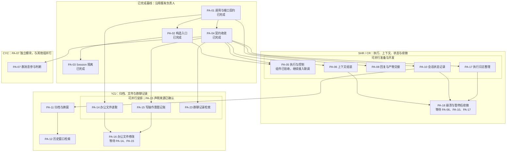
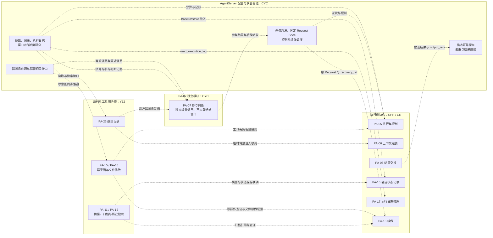

# Persistent Agent 开发计划

## 1. 这份计划怎么读和维护

| 项 | 内容 |
| --- | --- |
| 用途 | 在一个文档中列出要开发的特性、先后顺序和进度 |
| 范围 | 仅限 `openjiuwen/harness/persistent_agent` 模块 |
| 设计依据 | [Persistent Agent 详细架构设计](persistent-agent-architecture.md)；旧版详细架构仅供参考，可从 Git 历史查看 |
| 文档定位 | 当前开发计划，按详细架构设计编制；此前计划仅保留在 Git 历史中 |
| 更新日期 | 2026-10-18 |
| 交付分类 | 本期 20 项（PA-01～PA-18、PA-22～PA-23）；独立学习扩展 3 项（PA-19～PA-21）；后续执行模式扩展 3 项（PA-24～PA-26） |
| 本轮安排 | 按 2026-10-09 确认的分工推进 PA-05～PA-08、PA-10～PA-12、PA-14～PA-18、PA-23；PA-07 单列模块。PA-09、PA-13、PA-22、主动学习 PA-19～PA-21、执行模式 PA-24～PA-26 暂不开发，条目和完整验收要求保留，暂缓项不出现在本轮分工图中 |
| 当前进度 | 共 6/26 项完成：本期 6/20、学习扩展 0/3、执行模式扩展 0/3；PA-01～PA-03 已按各自独立验收边界完成，PA-04 已按架构设计收敛已实现的契约，M0 完成；PA-05 已用测试替身完成组件验收；PA-10 会话状态记录已接入并完成组件验证，新任务正式入口可执行，确认恢复入口在 PA-09 接入前仍明确拒绝，M1 集成仍待开发；PA-07 已完成群消息参与判断的组件验收，AgentServer 联调仍待进行 |

### 1.1 范围、约束与术语

Persistent Agent 接收一次已经确定归属的任务，在对应会话中运行 Agent，并把执行过程和结果交还给调用方。本模块提供运行对象的构造入口及会话内隔离能力；**AgentServer 决定何时、为哪个 Session 创建实例**，并负责实例调度。同一业务 Agent 可以拥有多个 Session；一个运行实例在同一时刻只处理一个 Session，并行的 Session 使用不同实例。业务 Agent 的身份创建、配置发布、会话排队、群内模型调用额度管理、管理查询、定时计划的创建与触发、结果投递和产品页面均属 AgentServer 等其他层，不列入本清单。定时触发已形成的普通任务可由本模块执行。

**本期目标：支持指定 Session 内执行、按 Execution 生命周期管理上下文与换窗、会话状态记录、记账与执行日志、发起人确认、群聊与历史检索、知识使用和结果交接；崩溃续做与非确认暂停后继续统一由新的 Execution 读取执行日志、由 Agent 自行判断进度，不做程序层面的精确崩溃恢复。** 本文是 [Persistent Agent 详细架构设计](persistent-agent-architecture.md)的分期交付计划；旧版架构中用于程序层精确崩溃恢复的 Checkpoint、执行代次与条件更新、提交结果未知查询、事件背压等要求已删除，不再作为验收依据。本文所称 checkpoint 是完整 ReAct 轮次之间对白名单 Session 状态的持久化快照，不提供精确恢复语义；崩溃后仍由新 Execution 结合执行日志判断如何续做。

- 每个 Execution 开始时加载同一 Session 的会话状态记录；每个完整 ReAct 轮次结束且 Execution 继续时，在下一次模型调用前提交 checkpoint；Execution 结束仍按“整理窗口 → 保存记录 → 记账”收尾。新 Session 不继承其他 Session 的私有窗口和未完成工作。
- 用户确认复用 `PermissionInterruptRail` 和原生中断恢复：等待确认时保存含中断状态的记录并结束本次 Execution，发起人点击确认卡片后由新实例恢复；停止和取消由 AgentServer 直接调用执行侧函数，非确认暂停不阻塞后续 Request；补充消息一律作为新的 Request，明确继续的指示由服务端关联到原任务。
- Persistent Agent 运行在 AgentServer 进程内，直接调用记账接口：所有事件统一 await record，按 Execution 提交，服务端按 local_seq 维护日志顺序；普通日志入队或保存失败只记诊断，允许缺失及序号缺口，不阻塞后续关键事件；`tool.intent`（仅写操作）、`execution.paused`、`execution.final` 等待自身落盘才继续，final 还须确认 output_refs 引用的候选输出已可靠保存，关键记账失败停止当前执行；不设计记账“结果未知”状态，队列不随 Agent 实例清理而取消。
- 进程崩溃后，AgentServer 对最近一次已派发的 Execution 既无 `final` 也无 `paused` 且未被主动停止的 Request 自动发起续做；被停止的任务须明确要求继续，停止收尾失败也不自动续做；预算、容量或可恢复错误导致的暂停，可以明确继续，或由服务端确认对应条件恢复后发起，条件未变化时不反复自动续做。上述续做均沿用原 Request，通过 `recovery_ref` 定位该任务最近一次待接续的 Execution，加载 Session 最新窗口、读取日志和归档，再按续做规则继续，不新增 `continuation` 字段；写操作已登记意图但无结果的先查证，不盲目重做。
- 执行或确认恢复入口抛异常（包括记账失败）时，AgentServer 核对本次 Execution 已成功落盘的 final / paused；已有结果按对应状态处理，无结束记录且未被主动停止或取消时按崩溃中断走统一续做，不必等服务重启。续做时机由服务端决定，沿用原 Request，recovery_ref 指向本次中断执行，发起前确认旧执行退出和相关清理完成；停止或取消的收尾异常不自动续做。
- 续做加载到旧中断状态时，先补齐缺失的工具结果、清除 `__react_agent_interruption__`，保留已保存的 `__interrupt_auto_confirm__`，再追加续做内容，防止确认恢复后崩溃导致旧写工具调用被直接重放。正常确认恢复保留中断现场。这部分由 PA-18 实现、M2c 验收，不作为 PA-04 的完成前置。
- 同一 Request 的所有 Execution（含确认恢复、崩溃续做、非确认暂停后继续）使用同一版本的 Spec，包括确认规则和工具定义；由 AgentServer 保留并传入原配置（架构设计 §3.4 第 4 条），本模块按执行上下文中的配置指纹校验。资料授权和知识版本则在每个 Execution 开始时重新解析，二者不混用。
- DeepAgent 的构造、任务循环、模型与工具调用、流式输出、中断恢复、权限确认和子代理运行时作为复用基础；AgentServer 提供调度、单一执行者保证、预算、记账与执行日志存储、群聊记录、窗口存储后端和投递。本模块实现上下文管理及这些能力的执行侧适配。

每项只回答三件事：**做什么、怎样证明做成、开工前必须完成什么**。验收场景可以先用模拟调用方和模拟存储验证；“完成”仍需留下测试或联调证据。“开工硬前置”只列缺少它就无法独立实现当前特性的本模块能力，不把最终联调所需的所有特性都列为开工条件。可并行启动时间和联调汇合点见第 3 节。当前特性 ID 为 `PA-01`～`PA-26`。2026-10-08 仅调整编号与排列：旧 PA-22 移至 PA-04；旧 PA-04～PA-21 顺延为 PA-05～PA-22；PA-01～PA-03、PA-23～PA-26 不变。特性内容、依赖关系、负责人、完成状态和交付范围不变，当前编号引用同步更新。附录 B.1 的历史变更记录和附录 B.2保留当时编号，不用于当前认领。PA-22 单列跨资料来源的失效管理，避免重复建设知识读取或通用上下文引擎。PA-04 承接架构设计对已实现契约的调整；PA-23 由历史 PA-11（当前 PA-12）拆出，负责群聊记录检索。PA-24～PA-26 承接 PA-05 一期未开放的执行模式。

本文使用的几个词：

| 词 | 在本文中的意思 |
| --- | --- |
| Session（会话） | 一段独立的对话或工作；不同 Session 不共享未完成任务和私有记录 |
| Request（请求） | Session 中的一次具体任务；确认恢复、崩溃续做、停止后继续都会产生新的 Execution，仍关联原 Request |
| 运行实例 | AgentServer 通过本模块工厂为一次活动调用创建的 DeepAgent、专用工具 / Rails 及控制状态；实例只接受指定 Session，用完后清理，不另建 Agent 类型 |
| Window（窗口） | 当前送给模型的工作上下文；PA-11 以 Agent 主动换窗为主，未主动请求时按 `floor(context_window × 80%)` 触发兜底 |
| 会话状态记录 | 跨 Execution 需要保留的 Session 状态（当前窗口、中断状态、本会话确认选择等），按白名单写入；也是完整 ReAct 轮次 checkpoint 的持久化载体，但不提供程序层精确恢复 |
| 执行日志 | AgentServer 保存的事件流，记录每次 Execution 做过什么；崩溃续做时是进度的唯一来源 |
| 宿主端口 | AgentServer 提供的记账与执行日志、群聊记录、预算、知识和窗口存储后端等接口；本计划只实现 Persistent Agent 对这些接口的使用 |

状态使用“待开始、进行中、阻塞、待验收、完成、暂不开发”。“完成”须有对应验收证据；仅写了代码但没有完成验证时标“待验收”。交付分类与开发状态分别记录：第 2 节 A、B、C 组属于本期，D 组属于独立学习扩展，E 组属于后续执行模式扩展；未排入本期不等于阻塞或完成。

构造约束：只继承配置类，不继承运行类。PersistentAgentSpec 继承 DeepAgentSpec，使用单份扁平配置；不新增 PersistentAgent 运行类、DeepAgent 运行子类或 Agent 门面。PA-02 返回原生 DeepAgent，专属字段及调用依赖见 [F_01](../features/F_01_spec-and-deep-agent-construction.md)。PA-01～PA-03 已在本模块约定范围内完成；这不表示宿主运行时、存储后端或 PA-05 执行链路已经接入。

### 1.2 待确认事项

架构设计 §12.2 的待确认事项在相关特性开工前与对端确认：本期不支持跨进程部署；归档保留期（影响 PA-11、PA-12）和确认超时时长（影响 PA-09）由 AgentServer 按 Agent 配置决定；系统提示词中 `tools` 片段随工具列表变化的问题，在 PA-06 中以固定工具列表规避。

架构设计尚未覆盖、需先补充设计并确认的事项：

- **容量边界：** PA-11 的兜底触发和新窗口候选检查，均以完整请求的准确输入 token 数与 `floor(context_window × 80%)` 比较；Agent 主动换窗仍优先。80% 不等同于 provider hard limit。其他特性的容量要求按各自方案处理。仍需验证真实模型计量与阈值适用性、超大结果的受控引用方式和续做上下文预算；确认前，对应容量相关验收不能关闭。
- **写操作的声明来源**（影响 PA-15）：已确定由 agent-core 内部精确工具名白名单声明；`read_file`、`list_files`、`share_file` 精确命中才按只读处理，不额外校验实现类；其他一律按写操作处理，ToolCard 不增加副作用字段。`share_file` 只修改本次执行的内部登记状态，不直接修改办公空间或外部系统。具体分类和宿主持久化边界见 [F_15](../features/F_15_tool-intent-before-side-effect.md)。

## 2. 要开发的特性

**A. 本期：能创建、能执行一次任务**

### PA-01 定义本期调用及宿主端口契约

- **验收标准（怎样证明做成）：** Agent、Session、Request、Execution 与来源关联可校验；缺身份、权限、有效执行权或必需接口时得到明确错误；超时和结果未知不被当作“没有数据”。接口覆盖窗口、资料版本、控制、预算与提交确认，恢复扩展不作为本期完成条件
- **开工硬前置：** 无

### PA-02 提供 Persistent Agent 运行对象的构造入口

- **验收标准（怎样证明做成）：** 复用 `DeepAgentSpec` 的 parts / Config 装配及原生 `DeepAgent` 运行类，校验宿主固定配置并绑定本次执行上下文；有效配置可创建对象，缺少必需能力时创建失败；构造本身不运行任务，不另建运行类
- **开工硬前置：** PA-01

### PA-03 固定实例的 Session 归属并隔离内部状态

- **验收标准（怎样证明做成）：** 实例接收指定 Session 的调用后，消息、工具上下文、取消信号和清理范围只归该 Session；向活动实例传入另一 Session 会报错，不会读写原 Session 的状态
- **开工硬前置：** PA-02

### PA-04 按架构设计收敛已实现的契约

- **验收标准（怎样证明做成）：** `ExecutionContext` 按架构设计简化 `epoch`、`authority_handle`，保留 `recovery_ref`，明确崩溃续做与非确认暂停后继续均引用原任务待接续的 Execution，不新增 `continuation`；`PersistentPorts` 移除 `ExecutionAuthority` 与 `ControlPort`，`CommitPort` 改为 `record(event)`，普通事件接收入队后返回，普通日志允许缺失、不阻塞关键事件；关键事件等待自身落盘，final 还须确认所引用候选输出已可靠保存，并增加按产生顺序读取的 `read_execution_log(execution_id)`；`ContextStore`、`HistoryPort` 不再作为对外端口、改为注入必需的窗口存储后端（`BaseKVStore`，构造时校验契约，不读写存储；专用 SysOperation 文件系统后端不在本期范围），`GroupMaterialPort` 替换为 `GroupChatPort`（`recent_messages`、`search_messages` 及架构设计 §4.6 的消息结构），保留预算与知识端口；`AgentEvent` 按架构设计 §6.2.2 收敛为 11 类，`tool.intent`、`tool.completed`、`execution.paused` 补齐架构设计要求的字段；暂停原因固定为 `awaiting_confirmation / stopped / budget_denied / context_unfit / error` 并校验负载，暂停收尾与事件映射留给 PA-05；`window.switched` 只定义旧窗归档引用和新窗序号；`schema/context.py` 删除带版本和条件更新的窗口结构，新增群消息结构，`MaterialQuery / MaterialSnapshot / MaterialReadResult` 只用于知识端口；完整会话状态记录和归档结构分别随 PA-10、PA-11 定义，不在本项预设；不再使用的端口结果同步删减，群聊和知识端口仍区分“确定没有”与“没查完或失败”；构造的必需端口检查和现有测试随之更新，个人版行为不变。只调整契约，不实现事件队列或 PA-18 的恢复行为
- **开工硬前置：** PA-01

### PA-05 提供执行、恢复与控制入口，复用 DeepAgent 单轮执行并交接过程事件

- **验收标准（怎样证明做成）：** `execute_persistent_request(spec, context, inputs: RequestInput)` 与 `resume_persistent_request(spec, context, confirm_reply: ConfirmReply)` 组合构造、`stream_bound` 与 `close_bound`，不另写推理循环；`abort_persistent_request(context, reason=cancel / stop)` 先记录原因再复用 `abort_bound` 请求中断，结束事件统一由执行入口发出：cancel 产出 `final(cancelled)`，stop 产出 `paused(stopped)`，重复控制幂等、首个原因保留，尚未进入原生调用时在模型或工具调用前检查并收尾；原生调用退出、确定执行结果后同步锁定结局，锁定前接受的控制参与判定，锁定后不再接受停止或取消、不修改控制原因、不调用 `abort_bound`，锁定不代表持久化成功；异常退出进入清理前同样关闭控制接收。`RequestInput`、`ConfirmReply` 按架构设计 §4.2.1 校验：群消息在 PA-07 接入前明确拒绝；`continue_instruction` 只能随 `recovery_ref` 出现，带 `recovery_ref` 的执行在 PA-18 接入前明确拒绝；交互回复只校验结构、交互 ID 属于当前等待现场且不重复、答案键对应原问题，所属 Request 与回复目标取自等待现场，无效回复只拒绝本次恢复，不保存、不记账。一期只开放单轮执行：Spec 须显式填写 `enable_task_loop=False`，不启用任何子代理（含 `add_general_purpose_agent`），配置声明与装配结果都检查，不支持的模式在执行前拒绝。checkpointer 按 Session 注入 `NoopCheckpointer` 隔离，执行前检查，不符合就拒绝开始；正常完成、确认暂停与恢复、停止、取消、异常及提前关闭流时，checkpointer 旧状态不覆盖 WindowStore 加载的状态，不经 checkpointer 恢复或保存，原生生命周期与清理照常，个人版不变。原生流式输出映射为 `execution.started`、`reply.delta`、`progress.updated`、`model.completed`、`output.proposed`、`execution.paused / final` 并带 Request / Execution 关联；所有事件统一 await record，普通事件失败只记诊断，关键记账失败停止当前执行并由入口抛出异常。每次模型调用前 `admit`、调用后 `report`：拒绝准入时不调用模型并产出 `paused(budget_denied)`，`admit` 抛异常产出 `paused(error)`，`report` 抛异常只记诊断。最终回答生成一条 `output.proposed`（稳定 output_id、target 为 `reply_target`、share_mode=message）并列入 `final.output_refs`，收尾顺序为“交出候选 → 整理窗口 → 保存会话状态记录 → 记账 final → 清理”；中间结论、工具日志和错误文本不作为回答；事件同时受字符数和完整事件字节数限制，`reply.delta` 按两条限额拆分且拼接后与原文一致，最终答案超限时改判 `paused(error)`，完整答案交给会话状态记录保存（PA-10），只有容量超限改判暂停。原生运行错误（含 `result_type="error"`、最大迭代次数耗尽）默认 `paused(error)`，`final(failed)` 只用于明确终结依据；会话状态加载 / 保存失败及关键记账失败向外抛运行异常，原生内部吞掉的关键失败仍保留分类、阻止后续模型与工具调用并抛出；输入、Spec 或能力不合法抛校验拒绝。调用方契约见架构设计 §3.4 第 12、13 条（持续消费事件流、入口异常核对）。正式入口只开放已接入并验证的能力：会话状态记录（PA-10）接入前不能执行、不降级为空窗口；组件验收使用测试替身，与 M1 集成验收分开，M1 集成后再声明 `execution` 能力
- **开工硬前置：** PA-02、PA-04

### PA-06 按 Execution 生命周期组织上下文

- **验收标准（怎样证明做成）：** 不挂载 ContextAssembleRail、PersonalContextRail 和 ContextProcessorRail 的默认压缩链；一次 Execution 内系统提示词和工具定义不变。Execution 开始时，在已保存的窗口末尾依次追加本次执行头、临时背景块（最近群消息：按会话游标增量读取并从触发消息位置回补，合并去重、排除触发消息，含被忽略的消息，游标取服务端确认的扫描位置；知识导航随 PA-13、续做日志随 PA-18 接入）和任务输入；新任务按正常输入追加，崩溃续做与非确认暂停后继续统一使用“续做”执行头并注明 recovery_ref 指向的 execution_id，重新注入原任务输入，有继续指示时一并追加；旧中断状态由 PA-18 在追加前处理，正常确认恢复不追加任何内容；执行中只追加，动态内容经 PromptAttachmentManager 的增量通道追加；排队中的消息只作背景，不成为当前指令；构造时拒绝三个上下文 rail 和按条数截断窗口的参数；加载后发现等待中的调用或未配对的工具调用时校验拒绝
- **开工硬前置：** PA-04

### PA-07 判断是否参与一条群消息

- **验收标准（怎样证明做成）：** 人类与其他 Agent 消息走同一判断流程，保留发送者、@、回复关系及附件依据；被 @ 可忽略，未被 @ 可回复或介入。判断是一次独立的轻量模型调用，只带职责、当前消息和少量最近群消息，不加载或写入窗口，不开放写工具；忽略时记账 `execution.final(ignored)`，不产生公开回复、正式任务或改写当前工作目标，被忽略的消息不进入窗口；判断失败有限次重试后报失败，不记为忽略；私聊和已受理定时任务走直接执行路径
- **开工硬前置：** PA-04

### PA-08 可靠交接候选回复和文件结果

- **验收标准（怎样证明做成）：** 群聊与其他回复从同一事件出口返回；候选只来自执行结束时实际交接的最终回答（含 after_invoke 改写）和模型经 `share_file` 显式登记的文件，私有判断、工具明细、模型片段、错误与暂停说明及未登记的文件不成为候选；`target_ref` 一律由程序设为当前 Request 的回复目标（确认恢复取等待现场）；文件注明“上传群空间”（upload）或“作为附件发送”（attachment），并带收尾时读取的内容摘要、逻辑路径与实际大小，大小上限可配置（开发默认 32 MiB，正式值与服务端对齐）；`output_id` 在 Request 范围内按目标、共享方式和实际交付内容派生，相同成果身份相同，变化则生成新身份；completed 交回答与文件，非停止的暂停只交文件并在 `execution.paused.output_refs` 中引用，停止和取消不交；超过单事件容量的最终回答拆成有序多段，拼接与原文一致，照常 `final(completed)`；收尾先整批准备，任一文件失败则一项不交，completed 改为 `paused(error)` 并在 detail 中写明文件与原因；`output.proposed` 入队后返回，paused / final 记账成功时其 output_refs 引用的候选内容与交接信息已可靠保存，缺少被引用候选时结束事件失败，不得删除引用后宣告完成；结束事件首次失败时同一 Execution 内按原事件补交候选一次并重试一次；交出的文件以收尾时最终窗口中的有效登记结果为准（被宿主 Rail 改写或阻断的不交），确认恢复时包含同一确认链的登记；确认事件的参数摘要按事件容量截断并标记；不再产生和写入 `pending_answer`（开发阶段无历史数据，兼容代码直接删除），长回答正文随窗口保存；无关普通日志缺失不阻塞交接；交接不等于已送达，办公空间保存不等于群内可见；与宿主验证重复交接不重复投递、文件摘要不符时结束事件失败、投递失败只用留存版本重试发送、不重跑任务。设计见 [F_18](../features/F_18_output-handoff.md)
- **开工硬前置：** PA-01

### PA-09 复用 PermissionInterruptRail 处理用户确认，并响应停止与取消

- **验收标准（怎样证明做成）：** 确认完全复用 harness 的 `PermissionInterruptRail` 与原生中断恢复，不新写确认 rail；Spec 新增 `permissions` 字段（复用 `PermissionsSection`，构造时传入 DeepAgent 配置并纳入指纹），提供 `describe_confirmable_operations(spec)`；判定 ask 时保存含中断状态的会话状态记录，并同步记账 `execution.paused(awaiting_confirmation)`（附被拦截的工具名和脱敏参数摘要；摘要超出事件容量时截断并标记 `arguments_truncated`，卡片须提示已截断，批准按交互 ID 关联完整调用，见 [F_18](../features/F_18_output-handoff.md) D-13）；`resume_persistent_request` 由新实例放回记录、以 `ConfirmReply` 作为恢复输入，不向窗口追加任何内容；`ConfirmReply` 的权限确认项在恢复入口统一转换：同意为 `approved=True`，同意并本会话记住为 `approved=True, auto_confirm=True, persist_allow=False`，拒绝为 `approved=False` 并附反馈，其他组合（含 `auto_confirm=True` 而 `persist_allow` 为空或为真）一律拒绝，不能进入永久允许分支；同意时执行被拦截的调用（写操作照常先记账），拒绝时把反馈作为工具结果，权限确认超时按拒绝处理；主动提问回复（AskUserRail）转换为 `AskUserPayload.answers`，允许部分回答和自由文本，漏答的问题填“（未回答）”，`outcome=timed_out` 时每个问题填“（超时未获得回答）”，原生 rail 不重复提问，不扩展原生类型，Agent 不猜测缺失信息；本会话记住的选择写入 `INTERRUPT_AUTO_CONFIRM_KEY` 并随记录保存，同一 Session 在新 Execution、新实例中仍有效，其他 Session 不继承，不写入全局权限配置或权限 YAML；取消（`abort_persistent_request(reason="cancel")`）时保存记录并记账 `final(cancelled)`，停止（`reason="stop"`）时保存记录并记账 `paused(stopped)`；补充消息一律作为新 Request，不使用 follow_up / steer；续做中的询问复用 AskUserRail；开放确认恢复前须联调验证：确认前被 Rail 改写参数时，恢复后窗口中的调用与实际执行的参数一致（PA-10 遗留，见 [F_17](../features/F_17_session-state-record.md) 第 8.2 节）；若需修复，位置在原生恢复执行与窗口更新，不由本项的回复转换承担
- **开工硬前置：** PA-05、PA-10

PA-02 只验证构造入口；PA-03 验证实例内部的归属校验与状态隔离；PA-04 先把已实现的契约与架构设计对齐；PA-05 验证执行与恢复入口到事件出口的完整链路。PA-05 不重写 DeepAgent 的任务循环或另建一套流式输出；事件映射及按事件级别等待入队或落盘由 Persistent Agent 适配。AgentServer 负责调用执行与恢复入口、保证同一 Session 同时只有一个执行者、为并行 Session 分配不同实例并管理实例生命周期；PA-03 不实现这些调度工作。群内模型调用额度由 AgentServer 管理，本模块仅遵守宿主准入结果并回传实际用量，不维护预算账户。

**B. 本期：能记住工作内容并读取资料**

### PA-10 加载与保存会话状态记录

- **验收标准（怎样证明做成）：** PA-10 基线实现内部组件 `WindowStore` 的 `load_state / save_state`，后端使用服务端注入的 `BaseKVStore`，不放在办公空间或 Agent 工具可访问的 SysOperation 中；不使用 checkpointer（执行路径的隔离由 PA-05 实现），加载后的状态不被 checkpointer 中的旧状态覆盖；定义会话状态记录的结构、白名单字段和序列化方式，保存当前窗口、中断状态、本会话确认选择及可选的 DeepAgent 运行状态，以及 PA-05 交来的结束信息（`ExecutionEnding`；2026-10-14 起不再包含 `pending_answer`，改为带交接摘要；开发阶段无历史数据，记录结构删除该字段，见 [F_18](../features/F_18_output-handoff.md) 第 7 节），所有字段一次写入；Session 首次执行创建空窗口，后续 Execution 加载同一 Session 的当前窗口，新 Session 不继承其他 Session 的记录；终态时整理窗口（删除临时背景块、执行头压缩为一行、追加执行结束标记；等待确认时末尾的工具调用不动、结束标记记在记录元信息），覆盖保存后再记账；保存和恢复群消息游标（服务端确认的扫描位置）；停止、取消或执行中报错时保存真实执行事实（原生执行路径保留已取得的工具结果，Persistent 显式启用），保存时保证窗口可以安全追加：缺失结果的工具调用补一条 `stopped_tool_placeholder` 标记的结果（结果未取得，实际效果需核实），已有真实结果保留，原生自带的“已中断”结果不重复补位，正常等待确认的调用不补位；加载结局为停止、取消或失败的旧记录时同样幂等修补；“停止、取消或报错 → 保存 → 重新加载 → 执行下一任务”列为联调验收，并验证个人版清理行为不变；加载失败不开始执行，保存失败按崩溃续做处理。PA-11 协作扩展另按 [F_17 D-11](../features/F_17_session-state-record.md) 增加逐轮 checkpoint，并在未启用前直接调整 schema_version=1 记录结构、不实现旧格式映射；该扩展已在 PA-11 agent-core 组件实现并测试，不改变 PA-10 基线的终态保存顺序、负责人或既有验收状态，真实服务端后端仍待联调。
- **开工硬前置：** PA-04

### PA-11 Agent 主动换窗，容量阈值兜底

- **验收标准（怎样证明做成）：** 以 Session 私有归档和唯一活动窗口状态为核心；每个完整 ReAct 轮次结束且 Execution 将继续时，下一次模型调用前保存 checkpoint，未完成模型流或工具批次不提交。Agent 可通过内部 `new_context` 携带有界 handoff，在安全边界主动换窗；PA-11 每次模型调用前从当前 `ModelContext.context_window_tokens()` 读取上下文引擎解析出的有效窗口；若未主动请求，下一次完整请求的准确输入 token 数超过 `floor(context_window × 80%)` 时触发同一换窗流水线；新窗口完整候选请求也不得超过该阈值。计数不可靠时暂停为 `error`；有效窗口不可用时暂停为 `error`；80% 不是 provider hard-limit 保证。普通继续路径在 checkpoint 成功后才调用下一轮模型；若本轮换窗，则归档旧窗，并在 PA-10 单条 Session 状态记录中一起提交新活动窗口、窗口 ID、token usage、last_rollover 与轮次 checkpoint，替代普通 checkpoint，不另建 replacement_history 或重复保存。Execution 结束继续执行 PA-10 原有终态整理和保存。所有记录使用 schema_version=1 的最终结构；未知 / 损坏记录失败关闭，真实持久化启用前检查并显式处理旧结构记录。提交后记录普通 `window.switched`，事件缺失不回滚。可重新获取的内容保存来源引用，无法重新获取的内容保留原文；新窗须保留当前确认链中尚未交出的 `share_file` 登记依据（调用与结构化结果），必要内容仍放不下时产出 `paused(context_unfit)`，不静默截断。逐轮全量写入成本需通过真实 BaseKVStore 联调测量；详细方案见 [F_11 上下文窗口管理设计方案](../features/F_11_window-management.md)
- **开工硬前置：** PA-10 现有状态加载与终态保存基线；D-11 的 checkpoint 协议和最终 V1 记录结构已作为 PA-11 agent-core 实施的一部分完成，且保留 PA-10 原 Execution 收尾整理顺序。当前剩余工作不是等待 agent-core 代码前置，而是用 AgentServer 实际注入的 BaseKVStore 验证持久性、隔离、单 Session 串行和写入成本；启用真实后端前检查并处理旧结构记录。

### PA-12 检索本 Session 的历史窗口归档

- **验收标准（怎样证明做成）：** 提供 Persistent 专用 `search_session_history` 工具，经 `WindowStore.search` 只检索当前 Agent / Session 已归档窗口中的用户消息、模型可见回复、工具调用名称与参数、工具结果文本；不搜索活动窗口、隐藏推理、系统提示或其他 Session；按不区分大小写的字面子串匹配并返回有界原文摘录。搜索枚举实际归档键值并核对导航索引；索引损坏或漏列现存归档时可重建，索引引用缺失归档时不得返回完整结果。`list_archives` 可按 `execution_id` 查出归档供续做使用；结果区分完整命中、完整无命中、扫描不完整和无法可靠执行，结果展示截断与扫描完整性分开；不以摘要替代原文证据，不与群聊检索合并。agent-core 组件实现与测试已完成，真实 JiuwenSwarm `BaseKVStore` 持久性、隔离及跨重启检索仍待验证。方案及实现证据见 [F_12](../features/F_12_session-history-search.md)
- **开工硬前置：** PA-11

- **验收标准（怎样证明做成）：** PA-07 在窗口加载前独立读取近期群消息并判断是否参与，不依赖 PA-23 的搜索工具；群消息 Execution 的背景读取按会话状态游标增量获取，并以触发消息为游标回补触发消息之后至本次读取上界的消息，两部分合并去重并排除触发消息（例如 R2 由 M120 触发，R1 执行期间 M130 补充了 R2 的要求，R1 结束时游标为 M180，R2 背景须包含 M130）；返回服务端确认已扫描到的位置 `scanned_through` 作为新游标，正文暂缺（`unavailable`）不卡住游标，查询失败或进度不可信时不返回位置；区分永久不可读与查询失败。Persistent Agent 可在私聊或任意群聊 Execution 中显式调用 `search_group_messages`，检索该 Agent 当前获授权的一个或多个群历史；不要求当前提问者属于目标群，未指定群时搜索该 Agent 全部获授权群，宿主每次调用按可信 Agent 身份校验授权，群过滤只缩小范围；返回带稳定群身份、发送者身份、服务端接收时间、@、回复、附件引用和状态的有限结果，已撤回的不返回正文，排队中的请求只作背景；结果区分找到、确定没有、没查完、不可用或失败。私聊只需支持显式搜索，不自动读取或注入群消息。方案见 [F_23](../features/F_23_group-chat-history-retrieval.md)
- **开工硬前置：** PA-04

### PA-13 读取 PersonalContext 的授权知识版本

- **验收标准（怎样证明做成）：** 不挂载 PersonalContextRail；经 `KnowledgePort` 在 Execution 开始时解析一次授权范围和知识版本，知识导航放入临时背景块，执行中不刷新，正文由模型按需读取；无权限与不存在可区分；发布或授权变化在下一个 Execution 生效，并向 PA-22 提供来源依赖及失效信息
- **开工硬前置：** PA-04

### PA-14 按调用授权读取办公空间文件

- **验收标准（怎样证明做成）：** 复用 Workspace 与文件工具，能列出和读取当前授权范围内文件并保留来源及观察到的内容版本；越界路径、其他 Session 私有目录被拒绝；权限未知不读取
- **开工硬前置：** PA-01

### PA-15 写操作执行前同步记账意图

- **验收标准（怎样证明做成）：** 由 agent-core 内部精确工具名白名单判定副作用：精确命中 `read_file`、`list_files`、`share_file`、`read_execution_record` 才按只读（`share_file` 由 PA-08 加入，`read_execution_record` 由 PA-18 加入、只读取本 Request 已保存的执行日志，分类依据是不直接修改办公空间或外部系统，名单名称是否调整由本项负责人统一处理）；名单外、未知、自定义和 MCP 工具均按有副作用处理。写操作执行前产出 `tool.intent`（operation_id、工具名、目标、参数哈希及敏感参数脱敏后的可读摘要）并同步记账，按架构设计 §6.2 等待本条意图落盘，不因前序普通日志缺失而失败，成功才执行，失败停止当前执行；所有工具调用结束后产出 `tool.completed`（工具名、可读参数摘要、成功 / 失败 / 未知、必填的非空白结果摘要（所有状态均需提供，约 500 字以内）、可选的结果引用）；确认恢复后的写操作同样先记账；Persistent 不另加查询或重试，结果不明交 PA-18 的续做规则处理。与原生 ToolCallResilienceRail 衔接：只重试显式声明 `idempotent=True` 的工具；重试会再次触发工具调用前的回调，同一工具调用沿用原 operation_id，不重复登记意图
- **开工硬前置：** PA-04

### PA-16 适配办公空间文件修改

- **验收标准（怎样证明做成）：** 复用文件工具按授权创建和修改文件，写入前按 PA-15 记账意图；会话草稿放在 `sessions/<session_id>/` 下，其他 Session 不能访问；两个任务同时改同一文件时冲突可识别；文件落盘不等于任务完成，也不等于群内可见，任务失败不自动回滚文件
- **开工硬前置：** PA-14、PA-15

### PA-22 跟踪上下文来源版本并处理失效内容

- **验收标准（怎样证明做成）：** 对消息、历史归档、文件、知识及派生摘要记录来源依赖；资料更新和撤权在下一个 Execution 生效：临时背景块每次按最新版本重新注入，归档中可重新获取的内容只存来源引用、读取时重新检查权限；执行中不改写系统提示词和工具定义，执行中立即生效列为后续扩展（架构设计附录 B）；权限或版本无法确认时不读取
- **开工硬前置：** PA-04

文件只读与写入分开：PA-14 可以先交付；PA-16 在 PA-15 的意图记账就绪后再启用。写操作结果不明时，执行侧不查询、不自动重试，由 PA-18 的续做规则先查证，查不清时可再询问发起人，是否询问由模型判断。

PA-12 与 PA-23 分开交付：历史窗口归档是 Agent 自己的工作过程，属于 Session 私有；群聊记录属于群。两个检索工具不合并，避免把私有工作过程当作群公开内容引用。

PA-13 负责“授权知识如何读进来”，采集与发布由 PersonalContext 负责；PA-22 负责“已进入上下文的各类内容何时失效”，也覆盖非知识资料和派生摘要。PA-22 可先使用模拟片段与版本端口开发，与 PA-06、PA-12、PA-13、PA-23 在 M2a 验证整条失效链，与 PA-14～PA-16 在 M2b 验证文件变化和撤权；它不实现权限策略或另建知识库。续做时的资料装配随 PA-18 在 M2c 验证。

**C. 本期：执行日志与续做**

架构设计删除了 Checkpoint 和程序层面的精确恢复。PA-17、PA-18 保留编号，内容改为“执行日志 + 续做规则”，纳入本期。

### PA-17 读取并整理执行日志

- **验收标准（怎样证明做成）：** 事件流即执行日志，由服务端按 execution_id 和产生顺序保存，本模块不另写本地日志文件；崩溃续做和非确认暂停后继续由程序对执行链中的每次执行调用 `read_execution_log(execution_id)`（执行链的追溯属于 PA-18），只能读取同一 Session、同一 Request 的日志；读取已保存日志，按 local_seq 排序，允许缺口且非空不保证完整；缺少 tool.completed 的写操作标为有意图、无结果，不推断未执行；按架构设计 §8.3.3 整理成简短执行记录：丢弃 `reply.delta`、`model.completed`，按 operation_id 或工具调用 ID 合并意图与结果，保留中间结论和交出的候选（output_id、共享方式、文件路径）及其是否被结束事件引用，列出日志中的归档引用（按 execution_id 查询归档待 PA-12、PA-18）；提供完整与分层（`detail="brief"`）两种整理，分层整理中写操作一条不省略；读不到时提示“上一次记录缺失”，是否询问发起人由模型判断
- **开工硬前置：** PA-04

### PA-18 崩溃续做与非确认暂停后继续

- **验收标准（怎样证明做成）：** 进程崩溃、符合架构设计 §3.4 第 13 条异常续做条件的入口中断及非确认暂停后继续，统一按架构设计 §5.2.4，由服务端沿用原 Request、新 execution_id 和指向该任务待接续执行的 `recovery_ref` 调用 `execute_persistent_request`，不新增 continuation 字段；加载 Session 最新会话状态记录，若带旧中断状态，先核对等待现场归属，属于其他 Request 则拒绝；仅本 Request 的旧现场继续为每个缺少结果的工具调用补齐匹配 tool_call_id 的查证说明，已有真实结果不重复补齐，清除 `__react_agent_interruption__`、保留已保存的 `__interrupt_auto_confirm__`；再沿 AgentServer 派发前保存的前序关系（`read_execution_link`）追溯执行链，逐次核对归属并读取各次日志与归档（追溯上限可配置，断链、日志缺失与达到上限分别标注未知），追加含恢复引用的续做执行头、分层进度摘要（详细记录用 `read_execution_record` 分页读取）、原任务输入及继续指示。补结果只修复上下文，不记成实际工具执行的 tool.completed；正常确认恢复保留中断现场。续做规则写入提示词：已成功的步骤不重做，已登记意图但无结果的写操作（包括 tool.completed 日志缺失）先查证、查不清时可用 AskUserRail 询问发起人（是否询问由模型判断），已产出最终结果的直接整理交出（是否再次交出由 Agent 查证后决定，相同成果身份相同、服务端去重；停止后继续时窗口中的旧登记只作依据，不自动交出，见 [F_18](../features/F_18_output-handoff.md) D-12）；停止后继续须明确请求；预算、容量或可恢复错误导致的暂停，在明确继续或服务端确认条件恢复后沿用同一流程，不新增恢复入口；所有续做即使窗口保存成功也读日志，中间执行过其他任务时仍加载最新窗口并查证当前状态；引用无法定位或日志缺失明确处理，不当作新任务直接重做；每次模型调用在最终请求装配后、预算准入前检查容量（与 PA-06、PA-11 共用规则），超限不准入、不调用模型；正式入口在 PA-12 按 execution_id 查询归档接入前不开放续做
- **开工硬前置：** PA-06、PA-10、PA-17

PA-17 负责把上一次 Execution 的事件整理成 Agent 可读的执行记录；PA-18 负责统一续做、旧中断现场处理、注入内容和续做规则。两项分开，便于分别验证“日志整理”和“续做判断”。PA-04 只调整恢复引用与日志读取契约，旧中断状态处理不作为其完成前置。正常确认恢复由 PA-09 借助会话状态记录完成，不属于本组；子代理沿用 DeepAgent 现有实现，其写操作同样遵守 PA-15 的意图记账。AgentServer 负责停止记录、继续指示与原 Request 的关联及恢复引用选择，服务端事件队列也在对端实现。

**D. 独立扩展：主动学习**

### PA-19 从工作记录中识别学习目标

- **验收标准（怎样证明做成）：** 只使用专门授权且已确认的记录；同一问题不反复创建目标
- **开工硬前置：** PA-01

### PA-20 跟踪学习内容的处理结果

- **验收标准（怎样证明做成）：** 能关联目标、来源和 PersonalContext 的处理批次；处理失败不能显示为知识已更新
- **开工硬前置：** PA-19

### PA-21 根据后续工作反馈调整学习目标

- **验收标准（怎样证明做成）：** 能记录“新知识是否有帮助”及依据；反馈只更新学习目标，不改写原任务记录
- **开工硬前置：** PA-19

PA-19～PA-21 在独立学习作业中运行，不挤占业务会话，不作为本期核心交付前置。PA-13 的基础知识使用与 PA-22 的知识失效处理不依赖学习扩展完成。

**E. 后续：执行模式扩展**

PA-05 一期只开放单轮执行。以下执行模式各自验证生命周期、预算、记账、确认恢复和 checkpointer 隔离后逐项开放，不计入本期交付门槛。

### PA-24 开放 task-loop 执行模式

- **验收标准（怎样证明做成）：** 通过正式入口验证 task-loop 下的实例隔离、取消与停止收敛、确认恢复、异常清理、预算与记账，确认后台任务退出、其他 Session 不受影响，checkpointer 隔离成立；并核实会话状态记录中 DeepAgent 状态快照的按次字段（`iteration`、`task_plan`、`stop_condition_state`、`pending_follow_ups`）跨 Request 的生命周期，停止或异常后不得把上一 Request 的停止条件或待处理追加消息带入下一 Request（见 [F_17](../features/F_17_session-state-record.md) D-03）；验证通过后 Persistent Spec 才允许 `enable_task_loop=True`
- **开工硬前置：** PA-05

### PA-25 开放同步子代理

- **验收标准（怎样证明做成）：** 子代理在父 Request / Execution 内执行，预算、事件、意图记账（PA-15）和确认恢复经父执行汇聚；停止与取消收敛子代理，清理后无残留后台任务；验证通过后才允许配置同步子代理
- **开工硬前置：** PA-05、PA-15

### PA-26 开放异步及持久子代理

- **验收标准（怎样证明做成）：** 异步或持久子代理的后台任务归属、取消收敛、跨 Execution 状态及续做规则有明确设计并通过验证；验证通过后才允许 `enable_async_subagent` / `enable_subagent_runtime`
- **开工硬前置：** PA-25

## 3. 特性依赖关系与并行开发

以下按**交付节点和并行工作线**组织开发，不排具体日期或工期。完整交付分类仍为本期 20 项、独立学习扩展 3 项和执行模式扩展 3 项；本轮开发范围、暂缓项和负责人以第 3.2 节为准。节点表示可以交付、演示和验收的结果；工作线表示可以交给不同开发者同时推进的工作。纳入本轮的特性满足第 2 节开工硬前置即可启动，不必等同批其他工作结束；扩展满足依赖不意味着自动纳入本轮。

### 3.1 先交付接口基线

| 节点 | 开发内容 | 交付与放行标准 |
| --- | --- | --- |
| M0：接口基线 | PA-01（已完成，按旧版架构）；PA-04 按架构设计收敛：普通事件入队、关键事件等待落盘与执行日志读取、群聊记录、预算、知识、窗口存储后端注入及 11 类事件，并准备模拟调用方、模拟端口和内存版存储后端 | 无效输入、普通事件失败只记诊断 / 关键事件失败停止、普通日志允许缺失、关键事件自身落盘、final 所引用候选输出可靠保存、群聊 / 知识端口区分“确定没有”与“没查完或失败”等语义明确；本期各线能独立实现和测试。依赖新契约的特性在 PA-04 完成后启动，其余特性满足第 2 节开工硬前置即可启动 |

### 3.2 本期并行开发工作线

#### 3.2.1 本轮分工与暂缓范围

图中使用下列缩写；第 4.1 节的负责人列登记全名。Song Haoran 与 Chen Ran 共同负责所列特性，本计划不进一步指定两人内部的单项认领或工期。

| 缩写 | 负责人 | 本轮特性与协作范围 | 可以并行与需要等待的部分 |
| --- | --- | --- | --- |
| SHR / CR | Song Haoran、Chen Ran | PA-05、PA-06、PA-08、PA-10、PA-17、PA-18 | PA-05 已完成组件验收，继续负责接入与联调；PA-06、PA-08、PA-10、PA-17 可以并行开发；PA-18 等 PA-06、PA-10、PA-17 |
| YZJ | Yan Zhijun | PA-11、PA-12、PA-14、PA-15、PA-16、PA-23 | PA-14、PA-15、PA-23 可并行安排；PA-15 的副作用声明来源已按 F_15 确认为 agent-core 精确名称白名单；PA-11 等 PA-10，PA-12 等 PA-11；PA-16 等 PA-14、PA-15 |
| CYC | Chang Yucong | PA-07 独立参与判断模块；与 AgentServer 配合的接口对齐和联合验证 | PA-07 满足 PA-04 后可独立开发，与其他工作线并行；AgentServer 接口准备也可并行，联调时等待对应组件就绪 |

| 暂缓部分 | 本轮安排 |
| --- | --- |
| PA-09 确认与用户交互、PA-13 授权知识读取、PA-22 来源版本与失效 | 暂不开发；第 2 节保留特性、原硬前置和完整验收要求，不纳入本轮分工图 |
| PA-19～PA-21 主动学习 | 暂不开发；保留独立扩展分类、既有负责人及后续顺序，不纳入本轮分工图 |
| PA-24～PA-26 执行模式 | 暂不开发；保留后续扩展分类和逐项开放要求，不纳入本轮分工图 |

本轮共有 13 项已分工特性（其中 PA-05 已完成组件验收）和 4 项已完成基线出现在图中；9 项暂缓。特性总数、完成状态和原交付分类不变。暂缓是开发安排，不表示取消设计、解除依赖或验收完成。

| 工作线 / 模块 | 负责人 | 本轮立即做 | 后续安排与汇合 |
| --- | --- | --- | --- |
| A：实例与执行 | SHR / CR | PA-05 接入与联调（PA-01～PA-04 基线已完成） | 与 B、C、R 线和 AgentServer 汇合；完整 M1 的确认恢复验收仍等待暂缓的 PA-09 |
| B：上下文与交接 | SHR / CR | PA-06 上下文、PA-08 响应交接可并行 | 与 A、C 线联调执行头、背景注入和候选交接；PA-09 本轮暂不开发；PA-07 独立到 G 模块 |
| C：窗口与检索 | PA-10：SHR / CR；PA-11、PA-12、PA-23：YZJ | PA-10 会话状态记录、PA-23 群聊记录可并行 | PA-10 → PA-11 → PA-12；与 A、B、R、G 联调；原计划中的 PA-13、PA-22 本轮暂不开发 |
| D：办公空间 | YZJ | PA-14 文件读取、PA-15 意图记账可并行安排 | 两项完成后做 PA-16；与 A、R 线验证工具失败收敛和写操作续做；文件来源失效的完整验收仍等待 PA-22 |
| R：执行日志与续做 | SHR / CR | PA-17 执行日志整理 | PA-06、PA-10、PA-17 就绪后做 PA-18；归档、意图记账及文件续做场景与 YZJ 联调 |
| G：群消息参与判断（独立模块） | CYC | PA-07 参与判断 | 与 AgentServer 对齐消息输入、参与结果和后续派发；与 PA-23 联调最近群消息读取，与 PA-05、PA-08 联调群任务执行与结果交接 |
| S：AgentServer 配合 | CYC | 对齐调度、控制、预算、记账、窗口后端、群聊记录、执行日志和投递接口 | 对端接口准备与组件开发并行，联合验证由 CYC 协调；这里只登记配合责任，不把 AgentServer 自身实现纳入本模块 PA 清单 |

每条线可以先用 M0 的模拟端口完成组件验证，A、B、C、D、R、G 与 AgentServer 接口准备并行推进。本轮跨责任人的开工等待点是 PA-10（SHR / CR）→ PA-11（YZJ）；同组的跨工作线前置仍按下图执行，联调等待点另见第 3.3 节。PA-11、PA-12、PA-16、PA-18 只等待各自必要前置，不等待其他整条工作线。可并行表示依赖允许，实际同时开展多少项由各组人手安排。

#### 3.2.2 本轮开发硬依赖与责任人

实线表示第 2 节的开工硬前置；图中保留所有已展示特性之间的 20 条硬依赖，包括已完成基线和跨责任人的依赖。并行分组只表示组内所列特性可同时准备或开发，不改变每个特性的前置。PA-05 的“组件已验收”不表示正式入口已放行。

当前已满足代码契约硬前置的并行项为 SHR / CR 的 PA-06、PA-08、PA-10、PA-17，YZJ 的 PA-14、PA-15、PA-16、PA-23，以及 CYC 的 PA-07；PA-15 / PA-16 的 agent-core 组件已实现，JiuwenSwarm 持久化和宿主 provider 验证待后续联调。PA-10 完成后可同时推进 PA-11 与其他已经具备前置的工作；PA-18 开工还须等 PA-06、PA-17。

#### 3.2.3 PA-07 独立模块与 AgentServer 配合

下图全部使用虚线，表示接口对接或联合验证，不表示新增开工硬前置。图中重复出现的 PA 与上图是同一特性，只实现一份。CYC 负责 AgentServer 配合及 PA-07，执行侧和文件 / 归档侧仍按各自责任人开发。

PA-07 只负责参与判断；“参与后执行任务”与“结果交接”由 CYC 同 SHR / CR 联调 PA-05、PA-08，AgentServer 决定派发并处理投递。预算、记账、群聊记录、存储后端和执行日志的真实接口由 CYC 与对端对齐，模拟端口验证和真实联调证据分开记录。

本轮暂缓 PA-09，因此完整 M1 的确认恢复验收仍待完成；PA-13、PA-22 暂缓，完整 M2a 的知识 / 来源失效和 M2b 的文件来源失效验收仍待完成。M2c 包含 M1 执行链和确认恢复后崩溃等场景，也不能仅凭本轮组件联调宣告完整通过。正式入口仍按第 3.4 节验证能力后开放，本轮组件完成与完整里程碑验收分别登记。

| 扩展工作线 | 启动条件与安排 | 交付节点 |
| --- | --- | --- |
| E：学习（独立扩展） | 本轮暂不开发；保留 PA-01 后开发 PA-19，再并行开发 PA-20、PA-21 的后续安排，使用专门授权与学习端口 | M2d，本轮不验收 |
| X：执行模式扩展（后续） | 本轮暂不开发；保留 PA-05 完成后依次安排 PA-24、PA-25、PA-26，逐项验证后开放的要求 | 不设本期节点，各项后续单独验收 |

### 3.3 按可交付结果逐个汇合

下表保留完整设计的交付节点和验收要求；本轮分工及暂缓安排见第 3.2 节，暂缓项的验收条件不从本表删除，也不计为通过。

| 节点 | 交付分类 | 汇合时机与参与特性 | 必须演示并留下的验收证据 |
| --- | --- | --- | --- |
| M1：可执行任务 | 本期 | M0 完成后，A 线 PA-02～PA-03、PA-05，B 线 PA-06、PA-08、PA-09 与 C 线 PA-10 汇合 | 私聊或定时任务可以执行、取消、停止并返回结果；会话状态记录在 Execution 之间加载和保存，结束顺序为“整理 → 保存 → 记账”，各执行路径不经 checkpointer 读写状态；用带旧状态的 checkpointer 替身验证不恢复或保存，旧状态不覆盖 WindowStore 加载的记录，流关闭、取消收敛及资源清理照常，个人版默认行为不变；需要确认时保存记录并暂停，发起人确认后由新实例恢复，本会话记住只在本 Session 生效，超时按拒绝处理；预算准入被拒时产出 `paused(budget_denied)`，可恢复错误产出 `paused(error)`，已确定任务无法完成则产出 `final(failed)`；与 AgentServer 验证等待确认阻塞 Session、其他暂停不阻塞后续 Request；演示普通事件入队失败及异步保存失败后，后续关键事件不因 local_seq 缺口失败；关键事件自身保存失败停止执行；paused / final 所引用候选输出未保存时不得记账结束，按原标识补交并重试后不重复投递；无关普通日志缺失不阻塞 final；实例拒绝另一 Session 的输入。一期只开放单轮执行，task-loop 与子代理在 PA-24～PA-26 验证后逐项开放。与 AgentServer 联调：前端断开后任务继续运行，收到 final / paused 后仍消费至流结束，让入口完成资源清理，主动停止或取消通过独立控制任务调用 abort_persistent_request；E1 暂停后发布新版配置，确认恢复仍使用原 Request 的 Spec，新 Request 使用新版。未接入 PA-11 时上下文放不下明确暂停，不静默截断 |
| M2a：群消息与长上下文 | 本期 | M1 后汇入 PA-07、PA-11～PA-13、PA-22、PA-23；可在 M1 前独立开发 | 群参与判断、忽略语义及候选回复符合约束，被忽略的消息不进入窗口；每个完整 ReAct 轮次结束且 Execution 继续时，必须在下一模型调用前成功保存 checkpoint；未完成的模型流或工具批次不保存；Agent 主动换窗为主，未主动请求且下一次完整请求的准确输入 token 数超过 `floor(context_window × 80%)` 时由同一流水线兜底；新窗口候选也须符合该阈值；旧窗幂等归档、当前 Session state 提交新窗口与本轮 checkpoint，`window.switched` 为普通通知；群聊检索与历史归档检索分开，结果区分找到、确定没有、没查完或失败；知识导航在 Execution 开始时注入，消息、知识及派生摘要的更新 / 撤权在下一个 Execution 生效。群文件交接联合 PA-08 验证 |
| M2b：办公空间读写 | 本期 | M1 后汇入 PA-14～PA-16，并与 PA-22 验证文件来源失效；不等待 M2a 整体完成 | 授权读写成功，越界访问和其他 Session 的草稿目录被拒绝；写操作执行前意图记账成功才执行，记账失败即停止；并发修改同一文件可识别；文件更新或撤权影响后续 Execution 的上下文及操作。写能力按第 3.4 节条件放行 |
| M2c：崩溃后续做原任务 | 本期 | PA-17、PA-18 与 M1 执行链、PA-11 归档、PA-12 按 execution_id 查询归档、PA-15 意图记账就绪后汇合；文件写操作续做再联合 M2b | 崩溃续做与非确认暂停后继续统一加载 Session 最新记录，注入沿执行链整理的执行日志摘要、归档引用和原任务输入；已成功步骤不重做，已登记意图但无结果的写操作先查证、查不清时可询问发起人，是否询问由模型判断，已产出最终结果的直接交出；整个日志读不到或为空时明确提示记录缺失，是否询问发起人由模型判断；普通日志部分缺失时先结合窗口、归档查证必要事实，不能推断操作未执行；被停止的任务不自动续做，也不阻塞后续任务；预算、容量或可恢复错误暂停后，明确继续或服务端确认条件恢复时复用统一流程，条件未变化时不反复自动续做。必须演示：tool.intent 已保存但 tool.completed 缺失，非空日志仍按不完整记录处理，续做先查证、不直接重做；关键记账失败使入口抛异常，服务端不等重启，确认旧执行退出和清理完成后续做原 Request，恢复引用指向本次中断执行，更早 Execution 的 paused 不作为本次结局；final / paused 已落盘后清理报错，保留已有结果并按对应状态处理，主动停止或取消后收尾报错不自动续做；E1 等待确认并保存中断状态，E2 同意后登记写意图、可能已执行但无结果记录时崩溃，E3 加载旧记录后补齐工具结果、清除旧中断状态，先查证而不直接重放写工具；已保存的会话授权保留，正常确认恢复不受影响。与 AgentServer 联调：审计 A 停止、审计 B 停止、审计 C 完成后继续 A，沿用 A 的 Request 和恢复引用，加载最新窗口并读取 A 的日志；发布新版配置后，崩溃续做与停止后继续仍使用原 Request 的 Spec |
| M2d：主动学习 | 独立学习扩展 | E 线 PA-19～PA-21 完成后独立汇合；不作为本期节点前置 | 仅从授权记录创建目标；处理批次和反馈可追溯；处理失败不显示为知识更新 |

M2a、M2b、M2c 可并行汇合，本期完成要求 M0、M1、M2a、M2b、M2c 均通过；M2d 单独跟踪，不阻塞本期。AgentServer、PersonalContext 和办公空间提供本模块所需接口与验证环境，它们自身的开发不在本计划内。对端尚未就绪时先记录模拟端口验证，真实对端联调列为节点待验收项；模块验证通过不等于产品联合交付完成。当前 M0 已完成：PA-01 按旧版架构定义契约，PA-04 按架构设计收敛；M1、M2a、M2b、M2c、M2d 尚未完成。

### 3.4 验收范围与能力开放

能力开放遵循以下条件：

- M1 可先演示私聊和定时任务、会话状态记录、确认恢复、取消和停止；未接入 PA-07 时不处理群消息，未接入 PA-11 时上下文放不下明确暂停。
- 持续使用可变或可撤权资料时，须完成 PA-22 与相应读取、装配路径联调；撤权在下一个 Execution 生效，不能只验证 KnowledgePort 已撤权而仍向模型传旧内容。
- 本期写工具开放须通过 PA-15、PA-16 适用场景：写操作执行前意图记账成功才执行，需要确认的操作经 PA-09 由发起人确认；未声明副作用属性的工具一律按写操作处理；结果不明时不另加重试，原生只重试声明幂等的工具。
- M2c 通过前，AgentServer 不自动续做未完成的 Request，由服务端明确处置；被停止的任务任何时候都不自动续做。一期不开放 task-loop 与子代理（PA-24～PA-26 验证后逐项开放）；子代理开放后，其写工具未接入 PA-15 意图记账时禁用。
- 会话状态记录保存失败按崩溃续做处理；普通日志入队或保存失败只记诊断，缺失不阻塞后续关键事件；关键事件自身或 paused / final 必需候选输出保存失败（按原事件补交并重试一次后仍失败）则停止当前执行；不能把未保存或未记账的结果当作已完成。

## 4. 开发计划与进展

实现或验证有变化时，修改第 4.1 节对应特性的“状态”“负责人”“证据”三列和下方交付节点的状态，并在变更记录中追加一条。分别统计本期 20 项、独立学习扩展 3 项、执行模式扩展 3 项及总计 26 项；范围变更不能记为完成。硬前置尚未完成且未明确暂不开发的特性保持“待开始”；已经开工但自身验收或必要联调未过的特性标“进行中”或“待验收”，并写明待验证项及其交付范围。扩展未排期且未明确暂不开发时仍为“待开始”，不因此标为“阻塞”。完成项附上实现和测试或联调链接；架构设计 §12.2.1 的验证点按第 4.2 节登记结论。调用方及 PersonalContext 自身的开发进度在各自目录维护。负责人按第 3.2 节已确认的分工登记，不因使用 AI 协助修改而覆盖负责人；PA-01～PA-04 的既有负责人及历史证据保留。暂不开发的特性和交付节点使用“暂不开发”状态，并在证据列保留暂缓说明，不计为完成或删除。

### 4.1 特性与交付节点进展

| ID | 交付分类 | 状态 | 负责人 | 证据 |
| --- | --- | --- | --- | --- |
| PA-01 | 本期 | 已完成 | yan_zj | 契约层完成：执行身份含稳定来源和不进入业务 DTO 的宿主 authority handle；基础端口缺失 / 错形状会在 DeepAgent 构造前失败；事件、提交、控制、预算、窗口与版本化资料结果区分 unknown 和有完整查询依据的 empty / not_found。代码：`openjiuwen/harness/persistent_agent/schema/execution.py:13,19,23`、`openjiuwen/harness/persistent_agent/schema/protocol.py:27,33,43`、`openjiuwen/harness/persistent_agent/schema/context.py:16,37,60,82,109,150,164`、`openjiuwen/harness/persistent_agent/schema/events.py:181,206,225`、`openjiuwen/harness/persistent_agent/schema/port_results.py:18,63,102,129,152`、`openjiuwen/harness/persistent_agent/ports.py:26,36,41,45,50,63,68,73,79,89`；测试：`tests/unit_tests/harness/persistent_agent/test_protocol.py:81,91`、`tests/unit_tests/harness/persistent_agent/test_construction.py:152,167`。真实端口后端、运行时权限核验、超时转换和受控写入属于 PA-05 / PA-10～PA-13，不包含在本项。架构设计影响：架构设计对端口、事件、执行上下文及窗口 / 资料结构的调整由 PA-04 承接（见 [F_04](../features/F_04_contract-convergence.md)），本项完成状态与证据保留。 |
| PA-02 | 本期 | 已完成 | yan_zj | 有效配置返回原生 `DeepAgent`；缺失四个基础端口或注入错形状 ContextStore 时，在 `DeepAgentSpec.build` 前失败；构造不调用模型 / 端口。代码：`openjiuwen/harness/persistent_agent/schema/spec.py:21,70`、`openjiuwen/harness/persistent_agent/factory.py:20`、`openjiuwen/harness/persistent_agent/schema/build_context.py:73,93`、`openjiuwen/harness/persistent_agent/ports.py:79,89`、`openjiuwen/harness/schema/deep_agent_spec.py:524,600,635`；测试：`tests/unit_tests/harness/persistent_agent/test_construction.py:110,152,167`。正式宿主 providers 与执行入口不属于构造验收，仍待 PA-05。 |
| PA-03 | 本期 | 已完成 | yan_zj | 内部原生调用接缝校验固定 Session / Execution / Agent / owner，拒绝错配和同实例并发；隔离取消、owner 工具清理，并等待 Persistent 专用流生产者及原生 Session 收尾退出。代码：`openjiuwen/harness/persistent_agent/execution/binding.py:41,57,70,97,116,126,137,161`、`openjiuwen/harness/persistent_agent/execution/stream_lifecycle.py:9,17,57`、`openjiuwen/harness/deep_agent.py:3025,3411`、`openjiuwen/core/single_agent/agents/react_agent.py:2939,3057`、`openjiuwen/core/common/stream_lifecycle.py:8`；测试：`tests/unit_tests/harness/persistent_agent/test_binding.py:188,250,301,327,376`。个人版默认不注入该生命周期分支。PA-05 正式入口已有组件实现与独立验收，M1 真实宿主集成仍待完成；一期只开放单轮模式，task-loop、同步子代理、异步及持久子代理的正式入口验收分别归 PA-24～PA-26。当前绑定设计及验证见 [F_03](../features/F_03_invocation-binding-and-isolation.md)。 |
| PA-04 | 本期 | 已完成 | Song Haoran | 契约按架构设计收敛：执行上下文去掉 epoch / authority_handle，recovery_ref 不能指向本次执行；端口收敛为必需的 commit（record / read_execution_log）、budget、window_backend（BaseKVStore）和可选的 group_chat、knowledge；事件收敛为 11 类并固定五种暂停原因；新增群消息结构，删除旧窗口、提交、执行权和控制结构。代码：`openjiuwen/harness/persistent_agent/ports.py`、`openjiuwen/harness/persistent_agent/schema/{execution,protocol,events,port_results,context}.py`、`openjiuwen/harness/persistent_agent/__init__.py`；测试：`tests/unit_tests/harness/persistent_agent/{test_protocol,test_construction,test_binding}.py`，2026-10-07 当时 PA 包 173 passed（协议 99、构造 40、绑定 34），F_01～F_03 共享回归 213 passed，改动范围 Ruff check / format 通过；2026-10-12 在当前工作区重跑上述三个测试文件，173 passed、5 warnings，未重跑完整 PA 包、共享回归、Ruff 或 mypy。当前外层声明 41 个导出，39 个可解析；两个后续工作空间符号在该次历史检查中的懒加载问题记录于 F_04 第 4.3 节；目标分支后续提交已修正导出映射，不属于 PA-04 原新增符号。设计与验证见 [F_04](../features/F_04_contract-convergence.md)。事件映射、记账调用、暂停收尾及窗口存储读写不属于本项，分别归 PA-05、PA-10、PA-11 |
| PA-05 | 本期 | 已完成 | Song Haoran | 组件验收完成：三个入口、`RequestInput` / `ConfirmReply`、事件映射与记账、预算准入与用量回报（`PersistentModelCallRail`）、结局判定、最终回答交接、确认恢复校验、停止与取消、提前关闭流和 checkpointer 隔离均有测试；会话状态记录与交互适配原阶段经接入点用替身验证；2026-10-14 PA-10 已接入，新任务入口可执行，确认恢复入口在 PA-09 接入前仍拒绝，见 [F_17](../features/F_17_session-state-record.md)，`execution` 能力待 M1 集成后声明。代码：`openjiuwen/harness/persistent_agent/execution/{entries,emitter,control,model_rail,seams}.py`、`openjiuwen/harness/persistent_agent/schema/{request,spec}.py`、`openjiuwen/harness/persistent_agent/__init__.py`；共享接缝 `openjiuwen/core/session/agent.py`、`openjiuwen/core/session/checkpointer/noop.py`；测试：`tests/unit_tests/harness/persistent_agent/{test_entries,test_request}.py`，PA 包 249 passed（含结局锁定与审计修复），`tests/unit_tests/harness` 与 `tests/unit_tests/core/session` 联合回归 5863 passed / 39 skipped；此前共享回归 213 passed。设计与验证见 [F_05](../features/F_05_execution-entries.md)，共享 Session 接缝见 harness [F_07](../../../docs/features/F_07_session-checkpointer-injection.md)；2026-10-14 独立控制 Rail 修复：被控制拒绝的工具写入“本次执行正在结束，该工具未调用。”，内部结局信号不变；基于 8e0d1067，不含 PA-10，PA 包与 core Session 823 passed；本次实施 Song Haoran，状态不变，见 F_05 修订记录；已合入 [PR #72](https://gitcode.com/huenrui_/agent-core/pull/72) |
| PA-06 | 本期 | 待验收 | Song Haoran | 组件验收完成，容量相关验收待“容量边界”对齐后关闭。代码：`execution/window_assembly.py`、`schema/integration.py`、`schema/spec.py`；测试：`test_window_assembly.py`；设计与验证见 [F_06](../features/F_06_window-assembly.md) |
| PA-07 | 本期 | 已完成 | Chang Yucong | 组件验收完成：群消息在加载窗口和构造 DeepAgent 之前，经 `GroupChatPort.recent_messages` 做独立的无工具模型判断（正常成功一次，异常有限尝试）；缺少群端口时在事件之前拒绝。被 @ 仍可忽略，未被 @ 可回应或插话；忽略路径产生 `model.completed`、`participation.decided` 与 `execution.final(ignored)`，不产生 `output.proposed`，不写窗口。格式错误、模型异常和群记录 `incomplete` 最多尝试 3 次仍失败后记 `failed`；预算拒绝记 `paused(budget_denied)` 且不调用模型。私聊和定时任务不进入判断。不调用尚未实现的 `group_message_reader`。代码：`openjiuwen/harness/persistent_agent/execution/{participation.py,entries.py}`；测试：`tests/unit_tests/harness/persistent_agent/test_entries.py`，原阶段 PA 包 289 passed；2026-10-12 定向复核 10 passed / 61 deselected / 5 warnings，全包及真实联调本次未执行。2026-10-13 展示修订（按用户安排由 Song Haoran 实施）：最近消息区分已撤回、正文暂缺（`unavailable`）和无正文，新增 PA-07-V-09，PA 包与 core Session 818 passed。设计与验证见 [F_07](../features/F_07_group-participation.md)。群记录存储（PA-23）、窗口写入（PA-06、PA-10）、候选发送（PA-08）和 AgentServer 联调不在本项。 |
| PA-08 | 本期 | 进行中 | Song Haoran | 设计已确认（2026-10-14）：[F_18](../features/F_18_output-handoff.md) 的 D-01～D-13、S-01、Q-01～Q-04、文件检查分层与大小上限配置均由开发者确认，记录版本保持 1；替代 `docs/pa-08-output-handoff-design` 分支上未合入的 F_08 草稿 → 组件实现（2026-10-14～15，按代码、测试、文档三个连续提交交付）：I-01～I-08——事件契约（文件候选的摘要、路径与大小，暂停事件引用候选，确认摘要截断标记）、`share_file` 工具与装配、按内容派生身份、超长回答确定性分段、整批准备与失败处理、暂停交文件、结束事件补交重试、确认链登记、交接正文与结束标记；按独立审阅与复审修复：收尾先同步窗口并以最终窗口确定有效登记，宿主 Rail 阻断或改写（含保留格式、只改内容）的登记不再交出（回执内容校验值，不是签名），群参与判断的结束事件接入同一重试；开发阶段无历史数据，`pending_answer` 及兼容代码删除 → macOS、Python 3.11.17，真实 DeepAgent、本地模型、临时目录办公空间与 `InMemoryKVStore`，宿主端口与宿主 Rail 用测试替身 → 2026-10-15 最终：PA 包 621 passed；harness 与 core Session 6243 passed、39 skipped；42 项变异检查全部被发现；Ruff、codespell 通过；Pylint 余留均为 HEAD 已有；mypy 新文件 `share_file.py` 出现 4 条与 PA-14 同因的 override 诊断（core `Tool` 泛型约定，本轮不改 core）；Codex 独立复核：覆盖率 92.77%，Mermaid 12.2.0 语法解析 23 段图 0 失败，未做 SVG 渲染（详见 F_18 §8.2） → 剩余：审阅第 3 项（极端合法输入下确认事件仍可能超限）按开发者决定暂缓；服务端保证与 JiuwenSwarm 联调（PA-08-V-15，M1）；服务端须先发布支持新事件字段的版本，并确认 Spec 指纹与正式大小上限（Chang Yucong）；PA-11 换窗保留登记依据、PA-15 名单口径（Yan Zhijun） |
| PA-09 | 本期 | 暂不开发 | 待分配 | 本轮暂不开发（2026-10-09）；保留特性、硬前置和验收标准，不纳入本轮分工图。 |
| PA-10 | 本期 | 进行中 | Song Haoran | 组件实现（2026-10-14）：[F_17](../features/F_17_session-state-record.md) 的 I-01～I-07 已提交——记录加载与保存、保存前同步窗口与 DeepAgent 状态、带类型标记的中断状态、无效记录与存储故障分开处理、存储键编码与导出的 `session_key_prefix`、卸载处理器在构造时与 Rail 注册后拒绝、中途结束的补位与加载修补；I-08 与审阅修复已提交——停止、取消、报错时原生保留调用组，后续处理完成的结果按最终结果保留、未完成的只留说明（D-06 选项 B）；同日按两轮审阅修复按调用组配对、等待现场按调用内容核对、卸载处理器子类识别、`role` 类型校验、覆盖日志时机，并按确认的 Q-03 让控制 Rail 为被阻止的调用写入说明 → macOS、Python 3.11.17，真实 DeepAgent、本地模型与 `InMemoryKVStore`，宿主安全 Rail 用测试替身 → I-01～I-07：PA 包与 core Session 872 passed、5 项变异检查；I-08 与审阅修复历史验证：相关套件 7010 passed、23 项变异检查均被发现；PA-05 PR #72 合入后推送前复核：7012 passed、42 skipped，指定范围覆盖率 87.00%，文档、Mermaid 与链接检查通过；完整静态检查仍有 core 既有诊断及复杂度增加，详见 F_17 §7.2；类型检查中新增与改动的 PA 文件自身零报错，core 两个文件无新增 → 剩余：core 维护者评审标为待完成，按开发者决定不作为本次合入前置；确认恢复后窗口与实际执行参数一致列为开放确认恢复前的验收条件（PA-09 联调）；宿主安全 Rail 拦截后同批调用仍会执行，作为一期边界保留；真实服务端后端联调；`pending_answer` 已随 PA-08 退出，开发阶段无历史数据，兼容代码已删除（[F_18](../features/F_18_output-handoff.md)，2026-10-14，D-08 关闭）；确认恢复依赖 PA-09 |
| PA-11 | 本期 | 进行中 | Yan Zhijun | agent-core 组件实现：新增完整 ReAct 轮次 checkpoint、Persistent 专用 `new_context`、安全边界换窗、按 `floor(context_window × 80%)` 计算的兜底与候选检查、窗口归档 / 可重建索引、archive 先写和单条 V1 活动状态后写；提交异常后仅在 Session、旧窗快照、Request、recovery_ref、Spec 指纹及轮次精确匹配时，从旧窗、seed 和保留项引用重建候选并校验指纹，先持久化修复状态再加载；任何错配失败关闭。未启用 PA-11 的普通 Agent 与个人版默认 ReAct 路径不装管理器。代码：`openjiuwen/core/single_agent/{agents/react_agent.py,rail/base.py}`、`openjiuwen/harness/persistent_agent/{execution/{control,entries,model_rail,session_state,window_management}.py,schema/{integration,session_record,spec,window}.py,tools/{effect_policy,new_context}.py}`；测试：`test_window_management.py`、`test_construction.py`、`test_entries.py`、`test_session_state.py`。验证环境 Windows / Python 3.11.9，最新测试数据见本条对应实施记录与 [F_11](../features/F_11_window-management.md)。尚未验证：JiuwenSwarm 真实 BaseKVStore 的持久性、隔离、单 Session 串行，80% 阈值对真实模型容量边界的适用性 / 写入开销；首次启用前需检查旧 V1 记录。 |
| PA-12 | 本期 | 待验收 | Yan Zhijun | agent-core PA 全包 856 passed / 10 skipped；个人版定向回归 243 passed。真实 JiuwenSwarm 后端、跨 Execution / 重启与隔离验证待完成，见 [F_12](../features/F_12_session-history-search.md) |
| PA-23 | 本期 | 进行中 | 闫祉君 | agent-core 组件已实现：跨群查询 DTO、绑定可信 Execution 的只读 `search_group_messages`、当前群增量与触发补读、固定扫描上界及不完整语义；自动背景仅限群消息 Request，PA-07 独立判断不变。代码：`schema/context.py`、`ports.py`、`tools/group_history.py`、`execution/group_history.py`、`schema/spec.py`、`execution/{seams.py,window_assembly.py}`；验证入口：`test_group_history.py`、`test_construction.py`、`test_window_assembly.py`。设计、验证范围及宿主待适配项见 [F_23](../features/F_23_group-chat-history-retrieval.md)。真实群历史存储、当前授权过滤、分页撤权与跨仓闭环未验收，不计入已完成。 |
| PA-13 | 本期 | 暂不开发 | 待分配 | 本轮暂不开发（2026-10-09）；保留特性、硬前置和验收标准，不纳入本轮分工图。 |
| PA-14 | 本期 | 进行中 | Yan Zhijun | agent-core 组件已实现：`WorkspaceReadScope` / `WorkspaceAccessPort` 绑定 `ExecutionContext` 的 Agent、Session、principal 和 `policy_revision`；`resolve_read_path` 做相对路径、越界、兄弟 Session 私有目录与符号链接检查，`PersistentWorkspaceReadRail` 复用 Harness 的 `ReadFileTool` / `ListDirTool`，读取结果补充逻辑路径、`source_refs`、观察版本和完整性，`unknown` / `forbidden` 在后端访问前失败。代码：`openjiuwen/harness/persistent_agent/workspace/access.py:18,67,75`、`openjiuwen/harness/persistent_agent/workspace/path_policy.py:36,100`、`openjiuwen/harness/persistent_agent/workspace/file_access.py:17`、`openjiuwen/harness/persistent_agent/tools/workspace_read.py:43,153`、`openjiuwen/harness/persistent_agent/{ports.py:99,105,schema/build_context.py:84,schema/spec.py:29,53}`；测试：`tests/unit_tests/harness/persistent_agent/test_workspace_access.py:95,114,126,139,155`、`tests/unit_tests/harness/persistent_agent/test_workspace_path_policy.py:35,47,70,77,88,105`、`tests/unit_tests/harness/persistent_agent/test_workspace_read_rail.py:108,129,146`、`tests/unit_tests/harness/persistent_agent/test_workspace_read_tools.py:83,110,127,148,170,189`，定向测试 24 passed、1 skipped（2 个既有 Pydantic 弃用警告）。设计与验证见 [F_14](../features/F_14_workspace-file-read.md)；JiuwenSwarm 侧 `WorkspaceAccessPort`、目录授权映射和跨仓联调尚未完成，PA-15 / PA-16 不因本项提前开放 |
| PA-15 | 本期 | 进行中 | Yan Zhijun | agent-core 精确只读名单为 `read_file` / `list_files` / `share_file`，统一装配 `PersistentToolIntentRail`；写意图等待关键确认后才派发，失败保留 fatal 并 force-finish，等待返回后复查共享停止状态；回调上下文内去重，operation_id 按 namespace / Agent / Session / Request / tool_call_id 稳定派生，跨 Execution 稳定关联不等于持久去重；Persistent 仅显式 `idempotent=True` 保留原生重试。代码与验收入口见 [F_15](../features/F_15_tool-intent-before-side-effect.md) 第 2 节。2026-10-15 验证：agent-core PA 包 613 passed / 10 skipped，此前两项入口回归单独复跑 2 passed。JiuwenSwarm `HostCommitPort` 已实现关键事件等待仓储写入，CommitPort 单测 28 passed；Core Web 集成 7 passed，但只覆盖只读场景。尚缺真实写工具跨仓测试，证明意图先持久化再派发、存储失败时零副作用，以及重启后读回 `tool.intent`；因此 PA-15 保持进行中，PA-16 不提前放行。命令、范围及限制见 [F_15](../features/F_15_tool-intent-before-side-effect.md) 第 4 节 |
| PA-16 | 本期 | 进行中 | Yan Zhijun | agent-core 已实现 `WorkspaceWriteScope` / `WorkspaceWriteAccessPort`、逻辑路径和 Session 隔离、Persistent 文件访问模块、条件哈希写入与条件创建；默认个人版 / DeepAgent 不装配 `workspace_write`，保留原 Write/Edit 路径。测试覆盖授权失败关闭、意图记账顺序、同版本并发更新 / 创建冲突和默认工具兼容性；PA-16 与底层条件写入定向测试 80 passed / 3 skipped，另有 1 个既有 Windows 锁清理时序测试单独排除；Harness Grep 5 个 Windows shell allowlist 失败与本项无关。JiuwenSwarm 的真实写授权端口、Session 目录映射、SysOperation / Sandbox provider 和 AgentServer 联调尚未完成，故不标完成。详见 [F_16](../features/F_16_workspace-file-write.md) |
| PA-22 | 本期 | 暂不开发 | 待分配 | 本轮暂不开发（2026-10-09）；保留特性、硬前置和验收标准，不纳入本轮分工图。 |
| PA-17 | 本期 | 进行中 | Song Haoran | 组件实现与组件验证（2026-10-15）：[F_19](../features/F_19_execution-log-record.md) 的 D-01～D-06、P-01～P-07 由开发者确认；`execution/execution_log.py` 的 `summarize_execution` 先整份校验（只接受 tuple、四项归属与目标执行、日志内来源一致、内容冲突），再按序号整理并写明缺口与未记录结束，意图与结果只在唯一关联时合并，保留候选及 paused / final 引用和工具的查证依据；测试：`test_execution_log.py` 40 个用例，PA 包 661 passed，harness 与 core Session 6283 passed、39 skipped，41 项变异全部被发现。待完成：按 execution_id 查询归档（PA-12、PA-18）、容量验收（“容量边界”）、PA-18 接入与 M2c 联调 |
| PA-18 | 本期 | 进行中 | Song Haoran | 设计 [F_20](../features/F_20_continuation.md)：开发者 2026-10-16 确认 Q-01～Q-09、D-06 执行链、D-08 分层材料与分页查询、D-09 最终请求检查（core 接缝）与 D-10 方案 A；F_20 第 3 节三项已确认：装配不重复计数、每页固定 6000 字符、所有正式 execute / resume 强制完整容量配置；三项已实现；新增正式入口拒绝、卸载身份保护、公开导出与流式查询测试通过。组件实现：续做（`execution/continuation.py`、`entries.py`、`window_assembly.py`、`seams.py`）、执行链追溯（`read_execution_link`、`continuation_chain_limit`）、分层摘要与 `read_execution_record`（`execution_log.py`、`record_tool.py`）、共用容量模块与最终请求检查（`capacity.py`、`model_rail.py`、core `react_agent.py` 的 `set_final_request_check`）、登记扫描范围（`handoff.py`）；正式入口在 PA-12 按 execution_id 查询归档接入前仍拒绝续做。测试与执行记录见 F_20 第 8.2 节。2026-10-16 审阅发现的计数正确性问题已修复（自报估算或会被计数器改写的内容按容量未知处理）；推送复查后改为复用当前 ModelContext 的计数器，补齐 JSON 快照后的上下文配置类型还原及 Q-09 实际提示，真实本地 tokenizer 入口用例已覆盖，PA / core 接缝 779 passed，扩大回归 7077 passed / 39 skipped。旧基线已通过 [PR #82](https://gitcode.com/huenrui_/agent-core/pull/82) 合入 `jiuwenmate`；按开发者要求重放至 `jiuwenmate_v0.1.20`（基线 `4b0384c57`），本轮 PA / core 接缝 781 passed，扩大回归 8456 passed / 128 skipped；静态检查边界见 F_20 第 8.2.1 节。待完成：core 维护者评审、PA-12 接入、为部署的模型提供非估算计数器、装配阶段材料筛选与换窗摘要前检查（随 PA-06、PA-11）、AgentServer 前序关系联调与 M2c |
| PA-19 | 独立学习扩展 | 暂不开发 | zhaominjun1997 | 本轮暂不开发（2026-10-09）；保留特性、硬前置和验收标准，不纳入本轮分工图。 |
| PA-20 | 独立学习扩展 | 暂不开发 | zhaominjun1997 | 本轮暂不开发（2026-10-09）；保留特性、硬前置和验收标准，不纳入本轮分工图。 |
| PA-21 | 独立学习扩展 | 暂不开发 | zhaominjun1997 | 本轮暂不开发（2026-10-09）；保留特性、硬前置和验收标准，不纳入本轮分工图。 |
| PA-24 | 后续执行模式扩展 | 暂不开发 | 待分配 | 本轮暂不开发（2026-10-09）；保留特性、硬前置和验收标准，不纳入本轮分工图。 |
| PA-25 | 后续执行模式扩展 | 暂不开发 | 待分配 | 本轮暂不开发（2026-10-09）；保留特性、硬前置和验收标准，不纳入本轮分工图。 |
| PA-26 | 后续执行模式扩展 | 暂不开发 | 待分配 | 本轮暂不开发（2026-10-09）；保留特性、硬前置和验收标准，不纳入本轮分工图。 |
| M0：接口基线 | 本期 | 已完成 | yan_zj | PA-01 按旧版架构定义调用身份与宿主端口协议；PA-04 按架构设计收敛执行上下文、端口、事件与群消息结构，PA 包 173 passed、共享回归 213 passed，见 [F_04](../features/F_04_contract-convergence.md)。实际宿主适配和存储后端不属于接口基线，列在 PA-05、PA-10～PA-13、PA-23 |
| M1：可执行任务 | 本期 | 待开始 | 本轮 SHR / CR；CYC 负责 AgentServer 配合 | 执行与恢复入口、会话状态记录、确认与控制、结果交接；PA-09 暂不开发，完整确认恢复验收仍待完成 |
| M2a：群消息与长上下文 | 本期 | 待开始 | 本轮 SHR / CR、YZJ、CYC | 群消息判断、换窗与归档、群聊与历史检索、知识与 PA-22 失效联调；PA-13、PA-22 暂不开发，相关完整验收待完成 |
| M2b：办公空间读写 | 本期 | 待开始 | 本轮 YZJ；CYC 负责 AgentServer 配合 | 文件读写、写操作意图记账、并发修改及 PA-22 文件失效联调；PA-22 暂不开发，完整文件失效验收待完成 |
| M2c：崩溃后续做原任务 | 本期 | 待开始 | 本轮 SHR / CR、YZJ；CYC 负责 AgentServer 配合 | 执行日志整理、崩溃续做与停止后继续；完整验收仍包含 M1 执行链及确认恢复后崩溃场景，不能因 PA-09 暂缓而视为通过 |
| M2d：主动学习 | 独立学习扩展 | 暂不开发 | zhaominjun1997 | 本轮暂不开发；保留目标、处理批次与反馈关联的后续安排 |

### 4.2 架构设计 §12.2.1 验证点

架构设计不再预先展开验证矩阵，各特性实现时按自身“怎样证明做成”补充测试（架构设计 §11.2）。旧版架构 V01～V41 验证矩阵（见 Git 历史）只作参考，不作为本期验收项。下表把架构设计 §12.2.1 中“实现阶段需要验证”的事项落到具体特性，须在对应特性完成前给出结论并登记证据：

| 架构设计 §12.2.1 验证点 | 主责特性 | 交付节点 | 当前结论 |
| --- | --- | --- | --- |
| 1. `ToolInterruptionState` 序列化后能正确还原，包括其中的工具调用消息和子代理中断 | PA-09、PA-10 | M1 | 部分验证（PA-10，组件层）：`InterruptRequest`、`AskUserRequest` 带类型标记往返后类型与字段一致，工具调用消息随窗口保存并与中断状态逐个核对（PA-10-V-04、V-10、V-17，见 [F_17](../features/F_17_session-state-record.md)）；子代理中断一期不支持，保存时拒绝；真实交互恢复待 PA-09 |
| 2. 卡片回复能转换成 DeepAgent 识别的恢复输入（`InteractiveInput`，按工具调用 ID 对应），task loop 能识别这是一次恢复 | PA-09 | M1 | 待验证 |
| 3. 中断时上下文末尾的结构（工具调用消息是否在上下文里、有没有占位的工具结果） | PA-09、PA-10 | M1 | 已验证（PA-10，组件层）：等待确认时带工具调用的 assistant 消息留在窗口末尾，被中断的调用没有占位结果，保存时不追加结束标记（PA-10-V-04，见 [F_17](../features/F_17_session-state-record.md) D-09）；真实宿主联调随 PA-09 |
| 4. 调用方传入 Session 时，正常结束的执行是否会把上下文写回 Session state | PA-10 | M1 | 已验证（PA-10，组件层）：原生在正常结束、中断和中止时写回，但 DeepAgent 外层的后续处理可能在其后改变内存上下文，且没有原生上下文时会写入空快照；PA-10 保存前按 D-01 同步并跳过空快照（PA-10-V-15、V-16，见 [F_17](../features/F_17_session-state-record.md)） |
| 5. 停止（`abort_persistent_request` 内部复用 `abort_bound`）路径能否拿到当时的上下文并保存，以及是否清掉了不完整工具调用 | PA-09、PA-18 | M1、M2c | 部分验证（组件层）：模型调用中途停止时已有上下文经会话状态记录保存后记 `paused(stopped)`，第一次模型调用中途停止时的原生占位回复按窗口整理规则保留（PA-05 `test_stop_saves_the_context_reached_so_far`、PA-10-V-06）；工具执行中途停止、取消或报错时，原生保留调用组，PA-10 为缺结果的调用补位，不再删除不完整的调用组（PA-10-V-07、V-14、V-23、V-24，见 [F_17](../features/F_17_session-state-record.md)）。真实宿主联调与确认恢复后的崩溃场景待 PA-09、PA-18 |
| 6. `context_window` 80% 换窗阈值与新窗保留的近期完整消息组预算 | PA-11 | M2a | 待验证 |
| 7. 确认恢复后崩溃，续做加载旧中断记录时能否补齐工具结果、清除旧中断状态并保留会话授权，正常确认恢复不受影响 | PA-18 | M2c | 待验证 |

## 附录 A. 从 JiuwenSwarm 迁移时的补充安排

本节只补充跨仓接入顺序，不改变第 2～3 节的模块内硬前置和并行计划。本轮只推进第 3.2 节纳入分工的部分；知识、学习、确认及来源失效相关内容保留为后续安排。

1. **M0 先确认责任和差异。** 明确单次调用固定 Session、事件按序入队与关键事件等待落盘、窗口存储后端注入、群聊记录权限，以及切窗策略。原架构曾采用固定 70%；当前 PA-11 由 Agent 主动换窗优先，准确请求输入超过 `floor(context_window × 80%)` 时容量兜底。agent-core 组件已实现，真实 provider 适用性及宿主闭环仍待验证，详见 [F_11](../features/F_11_window-management.md)。
2. **宿主适配与纯算法提取可并行准备。** 公共群归档、附件 / 云文档、Skill 安装选择、飞书身份和渠道投递保留 JiuwenSwarm；core 经端口消费。字面原文匹配、消息转换等可复用，但补充调用权限、稳定引用和完整性检查。
3. **优先形成 M1 的新入口闭环。** 使用 Harness 公共工厂，验证实例隔离、完整装配、统一事件、控制及文本 / 文件结果提案；不复制旧应用 Runtime 或直接 SDK 发送链路。个人版入口保持原逻辑。
4. **窗口与续做按独立确认点接入。** PA-10 先支持会话状态记录的加载和保存，PA-11 再处理换窗和归档；现有窗口加载器不是 PA-18 的崩溃续做。PA-15 的意图记账从 M0 后准备，与窗口开发并行。
5. **能力放行与开工条件分开。** PA-05 可用模拟端口开发，但 M1 须合并验证 PA-03、PA-06、PA-08、PA-09、PA-10；PA-18 可在 PA-17 后开发，但 M2c 放行必须满足第 3.3 节的日志整理、归档查询和意图记账要求。缺少意图记账时不能以兼容模式开放写工具。
6. **知识和学习保留原归属。** core 消费 PersonalContext 的授权版本，学习作业只管理目标、批次关联与反馈；采集 / 发布实现不迁入 Persistent Agent。M2d 仍可独立交付。

后续实现前按 `docs/AGENTS.md` 创建对应 feature 设计，完成代码和验证后再更新 PA 状态。实现目录沿用现有的 `persistent_agent/` 结构（见架构设计 §4.1 与 [F_01：当前实现结构与影响面](../features/F_01_spec-and-deep-agent-construction.md#32-当前实现结构与影响面)），新组件按职责放入 `execution/`、`schema/` 或新增子目录；不创建空执行接口或将文档梳理计为实现完成。

## 附录 B. 历史变更与阶段交付记录

### B.1 历史变更记录

以下历史记录保留当时的 PA 编号；2026-10-08 编号调整之后的记录使用当前编号。

| 日期 | 条目 | 变更 | 证据或阻塞原因 |
| --- | --- | --- | --- |
| 2026-09-24 | PA-01～PA-26 | 建立仅覆盖本模块的计划；全部待开始 | `persistent_agent/` 目前只有 `docs/`，尚无本模块实现和测试 |
| 2026-09-24 | PA-01～PA-26 | 将特性描述改为具体行为和验收场景，补充术语说明；进度不变 | 文档修订 |
| 2026-09-24 | PA-20～PA-26 | 将协作、管理和学习分组及阶段验收分开；进度不变 | 文档修订 |
| 2026-09-24 | 原 PA-20～PA-26 | 移除子代理开发项，后续特性重新编号为 PA-20～PA-25；进度仍为 0/25 | 子代理实现直接复用 DeepAgent |
| 2026-09-24 | 原 PA-21～PA-25 | 移除管理查询和定时计划两项，学习特性改为 PA-21～PA-23；进度仍为 0/23 | 两项由 AgentServer 层承载 |
| 2026-09-24 | 原 PA-20～PA-23 | 移除单独的群内公开协作项，学习特性改为 PA-20～PA-22；进度仍为 0/22 | 群回复复用普通 Agent 响应链路 |
| 2026-09-24 | PA-02～PA-03、原 G0 | 明确业务 Agent 身份可跨 Session，运行实例同一时刻只绑定一个 Session；进度不变 | 文档约束统一 |
| 2026-09-24 | PA-02～PA-03、原 G0 | 将实例创建时机与分配归回 AgentServer；PA-03 仅负责实例内部会话绑定及状态隔离，进度不变 | 职责边界修订 |
| 2026-09-24 | PA-03、原 G0 | 验收聚焦单实例归属校验和内部状态隔离，移除服务端实例分配场景；进度不变 | 特性边界细化 |
| 2026-09-24 | 原 PA-04～PA-22 | 合并任务执行与过程回传为 PA-04，后续编号调整为 PA-05～PA-21；进度仍为 0/21 | 优先复用 DeepAgent 的任务循环、模型与工具调用及流式输出 |
| 2026-09-24 | 原 PA-07～PA-21 | 移除群内模型调用额度管理项，后续编号调整为 PA-07～PA-20；进度仍为 0/20 | 额度账户、准入与结算归 AgentServer；本模块仅遵守准入并回传用量 |
| 2026-09-24 | PA-07 | 明确文件仅在上传群空间或发送到群内后才对群成员可见；进度不变 | 文件共享与办公空间保存分开验收 |
| 2026-09-24 | PA-10、原 G2 | 明确新窗口生效后不切回旧窗口，后续故障在新窗口核对与恢复；进度不变 | 换窗语义修订 |
| 2026-09-24 | PA-11 | 将“缺页”明确为历史检索分页读取不完整；进度不变 | 验收描述澄清 |
| 2026-09-24 | PA-01～PA-20 | 将开发顺序改为硬前置解锁、并行工作线与组合验收；进度不变 | 依赖与并行计划明确化 |
| 2026-09-24 | PA-01～PA-20 | 将第 3 节改为接口基线、并行工作线和交付节点计划，增加节点进度跟踪；进度不变 | 开发安排与验收汇合点明确化 |
| 2026-09-28 | PA-01～PA-20 | 补充 JiuwenSwarm 代码归属分析与跨仓迁移汇合顺序；未修改能力契约，进度仍为 0/20 | 迁移分析 `jiuwenswarm-migration-analysis.md`（未入库，仓库历史中也不存在，仅作历史记录）；仅完成静态梳理，未迁移代码 |
| 2026-09-28 | PA-02～PA-04 | 按用户要求明确沿用 DeepAgent 类，以 Spec 和工厂装配 Persistent 能力，不新增 Agent 门面；进度不变 | 迁移分析第 6.1～6.2 节（文件未入库，仅作历史记录）；已有架构 / S_01 接口表述待同步 |
| 2026-09-28 | PA-01～PA-04 | 新增 F_01，细化 Spec / 构造上下文 / owner 接缝 / 薄执行适配并同步架构、概览及 S_01；进度仍为 0/20 | 文档设计，未实现或运行新增测试 |
| 2026-09-28 | PA-01～PA-02 | 按用户确认将嵌套配置组合改为 PersistentAgentSpec 继承 DeepAgentSpec；专属字段平铺，运行类仍为 DeepAgent；进度不变 | F_01、S_01、架构、概览及迁移分析同步；仅文档变更 |
| 2026-09-28 | PA-01～PA-02 | 开始配置与构造子范围，Spec / context / factory / owner 接缝已实现；完整特性仍为进行中 | 27 项新单测 + 77 项现有定向回归通过；独立审查问题经 RED → GREEN 修复；全 Harness 缺 OpenTelemetry exporter，见 F_01 |
| 2026-09-28 | PA-01 协议子范围 | 稳定 AgentEvent、类型化负载、Commit / Authority / Control / Budget 结果和端口类型已实现；PA-04 仍未开始 | 63 项协议 + 104 项构造 / 现有回归通过；独立审查空白片段问题经 RED → GREEN 修复；全仓 82 项收集错误，见 F_02 |
| 2026-09-28 | PA-03 内部绑定子范围 | 普通调用归属、占用、停止和 owner 清理已实现；原生流后台生命周期未安全接入，内部流接缝失败关闭，完整特性仍进行中 | 25 项绑定测试 + 167 项回归通过；独立审查 P1 经 RED → GREEN 禁止不安全流启动；未修改个人版，见 F_03 |
| 2026-09-28 | PA-03 单轮流补齐 | 经用户确认新增仅 Persistent 启用的原生生命周期接缝，恢复内部 stream_bound；默认个人版路径保留，完整正式入口验收仍待 PA-04 | 34 项 binding 与原回归合计 593 passed；独立审查两项 P1 经 RED → GREEN 修复，全仓仍 82 项收集错误，见 F_03 / 原 Harness F_06 |
| 2026-09-29 | PA-01～PA-21 | 保留已有编号，新增 PA-21 来源版本与上下文失效管理；扩充窗口、归档、检索、判断/执行上下文及可靠交接验收，明确 DeepAgent 复用和宿主职责 | 仅修订计划；无实现或测试完成证据 |
| 2026-09-29 | 本期范围、M0～M2d | 本期为 PA-01～PA-15、PA-21 共 16 项；PA-16～PA-17 中断恢复暂缓，PA-18～PA-20 学习单独扩展；同步工作线、验收分类和能力开放条件 | 总计 0/21：本期 0/16、恢复 0/2、学习 0/3；完整架构目标保留 |
| 2026-09-29 | PA-18～PA-20、M2d | 主动学习特性及交付节点负责人统一登记为 zhaominjun1997 | 负责人登记；状态仍为待开始，进度不变 |
| 2026-09-29 | PA-01～PA-03 | 负责人登记名更新为 yan_zj；当日远端调整后的状态为进行中 | 本行为历史进度记录，当前闭环状态见下行 |
| 2026-09-29 | PA-01～PA-03 | 同步 main/jiuwenmate 的新版 21 项计划并按当前代码校准实现状态；PA-02 明确复用 DeepAgentSpec 的 parts / Config 装配而非误写为调用 create_deep_agent | PA-01～03 子范围已实现；正式执行闭环和全项验收仍待后续阶段 |
| 2026-09-29 | PA-01～PA-03、M0 | 按各项可独立验证的边界关闭接口契约、DeepAgent 构造和实例内 Session 隔离；未将宿主后端或执行集成提前计入完成 | PA 包 132 passed；共享 Harness 定向回归 582 passed；ReAct / 默认个人版定向回归 136 passed；Ruff 与格式检查通过。PA-04、窗口 / 资料后端及正式入口集成仍待开发 |
| 2026-10-06 | PA-01～PA-23、M0～M2d | 按 [架构设计](persistent-agent-architecture.md)附录 E 编制开发计划：PA-05、PA-08～PA-12、PA-14、PA-21 按架构设计改写；原 PA-11 拆出群聊检索为新增 PA-23；新增 PA-22 承接已实现契约的调整；PA-16、PA-17 改为执行日志与续做并纳入本期；PA-04、PA-06、PA-07、PA-15 同步验收描述；第 3.4 节改为架构设计附录 C 验证点映射；M0 因 PA-22 改为进行中 | 仅修订计划，PA-01～03 状态与证据不变；总计 3/23：本期 3/20、学习 0/3 |
| 2026-10-06 | PA-04、PA-08、PA-09、PA-14、M0～M2c | 按评审补充：PA-04 增加 checkpointer 隔离及 task-loop / 子代理正式入口验收；PA-08 明确确认回复转换，“本会话记住”不进入永久允许分支；PA-14 与原生工具重试衔接；同一 Request 跨 Execution 固定 Spec 写入第 1 节并列入 M1、M2c 联调；修正 M0 与 A 线顺序；容量边界和写操作声明来源列为待确认；迁移分析标为未入库的历史资料 | 仅修订计划；进度不变 |
| 2026-10-06 | PA-04、PA-07、PA-14、PA-22 | 同步架构设计 §9.1 的事件有序保存：普通事件入队后返回，关键事件等待前序事件和自身全部落盘，失败不越过；队列由 AgentServer 维护，PA-22 只定义端口契约 | 仅修订计划；进度不变 |
| 2026-10-06 | PA-05、PA-16、PA-17、PA-22、M2c | 崩溃续做与停止后继续统一使用 recovery_ref，不新增 continuation；停止不阻塞后续任务，明确继续关联原 Request；旧中断状态处理归 PA-17，M2c 增加确认恢复后崩溃及停止后执行其他任务再继续的验收，正常确认恢复保留原流程 | 仅修订计划；不新增 PA-22 的运行时前置，进度不变 |
| 2026-10-07 | PA-09、PA-10、PA-22 | 本期窗口存储后端只支持 `BaseKVStore`：PA-22 定义必需注入位并校验契约，PA-09、PA-10 基于同一后端实现保存、加载和归档；专用 SysOperation 文件系统后端不在本期范围 | 同步 D3 决策；持久化与隔离由服务端保证，进度不变 |
| 2026-10-07 | PA-09、PA-10、PA-22 | PA-22 新增群消息结构和事件必需字段，知识端口保留 Material 三类结构；完整会话状态记录及序列化归 PA-09，完整归档记录和索引及序列化归 PA-10，`window.switched` 只定义归档引用和新窗序号 | 存储格式随使用方定义；不在 PA-22 预设完整存储结构，进度不变 |
| 2026-10-07 | PA-04、PA-05、PA-08、PA-10、PA-16、PA-17、PA-22、M1、M2c | 固定五种暂停原因及负载校验，PA-22 定契约、PA-04 做暂停收尾与事件映射；非确认暂停不阻塞后续任务，继续复用 PA-17，主动停止须明确请求，其余原因可由服务端确认条件恢复后发起；区分 paused(error) 与 final(failed) | 补齐预算、容量和可恢复错误暂停的语义与验收；不新增恢复流程，进度不变 |
| 2026-10-07 | PA-04、M1 | 明确 AgentServer 持续消费事件流的调用方契约，final / paused 后仍读到结束；前端断开只结束展示订阅，停止或取消通过独立控制任务调用 abort_bound；M1 增加断线及收尾联调验收 | 避免前端断开或提前结束消费取消原生执行；不增加 PA-22 的前置，进度不变 |
| 2026-10-07 | PA-04、M1 | 同步 checkpointer 隔离说明：服务端不额外调用 pre_run / post_run，原生生命周期中的状态恢复和保存由 PA-04 隔离；M1 增加旧 checkpointer 状态不覆盖 WindowStore 记录及清理照常的验收 | 跨 Execution 状态只由 WindowStore 管理；保留原生生命周期清理和个人版默认行为，进度不变 |
| 2026-10-07 | PA-04、PA-17、M2c | 入口异常（含记账失败）由服务端接住并核对本次 Execution 的结束记录，无 final / paused 且未被主动停止或取消时按崩溃中断续做；已有结果保持，续做前确认旧执行退出和清理完成，M2c 增加对应验收 | 避免 Request 等待服务重启才处理；沿用原 Request 和统一流程，进度不变 |
| 2026-10-07 | M0、第 2、5 节 | 将记账的概括表述统一为普通事件入队、关键事件等待落盘，保留写操作等关键事件的同步记账要求 | 对齐已确认的事件级别与有序保存契约；只修正表述，进度不变 |
| 2026-10-07 | PA-22、M0 | 按架构设计收敛已实现的契约：执行上下文、宿主端口、11 类事件与五种暂停原因、群消息结构；删除旧窗口、提交、执行权和控制结构；同步 S_01～S_03 并新增 F_04 | PA 包 161 passed；共享回归 213 passed；Ruff 通过。总计 4/23：本期 4/20、学习 0/3；M0 完成 |
| 2026-10-07 | PA-22、PA-04、PA-14、M0 | 按审阅确认恢复 D1：普通事件失败只记诊断，关键事件失败停止，前序未保存时屏障不能成功；tool.completed 在成功 / 失败 / 未知状态下均要求非空白结果摘要，引用不能替代 | 代码、测试和契约同步修订；PA 包 173 passed（协议 99、构造 40、绑定 34），共享回归 213 passed，合计 386 passed；Ruff check / format 通过；完成状态不变 |
| 2026-10-07 | PA-04、PA-07、PA-14、PA-16、PA-17、PA-22、M0～M2c | 取消全部前序落盘屏障：普通日志允许缺失、不阻塞关键事件；关键事件保证自身落盘，final 额外确认 output_refs 引用的候选输出已可靠保存；日志允许 local_seq 缺口，续做先查证缺失结果 | 同步已确认策略、端口说明及待实现的运行验收；事件结构和函数签名不变；PA 包 173 passed，Ruff check / format 通过；PA-22 / M0 状态不变；运行行为仍待对应 PA 与 AgentServer 实现 |
| 2026-10-07 | PA-04、PA-08、PA-24～PA-26、M1 | 按 PA-04 设计决策（D1～D7）修订：执行 / 恢复 / 控制三个入口及 `RequestInput`、`ConfirmReply`；主动提问回复的未回答与超时标记；checkpointer 按 Session 注入 `NoopCheckpointer`；一期只开放单轮执行，新增 E 组 PA-24 task-loop、PA-25 同步子代理、PA-26 异步及持久子代理；错误与结局映射、最终回答交接；正式入口只开放已接入能力。PA-04 开工，负责人 Song Haoran | 仅修订计划；总计 4/26：本期 4/20、学习 0/3、执行模式扩展 0/3；PA-04 进行中 |
| 2026-10-07 | PA-04、M1 | PA-04 组件验收完成：三个入口、事件映射与记账、预算准入、结局判定、最终回答交接、确认恢复校验、停止与取消、提前关闭流和 checkpointer 隔离；超长最终回答以 `paused(error)` 结束、不截断，拆分或转文件交接待 PA-07 决定；M1 联调的停止与取消改为调用 `abort_persistent_request` | PA 包 224 passed，共享回归 213 passed，`tests/unit_tests/harness` 5426 passed / 39 skipped；总计 5/26：本期 5/20、学习 0/3、执行模式扩展 0/3 |
| 2026-10-08 | PA-04、PA-07、第 3.4 节 | PA-04 增加结局锁定：原生调用退出、确定执行结果后同步锁定，锁定后到达的停止或取消不被接受、不调用 `abort_bound`；PA-07 验收补充超长最终回答的交接方式；第 3.4 节增加“当前结论”列，架构设计附录 C 验证点 5 登记为部分验证 | PA 包 229 passed，共享回归 213 passed，`tests/unit_tests/harness` 5432 passed / 39 skipped；完成状态与总计不变（5/26） |
| 2026-10-08 | 当前 PA-04～PA-22 | 旧 PA-22 移至 PA-04，旧 PA-04～PA-21 顺延；同步当前依赖、工作线、节点和关联文档引用；架构设计与开发计划统一使用正式文件名 | 仅文档整理；特性内容、依赖关系、负责人、完成状态和交付范围不变；历史记录保留原编号 |
| 2026-10-08 | 文档命名 | 设计与计划正式覆盖此前文档；标题统一为详细架构设计、开发计划；F_04 重命名为契约收敛并同步链接，移除正文中的版本称呼 | 仅文档命名与引用调整；PA 编号、特性内容、依赖、负责人和状态不变 |
| 2026-10-08 | PA-05、PA-06、PA-07、PA-10、PA-23 | 为 B 线并行开发先固定共享接入约定：会话状态记录加载返回等待现场和群消息游标，结束信息携带新游标；执行入口在加载后调用窗口组装接入点（PA-06）；执行头与临时背景块的消息标记（PA-06 写、PA-10 整理）；群消息读取接口（PA-23 实现，PA-06、PA-07 共用）；代码中的 PA 编号按重排更新。约定见 [F_05](../features/F_05_execution-entries.md) §7 | PA 包与 core Session 共 665 passed；完成状态与总计不变（5/26） |
| 2026-10-09 | 本轮分工、PA-07 独立模块及暂缓安排 | PA-05、PA-06、PA-08、PA-10、PA-17、PA-18 由 Song Haoran、Chen Ran 负责；PA-11、PA-12、PA-14、PA-15、PA-16、PA-23 由 Yan Zhijun 负责；PA-07 与 AgentServer 配合由 Chang Yucong 负责。PA-09、PA-13、PA-22、PA-19～PA-21、PA-24～PA-26 暂不开发，条目及验收保留；新增 Mermaid 硬依赖分工图和对接联调图 | 仅本地计划调整，原硬前置和验收标准保留；总计仍为 5/26、本期 5/20，分工不计为开工或完成 |
| 2026-10-09 | PA-14 | 新增 [F_14](../features/F_14_workspace-file-read.md)，明确调用级授权范围、路径 / 私有 Session 边界、Harness 读取工具适配和 JiuwenSwarm 端口责任；agent-core 只读组件已实现 | 组件验证通过，但宿主适配和跨仓联调仍待完成；PA-15、PA-16 不因本项提前开放 |
| 2026-10-09 | PA-07 | 群消息在加载窗口前完成参与判断：直接读取 `GroupChatPort`，不等待 PA-23 的 `group_message_reader`；忽略与失败都不记为对方，回应和插话才进入既有执行入口 | PA 包 289 passed；总计 6/26：本期 6/20、学习 0/3、执行模式扩展 0/3。AgentServer 联调仍待进行 |
| 2026-10-10 | PA-15 | 确认使用 agent-core 只读工具身份白名单；精确名称和已登记实现均匹配才按只读，其他按写操作处理；不修改 ToolCard 副作用字段；新增 [F_15](../features/F_15_tool-intent-before-side-effect.md) 记录意图记账 Rail、失败关闭、重试和 JiuwenSwarm 持久化边界 | 仅确认设计方向并补充方案文档；PA-15 仍待开始，代码、测试及宿主持久化联调未完成 |
| 2026-10-10 | PA-15 | 按用户反馈简化副作用分类：白名单仅按精确工具名识别 `read_file`、`list_files`，不再核验实现类；名单外仍按有副作用处理 | 同步 [F_15](../features/F_15_tool-intent-before-side-effect.md) 与 PA-15 计划描述；PA-15 仍待开始，未改代码 |
| 2026-10-10 | PA-15 | agent-core 实现并装配 `PersistentToolIntentRail`；增加只读精确名称策略、关键意图记账前置、完成事件、稳定操作关联、失败关闭与 Persistent 专属幂等重试约束；补充深嵌套参数、异常摘要脱敏、循环结果兜底、原生重试、确认中断 / 拒绝、并发失败和非 Persistent 装配测试 | PA 包 325 passed / 1 skipped，共享 ToolCallResilienceRail 11 passed，Ruff 检查与格式检查通过；JiuwenSwarm `CommitPort.record` 持久化确认及跨仓联调未完成，状态为进行中，见 [F_15](../features/F_15_tool-intent-before-side-effect.md) |
| 2026-10-12 | PA-16 | agent-core 实现并装配 Persistent 文件访问模块：增加独立写授权端口、逻辑路径 / Session 隔离、条件哈希更新和条件创建，冲突稳定映射为 `version_conflict`；条件写入仅在 Persistent opt-in 工具实例启用，个人版 / 普通 DeepAgent 默认行为保持不变；补充意图记账顺序、记账失败零写入、结果未知映射、同版本并发更新 / 创建和默认工具回归测试 | PA-16 与底层条件写入定向测试 80 passed / 3 skipped，另有 1 个既有 Windows 锁清理时序测试单独排除；Harness Grep 5 个 Windows shell allowlist 失败与本项无关。JiuwenSwarm 的真实 `WorkspaceWriteAccessPort`、Session 目录 / provider 适配、`CommitPort.record` 持久化确认及跨仓联调尚未完成，PA-16 保持进行中，详见 [F_16](../features/F_16_workspace-file-write.md) |
| 2026-10-12 | PA-04、PA-23 | 补充群聊读取契约：回补以触发消息为游标读取其后的消息（`recent_messages` 签名不变；同日最初加入的 `before` 方向错误，已撤销），`GroupMessagesResult` 增加可信扫描位置 `scanned_through`，消息状态增加 `unavailable`；PA-23 验收同步为“增量读取＋回补合并去重、以扫描位置为游标、区分永久不可读与查询失败” | 契约只增不改，原有调用兼容；PA-07 需补充“正文暂缺”的展示；完成状态不变 |
| 2026-10-12 | PA-06、PA-10 | PA-06 第二轮：游标改为服务端确认的扫描位置，回补区间为触发消息之后至本次读取上界，正文暂缺单独标注；加载后发现未配对的工具调用时以校验拒绝结束并记 error 日志；拒绝启用按条数截断窗口的参数。PA-10 验收补充停止后的窗口安全与幂等修补。误派暂缓（新错误分类与前置加载）本期不做 | PA 包与 core Session 共 778 passed，共享回归 213 passed，联合回归 5981 passed / 39 skipped；PA-06 改为待验收（容量边界待对齐） |
| 2026-10-12 | PA-03 | 重构 F_03：补齐绑定快照、状态条件、原生流收尾和验收映射；按用户要求将原阶段记录整合为设计演进与历史验证摘要，不保留完整原文；校正 PA-03 当前证据中的正式入口和执行模式扩展归属 | 文档核对与现有绑定测试 34 passed；PA-05 组件实现不等于 M1 联调完成，task-loop / 子代理归 PA-24～PA-26；本次不改变特性状态、依赖、排期或完成数 |
| 2026-10-12 | PA-04 | 重构 F_04：按开发计划与特性设计模板组织契约差异、决策、独立验收和历史记录；核对现行架构 / spec / 代码，更新 PA-05、PA-07、PA-15 的组件状态及剩余边界；记录后续工作空间懒导出问题 | 协议、构造与绑定测试 173 passed、5 warnings；36 个相对链接及所用锚点、验收编号、目标文档差异格式检查通过。历史共享回归 / Ruff / mypy 与本次结果分开；不改变 PA-04 状态、依赖、负责人、排期或完成数，详见 [F_04](../features/F_04_contract-convergence.md) |
| 2026-10-12 | PA-07 | 按开发计划与特性设计模板重构 [F_07](../features/F_07_group-participation.md)，补齐输入、预算 / 模型异常记账、输出解析、事件交接、局部依赖图和验收映射；校正 ignore 路径包含 model.completed，记录近期消息 limit 与正式接入 / 架构概括顺序的边界 | 现有群参与定向测试 10 passed / 61 deselected / 5 warnings；历史 PA 包 289 passed 与本次结果分开，AgentServer 联调仍待进行；本次不改变代码、架构、特性状态、负责人、排期、依赖或完成数 |
| 2026-10-13 | PA-07 | 按用户安排由 Song Haoran 修正最近群消息展示：`recalled` 显示“已撤回”，`unavailable` 显示“正文暂缺”，其他无正文显示“（无正文）”；不改变判断策略、入口顺序、条数或重试；同步 F_07、S_01、S_09，并在 F_04、F_06 注明遗留已解决 | 新增 PA-07-V-09，换回旧展示时该用例失败；PA 包与 core Session 818 passed；AgentServer 联调仍待进行；不改变特性状态、负责人、排期、依赖或完成数，详见 [F_07](../features/F_07_group-participation.md) |
| 2026-10-12 | PA-15 | 重构 F_15：按开发计划及特性设计模板补齐范围、决策、验收、局部依赖、宿主开放条件与遗留；核对 ConstructionBinding、五项 operation_id、上下文内去重、显式 target_ref、完成状态与摘要边界 | 本次现有 PA / 共享重试回归 344 passed / 1 skipped / 2 failed，失败单独复跑一致；历史基线分开保留，真实宿主确认及跨仓联调未执行。状态、负责人、硬前置和完成数不变，证据见 [F_15](../features/F_15_tool-intent-before-side-effect.md) 第 4 节 |
| 2026-10-13 | PA-10 | 开始设计：新增 [F_17](../features/F_17_session-state-record.md) 方案草稿；核对代码发现工具执行中途停止时，同批工具结果未写入窗口，原生收尾又删除不完整的工具调用组，架构 §7.2 的补位要求在该情况下无法由 PA-10 单独满足，记为 F_17 Q-01 并按开发者决定暂缓 | 状态改为进行中；方案为草稿，未实现、未验证；不改变负责人、依赖、排期或完成数 |
| 2026-10-13 | PA-11、M2a、第 1.2 节 | 新增 [F_11](../features/F_11_window-management.md)，按用户确认将目标设计改为 Agent 主动换窗为主、容量 hard-limit 兜底；统一使用归档与 Session state 提交流水线，last_rollover 检查点内嵌 state，不另建 replacement_history；产品对比及 Codex 源码说明纳入方案 | 仅更新方案与计划文档；PA-11 仍待开始，代码和测试未执行；S_03、架构及 overview 仍需按模块文档规则同步，验收、负责人、硬前置及完成数未改变 |
| 2026-10-14 | PA-10、PA-24 | 开发者确认 PA-10 设计决策并修订 [F_17](../features/F_17_session-state-record.md)：保存前同步窗口与 DeepAgent 状态、中断状态带类型标记编解码、无效记录与存储故障分开处理、存储键分别百分号编码并导出键前缀函数、卸载处理器三层拒绝、`pending_answer` 按现行契约保存且生命周期暂缓；D-06 方向改为由原生执行路径保留真实工具事实，接口与影响范围待确认。PA-24 验收增加 DeepAgent 状态按次字段的跨 Request 核实 | 方案确认，未实现、未验证；不改变负责人、依赖、排期或完成数 |
| 2026-10-14 | PA-10、PA-05 | 实现 [F_17](../features/F_17_session-state-record.md) I-01～I-07：`session_state_store` 接入正式实现，新任务正式入口可执行，确认恢复入口在 PA-09 接入前仍拒绝；入口加载路径只透传无效记录的框架校验错误 | 组件验证 872 passed，变异检查 5 项；I-08 core 改动与真实服务端联调未完成，PA-10 保持进行中；不改变负责人、依赖、排期或完成数 |
| 2026-10-14 | PA-10 | 实现 [F_17](../features/F_17_session-state-record.md) I-08（选项 B：后续处理未完成时只保留说明，不保存未经处理的内容），并按审阅修复按调用组配对、等待现场按调用内容核对、卸载处理器子类识别、`role` 类型校验与覆盖日志时机；确认 Q-02（说明保持英文）、Q-03（被控制 Rail 阻止的调用写入说明，修改 PA-05 控制 Rail）与宿主安全 Rail 约定（先替换成安全说明，再请求强制结束） | 组件验证 7004 passed，变异检查 23 项；I-08 未提交、未经 core 维护者评审，真实服务端未联调，PA-10 保持进行中；不改变负责人、依赖、排期或完成数 |
| 2026-10-14 | PA-10、PA-09 | Q-03 说明统一为“本次执行正在结束，该工具未调用。”（停止、取消与致命错误共用）并补取消路径测试；确认恢复后窗口与实际执行参数一致列为开放确认恢复前的验收条件（PA-09 接入时联调，修复位置在原生恢复执行与窗口更新）；宿主安全 Rail 拦截后同批调用继续执行作为一期边界保留；修正 `session_record.py` 的类型检查错误 | 组件验证 7008 passed；不改变负责人、依赖、排期或完成数 |
| 2026-10-14 | PA-10、PA-05 | 按第四轮审阅收紧 [F_17](../features/F_17_session-state-record.md) 与 S_03 的保证范围：后端写入抛错时不能保证记录未改变（失败路径改记“可能已覆盖”日志）、JSON 校验不等于防篡改、消息往返不保留流式 index、事件链走完不等于安全检查成功；F_05 更新当前接入状态与 Model Rail 钩子；概览、F_01、F_02、F_04、F_05、F_06、F_07 中 PA-10 接入状态的旧说明统一改为当前状态；§4.2 验证点 1、3、4、5 按 PA-10 组件验证更新结论 | 组件验证 7010 passed；不改变负责人、依赖、排期或完成数 |
| 2026-10-14 | PA-10 | 按开发者决定，D-06 / I-08 的 core 维护者评审改为交付报告与 PR 标注“待评审”，不作为本次合入前置；同步 [F_17](../features/F_17_session-state-record.md) 的现行要求及历史替代说明 | 评审尚未完成，不宣称已评审通过；代码、接口、验收要求和既有验证结果不变，PA-10 仍进行中；不改变负责人、依赖、排期或完成数 |
| 2026-10-14 | PA-05、PA-10 | 按开发者确认先独立普通合入 PA-05 [PR #72](https://gitcode.com/huenrui_/agent-core/pull/72)，再合并该节点、分组提交 PA-10 core 与 harness 代码和测试；§4.1 更新已提交范围及推送前证据 | 本轮联合回归 7012 passed、42 skipped，指定范围覆盖率 87.00%；文档、Mermaid、链接和差异格式检查通过；完整静态检查仍有 core 既有诊断，execute 复杂度增加；真实宿主及 core 维护者评审待完成，PA-10 仍进行中；负责人更新仅限 §4.1 的 PA-05、PA-06、PA-10 三行 |
| 2026-10-14 | PA-08 | 开发者确认 PA-08 的交接决策 D1～D13 与 S1，归档 [F_18](../features/F_18_output-handoff.md)：候选只来自最终回答与 share_file 登记的文件，目标固定为回复目标，非停止暂停可交接文件，身份在 Request 范围内按内容派生，超长回答分段交出，整批准备失败不交接，恢复依据保存在窗口中，`pending_answer` 退出新流程 | PA-08 状态改为进行中；不改变负责人、依赖、排期或完成数 |
| 2026-10-14 | PA-08～PA-11、PA-15、PA-17、PA-18、M1 | 开发者确认 F_18 的 Q-01～Q-04、文件检查分层、`share_file_max_bytes` 与记录版本保持 1；按确认方案修订 PA-08 验收（暂停事件引用候选、超长回答分段、整批准备、补交重试），PA-09 确认卡片提示截断，PA-10 结束信息不再含 `pending_answer`，PA-11 换窗保留登记依据，PA-15 名单加入 `share_file`，PA-17、PA-18 日志与续做的交接规则，M1 的结束事件引用要求扩展到 paused；同步架构、概览与 S_01～S_04、S_08 | 契约随设计变化；PA-08 完成组件实现与验证，未提交、未联调；不改变负责人、依赖、排期或完成数 |
| 2026-10-14 | PA-08、PA-10 | 按独立审阅修订 [F_18](../features/F_18_output-handoff.md)：收尾先同步窗口并以最终窗口确定有效登记，宿主 Rail 阻断或改写的登记不再交出；新流程退役 `pending_answer`，已保存旧记录的处理（迁移或确认无历史数据）待开发者决定，当前为临时实现；极端合法输入下确认事件仍可能超限一项按开发者决定暂缓 | 修订验收与遗留；不改变负责人、依赖、排期或完成数 |
| 2026-10-14 | PA-08、PA-10 | 开发者确认开发阶段尚未实际运行、没有历史数据：不做迁移，删除 `pending_answer` 及其兼容代码，带该键的记录（含 null）按严格模型判为无效；记录版本保持 1。替代上一条中“已保存旧记录的处理待决定”的内容 | 修订验收与遗留；不改变负责人、依赖、排期或完成数 |
| 2026-10-15 | PA-07、PA-08 | 按独立复审修订 [F_18](../features/F_18_output-handoff.md)：`share_file` 回执增加内容校验值，保留格式、只改内容的改写不再算登记（不是签名，不能证明来源）；群参与判断的 final / paused 改由 `emit_ending` 记账，首次失败按原事件重试一次；F_02、F_07、F_15 就近注明替代 | 不改变 PA-07 负责人与判断策略；不改变依赖、排期或完成数 |
| 2026-10-15 | PA-08 | 开发者确认按 PA 交付目标合入，PA-08 必要集成随本批交付，PA-17 单独开发与交付；本批 13 个源码、7 个测试、14 个文档按 feat(harness) → test(harness) → docs(harness) 组织 | 不包含根 checkout 既有计划修改或 PA-17 改动；已验证源码与测试哈希不变，真实服务端 V-15 未执行，PA-08 保持进行中；子仓推送后主仓 PR 另行确认 |
| 2026-10-15 | PA-15 | 按最新 agent-core 与 JiuwenSwarm 本地代码 / 测试刷新 [F_15](../features/F_15_tool-intent-before-side-effect.md)：白名单同步为 `read_file` / `list_files` / `share_file`；两项历史失败入口回归更新为当前通过；补充 JiuwenSwarm `HostCommitPort` 关键事件等待写入的实现与组件测试证据 | agent-core PA 包 613 passed / 10 skipped，入口回归 2 passed；JiuwenSwarm CommitPort 28 passed、Core Web 只读集成 7 passed。真实写工具写前屏障及重启后 `tool.intent` 读回仍未跨仓验证；PA-15 状态、负责人、依赖及完成数不变 |
| 2026-10-15 | PA-17 | 新增 [F_19](../features/F_19_execution-log-record.md)：开发者确认 D-01～D-06、P-01～P-07 与三项补充规则（复用后不误配、合并时核对调用身份、非法 execution_id 前置拒绝）；按审阅意见补充“结果之后出现同 ID 的意图按复用处理”、日志内来源一致、工具查证依据与诊断等级；实现 `execution/execution_log.py`，同步 S_02 第 4.3 节、S_05 第 5.3 节；PA-17 负责人登记为 Song Haoran | PA-17 改为进行中；组件验证见 F_19 第 8.2 节；按 execution_id 查询归档待 PA-12、PA-18，容量验收待“容量边界”对齐；不改变依赖、排期或完成数 |
| 2026-10-16 | PA-05、PA-08、PA-10、PA-17 | 按开发者确认修复 v0.1.20 重放后剩余冲突：保留上下文工具用量统计与工具事实保留，合并完整入口测试，清理本计划及 F_05 的重复旧状态，恢复 F_19 第 8.2.2 节历史证据；适配新基线瞬态模型重试，保留双方功能 | 本轮方案与实际验证见 [F_17 第 9 节](../features/F_17_session-state-record.md#2026-10-16-v0120-基线冲突修复)；不改变负责人、依赖、排期、状态或完成数，PA-18 不纳入本次工作 |
| 2026-10-15 | PA-18 | 新增设计草稿 [F_20](../features/F_20_continuation.md)：入口放开续做、过期等待现场处理、续做执行头 / 续做记录 / 规则 / 原任务输入；Q-01～Q-08 待开发者确认，其中 Q-01（连续中断的日志链）与 Q-03（续做后的文件登记范围）需改 S_02 事件契约、PA-17 返回值与 PA-08；PA-18 负责人登记为 Song Haoran | PA-18 改为进行中；组件验证见 F_20 第 8.2 节；不改变依赖、排期或完成数 |
| 2026-10-16 | PA-08、PA-11、PA-18 | 开发者确认 [F_20](../features/F_20_continuation.md) 的 Q-02、Q-03、Q-04、Q-07、Q-08、Q-09，Q-01、Q-06 确认方向；PA-08 的文件登记扫描改为从最后一个结束标记或执行头开始（同步 F_18 D-12、S_04）；PA-11 换窗验收补充“登记依据须位于新窗中最后一个结束标记或执行头之后” | PA-18 仍为进行中；PA-11 验收的补充需告知其负责人；不改变依赖、排期或完成数 |
| 2026-10-16 | PA-18 | 按审阅意见：实现执行链追溯（可选端口 `read_execution_link`、`ExecutionLink`、可配置上限 `continuation_chain_limit`）；正式入口按 D-10 方案 A 继续拒绝续做，开放条件为 PA-12 按 execution_id 查询归档与最终容量检查接入，开放后还须宿主提供 `read_execution_link`、Spec 配置追溯上限；同步 S_02 第 4.3.1 节、S_05 第 4.4 节 | PA-18 仍为进行中；新增 Spec 字段改变指纹；D-08、D-09 与架构文档同步待确认；不改变依赖、排期或完成数 |
| 2026-10-16 | PA-11、PA-15、PA-17、PA-18、M2c | 开发者确认 F_20 D-08、D-09 与架构同步：实现分层摘要（`detail="brief"`）、`record_blocks` 与 `read_execution_record`（Spec 固定声明，只回答本次续做已核验的执行链，游标分页），只读名单加入该工具；实现按实例注入、默认关闭的 core 最终请求检查接缝，Persistent 在最终请求装配后先检查容量再准入预算；新增 Spec 字段 `model_input_limit_tokens`、`capacity_safety_margin_tokens`；同步架构、设计概览、S_02、S_05、S_08、F_19，以及 PA-15、PA-17、PA-18 验收与 M2c 描述 | PA-18 仍为进行中；core 改动待 core 维护者评审；PA-15 名单变化需告知其负责人；新增 Spec 字段改变指纹；不改变依赖、排期或完成数 |
| 2026-10-16 | PA-18 | 按审阅意见修正容量计数：计数器自报估算、降级或会改写所计内容（文本中的图片 data URL）时按容量未知处理，不修改 core 计数器；补真实计数器用例。装配阶段暂不单独计数、`read_execution_record` 每页字符上限保留 6000，按审阅确认 | PA-18 仍为进行中；core 当前的 tiktoken 计数自报为估算，续做放行还需部署的模型有非估算计数器；Q-06 三个检查点只完成一个；不改变依赖、排期或完成数 |
| 2026-10-16 | PA-18 及必要集成 | 按开发者要求将原型移入项目工作区并保留原有计划修改；落实所有正式 execute / resume 强制容量配置、日志工具按 Card 身份卸载、ExecutionLink / ExecutionLinkPort 懒导出，消除新增类型诊断；同步已确认规则、当前实施状态和历史替代，包含 Q-09 模型自主决定是否询问 | PA 包与 core 接缝 759 passed；扩大回归 7057 passed、39 skipped。17 份文档的 518 个本地链接和 20 段 Mermaid 语法通过；静态基线与实际范围见 F_20 第 8.2 节。PA-18 仍为进行中，M2c 未验收；续做入口仍关闭；负责人 Song Haoran，其他负责人不变；未提交、推送、建分支或 PR |

| 2026-10-16 | PA-18 计数器接入与提示补正 | 按开发者确认的修复方案，最终检查改用当前 ModelContext.token_counter，不另建选择器或缓存；Persistent 装配边界将 JSON 快照的 context_engine_config 还原为类型配置；实际日志提示、F_19 / F_15 同步 Q-09 模型自主判断 | PA / core 接缝 779 passed；扩大回归 7077 passed、39 skipped；PA 包覆盖率 93.79%，本批源码变更 98.64%。真实本地 tokenizer 的对象 / 字典、直接配置 / registry、超限与失败路径通过。core 维护者评审、PA-12、真实宿主联调、M2c 和全仓覆盖率门槛未验收；PA-18 保持进行中，负责人 Song Haoran，其他负责人及完成数不变；未提交或推送 |
| 2026-10-16 | PA-18 | 按开发者要求将源码、测试、文档三个提交重放到 `jiuwenmate_v0.1.20` 的 `4b0384c57`；保留新 core 最终窗口构建、双方文档修订与此前迁移修复历史，旧基线已由 [PR #82](https://gitcode.com/huenrui_/agent-core/pull/82) 合入 | PA / core 接缝 781 passed；扩大回归 8456 passed、128 skipped；26 个 Python 文件 Ruff / format、文档引用与 20 个 Mermaid 语法通过；Pylint 新增一条复杂度阈值诊断及其余静态边界见 F_20 第 8.2.1 节。保留本地原有计划修改，不改变负责人、状态、依赖或完成数 |

| 2026-10-16 | PA-11 | 将 F_11 的确认方案同步到 S_03、架构设计与 overview，并同步本计划的换窗策略、容量兜底边界、存储提交顺序和验收项 | 仅恢复并同步设计文档；PA-11 仍待开始，运行时代码、测试及 JiuwenSwarm 联调未执行；负责人、依赖、排期和完成数不变 |
| 2026-10-17 | PA-10、PA-11、M2a | 按开发者确认将完整 ReAct 轮次设为非终态 checkpoint 边界：完整工具批次完成后、下一次模型调用前保存；换窗状态提交替代普通 checkpoint；Execution 结束仍保留 PA-10 终态整理。同步 F_11、F_17 D-11、S_03、架构及概览；初始版本方案曾提出新记录格式及旧格式兼容读取 | 仅修订方案和计划；该存储版本策略已被同日下一条记录替代；checkpoint 编解码、PA-11 loop 接入与测试尚未实现；不改变 PA-10 / PA-11 当前状态、负责人、排期和完成数 |
| 2026-10-17 | PA-10、PA-11、M2a | 同日修订存储版本策略：代码尚未启用真实持久化且无须保留的线上记录，故采用 schema_version=1 的唯一最终结构，不兼容此前组件级旧 V1 结构；首次启用前须检查并显式迁移或清理旧记录 | 替代同日早先的 v2 / v1 兼容方案；checkpoint 边界、PA-10 终态保存、PA-11 状态、负责人、排期和完成数不变；代码和测试未实现 |
| 2026-10-17 | PA-10、PA-11、M2a | 按 F_11 开始并完成本轮 agent-core 组件实现：逐轮 checkpoint、主动与容量兜底换窗、归档幂等、V1 活动态记录和精确崩溃恢复；保留 PA-10 原终态保存顺序，并用 opt-in 控制隔离个人版路径 | PA 包 839 passed / 10 skipped，core single-agent 160 passed；PA-11 仍进行中，真实 JiuwenSwarm BaseKVStore、模型 hard limit、持久隔离和单 Session 串行待联调；负责人、范围及完成数不变，未提交 |
| 2026-10-18 | PA-12 | 新增 [F_12](../features/F_12_session-history-search.md) 方案：按当前 Session 检索已归档消息，覆盖用户 / 模型可见文本及工具调用、结果；区分搜索完整性与结果展示截断；明确 `execution_id` 归档过滤供 PA-18 使用，与普通关键词搜索分开 | 完成方案及引用；随后完成 agent-core 组件实现，定向测试 77 passed；PA 全包 856 passed / 10 skipped，个人版定向回归 243 passed；PA-12 待验收，真实 JiuwenSwarm 后端验证尚未完成；不改变硬前置、负责人或完成数 |
| 2026-10-19 | PA-11 | 将容量兜底和新窗口候选检查统一为 `floor(context_window × 80%)`，并同步 F_11、S_03、架构与 overview | PA 包 857 passed / 10 skipped；core single-agent 160 passed。80% 仅是换窗阈值，不代表 provider hard-limit 保证；真实模型边界和 PA-11 宿主联调仍待后续验证；负责人、状态、依赖和完成数不变 |
| 2026-10-19 | PA-11 | 窗口来源改为每次模型调用前读取当前 `ModelContext.context_window_tokens()`；模型切换后刷新有效窗口及 80% 阈值；窗口无法解析时暂停为 `error`。同步 F_11、S_03、架构和 overview | PA 包 860 passed / 10 skipped；core single-agent 160 passed；压缩器与模型重绑回归 12 passed。压缩器沿用自身触发比例；真实模型边界与宿主联调仍待验证；负责人、状态、依赖和完成数不变 |

### B.2 第一阶段具体产物与评审门槛

本节是按旧版架构完成第一阶段（PA-01～03）时的交付记录，保留原文。其中列为“尚未实现”的有界交接、持久化去重 / 围栏、超时查询等在架构设计下不再需要；`execute_persistent_request` 的签名以架构设计 §4.2.1 为准；按架构设计对已实现代码的调整见当前 PA-04（旧 PA-22）。

细化设计见 [F_01](../features/F_01_spec-and-deep-agent-construction.md)，按以下顺序展开，不新增 PA 编号：

| 顺序 | 范围 | 产物与检查点 |
| --- | --- | --- |
| A | PA-01 | PersistentAgentSpec 配置继承、专属字段、PersistentBuildContext、端口协议与测试替身；扁平序列化、专属字段校验与指纹、调用身份验证 |
| B | PA-02 / PA-03 接缝 | tool_owner_id 在 Spec provider / parts / Config 注册前贯穿；原 Card 不变，缺省路径回归 |
| C | PA-02 | create_persistent_agent 返回 DeepAgent；无模型 / 投递副作用；部分构造失败仅清理本调用资源 |
| D | PA-04 接入准备 | execute_persistent_request 薄适配及并发消费 / 确认测试骨架；内部复用 DeepAgent API，不当作 PA-04 已完成 |

F_01 已经用户确认并启动配置与构造实现。A～C 的构造子范围已落地；D 暂不提供空执行函数，以免误用为可靠执行入口。构造测试覆盖返回类型、错配 Session / 配置、工具注册隔离、浅复制污染和失败清理，并有默认 Harness 定向回归。原配置恢复、未知提交、隐藏写能力及模型前动态授权须在后续执行接入时验证；窗口、群判断和恢复不能随工厂空挂载后标为实现。

#### B.2.1 第一阶段交付记录

- 实现目录：`persistent_agent/` 下的 factory.py、ports.py、schema/{spec,build_context,execution,context}.py；外层 `__init__.py` 懒导出构造和协议符号。
- 通用接缝：BuildContext.tool_owner_id（缺省 None）→ DeepAgentSpec.resolve_parts → parts / Config；不改个人版默认行为。
- 测试：`tests/unit_tests/harness/persistent_agent/test_construction.py`；历史验收以本节阶段记录为准，当前验证范围与定向运行结果见 [F_01 验证记录](../features/F_01_spec-and-deep-agent-construction.md#41-验证范围与结果)。
- 进度：PA-01 契约层、PA-02 构造和 PA-03 实例内 Session 隔离已分别完成。下一步为 PA-04 正式执行适配、事件生产与授权 / 预算 / 确认闭环，不重新实现模型循环。
- 未提交代码；仍在用户指定 checkout 的当前分支。

#### B.2.2 第二步：执行协议值对象

- 实现目录：内部 schema/{protocol,events,port_results}.py；ports.py 使用类型化事件和结果，外层包继续懒导出，不新增运行类。
- AgentEvent 稳定编号、完整提案摘要、13 类负载；Commit / Authority / Control / Budget 结果明确区分未知、拒绝和确认，并验证归属与引用。
- 验证及独立审查结果见 [F_02](../features/F_02_execution-protocol.md)；新增协议测试在 test_protocol.py。
- PA-01 / M0 的接口契约已完成，不等于宿主端口已有生产实现。尚未实现：事件生产与 local_seq 分配、有界交接、持久化去重 / 围栏、超时查询、原生 DeepAgent 执行映射。PA-04 / M1 仍待开始，不把 DTO 当成执行闭环。
- 本步不改 JiuwenSwarm、个人版逻辑或通用 Harness 代码，不提交代码；架构文件未修改。

#### B.2.3 第三步：内部执行绑定与隔离

- 内部 execution/binding.py 提供 native invoke / stream 的绑定占用，以及作用于目标绑定的停止与空闲关闭；工厂捕获配置及资源归属快照。Persistent 构造注入独立流任务管理器，通过 DeepAgent 可选分支取消并等待单轮流生产者及 Session 收尾退出。默认个人版不注入、不启用。
- 测试使用真实 DeepAgent、Session、Runner 工具注册与本地模型，覆盖并行消息 / 工具隔离、错配拒绝、停止、清理、异常释放和流提前关闭。
- 测试、审查及范围裁定见 [F_03](../features/F_03_invocation-binding-and-isolation.md)。不对外新增 Agent 类或可靠执行函数，不启用执行 capability。
- PA-03 已在内部绑定 / 原生单轮调用边界完成并有测试。仍未覆盖的是 PA-04 正式执行入口接入后的 task-loop、惰性子代理端到端联调；不把单轮接缝验证推广为任意可信扩展的沙箱保证。共享原生层只增加默认不启用的接缝，个人版默认行为保留，架构文件未改，未提交代码。
