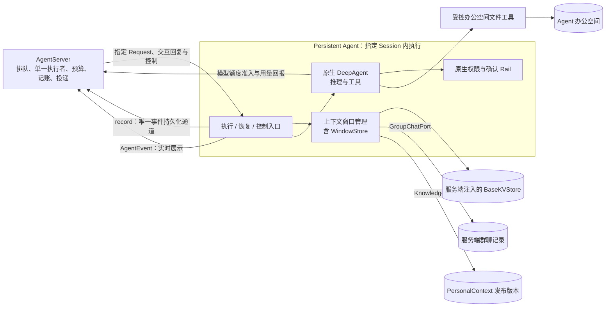
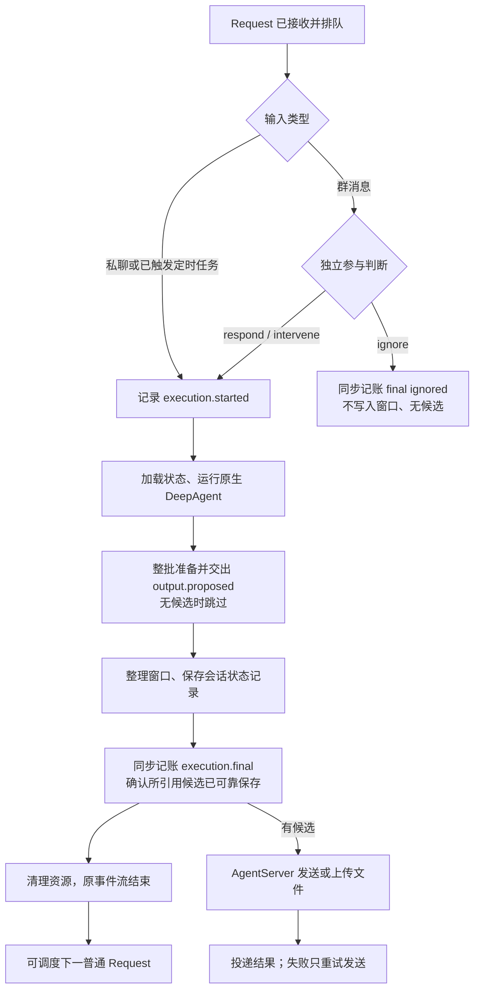
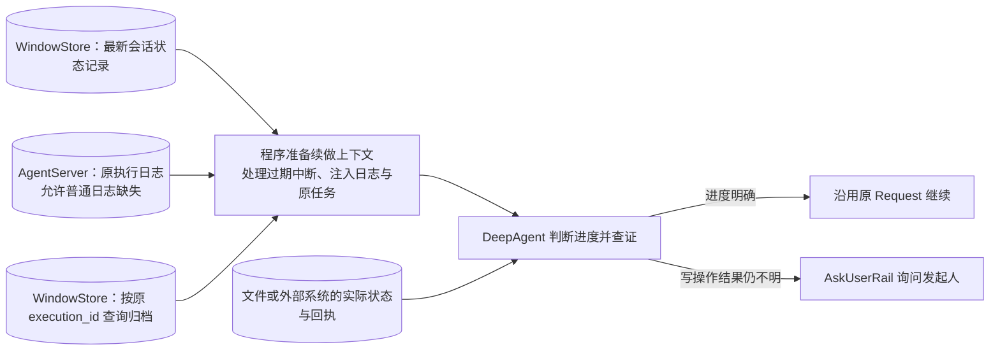

# Persistent Agent 设计概览

## 文档状态与阅读说明

| 项 | 说明 |
| --- | --- |
| 类型 | 当前架构的设计概览；设计范围与实现状态分别说明，现状与依据见第 5.1 节 |
| 最近一次修订日期 | 2026-10-16 |
| 责任人 | henry hu |
| 关联模块 | `openjiuwen.harness.persistent_agent` |
| 详细设计 | [Persistent Agent 详细架构设计](persistent-agent-architecture.md) |
| 开发计划 | [统一开发计划](persistent-agent-development-plan.md) |
| 文档归属 | [Persistent Agent 文档约定](../AGENTS.md) |

本文概括当前详细架构的目标、职责边界和关键规则；模块、端口、状态、执行时序、故障处理及验证要求以详细架构为准，实现状态以代码、当前规约及验证记录为依据，见第 5.1 节。正文中的设计流程不代表所有依赖已接入或完整闭环已开放。支持范围、负责人、进度和证据由统一开发计划维护；确定后的契约进入 `specs/`，实现决策与验证记录进入 `features/`。

## 1. 目标与范围

### 1.1 定位与目标

Persistent Agent 给原生 DeepAgent 加一层在指定 Session 内执行的外壳，使同一业务 Agent 身份能在多个独立 Session 中持续提供服务。进入原生推理循环的每个 Execution 使用独立实例，只处理一个 Session；不同 Session 可以由不同实例并行处理。实例用完即清理，长期保留的是 Agent 身份、获授权的工作文件、会话状态记录、历史归档和已保存的执行日志。

设计解决四个问题：

1. **连续工作：** 原 Session 可以跨请求和上下文窗口推进工作；确认恢复保留工具调用现场，崩溃或非确认暂停后由 Agent 结合最新窗口、日志和归档查证进度后续做。
2. **状态隔离：** 同一业务 Agent 的不同 Session 可以并行处理；实例、工具与私有执行状态按 Session、Execution 隔离。
3. **成果复用：** Agent 在获授权的办公空间内直接读写工作文件；其他获授权 Session 可使用办公空间的公共资料，会话草稿仍只属于原 Session。
4. **可靠交接：** 写操作先登记意图，执行结局和必要候选输出可靠保存；普通过程日志尽力记录，允许缺失。

典型使用方式是：Agent 在一个群的 Session 中整理项目事项，在私聊 Session 中处理独立请求，并在专用 Session 中执行 AgentServer 已触发的定时任务。三者使用同一 Agent 配置和办公空间，各自的窗口、待办和私有进度互不可见。群任务续做仍关联原群的原 Request；私聊不能直接接管它的待办。Agent 可以读取办公空间中获授权的 SOP 开始新工作，共享 Agent 身份不授予跨 Session 私有访问权。

### 1.2 职责与范围边界

本模块负责**宿主指定 Session 内的执行**：群消息参与判断、原生推理循环接入、窗口与历史管理、办公文件访问、只读知识使用、执行记账和发起人确认。JiuwenMate/AgentServer（`jiuwenswarm` 仓）负责渠道接入、Session 定位和排队、单一执行者、配置发布、预算账户、管理报表、群消息存储、事件保存、控制调度与投递。PersonalContext 独立负责知识采集和发布，本模块只读取获授权的版本。

本期运行在 AgentServer 同一进程内，端口采用进程内直接调用，不要求每个 Agent 常驻独占进程。

### 1.3 当前范围与后续扩展

本期执行模式仅限单轮，一次执行内可以多次调用模型和工具。task-loop、同步子代理、异步及持久子代理在执行前明确拒绝，验证后逐项开放。

Agent 主动换窗为主、模型容量 hard-limit 兜底已纳入 PA-11 的当前设计，尚未实现或开放；程序层面更强恢复、调用级即时撤权及等待确认期间处理其他 Request 列入后续扩展。程序层面的精确崩溃恢复、跨进程安全接管和卡死检测本期不支持。主动学习也是独立扩展，采用独立作业、独立调度和预算，不占用业务 Session；本期不承担学习目标、知识批次对账和反馈闭环，其目标、授权证据、知识批次与反馈机制由后续方案确定。

## 2. 核心模型与职责

### 2.1 总体关系

一次调用的职责边界如下，箭头表示能力调用或读写：

### 2.2 对象及事实权威

业务归属按 **Agent → Session → Request → Execution** 组织：Agent 是长期身份，Session 隔离对话与工作，Request 是一件具体事情，Execution 是一次实际执行。确认恢复、崩溃续做和非确认暂停后继续都会产生新的 Execution，并沿用原 Request。Window 按 Session 组织，可以覆盖多个 Request；一个 Request 也可以跨多个 Window。

| 对象 | 回答的问题 | 状态依据 |
| --- | --- | --- |
| Request / Execution | 原事情是否终结，哪次执行运行、暂停或结束？ | AgentServer 根据已落盘的 final / paused 和主动控制事实管理 |
| Window / 会话状态记录 | 当前执行看到什么，下次执行能加载什么？ | 运行中的 ContextEngine / Session state；WindowStore 保存的会话状态记录 |
| 历史归档 | 换出的窗口如何回查，某次执行留下哪些归档？ | WindowStore 保存的归档及索引 |
| 执行日志 | 一次执行做过什么，哪些写操作需要查证？ | AgentServer 按 execution_id 保存的事件；只允许读取同一 Session、同一 Request 下的日志，普通日志可能缺失 |
| 工作文件 | 办公空间中实际生成或修改了什么？ | 当前文件状态与工具回执；文件存在不证明任务完成 |
| PersonalContext 知识 | 本次执行可使用哪个授权版本？ | Execution 开始时解析的授权和发布版本 |
| 候选输出 / 投递 | 完整回复或登记的文件是否已交接，是否送达目标？ | paused / final 确认前可靠保存的候选输出；服务端发送和投递记录 |

这些状态分别确认，不假定跨存储事务。例如执行中已经换到新 Window，并不代表新窗已持久化；窗口中写有结束标记，也不能代替 `execution.final` 成功记账。

### 2.3 贯穿设计的原则

以下原则贯穿后续设计：

- 同 Session 同时只有一个活动 Execution，由 AgentServer 保证；旧执行退出并清理后才调度新执行。窗口存储因此无需版本号、条件更新或执行者代次校验。
- 原 Request 从开始到结束固定 Spec，包括确认恢复与续做；一次 Execution 内系统提示词和工具定义不变，知识版本在开始时解析一次，本期撤权在下一个 Execution 生效。
- 写意图、暂停与最终结局等待自身落盘；paused 与 final 还须保证引用的候选输出可靠保存，普通日志缺失不阻塞关键记账。
- 不同 Session 的会话状态、归档、执行日志和草稿互不可见；执行日志只允许读取同一 Session、同一 Request 下的记录。群公开历史与私有工作过程分开检索，来源引用重新读取时检查权限。
- 外部副作用结果不明时先查证，查不清时可询问发起人，是否询问由模型判断，不能因缺少本地结果记录就重做。
- 流式展示、文件存在、窗口保存和业务完成分别确认；发送失败只重试发送，不重跑已结束的任务。

## 3. 关键流程与完成语义

### 3.1 入口与正常链路

宿主定位 Session、固定原 Request 的 Spec，并提供可信执行上下文。本期每条群消息都先进入 Session 串行队列，轮到时以独立轻量模型调用判断 `ignore / respond / intervene`。判断只带职责、当前消息和少量最近群消息，不加载或写入窗口，不开放写工具；@、回复关系和发送者只是判断证据。私聊指令和已触发的定时任务跳过群参与判断，直接执行。

选择忽略时，记账 `execution.final(ignored)` 后结束，不构造 DeepAgent，不创建正式任务，不产生候选回复，也不写入窗口。需要执行时，记录 `execution.started`，加载会话状态记录并运行原生 DeepAgent；参与决策和 started 都是普通记录，不以其落盘作为进入推理循环的条件。判断失败不能记为忽略，模型额度拒绝也不能伪装成忽略。

图中展示正常终结路径。暂停同样遵循“交出候选 → 整理窗口 → 保存记录 → 记账 paused → 清理资源”的顺序，非停止的暂停只交出登记的文件；等待确认期间阻塞 Session，其他暂停不阻塞后续 Request。

AgentServer 持续消费执行流至结束或明确异常，收到 final / paused 后仍让入口完成清理。消费任务独立于前端连接，Web 订阅断开只结束展示订阅，不取消执行。

### 3.2 完成与交付的确认点

处理完成以 final 成功记账为准，和实际送达分开。完整最终回答由 `output.proposed` 交接，并列入 final.output_refs；流式片段不能替代最终回答。文件写好不等于任务完成或群内可见，需要公开时由 Agent 调用 `share_file` 登记文件和共享方式（上传群空间或作为附件发送），执行结束时程序按文件当时的内容交出候选，目标固定为当前回复目标，由 AgentServer 核对、留存后上传或发送。非停止的暂停也交出已登记的文件，并在 paused.output_refs 中引用；停止和取消不交接。最终回答超过单事件容量时拆成按顺序引用的多个候选，不截断，也不以暂停结束。任一候选准备失败时整批不交，原本完成的改为 `paused(error)`。

| 事件类别 | 处理要求 |
| --- | --- |
| 写操作 `tool.intent` | 同步记账成功后才执行；工具未声明副作用属性时按写操作处理 |
| `execution.paused` | 同步记账本事件，并确认 output_refs 引用的候选已可靠保存；结束当前 Execution，原 Request 可接续 |
| `execution.final` | 同步记账本事件，并确认 output_refs 引用的候选内容、目标和共享方式已可靠保存 |
| 其他事件 | 包括参与决策、started、进度、工具结果、换窗及候选输出；接收入队后即可继续，普通日志允许缺失 |

所有事件统一 `await record(event)`，这是唯一事件持久化通道；返回的 AgentEvent 流只用于展示，宿主消费时不再次保存同一事件。事件按产生顺序提交，已保存日志按 local_seq 返回，允许缺口。关键记账不等待无关前序普通日志全部落盘；同进程调用按成功返回或异常处理，本期不设置记账结果未知和超时查询协议。结束事件首次记账失败时，同一 Execution 内按原事件补交被引用的候选一次、再重试结束记账一次，服务端按 event_id 去重；仍失败则停止执行，不改为重跑业务任务。

### 3.3 控制、失败与重试

权限确认和主动提问直接复用原生中断机制：保存窗口与中断状态，记账 `paused(awaiting_confirmation)` 并结束本次 Execution；服务端只向发起人展示卡片、只接受其回复。回复通过 `ConfirmReply` 关联交互 ID，由新实例和新 Execution 调用 `resume_persistent_request`。确认恢复不向窗口追加消息，以回复作为原生恢复输入，保持工具调用与结果配对。权限确认超时按拒绝恢复，主动提问超时显式标记未获得回答；无效回复保持等待。本会话记住的选择随状态记录保存，不开放永久允许。

控制与排队的规则如下：

| 情况 | 对原 Request 与 Session 的影响 |
| --- | --- |
| 等待确认 | 阻塞 Session，直到有效回复或超时；恢复时创建新 Execution |
| 主动停止 | 记账 `paused(stopped)`，保留原 Request，不阻塞后续请求；必须明确要求继续 |
| 主动取消 | 记账 `final(cancelled)`，终结原 Request，不自动继续 |
| 预算、容量或可恢复错误暂停 | 分别使用 `budget_denied / context_unfit / error`；不阻塞后续请求，明确继续或服务端确认条件恢复后重新排队 |
| 普通补充消息 | 一律新建 Request 排队，不使用 `follow_up / steer`，不即时改变当前任务；卡片交互回复走独立恢复入口 |

服务端通过独立控制任务调用 `abort_persistent_request`，执行入口统一完成中断收敛、状态保存、结束记账与清理。原生退出并确定结局后，入口锁定结局，迟到的停止或取消不再改写原因或中断实例。控制入口返回不证明收尾完成；停止和取消也不自动撤销已经发生的外部效果。

普通运行错误默认使用 `paused(error)`，只有明确决定原任务无法完成时才 `final(failed)`；错误文本不能当作正常回答。状态加载保存或关键记账失败时停止并向宿主抛异常，不降级为普通运行错误，由服务端核对已落盘结局后决定调度。

## 4. 持续状态与关键约束

### 4.1 状态与资源生命周期

执行入口不选取下一条请求，也不另写持久化日志。进入原生推理循环时，每次 Execution 使用独立的原生 DeepAgent、`tool_owner_id` 和新的空 runtime Session，业务 Card 和 Session 身份保持稳定。构造通过 `create_persistent_agent` 委托 `DeepAgentSpec.build`，与 `create_deep_agent` 共用装配逻辑。服务端为 runtime Session 显式注入 `NoopCheckpointer`，跨 Execution 状态只由 WindowStore 保存和加载。原生 Session 生命周期、流关闭和资源清理照常执行。

WindowStore 是本模块内部组件，定义会话状态记录、归档、索引与检索逻辑；服务端必需注入符合 `BaseKVStore` 契约的后端，并保证持久化和命名空间隔离。状态与归档不能放在 Agent 工具可访问的位置，包括办公空间和工具所用的 SysOperation。会话状态记录按白名单整条一次写入，保存窗口、中断状态、本会话确认选择及必要的 DeepAgent 运行状态。

**上下文。** 新任务在 Execution 开始时加载 Session 当前记录；同一 Session 首次进入正式执行且尚无会话状态记录时，创建空窗口。记录读取失败时拒绝执行，不降级为空窗口。随后在窗口末尾依次追加执行头、临时背景和任务输入。背景包含最近群消息和知识导航；触发消息从群背景中排除，排队中的其他请求只作为背景。执行中模型回复、工具调用、结果和动态附件只追加到末尾，不改写既有内容；本模块不挂载默认的 ContextAssembleRail、PersonalContextRail 和 ContextProcessorRail。

**窗口与归档（PA-11，已确认待实现）。** Agent 在任务阶段边界主动请求换窗是主路径；若本回合没有请求，窗口管理组件按下一次调用的上下文、工具和用户结果、输出预留及安全余量估算，在接近模型 hard limit 时兜底，不采用固定 70%。仅在模型回复结束、工具调用与结果成组且并行工具收敛的安全边界换窗。新窗由当前原始 Request、受校验的 WindowSeed、预算内近期完整消息组及固定系统指令 / 工具组成；不额外调用模型生成摘要。必要内容放不下或容量安全无法判断时，暂停为 `context_unfit` 或 `error`，不静默截断。

换窗不改变 Session、Request 或 Execution。顺序是先幂等归档完整旧窗，再把新窗口、`current_window_id`、`window_seq` 和 `last_rollover` 写入 PA-10 使用的同一条 Session 状态记录；状态提交成功后才替换运行时上下文，`window.switched` 只是可缺失的普通通知。恢复以状态记录的当前窗口为准，归档与状态写入之间中断时仅按精确匹配的归档元数据对账。归档属于 Session 私有；PA-11 不等于 Agent 已有历史检索工具，检索由 PA-12 单独提供。PA-11 的运行时链路尚未接入，当前不宣称已具备换窗或恢复能力。

**结束保存。** 先整理窗口，再覆盖保存整条白名单会话状态记录，最后记账 paused / final，不为每次 Execution 另存窗口快照。整理时保留历史段落，压缩本次执行头，删除临时背景，保留对话和工作过程并增加结束标记。等待确认时末尾悬空工具调用不动，结束标记放在记录元信息里。状态保存和结束记账分别确认；先保存但未记账时，续做结合窗口、结束标记和日志判断已有结果。

**办公空间。** 文件通过现有 Workspace 和权限引擎直接读写，写操作先记账意图；会话草稿位于 `sessions/<session_id>/`，其他 Session 不能访问。文件存在不能代替执行结局，也不会自动形成群公开记录。知识发布由 PersonalContext 独立管理，当前 Request 的 Spec 在确认恢复和续做中保持原版本。

群背景按会话扫描游标增量读取，并回补触发消息之后至本次读取上界的内容；scanned_through 与展示范围和分页分开。PA-06 拒绝未配对工具调用及按条数截断参数，校验拒绝不自动续做。停止、取消或执行报错后，原生执行路径保留后续处理已完成的工具结果，处理未完成的只留说明、不纳入原始内容（事件链走完不等于安全检查成功，拦截依赖宿主安全 Rail 先替换内容再结束），PA-10 对缺失结果作 stopped_tool_placeholder 幂等补位（结果未取得，实际效果需核实）；正常等待确认不补位。

### 4.2 恢复与一致性

**续做。** 服务端重启后，对最近一次已派发的 Execution 无 final、无 paused 且未被主动停止或取消的 Request 自动发起续做。执行入口异常也可以触发同样处理，不必等待重启：先核对本次已落盘结局，已有 final / paused 保持结果；无结局且未被主动停止或取消时按中断处理。主动停止或取消的事实由服务端保存，收尾保存或记账失败也不能触发自动续做。主动停止必须明确继续，预算、容量及错误暂停只有在明确继续或条件恢复后重新排队；条件不变时不反复自动续做。新执行前必须确认旧执行已退出并完成清理，进程卡死时本期没有安全自动接管保证。

崩溃续做与非确认暂停后继续统一使用 `execute_persistent_request`。服务端沿用原 Request 和 Spec，提供新的 execution_id、原任务输入及 recovery_ref，后者指向同一 Session、同一 Request 下最近一次待接续的 Execution。程序加载 Session 最新记录，即使暂停期间执行过其他任务，也不回退到原任务的旧窗口。若记录带旧中断状态，先补齐悬空工具结果、清除过期中断，保留本会话授权，再读取日志和归档并追加续做信息；正常确认恢复不执行这项清理。

进度依靠尽力记录、模型判断和实际查证，不承诺程序层面的精确恢复。续做时程序沿 AgentServer 保存的前序关系追溯执行链，提供分层进度摘要，模型需要细节时用受控工具分页读取完整记录；某次日志读取失败或缺失、关联断裂或达到追溯上限时，明确提示未知的部分，是否询问发起人由模型判断。非空日志也可能缺少普通事件：日志已成功的步骤不重做，不确定的只读步骤可以重做；已登记意图但无结果的写操作必须先查证，查不清时可询问发起人，是否询问由模型判断，不能因缺少结果记录而认定操作未发生。已有最终结果直接整理交出，不重新生成。

例如 Q1 在 E1 中登记写意图并发生外部写入，随后换到 W2，但在保存会话状态记录前崩溃。E2 加载的可能仍是 W1，通过 E1 的日志和归档了解工作过程，并核对文件或外部系统实际状态；结果不明时询问发起人，不盲目重复写入。非确认暂停后，同一 Session 可以先处理其他 Request，继续 Q1 时使用 Session 最新窗口；其他 Session 不继承 Q1 的私有待办或控制状态。

### 4.3 授权、隔离与资源约束

PersonalContext 的授权与版本在 Execution 开始时解析一次，执行中不刷新；正文按需读取，来源引用重新读取仍检查权限。本期撤权在下一个 Execution 生效，调用级即时撤权列入扩展。系统提示词和工具定义固定，动态资料通过末尾追加通道加入。群公开记录通过 GroupChatPort 查询，私有历史通过 WindowStore 检索，查询失败或没查完不能当作确定没有。

每次模型调用，包括群参与判断，都先申请额度、调用后回报实际用量。PA-11 不额外调用模型生成换窗摘要。准入拒绝不调用模型；准入端口异常为 `paused(error)`，用量回报失败只记诊断并由服务端对账。

## 5. 现有基础与落地边界

### 5.1 可复用基础与待建设能力

现有 [DeepAgent](../../../deep_agent.py)、[构造工厂](../../../factory.py)、[PersonalContext](../../../personal_context/personal_context.py)、Rails、权限引擎与 Workspace 是可复用基础；可靠执行仍依赖宿主兑现持久化、隔离、记账、输出交接及独立流消费等保证。

**已实现的组件。** 构造与实例隔离、执行上下文及端口契约已按各自范围实现，见[调用与执行规约](../specs/S_01_public-api-and-execution.md)。[执行、恢复与控制入口](../../execution/entries.py)已有实现，并完成组件验收，见 [F_05](../features/F_05_execution-entries.md)；群消息参与判断也已完成组件验收，见 [F_07](../features/F_07_group-participation.md)。群消息的忽略路径在构造 DeepAgent 和加载窗口之前结束。

**待接入的能力。** PA-06 窗口装配已接入，容量验收仍待完成；会话状态记录（PA-10）已接入，相关组件验证通过，真实宿主联调未完成（见 [F_17](../features/F_17_session-state-record.md)）；PA-11 的主动换窗、容量兜底、归档和状态对账已有设计，代码与测试尚未实现（见 [F_11](../features/F_11_window-management.md)），其中 PA-10 记录版本兼容及中途保存时结束字段的语义须在实现前定稿；交互适配（PA-09）仍通过[接入点](../../execution/seams.py)等待接入，确认恢复在此之前拒绝；入口组件测试使用替身验证尚未接入的协作。依赖接入并完成 M1 集成前，不声明完整原生业务执行闭环或 execution 能力已开放。崩溃续做与非确认暂停后继续（PA-18）尚未接入，当前入口明确拒绝带 recovery_ref 的执行。

**验证边界。** 模型调用和工具执行中途停止、取消或报错时的窗口保存已有组件验证（PA-10，内存后端），真实宿主联调未完成。候选交接（PA-08，见 [F_18](../features/F_18_output-handoff.md)）已有组件实现与验证，服务端的候选留存、核对与投递保证待联调。组件验收、真实宿主端口与跨仓联调分别确认，具体状态和证据以统一开发计划及对应 feature 为准。

### 5.2 能力开放条件

能力开放以接入和验证为前提；具体特性顺序、负责人、测试和证据由[统一开发计划](persistent-agent-development-plan.md)维护。本概览按能力列出当前架构门槛：

| 能力 | 开放条件与限制 |
| --- | --- |
| 原生业务执行 | 窗口装配、会话状态加载保存与 checkpointer 隔离接入；首次无记录可创建空窗口，加载失败不降级；配置或输入校验拒绝不自动续做 |
| 群消息执行 | 参与判断接入并验证；接入前拒绝群消息，私聊和已触发定时任务直接执行 |
| 写工具 | 写意图记账接入后开放，意图失败不执行；文件交接经 `share_file` 登记，随办公空间读取能力开放，真实投递待服务端联调 |
| 确认与主动提问 | 交互适配与会话状态记录接入，验证中断序列化、交互回复转换、工具调用配对和发起人校验；等待确认阻塞 Session |
| 换窗与保存 | 验证 Agent 主动请求、模型 hard-limit 容量兜底、安全边界、旧窗归档与新状态提交顺序、重复切换幂等及中断对账；PA-10 整条保存及工具执行中途停止、取消、报错时的窗口保存已有组件验证，真实宿主联调未完成；PA-12 另行验证历史检索 |
| 崩溃及非确认暂停续做 | 验证 recovery_ref、日志与归档读取、过期中断清理及写结果查证；接入前拒绝带 recovery_ref 的执行 |
| 候选输出与完成 | paused / final 成功前确认引用的候选已可靠保存，前端展示与执行流消费独立，清理或投递失败不重跑已结束任务 |

### 5.3 详细设计与实施文档索引

发送检查、过时回复抑制、发送前复核，以及群预算账户维度、共享和重置规则由服务端所属方案定义，当前详细架构未确定这些机制；本概览不将其作为已确定的执行侧契约。

归档保留期、确认超时、队列容量、限流与告警、查询统计及详情权限，以及跨版本兼容、迁移回退、删除依赖和备份后外部效果核对仍由对应方案确定。后端备份与清理责任不构成完整恢复保证；管理报表、预算账户和投递策略由服务端维护。

详细架构共十二章及附录：

| 阅读主题 | 详细架构入口 |
| --- | --- |
| 定位、范围、核心概念与双方分工 | 第 1～3 节 |
| 实例构造、执行入口、上下文、检索与确认 | 第 4 节 |
| 正常执行、确认、换窗、控制及统一续做 | 第 5 节 |
| 状态、事件可靠性与结果交接 | 第 6 节 |
| 会话状态、checkpointer 隔离、存储与归档 | 第 7 节 |
| 故障分类、外部操作查证和继续条件 | 第 8 节 |
| 权限、隔离与资源限制 | 第 9 节 |
| 运行保障、诊断、保留删除和版本维护 | 第 10 节 |
| 完整场景与验证要求 | 第 11 节 |
| 设计选择、待验证前提与待确认问题 | 第 12 节 |
| 共同规则、后续扩展与历史记录 | 附录 A～C |
