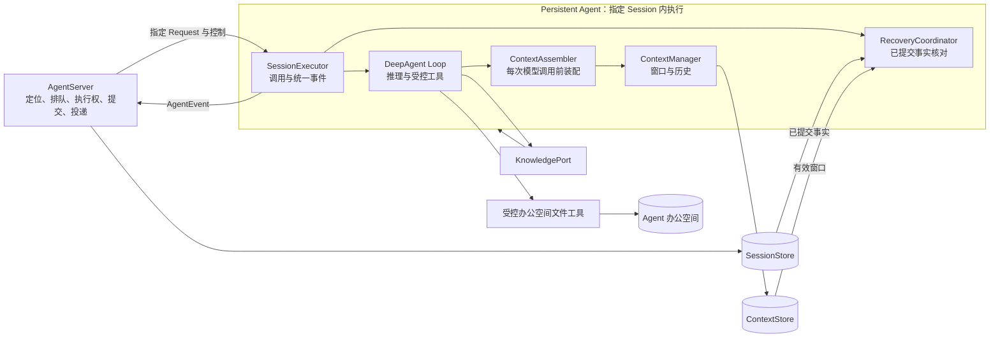
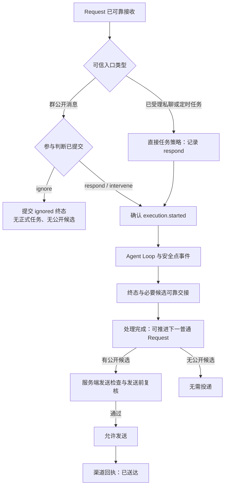
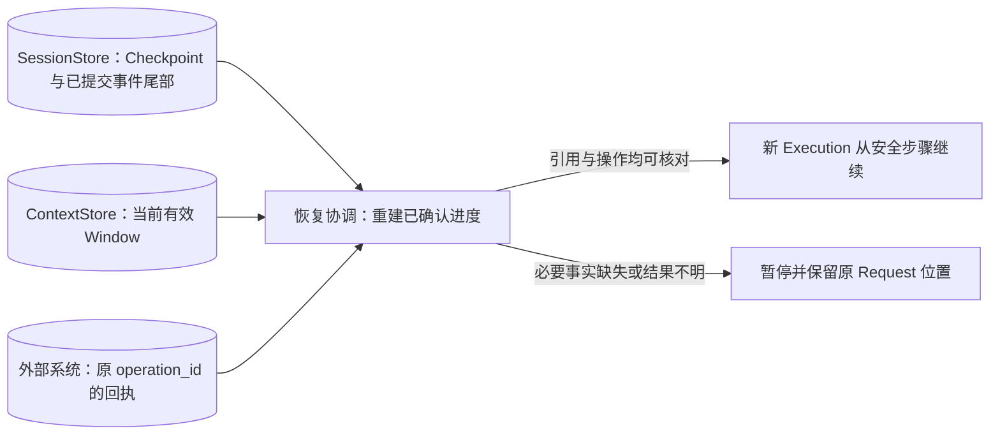

# Persistent Agent 设计概览

## 文档状态与阅读说明

| 项 | 说明 |
| --- | --- |
| 类型 | 目标设计草案；不代表已实现 API 或已生效规约 |
| 最近一次修订日期 | 2026-09-24 |
| 责任人 | henry hu |
| 关联模块 | `openjiuwen.harness.persistent_agent` |
| 详细设计 | [Persistent Agent 详细架构设计](persistent-agent-architecture.md) |
| 文档归属 | [Persistent Agent 文档约定](../AGENTS.md) |

本文说明目标、职责边界和关键设计原则。详细架构在这些原则下展开模块、端口、状态机、事件与数据结构、执行时序、故障处理和验收矩阵；需要实施细节时以详细架构为准。两份文档目前均为目标设计草案，确定后的契约进入 `specs/`，实现决策与验证记录进入 `features/`。

## 1. 目标与范围

Persistent Agent 使同一业务 Agent 身份能在多个独立 Session 中持续提供服务。每个活动运行实例只处理一个 Session；不同 Session 需要并行时使用不同实例。实例可以释放和重建；持久的是 Agent 身份、获授权的工作文件、会话内已确认进度及可恢复上下文。

设计解决四个问题：

1. **连续工作：** 原 Session 可以跨请求和上下文窗口推进工作，中断后从已确认的安全状态继续。
2. **状态隔离：** 同一业务 Agent 的不同 Session 可以由不同实例并行处理；单个实例不同时接入两个 Session，消息、待办、工具与控制状态互不串扰。
3. **成果复用：** Agent 在获授权的办公空间内直接读写工作文件；不同 Session 可按当前权限使用同一空间中的资料，但不共享私有执行状态。
4. **可靠追溯：** 决策、证据、工作文件引用、操作回执、处理终态和公开投递可分别核对。

典型使用方式是：Agent 在一个群的 Session 中持续整理项目事项，在私聊 Session 中处理独立的工作请求，并在专用 Session 中执行 AgentServer 已触发的定时任务。三个 Session 使用同一 Agent 已发布的能力配置与获授权的办公空间，但各自保留独立的工作进度。管理查询和定时计划管理由 AgentServer 处理；群任务中断后，恢复的仍是原群的原 Request，私聊不能直接接管其未完成待办。Agent 可以读取办公空间中可访问的 SOP 开始新工作，却不能因为同属一个 Agent 就读取来源会话的私有轨迹。

本模块负责**宿主指定 Session 内的执行**：参与判断、Agent Loop 接入、上下文装配、窗口与历史、资产访问、恢复状态重建，以及 Agent 级主动学习的目标与反馈。JiuwenMate/AgentServer 负责渠道接入、Session 定位和排队、配置发布、执行权、业务事实提交、控制调度、发送检查与投递。PersonalContext 负责知识来源采集、处理和发布；本模块只消费获授权的版本，并通过独立学习作业与之协作。Team Leader、跨 Agent 私有状态共享及模型参数训练不在基础范围内。

当前 `persistent_agent/` 只有设计文档，拟议的 `SessionExecutor` 和 `execute` 尚未实现。现有 [DeepAgent](../../../deep_agent.py)、[构造工厂](../../../factory.py)、[PersonalContext](../../../personal_context/personal_context.py)、Rails、工具权限与 Workspace 是可复用基础，不等于已具备本文的可靠执行闭环。

设计不要求一 Agent 常驻一个进程，也不要求每个逻辑模块独立部署。它依赖宿主提供可靠接收、执行权与提交确认；若宿主暂不具备某项保证，对应能力应保持关闭，而不是由模型或内存状态假装可靠。

## 2. 核心模型与职责

业务归属按 **Agent → Session → Request → Execution** 组织：Agent 是长期身份；Session 隔离交互与工作；Request 是一次已可靠接收的业务输入；Execution 是该 Request 的一次实际执行。旧执行结束后，恢复会建立关联原 Request 的新 Execution。Window 是 Session 的上下文容器，Checkpoint 是已提交的恢复依据，二者都不是新的业务任务。工作文件由 Agent 在获授权办公空间内按路径读写；路径本身不是授权凭据。

| 对象 | 回答的问题 | 权威状态 |
| --- | --- | --- |
| Request / Execution | 正在处理哪条输入，由哪次尝试执行，哪些事实已提交？ | AgentServer 的 SessionStore 与执行权记录 |
| Window | 下一次模型调用使用哪个上下文容器？ | ContextStore 的活动指针及内容版本 |
| Checkpoint | 原任务已确认推进到哪一步？ | SessionStore 已提交的检查点引用及事件边界 |
| 工作文件 | 当前调用可以访问办公空间中的哪些文件？ | 工作空间边界与当前文件状态；文件内容不证明业务进度已提交 |
| PersonalContext 知识 | 哪个发布版本获准被当前调用读取？ | PersonalContext 的发布版本与来源权限 |
| Delivery | 候选内容是否允许发送、是否真正送达？ | 服务端投递记录与渠道回执 |

这些状态可以分别提交，不能用其中一个的更新时间代替另一个的确认结果。例如新 Window 已生效而 Checkpoint 仍指向旧窗时，新窗是合法的上下文容器，但其中写有“已完成”的文字不是已提交的工作进度。

一次调用的职责边界如下。图中的箭头表示调用或受控访问，不表示跨存储事务；AgentServer 仍是业务事实、执行权和投递的权威。

执行器不选取下一条业务请求，也不维护第二套持久化事件日志。每个活动调用使用独立的 Persistent Agent 执行对象、DeepAgent 和 `tool_owner_id`，并固定到一个 Session；同一实例不能同时处理第二个 Session。业务 Card 身份保持稳定，共享只限已验证安全的只读配置、构造依赖和客户端。DeepAgent 仍经 `create_deep_agent` 构造。ContextStore 管活动窗口，SessionStore 管请求进度与事件；办公空间直接保存工作文件，PersonalContext 独立决定知识发布版本。这些存储不假定存在统一事务。

子代理的创建与运行直接复用 DeepAgent 现有实现，Persistent Agent 不另建子代理能力。若配置启用子代理，它们仍是当前 Request 内的工作单元，沿用父调用的权限和预算上限，事件与结果汇入父执行；需要可靠恢复的写操作按通用写工具协议核对。

调用上下文由可信宿主给出完整归属、原配置、启动权限上限、执行代次、预算、资料与受控端口。消息正文、工具返回和文件内容只能作为带来源的业务数据，不能更换 Session、声明新权限或成为系统指令。每次模型调用和受控写入都重新检查必要的动态条件；入口校验不是一次性通行证。

以下原则贯穿后续设计：

- 同 Session 同时只有一个有效写入者；受控状态写入须在写入边界原子校验执行权。
- 原 Request 的能力配置与启动权限上限固定；知识版本可在下次模型调用前刷新，当前撤权和停止收紧后续使用。
- 事件发出、函数返回、文件存在或窗口切换，都不能单独证明业务终态已提交。
- 会话私有状态不跨 Session 分享；摘要、导航和缓存不能替代原文或绕过来源权限。
- 外部副作用结果不明时先核对，不能因缺少本地成功记录就重做；不承诺任意外部操作恰好执行一次。
- 候选公开输出、允许发送和渠道送达分别确认；私有判断和工具轨迹不会随群消息公开。

## 3. 执行与完成语义

宿主定位 Session、固定原请求配置并提供可信执行上下文。群公开消息按 `ignore / respond / intervene` 判断，@、回复关系和发送者只是证据；已明确受理的私聊指令或定时任务走直接任务策略，不因“无需群内发言”而忽略。判断只读，忽略不创建正式工作窗口或正式任务投影。参与决策提交后，执行器另提交 `execution.started`，确认后才进入 Agent Loop；判断失败或预算不足不能伪装成忽略。

图中“处理完成”与“已送达”是不同确认点；发送检查等待或失败不会重新打开已完成的业务执行。

| 输入或结果 | 执行侧处理 | 宿主侧后续 |
| --- | --- | --- |
| 群消息判断为忽略 | 留存私有决策与实际用量，不进入正式 Loop | 提交 ignored 终态；无公开候选，也不创建正式任务投影 |
| 群消息需要响应或主动介入 | 提交参与决策与执行开始，再推进当前目标 | 保存进度和最终结果；候选公开内容走发送检查 |
| 已受理私聊或定时任务 | 以直接任务策略记录参与，必要时澄清或报告失败 | 保持原 Session、原回复位置和执行顺序 |
| 仅产生文件或状态变化 | 完成任务并提供产物引用，不伪造回复正文 | 提交 completed；有候选才进入投递流程 |

同一群消息可以由零位、一位或多位 Agent 独立处理。协作通过原群公开消息和获授权的资产发生，提出分工不等于对方承接；发送成功也不保证其他 Agent 已接收。发送检查会依据最新公开讨论判断增量价值，但抑制过时回复不会把已完成的工作改写成 ignored。

执行器通过统一事件流返回决策、正式执行开始、进度、工具意图与回执、Checkpoint、等待和最终结果。依赖安全点的后续操作必须等待服务端确认；事件重传沿用原标识，恢复执行产生新事件但仍归属原 Request。事件生产与宿主消费并行，以有界缓冲避免等待确认时互相阻塞。

事件流本身只表示“已提出”，不表示“已提交”。需要对外写入、保存有效恢复点、进入等待或结束请求时，执行器先取得相应确认；确认超时先查询，不能假定失败后重做。业务进度由已提交事件与 Checkpoint 决定，展示片段不参与恢复状态归约。具体事件字段、顺序和背压约束由详细架构定义。

同 Session 的普通 Request 串行；审批、取消和明确关联当前交互的补充走独立、鉴权且去重的控制路径。短等待可继续原 Execution；释放运行对象的持久化等待由新恢复 Execution 接续。暂停或停止可释放计算资源，但未确认终态前仍占用原请求的逻辑位置。Agent 重新启动不会自动补跑旧任务或补发旧结果，旧任务需明确继续或结束。

控制与恢复不创造第二个 Session 写入者。审批须绑定目标操作与参数；参数改变后原审批不能复用。取消和停止只阻止新步骤并收敛在途调用，不自动撤销已经发生的外部效果。原执行失去执行权后，旧回执可以成为待核对证据，却不能由旧执行者直接改写当前权威状态。

**已接收、处理完成、允许发送、已送达**是不同事实。最终结果和必要候选输出在同一事务或可恢复提交单元中可靠交接后，原 Request 才能推进；候选通过发送检查并在实际发送前复核，渠道回执才证明送达。投递失败、检查等待或 Web 订阅断开均不重跑业务执行。群聊回复作为普通 Agent 响应，沿用统一事件与输出交接链路。办公空间中的文件即使已完成，也不会仅凭文件引用出现在群内；需要群成员或其他 Agent 感知时，执行器交接目标群、文件引用及共享方式，AgentServer 经授权将文件上传群空间或作为群消息附件／可访问引用发送，确认后才形成群公开记录。

群内模型调用额度由 AgentServer 管理：判断、执行与发送前模型检查共享该 Agent 在该群的预算，服务端负责预占、结算和未知用量核对。Persistent Agent 每次模型调用前遵守宿主准入结果，并回传实际用量；额度不足时不发起模型调用。新消息、新 Session 或重启不自动重置群预算；Agent 级学习单独核算。

AgentServer 独立处理管理查询、办公室、日报和跨 Session 汇总，并检查群消息访问权与轨迹管理权；Persistent Agent 只回传供其使用的结构化执行事件，不提供管理查询工具。任何列表、统计或下载都不能泄露无权来源的标题、数量或正文。

## 4. 长期状态、知识与恢复

**上下文。** 每次模型调用前核对授权、资料与知识版本，按任务选择必要历史证据、资产和知识导航，并在运行时附件注入后检查完整请求容量。大资料按需有界读取；排队中的新请求只能作为公开背景，不能成为本 Request 的新指令。必要输入仍超限时暂停并报告原因，不静默截断。

判断阶段只需要职责、当前输入和少量必要背景；执行阶段才引入目标、待办、证据及工具结果；恢复阶段还要加入已确认进度和操作核对结果。一次模型输入中的来源和发布版本应自洽。知识或资料更新可在下一次装配生效，但撤权后旧正文及其派生摘要不能继续被模型或后续操作使用。历史检索按当前 Session 与权限有界返回原文证据，索引或摘要仅用于定位。

**Window 与 Checkpoint。** Window 决定模型接下来看到什么，ContextStore 的活动指针是其权威；Checkpoint 记录任务已确认推进到哪里，以 SessionStore 已提交引用为准。正式执行的安全点可保存同一 Window 的新内容版本；Agent 主动请求或完整输入容量不足时才换到新 Window。换窗成功即产生有效上下文容器，但不自动提交业务进度。

换窗不改变 Session、Request 或 Execution，也不删除群公开历史。创建新窗前应保留允许归档的旧窗原文、来源和可回查索引；新窗携带剩余目标、约束、已确认结论、待办和未决操作引用。前置归档未完成时尚未换窗，应暂停并处理原因；新窗一旦成为活动窗口，后续故障也不切回旧窗，而是核对当前窗口及已提交进度后继续或暂停。Window 可以跨多个 Request，单个 Request 也可以跨多个 Window。

**办公空间与知识。** Agent 在授权办公空间内直接读写资料、模板、SOP、脚本及产物，不经过办公资产发布步骤。办公空间中的文件可被其他获授权 Session 使用，但文件存在本身不会通知群成员或变成群公开资料；草稿、待办、Checkpoint 和私有轨迹仍只属于原 Session。文件路径不扩大权限，也不证明业务任务已完成。PersonalContext 知识由其独立发布根管理。本模块读取获授权的知识导航和正文，不复制采集状态形成第二份知识库。主动学习使用专门授权的跨 Session 证据，识别目标并跟踪反馈；分析权不等于 PersonalContext 的知识发布权。

办公空间文件写入按当前工具权限执行，必要时记录来源及可核对的文件状态；同一文件的并发修改按文件工具的冲突语义处理，不引入发布指针。保存脚本不会自动增加 Skill 或执行权限。PersonalContext 的发布版本可供下一轮装配使用，但新版本不改变当前 Request 已固定的模型、工具或人设能力。主动学习作为 Agent 级独立作业，由宿主调度并占用独立预算；它可以补知识缺口或持续建设高价值领域，知识采集与发布仍需来源授权和版本核对。

**恢复。** 服务端先查原 Request 的权威终态，已完成时只处理投递。未完成时，新 Execution 沿用原配置和启动权限上限，校验最近已提交 Checkpoint，再归约其后的已提交事件，核对有效 Window、必要工作文件的当前状态、未决操作与等待控制。外部操作沿用原 `operation_id` 查询回执；结果仍不明时暂停依赖步骤。只重建可验证状态，不恢复旧线程或隐藏推理。

Window 提供有效上下文容器，Checkpoint 加事件尾部提供已确认进度，外部回执说明副作用的真实结果。三者不能互相替代。

例如群任务 Q1 在 E1 中完成一次外部写入，工具成功但回执确认丢失，同时 Window 已从 W1 切到 W2。服务端接管后建立 E2：先核对 Q1 是否已有终态，再读取已提交事件及 W2 指针，用原操作标识查询真实外部效果。W2 不会因为比 Checkpoint 新就被回滚，也不能凭其文字宣称写入已提交。结果明确后才继续 Q1；若无法查询且操作不支持幂等，就暂停等待核对。另一个 Session 的任务不继承 Q1 的取消、待办或未确认结果。

权限检查覆盖资料读取、模型使用、办公空间文件工具执行和最终发送。跨 Session 管理报表须通过服务端独立授权投影，不能借普通历史工具读取其他 Session 的恢复对象。保留期和撤权同样覆盖原文、摘要、索引、缓存与派生内容。

## 5. 落地门槛与详细设计索引

| 阶段 | 目标与开放条件 |
| --- | --- |
| P1 最小安全闭环 | 完成隔离、判断/直接任务、事件确认、宿主群预算准入对接、停止与投递交接；群预算账户和结算由 AgentServer 验收；只开放只读任务，缺少持久化控制恢复时明确禁用对应能力。 |
| P2 长程与副作用恢复 | 验证普通保存、换窗、Checkpoint 后事件归约、办公空间文件写入与操作回执、持久化等待；故障注入通过后才开放写工具和需持久化审批的任务。若启用 DeepAgent 现有子代理，其写操作适用同一验收门槛。 |
| P3 知识使用 | 验证 PersonalContext 版本与撤权传播；办公空间读写在 P2 验收，群回复沿用 P1 响应交接，管理报表由 AgentServer 验收。 |
| P4 主动学习 | 验证专门授权、目标作业、知识批次对账和反馈闭环。 |

详细架构按主题展开：第 2～4 节说明模块、现有基础、状态归属及输入来源；第 5～8 节定义调用、端口结果、控制、预算与事件确认；第 9～14 节给出上下文、存储、窗口、资产、子代理、学习和恢复协议；第 15～18 节覆盖场景、安全、错误、跨仓接口与版本演进；第 19～20 节列出故障注入矩阵、阶段退出条件及仍待确定的接口。灰度升级须保留原请求的能力配置和已提交状态，兼容读者先行；后台对账只能补齐可证明的事实。分阶段不降低启停、权限或副作用安全要求。
