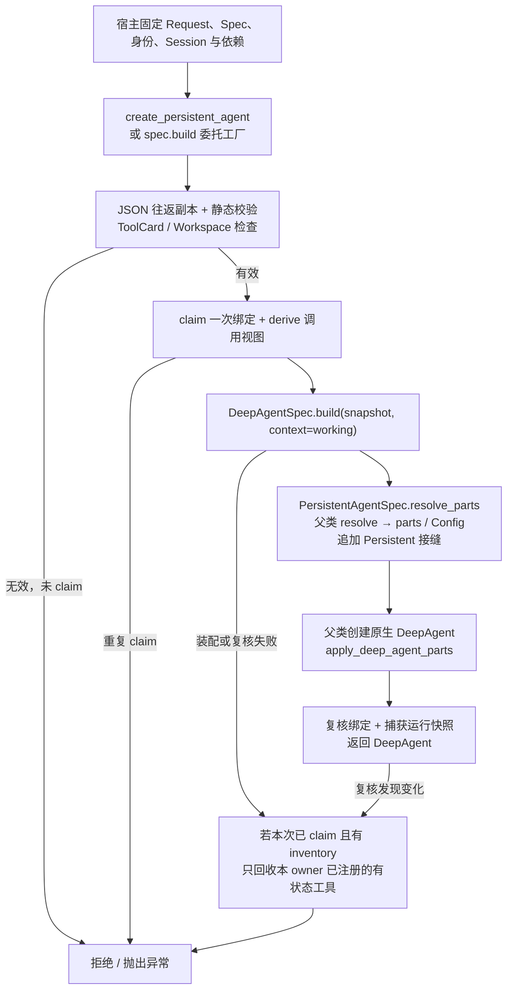
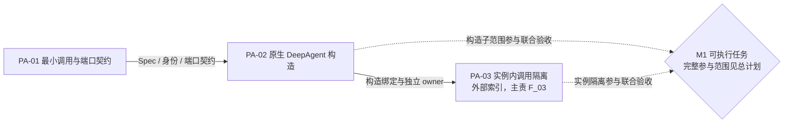

# F_01 Persistent Spec 与 DeepAgent 装配接入

## 1. 阅读与维护说明

### 1.1 元信息与文档定位

| 项 | 值 |
| --- | --- |
| 类型 | feature；记录 PA-01 的构造契约基础与 PA-02 的原生 DeepAgent 构造设计 |
| 最近修订日期 | 2026-10-12 |
| 核心方案 | 原生 DeepAgent 运行主体 + 单份继承型扁平 Spec |
| 负责人 | yan_zj（PA-01 / PA-02） |
| 状态与适用范围 | PA-01 契约层、PA-02 构造已按各自边界完成；后续契约收敛、实例隔离及执行组件分别由 PA-04、PA-03、PA-05 维护 |
| 唯一开发计划 | [Persistent Agent 开发计划](../designs/persistent-agent-development-plan.md)；认领、排期、交付分类、节点和完成率在该计划维护 |
| 验证摘要 | 构造 / 协议 / workspace_read 装配定向测试 144 passed；范围与环境见第 4.1 节 |
| 关联 PR / issue | 未提供 |

本文参考[特性开发计划模板](../../../docs/templates/feature-development-plan-template.md)组织范围、验收、依赖和进展，按[特性设计模板](../../../docs/templates/feature-design-template.md)展开设计取舍与实现流程。特性编号采用总计划的当前 PA 编号，F_01 是文档编号。开发状态与排期由总计划维护，本文提供构造设计及技术证据。

### 1.2 范围与阅读依据

本特性负责可序列化 Spec、调用级构造上下文、静态依赖检查、共享 owner 接缝，以及通过既有 parts / Config 路径构造原生 DeepAgent。PA-01 的完整事件和宿主 DTO 设计由 [F_02](F_02_execution-protocol.md)记录，当前契约收敛由 [F_04](F_04_contract-convergence.md)记录；本文只展开构造会消费的部分。

| 依据 | 本文采用的范围 |
| --- | --- |
| [Overview](../designs/persistent-agent-overview.md)、[架构设计](../designs/persistent-agent-architecture.md)第 3、4.1、4.2、7.3、9～10 节 | 宿主边界、构造与实例隔离、执行模式、状态保存及成立前提 |
| [S_07 构造与调用绑定](../specs/S_07_construction-and-binding.md) | 当前 Spec、ExecutionContext、端口集合、工厂、绑定及错误契约的唯一规约 |
| [S_01 执行入口](../specs/S_01_public-api-and-execution.md)、[S_02 事件与结果交接](../specs/S_02_events-and-result-handoff.md) | 正式入口、预算、结局与记账；构造成功不能代替这些保证 |
| [S_03 上下文与窗口](../specs/S_03_context-and-windows.md)、[S_04 工具与办公空间](../specs/S_04_tools-and-workspace.md) | 状态后端与 workspace_read 的依赖及授权边界 |
| [S_05 确认与续做](../specs/S_05_confirmation-and-continuation.md)、[S_08 工具意图](../specs/S_08_tool-effects-and-intent.md)、[S_09 群聊与知识](../specs/S_09_group-chat-and-knowledge.md) | 控制、确认、写操作及资料访问的后续消费契约 |
| Harness [公开 API 与构造](../../../docs/specs/S_01_public-api-and-construction.md) | BuildContext → parts → Config、工具资格化及默认个人版行为 |
| [F_03 实例绑定与隔离](F_03_invocation-binding-and-isolation.md)、[F_05 执行入口](F_05_execution-entries.md)、[F_14 文件读取](F_14_workspace-file-read.md)、[F_15 写操作意图](F_15_tool-intent-before-side-effect.md) | 构造所装配接缝的运行行为及独立验证范围 |

F_01 交付 Spec、构造上下文、静态依赖检查、owner 接缝及原生 DeepAgent 装配。窗口、历史、知识、群参与判断、确认、续做、学习和结果交接由各自特性维护。Agent 配置发布、Request 受理、Session 串行调度、预算账户、持久化与实际投递由 AgentServer 负责；跨仓接入安排见总计划迁移附录。

### 1.3 完成与维护口径

- 构造验收只证明静态检查、装配和资源归属；端口符合类型或方法形状，不证明真实授权、持久化、可用性、投递或恢复。
- 验收要求在第 2.6 节维护，实际结果在第 4 节维护；总计划引用本文的技术证据。
- 设计约束、当前实现和未验证范围分别说明；契约变化同步主责 spec，架构变更遵循本目录 [AGENTS.md](../AGENTS.md)。

## 2. 特性定义与设计

### 2.1 背景、目标与责任

同一个业务 Agent 可以在多个 Session 中工作。如果复用可变运行实例或按 Card ID 注册同名有状态工具，调用之间会互相覆盖状态；如果再新增运行门面、复制配置或另建任务循环，又会使 Persistent 与 DeepAgent 的公共能力分叉。

目标是让宿主以一份固定配置和一次调用上下文创建原生 DeepAgent：有效输入可装配；身份、配置或依赖错配可明确拒绝；构造不开始业务任务；工具注册与失败回收限定在本调用。运行身份和服务端能力由可信宿主提供，不让模型通过参数重绑。

| 开发单元 | 目标及责任边界 | 开工硬前置 | 独立验证条件 / 联合开放 |
| --- | --- | --- | --- |
| PA-01 构造所需调用与端口契约 | 提供可核对的身份、配置、权限快照和依赖集合；完整协议见 F_02，当前形状见 F_04 / S_07 | 无；复用现有 DeepAgent / Session / BaseKVStore 契约 | DTO 与模拟端口可独立验证；宿主真实实现不属于类型层验收 |
| PA-02 Persistent 构造入口 | 校验 PA-01 产物、分配 owner、复用 parts / Config，严格返回原生 DeepAgent | PA-01 的 Spec、ExecutionContext、PersistentPorts 最小契约 | 真实本地 DeepAgent 与 Session，端口和 KVStore 可用禁止调用的替身；正式执行仍须总计划 M1 联合验收 |

两项均无独立前端，前端验证不适用。本文不承诺 PA-03 的完整调用隔离，也不承诺 PA-05 的正式任务闭环；对应共享场景引用各自主责文档。

### 2.2 总体方案、关键决策与替代方案

Persistent 是组合到 DeepAgent 的配置、Rails、工具及交接能力，不是第二个 Agent 类型。配置采用 `PersistentAgentSpec(DeepAgentSpec)`，只继承描述类；运行主体仍为原生 `DeepAgent`，不新增 PersistentAgent 类、DeepAgent 子类、包装门面或第二套模型 / 任务循环。

| 决策 | 选择与原因 | 被排除方案及代价 |
| --- | --- | --- |
| D-01 运行主体 | 复用原生 DeepAgent 的装配和公开生命周期，保持单一执行基础 | 新 Agent 门面 / 子类或改写 stream：重复入口与生命周期，易把原生结束误当业务完成 |
| D-02 配置形态 | 单份扁平继承型 Spec，通用字段沿用父类，专属字段参与校验和指纹 | 复制父类字段易漂移；嵌套 `deep_agent` 或使用两份 Spec 会增加配置同步与校验成本 |
| D-03 运行依赖 | Session、端口、owner 和绑定进入运行时 BuildContext，不进入发布 JSON | 把端口放 Spec 或 query 会混淆序列化配置与可信授权边界 |
| D-04 注册归属 | 在注册前经公共 BuildContext → parts → Config 传入独立 owner，Card 身份不变 | 构造后补 owner 已晚于资源注册；靠 provider 前缀或修改私有字段不能可靠隔离 |
| D-05 能力与失败 | 只声明有消费者的能力；静态失败明确拒绝，部分装配失败按本 owner 回收 | 提前增加无消费者策略字段或默认成功端口，会把配置声明误当运行保证 |

父类模型 / 工具重试配置直接继承，不重复定义。不可序列化的发布配置拒绝构造，不转成父类后静默丢弃专属字段。可信自定义 provider 须在构造期无外部业务副作用，并创建独立有状态工具 / Rail；本工厂不是任意 Python 扩展的沙箱。

### 2.3 Spec、指纹与调用上下文

#### 2.3.1 可序列化 Spec

实现见 [schema/spec.py](../../persistent_agent/schema/spec.py)。

| 内容 | 当前约束 |
| --- | --- |
| 父类字段 | 模型、Card、system_prompt、工具、MCP、子代理、Rails、Workspace、Skill、cwd / project_root 等直接继承 DeepAgentSpec，不在子类重复声明 |
| `schema_version` | `Literal[1]`，默认 1；未知版本拒绝 |
| `enabled_features` | 非空 frozenset，允许 `construction`、`workspace_read`，默认仅含 `construction`；代码未额外要求集合必须包含 construction |
| 额外字段 | `extra="forbid"`；不接受 `execution` 能力声明及尚未实现的策略字段 |
| 运行句柄 | 不放 Session、宿主端口、锁、取消令牌、owner、当前运行状态或凭证句柄 |

workspace_read 的装配由 [F_14](F_14_workspace-file-read.md)定义；开启时须提供 workspace_access 并设置 enable_sys_operation=True。具体工具、路径和授权语义引用 S_04。

`fingerprint()` 对完整 `model_dump(mode="json")` 计算 SHA-256：先排序 enabled_features，再以排序键、紧凑分隔符、UTF-8、保留非 ASCII 且拒绝 NaN 的 JSON 编码。父类和专属字段均进入指纹；不散列运行句柄。工厂另经 JSON 往返生成并重新校验副本，保护宿主发布对象。

配置版本由宿主提供；工厂比对配置指纹及 capability_snapshot，不自行查询发布版本仓库。Spec 可序列化不代表其中的模型敏感配置可公开记录；飞书凭据通过宿主能力绑定，不新增到此 Spec。沿用父类字段和默认值，不改变普通 DeepAgent 的默认行为；正式执行的额外模式限制见第 2.5 节。

#### 2.3.2 调用级构造上下文

实现见 [build_context.py](../../persistent_agent/schema/build_context.py)、[execution.py](../../persistent_agent/schema/execution.py)。PersistentBuildContext 扩展通用 BuildContext，是不参与发布 JSON 的运行载体，不是 Agent 类。

| 部分 | 当前事实与约束 |
| --- | --- |
| `execution` | frozen ExecutionContext，包含 namespace_id、agent_id、session_id、request_id、execution_id、source_ref；config_version / config_fingerprint；principal_ref、startup_scope、source_scope、policy_revision、capability_snapshot；可选 recovery_ref |
| `session` | 宿主管理的真实 Session；get_session_id() 必须等于 execution.session_id，不隐式创建 default Session |
| `ports` | 本调用的 PersistentPorts；依赖要求见下一小节 |
| `tool_owner_id` | 上下文自动生成 `persistent_<uuid>`；不接受调用方指定，Card 保持业务身份 |
| `binding` | 保存本次 claim 的 Execution 值、Session / ports 对象、Agent 弱引用、装配 inventory、运行快照及控制状态 |

recovery_ref 不能等于本次 execution_id，其“同一 Session / Request 的较早 Execution”关联须由宿主核对。该引用本身不表示恢复已开放。

`claim()` 在锁内校验并占用一次绑定；成功 claim 后，装配失败也不能复用。claim 前的静态拒绝不一定消耗上下文，例如顶层有状态 ToolCard 被拒绝时 attempted 仍为 false。

通用 BuildContext.derive 是浅复制；Persistent 的 override 另复制 extras 容器，并保留同一次 binding。extras 内部嵌套值不会深复制，provider 仍须避免污染共享可变依赖。派生视图不用于另一调用；另一 Execution 要新建上下文及可变实例。工厂完成后复核身份及 Session / ports 对象，执行接缝再验证 Agent 与原绑定，不能替换 context 重绑身份。

#### 2.3.3 宿主依赖与静态检查

实现见 [ports.py](../../persistent_agent/ports.py)。构造只检查依赖存在及指定方法为异步函数；不调用这些方法，不证明签名的完整语义、授权或存储可靠性。

| 依赖 | 构造要求 | 当前接口 / 主责规约 |
| --- | --- | --- |
| commit | 必需 | 异步 `record(execution, event)`、`read_execution_log(execution, execution_id)`；S_02 |
| budget | 必需 | 异步 `admit(execution, model_call_id)`、`report(execution, model_call_id, usage)`；S_01 |
| window_backend | 必需 | BaseKVStore 实例；构造不读写，状态存储与隔离见 S_03 |
| group_chat | 可选，提供后校验两个方法 | 异步 recent_messages / search_messages；宿主按 ExecutionContext 的 Session 定位群；S_09 |
| knowledge | 可选，提供后校验两个方法 | 异步 resolve / read；S_09 |
| workspace_access | 可选，workspace_read 开启时必需 | 异步 resolve_read_scope；S_04 |

构造依赖由可信宿主注入。动态资料授权由访问组件处理，控制由正式控制入口处理；同进程、同一业务 Session 单一执行者的保证由宿主调度承担。工厂只负责静态检查与装配，不授予执行权，也不关闭宿主 Session。

#### 2.3.4 关键类、函数与构造接口定义

以下按 2026-10-12 当前实现补充定义。模块路径以 `openjiuwen.harness.persistent_agent` 为实现前缀；是否公开以[外层导出](../../__init__.py)为准。签名保留源码注解，未标注的参数或返回类型通过说明给出，不补造类型声明。

| 类 / 定义来源 | 变更与可见性 | 职责、关系及生命周期 |
| --- | --- | --- |
| [schema.spec.PersistentAgentSpec](../../persistent_agent/schema/spec.py) | 本特性新增；公开 | 继承 `DeepAgentSpec`，经 Pydantic 关键字字段构造；父类字段、专属字段及默认值见第 2.3.1 节。保存发布配置，不持有调用资源；构造工厂使用 JSON 往返副本 |
| [schema.build_context.PersistentBuildContext](../../persistent_agent/schema/build_context.py) | 本特性新增；公开 | `@dataclass(kw_only=True)`，继承 `BuildContext`；构造时必传 `execution: ExecutionContext`、`session: Session`、`ports: PersistentPorts`，父类字段及完整生成构造定义见[BuildContext](../../../schema/build_context.py)。`binding` 不接受构造传入，由 default_factory 创建；一次 claim 对应一次装配 |
| [schema.build_context.ConstructionBinding](../../persistent_agent/schema/build_context.py) | 本特性新增、后续扩展；内部 | 普通 dataclass，组合锁、owner、原调用引用、原生 Agent 弱引用及 `ExecutionControl`；派生 context 共用同一 binding，不是宿主可替换的执行权接口 |

| 类 / 关键属性 | 类型与初值 | 更新主体与约束 |
| --- | --- | --- |
| Spec.schema_version / enabled_features | `Literal[1] = 1`；非空能力 frozenset，默认 `{construction}` | 发布者设定，完整集合与指纹须匹配 ExecutionContext；允许值见第 2.3.1 节 |
| Context.tool_owner_id / extras | 继承字段，owner 初始为 None，extras 默认独立 dict | `__post_init__` 分配 binding.owner_id；derive 复制 extras 外层容器，嵌套对象仍共享 |
| Binding.owner_id / lock / attempted | UUID 派生字符串；新 `Lock`；`False` | owner 构造时分配，claim 在锁内把 attempted 置 True，此后不复用 |
| Binding.execution / session / ports / agent_ref | 对应调用对象或弱引用，均默认 None | claim 固定前三项，工厂成功后设置 agent_ref；不是发布字段 |
| Binding.parts / runtime / control | `DeepAgentParts \| None`、`object \| None` 初始 None；新 `ExecutionControl` | resolve_parts 保存回收 inventory，成功后清空 parts 并捕获 InvocationState；控制及清理见 F_03 / F_05 |

| 关键方法（同步） | 输入、结果及调用条件 | 异常与副作用 |
| --- | --- | --- |
| `PersistentAgentSpec.fingerprint(self) -> str` | 无运行输入，返回完整发布 JSON 的 64 位十六进制 SHA-256 | 序列化失败为 CONFIG_PARAM_ERROR；不查询配置仓库、不改 Spec |
| `PersistentAgentSpec.build(self, context: PersistentBuildContext \| None = None) -> DeepAgent` | 委托工厂；默认 None 仅是签名默认值，调用时仍必须提供有效 context | 与下述工厂相同；不开始任务 |
| `PersistentAgentSpec.resolve_parts(self, context=None)` | 工厂 claim 后消费 PersistentBuildContext；返回父类 `DeepAgentParts` 并追加 Persistent Rails / stream lifecycle | 非法 context 或未 claim 拒绝；写入 binding.parts，可能已有工具注册，失败回收见第 2.4.2 节 |
| `PersistentBuildContext.derive(self, **overrides) -> PersistentBuildContext` | 覆盖普通构造字段，返回同 binding 的浅复制视图 | 不产生新 owner，不授予重绑；复制 extras 容器 |
| `PersistentBuildContext.validate(self, spec: PersistentAgentSpec) -> None` | 静态核对身份、Session、指纹、能力及依赖 | CONTEXT_PARAM_ERROR 或 CONFIG_PARAM_ERROR；不访问端口 / 后端 |
| `PersistentBuildContext.claim(self, spec: PersistentAgentSpec) -> None` | 锁内 validate 后固定本次调用；重复 claim 拒绝 | 改变 attempted 与绑定引用；成功 claim 后装配失败也已消耗上下文 |
| `PersistentBuildContext.validate_binding(self, agent: DeepAgent) -> None` | 核对原生对象、Execution 值、Session / ports 对象及 owner | CONTEXT_PARAM_ERROR；只读复核，运行快照另由 F_03 校验 |

关键独立函数是 [factory.create_persistent_agent](../../persistent_agent/factory.py)：

```python
def create_persistent_agent(spec: PersistentAgentSpec, *, context: PersistentBuildContext) -> DeepAgent:
    ...
```

这是本特性新增的公开同步构造入口，`context` 为必传关键字参数；返回原生 DeepAgent，由正式执行入口或底层绑定调用方负责后续关闭。静态检查 → claim → 父类装配 → 复核的顺序和异常码见第 2.4 节；资源注册和失败时 owner 回收是构造副作用，模型调用和业务记账不在此函数内。相同 context 不可再次成功构造，发布 spec 对象可配合新的 context 使用。

构造接口的宿主实现方通过 `PersistentPorts` 注入；完整异步端口签名由 [F_02 第 5.6 节](F_02_execution-protocol.md#56-关键类方法与宿主接口定义)维护。`CommitPort` / `BudgetPort` 是内部模块可定位的 Protocol，未由外层包直接导出；构造只验证方法形状。`DeepAgentSpec` 的父类装配定义引用[源码](../../../schema/deep_agent_spec.py)，不在本特性建立另一套运行接口。

### 2.4 装配流程、注册隔离与错误

#### 2.4.1 正常流程与最小公共接缝



图中箭头表示本次同步构造的调用 / 异常路径，不表示跨模块事务。失败回收依据本次工厂的 claimed 标记和可用 inventory，不能因重入拒绝而清理正在构造的其他调用。

公共用法是 `create_persistent_agent(spec, context=context)` 或 `spec.build(context=context)`，二者均返回原生 DeepAgent。PersistentAgentSpec.build 委托专用工厂；工厂在副本上调用 `DeepAgentSpec.build(snapshot, context=working)`，由父类动态分派到 Persistent.resolve_parts。父类 build 创建唯一原生对象并 apply，Persistent 工厂不另开直接 new 分支，不先建模板再复制对象。

DeepAgentSpec.build 与程序式 create_deep_agent 共用 resolve_deep_agent_parts / apply_deep_agent_parts，不是前者直接调用后者。通用 BuildContext 的可选 tool_owner_id 默认 None；DeepAgentSpec.resolve_parts 在工具注册前把它传入 parts / DeepAgentConfig。实际 ID 资格化在 AbilityManager.add_ability：有状态工具使用 `name_owner`，stateless 工具保持共享 ID。BuiltinToolSpec 的 tool_id 是不转给 provider 的保留参数，不能靠它隔离；未指定 owner 的普通构造仍使用原 Card 归属。

resolve_parts 注入 NativeStreamTaskLifecycle、PersistentModelCallRail、PersistentToolIntentRail；workspace_read 开启时追加 PersistentWorkspaceReadRail。运行行为分别由 F_03 / F_05 / F_15 / F_14 验证；模型 Rail 依赖正式入口的 emitter，写意图 Rail 的低层限制见 S_08。Rails 排队及首次异步初始化沿用原生生命周期。

#### 2.4.2 副作用、清理与失败语义

构造不调用模型、宿主端口或窗口后端，不读取群公告、不安装 Skill、不创建业务 Request / Window、不提交业务事件或投递消息。有状态工具 / Rail 由可信 provider 创建独立实例；顶层 tools 中直接引用有状态 ToolCard 会被拒绝，改用 fresh BuiltinToolSpec provider；stateless ToolCard 可共享。此拒绝只约束 Persistent，不改变个人版 ToolCard 行为。

若声明 WorkspaceSpec，宿主须预先创建其根目录且设置 auto_create_workspace=False；工厂不借自动创建隐式迁移生产目录。通用 WorkspaceSpec 与受控办公空间授权是不同契约，目录存在不能代替 workspace_access 授权。

| 错误边界 | 当前结果与清理 |
| --- | --- |
| 直接构造非法 Spec / DTO | Pydantic ValidationError；不产生有效配置 |
| 身份、Session、Card、owner、上下文类型或必需端口形状不符 | BaseError / DEEPAGENT_CONTEXT_PARAM_ERROR |
| 指纹、能力快照、工作空间、有状态 ToolCard 或一般装配失败 | BaseError / DEEPAGENT_CONFIG_PARAM_ERROR；已有 BaseError 原样传播，其余工厂异常包装为该码 |
| workspace_read 缺依赖或未启用 sys_operation | BaseError / DEEPAGENT_CONTEXT_PARAM_ERROR |
| 部分注册后失败 | 仅当本次已 claim 且 parts 可用时，逐个回收 ID 为本 owner 资格化 ID、仍由资源管理器指向同一实例的有状态工具；不删除其他调用或共享工具 |
| 重复构造 / 重入拒绝 | 不回收另一正在构造调用的 inventory；已 claim 上下文不复用 |

这不是完整构造事务：inventory 之外的 provider 外部副作用不在可回收保证内。失败不删除持久化数据、不全局清理、不关闭宿主 Session，也不产生构造业务事件；执行开始后的错误、结局和记账分别按 S_01 / S_02 处理。

### 2.5 执行接入与能力开放边界

工厂返回值保留已有 DeepAgent API，但原生 invoke / stream 结果不是 Persistent 业务终态。不能动态增加 Agent.execute、替换 stream，或把流结束伪装成已记账、已发送或已送达。

外层包提供下列构造与执行入口；业务执行契约由 F_05 / S_01 / S_05 维护：

```text
create_persistent_agent(spec: PersistentAgentSpec, *, context: PersistentBuildContext)
    -> DeepAgent
execute_persistent_request(spec, context, inputs: RequestInput)
    -> AsyncIterator[AgentEvent]
resume_persistent_request(spec, context, confirm_reply: ConfirmReply)
    -> AsyncIterator[AgentEvent]
abort_persistent_request(context, *, reason: "cancel" | "stop")
    -> None  # async
```

execute / resume 使用 spec 与 context。RequestInput 是宿主已保存 Request 的输入值，不新建业务 Request。恢复或续做的新 Execution 须新构造并固定原 Request 的配置；内部 invoke_bound / stream_bound / abort_bound / close_bound 仅是原生绑定接缝，不代替正式业务入口。

一期正式执行另要求 enable_task_loop=False、关闭全部子代理开关和自动通用子代理，新的空 runtime Session 注入 NoopCheckpointer；这些是执行校验，不能声称工厂自身已验证全部条件。默认父类配置不被悄悄重写。

[seams.py](../../persistent_agent/execution/seams.py) 中 SessionStateStore（PA-10）、GroupMessageReader（PA-23）、NativeReplyAdapter（PA-09）仍有未接入门禁；WindowAssembler（PA-06）已接入，容量验收仍待完成。普通任务路径不能降级为空状态 / 窗口；带 recovery_ref 的执行明确拒绝。群消息可在正式 Agent 构造前完成参与判断及 ignored / failed 等独立分支，不表示任务执行链路开放。

| 能力 | 当前保证及依赖 | 不能据此推导的结论 / 失败边界 |
| --- | --- | --- |
| 正式任务闭环 | 宿主单一执行者、固定身份配置、预算、记账及状态 / 窗口接入；S_01 / S_02 | 缺依赖拒绝，关键记账失败抛异常；构造成功不证明执行开放 |
| 窗口与历史 | 注入隔离且持久的 BaseKVStore，由内部组件保存状态和归档；S_03 | 后端类型符合不能证明持久化、状态还原或跨 Execution 隔离 |
| 群聊与知识 | 按 Session / 主体授权读取，有界引用；群结果区分 empty 与 incomplete，知识沿用 Material 协议；S_09 | 不可用不转空数据，不能凭引用或路径获得跨群权限；即时撤权不能写成已开放保证 |
| 写工具 | S_08 的 intent 记账屏障；缺正式 emitter 时只允许精确只读白名单，其余失败关闭 | 不能只过滤几个写工具名称后认为 shell、CLI、MCP、子代理都无副作用；F_01 不证明完整只读沙箱 |
| 续做与恢复 | 原 Request 配置、会话状态记录、待接续 Execution 日志及未决写操作查证；S_05 | 带 recovery_ref 的执行仍拒绝；不得降级为新任务重跑 |
| 结果交接 | final 记账须保障自身及 output_refs 所引候选可靠保存；S_02 | 原生 answer、文件存在或流结束不代表终态、投递和送达已确认 |

各项能力按主责规约及 feature 独立验收，联合开放条件由总计划维护。窗口容量、换窗和缓存效果由 S_03 及窗口特性验证，不属于构造验收。

### 2.6 独立验收标准与共享场景归属

总计划尚未给 PA-02 细分验收 ID；本文为构造范围分配以下稳定场景，用于证据引用，不另建同义进度条目。PA-01 完整 DTO 验收引用 F_02 / F_04，PA-03 运行隔离引用 F_03。

| 验收 ID | 前置 / 操作 → 应有的可观察结果 | 独立验证入口 |
| --- | --- | --- |
| PA-02-V-01 配置与指纹 | 序列化父类及专属字段再还原 → 字段平铺、指纹一致；改发布字段 → 指纹变化；未知版本 / 能力、句柄及无消费者策略字段 → 拒绝 | test_construction.py：flat_spec、invalid_spec、unimplemented_policy_fields |
| PA-02-V-02 无业务执行构造 | 注入所有业务调用和存储访问均报错的替身，以有效身份配置构造 → 严格返回原生 DeepAgent，发布 Spec 与 extras 不被修改，替身未被调用 | test_construction.py：factory_returns_native_deep_agent_without_side_effects |
| PA-02-V-03 先验拒绝 | Session / Card / 指纹 / 能力错配、必需依赖缺失或可选端口错形状 → 进入父类 build 前拒绝 | test_construction.py：mismatch、missing_required_dependency、injected_dependencies；workspace_read 另见 test_workspace_read_rail.py |
| PA-02-V-04 一次绑定与派生 | 构造后复用、换 context / execution → 拒绝；派生 extras 修改不影响原容器，binding 保持同一调用 | test_construction.py：one_context、derive_does_not_share_extras |
| PA-02-V-05 工具隔离与回收 | 相同 Card、两个 owner 创建有状态工具 → ID 和实例独立；第三次注入装配失败 → 只回收第三次资源；重入失败不清理活动 inventory | test_construction.py：same_card_tools、reentrant_duplicate |
| PA-02-V-06 共享与兼容 | 顶层有状态 ToolCard 引用 → 拒绝；stateless 引用 → 保持共享 ID；普通 DeepAgentSpec 不设置 owner → 保持默认归属 | test_construction.py：stateful_tool_card、stateless_tool_card、default_deep_spec_owner |
| PA-02-V-07 工作空间 | 根目录不存在 → 拒绝且不创建；已有目录、关闭自动创建 → 构造不填充目录；自动创建开关约束按 factory.py 核对 | test_construction.py：workspace_is_not_created_or_populated；factory.py 静态检查 |

以上入口均位于[构造测试](../../../../../tests/unit_tests/harness/persistent_agent/test_construction.py)，辅助入口为[协议测试](../../../../../tests/unit_tests/harness/persistent_agent/test_protocol.py)与[读取 Rail 测试](../../../../../tests/unit_tests/harness/persistent_agent/test_workspace_read_rail.py)。入口列为源码定位简称，实际命令见第 4 节；测试替身不证明真实对端行为。

S_07 的 I-1 单次绑定、I-2 实例隔离、I-3 owner 隔离在构造子范围分别关联 V-04、V-05 / V-06、V-05；I-2 的运行期隔离及 I-4 固定配置、I-5 占用收敛由 PA-03 主责、F_03 维护。M1 复用 PA-02 的构造结果，再汇合正式入口、上下文、交接、确认与状态保存；M1 当前结论只在总计划维护。架构第 12.2 节的中断序列化、停止保存、容量和续做验证点不属于构造验收，不能因本表通过而关闭。

## 3. 依赖、实施与兼容

### 3.1 开发顺序与联合交付

实施按“固定契约 → 接通注册 owner → 构造与失败回收 → 下游接入”推进。PA-02 消费 PA-01 的最小契约；PA-03 复用构造绑定，完整任务链路在 M1 汇合。



本图是 F_01 范围的辅助视图，覆盖 PA-01 / PA-02 及直接下游 PA-03，省略 M1 其他参与特性与外部条件；模块完整关系、PA-04 后的新契约依赖及本轮分工以总计划为准。实线是最小开工产物，虚线是联合验收参与，不表示 M1 的其他特性必须全部等待构造完成才能准备。

| 实施内容 | 产物与责任 | 验收关联 |
| --- | --- | --- |
| 调用契约 | Spec、ExecutionContext、PersistentPorts、构造上下文及替身 | PA-02-V-01～V-04；完整协议见 F_02 / F_04 |
| 注册归属 | owner 贯穿通用 BuildContext / Spec / parts / Config，在注册前生效 | PA-02-V-05 / V-06 |
| 构造与回收 | 工厂、可信 providers、配置副本及失败清理，复用共享装配路径 | PA-02-V-02 / V-05 / V-07 |
| 下游接入 | 绑定隔离、正式执行、窗口与宿主适配 | PA-03 / PA-05 及 M1，按总计划验收 |

静态协议与替身可先独立验证；真实宿主 provider、窗口和执行接入满足后再联合交付。人员、共享文件冲突、优先级和排期由总计划维护；本文不推测日期，不把后续能力加入 PA-02 完成分母。

### 3.2 当前实现结构与影响面

构造实现及其公共接缝如下：

| 位置 | 责任 / 影响 |
| --- | --- |
| [外层 __init__.py](../../__init__.py) | 懒加载公共构造类型、工厂、协议值与业务入口；Harness 顶层导出集合未因此扩展 |
| [factory.py](../../persistent_agent/factory.py) | 静态检查、JSON 配置副本、共享装配调用、返回前复核与失败回收 |
| [spec.py](../../persistent_agent/schema/spec.py) | 扁平配置、完整指纹、工厂委托与后续能力接缝注入 |
| [build_context.py](../../persistent_agent/schema/build_context.py)、[execution.py](../../persistent_agent/schema/execution.py) | 一次绑定、独立 owner、身份 / 配置 / 权限快照；ExecutionContext 是身份值，不是执行器 |
| [ports.py](../../persistent_agent/ports.py)、[schema 包](../../persistent_agent/schema/) | 宿主异步契约及 DTO；无默认成功实现、无存储后端 |
| [execution/binding.py](../../persistent_agent/execution/binding.py)、[execution/seams.py](../../persistent_agent/execution/seams.py) | 后续运行隔离及未接入门禁，正式执行独立验收 |
| [通用 BuildContext](../../../schema/build_context.py)、[DeepAgentSpec](../../../schema/deep_agent_spec.py)、[Harness factory](../../../factory.py) | 可选 owner 透传与共享 parts / Config 装配；不补构造后的私有字段 |
| [AbilityManager](../../../../core/single_agent/ability_manager.py) | 有状态资格化、stateless 共享及 owner 资源清理 |
| 本文与 S_07、相关 feature / 总计划 | 分别维护技术证据、构造契约、运行行为与交付状态 |

宿主提供真实 Session 和生产端口；测试替身只用于构造与消费契约验证，不能代替生产记账确认。

### 3.3 兼容与迁移

- 通用 BuildContext.tool_owner_id 默认 None；普通 DeepAgent 的 Card、工具注册、配置默认值和原生调用路径保持原通用契约。Persistent 顶层有状态 ToolCard 限制不向个人版扩散。
- 宿主按 S_07 注入 commit、budget、BaseKVStore 及启用能力所需的可选端口；接口调整的消费关系见 F_04。
- 固定调用不直接热重配、加载插件或绕过绑定接缝；同一 Request 的确认 / 续做沿用原配置，每个新 Execution 使用新上下文和运行实例。新 Request 可使用新的发布配置。
- 能力开放、跨版本会话状态兼容与恢复不是配置 JSON 往返的自动收益，仍按各自主责特性验证。

## 4. 验证证据、进展与已知遗留

### 4.1 验证范围与结果

2026-10-12 在当前工作区对照代码、specs 和既有测试完成构造核对；使用 uv.lock 安装临时隔离环境后运行定向测试。运行代码和测试没有因文档整理而修改。

| 验证范围 | 方式与环境 | 实际结果 | 适用边界 |
| --- | --- | --- | --- |
| 配置、工厂、调用绑定、owner 与失败回收 | test_construction.py；真实本地 DeepAgent / Session，宿主端口与存储使用禁止访问的替身 | 40 passed | 覆盖第 2.6 节的既有自动化构造入口；自动创建开关等静态检查按 factory.py 核对 |
| 协议 DTO 与归属 | test_protocol.py；Python 3.11.15 / pytest 9.0.2 / Pydantic 2.12.5 | 99 passed | 验证类型及数据约束，不证明宿主授权与持久化 |
| workspace_read 依赖与 Rail 装配 | test_workspace_read_rail.py；同一隔离环境 | 5 passed | 验证能力装配，不证明真实办公空间后端可用 |
| 定向运行整体 | 下述命令 | **144 passed**，退出码 0，6 个既有依赖 / 源码弃用警告，无失败或跳过 | 不覆盖完整 PA 包、全 Harness、真实宿主或 M1 |
| 文档一致性 | 本地链接、章节、验收 ID、图文及代码围栏检查；git diff --check | 检查通过 | 不替代运行或联合验收 |

从 agent-core 根目录执行：

```powershell
$env:UV_PROJECT_ENVIRONMENT = Join-Path $env:TEMP 'workmate-f01-verify'
uv sync --locked --python 3.11 --no-default-groups --group test
& (Join-Path $env:TEMP 'workmate-f01-verify/Scripts/python.exe') -m pytest tests/unit_tests/harness/persistent_agent/test_construction.py tests/unit_tests/harness/persistent_agent/test_protocol.py tests/unit_tests/harness/persistent_agent/test_workspace_read_rail.py -q --tb=short --show-capture=no
```

环境位于系统临时目录，依赖文件及全局 Python 未修改。本次文档精简后仅重新检查文档一致性，沿用同日上述运行证据，不计为再次运行测试。

PA-01 / PA-02 的开发状态与交付分类引用总计划；本节结果支持构造与静态契约边界，不证明其他运行特性或联合节点已完成。

### 4.2 已知遗留与开放条件

| 缺口 / 限制 | 影响与后续条件 |
| --- | --- |
| 会话状态、窗口组装、确认适配及续做仍有接入门禁 | 按 PA-06、PA-09～PA-13、PA-17～PA-18、PA-22～PA-23 及总计划接入；正式入口不能降级为空状态或新任务 |
| 真实宿主授权、存储隔离、候选保存与写意图落盘未由构造测试验证 | 对应 feature 与 AgentServer 联调，满足 M1 等节点的真实依赖和异常验收 |
| provider、模型与 Rail 是可信扩展；extras 仅复制容器，inventory 回收非完整事务 | 扩展须返回独立有状态实例、避免共享可变依赖，构造期不得产生外部业务副作用 |
| task-loop 与子代理的正式入口模式未开放 | PA-24～PA-26 分别验证后开放；父构造隔离不能证明子代理全链路隔离 |
| 工具子进程和外部副作用收敛不由构造或原生 abort 保证 | 工具主责、F_15 / PA-18 与宿主查证；未决写操作不能盲目重试 |
| 本次只运行定向测试 | 全 Harness / 全仓和跨仓端到端链路未验证，不扩大解释 144 项通过的范围 |
