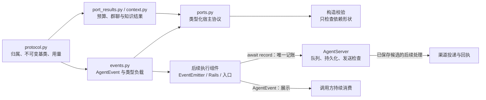
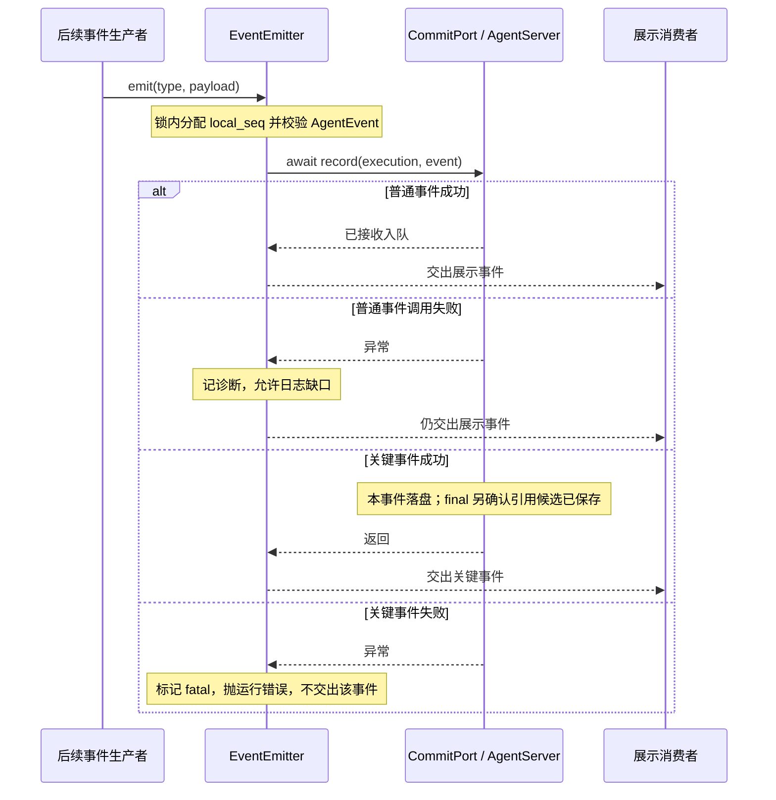

# F_02 执行事件与宿主端口结果协议设计方案

## 1. 元信息与阅读说明

| 项 | 内容 |
| --- | --- |
| 类型 | feature；PA-01 执行协议设计与后续契约演进 |
| 日期 | 原阶段归档日期：2026-09-29；本次文档修订：2026-10-12；引用修订：2026-10-13 |
| 范围 | 调用归属、不可变事件、类型化宿主响应、构造期端口检查，以及窗口 / 资料协议的演进和接入边界 |
| 方案依据 | 原协议阶段按用户确认形成；当前方案沿用 F_04 已落实的契约收敛，运行适配及确认语义分别由 F_05 和现行 spec 定义 |
| 计划条目 / 状态 | [统一开发计划](../designs/persistent-agent-development-plan.md) PA-01：契约层已完成；当前契约调整归 PA-04，执行适配归 PA-05。完成范围分别判断，不能据此宣称 M1 已通过 |
| 负责人 | PA-01：yan_zj；PA-04 及后续工作负责人以统一开发计划为准 |
| 设计依据 | [概览](../designs/persistent-agent-overview.md)、[架构：端口与交接](../designs/persistent-agent-architecture.md#35-端口与交接契约)、[架构：事件与确认](../designs/persistent-agent-architecture.md#62-事件传递确认与流量边界) |
| 关联规约 | [S_07 共同身份与构造](../specs/S_07_construction-and-binding.md)、[S_02 事件与记账](../specs/S_02_events-and-result-handoff.md)、[S_01 执行与预算](../specs/S_01_public-api-and-execution.md)、[S_03 窗口与状态](../specs/S_03_context-and-windows.md)、[S_09 群聊与知识](../specs/S_09_group-chat-and-knowledge.md) |
| 关联 feature | 前置 [F_01 构造](F_01_spec-and-deep-agent-construction.md)、延续 [F_03 绑定隔离](F_03_invocation-binding-and-isolation.md)、替代 [F_04 契约收敛](F_04_contract-convergence.md)、消费 [F_05 执行入口](F_05_execution-entries.md)、[F_07 群参与判断](F_07_group-participation.md)、[F_15 工具意图](F_15_tool-intent-before-side-effect.md) |
| 验证摘要 | 2026-10-12 协议与构造定向测试 139 passed；文档链接、测试入口和格式检查通过。历史与本次验证的适用范围见第 8 节 |
| 维护依据 | [文档约定](../AGENTS.md)、[特性设计模板](../../../docs/templates/feature-design-template.md)、用户指定的[开发计划模板](../../../docs/templates/feature-development-plan-template.md) |
| Refs | 需求来源为协议阶段的用户确认；未关联 issue / PR |

本文是特性设计记录。按特性设计模板组织问题、方案、取舍和验证，借用开发计划模板的独立验收、最小前置、证据与历史维护口径；依赖、负责人、排期及当前进度仍由统一开发计划维护，不在本文建立第二份台账。

第 2～7 节说明设计目标、约束、方案和当前契约；第 8 节汇总独立验证、历史证据与联合交付边界；第 9～10 节维护遗留和设计演进。已废止接口只在兼容与演进说明中出现，不能作为当前调用方式或待办。

**编号约定：** 正文使用当前 PA 编号；历史旧 PA-22 对应当前 PA-04，旧 PA-04～PA-21 对应当前 PA-05～PA-22，其余不变。历史“PA-04 执行闭环”现对应 PA-05；当前 PA-04 专指契约收敛。F_02、F_04 等文件编号保持稳定，不等于 PA 计划编号。

## 2. 背景、目标与范围

### 2.1 为什么建立协议

第一阶段端口返回泛化 object，构造只检查异步方法形状，调用方无法据类型明确区分提交确认、拒绝、资料缺失和结果未知。原阶段按用户确认补齐统一执行事件、结构化端口结果、稳定关联标识及协议测试，代码落在嵌套的 `persistent_agent/` 内；当时不实现模型循环、群消息归档、数据库或飞书投递，不修改个人版，也未提交代码。

这些值对象解决的是“收到的内容属于哪次调用、字段是否合法、可以如何解释”，不能替代宿主授权、日志持久化、工具副作用或渠道回执。后续同进程架构取消了执行代次、超时查询及外部窗口协议，由 F_04 收敛；本文保留原设计原因，同时明确现行接口。

### 2.2 目标与可观察行为

| 场景 | 协议要提供的结果 |
| --- | --- |
| 创建或反序列化事件 | 调用归属、事件类型、负载、时间、序号和容量可校验；错误输入被拒绝 |
| 重传同一事件 | ID、序号及完整内容保持一致；同 ID 不同内容可由纯校验识别为冲突 |
| 接收预算、群聊或知识结果 | 重新校验 DTO、匹配调用归属及适用的模型调用关联，再显式解释状态 |
| 未知用量、不完整资料或工具结果缺失 | 不推断为零用量、确定没有或未执行 |
| 构造 Agent | 必需依赖缺失或异步方法形状错误时提前失败，不调用端口验证业务可用性 |
| 提交候选回复或文件 | 表示待宿主处理的候选，不能表示已经公开、获准发送或送达 |

### 2.3 本次包含与非目标

F_02 原阶段交付调用身份、事件及结果值对象、窗口和版本化资料接口、端口类型和懒导出；其旧接口的保留或移除见第 7 节。当前协议以第 5 节及关联 spec 为准，本次只重构文档并核对代码，不新增运行能力。

宿主后端、生产事件队列、真正去重与持久化、授权过滤、窗口状态保存、资料内容解析、结果投递及崩溃续做不属于 F_02 的契约层验收。local_seq 的递增和原生流映射已由 F_05 实现；工具意图与完成生产者见 F_15；这些后续组件不能倒算成 F_02 当时已经实现的运行闭环。

## 3. 设计约束、假设与待决问题

- **已确认架构前提：** 本期 Persistent Agent 与 AgentServer 同进程，宿主保证同 Session 单一执行者及 Request 排队；本模块返回原生 DeepAgent，不新增运行类，也不另写模型循环。
- **开工最小前置：** 纯协议模型可独立测试；构造检查复用 F_01 的 Spec / BuildContext。真实队列、模型、数据库、窗口及渠道后端不是协议模型开工条件，但属于相应交付节点的真实验证条件。
- **共同归属：** 宿主固定配置、来源和权限快照；InvocationRef 仅是归属声明，不是授权凭证。同 Request 的后续 Execution 使用原配置，资料授权按各自规约重新解析。
- **安全边界：** 工具参数、结果和展示文本由生产者脱敏，DTO 不自动去除秘密或隐藏推理。受控引用的解析及实际权限核验由消费方和宿主负责。
- **外部消费边界：** 先重新 `model_validate`，再匹配归属及调用关联，最后检查 status；仅有类型注解、frozen 或已有模型实例不证明可信和持久化。
- **未验证前提：** 生产 CommitPort 的关键落盘、候选保存和去重保证须由 AgentServer 联调证明；同进程调用和测试替身本身不能证明这些保证。
- **待决问题：** 本次文档重构无新增设计待决项。队列容量 / 积压策略、窗口容量边界及超大最终回答后续交接由关联架构与特性处理，见第 9 节。

## 4. 总体方案与设计取舍

### 4.1 方案概览

共享协议原语定义归属与不可变约束；事件按类型选择负载，结果按状态检查必要证据。后续执行组件消费这些契约，通过唯一的 record 通道交给宿主，入口流提供实时展示。下图是当前责任与调用方向，不表示 F_02 实现了全部参与方。



协议定义不维护业务日志。图中的“发送检查”和“投递”由宿主承担；record 返回和入口 yield 各自表示什么，由分级确认规则决定。

### 4.2 关键决策

| 决策 | 选择与依据 | 代价与成立条件 |
| --- | --- | --- |
| D-01 不可变类型值对象 | frozen Pydantic、禁止额外字段，负载也使用模型和 tuple；保留确定的提案内容，避免重传期间被输入别名修改 | 约束针对正常校验 / 消费路径；不能使用绕过校验的构造或复制证明有效 |
| D-02 稳定身份与完整提案分离 | event_id 由归属和 local_seq 派生；proposal_digest 比较完整事件 | DTO 只识别冲突，不提供持久化去重或序号分配器 |
| D-03 明确状态和证据 | 用量、预算与资料结果区分业务状态，失败或不确定需要适用原因 / 证据 | 原提交 unknown 查询已被 F_04 删除；保留的知识 unknown 和工具 unknown 仍必须显式处理 |
| D-04 提案、持久化与送达分开 | 事件是执行提案，output.proposed 是候选；record 为唯一记账入口，展示流不再保存一次 | 普通展示可能缺日志；生产可靠性依赖宿主，final 额外保障所引用候选 |
| D-05 保留流片段空白 | ReplyDeltaPayload 允许非空的空格、换行、制表符；完整正文仍须非空白 | 原阶段 3 项回归先 RED 后 GREEN；空字符串不由 emitter 生成事件 |
| D-06 构造检查不执行业务 | 只检查端口异步方法和 BaseKVStore 类型 | 提前错误清楚，但不能证明签名完整兼容、授权正确、后端可用或数据持久 |

D-01～D-05 来自协议阶段的实现与审查，验证依据见第 8 节；D-03、D-04 的同进程语义及窗口后端由 F_04 更新。F_05、F_15 分别记录消费端的执行与工具行为，本文不替代其完整设计。

### 4.3 替代方案与排除理由

| 候选 | 不采用的原因 / 当前效力 |
| --- | --- |
| 任意 dict 或聊天 role 作为执行协议 | 缺少类型负载、稳定归属和状态语义；普通字典只可作为待校验输入 |
| bool 表示提交或预算结果 | 不能表达必要证据、失败原因和调用关联；原 CommitResult 已被 record 的返回 / 异常边界替代，不恢复旧 DTO |
| 流消费与端口各保存一遍 | 产生两条独立持久化路径，破坏统一记账和去重责任 |
| 协议层提供生产默认端口或第二份业务日志 | 隐藏宿主缺失和故障，越过原阶段明确范围；继续要求注入 |
| 保留 epoch、执行权轮询、超时 unknown → query | 原跨进程设想已由同进程架构取消；未来跨进程部署须重新整体设计，不能只恢复字段 |
| 关键事件等待所有前序普通事件落盘 | 普通日志缺失会阻断业务；当前只等待关键事件自身，final 另检查必要候选，见 F_04 后续确认 |
| F_02 直接实现完整执行器、窗口后端或投递 | 超出契约层边界；分别由后续 PA 与 AgentServer 实现和验证 |

## 5. 详细设计：当前有效契约

本节是源码与 spec 的消费摘要。完整 Schema 和状态规则分别由 S_07、S_02、S_01、S_09 维护；旧协议的变更关系集中见第 7 节。

### 5.1 模块责任与共同归属

`InvocationRef` 以 `namespace_id / agent_id / session_id / request_id / execution_id / source_ref` 六元归属绑定事件及预算 / 资料响应。source_ref 是宿主分配的稳定请求来源；event_id 包含它。当前不存在 epoch 或 authority_handle。

`ExecutionContext` 为 frozen dataclass，另携配置指纹、版本、principal_ref、startup_scope、source_scope、policy_revision、capability_snapshot；集合归一化为 frozenset。`recovery_ref` 可选且不能等于本次 execution_id。模型本身不能证明该引用确属同 Request 的更早 Execution，关联须由宿主核查。

协议模型为 frozen、extra=forbid、validate_default=True、revalidate_instances=always。这不等于所有字段都使用严格类型：schema_version、local_seq 和 token 计数等按各自字段严格校验；完整约束以源码为准。

### 5.2 AgentEvent：稳定标识、负载和容量

- 事件含版本、六元归属、event_id、event_type、local_seq、带时区的 occurred_at、visibility、correlation_refs 和类型负载；时间归一化 UTC，排序依据 local_seq。
- schema_version 仅接受严格整数 1；local_seq 为严格正整数，作用域为单次 Execution。值对象验证序号合法性，不分配序号。
- event_id 为 `evt_` 加六元归属与 local_seq 的规范 JSON SHA-256；时间、可见范围、关联引用和负载进入完整提案摘要，不进入 ID 的归属输入。因此相同 ID 不保证内容相同，重传须复用完整原事件。
- visibility 仅为 private / progress / candidate，是建议展示范围，不授予公开权；不存在 delivered 标签或 delivered=true 终态。
- 标识最多 512 字符；文本最多 65536 字符；原因最多 4096 字符；关联 / 输出等引用最多 128 项。完整规范 JSON 的 UTF-8 字节数最多 262144（256 KiB），包含全部字段及转义开销；非法 UTF-8 被拒绝。`proposal_size()` 给出实际大小。
- 类型负载拒绝错配和额外字段。参数摘要、哈希及受控引用不应携带秘密，脱敏和引用授权不由 DTO 自动完成。

当前 11 类事件及对应负载如下；详细字段见 [S_02](../specs/S_02_events-and-result-handoff.md#2-数据结构与事实归属) 与 [events.py](../../schema/events.py)。

| 事件 | 负载模型 | 关键约束 / 确认等级 |
| --- | --- | --- |
| participation.decided | ParticipationPayload | ignore / respond / intervene、原因和证据；普通 |
| execution.started | StartedPayload | goal；decision_event_id 可选；普通 |
| progress.updated | TextPayload | 非空白进度 / 中间结论；普通 |
| reply.delta | ReplyDeltaPayload | 非空片段，保留纯空白；普通 |
| model.completed | ModelCompletedPayload | model_call_id、配置版本和 ModelUsage；普通 |
| tool.intent | ToolIntentPayload | operation_id、tool_call_id、参数哈希与脱敏摘要；关键 |
| tool.completed | ToolCompletedPayload | succeeded / failed / unknown 均须非空白 result_summary，后两者还须 reason；普通 |
| window.switched | WindowSwitchedPayload | 旧窗 archive_ref、新窗正整数 window_seq；普通，生产者待接入 |
| output.proposed | OutputPayload | output_id、目标、共享方式、正文或受控文件引用；普通，final 引用后另保障保存 |
| execution.paused | PausedPayload | 五种暂停原因；关键 |
| execution.final | FinalPayload | completed / ignored / cancelled / failed；非 completed 须原因；关键 |

paused 原因仅 awaiting_confirmation / stopped / budget_denied / context_unfit / error。只有 awaiting_confirmation 带 1～64 项拦截调用，tool_call_id 不重复；budget_denied、context_unfit、error 必须有 detail。这是负载校验，不是程序层面的恢复执行器。

### 5.3 宿主端口与构造检查

| 当前入口 | 作用与结果 | 责任 / 失败边界 |
| --- | --- | --- |
| `CommitPort.record(execution, event) -> None` | 唯一记账；所有调用都 await | 普通事件入队后可返回，失败记诊断；关键事件自身落盘后返回，失败停止执行；final 另检查必要候选 |
| `read_execution_log(execution, execution_id) -> tuple[AgentEvent, ...]` | 返回同 Session、同 Request 内指定执行的已保存事件，按 local_seq 排序 | 允许缺口，非空不证明完整；读取失败抛异常，空日志不证明此前未执行 |
| `BudgetPort.admit(execution, model_call_id)` | BudgetAdmission：admitted / denied | admitted 必须有 reservation_ref；denied 有原因且无 reservation_ref；失败抛异常 |
| `BudgetPort.report(execution, model_call_id, usage)` | BudgetReport：confirmed / rejected | confirmed 必须有 receipt_ref；rejected 有原因且无 receipt_ref；失败抛异常 |
| `window_backend: BaseKVStore` | 必需注入位，供内部 WindowStore 后续消费 | 只做实例类型检查，不在构造时读写；存储实现和状态格式归 S_03 |
| `GroupChatPort.recent_messages / search_messages` | 可选；返回 GroupMessagesResult | 按 ExecutionContext 的 Session 定位群，宿主授权过滤；完整群历史读取适配归 PA-23 |
| `KnowledgePort.resolve / read` | 可选；返回 MaterialReadResult | 读取获授权的精确知识版本；实际适配归 PA-13 |

`PersistentPorts.validate()` 要求 commit 的 record / read_execution_log、budget 的 admit / report 都是异步方法，window_backend 为 BaseKVStore；显式提供 group_chat、knowledge 时也检查其异步方法。当前还含 F_14 新增的可选 workspace_access，workspace_read 开启时必须提供，规则见 [S_04](../specs/S_04_tools-and-workspace.md)。必需依赖按当前集合判断。

形状检查不调用端口、不验证生产后端、不检查所有方法参数或返回值；缺失 / 错形状以 DEEPAGENT_CONTEXT_PARAM_ERROR 在 DeepAgent 装配前失败。普通 DTO 字段非法抛 Pydantic ValidationError；归属或模型调用错配抛 DEEPAGENT_CONTEXT_PARAM_ERROR；提案冲突抛 DEEPAGENT_INPUT_PARAM_ERROR。

### 5.4 用量、群聊和资料状态

`ModelUsage` 的 known 必须携 input_tokens 和 output_tokens 两个非负计数；unknown 必须无计数且有原因，不能伪造为零。BudgetAdmission / BudgetReport 绑定六元归属及 model_call_id，先校验再 `assert_call`；当前两者均无 unknown 状态。准入拒绝不调用模型，报告异常只记诊断，report 的 rejected 不由当前 Rail 转为暂停；具体编排见 S_01。

`GroupMessagesResult` 为 found / empty / incomplete：found 至少一条消息；empty 无消息且无 next_cursor；incomplete 必须有原因，可以带部分消息。`GroupMessage` 包括发送者、接收时间、正文、提及 / 回复 / 附件、撤回状态及 queued_request；撤回消息不能带正文，排队中的请求只作背景。完整模型见 S_09。

`MaterialSnapshot` 保留来源、范围、版本、内容引用 / 摘要、授权修订及 complete / partial 标记。`MaterialReadResult` 保留 found / empty / forbidden / partial / unavailable / unknown：empty 要求无 items、query_complete=true 且有 watermark；partial 有分页游标或不完整来源；forbidden / unavailable / unknown 必须无 items 且有原因。query_complete 与 watermark 成对。DTO 不自动校验所有业务分页一致性，也不授予正文访问权。

资料 unknown 表示查询未确定，工具 unknown 表示结果不明；二者仍有效。它们不同于已经移除的提交 / 执行权 / 控制 / 预算“跨进程结果未知”协议。

### 5.5 唯一记账、候选交接及异常路径

[S_02 I-1～I-5](../specs/S_02_events-and-result-handoff.md#3-不变量) 是当前保证的唯一定义。下图展示 F_05 已实现的调用顺序及宿主必须满足的确认点；服务端持久化行为仍需真实联调验证。



EventEmitter 的锁串行化产生、record 调用和展示顺序；宿主保存的普通日志可以缺失，不设全部前序落盘屏障。展示队列与宿主持久化队列不是同一队列；当前 emitter 的 outbox 是无界 asyncio.Queue，不能从旧架构“有界交接”推导现有背压保证。

output.proposed 始终是候选：message 必须有非空白正文且不能带 file_ref；attachment / upload / link 必须带受控 file_ref。final.output_refs 必须列出本次要交接的候选；宿主在 final 成功前保存其内容、目标和共享信息。缺失时不能删除引用后宣布完成，补交沿用原 event_id / output_id，不重跑业务任务。

执行入口当前自动交接 message 最终回答；文件候选、多种共享方式和完整补交适配仍由 PA-08 接入。正常收尾为“交出候选 → 整理窗口 → 保存会话状态记录 → 记账 final → 清理”。reply.delta 可按字符与字节限额无损拆分；最终答案超限则 paused(error)，完整答案经结束信息交给状态保存接入点，不截断后完成。正式存储适配尚待接入，这不是 F_02 提供的后端。

关键 record 失败抛运行错误，并阻止后续未开始的模型 / 工具调用；普通日志丢失不阻断关键记账。工具结果缺失或 unknown 不允许解释成“工具未执行”；续做前查证规则见 [S_05](../specs/S_05_confirmation-and-continuation.md) 和 [S_08](../specs/S_08_tool-effects-and-intent.md)。服务端须持续消费直到结束 / 异常，前端断开只结束展示订阅。业务完成、状态保存和渠道送达分别确认。

### 5.6 关键类、方法与宿主接口定义

本节补齐截至 2026-10-12 的当前定义，字段及状态约束引用第 5.1～5.4 节；模块前缀为 `openjiuwen.harness.persistent_agent`。值对象经关键字字段构造，完整字段定义、类型和默认值以链接的源码为准，不将 Pydantic 生成的 `**data` 构造器另写成手工构造签名。

| 类 / 定义来源 | 变更及可见性 | 职责、关系和关键状态 |
| --- | --- | --- |
| [schema.protocol.ProtocolModel](../../schema/protocol.py) | 本特性新增；内部基类 | 继承 Pydantic `BaseModel`，统一 frozen、extra=forbid 及实例重校验；不持有运行句柄 |
| [schema.protocol.InvocationRef](../../schema/protocol.py) | 新增，后由 F_04 收敛；公开 | 继承 ProtocolModel，六个必传身份字段；作为事件、预算与资料结果的共同基类 |
| [schema.events.AgentEvent](../../schema/events.py) | 新增，后续特性调整负载；公开 | 继承 InvocationRef；schema_version=1、event_id 初始空串、visibility=private、correlation_refs=()；event_type、local_seq、occurred_at、payload 必传，校验后派生 event_id；字段含义见第 5.2 节 |
| [schema.protocol.ModelUsage](../../schema/protocol.py) | 新增；公开 | 继承 ProtocolModel；status 必传，计数与 reason 默认 None，校验 known / unknown 的互斥形状 |
| [schema.port_results.BudgetAdmission / BudgetReport](../../schema/port_results.py) | 新增，后由 F_04 收敛；公开 | 继承 InvocationRef；model_call_id、status 必传，reservation_ref / receipt_ref 与 reason 默认 None；验证准入或回报凭据及调用关联 |
| [schema.context.GroupMessagesResult / MaterialReadResult](../../schema/context.py) | 新增，后续调整；公开 | 继承 InvocationRef，组合 GroupMessage / MaterialSnapshot；状态必传，消息 / 条目默认空 tuple。完整查询、消息和快照定义同文件，语义见第 5.4 节 |
| [ports.PersistentPorts](../../ports.py) | 新增，后由 F_04 / F_14 调整；公开 | frozen、kw_only dataclass；六个依赖成员默认 None，类型及必需性见第 5.3 节；宿主注入后供构造和执行共同消费 |

这些 DTO 不创建模型、连接或持久化记录，也没有异步释放方法；frozen 约束不代替宿主授权。事件负载类、字段上限和 event_type 映射由第 5.2 节及 events.py 维护。

| 关键同步方法 / 完整源码签名 | 输入输出与调用条件 | 异常及副作用 |
| --- | --- | --- |
| `InvocationRef.from_execution(cls, execution: ExecutionContext) -> InvocationRef`（classmethod） | 复制六元归属为协议值对象，不复制配置及授权快照 | 非 ExecutionContext 为 CONTEXT_PARAM_ERROR，字段错误为 ValidationError；不改 execution |
| `InvocationRef.assert_matches(self, execution: ExecutionContext) -> None` | 消费宿主响应前比对六元身份 | 错配为 CONTEXT_PARAM_ERROR；无存储副作用 |
| `AgentEvent.create(cls, execution: ExecutionContext, **fields) -> AgentEvent`（classmethod） | fields 提供 event_type、local_seq、occurred_at、payload 及可选字段；调用方分配序号 | Schema 错误为 ValidationError；只创建提案，不记账 |
| `AgentEvent.proposal_size(self) -> int` / `proposal_digest(self) -> str` | 返回规范 JSON 的 UTF-8 字节数 / SHA-256 | 无持久化副作用；大小不是仅正文长度 |
| `AgentEvent.assert_same_proposal(self, other: AgentEvent) -> None` | 校验同 event_id 且完整提案摘要相同，用于重传比较 | 不同类型、ID 或正文为 INPUT_PARAM_ERROR；不实现去重存储 |
| `BudgetAdmission.assert_call(self, execution: ExecutionContext, model_call_id: str) -> None` / `BudgetReport.assert_call(self, execution: ExecutionContext, model_call_id: str) -> None` | DTO 校验后比对身份与模型调用 ID | 错配为 CONTEXT_PARAM_ERROR，不申请或扣减额度 |
| `PersistentPorts.validate(self) -> None` | 构造前核对异步方法存在及 BaseKVStore 类型 | 缺必需依赖、方法形状错误为 CONTEXT_PARAM_ERROR；不调用宿主 |

本特性没有独立运行函数：上述创建、比较均属于类方法。序号分配、唯一 record 调用、队列及错误编排由后续 [F_05](F_05_execution-entries.md) 的 EventEmitter 实现，不能由 DTO 方法推导执行能力。

宿主接口均为 [ports.py](../../ports.py) 中的 `Protocol`，实现方是 AgentServer / 宿主适配器，通过 `PersistentPorts(...)` 注入；不要求实现类继承 Protocol，不由本包自动创建生产后端。CommitPort、BudgetPort 未在外层导出，GroupChatPort、KnowledgePort 已导出。下表是带参数类型、默认值及返回类型的完整方法定义，全部为异步方法。

| 接口方法 | 调用方、完成条件及失败语义 |
| --- | --- |
| `CommitPort.record(self, execution: ExecutionContext, event: AgentEvent) -> None` | EventEmitter 顺序 await；普通入队 / 关键落盘 / final 候选确认见第 5.5 节。宿主按 event_id 去重，并核对同 ID 的完整提案；抛异常不表示外部一定未写入 |
| `CommitPort.read_execution_log(self, execution: ExecutionContext, execution_id: str) -> tuple[AgentEvent, ...]` | 后续日志整理 / 续做读取同 Session、Request 的目标 Execution；按 local_seq 排序且可有缺口，失败抛异常；当前 DTO 层不消费日志 |
| `BudgetPort.admit(self, execution: ExecutionContext, model_call_id: str) -> BudgetAdmission` | 模型调用前申请；返回 admitted / denied，调用异常由消费方处理；同 ID 预留的重试 / 对账责任由宿主实现 |
| `BudgetPort.report(self, execution: ExecutionContext, model_call_id: str, usage: ModelUsage) -> BudgetReport` | 模型调用后回报 known / unknown 用量，返回 confirmed / rejected；回报失败不允许重跑模型来补凭据 |
| `GroupChatPort.recent_messages(self, execution: ExecutionContext, cursor: str \| None = None, limit: int = 20) -> GroupMessagesResult` | 宿主按 Session 解析群及授权，返回游标后的最近页；参与判断实际传 limit=8，见 F_07；DTO 层不验证宿主是否遵守 limit |
| `GroupChatPort.search_messages(self, execution: ExecutionContext, query: GroupMessageQuery) -> GroupMessagesResult` | 消费有界查询，筛选条件与默认 limit=50 见 context.py；F_07 不调用搜索 |
| `KnowledgePort.resolve(self, execution: ExecutionContext, query: MaterialQuery) -> MaterialReadResult` | 解析授权范围内的资料引用和版本；空、部分及未知须按第 5.4 节区分，不返回默认成功 |
| `KnowledgePort.read(self, execution: ExecutionContext, material_ref: str, version_ref: str) -> MaterialReadResult` | 读取指定资料的精确获授权版本；引用不授予访问权，实际消费适配由 PA-13 接入 |

WorkspaceAccessPort 的完整定义及调用约束见 [F_14 第 5.7 节](F_14_workspace-file-read.md#57-关键类函数与工具接口定义)。window_backend 使用既有 BaseKVStore，不新增 Protocol；这些接口未定义统一超时、取消回滚或跨调用自动重试，相关能力必须由宿主及各消费特性明确实现和验证。

## 6. 影响面与实施设计

| 位置 | 作用与阶段归属 |
| --- | --- |
| [schema/protocol.py](../../schema/protocol.py) | F_02 引入共同原语；F_04 收敛归属 |
| [schema/execution.py](../../schema/execution.py) | 宿主不可变执行快照；F_04 删除租约字段，保留 recovery_ref |
| [schema/events.py](../../schema/events.py) | F_02 稳定事件 / 负载 / 容量；F_04 收敛当前 11 类事件 |
| [schema/port_results.py](../../schema/port_results.py) | 原多端口结果收敛为预算响应 |
| [schema/context.py](../../schema/context.py) | 知识 Material 模型保留，旧窗口 DTO 删除，新增群消息模型 |
| [ports.py](../../ports.py)、[build_context.py](../../schema/build_context.py) | 类型化协议、必需 / 可选注入与构造前检查 |
| [外层 __init__.py](../../__init__.py) | 继续懒导出协议值对象；CommitPort / BudgetPort 协议从内部 ports.py 取用，不据名称推定为外层导出 |
| [emitter.py](../../execution/emitter.py)、[model_rail.py](../../execution/model_rail.py) | F_05 后续提供序号、记账、预算消费；非 F_02 原交付 |
| [tool_intent_rail.py](../../execution/tool_intent_rail.py) | F_15 后续提供写意图及工具结果；真实关键持久化由宿主实现 |

原实施顺序是先写协议测试确认失败，再实现 protocol / events / port_results、更新 ports 和导出，补边界回归，定向验证及独立审查，最后同步 S_01 / S_02 和计划。来源、窗口及版本化资料契约在 2026-09-29 补齐。events 与 port_results 共用 InvocationRef / ModelUsage，ports 消费二者，事件模型不反向导入 ports，避免循环依赖。

本次仅修改 F_02：既有 spec 已给出当前定义，未改变接口或架构，不新增 spec、特性条目、排期或完成数。当前契约调整证据继续由 F_04 提供；原计划 PA-01 的 authority handle 等证据按原交付理解，其当前替代由 PA-04 承接，不能拿旧源码行号判断现行字段。

## 7. 兼容与迁移

| 原阶段协议 | 当前处理与依据 |
| --- | --- |
| InvocationRef 含 epoch；ExecutionContext 含 authority_handle | 已删除；当前为六元归属，event_id 不含 epoch。宿主单一执行者替代本期执行权 / 围栏设计 |
| CommitPort.submit / query、CommitResult 及 request_event_seq / not_found 水位 | 已删除，改 record / read_execution_log；同进程成功返回或异常，不提供超时查询执行器 |
| ExecutionAuthority、ControlPort 与 AuthorityResult / ControlCommand / ControlResult | 已删除；控制入口和确认恢复见 F_05 / S_05，权限由现行宿主及 Rails 核验 |
| ContextStore 的 head、Window 版本、条件更新及操作查询；HistoryPort | 已删除；必需注入 BaseKVStore，内部 WindowStore 的实际读写由 PA-10～PA-12 接入 |
| GroupMaterialPort | 已删除，改 GroupChatPort；Material 模型只用于 KnowledgePort |
| 预算响应 unknown | 已删除；admit 为 admitted / denied，report 为 confirmed / rejected；ModelUsage.unknown 继续保留 |
| checkpoint.proposed、control.waiting、execution.suspended、window.activated | 已删除；暂停合并为 execution.paused，窗口事件为 window.switched |
| failed-final 终态 | 改为 failed；仍需失败原因 |
| 旧工具恢复字段和 receipt_ref | tool.intent 改为调用关联、参数哈希与脱敏摘要；tool.completed 要求可读摘要，写操作关联 operation_id |
| 有界交接、旧 epoch 拒绝、全部前序落盘屏障 | 旧交接 / 执行代次设计不再属于本期；全部前序屏障已撤销。当前宿主去重及关键事件自身落盘仍是必要保证 |

F_04 记录旧事件未在生产环境落盘，无需兼容旧持久数据，因此事件 schema_version 仍为 1。这不表示旧接口仍可用：旧字段、事件和导出被明确拒绝，不能原样反序列化成新模型或伪装成当前契约。未来生产持久数据变化须另行评估版本与迁移，不能沿用这一历史前提。

## 8. 验证设计、执行记录与结论

### 8.1 独立验证入口与验收对应

独立协议测试无需真实模型、数据库、飞书或生产宿主。构造测试使用异步端口替身、真实 Spec / Session 及窗口后端替身；它只能证明装配和形状检查。完整验收定义和当前状态归统一开发计划 PA-01 / PA-04，本文不另建同义验收 ID；以下按现有测试函数定位技术证据。

| 验证范围 / 预期 | 已有入口与关键检查 |
| --- | --- |
| 来源与归属可校验，旧租约字段拒绝，恢复引用不指向自己 | [test_protocol.py](../../../../../tests/unit_tests/harness/persistent_agent/test_protocol.py)：test_request_source_is_required_and_bound_to_protocol_identity、test_execution_context_has_no_lease_fields、test_recovery_ref_names_an_earlier_execution |
| JSON 往返保留事件，完整重传一致，内容改变冲突；隔离不同归属 | 同文件：test_event_roundtrip_keeps_id_payload_and_digest、test_retransmission_is_same_proposal_but_changed_content_conflicts、test_event_ids_separate_execution_scope |
| 类型负载、版本、UTC、不可变、UTF-8 与容量边界；空白片段无损 | 同文件：test_malformed_event_rejected、test_event_and_nested_payload_are_immutable、test_invalid_envelope_version_or_id_is_rejected、test_equivalent_timezones_have_identical_proposal_digest、test_reply_delta_preserves_whitespace_chunks 及容量用例 |
| 11 类事件、五种暂停原因、工具摘要和删除导出符合当前协议 | 同文件：test_event_types_removed_by_v2_are_rejected、test_pause_payload_rules、test_all_tool_outcomes_reject_empty_summaries_even_with_references、test_contracts_removed_by_v2_are_not_exported |
| 预算凭证及模型调用匹配，unknown 用量不为零，资料未确定不为空 | 同文件：test_budget_receipts_bind_model_call_and_require_reservation、test_unknown_usage_is_not_zero、test_knowledge_material_keeps_unknown_distinct_from_empty |
| 群结果区分 found / empty / incomplete，撤回不带正文，查询边界合法 | 同文件：test_group_results_distinguish_found_empty_and_incomplete、test_group_message_hides_recalled_text_and_normalizes_time、test_group_search_requires_a_criterion_and_ordered_range |
| 构造前拒绝必需依赖缺失 / 错形状，合法可选端口接受；不调用业务 | [test_construction.py](../../../../../tests/unit_tests/harness/persistent_agent/test_construction.py)：test_missing_required_dependency_fails_before_deep_agent_build、test_injected_dependencies_must_satisfy_their_contract_before_build、test_factory_returns_native_deep_agent_without_side_effects |
| 后续消费者按序记账、容量试探不占号、普通失败继续、关键失败停止 | [test_emitter.py](../../../../../tests/unit_tests/harness/persistent_agent/test_emitter.py)、[test_entries.py](../../../../../tests/unit_tests/harness/persistent_agent/test_entries.py)；完整运行记录见 F_05 |
| 写意图先记账、工具结果关联及失败关闭 | [test_tool_intent_rail.py](../../../../../tests/unit_tests/harness/persistent_agent/test_tool_intent_rail.py)；组件与跨仓边界见 F_15 |

### 8.2 执行记录与证据范围

历史证据按当时的接口和验收边界解释，不作为当前重跑结果。原协议阶段的关键记录如下：

| 日期 / 范围 | 执行与结果 | 证据支持的边界 |
| --- | --- | --- |
| 2026-09-28 协议模型 | 初始 49 项协议测试因 API 缺失失败，实现后通过；补充容量、UTF-8、时区、输入别名和结果证据等 11 项测试通过 | 值对象和纯校验，不包含真实持久化、去重、围栏或超时查询 |
| 2026-09-28 空白片段修复 | 独立审查发现普通 Text 拒绝空格、换行、制表符；3 项新增回归先 RED，改用 ReplyDeltaPayload 后 GREEN，复核无剩余重要问题 | 合法流片段可无损表达；该修复仍适用当前协议 |
| 2026-09-28 定向回归 | 167 passed、2 项已有 Pydantic 弃用警告：63 项协议、27 项构造、77 项既有 Harness / 工具回归；6 个 Python 文件 Ruff check / format --check 及 diff 检查通过 | 当时的协议和构造子范围完成，PA-01 / M0 尚未整体关闭 |
| 2026-09-28 全仓尝试 | 收集 20155 项，82 个收集错误、15 skipped，退出码 1；包括缺少 opentelemetry.exporter、prompt_toolkit；没有执行全仓用例 | 不能声称全仓通过，当时未为此安装依赖或修改无关模块 |
| 2026-09-29 补充契约 | 来源绑定、窗口 / 资料 unknown 与完整空结果区分、必需端口缺失及 ContextStore 错形状等测试先 RED 后 GREEN；PA 包 132 passed，共享定向回归 582 passed，ReAct / 默认个人版 136 passed；Ruff 和格式检查通过 | PA-01 / M0 在接口定义与构造检查范围完成，真实宿主、窗口后端和执行闭环不在验收内；旧窗口与提交结果随后由 F_04 替代 |
| 2026-09-29 环境限制 | 初始回归包含 test_deep_agent_terminal_stream.py 时因缺少 opentelemetry.exporter 收集失败，移除该文件后对应定向集通过 | 定向通过不扩大为完整全仓结论 |

原 167 项定向回归覆盖 PA 测试目录，以及 test_leaf_spec_build、test_spec_ownership、test_factory_model_anomaly_detection_rail、test_deep_agent_cold_build、test_deep_agent_workspace、test_ability_manager_add_ability；从 agent-core 根目录使用当时的 .venv 执行 pytest -q --tb=short。旧 API 的用例已随 F_04 更新，复核当前契约使用下方命令。

原阶段的提交路径决策只定义 submit / query 和结果匹配，不实现提交器、有界队列或超时重试；当时没有修改个人版、共享 Harness、架构或 JiuwenSwarm 的业务实现，也没有提交 / 推送。上述旧接口的最终替代关系见第 7 节，后续组件与生产宿主的证据分别由相关 feature 维护。

- **契约替代阶段（2026-10-07）：** F_04 记录 PA 包 173 passed（协议 99、构造 40、绑定 34）、共享回归 213 passed 和 Ruff 通过；这些是当前契约演进的已有证据，本次未重跑该共享集。
- **执行组件阶段（2026-10-08）：** F_05 记录 PA 包 249 passed、Harness 与 core/session 联合回归 5863 passed / 39 skipped；使用替身验证状态 / 交互接入，不证明生产存储和投递。
- **本次（2026-10-12）：** 在当前工作树核对协议、端口、构造检查、导出、emitter、预算消费和对应测试。初次系统 Python 执行因缺少 pytest 失败；随后按用户授权在仓库本地 .venv 安装所需依赖。补依赖期间另因缺少 jsonschema_path、pymilvus 在加载 conftest 时失败，均非用例断言失败；补齐后按下方命令实际运行：139 passed、9 warnings，退出码 0，用时 13.24 秒。环境为 Python 3.13.12、pytest 9.1.1、Pydantic 2.14.1；源码基线为 dca8baad 的当前工作树，本次未修改代码。警告涉及 Pydantic / SQLAlchemy 弃用接口及源码 / 依赖中的转义写法；不据此宣称全仓通过。

本次定向命令在 agent-core 根目录执行；覆盖协议与构造，不扩展为全仓通过：

```powershell
.venv/Scripts/python.exe -m pytest -q -o addopts= tests/unit_tests/harness/persistent_agent/test_protocol.py tests/unit_tests/harness/persistent_agent/test_construction.py --tb=short
```

2026-10-12 文档整理：将设计背景、关键取舍和验证证据统一融入正文，删除逐字保留的旧文附录；本轮只调整文档，未重跑上述测试。40 个文档链接及章节锚点、测试入口、代码块和 git diff --check 检查通过。

### 8.3 验证结论与联合交付条件

PA-01 的原契约层完成状态保留；其现行替代以 PA-04 / F_04 为依据。DTO、构造及执行组件测试只支持各自的独立边界，不证明生产宿主可靠性。M0 是接口基线，M1 的真实执行闭环仍需状态存储、交互适配和宿主确认；窗口 / 资料、写工具和续做分别在关联节点验收。

真实联合验证须证明关键事件确实落盘、final 引用候选保存、重复候选按原标识去重、普通日志缺口不阻塞关键事件、读日志受同 Session / Request 限制，以及缺少工具结果时先查证。发送检查和平台回执另行验证；未验证项不能由协议模型或历史通过数关闭。

## 9. 风险与已知遗留

| 遗留 / 性质 | 当前影响与处置 | 后续入口和所需证据 |
| --- | --- | --- |
| 生产记账、队列、去重与候选可靠保存：宿主范围，未作真实验证 | 组件使用替身；展示、record 类型或 final DTO 不证明落盘 | AgentServer 与 PA-05、PA-08、PA-15 联调；按第 8.3 节故障条件验收 |
| 窗口组装（PA-06）与会话状态记录（PA-10，见 [F_17](F_17_session-state-record.md)）已接入；归档及检索待接入（PA-11、PA-12） | BaseKVStore 注入只证明类型；旧 ContextStore 不再是待实现项 | PA-06、PA-10～PA-12 / S_03；验证真实保存、读取、隔离及 JSON 还原 |
| 知识与完整群历史适配：待接入 | 群参与判断已直接消费 recent_messages，不代表 PA-23 完整历史工具或 PA-13 知识可用 | S_09、PA-13、PA-23；验证授权过滤、版本及完整性 |
| 文件候选、完整补交与超大最终答案交接：待实现 / 待设计 | 仅已有候选协议和 message 自动交接；超限不截断完成 | PA-08；验证完整答案保留、原标识补交和目标 / 共享检查 |
| 工具结果查证与崩溃续做：待实现 | unknown、日志缺口或意图无结果不能触发盲目重做 | PA-17、PA-18 / S_05、S_08；验证无重复业务副作用 |
| 受控引用授权与内容脱敏：生产者 / 宿主责任 | DTO 不执行引用解析或实际鉴权；F_14 读取和 F_15 摘要组件已有独立实现 | 按相应 feature 的真实宿主边界验证，不将引用合法性等同授权 |
| 跨进程超时查询、执行代次围栏及精确恢复：本期范围外 | 原方案已被同进程架构替代，不保留为当前阻塞 | 架构前提变化时整体重设计 |
| 队列积压策略及窗口容量：未定 / 未验证边界 | 不从无界展示队列推断背压，也不从事件 256 KiB 推断模型窗口容量 | 架构“尚未确定的设计问题”及对应宿主、窗口特性；不影响纯 DTO 定义 |

## 10. 设计演进与本次修订

| 日期 | 原结论与新证据 | 当前效力 / 归属 |
| --- | --- | --- |
| 2026-09-28 | 第二步引入事件与多端口结果；审查发现 Text 会拒绝合法纯空白流片段，3 项回归 RED 后引入 ReplyDeltaPayload | 空白片段修复继续有效；原 submit / query 等仅适用旧架构，验证证据见第 8 节 |
| 2026-09-29 | 补 source_ref、authority_handle、ContextStore 与版本化资料；关闭 PA-01 / M0 的接口和构造检查范围 | 来源与 Material 模型保留；执行权与窗口旧协议已被 F_04 替代 |
| 2026-10-07 | F_04 按同进程架构收敛事件、端口和响应；后续确认普通日志允许缺失，撤销全部前序落盘屏障 | 当前 PA-04 已完成；关键事件保证自身，final 另保障引用候选，见 S_02 |
| 2026-10-07～08 | F_05 实现执行入口、序号、事件映射、预算消费和收尾组件 | 当前 PA-05 组件验收完成；真实接入仍按统一计划，不再写成“执行适配尚未实现” |
| 2026-10-08 | 计划调整编号：旧 PA-22 → PA-04；旧 PA-04～PA-21 → PA-05～PA-22 | 正文统一使用当前编号，历史证据标明当时范围，不重编号特性文件 |
| 2026-10-12 | 按两个模板、当前架构 / spec / 代码重新组织；补责任图、确认时序、兼容映射、验证入口及遗留归属，并将必要历史信息融入正文 | 只修订 F_02，不改变架构、代码、计划状态或历史通过结论；文档检查及定向执行结果见第 8 节 |
