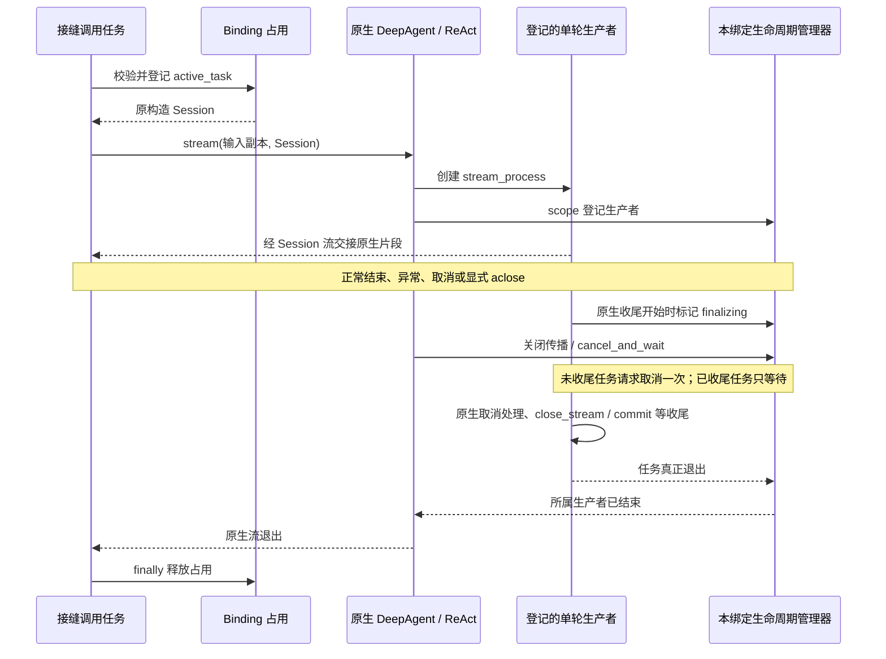

# F_03 执行绑定与调用隔离设计方案

## 1. 阅读与维护说明

### 1.1 元信息与文档定位

| 项 | 内容 |
| --- | --- |
| 类型 | feature；PA-03 内部绑定与原生单轮调用隔离的设计及归档记录 |
| 日期 | 原阶段归档日期：2026-09-29；本次文档修订：2026-10-12 |
| 负责人 | yan_zj（PA-03 原实现与独立验收负责人） |
| 状态与适用范围 | PA-03 已按内部绑定及单轮调用边界完成；正式入口、业务收尾和执行模式扩展分别由相关特性维护 |
| 范围 | `execution/binding.py`、`execution/stream_lifecycle.py`、构造快照及共享原生流生命周期接缝；不承担宿主 Session 调度或业务事件闭环 |
| 唯一开发计划 | [Persistent Agent 开发计划](../designs/persistent-agent-development-plan.md) PA-03；认领、排期、交付节点及完成率在该计划维护 |
| 方案依据 | 沿用原记录中的原生 DeepAgent 复用、个人版默认行为保持，以及经用户确认的可选原生流接缝；决策演进见附录 A |
| 验证摘要 | 2026-10-12 在当前工作区运行绑定测试，34 passed；原阶段验证与环境限制汇总见附录 A |
| Refs / 关联 PR | 原记录未登记 issue / PR；不补造编号 |

本文仍是特性设计记录。参考用户指定的[开发计划模板](../../../docs/templates/feature-development-plan-template.md)，按“范围与口径 → 特性与验收 → 依赖与实施 → 验证与进展”组织正文；结合[特性设计模板](../../../docs/templates/feature-design-template.md)补齐决策、替代方案、接口、状态、异常及资源收尾。本文不另建模块进度台账，也不因文档重构重计完成数。

正文使用当前 PA 编号：旧 PA-22 对应 PA-04（契约收敛），旧 PA-04～PA-21 对应 PA-05～PA-22，其余不变。F_03 文件编号保持稳定。历史记录中的“PA-04 正式执行入口”对应当前 PA-05，不能与当前 PA-04 混同。

### 1.2 阅读依据与责任边界

| 依据 | 本文采用的内容 |
| --- | --- |
| [Overview](../designs/persistent-agent-overview.md)、[架构设计](../designs/persistent-agent-architecture.md)第 3.4、4.1、4.2、5.2.3、7.3、9.2 节 | 宿主单一执行者、每 Execution 独立实例、原生执行复用、控制及 checkpointer 边界 |
| [S_07 构造与调用绑定](../specs/S_07_construction-and-binding.md) | 绑定、快照、占用、owner 及错误语义的唯一规约，本文沿用 I-1～I-5 |
| [S_01 执行入口](../specs/S_01_public-api-and-execution.md)、[S_05 确认与续做](../specs/S_05_confirmation-and-continuation.md) | 正式入口、结局、控制包装与持续消费要求 |
| [S_02 事件与结果交接](../specs/S_02_events-and-result-handoff.md)、[S_08 工具意图](../specs/S_08_tool-effects-and-intent.md) | 业务记账和外部效果边界；原生退出不能代替这些事实 |
| [F_01 构造](F_01_spec-and-deep-agent-construction.md)、[F_02 协议](F_02_execution-protocol.md)、[F_04 契约收敛](F_04_contract-convergence.md) | 最小构造基础、历史协议及现行契约的替代关系 |
| [F_05 执行入口](F_05_execution-entries.md)、[F_15 写前意图](F_15_tool-intent-before-side-effect.md) | 当前接缝消费者及后续 Rails 对低层调用的影响 |
| Harness [F_06 可选流任务生命周期](../../../docs/features/F_06_opt-in-stream-task-lifecycle.md)、[F_07 Session checkpointer 注入](../../../docs/features/F_07_session-checkpointer-injection.md) | 共享原生接缝，以及后续正式执行使用的 Session 隔离 |

F_03 负责在进入原生 API 前核对归属、占用同一实例、隔离停止和清理，并在显式关闭流时等待登记的单轮生产者及原生 Session 收尾。AgentServer 负责身份鉴别、Request 排队、同一业务 Session 的单一执行者、新 runtime Session 与实例的分配、资源生命周期及持久记录。不同实例的低层并行能力不等于允许宿主并发执行同一业务 Session。

### 1.3 当前实现、历史结论与开放口径

- 原生 `invoke / stream` 仍可直接调用；绕过 Persistent 接缝就不获得本文的绑定检查和占用保证。模型、Rail、自定义 provider 是可信扩展，本特性不是任意 Python 代码的沙箱。
- 正式执行、恢复、控制三个入口已有 PA-05 组件实现，不再写成“尚未开发”。会话状态与交互适配尚需接入，正式入口受当前门禁限制；组件通过不代表 M1 的真实宿主闭环通过。
- 一期正式执行只支持单轮模式，一次单轮内可以多次调用模型和工具。task-loop、同步子代理、异步及持久子代理分别归 PA-24～PA-26 验证后开放，不再作为 PA-03 的未完成子范围。
- 验收预期在第 2.7 节维护，当前实际结果在第 4 节维护；历史验证只放附录。架构与 spec 的相关保证按各自来源引用，不复制成第二套规约。

## 2. 特性定义与详细设计

### 2.1 背景、目标与范围

多个业务 Session 使用相同 Agent Card 时，若复用可变实例、按业务 Agent ID 注册有状态工具，或者只取消流消费者，消息、工具状态和后台 Session 写入可能互相影响。仅验证 Session ID 也不足以证明对象归属：同 ID 的另一个 Session 对象仍可能带有不同的可变状态。

PA-03 的目标是以 PA-02 的构造绑定为基础，将内部原生调用固定到原 Session、完整 ExecutionContext、端口集合和工具 owner；错配在原生调用前拒绝，同实例重叠调用立即失败，不同实例保持各自状态。正常结束、异常、停止和显式关闭都须在所属资源边界内收尾。

本特性不实现业务授权、审批、预算账户、事件持久化、终态确认、结果投递、跨进程恢复或任意工具子进程收敛。原生 Session 的 commit / close_stream 属于原生生命周期，不等于业务 CommitPort 确认。它也不清空消息、删除文件或关闭宿主 Session。

### 2.2 设计约束与关键决策

开工硬前置为 **PA-02 提供的原生 DeepAgent、ConstructionBinding、原 Session / Execution / ports / owner 以及共享装配路径**。PA-01 的身份契约经 PA-02 消费，不另加传递依赖；PA-05、真实宿主后端、task-loop 和子代理不是 PA-03 独立实现的开工前置。当前契约形状按 PA-04 / S_07 核对。

| 决策 | 选择、依据与代价 |
| --- | --- |
| D-01 复用原生执行 | 内部函数组合 `DeepAgent.invoke / stream / abort / cleanup_task_resources`；不新增运行类、门面或第二套模型循环。保护范围要求调用者遵守接缝边界 |
| D-02 绑定快照 | 保留 config、model、AbilityManager 对象及选定声明值，校验固定调用而非支持热重配；不把 live config 重新解释成新的发布 Spec 指纹 |
| D-03 实例内即时占用 | 原绑定线程锁只做短时检查和赋值，不持锁 await；同实例重叠立即拒绝，不排队、不充当宿主调度器 |
| D-04 原生流显式归属 | `PersistentAgentSpec.resolve_parts` 在配置应用前注入独立 `NativeStreamTaskLifecycle`；共享 DeepAgent / ReAct 接缝默认关闭，个人版沿用原路径 |
| D-05 先退出再释放 | 流生产者及原生收尾退出前保留占用；已进入收尾的生产者只等待，不再次取消 commit。接受不合作任务可能长期占用的限制，不提供超时接管 |
| D-06 停止与关闭分离 | 停止只请求本绑定中断；关闭仅在无活动调用且无停止过程时清理。业务 stop / cancel、结局及保存由 PA-05 包装入口处理 |

原阶段曾因后台任务不可控而让内部 stream 接缝失败关闭。后续用户确认默认关闭的共享接缝后，恢复了 `stream_bound`；失败关闭措施已经移除，不能作为当前流行为描述。具体审查与 RED → GREEN 过程见附录 A。

| 拒绝的方案 | 原因 / 重新评估条件 |
| --- | --- |
| 新建 PersistentAgent 类、继承运行类或复制模型循环 | 违背原生复用与单一执行基础；本次不改变该架构约束 |
| 全局给个人版增加绑定检查或改默认取消语义 | 违反原用户“个人版保持原路径”的要求；新增共享接缝必须显式选择启用 |
| monkey-patch 私有字段、扫描 `asyncio.all_tasks`、全局 task factory | 无法可靠限定归属，可能取消其他实例；只有原生创建点显式登记才能形成本特性的证明边界 |
| 只取消消费者、只置 stopped 或消费者结束后立即清理 | 后台仍可能写 Session；必须等待登记生产者和原生收尾退出 |
| 正常流结束后直接 await 生产者，或收尾期间再次 cancel | 消费者取消可打断 commit；采用 shield 和 finalizing 标记 |
| 同实例排队或因超时自动释放占用 | 混淆实例占用与业务 Session 调度，也不能证明旧执行已退出；调度留给宿主 |

本次文档重构无新增设计待决项。成立前提为可信 provider 创建独立可变资源、宿主按正式契约调度、消费者显式结束流；这些前提不成立时，本文不扩大保证范围。

### 2.3 模块责任与实现索引

| 模块 | 责任 |
| --- | --- |
| [schema/build_context.py](../../persistent_agent/schema/build_context.py) | ConstructionBinding 保存原归属、锁和 runtime；validate_binding 核对 agent、Session、Execution、ports 与 owner |
| [factory.py](../../persistent_agent/factory.py) | 原生构造结束后保存 agent 弱引用，调用 `InvocationState.capture`，清除临时 parts；构造失败回收详见 F_01 |
| [schema/spec.py](../../persistent_agent/schema/spec.py) | 经父类 parts / Config 路径注入本构造的 NativeStreamTaskLifecycle；当前也装配模型及写意图 Rails |
| [execution/binding.py](../../persistent_agent/execution/binding.py) | 运行快照校验、占用、输入副本、原生 invoke / stream、独立停止及空闲关闭 |
| [execution/stream_lifecycle.py](../../persistent_agent/execution/stream_lifecycle.py) | 仅管理本绑定登记的原生生产者，避免重复取消与收尾中再次取消，等待退出 |
| [DeepAgent](../../../deep_agent.py)、[ReActAgent](../../../../core/single_agent/agents/react_agent.py) | 单轮 stream 与 abort 的可选原生接缝；生产者创建、finalizing 标记及原生 Session 生命周期 |
| [owned stream 判定](../../../../core/common/stream_lifecycle.py)、[回调装饰器](../../../../core/runner/callback/decorator.py) | 识别显式归属的流，使适用的回调生成器边界向下传播关闭；默认流关闭语义沿用原契约 |
| [execution/entries.py](../../persistent_agent/execution/entries.py) | 后续 PA-05 消费者：独立 runner、事件映射、控制原因及结局、状态接入、等待控制完成后关闭 |

#### 2.3.1 关键类、绑定函数与原生接口定义

以下是 2026-10-12 当前实现的内部符号，均不经 Persistent 外层包导出；实现模块前缀为 `openjiuwen.harness.persistent_agent.persistent_agent.execution`。复用的 ConstructionBinding / PersistentBuildContext 定义见 [F_01 第 2.3.4 节](F_01_spec-and-deep-agent-construction.md#234-关键类函数与构造接口定义)。源码没有标注的参数和返回类型保持原状，实际含义在表中说明。

| 类 / 定义来源 | 变更、关系与构造 | 关键属性和生命周期 |
| --- | --- | --- |
| [binding.InvocationState](../../persistent_agent/execution/binding.py) | 本特性新增普通 dataclass；组合到 `binding.runtime`，由 capture 构造 | 必传 config、model、abilities、declarations、owned_tools；loop / active_task 默认 None，stopped / stopping / closing / closed 默认 False。字段类型、更新时机及复核范围见第 2.4 节；不序列化 |
| [stream_lifecycle.NativeStreamTaskLifecycle](../../persistent_agent/execution/stream_lifecycle.py) | 本特性新增；`__init__(self)`，无宿主参数，作为 `DeepAgentConfig.stream_task_lifecycle` 注入 | `_tasks`、`_cancel_requested`、`_finalizing` 均为初始空 `set[asyncio.Task]`；每次构造独立实例，只管理登记的原生流生产者；不扫描其他后台任务 |

| 类方法 / 源码完整签名 | 输入输出、异常及副作用 |
| --- | --- |
| `InvocationState.capture(cls, agent: DeepAgent, owner_id: str)`（classmethod） | 捕获 config / model / ability 对象、选定声明和本 owner 注册工具，返回 InvocationState；查询 Runner，不执行原生调用或删除资源 |
| `InvocationState.validate_agent(self, agent)` | 比对运行对象及选定声明；返回 None，漂移为 CONTEXT_PARAM_ERROR；不全面检查第三方内部状态 |
| `NativeStreamTaskLifecycle.begin_finalization(self, task)` | 已登记生产者进入收尾时加入 finalizing；返回 None，之后不再向其请求取消 |
| `async NativeStreamTaskLifecycle.scope(self, task)`（asynccontextmanager） | 上下文进入时登记 task；退出时请求一次取消并等待真实退出，完成后移除三组标记；本体 yield 无业务值 |
| `async NativeStreamTaskLifecycle.cancel_and_wait(self)` | 对当前登记任务快照请求取消并等待；生产者等待自身抛 RuntimeError，生产者非取消异常或等待期间的取消可传播；不提供超时接管 |

下面的独立函数均新增于 [binding.py](../../persistent_agent/execution/binding.py)。这些是源码签名；缺省返回注解不表示没有返回值。

| 内部异步函数 | 调用条件、参数与结果 | 异常及状态 / 资源副作用 |
| --- | --- | --- |
| `invocation_scope(agent: DeepAgent, *, context: PersistentBuildContext)`（asynccontextmanager） | 有效绑定、同 loop 且空闲时使用，yield 原构造 Session | 锁内占用 active_task，finally 按原绑定释放；不可用或错配为 CONTEXT_PARAM_ERROR |
| `invoke_bound(agent: DeepAgent, inputs, *, context: PersistentBuildContext)` | deepcopy 输入交给原生 invoke；返回原生结果 | 前后复核，停止后抛 CancelledError；原生 / deepcopy 异常传播，可产生模型调用和 Session 状态变化 |
| `stream_bound(agent: DeepAgent, inputs, *, context: PersistentBuildContext, stream_modes=None)` | 首次迭代取得占用；stream_modes 原样透传，产出原生 chunk，非 AgentEvent | 每片段复核；aclose 向下传播并等待登记生产者退出后释放占用；提前结束须显式关闭 |
| `abort_bound(agent: DeepAgent, *, context: PersistentBuildContext) -> None` | 独立控制任务停止本绑定，await 原生 abort | 设置 stopped / stopping，取消 active_task；非法状态为 CONTEXT_PARAM_ERROR；返回不等于全部外部效果收敛，finally 仅清 stopping |
| `close_bound(agent: DeepAgent, *, context: PersistentBuildContext) -> None` | 空闲且无停止 / 关闭在途时释放临时资源与捕获工具 | 先校验归属，已 closed 幂等返回；异常保留 closed=False；不删除宿主持久记录或关闭 Session |

原生协作接口是既有 DeepAgent 的 invoke / stream / abort / cleanup_task_resources，完整定义引用[DeepAgent 源码](../../../deep_agent.py)。绑定函数固定 session 参数，不让调用方指定另一 Session；底层错误不转换为 Persistent 业务事件。生命周期对象是通过 Config 注入的内部结构化接缝，不是新增公开 Protocol；DeepAgent / ReAct 调用 scope、begin_finalization、cancel_and_wait，具体顺序见第 2.6 节。正式 execute / resume / abort 接口由 [F_05](F_05_execution-entries.md)负责。

### 2.4 绑定校验、数据与防漂移边界

`PersistentBuildContext.validate_binding` 核对 agent 弱引用指向的对象、原 Session 对象、原端口集合对象、完整 ExecutionContext 值、owner，以及 Session ID 与执行上下文的一致性。**Session / ports 使用对象身份比较，ExecutionContext 使用完整值比较**；替换为字段完全相同的 ExecutionContext 不属于漂移。派生上下文共享同一次 binding，不获得重绑能力；详细构造规则见 S_07 I-1～I-3。

`InvocationState` 为本绑定的进程内状态，不序列化，不是 Checkpoint，也不能恢复某条 asyncio 指令。捕获内容为：

| 数据 | 当前校验或生命周期 |
| --- | --- |
| `config / model / abilities` | 与构造时的 `agent.deep_config`、其 model、`agent.ability_manager` 做对象身份比较 |
| `declarations` | Card **ID**、tool_owner_id、system_prompt、cwd、project_root、enable_task_loop、stream_task_lifecycle 身份、max_iterations、auto_create_workspace、completion_timeout、Skills 声明、工具 Card 的 `(id, name, stateless)` 元组 |
| `owned_tools` | 只捕获非 stateless 且 ID 为 `name_owner_id` 的工具名、ID、注册对象；供空闲关闭时核对并回收 |
| `loop / active_task` | 首次占用或停止固定事件循环；活动任务表示本次原生调用的占用，跨循环使用拒绝 |
| `stopped / stopping / closing / closed` | 永久停止标记、原生停止在途、关闭在途、关闭完成；用于拒绝新调用和阻止清理竞争 |

这里不校验 Card 对象身份或全部 Card 字段，不遍历模型 / Rail / provider 的内部可变状态，也不全面检测端口成员原地变更。宿主发布 Spec 的版本与完整指纹由构造和 ExecutionContext 固定，运行快照只是选定声明的复核，不能冒充完整 live config 指纹或任意扩展防篡改。

校验在占用前、锁内占用检查时，以及 invoke 返回或每个 stream 片段交接前执行。运行中发生漂移时，返回 / 片段复核可以拒绝交接，但不能撤销此前已发生的模型调用、Session 写入或外部效果。finally 始终按原 binding 释放占用，不使用被修改的 context 重新推导归属。

### 2.5 内部接口、占用与状态转换

以下函数定义在内部 binding 模块，不通过外层包公开导出；正式业务调用使用 S_01 / S_05 的包装入口。

| 入口 | 行为与结果 | 错误 / 资源语义 |
| --- | --- | --- |
| `invoke_bound(agent, inputs, *, context)` | 取得占用，将 `deepcopy(inputs)` 和原构造 Session 交给原生 invoke；返回原生结果 | 返回前复核绑定与 stopped；停止后即使原生吞掉取消并正常返回，也抛 CancelledError |
| `stream_bound(agent, inputs, *, context, stream_modes=None)` | 首次迭代时取得占用，使用原 Session 和输入副本；交出原生片段，stream_modes 透传 | 每片段复核；以 aclosing 关闭原生流，登记生产者和原生收尾退出后才释放占用 |
| `abort_bound(agent, *, context)` | 独立控制任务设置 stopped / stopping，取消活动调用，再 await 原生 abort | 活动调用不能中断自己；关闭中、已关闭或停止在途时拒绝；finally 清除 stopping，stopped 保留 |
| `close_bound(agent, *, context)` | 无活动调用及停止过程时标记 closing，await 原生临时资源清理，再核对并移除捕获 owner 工具 | 原生清理函数返回且捕获工具回收结束后 closed=True；重复关闭仍先校验归属，再幂等返回；向外传播的异常不标关闭完成 |

绑定参数、归属、运行漂移、跨循环、占用及非法停止 / 关闭均使用 `BaseError(DEEPAGENT_CONTEXT_PARAM_ERROR)`。原生调用、输入 deepcopy 或资源清理的异常按实际路径传播，不统一转换成业务失败事件；invoke 停止后的返回和 stream 停止后的片段交接抛 `asyncio.CancelledError`。

占用依赖 `ConstructionBinding.lock` 的短时同步检查和赋值，await 均在锁外。同实例串行使用仅限同一事件循环、未停止且未关闭的低层绑定；原生异常退出可释放占用后再次调用。这是低层能力，不能用于把同一个实例重绑到下一个业务 Execution。正式入口遵循“一 Execution 一实例”。

| 本绑定条件 | 操作 | 状态变化与保证 |
| --- | --- | --- |
| 可用、空闲 | invoke / 首次迭代 stream | 固定 loop、登记 active_task；重叠调用立即拒绝，原调用继续 |
| 原生正常或异常退出 | invocation_scope finally | 清空所属 active_task；流路径须先完成原生退出，保留 stopped / loop |
| 活动或空闲，未关闭且无停止在途 | 独立任务 abort | stopped=True、stopping=True；活动任务收到取消；原生 abort 返回或抛异常后 stopping=False |
| 已停止 | invoke / stream | 拒绝重用；再次低层 abort 在无其他禁止条件时仍可调用原生 abort，业务控制幂等由 PA-05 保证 |
| active_task 存在，或 stopping / closing | close | 拒绝清理；保留所属资源 |
| 无活动调用、无停止或关闭在途 | close | closing=True；清理函数返回及工具回收结束后 closed=True，finally 清除 closing |
| 已关闭且绑定仍有效 | close / 新调用 | 重复 close 返回；invoke / stream / abort 拒绝 |

这些是布尔字段的条件组合，不是源码中的业务状态枚举。closed 只表示关闭路径已返回并完成捕获工具回收，不表示 Request 完成、每个临时清理回调成功或外部副作用已结束。

### 2.6 原生流生命周期、停止与清理

Persistent 在构造时注入的管理器由 DeepAgent 单轮 stream 传给 ReAct。原生 ReAct 在创建 `stream_process` 任务的位置调用管理器 scope；管理器仅登记这些生产者，不扫描全局任务，也不管理任意第三方自行创建的后台任务。



图表示正常收尾与取消收尾的共同等待边界，不要求每条路径先收到 finalizing 再请求取消。正常或异常收尾开始后，`begin_finalization` 防止再次 cancel；取消路径先接收取消，再标记收尾。`asyncio.shield` 隔离消费者取消，管理器的等待处理重复取消，直到任务真正完成；非取消的生产者异常可继续向外传播。回调的 once、per_item、generator 等 owned-stream 路径须向下传播 aclose，不能只关闭最外层生成器。

提前退出必须显式 `aclose` 或使用 `contextlib.aclosing`；仅创建生成器不开始调用，遗弃已开始但未关闭的生成器也不能作为收敛证据。不合作的模型或收尾继续等待、保留占用；本机制没有“等够时间即可接管”的成功路径。

`abort_bound` 取消的是 active_task，并调用原生 abort；它不区分业务 stop / cancel，不发 paused / final，也不等待普通 invoke 的 active_task 本身成为 done。因此调用方还须观察原调用真正退出。流式原生 abort 的可选分支会等待登记生产者，但该等待仍不等于任意工具子进程或外部效果收敛。

空闲关闭先调用 `cleanup_task_resources`，然后仅在 Runner 中同 ID 仍指向捕获工具对象时移除它；AbilityManager 中同名 Card 的 ID 仍匹配时才移除该能力。另一 owner、共享 stateless 工具或同 ID 的替代注册对象不按捕获资源删除。绑定关闭函数不调用宿主 Session.post_run、不清空持久状态、不删消息或文件；向外传播的清理或回收异常会保留 closed=False。须注意原生 `cleanup_task_resources` 对各临时资源回调的普通异常只记日志并继续，因此该类回调失败仍可能使 close_bound 最终返回并标 closed=True，不能据此证明全部临时或外部资源释放成功。自定义清理钩子仍须遵守可信扩展的资源边界。

后续 PA-05 的独立 runner 持有原生占用，服务端事件消费任务不会直接被 `abort_bound` 取消。控制包装入口登记完成信号，runner 关闭前等待原生停止过程结束；结局锁定、状态保存、业务事件及 late control 规则见 F_05 / S_05。本特性不复制这些业务规则。

### 2.7 独立验收要求与测试映射

独立验证使用真实本地 DeepAgent、Session、Runner 工具注册、原生回调框架及可控 LocalModel；模型和宿主端口是替身，不需要网络、真实预算账户、数据库或渠道。无独立页面，前端验证不适用。来源为总计划 PA-03 的隔离验收与 S_07 I-1～I-5；下表是该范围的细化定位，不新增模块特性或交付节点。

测试索引：[test_binding.py](../../../../../tests/unit_tests/harness/persistent_agent/test_binding.py)。以下预期不是新测试结果，实际执行见第 4 节。

| 验收 ID | 操作与通过条件 | 现有测试函数 / 参数化场景 |
| --- | --- | --- |
| PA-03-V-01 | 有效绑定调用原生 invoke / stream，获得本地最终回答；登记流生产者全部退出 | `test_bound_invoke_runs_real_native_agent`、`test_real_native_stream_completes_with_final_answer` |
| PA-03-V-02 | 更换 Session（含相同 ID 的不同对象）、Execution、Request、配置版本、ports 或 owner；在模型和原 Session 状态变化前拒绝 | `test_mismatch_is_rejected_before_model_or_state_change` |
| PA-03-V-03 | 同实例第二调用立即拒绝，第一调用正常完成；不同 Session 的实例并行时输入、待跟进状态和 owner 独立 | `test_same_instance_rejects_overlap_without_interrupting_first`、`test_parallel_sessions_keep_messages_and_state_separate` |
| PA-03-V-04 | 停止目标实例不打断另一实例；停止后不能重启；原生吞掉取消也不能返回正常成功 | `test_abort_is_scoped_and_stopped_binding_cannot_restart`、`test_stream_abort_does_not_stop_other_instance`、`test_stopped_native_call_cannot_return_a_normal_success` |
| PA-03-V-05 | config、model、prompt、Card ID、owner 或流生命周期声明漂移被拒绝；运行中改变 Request 在返回复核时拒绝 | `test_runtime_config_drift_rejected_before_native_call`、`test_context_changed_during_native_call_is_rejected_on_return` |
| PA-03-V-06 | 流提前关闭、三种回调包装路径、重复取消及正常 / 异常 commit 期间取消，均等待生产者及 Session 收尾；占用保留至退出，无关闭后迟到写入 | `test_early_stream_close_waits_for_native_producer_exit`、`test_stream_abort_keeps_occupancy_until_cleanup_despite_repeated_cancel`、`test_cancel_during_native_commit_waits_without_interrupting_commit` |
| PA-03-V-07 | 活动调用或停止在途时不能关闭；空闲关闭保留 Session 状态、拒绝新调用；本 owner 工具回收不影响另一实例 | `test_close_rejects_active_call`、`test_close_cannot_race_inflight_abort`、`test_close_does_not_delete_session_state_or_allow_reuse`、`test_tools_and_cleanup_are_owner_scoped` |
| PA-03-V-08 | 原生失败释放占用；跨循环重用拒绝；默认 DeepAgent 的生命周期句柄为 None，真实正常流仍可运行 | `test_native_failure_releases_occupancy_for_next_call`、`test_binding_refuses_event_loop_reuse`、`test_default_deep_agent_does_not_enable_persistent_branch` |

工具隔离测试当前为自定义写工具注入测试 emitter 与预算响应，以满足 F_15 的写意图 Rail；这只证明真实原生调用和 owner 清理，不能作为真实 CommitPort 持久化证据。该测试函数不是纯“绝不调用任何宿主接口”的场景。

PA-03 独立验收不要求宿主生产环境，但其用于正式业务的联合开放必须遵守总计划 M1、PA-05 及当前接入门禁。task-loop / 子代理各自的隔离、停止、确认、预算、记账和 checkpointer 验收分别归 PA-24～PA-26，引用本文作为底层基础，不以本文的单轮结果替代。

## 3. 依赖、实施影响与兼容性

### 3.1 依赖与接入顺序

本文引用[总计划](../designs/persistent-agent-development-plan.md)的依赖及工作线，不另画一套特性关系图或登记排期。PA-02 最小绑定产物就绪后即可独立实现 PA-03；真实宿主服务与端口后端不构成其开工限制。共享 DeepAgent / ReAct / 回调接缝涉及相同核心文件，实施时需协调文件修改，依赖允许并行不等于已经排定并行。

原实施顺序仍保留为历史依据：先建立错配、并发、状态 / 工具隔离、停止清理与配置漂移的失败回归，再实现占用及 invoke / stream 接缝；补提前关闭、异常释放、跨循环、关闭后重用与默认 Harness 回归，最后独立审查及同步规约 / 总计划。审查新增的原生生产者、commit 竞争与关闭传播问题也采用失败回归复现后修复，详见附录 A。

### 3.2 当前消费路径与限制

- PA-05 已组合构造、stream_bound、abort_bound、close_bound，负责事件及业务结局；NoopCheckpointer 的校验与注入要求归该执行层，不由低层构造成功或绑定测试证明。
- 绑定函数本身不直接调用授权、预算或 CommitPort，也不建立业务事件 emitter；但当前构造已装配 PA-05 模型 Rail 和 PA-15 写意图 Rail。emitter 存在时模型 Rail 可消费预算并产事件；写工具缺 emitter 会拒绝。因此不能把“binding 不直接记账”扩写成“所有低层调用不会触发任何 Rail 或端口”。
- 同 Request 的后续 Execution 按架构固定原 Spec，使用新 context、空 runtime Session 与新实例；停止 / 关闭的绑定不能复用。会话状态恢复由 PA-10 等组件接入，不靠 InvocationState 保存或原生绑定自动实现。

### 3.3 兼容与文档同步

通用 `DeepAgentConfig.stream_task_lifecycle` 默认 None；Persistent 构造注入独立句柄，个人版默认不进入该管理分支。内部新增函数不改变外层原生 invoke / stream 的公开形态，也不把内部流当作 AgentEvent 流。原生 API、配置发布和工具公共契约继续引用其主责文档。

本次修改文档，不改变 Python 实现、测试或架构方案。S_07 已与当前绑定实现相符，无需改写其契约；总计划 PA-03 的证据行中“正式入口及 task-loop / 子代理都待完成”的旧描述同步校正为 PA-05 组件已实现、M1 集成待完成、模式扩展归 PA-24～PA-26。保留其他既有工作区改动与历史记录，不提交或推送。

## 4. 验证记录、结论与已知遗留

### 4.1 本次执行记录

| 项 | 记录 |
| --- | --- |
| 日期 / 版本范围 | 2026-10-12；当前 `src/agent-core` 工作区实现，存在既有文档改动，未创建提交 |
| 环境 | Windows；仓库 `.venv/Scripts/python.exe`，Python 3.13.12、pytest 9.1.1；本地真实 Agent / Session / 回调与模型、端口替身 |
| 命令 | 见下方，可直接在 agent-core 仓库根运行 |
| 实际结果 | **34 passed，5 warnings**；覆盖第 2.7 节所映射的绑定场景 |
| 警告 | 2 项 Pydantic class-based config 弃用、3 项 SQLAlchemy declarative_mixin 弃用；不作为绑定失败 |
| 本次未执行 | 全仓 pytest、生产模型 / 端口联调、task-loop / 子代理正式入口验收及任意外部工具进程收敛 |

```powershell
.venv/Scripts/python.exe -m pytest -q tests/unit_tests/harness/persistent_agent/test_binding.py --tb=short --show-capture=no
```

本次无需安装包。原阶段的 192 / 593 / 582 / 136 等结果保留其日期与范围，不能与本次 34 项相加或当作今天的全仓结果；当时缺依赖导致的 82 项收集错误也是历史环境事实，不代表当前环境仍有相同错误。

### 4.2 验证结论

当前证据支持 PA-03 在内部绑定、原生单轮流、显式关闭、所属资源回收及默认 DeepAgent 分支范围的独立验收。它不证明真实宿主授权、持久化、业务终态、投递、完整恢复或 M1 通过，也不证明任意第三方后台任务和外部工具进程收敛。

文档核对包括模板适用范围、当前接口与导出、快照字段、布尔状态条件、错误码、源码 / spec / 测试链接，以及历史结论的适用范围与当前替代关系。原错误的成功流验收仍明确记录为作废；经原生正常流和 commit / 关闭传播回归补齐后的结果才作为独立验收证据。

### 4.3 已知遗留与归属

| 限制 / 剩余验证 | 当前归属与处理 |
| --- | --- |
| 正式入口已有组件但业务闭环未开放 | PA-05 / M1 联合集成；会话状态记录和交互适配分别由 PA-10、PA-09 接入，未接入时明确拒绝 |
| task-loop、同步及异步 / 持久子代理全链路 | PA-24～PA-26；验证生命周期、隔离、停止、确认、预算、记账与 checkpointer 后逐项开放 |
| 任意工具子进程、未知外部效果及停止后续做 | 工具执行与意图归 PA-15 / PA-16；执行日志核对与续做归 PA-17 / PA-18 及宿主，不由 abort 返回自动证明或回滚 |
| 消费者遗弃流或生产者不合作 | 调用方必须显式关闭；管理器保留占用并等待，不宣称可超时释放或已完成 |
| 可信模型 / Rail / provider 的内部状态或私有扩展绕过 | 超出所选身份 / 声明校验范围；原生直接调用不获得本特性保证 |
| 原生临时清理回调失败 | DeepAgent 对普通回调异常只记日志；绑定关闭返回不证明每个回调成功，宿主须按资源种类核对，本文不新增错误聚合机制 |
| 全仓依赖与跨仓环境 | 本次未作环境修复或全仓验收；历史阻断见附录，当前完整结论须由相应测试 / 联调形成 |

## 附录 A. 设计演进与历史验证摘要

本节提炼原阶段的决策、审查与验证依据，不重复保留原文。历史结果只证明当时约定的范围，当前行为、接口和后续归属以正文及关联 spec 为准。

### A.1 设计演进与审查

| 阶段 | 问题与证据 | 决策、修复及当前适用范围 |
| --- | --- | --- |
| 初版绑定 | 18 项新增测试先因缺少执行接缝失败，再通过；后续补工具及循环重用测试，并补齐真实 Session Card / ToolCall type 夹具 | 复用 F_01 的原 Session / Execution / owner 和 F_02 协议；只实现原生隔离接缝，不另建模型循环、不将其当作业务执行闭环 |
| 停止与关闭竞争 | 3 项失败回归复现关闭与 abort 竞争、停止后的正常返回及调用中归属变化 | 增加 stopping 标记和返回复核；停止不代表收敛，活动调用或停止过程未退出时拒绝关闭 |
| 原生流首次审查 | P1：消费者关闭后，ReAct 后台模型任务仍可写 Session；原提前关闭测试缺少 model.stream，实际消费错误结果，不能证明成功流关闭 | 作废错误验收，以真实原生 Agent 流入口哨兵回归复现后，暂时禁止内部流启动。该失败关闭措施随后被可选原生生命周期接缝替代，当前 stream_bound 已恢复 |
| 2026-09-28 流生命周期补齐 | 经用户确认增加仅 Persistent 启用的共享接缝，普通 DeepAgentConfig 默认句柄仍为 None | 构造注入独立管理器，在原生生产者创建点登记，退出时等待后台及 Session 收尾；不新增 Agent 类、不扫描全局任务、不改写模型循环，详见 Harness F_06 |
| 补齐版本独立审查 | 两项 P1：正常 stream_iterator 结束后直接 await 生产者会在取消时打断 commit；emit_after 的 once、transform_io 的 generator 分支未向下传递关闭 | 以真实 Agent / Session 失败回归复现后修复：shield 等待、finalizing 后不再次取消、仅 owned stream 传播 aclose。覆盖正常 / 模型异常 commit 期间取消、三种回调模式提前关闭、重复取消、跨实例停止与无关闭后迟到写入 |
| 2026-09-29 独立验收 | 实例内归属、占用、取消、清理及单轮生产者收尾通过定向验证，默认个人版实际正常流及 ReAct 回归也已执行 | PA-03 按单轮内部边界完成；不能推广为宿主业务闭环、task-loop / 子代理全链路或任意外部进程收敛 |

原阶段裁定保留原生 API、个人版默认路径及可信扩展边界；不采用 monkey-patch、全局任务扫描或私有字段补丁。初版未修改共享 Harness，后续共享接缝经用户确认后加入；当时未修改 JiuwenSwarm 或架构文件，未提交 / 推送。旧 ControlPort 已由后续契约收敛移除，正式执行现归 PA-05，模式扩展归 PA-24～PA-26，外部效果核对归正文所列工具、日志、续做及宿主职责。

### A.2 历史验证基线

| 阶段 / 日期 | 实际结果 | 验证范围与限制 |
| --- | --- | --- |
| 初版定向回归 | 192 passed，2 项已有 Pydantic 弃用警告 | 25 项绑定测试与前两步 167 项回归；初版 5 个 Python 文件 Ruff check / format --check 通过，git diff --check 无空白错误，仅 CRLF 提示 |
| 单轮流补齐版本 | 593 passed，2 项已有 Pydantic 弃用警告 | 34 项 binding、前两步 90 项、原 Harness / Ability 78 项、原生回调及 ReAct 391 项；修复独立审查发现的两个 P1 |
| 2026-09-29 | Persistent 包 132 passed；包含该包的共享 Harness 定向回归 582 passed；ReAct 定向回归 136 passed | 改动范围 Ruff check / format --check 通过；覆盖原生单轮和默认个人版，不代表全仓或正式业务入口验收 |
| 当时全仓运行 | 82 项收集错误、15 skipped，测试用例未完整执行 | 缺 prompt_toolkit、opentelemetry.exporter 等；test_deep_agent_terminal_stream.py 也因后者缺失无法收集。未修复无关依赖或格式化共享大文件既有导入顺序告警，不声称全仓通过 |

初版 192 项定向运行命令如下，保留用于定位其历史范围；本次实际执行命令及结果见第 4.1 节。

```powershell
.venv/Scripts/python.exe -m pytest -q tests/unit_tests/harness/persistent_agent tests/unit_tests/harness/test_leaf_spec_build.py tests/unit_tests/harness/test_spec_ownership.py tests/unit_tests/harness/test_factory_model_anomaly_detection_rail.py tests/unit_tests/harness/test_deep_agent_cold_build.py tests/unit_tests/harness/test_deep_agent_workspace.py tests/unit_tests/core/single_agent/test_ability_manager_add_ability.py --tb=short --show-capture=no
```

当时全仓执行命令为 `pytest -q --tb=short`，依赖错误示例包括 `tests/cli/integration/test_repl_dispatch.py` 和 `tests/unit_tests/harness/observability/test_rail.py` 及多项 RSI / observability 测试。以上各轮结果不能相加或视为当前全仓结论。

## 附录 B. 2026-10-12 文档修订

按现有工作区模板、架构、spec、代码及测试重构 F_03，补齐快照校验粒度、占用和清理条件、原生流收尾、独立验收及后续归属，同步总计划 PA-03 证据。根据用户后续要求移除完整原文附录，将必要的设计演进、审查和历史验证整合为摘要；接口、架构、负责人、排期和完成数未变更。
