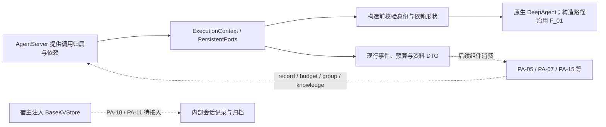

# F_04 契约收敛设计方案

## 1. 阅读与维护说明

### 1.1 元信息与完成口径

| 项 | 内容 |
| --- | --- |
| 类型 | feature；PA-04 已实现契约的收敛与归档记录 |
| 日期 | 原阶段归档：2026-10-07；本次文档修订：2026-10-12；引用修订：2026-10-13 |
| 负责人 | Song Haoran；认领与后续安排以统一开发计划为准 |
| 状态与验收边界 | PA-04 已按类型、端口协议、构造检查与既有绑定回归边界完成；不包含生产宿主端口、事件队列、状态存储或续做实现 |
| 原实现范围 | 内部 `persistent_agent/ports.py`、`schema/{execution,protocol,events,port_results,context}.py`、外层 `__init__.py` 及对应单测；`schema/build_context.py`、`factory.py` 当时只修正过时文档字符串。不改共享 harness / core 代码 |
| 本次修订范围 | 重组设计、契约差异、验收映射与历史证据，按当前代码修正下游状态、引用和限制；不改变运行代码、接口或特性完成边界 |
| 唯一开发计划 | [Persistent Agent 开发计划](../designs/persistent-agent-development-plan.md) PA-04；状态、排期、认领和联合交付进度在该计划维护 |
| 验证摘要 | 本次直接关联的协议、构造、绑定测试通过；当前导出检查另发现两个后续工作空间符号的解析问题。详细结果及历史基线见第 4 节和附录 A |
| Refs / 关联 PR | 原记录未登记 issue / PR；本次未创建提交，不补造编号 |

本文仍是特性设计记录，参考用户指定的[开发计划模板](../../../docs/templates/feature-development-plan-template.md)，按“范围与口径 → 特性与验收 → 依赖与实施 → 验证与进展”组织正文；同时参考[特性设计模板](../../../docs/templates/feature-design-template.md)及[目录约定](../AGENTS.md)，保留决策、替代方案、详细契约和设计演进。不在本文复制全模块依赖图、排期或完成率。

正文使用当前 PA 编号。2026-10-08 编号调整中，旧 PA-22 对应当前 PA-04，旧 PA-04～PA-21 对应当前 PA-05～PA-22，其余不变；F_04 文件编号保持稳定。历史“PA-04 正式执行入口”应理解为当前 PA-05，不能与本文的契约收敛混同。

### 1.2 阅读依据与责任边界

| 依据 | 本文采用的内容 |
| --- | --- |
| [Overview](../designs/persistent-agent-overview.md)、[架构设计](../designs/persistent-agent-architecture.md)第 3.4～3.5、6.2～6.3、7.3、8.3 节 | 同进程宿主、Session 单一执行者、端口与确认点、私有存储及续做边界 |
| [S_07 构造与绑定](../specs/S_07_construction-and-binding.md) | ExecutionContext、InvocationRef、PersistentPorts 与构造检查 |
| [S_02 事件与交接](../specs/S_02_events-and-result-handoff.md) | 11 类事件、分级记账、候选输出和日志缺口的唯一规约 |
| [S_01 执行入口](../specs/S_01_public-api-and-execution.md)、[S_05 确认与续做](../specs/S_05_confirmation-and-continuation.md) | 预算响应的消费、暂停 / 终态编排、确认恢复及 recovery_ref 的使用 |
| [S_03 窗口与状态](../specs/S_03_context-and-windows.md)、[S_09 群聊与知识](../specs/S_09_group-chat-and-knowledge.md) | 内部 WindowStore 与外部资料端口的职责分离 |
| [S_08 工具意图](../specs/S_08_tool-effects-and-intent.md) | 后续副作用分类、写前记账和工具结果产生条件 |
| [F_01 构造](F_01_spec-and-deep-agent-construction.md)、[F_02 协议](F_02_execution-protocol.md)、[F_03 绑定](F_03_invocation-binding-and-isolation.md) | 本次收敛的既有构造、协议与隔离基础 |
| [F_05 执行入口](F_05_execution-entries.md)、[F_07 群参与判断](F_07_group-participation.md)、[F_15 写前意图](F_15_tool-intent-before-side-effect.md) | 新契约的当前组件消费者；不把后续实现归入 PA-04 原交付 |

spec 维护现行契约，本文解释为什么替换旧契约、替换到哪里，以及如何独立证明类型和构造约束成立。架构负责整体保证及宿主前提，生产实现不能仅凭 DTO 或 Protocol 类型注解宣称可用。

### 1.3 当前实现与历史结论的区分

PA-04 原交付只调整契约，不实现运行行为。此后 PA-05 已有事件映射、EventEmitter、预算和暂停收尾组件，PA-07 已消费群聊最近消息，PA-15 已实现工具意图 / 完成 Rail。原文“全部待实现”的描述不再适用于这些组件，但其本地测试不能证明 AgentServer 已提供真实持久化确认。

PA-06 窗口组装已接入，容量验收仍待完成；实际会话状态、完整确认适配、历史读取整理与续做仍有接入缺口。正式任务执行和确认恢复受 [seams.py](../../execution/seams.py) 的门禁约束；带 recovery_ref 的执行仍被拒绝。群参与判断可先于这些接入结束，不能笼统描述为所有入口都不可运行。

本文的验收预期集中在第 2.7 节，本次证据在第 4 节，旧结果只在附录 A 维护。PA-04 完成不等于 M1 执行闭环或 M2c 续做闭环通过。

## 2. 特性定义与详细设计

### 2.1 背景、目标与范围

PA-01 在旧架构下定义了执行上下文、端口、事件和返回值，见 F_02。后来已确认的架构限定 Persistent Agent 与 AgentServer 同进程运行，同一业务 Session 只有一个执行者；事件经宿主记账，跨 Execution 状态由内部 WindowStore 使用宿主注入的 BaseKVStore 保存，崩溃续做依赖日志及实际结果查证。

旧契约中的 epoch、执行权检查、控制轮询、提交查询、外部窗口协议和群资料通用模型不再符合这一责任划分。继续保留会要求调用方实现本期不消费的方法，也容易把旧版条件更新、围栏或精确恢复误当作当前保证。

| 输入或场景 | 本次收敛后的可观察结果 |
| --- | --- |
| 构造执行上下文或端口集合 | 旧执行代次、执行权句柄及已删除端口不能继续传入；必需注入记账、预算和窗口后端 |
| 构造事件或预算响应 | 接受现行事件与状态，拒绝旧字段、旧事件和非法组合；保留完整调用归属 |
| 群消息查询 | 专用消息结构表达撤回、排队背景与查询完整性，不再混用知识 Material 模型 |
| 继续原 Request | 保留 recovery_ref，不能指向本次 Execution；类型检查不等于已经实现续做 |
| 下游接入记账或存储 | 使用已明确的成功 / 失败与确认语义；实际队列、落盘和 JSON 编码由各自实现承担 |

本项包含 DTO、端口 Protocol、必需依赖的静态检查、公开符号调整及原绑定测试适配。不包含推理循环、运行记账调用、宿主队列、预算账户、窗口读写、归档格式、知识读取、续做查证或渠道发送；无需新增页面，前端独立验收不适用。

### 2.2 总体方案、关键决策与替代方案



实线表示本项的数据及构造检查路径；虚线表示后续消费或待接入的运行关系，不表示 PA-04 已完成相应运行链路。BaseKVStore 是注入依赖，WindowStore 是内部组件，二者不形成新的外部 ContextStore 端口。

| 决策 | 选择、依据与成立条件 |
| --- | --- |
| D-01 同进程契约简化 | 删除 epoch、authority_handle、执行权和控制轮询 / 提交查询结果；宿主负责同 Session 单一执行者。放弃本期租约围栏、超时查询及自动接管保证；跨进程需整体重设计 |
| D-02 保留原任务的恢复引用 | recovery_ref 统一指向原 Request 中待接续的 Execution，不新增 continuation。DTO 只做值校验，跨执行归属和调度由宿主及后续消费者核实 |
| D-03 一个记账方法，按事件分级确认 | 所有事件统一 await record；普通日志允许缺失，关键事件保证自身落盘。等待方式由宿主实现，Agent 不选择不同提交方法 |
| D-04 最终输出独立保障 | final.output_refs 保留候选引用；宿主在 final 成功前确认候选内容和交接信息已可靠保存，不将完整正文塞入 final，也不增加事件类型 |
| D-05 私有窗口依赖与外部资料分离 | 必需注入 BaseKVStore；内部存储格式留给 PA-10 / PA-11。群消息改用专用 DTO，知识继续使用 Material 系列模型 |
| D-06 字段校验与生成策略分开 | DTO 强制工具结果摘要、暂停负载和有限容量；脱敏、约 500 字摘要及实际事件产生由运行组件完成，类型注解不替代这些行为 |

以下方案来自原记录中的取舍，不新增未经讨论的候选：

| 候选 | 拒绝原因 | 重新评估条件 |
| --- | --- | --- |
| 保留 epoch 供未来使用 | 当前没有消费者；跨进程需要代次、超时查询及旧执行者失效处理的一整套协议 | 确认支持跨进程或卡死接管时 |
| record 拆成入队 / 落盘两个方法 | 让 Agent 选择持久化策略，增加与宿主耦合；现行契约通过同一方法表达不同确认点 | 确认新的传输架构时 |
| GroupChatPort 另传 group | 宿主可由 Session 定位群，重复传参会引入两份归属信息 | Session 与群的映射模型发生变化时 |
| PA-04 预设会话记录和归档结构 | 尚未实现对应消费者，白名单、JSON 字段编码和对象还原应由 PA-10 / PA-11 确定 | 相应存储特性设计及实现时 |
| 预算响应保留 unknown | 同进程调用失败直接抛异常；不需要跨进程结果查询协议 | 引入跨进程预算调用时 |
| 将 CommitPort 改名为记账 / 日志端口 | 现有名称可承载记账含义，改名只扩大无关改动 | 公共 API 统一命名调整时 |
| 所有关键事件等待全部前序日志落盘 | 普通展示日志缺失会阻断业务；final 的必要候选应单独保障 | 业务确需完整审计且另行设计可靠日志时 |

### 2.3 执行归属与端口集合

#### 2.3.1 ExecutionContext 与 InvocationRef

ExecutionContext 删除 epoch、authority_handle；保留 namespace、Agent、Session、Request、Execution、source_ref 六元归属，以及 config_version、config_fingerprint、principal_ref、startup_scope、source_scope、policy_revision、capability_snapshot。附录中未要求删除的配置和授权快照不能因为同进程而省略。

recovery_ref 默认 None；给出时必须是非空白字符串且不能等于 execution_id。它表示原 Request 中更早的待接续 Execution，适用于崩溃续做和非确认暂停后的继续；正常用户确认走原生中断现场恢复，不能与日志续做混为一谈。仅比较两个 ID 不能证明同一 Session / Request，宿主须核对关联。

InvocationRef 不再含 epoch，其六个字段用于事件和群聊、知识、预算响应的关联。event_id 由六元归属和 local_seq 的规范 JSON SHA-256 派生，保留 source_ref 的区分；序号由后续执行适配分配。现行事件不可变、额外字段被拒绝，同 ID 不同提案须判冲突，不能覆盖。完整规则见 S_07 和 S_02。

#### 2.3.2 端口签名、依赖与校验边界

以下是源码中的完整签名摘要；架构里的 record(event)、admit(model_call_id) 等是省略执行上下文的概念写法，接入时不能据此省略 execution。

| 成员 | 真实方法 / 类型 | 成功及失败契约 |
| --- | --- | --- |
| commit，必需 | async `record(execution, event) -> None` | 普通事件接收入队后返回；关键事件等待自身落盘，final 另检查必要候选。调用失败抛异常，消费策略见第 2.4 节 |
| commit | async `read_execution_log(execution, execution_id) -> tuple[AgentEvent, ...]` | 同一 Session、同一 Request 的已保存事件，按 local_seq 排序，允许缺口；无事件返回空元组，读取失败抛异常 |
| budget，必需 | async `admit(execution, model_call_id) -> BudgetAdmission`；async `report(execution, model_call_id, usage) -> BudgetReport` | 准入 admitted / denied；回报 confirmed / rejected；调用失败抛异常 |
| window_backend，必需 | `BaseKVStore` 实例 | 构造只检查类型，不读写；真实持久化、隔离与工具不可访问性由宿主保障 |
| group_chat，可选 | async `recent_messages(execution, cursor=None, limit=20)`；async `search_messages(execution, query)` | 均返回 GroupMessagesResult，宿主按 Session 定位群并过滤授权消息 |
| knowledge，可选 | async `resolve(execution, query)`；async `read(execution, material_ref, version_ref)` | 均返回 MaterialReadResult；版本化知识契约沿用，读取适配由 PA-13 接入 |

删除 ExecutionAuthority、ControlPort、ContextStore、HistoryPort、GroupMaterialPort；PersistentPorts 的必需依赖从“执行权 / 提交 / 控制 / 预算”改为“记账 / 预算 / 窗口后端”。构造检查异步方法是否存在，不核验每个方法的完整 Python 参数签名，也不证明其返回值、授权或可靠性；响应仍须在消费边界重新校验并匹配归属。

当前集合还含 PA-14 后续新增的 workspace_access：提供时检查异步 resolve_read_scope；workspace_read 开启时必须提供。它不属于 PA-04 原始新增项，完整规则由 [S_04](../specs/S_04_tools-and-workspace.md) 维护。

预算响应中的 admitted 必须带 reservation_ref，denied 必须带 reason 且不能带 reservation_ref；confirmed 必须带 receipt_ref，rejected 必须带 reason 且不能带 receipt_ref。两者都匹配 model_call_id 和六元归属。去掉的是这两种响应的 unknown，ModelUsage 的 unknown、工具结果的 unknown 和知识查询的 unknown 仍合法，不能连带删除。

### 2.4 记账、日志缺口与最终输出

record 是事件唯一持久化通道。入口流只作实时展示，宿主消费流时不再次保存同一事件；已接收的宿主队列不随 Agent 实例清理而取消。本项定义这些交接义务，不实现服务端队列。

| 事件级别 | 返回保证 | 失败与后续行为 |
| --- | --- | --- |
| 普通事件 | 宿主已接收入队；不证明异步保存完成 | 调用或异步保存失败只记诊断，可重试或跳过；允许永久缺失，不要求在下一个关键事件前补齐 |
| tool.intent、execution.paused | 本事件已可靠保存 | 失败停止当前执行；写意图失败不能放行相应写操作 |
| execution.final | 本事件及 output_refs 引用的必要候选内容、目标与共享信息已可靠保存 | 候选缺失或关键保存失败必须失败，不能删引用后宣告完成 |

后续 EventEmitter 已将普通 record 调用失败处理为“记诊断后仍交出展示事件”；关键失败登记 fatal，抛 DEEPAGENT_RUNTIME_ERROR，并不交出该关键事件。模型及工具 Rail 阻止尚未开始的业务调用。该本地组件行为归 PA-05 / PA-15，不证明宿主 await record 的成功返回具有真实落盘保证。

候选输出仍用 output.proposed，final 只带引用。本次要交接的候选必须列入 output_refs；需要补交时沿用原 event_id / output_id，由宿主去重，不重跑业务任务。PA-05 已交接最终 message 回答；文件候选、完整补交与投递适配仍由 PA-08 和 AgentServer 实现。业务完成、候选保存和渠道送达是不同确认点。

日志按 local_seq 返回已保存事件，非空也不表示完整。普通日志缺口不能导致后续关键记账失败，关键成功也不能推导所有前序事件已保存。已有 tool.intent 而缺 tool.completed 时，不能推断“工具未执行”；PA-17 的日志整理应提示缺失，PA-18 按实际结果查证，再决定如何继续，查不清时询问发起人。

### 2.5 事件收敛与载荷约束

旧契约共 13 类事件：删除 checkpoint.proposed、control.waiting、execution.suspended、window.activated，新增 execution.paused、window.switched，得到当前 11 类。Schema 唯一来源是 [events.py](../../schema/events.py) / S_02，以下只展开本次差异和关键校验。

| 事件 | 负载与变更 | 确认级别 |
| --- | --- | --- |
| participation.decided | decision、reason、evidence_refs、可选 model_call_id；本次不改 | 普通 |
| execution.started | goal；decision_event_id 改为可选，私聊和定时任务不必经过参与判断 | 普通 |
| progress.updated | text；本次不改 | 普通 |
| reply.delta | text；本次不改，保留非空空白片段的流式语义 | 普通 |
| model.completed | model_call_id、config_version、usage；本次不改 | 普通 |
| tool.intent | 必填 operation_id、tool_call_id、tool_name、params_digest、args_summary；target_ref 可选。删除 tool_version、args_ref、authorization_ref | 关键 |
| tool.completed | 必填 tool_call_id、tool_name、args_summary、status、result_summary；result_refs 默认空；operation_id、reason 可选但受状态约束。删除 receipt_ref | 普通 |
| window.switched | archive_ref、严格正整数 window_seq；替换 window.activated，不定义完整归档结构 | 普通；生产者待接入 |
| output.proposed | output_id、target_ref、share_mode、text / file_ref、dependency_refs；本次不改 | 普通；被 final 引用的候选另须可靠保存 |
| execution.paused | reason、intercepted、detail；替换 control.waiting / execution.suspended | 关键 |
| execution.final | status、output_refs、artifact_refs、reason；failed-final 改为 failed | 关键 |

**工具结果。** tool.completed 覆盖实际被派发的只读和写工具的最终结果；权限等待或拒绝等未派发调用不伪造完成事件，产生条件由 S_08 维护。status 只允许 succeeded / failed / unknown，三种状态都必须有非空白 result_summary；有 result_refs 也不能省略摘要，失败和未知还必须有 reason。工具调用、意图、结果与续做补齐通过 tool_call_id 关联。协议允许 operation_id 为空，DTO 不会自行判断工具是否写操作；后续生产者为写操作关联意图，只读调用可不带该字段。

**暂停负载。** intercepted 实际是最多 64 项的不可变 tuple；JSON 序列化为数组，适合一轮多个被拦截调用，每项含 tool_call_id、tool_name、arguments（可读脱敏参数）。多个调用不能重复 tool_call_id，卡片展示方式由宿主决定。

| reason | intercepted | detail | 含义 |
| --- | --- | --- | --- |
| awaiting_confirmation | 至少一项，且调用 ID 不重复 | 可选 | 等待发起人对原生中断调用回复 |
| stopped | 必须为空 | 可选 | 主动停止，需明确要求继续 |
| budget_denied | 必须为空 | 必填非空白原因 | 额度不足 |
| context_unfit | 必须为空 | 必填非空白原因 | 最小必要上下文仍放不下 |
| error | 必须为空 | 必填非空白原因 | 可接续运行错误 |

final 状态只允许 completed / ignored / cancelled / failed，非 completed 均须有 reason。paused 结束本次执行而不终结原 Request；确认等待与其他暂停的排队 / 继续方式见 S_05，不能只凭枚举解释调度已经实现。

schema_version 仍严格为整数 1。原记录明确旧协议未在生产落盘，不需要旧事件迁移或双版本兼容；若以后发现旧数据，须另行确认迁移，不能以本次假设静默解释它。

事件 DTO 保留容量限制：Text 最大 65536 字符、Reason 最大 4096 字符、引用最多 128 项，完整规范 UTF-8 事件最多 256 KiB。约 500 字的进度和工具摘要是生产策略，不是 DTO 字段上限；当前 PA-05 / PA-15 生成器已有相应限长与脱敏逻辑。DTO 验证非空、字段、身份和容量，不检测敏感信息是否已正确脱敏。

### 2.6 群消息、知识与内部存储结构

删除 CommitResult、AuthorityResult、ControlCommand、ControlResult，以及旧 schema/context.py 中带版本和条件更新的 8 个窗口结构。旧窗口 revision、head 更新和查询结果不再是本期实现待办；会话状态和归档格式分别由 PA-10 / PA-11 确定。

| 新增结构 | 当前字段及关键校验 |
| --- | --- |
| GroupMessage | message_id；sender_id、sender_name、sender_kind(human / agent)；带时区并归一化 UTC 的 received_at；可选 text；mention_ids、reply_to、attachment_refs；status(normal / edited / recalled)；严格布尔 queued_request，默认 false。撤回消息不得带 text，排队请求只作背景 |
| GroupMessageQuery | query、since、until、sender_id 至少一个查询条件；起止时间不能倒置；cursor 可选，limit 默认 50、严格正整数、最多 500。只有 cursor 不构成查询条件 |
| GroupMessagesResult | 继承六元调用归属；messages 最多 500 项；found 至少一条消息，可带 next_cursor；empty 无消息且无 next_cursor；incomplete 必须有 reason，可带部分消息，不能当作确定没有 |

KnowledgePort 继续使用 MaterialQuery、MaterialSnapshot、MaterialReadResult。MaterialSnapshot 是来源、范围、版本和完整性的引用，不是权限凭证。MaterialReadResult 仍区分 found / empty / forbidden / partial / unavailable / unknown，完整空结果必须有完整查询依据及水位；不能将无权、查询失败或部分结果改写成“没有资料”。完整校验与消费规则由 S_09 维护，PA-13 负责读取适配。

**已确认的序列化边界：** 会话状态记录与历史窗口归档统一使用 JSON，不使用 pickle，不直接序列化整个 Session 或运行对象。保存时按白名单取字段并转成 JSON 数据；读取时验证字段、显式还原必要对象，包括中断状态。PA-04 只记录该约束，未实现编码或还原；PA-10 / PA-11 的完整格式与测试仍待落地。JSON 格式约定也不等于存储后端已经提供原子保存、跨重启持久化和命名空间隔离。

#### 2.6.1 收敛后的关键类、方法与接口定义

以下补充 2026-10-12 当前实现中直接承载本次契约调整的类；模块前缀为 `openjiuwen.harness.persistent_agent`。本项修改现有值对象及端口契约，不新增运行主体、服务端后端或独立执行函数。共享定义引用 F_01 / F_02，避免同一签名重复维护。

| 类 / 定义来源 | 变更类型与可见性 | 定义、关键属性及关系 |
| --- | --- | --- |
| [schema.execution.ExecutionContext](../../schema/execution.py) | 修改；公开 | `@dataclass(frozen=True, kw_only=True)`，以全部身份、配置和授权字段构造，只有 `recovery_ref: str \| None = None` 可省略；字段表见第 2.3.1 节及 S_07。不持有执行权对象、锁或 epoch |
| [schema.protocol.InvocationRef](../../schema/protocol.py) | 修改；公开 | 继承 ProtocolModel，仅保留六元身份；事件及预算 / 资料结果继承此类。创建与归属复核方法见 F_02 第 5.6 节 |
| [ports.PersistentPorts](../../ports.py) | 修改；公开 | frozen、kw_only dataclass；所有成员初值 None，validate 强制 commit / budget / window_backend，提供可选端口时检查形状。定义、类型与完整方法见 F_02 第 5.6 节 |
| [schema.port_results.BudgetAdmission / BudgetReport](../../schema/port_results.py) | 修改；公开 | 继承 InvocationRef；分别保留 admitted / denied 和 confirmed / rejected，凭据 / reason 默认 None；model_call_id 与 status 必传；不以 unknown 包装调用异常 |
| [schema.events.ToolIntentPayload / ToolCompletedPayload](../../schema/events.py) | 修改；公开 | 继承 ProtocolModel；意图新增必填稳定 operation_id，结果必须有 result_summary；字段与可选值见第 2.5 节。类本身不分类读写、不派发工具 |
| [schema.events.PausedPayload / FinalPayload](../../schema/events.py) | 新增暂停负载 / 修改终态；公开 | 继承 ProtocolModel；PausedPayload.reason 必传，intercepted=()、detail=None；FinalPayload.status 必传，output_refs / artifact_refs=()、reason=None；语义见第 2.5 节 |
| [schema.events.WindowSwitchedPayload](../../schema/events.py) | 新增替代负载；公开 | 继承 ProtocolModel；archive_ref 与 window_seq 必传，只描述旧窗归档引用和新窗序号，不实现归档 |

DTO 按字段关键字构造，完整字段注解及默认值见上述来源。ExecutionContext 构造时将范围集合归一化为 frozenset；Pydantic 值对象构造 / model_validate 时触发以下校验，不需要调用方手动逐个调用 validator。

| 同步方法 / 源码签名 | 参数、返回值与异常 | 对本次收敛的作用 |
| --- | --- | --- |
| `ExecutionContext.__post_init__(self)` | 无外部参数，返回 None；非法身份、指纹、范围或 recovery_ref 为 CONTEXT_PARAM_ERROR | 保留配置及权限快照，拒绝指向自身的 recovery_ref；不证明早期执行的跨记录关联 |
| `BudgetAdmission.validate_admission(self) -> Self` / `BudgetReport.validate_report(self) -> Self` | 成功返回自身；非法凭据 / reason 形状产生 ValidationError | 收敛预算结果；归属及 model_call_id 再由 assert_call 复核 |
| `ToolCompletedPayload.validate_result(self) -> Self` | 成功返回自身；failed / unknown 缺 reason 产生 ValidationError | 三种结果均由字段校验要求摘要；结果未知不能被误写为确定失败 |
| `PausedPayload.validate_pause(self) -> Self` | 成功返回自身；确认调用缺失 / 重复、其他暂停带 intercepted 或必要 detail 缺失产生 ValidationError | 单个不可变 tuple 表达一轮等待调用；不恢复 Python 指令 |
| `FinalPayload.validate_final(self) -> Self` | 成功返回自身；非 completed 缺 reason 产生 ValidationError | 保留候选引用及失败原因；不验证候选已真实落盘或送达 |

这些方法只校验 / 归一化值对象，不调用宿主，不创建或释放连接。`AgentEvent.create / proposal_digest / assert_same_proposal` 的定义由 [F_02 第 5.6 节](F_02_execution-protocol.md#56-关键类方法与宿主接口定义)维护；event_type 与负载的映射在 events.py，由 AgentEvent 校验，不能靠负载类名推断事件分配和记账。

本次改变的跨模块接口是 CommitPort、BudgetPort、GroupChatPort、KnowledgePort 与 PersistentPorts 依赖集合；完整参数类型、默认值和返回类型引用 F_02 第 5.6 节，第 2.3.2 节说明本项差异。实现方仍是宿主，通过 PersistentBuildContext.ports 注入；没有新的注册中心或执行权 / 控制端口。工厂 `create_persistent_agent` 复用 [F_01 第 2.3.4 节](F_01_spec-and-deep-agent-construction.md#234-关键类函数与构造接口定义)，正式控制复用 F_05 的 `abort_persistent_request`。普通 / 关键事件的完成点和失败策略见第 2.4 节；删除的类不能作为仍有效的接口引用。

#### 2.6.2 2026-10-12 补充修订：群聊读取契约

PA-06 的群消息背景需要“Session 游标增量读取＋当前 Request 触发位置回补”，游标以服务端确认的扫描进度为准。对本项定义的群聊契约做三处只增不改的补充：

| 位置 | 补充 | 兼容性 |
| --- | --- | --- |
| `GroupChatPort.recent_messages` | 签名不变。回补以触发消息为游标读取其后的消息，覆盖“触发消息之后至本次读取上界”。同日曾加入仅限关键字的 `before`（读取触发消息之前的消息），方向错误，已撤销 | 无变化 |
| `GroupMessagesResult` | 新增 `scanned_through`：服务端确认已扫描到的消息位置，可越过正文暂缺的消息；进度不可信时为空。`empty` 结果也可以携带，表示没有新消息但已确认扫描到该位置。原 `next_cursor` 仍只表示分页位置 | 新字段可选，默认为空 |
| `GroupMessage.status` | 新增 `unavailable`：消息存在但正文暂时读不到；与 `recalled` 一样不能携带正文 | 新增枚举值；只认旧值的展示代码需要补充。PA-07 现有展示把正文为空的消息一律显示为“已撤回”，须由 PA-07 负责人补充“正文暂缺”的展示，不改变判断策略或入口顺序。按本轮确认，先合入契约和 PA-06，PA-07 代码保持不动；该展示适配登记为待 PA-07 负责人后续处理的兼容性遗留（2026-10-13 已解决：PA-07 判断提示区分已撤回、正文暂缺和无正文，见 [F_07](F_07_group-participation.md) 第 4.4 节） |

由 PA-23 按新契约实现读取器，AgentServer 提供回补和可信扫描进度，PA-06 使用结果装配背景，PA-10 保存和恢复游标。

验证：`test_protocol.py` 新增 3 项，覆盖扫描位置与分页位置分开、`empty` / `incomplete` 携带或不带扫描位置、`unavailable` 不能带正文，以及 `recent_messages` 签名保持不变。回补区间的验收示例见 [F_06](F_06_window-assembly.md)：例：R2 由 M120 触发；R1 执行期间，群里在 M130 补充了 R2 的要求；R1 结束时游标为 M180。R2 执行时须读到 M130：它不在游标之后，也只出现在 R1 的临时背景里，已随结束整理删除。

### 2.7 独立验收要求与测试映射

PA-04 的开工硬前置沿用统一开发计划，仅为 PA-01 的既有协议产物；已确认的同进程架构规定本次收敛目标。PA-02 / PA-03 的既有构造和绑定组件用于检查影响及回归，不新增为开工硬前置；后续真实端口、窗口或续做实现也不必先完成。独立验证使用真实 DTO、构造和原生绑定组件，以遵守契约的端口 / 模型替身代替外部服务，无需生产凭证或页面。

| 验收 ID | 输入、操作与通过条件 | 验证入口 / 来源 |
| --- | --- | --- |
| PA-04-V-01 | 构造含 epoch / authority_handle 的上下文必须拒绝；recovery_ref 可指向不同 Execution，但不能指向自身；六元归属与事件 ID 对应，错归属被拒绝 | [test_protocol.py](../../../../../tests/unit_tests/harness/persistent_agent/test_protocol.py)：上下文、recovery_ref、来源与事件身份；S_07 |
| PA-04-V-02 | 11 类事件均按对应负载 JSON 往返；4 类旧事件、旧 intent 字段、failed-final 和非法版本 / 身份被拒绝 | 同上：事件 roundtrip、removed types、intent、final、envelope；S_02 |
| PA-04-V-03 | 五种暂停原因各符合负载矩阵，多调用不丢失且 ID 不重复；三种工具结果都拒绝缺省、空值、空白摘要，即使带结果引用也一样；失败 / 未知须有原因 | 同上：pause、parallel intercepted calls、工具结果参数化测试；S_02 |
| PA-04-V-04 | 群撤回正文、无条件查询、倒置时间和非法 found / empty / incomplete 组合被拒绝；知识 unknown 仍不同于 empty；预算 unknown 被拒绝，合法响应有相应凭据及归属 | 同上：group、material、budget；S_01 / S_09 |
| PA-04-V-05 | 缺记账、预算、窗口后端，后端非 BaseKVStore，或提供错形状的可选群聊 / 知识端口时，在 DeepAgent 装配前失败；正常构造不调用端口或存储 | [test_construction.py](../../../../../tests/unit_tests/harness/persistent_agent/test_construction.py)：required dependency、injected contract、optional ports、factory no side effects；S_07 |
| PA-04-V-06 | 删除的端口成员与外层符号不能继续使用；PA-04 保留 / 新增的导出可以解析，构造仍返回原生 DeepAgent | 协议测试的 removed exports、构造测试的 removed ports；外层 [__init__.py](../../__init__.py) 定向解析 |
| PA-04-V-07 | 去掉旧字段后，原生绑定归属、固定配置、重叠调用拒绝、跨 Session 隔离、停止、流关闭与所属资源回收仍符合原验收 | [test_binding.py](../../../../../tests/unit_tests/harness/persistent_agent/test_binding.py)；S_07 / F_03。原靠 epoch 制造上下文错配的两个用例改用 request_id |

构造测试用每个读写方法都会抛错的 UntouchedKVStore，证明构造不读写后端；绑定测试使用 InMemoryKVStore。两者都不能证明生产存储或跨重启恢复。

来源验证点在现行架构第 11～12 节、S_02 / S_07 / S_09 中按主题定位。以上场景由 PA-04 主责，后续运行场景由其所属特性维护：普通日志失败仍可关键记账归 PA-05；意图失败不执行写操作归 PA-15；final 必要候选保存和重交归 PA-08 / AgentServer；日志缺口及未决工具查证归 PA-17 / PA-18。它们在 M1、M2c 等节点汇合，不作为 PA-04 类型层完成的追加硬前置。

## 3. 依赖、实施影响与兼容性

### 3.1 实施顺序与模块索引

PA-04 在既有协议、构造和绑定上依次收敛调用身份 → 端口及返回值 → 事件与资料 DTO → 外层导出 → 测试替身与校验，再同步设计和 specs。实际模块位置如下：

| 文件 | 本次原实现责任 | 当前后续影响 |
| --- | --- | --- |
| [execution.py](../../schema/execution.py)、[protocol.py](../../schema/protocol.py) | 去掉执行代次 / 句柄，保留恢复引用，调整共同归属 | 下游响应和事件继续按六元身份校验 |
| [ports.py](../../ports.py)、[port_results.py](../../schema/port_results.py) | 端口收敛、依赖形状检查和预算状态简化 | 后续新增 workspace_access；业务方法消费分别归各 spec |
| [events.py](../../schema/events.py) | 11 类事件、暂停和工具结果字段及校验 | EventEmitter 和 Rails 负责分配序号、记账与运行控制 |
| [context.py](../../schema/context.py) | 删除旧窗口 DTO，新增群消息并保留知识模型 | 群参与判断已消费；窗口背景和完整知识适配待接入 |
| [外层 __init__.py](../../__init__.py) | 删除旧符号并懒导出现行协议 | 后续入口和工作空间符号使集合扩展，当前解析限制见第 4 节 |
| [build_context.py](../../schema/build_context.py)、[factory.py](../../factory.py) | 原阶段仅更新过时说明，复用端口 validate 路径 | 后续装配 Rails 和能力依赖不属于 PA-04 原代码改动 |

PA-04 为 PA-05、PA-06、PA-07、PA-10、PA-13、PA-15、PA-17、PA-22、PA-23 提供契约前置；完整直接依赖及并行工作线只在统一开发计划第 2～3 节维护。各项取得其最小契约后可独立实现和模拟验证，不必等待整个宿主集成完成。PA-04 作为基础契约参与 M0，真实运行和故障验证仍按 M1 / M2c 等节点各自的完整门槛验收。

### 3.2 公共 API、迁移与保留行为

- **调用方迁移：** 不再传执行权、控制、外部窗口或旧群资料端口；必须提供 window_backend，commit 实现 record / read_execution_log，group_chat 使用专用群消息模型。不得补回假成功端口来维持旧调用。
- **公开符号迁移：** 删除 ContextStore、HistoryPort、GroupMaterialPort、旧 8 个窗口结构、CheckpointPayload、WaitingPayload、SuspendedPayload、WindowPayload、CommitResult、AuthorityResult、ControlCommand、ControlResult；新增 GroupChatPort、GroupMessage、GroupMessageQuery、GroupMessagesResult、PausedPayload、InterceptedToolCall、WindowSwitchedPayload。ExecutionAuthority 等内部协议也删除，不因此声称它们原来都属于外层导出。
- **入口行为：** create_persistent_agent(spec, *, context) 签名保持不变，仍返回原生 DeepAgent；PA-04 原阶段不改变 spec.py、execution/binding.py、execution/stream_lifecycle.py。permissions 属 PA-09；后续这些文件的新增能力与装配应按所属特性解释，不能写成当前文件一直没有变化。
- **旧数据：** 原交付基于旧协议未在生产落盘的前提，不提供兼容别名、双写或迁移器；schema_version 不升级。会话记录 / 归档 JSON 的跨版本迁移由对应存储设计处理。
- **共享行为：** PA-04 不改变通用 harness / core，不改个人版构造或默认运行路径。普通 DeepAgent 仍遵循原公共规约；本特性的专用端口检查不能自动推广到所有 DeepAgent。

### 3.3 文档同步与未决问题

本次文档修订沿用已确认架构和当前实现，不变更架构方案。引用改用现行端口、事件、状态保存、群聊和续做章节；旧架构附录 E / C 的历史位置见附录 A，不再当作当前锚点。现行身份 / 构造归 S_07，预算和执行归 S_01，群聊与知识归 S_09，工具意图归 S_08，避免沿用重组前的 spec 职责。

PA-04 的 DTO 和构造选择无新增待决项。生产容量计算及检查点、事件队列容量 / 限流 / 告警、存储格式兼容等仍由相应架构和下游方案确认；详见开发计划第 1.2 节、架构第 12.2 节。它们影响后续运行验收，不重新引入旧提交查询、条件窗口更新或跨进程围栏。

## 4. 验证记录、结论与已知遗留

### 4.1 本次执行记录

| 项 | 记录 |
| --- | --- |
| 日期 / 版本范围 | 2026-10-12；当前 agent-core 工作区实现，保留既有改动，未创建提交 |
| 环境 | Windows；仓库 `.venv/Scripts/python.exe`，Python 3.13.12、pytest 9.1.1；本地真实协议 / 构造 / 绑定组件，宿主与模型使用测试替身 |
| 覆盖范围 | PA-04-V-01～V-07 的协议、依赖检查与绑定回归；公开符号另用解释器逐项解析 |
| 定向测试实际结果 | **173 passed，5 warnings**：协议 99、构造 40、绑定 34；不是当前完整 PA 包的总测试数 |
| 警告 | 2 项 Pydantic class-based config 弃用、3 项 SQLAlchemy declarative_mixin 弃用；不作为协议失败 |
| 当前导出检查 | 外层 `__all__` 声明 41 个符号，39 个可解析；WorkspaceAccessPort、WorkspaceReadScope 抛 ModuleNotFoundError，见第 4.3 节。PA-04 原范围的协议导出不受这两个后续符号影响 |
| 本次未执行 | 完整 PA 包、历史共享回归集、Ruff、mypy、生产宿主 / 持久化 / 渠道联调、完整窗口及续做验收；不引用历史通过结论冒充本次执行 |

可在 agent-core 仓库根复现定向测试：

```powershell
.venv/Scripts/python.exe -m pytest -q tests/unit_tests/harness/persistent_agent/test_protocol.py tests/unit_tests/harness/persistent_agent/test_construction.py tests/unit_tests/harness/persistent_agent/test_binding.py --tb=short --show-capture=no
```

当前导出检查使用全新解释器逐项 getattr 捕获异常，不能用单纯 import 包或 `__all__` 长度证明懒导出可用：

```python
import openjiuwen.harness.persistent_agent as api

failed = {}
for name in api.__all__:
    try:
        getattr(api, name)
    except Exception as exc:
        failed[name] = f"{type(exc).__name__}: {exc}"
print(len(api.__all__), failed)
```

文档检查已通过：36 个相对文件链接均可定位，文内所用章节锚点存在，PA-04-V-01～V-07 编号一致，代码围栏成对，目标文档的 git diff --check 无格式错误。另核对现行端口 / 字段、历史编号、下游状态与未完成边界；执行日志与完整报告不在本文重复展开。

### 4.2 验证结论

当前定向证据支持 PA-04 在已约定的类型、端口形状、构造拒绝和既有绑定回归范围内保持完成。它不能证明真实宿主授权、可靠存储、关键事件落盘、候选补交、渠道投递、完整状态恢复或 M1 / M2c 通过。

当前导出检查同时揭示后续工作空间符号问题，因此不能对今天的整个外层包沿用“全部导出可解析”。此问题不属于 PA-04 原新增符号，但须在相关工作空间能力验收中处理；历史 31 个导出的成功结论仅保留当时范围。

**目标分支后续更新：** PA-16 提交已把 WorkspaceAccessPort / WorkspaceReadScope 的外层懒导出映射修正为 `workspace.access`，并增加 WorkspaceWriteAccessPort / WorkspaceWriteScope。第 4.1 节的 39/41 及导入失败是文档重写前的历史实测结果；本次保留该证据，不将已修正的映射缺陷当作当前未修复问题。停止留下的缺失工具结果由 PA-10 在保存及加载时幂等补位；确认恢复后崩溃留下的旧中断状态仍归 PA-18。

### 4.3 已知遗留、当前状态与归属

| 主题 | 当前核对结论 | 责任与后续验证 |
| --- | --- | --- |
| 事件映射、记账失败和暂停收尾 | PA-05 已有组件实现及测试；旧文“待实现”已失效。真实队列和落盘确认不由本模块提供 | PA-05 / AgentServer；M1 验证普通日志失败后关键记账仍可进行、关键失败阻止后续调用及异常清理 |
| 工具只读 / 写声明与意图记账 | PA-15 已有 Rail；声明来源已确定为 agent-core 精确名称白名单，仅 read_file、list_files 为只读，其他默认写；不增加 ToolCard 字段 | PA-15 / S_08；真实 tool.intent 持久化确认和跨仓联调仍待验，不把本地放行顺序当作持久化证据 |
| 候选保存、补交与投递 | PA-05 已产生最终 message 候选并带入 final.output_refs；完整候选交接和生产发送仍待完成 | PA-08 / AgentServer；验证缺候选 final 失败、原 ID 补交和去重，发送失败不重跑业务 |
| 日志读取、缺口与悬空工具结果 | read_execution_log 协议已定义；整理、查证、补齐工具结果和清除过期中断尚待接入 | PA-17 / PA-18；M2c 验证缺日志不当未执行、先查证未决写操作，并保留正确确认状态 |
| 会话记录、归档与 JSON 还原 | BaseKVStore 注入和 JSON / 白名单约束已确认；实际 load / save、换窗及归档实现待接入 | PA-06、PA-10～PA-12 / S_03；验证整条保存、对象还原、私有隔离和跨重启行为 |
| 群聊与知识 | PA-07 已消费 recent_messages；窗口群背景、完整搜索与授权知识适配仍待接入 | PA-23、PA-13 / S_09；宿主验证权限、撤回、游标和完整性，不能以空结果掩盖失败 |
| 容量和运行保障 | DTO 上限已实现；窗口 / 工具结果 / 续做注入的容量计算与检查点、宿主队列限流等仍需确认 | PA-06、PA-11、PA-17、PA-18 与 AgentServer；以开发计划及架构的待确认项为准 |
| 后续工作空间懒导出 | WorkspaceAccessPort、WorkspaceReadScope 的 `_MODULES` 路径多含一层 persistent_agent，getattr 导致三层包路径不存在；其余 39 个符号可解析 | 工作空间能力维护者 / PA-14，定位 [外层 __init__.py](../../__init__.py)。本次只记录，不改代码；修复后重新运行全量导出检查 |

## 附录 A. 设计演进与历史验证

### A.1 历史决策及当前替代关系

| 日期 | 变更 / 当时结论 | 当前解释 |
| --- | --- | --- |
| 2026-10-07 原实现 | 按当时架构附录 E 收敛执行上下文、端口、事件与窗口 / 群资料模型；当时编号为旧 PA-22 | 当前为 PA-04；原附录要求的主题已纳入架构正文及现行 spec，不能按旧章节号定位 |
| 2026-10-07 首次审阅 | 恢复当时 D1 失败策略，并一度保留所有前序日志的落盘屏障；三种工具状态强制非空白 result_summary，补充 12 项缺省、空值、空白与 JSON 往返用例 | 摘要约束仍有效；全部前序屏障已被后续独立可靠性决策替代，不是当前实现要求 |
| 2026-10-07 后续确认 | 普通日志允许缺失，不阻塞关键事件；关键事件保证自身，final 另保证引用候选。同步端口、架构、spec 和计划；事件结构和函数签名不变 | 当前 D-03 / D-04；当时仅修改契约说明，运行记账及服务端队列不在 PA-04 范围 |
| 2026-10-08 | 旧 PA-22 移到 PA-04，旧 PA-04～PA-21 顺延；内容和完成范围不变 | 正文与总计划用当前编号；历史 PA-04 入口对应当前 PA-05 |
| 2026-10-12 本次修订 | 参考两个模板重组完整设计和独立验收；更新下游实现状态、spec 归属及架构引用，区分历史与当前证据；记录后续工作空间导出问题 | 不改变接口、架构选择、PA-04 完成状态、依赖、排期或统计分母 |

### A.2 原阶段验证基线

下表保留原文全部验证结论，但只说明原阶段边界；本次实际运行记录见第 4.1 节，不把不同日期 / 环境的测试数相加作为当前结果。

| 阶段 / 验证 | 原记录结果及范围 |
| --- | --- |
| 改动前基线 | 完整 PA 包 132 passed；F_01～F_03 共享回归集 213 passed |
| 收敛及审阅修订后 | 当时完整 PA 包 173 passed：协议 99、构造 40、绑定 34；绑定数量与 F_03 一致 |
| 原共享回归集 | 213 passed，与改动前相同；包含 test_leaf_spec_build、test_spec_ownership、test_factory_model_anomaly_detection_rail、test_deep_agent_cold_build、test_deep_agent_workspace、test_ability_manager_add_ability 及 tests/unit_tests/agent/react_agent |
| 原 Ruff | `openjiuwen/harness/persistent_agent` 及对应测试目录的 check / format --check 通过 |
| 原公开符号与引用核对 | 当时 31 个外层导出全部可解析，仓库中没有本包之外的代码引用被删除符号；这是当时结论，不证明当前 41 个符号全部可解析 |
| 原 mypy | 改动源文件有 2 个既有报错：events.py 动态选择负载模型后的 model_validate 调用、build_context.py 的 derive 返回类型；原记录判定均改动前已有，未修改。本次未重跑，不对其当前状态下结论 |
| 原环境 | Python 3.11.17；uv 按 uv.lock 同步的 `.venv`。与本次 Python 3.13.12 环境分开解释 |
| 首次审阅修订 | 新增上述 12 个工具摘要用例；PA 包与共享回归合计 386 passed，记账异常处理及队列未纳入原实现 |
| 后续可靠性确认 | 既有 PA 包 173 passed，Ruff check / format 通过；未新增运行代码，普通日志缺口与候选保障仍待对应特性 / AgentServer 验收 |
