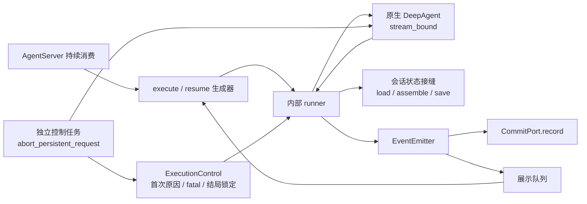
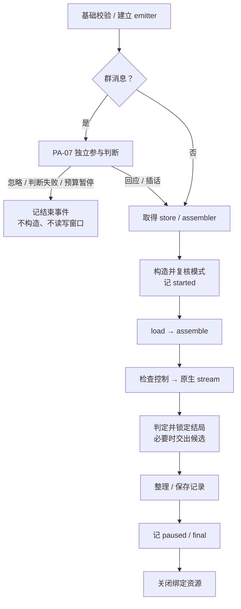
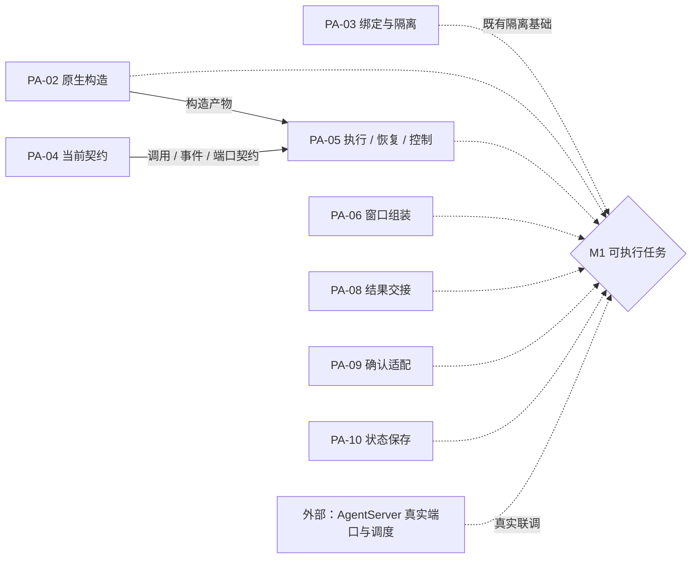

# F_05 执行、确认恢复与控制入口设计方案

## 1. 阅读与维护说明

### 1.1 元信息与完成口径

| 项 | 内容 |
| --- | --- |
| 类型 / 计划条目 | feature；PA-05，F_05 为文档编号 |
| 日期 | 原阶段归档：2026-10-08；本次文档修订：2026-10-12；引用修订：2026-10-13；控制 Rail 修复与独立验证：2026-10-14；PA-10 联动修订与当前接入状态同步：2026-10-14；PA-08 交接替代说明：2026-10-14；v0.1.20 冲突修复与入口测试适配、PA-18 接入与容量契约同步：2026-10-16；PA-18 容量检查移除同步：2026-10-19；PA-17 日志快照联动：2026-10-21；群消息接缝现状核对：2026-10-22（见附录 A.2） |
| 负责人 | Song Haoran、Chen Ran；认领和后续安排以统一开发计划为准 |
| 方案依据 | 沿用已确认架构及现行 spec；原阶段记录注明 D1～D7 已确认，本次不新增设计确认或修改架构 |
| 原实现范围 | 内部 `persistent_agent/schema/request.py`、`execution/{entries,control,emitter,model_rail,seams}.py`、`schema/spec.py`，外层 `__init__.py` 与对应单测；复用共享 Session 接缝 |
| 本次修订范围 | 2026-10-12 重组设计与验证记录；2026-10-14 修复控制拒绝的工具消息并同步 PA-10；2026-10-16 同步 PA-18 的续做组件、窗口接缝、最终容量检查及预算准入时点；2026-10-19 同步移除 PA-18 容量检查；2026-10-22 核对已合入的 PA-23 群背景与游标接缝，仅纠正过时现状；三个公开执行入口签名不变，core 接缝与 Spec 配置见 F_20 |
| 唯一开发计划 | [Persistent Agent 开发计划](../designs/persistent-agent-development-plan.md) PA-05；开发状态、排期、交付分类和节点进度在该计划维护 |
| 验证摘要 | 2026-10-12 历史定向复核 94 passed / 2 failed；2026-10-14 控制修复独立回归及推送前复核均为 823 passed，历史与最新记录分开保留；真实宿主与 M1 联调未完成，见第 4 节及附录 A.2 |
| Refs / 关联 PR | 原记录未提供 issue；控制 Rail 修复已合入 [PR #72](https://gitcode.com/huenrui_/agent-core/pull/72)，未关联 issue |

本文参考用户指定的[特性开发计划模板](../../../docs/templates/feature-development-plan-template.md)，按“范围与口径 → 特性与验收 → 依赖与联合交付 → 验证与进展”组织；按[特性设计模板](../../../docs/templates/feature-design-template.md)及[目录约定](../AGENTS.md)展开方案、取舍和实现流程。本文提供 PA-05 的技术设计与验证证据，不另建排期或完成率台账。

当前编号为 PA-05；2026-10-08 编号调整前的“PA-04 执行入口”对应本项，当前 PA-04 则是契约收敛。历史编号和当时结果不能用作当前认领依据。

### 1.2 设计依据与责任边界

| 依据 | 本文采用的内容 |
| --- | --- |
| [Overview](../designs/persistent-agent-overview.md)、[架构设计](../designs/persistent-agent-architecture.md)第 4.2、5、6.2～6.3、7.2～7.3、8、12.2.1 节 | 指定任务执行、宿主协作、结束保存、故障及来源验证点 |
| [S_01 执行入口与结局](../specs/S_01_public-api-and-execution.md) | RequestInput、执行编排、群参与判断、模型预算及结局 |
| [S_02 事件与结果交接](../specs/S_02_events-and-result-handoff.md) | 事件身份、序号、容量、分级记账及候选可靠保存 |
| [S_03 上下文与窗口](../specs/S_03_context-and-windows.md) | 会话记录、组装、保存及群消息游标接入协议 |
| [S_05 确认与续做](../specs/S_05_confirmation-and-continuation.md) | ConfirmReply、等待现场、控制截止和续做边界 |
| [S_07 构造与绑定](../specs/S_07_construction-and-binding.md) | 原生 DeepAgent、调用上下文、单次绑定与资源收敛 |
| [S_08 工具意图](../specs/S_08_tool-effects-and-intent.md)、[S_09 群聊与知识](../specs/S_09_group-chat-and-knowledge.md) | 已接入协同组件的职责及外部事实边界 |
| [F_01 构造](F_01_spec-and-deep-agent-construction.md)、[F_02 协议](F_02_execution-protocol.md)、[F_03 绑定](F_03_invocation-binding-and-isolation.md)、[F_04 契约收敛](F_04_contract-convergence.md) | PA-05 的配置、类型与调用隔离基础 |
| Harness [F_07 Session checkpointer 注入](../../../docs/features/F_07_session-checkpointer-injection.md) | 每次 Execution 注入 NoopCheckpointer，保留原生生命周期 |

PA-05 组合已有构造、原生流和清理接缝，负责入口校验、事件出口、预算消费、结局判定及收尾顺序。窗口内容与存储格式、回复到原生载荷的转换、文件交接、续做查证分别由后续特性承担。AgentServer 负责配置发布、Request 受理、身份鉴别、Session 串行调度、真实端口、预算账户、候选保存和渠道投递。

### 1.3 当前实现与开放边界

| 行为 | 当前边界 |
| --- | --- |
| 三个入口、请求值对象、runner、事件映射、预算 Rail、结局锁定 | 已有组件实现；本次复核结果见第 4 节 |
| 群消息参与判断 | 已由 [F_07](F_07_group-participation.md)接入。忽略、判断失败或预算暂停可在构造正式 Agent、加载窗口前结束 |
| 工具意图与完成 | 已由 [F_15](F_15_tool-intent-before-side-effect.md)接入，复用 PA-05 emitter / fatal 通道，不再列为未实现接入点 |
| 新任务正式执行 | `session_state_store`（PA-10）已接入（2026-10-14，见 [F_17](F_17_session-state-record.md)），新任务正式入口可执行；PA-06 组装器已接入，但注入 GroupChatPort（需要 PA-23 群消息读取）或 KnowledgePort（PA-13 知识导航）时仍拒绝；回应 / 插话也受这些条件约束 |
| 正式确认恢复 | `session_state_store`（PA-10）已接入（2026-10-14，见 [F_17](F_17_session-state-record.md)）；确认恢复因 `native_reply_adapter`（PA-09）尚未接入而拒绝 |
| 非确认暂停后继续、崩溃续做 | 带 `recovery_ref` 的 execute 仍明确拒绝，待 PA-18 接入 |
| 执行能力声明 | `enabled_features` 当前只允许 construction / workspace_read，没有 execution；声明条件见第 3.3 节 |

组件替身验证只能证明入口消费契约和本地编排。它不证明真实 WindowStore、发起人鉴权、持久化确认、跨进程恢复或渠道送达。验收预期集中在第 2.9 节，当前结果集中在第 4 节，历史证据保留在附录 A。

## 2. 特性定义与设计

### 2.1 背景、目标与设计约束

PA-01～PA-04 已提供构造、实例隔离和协议基础，但宿主仍需业务入口来执行任务、接续确认和控制活动执行。直接调用原生 stream 既不能区分停止与取消，也不能保证收尾保存与业务结束事件按正确顺序发生。

本项的目标是在指定 Session / Request / Execution 内复用 DeepAgent 单轮执行，交接过程事件和最终回答，并在确认、控制、原生错误、存储失败及流关闭时保持真实结局。单轮允许多次模型和工具调用，不等于只调用一次模型。

成立条件如下：

- 宿主保证同一业务 Session 只有一个活动 Execution；每次提供新的空 runtime Session，业务 session_id 保持不变，显式注入 `NoopCheckpointer`。入口检查 checkpointer 类型，不替宿主调度。
- 原 Request 从执行到确认恢复、后续续做固定原版本 Spec；新的 Execution 使用新的上下文和实例。不能用 follow_up / steer 将排队消息插入活动任务。
- Spec 须显式 `enable_task_loop=False`，`subagents` 为空，`enable_async_subagent / enable_subagent_runtime / add_general_purpose_agent` 全为 false；配置声明与装配结果都检查，不静默改写发布配置。
- 运行状态仍读写当前 Session state，原生 pre_run、流关闭和取消收敛照常；NoopCheckpointer 只关闭存储恢复 / 保存，跨 Execution 的状态权威属于会话状态记录。
- 本项不实现 task-loop、子代理、换窗、文件投递或业务副作用重放。当前方案无需新增架构决策；超限最终答案后续如何交接由 PA-08 确定。

### 2.2 总体方案与设计取舍

执行入口是异步生成器，首次迭代才开始校验和运行。生成器启动内部 runner，runner 占用绑定实例并调用原生流；生成器仅转交 emitter 排入队列的事件。`abort_bound` 因此取消 runner，而不会把取消信号直接落在服务端消费任务内；runner 可吸收已接受的控制取消，继续保存和结束记账。



箭头表示调用或事件传递；会话接缝是真实实现待接入的内部协议，CommitPort 的持久化和投递保证由宿主兑现。图中的控制不直接产生结束事件。

| 选择 | 依据与代价 | 排除的方案及原因 |
| --- | --- | --- |
| runner 与消费生成器分离 | 让取消落在可收尾的执行任务内；需维护队列和取消等待 | 在服务端消费任务中直接运行原生流：取消可能打断宿主业务代码，入口无法完成收尾 |
| 业务控制包装 `abort_bound` | 控制原因在构造前即可登记，结束事件只有一个写入者 | 服务端直接调用内部 abort_bound：拿不到内部实例，也无法表达 cancel / stop 的区别 |
| 预算拒绝用结构化 force-finish | 原生循环返回原因标记，入口统一判定结局 | 模型前 Rail 直接抛预算异常：可能被原生转换为普通错误，丢失预算分类 |
| 未接入状态组件时明确拒绝 | 不让无记忆执行伪装成有效任务 | PA-10 接入前退回空窗口：违背加载失败不能降级的约束 |
| 交互转换归 PA-09 | PA-05 只匹配等待现场并组装 InteractiveInput | 在 PA-05 复制原生载荷转换：职责重复、易与确认策略分叉 |
| 超时由 ConfirmReply.outcome 与标记文本表示 | 保持共享 AskUserPayload 类型，标记生成待 PA-09 | 为超时扩展原生 AskUserPayload：不属于本项职责，也无须改共享类型 |
| 原生退出后同步锁定控制 | 控制截止与结局一致；锁定仍不能证明保存成功 | 保存期间继续接受控制：原因变成 cancel / stop，实际终态却仍按原生结果，产生矛盾 |

### 2.3 公共入口与输入契约

三个入口由[外层包](../../__init__.py)懒加载导出；内部实现位于 [entries.py](../../execution/entries.py)。以下是调用契约概览，不要求源码签名逐项带类型注解。

```text
execute_persistent_request(spec, context, inputs: RequestInput) -> AsyncIterator[AgentEvent]
resume_persistent_request(spec, context, confirm_reply: ConfirmReply) -> AsyncIterator[AgentEvent]
abort_persistent_request(context, *, reason: "cancel" | "stop") -> None  # async
```

| 对象 / 字段 | 本入口消费的约束 |
| --- | --- |
| RequestInput | kind、text、source、reply_target、attachment_refs、continue_instruction；完整字段约束见 S_01 / request.py |
| kind / source | group_message 必须有 GroupMessage；direct_message 必须有 DirectMessageSource；scheduled 的 source 为空 |
| DirectMessageSource | message_id、sender_id、sender_name、带时区 received_at；接收时间归一化 UTC |
| attachment_refs | 默认空元组，最多 128 项受控引用；引用本身不授予读取权限 |
| continue_instruction | 可选非空白指示，仅上下文有 recovery_ref 时合法；当前 recovery_ref 路径仍整体拒绝 |
| ConfirmReply.responses | 1～64 项，tool_call_id 不重复；按 kind 区分 permission / answer |
| PermissionResponse | approve / approve_for_session / reject，可附最多 4096 字符 feedback；不接受永久允许选项 |
| AnswerResponse | answered 至少有一个回答；timed_out 不带回答；answers 以原问题文本为键，最多 64 项，允许部分回答 |

直接构造非法值对象抛 Pydantic ValidationError；入口重新校验并包装为对应 BaseError。输入值不包含第二套运行时依赖或授权状态。

#### 2.3.1 关键运行类、函数与扩展接口定义

以下按 2026-10-12 当前实现补齐定义。实现模块前缀为 `openjiuwen.harness.persistent_agent`；三个正式入口由外层导出，运行类及 seams 接口均为内部接缝。源码未注解的参数保持未注解，其要求在说明中给出。

| 类 / 来源 | 变更、关系与构造 | 关键状态、生命周期与职责 |
| --- | --- | --- |
| [execution.control.ExecutionControl](../../execution/control.py) | 新增 dataclass；ConstructionBinding 默认组合一个新实例 | abort_reason / fatal / emitter / stop_settled 初始 None，outcome_locked=False；本 Execution 的控制信号，不序列化、不代表持久化回执 |
| [execution.emitter.EventEmitter](../../execution/emitter.py) | 新增；`__init__(self, execution: ExecutionContext, commit, control: ExecutionControl)` | execution 固定，commit 为注入的 CommitPort；`_seq=0`、新 asyncio.Lock、无界 `outbox: asyncio.Queue[AgentEvent]`；唯一 record 调用者，本次 runner 结束后由消费侧排空 |
| [execution.model_rail.PersistentModelCallRail](../../execution/model_rail.py) | 新增，继承 DeepAgentRail；`__init__(self, binding: ConstructionBinding)` | `_binding` 固定，priority=10；通过 binding 取 emitter、预算与控制，模型调用 ID 放回调 ctx.extra，不在 Rail 建共享调用字典 |
| [execution.entries._Outcome](../../execution/entries.py) | 新增内部 frozen dataclass | kind 必传，text=""、detail=None、intercepted=()；将原生结果映射为待保存的结局，不是业务持久状态 |
| [schema.request.RequestInput / ConfirmReply](../../schema/request.py) | 新增公开 DTO，继承 ProtocolModel | 关键字字段构造，完整字段及源类型约束见第 2.3 节；输入不携带 Session 或端口，不新建宿主 Request |

| 关键类方法 / 同步或异步 | 输入输出、调用条件及副作用 |
| --- | --- |
| `ExecutionControl.request_abort(self, reason: AbortReason) -> bool`（同步） | 首个且结局未锁定时保存原因并返回 True，重复或晚到返回 False；此方法不校验 reason 值，由公开入口校验 |
| `ExecutionControl.lock_outcome(self) -> AbortReason \| None` / `mark_fatal(self, error: BaseException) -> None`（同步） | 前者置 outcome_locked 并返回已接受原因；后者只保存首个 fatal，不覆盖旧错误 |
| `async EventEmitter.emit(self, event_type: EventType, payload: Any) -> AgentEvent` | 锁内创建、编号、await record 后交出事件；普通失败诊断后仍入 outbox，关键失败标 fatal 并抛 RUNTIME_ERROR，不入 outbox |
| `async EventEmitter.emit_if_fits(self, event_type: EventType, payload: dict) -> AgentEvent \| None` | 检查 payload.text 和完整容量；超限返回 None 且不占序号，字段形状错误仍可抛 ValidationError；用于最终候选。**2026-10-14 已删除**：最终回答改由 [F_18](F_18_output-handoff.md) 的交接模块按最宽事件分段，paused / final 改由 `emit_ending` 记账 |
| `async EventEmitter.emit_text(self, event_type: EventType, text: str) -> None` | 文本按字符 / JSON 字节上限分块，多事件相接还原原文；空字符串不产事件；记录与入队是副作用 |
| `async PersistentModelCallRail.before_invoke(self, ctx) -> None` | PA-10 新增：Rail 注册完成后、原生创建上下文前检查实际挂载的卸载处理器，发现即标记致命错误并抛 CONFIG_PARAM_ERROR；无 emitter 时不工作 |
| `async PersistentModelCallRail.before_model_call(self, ctx) -> None` | 无 emitter 时不工作；有 emitter 时停止检查与预算准入，准入成功保存调用 ID，拒绝 / 异常请求 force-finish |
| `async PersistentModelCallRail.after_model_call(self, ctx) -> None` / `on_model_exception(self, ctx) -> None` | 消费并移除本次调用 ID，回报用量与 model.completed；模型异常回报 unknown，report 异常诊断后继续；after 可产带工具调用的中间文本 |
| `async PersistentModelCallRail.before_tool_call(self, ctx) -> None` | emitter 存在时阻止控制 / fatal 后尚未开始的工具，同时把该调用的工具结果写为“本次执行正在结束，该工具未调用。”；不负责写意图，写屏障见 F_15 |

公开独立函数的真实签名在 [entries.py](../../execution/entries.py)：

```python
async def execute_persistent_request(spec, context, inputs) -> AsyncIterator[AgentEvent]:
    ...
async def resume_persistent_request(spec, context, confirm_reply) -> AsyncIterator[AgentEvent]:
    ...
async def abort_persistent_request(context, *, reason: AbortReason) -> None:
    ...
# execution.control 中：AbortReason = Literal["cancel", "stop"]
```

execute / resume 都是异步生成器，首次迭代才执行校验和启动 runner；spec 要求 PersistentAgentSpec，context 要求本次 PersistentBuildContext，inputs / confirm_reply 经 RequestInput / ConfirmReply 重新验证。它们交出已按 record 策略处理的 AgentEvent，而不是原生 chunk；关键记账成功与事件流结束、资源收敛分别确认。提前退出须 aclose / aclosing，关闭将取消并等待 runner，不等于调用 cancel 控制；服务端须消费到结束或异常。三个入口的输入错误、配置门禁、保存及清理异常见第 2.8 节，同 context 不可开始第二次正式执行。

abort 是需 await 的控制协程，返回 None 只说明本次控制路径已返回；首次有效原因生效，重复 / 晚到返回，native 停止异常可传播。接收控制前可能尚无 Agent；正式 runner 的结局、记录保存及事件记账仍由 execute / resume 完成，控制期间的共享 Future 防止停止与清理重叠。

| 内部独立函数 / 完整签名 | 输入输出及设计作用 |
| --- | --- |
| `async _run_native(agent, context: PersistentBuildContext, native_input) -> _Outcome` | 消费 stream_bound 的原生事件并映射为结局；fatal 重新抛出，控制在原生退出后锁定；普通运行异常可转 error |
| `async _finish(context: PersistentBuildContext, store, outcome: _Outcome, reply_target: str \| None, last_group_message_id: str \| None) -> None` | 候选交接 → store.save → paused / final；超长完整答案放 ExecutionEnding.pending_answer，保存失败阻止结束记账；不是事务回滚。**2026-10-14 起**签名增加 `spec`，先按 [F_18](F_18_output-handoff.md) 整批准备并交出候选（含 `share_file` 文件），不再使用 pending_answer |
| `_native_resume_input(context: PersistentBuildContext, reply: ConfirmReply, waiting, adapter) -> InteractiveInput`（同步） | 复核 WaitingScene、Request、工具调用及问题键，调用 adapter.to_native 后按 tool_call_id 写入新 InteractiveInput；非法匹配为 INPUT_PARAM_ERROR |
| `async _drive(control: ExecutionControl, runner) -> AsyncGenerator[AgentEvent, None]` | 创建独立 runner Task 并转发 outbox；自然结束传播 runner 异常，提前关闭取消并等待其清理；本函数不再次 record |

扩展接口及载体定义在 [execution/seams.py](../../execution/seams.py)。WaitingScene(request_id, reply_target)、LoadedRecord(waiting=None, last_group_message_id=None)、WindowAssembly(native_input, last_group_message_id=None)、ExecutionEnding(outcome, request_id, reply_target, output_refs=(), pending_answer=None, last_group_message_id=None) 均为 frozen dataclass（2026-10-14 起 ExecutionEnding 去掉 pending_answer，增加交接摘要字段，见 [F_18](F_18_output-handoff.md)）；参数类型和生成构造定义见源码，含义见第 2.4～2.6 节。

| 内部 Protocol 的完整方法 | 实现方、调用条件、完成及失败约束 |
| --- | --- |
| `async SessionStateStore.load(self, context: PersistentBuildContext) -> LoadedRecord` | PA-10：把最新白名单记录写入新 Session，无历史可返回空 LoadedRecord；入口验证返回类型，加载异常 / 错形状为 RUNTIME_ERROR（2026-10-14 起记录无效时为 DEEPAGENT_CONTEXT_PARAM_ERROR 并原样透传，见 [F_17](F_17_session-state-record.md) D-04） |
| `async SessionStateStore.save(self, context: PersistentBuildContext, ending: ExecutionEnding) -> None` | PA-10：整理窗口并一次保存记录；入口 await 成功后才记结局，异常为 RUNTIME_ERROR，不降级空保存 |
| `async WindowAssembler.assemble(self, context: PersistentBuildContext, request: RequestInput, record: LoadedRecord) -> WindowAssembly` | PA-06：load 后追加带 WINDOW_PART_KEY 标记的执行头 / 临时背景，返回原生输入；非 BaseError 包装为 RUNTIME_ERROR，错类型拒绝 |
| `async GroupMessageReader.recent_messages(self, context: PersistentBuildContext, *, after: str \| None = None, trigger_message_id: str \| None = None) -> GroupMessagesResult` | PA-23：游标后新消息及连续性背景，排除触发消息；当前 F_07 直接调用 GroupChatPort，不通过此接口 |
| `NativeReplyAdapter.to_native(self, response: PermissionResponse \| AnswerResponse, request: InterruptRequest) -> Any`（同步） | PA-09：合法响应转为原生中断输入值，不创建新任务正文；等待场景及工具 ID 由入口先校验，适配器异常可传播 |

获取接口分别为 `session_state_store(context: PersistentBuildContext) -> SessionStateStore`、`window_assembler(context: PersistentBuildContext, *, chain_limit: int | None = None) -> WindowAssembler`、`group_message_reader(context: PersistentBuildContext) -> GroupMessageReader`、`native_reply_adapter() -> NativeReplyAdapter`，均为同步内部函数。当前 `session_state_store` 返回 PA-10 的正式实现，`window_assembler` 返回 PA-06 / PA-18 共用组装器，入口传入 Spec.continuation_chain_limit（注入 KnowledgePort 时抛 CONFIG_PARAM_ERROR；注入 GroupChatPort 时仍需要 PA-23 群消息读取）。`continuation_support(context) -> None` 是 PA-18 正式入口门禁，在 PA-12 归档查询接入前明确拒绝；`group_message_reader`（PA-23）与 `native_reply_adapter`（PA-09）仍拒绝，测试替身只证明组件。WindowAssembler.assemble 的共享签名、值对象和标记不变，权威定义在 schema/integration.py，seams.py 兼容再导出。宿主 record / budget 仍复用 F_02 的契约，新增可选执行链接口由 [S_02 第 4.3.1 节](../specs/S_02_events-and-result-handoff.md) 与 [F_20](F_20_continuation.md) D-06 定义，不新增执行权或控制端口。

### 2.4 执行与确认恢复流程

#### 2.4.1 新 Request 的 execute

本节的参与判断分支只适用于新 Request。PA-18 合法续做跳过群参与判断，先处理本 Request 的过期等待现场，再复用后续原生执行与收尾；流程、前序关系及正式入口门禁见 [F_20](F_20_continuation.md)。发起续做不要求模型继续操作，模型仍可根据证据结束任务。

1. 校验 Spec 模式、上下文 / NoopCheckpointer、RequestInput、recovery_ref 和群端口存在性。
2. `_start` 创建本 Execution 的 emitter，拒绝已有 emitter 的上下文。首次迭代启动 runner。
3. 群消息先执行 PA-07 独立判断。终结分支直接返回；respond / intervene 保留决策事件 ID，继续任务路径。私聊和定时任务跳过判断。
4. 取得会话状态记录与窗口组装接缝。getter 未接入即拒绝；群判断已经产生的事件不撤销。
5. 构造原生 DeepAgent，复核实际装配模式，记 `execution.started`；群参与路径附 `decision_event_id`。
6. `load(context)` 将最新会话记录写回新 Session，返回 LoadedRecord；随后 `assemble(context, request, record)` 返回 WindowAssembly。
7. `_run_native` 首先检查已接受的控制原因，然后经 `stream_bound` 运行原生流并映射事件。提前到达的控制会阻止原生模型 / 工具运行，但当前顺序仍会先加载和组装；不能表述为跳过全部前置工作。
8. 判定并同步锁定结局。非空白最终回答满足容量时交出 message 候选；超限处理见第 2.6 节。
9. 调用 `save(context, ending)` 整理并保存会话记录，然后记 `execution.paused / execution.final`，最后 `close_bound` 清理实例资源。



图展示接缝可用后的编排；getter、加载、组装、保存、关键记账或清理失败按第 2.8 节退出。`_start` 后即使尚未构造或没有业务事件，上下文也不能重复进入入口；构造已 claim 的上下文同样不可复用。

PA-06 加载后的兜底检查若发现等待中的调用或未配对工具调用，以校验拒绝结束且不追加内容。此拒绝晚于 `execution.started`，服务端不续做。已注入 GroupChatPort 的群消息先完成参与判断再取 PA-10 与组装相关接入点，其缺失可晚于判断事件；其他任务路径仍按前置门禁处理。

#### 2.4.2 确认恢复的 resume

恢复使用新的 Execution、Session、上下文和实例，仍属于原 Request 和原 Spec。入口先校验模式、隔离和 ConfirmReply，取得 store / NativeReplyAdapter 后建立 emitter、构造实例并加载记录，再校验：

- LoadedRecord.waiting 为 WaitingScene，所属 request_id 与执行上下文一致。
- Session 中存在原生 ToolInterruptionState；每项 tool_call_id 属于当前等待的交互请求。
- answer 只能回复提问，答案键不得超出原问题集合；permission 不能回复提问。DTO 已阻止重复 ID，但入口不要求一次答齐所有交互或所有问题。

匹配后调用 `adapter.to_native(response, request)`，按交互 ID 更新 InteractiveInput，再运行原生流。回复目标取 WaitingScene.reply_target；结束保存沿用加载时的群消息游标。恢复不调用 WindowAssembler、不读取新群背景、不追加执行头或任务消息，也不重复记 started。

无效回复不记业务事件、不保存、不改变已持久化等待现场；校验可能发生在新实例构造和加载之后，不能宣称完全没有构造或内存状态写入。实例仍清理，已使用上下文不可重用。发起人鉴权属于宿主，入口结构校验不能替代鉴权。

权限批准、会话记住、拒绝、未回答及超时标记到原生 ConfirmPayload / AskUserPayload 的转换由 PA-09 实现。现有测试 ReplyAdapter 只处理权限批准 / 拒绝，不证明 approve_for_session、主动提问或超时已端到端接入。

### 2.5 事件出口、预算与工具守卫

[EventEmitter](../../execution/emitter.py)是本 Execution 唯一 `record` 调用者。在锁内按顺序分配 local_seq、构造 AgentEvent、await CommitPort.record，再排入展示队列。字段身份、event_id 和重传冲突由 S_02 维护；服务端消费生成器时不再次记同一事件。

- `tool.intent / execution.paused / execution.final` 为关键事件：记账失败登记首个 fatal 并抛运行异常，不把失败事件交入展示队列。
- 普通事件失败只记诊断，仍交入展示队列；展示不证明事件已保存，也不能用序号缺口推断业务未发生。
- final 成功前候选可靠保存的检查属于宿主 CommitPort，不能因 output.proposed 普通记录失败而删除 output_refs 后假装完成。

| 来源 | 事件与处理 |
| --- | --- |
| 新任务开始 | execution.started，goal 为任务正文；群参与路径含决策引用 |
| 原生 llm_output.content | reply.delta；按两条容量限额拆分，空字符串不产出 |
| 模型正文与工具调用同时出现 | progress.updated，使用正文去空白后的前 500 字符，表示中间结论 |
| 已准入模型调用完成或失败 | model.completed，含 model_call_id、配置版本及真实 / 未知用量 |
| 原生 __interaction__ 片段 | 收集交互 ID、工具名及参数摘要，供 awaiting_confirmation 负载使用 |
| 最终非空白回答 | output.proposed，share_mode=message、target_ref=reply_target |
| 执行结束 | execution.paused / execution.final |
| 协同生产者 | participation.decided 归 PA-07；tool.intent / tool.completed 归 PA-15；window.switched 生产者归 PA-11，仍待接入 |

[PersistentModelCallRail](../../execution/model_rail.py)由 PersistentAgentSpec.resolve_parts 装配；没有正式 emitter 时不执行预算与事件逻辑。它使用 before_invoke、before_model_call、after_model_call、on_model_exception、before_tool_call 五个钩子（before_invoke 为 PA-10 新增，见第 5 条）：

1. before_model_call 先查 fatal / cancel / stop，有则 force-finish、跳过调用。PA-18 将预算准入移到本实例注入的 check_final_request：最终系统提示、消息、附件和工具定义全部装配后，启用 window_management 时先由 PA-11 处理换窗，再生成新的 model_call_id、await admit 并重新校验 BudgetAdmission 和调用归属，最后调用模型。PA-18 不检查模型容量（2026-10-19 移除）；denied 为 budget_denied，准入异常或 DTO / 归属错配为 error，均不调用模型。返回暂停结果不会进入模型异常重试，实际重试则重新检查并准入。
2. 模型完成以响应 usage_metadata 构造用量；缺少用量或模型调用失败为 unknown，不伪造零计数。await report、校验 BudgetReport / 归属，再记 model.completed。
3. report 调用或校验异常只记诊断；响应为 rejected 也不转成执行暂停，宿主负责结算与对账。model.completed 不是结算回执。
4. 工具前同样检查控制和 fatal，阻止每个尚未开始的工具，包括只读工具；被阻止的调用在窗口中的结果为“本次执行正在结束，该工具未调用。”（停止、取消与致命错误共用），强制结束载荷仍用于判定结局。已开始的并行调用依赖现有取消收敛，不承诺撤销外部效果。
5. 原生调用开始时（Rail 已注册、上下文尚未创建）检查实际挂载的上下文处理器，发现会卸载消息的处理器即标记致命错误并停止，入口在原生退出后抛出配置错误，不保存、不记结束事件（[F_17](F_17_session-state-record.md) D-07）。

before_invoke 同时通过 ReActAgent.set_final_request_check 为本实例注入上述最终检查；core 接缝默认关闭，不依赖 Persistent 类型，完整定义和待 core 维护者评审的边界见 F_20 D-09。独立的群消息参与判断仍单独使用预算端口，不经过这一原生接缝。

模型 Rail 优先级为 10；当前既有排序中高值先执行，它位于其他常用模型前钩子之后。不能仅凭数值宣称未来任何自定义 Rail 都不会排在它后面。PA-15 的 before_tool_call 优先级为 5，在控制守卫与权限 / 中断判定之后，并在意图等待返回后再次检查控制；旧文“PA-15 尚待接入、与工具守卫同为 10”的说明已不适用。完整工具策略和原生幂等重试边界由 F_15 / S_08 唯一维护。

### 2.6 容量与结局判定

#### 2.6.1 事件容量与无损文本

所有事件同时受 `TEXT_MAX_CHARS=65536` 和 `EVENT_MAX_BYTES=262144`（256 KiB）约束；后一限额计入完整规范 JSON 的身份、序号、时间、目标及转义开销。65536 个四字节字符已经耗尽正文之外的空间，控制字符还可能每个转义为 6 字节，因此不能只检查字符数。

- emit_text 为 reply.delta 选择满足两条限额的最长前缀，按 Python 字符边界拆分；片段拼接与原文一致，包括空格、换行和制表符。
- emit_if_fits 用于最终回答；只有正文及完整事件都能容纳才编号、记账并展示，否则返回 None。（2026-10-14 已由 [F_18](F_18_output-handoff.md) 的最终回答分段替代。）
- 容量试探不调用 record、不消耗正式 local_seq；使用下一事件的序号与同一时间，正文替换为单字符 x。可用正文空间等于字节限额减去占位事件大小再加 1，按正文规范转义字节数精确比较。
- 非法代理字符等字段错误不是容量超限，按真实事件校验规则抛出，不能吞为暂停。

#### 2.6.2 结局优先级与结束信息

| 优先级 | 条件 | 结果 |
| --- | --- | --- |
| 1 | 原生退出时控制对象已有 fatal | 抛原致命异常，不降级为 paused(error)，不进入普通结局的保存和结束记账；其他阶段已成功写入的事实不回滚 |
| 2 | 锁定前接受 cancel / stop | 分别 final(cancelled) / paused(stopped)；由 runner 接住控制引起的原生取消并收尾 |
| 3 | 已收集被拦截交互片段 | paused(awaiting_confirmation)；以交互 ID 作为 tool_call_id |
| 4 | 原生结果为 persistent_pause | 按 Rail 标记产生 paused(budget_denied) 或 paused(error) |
| 5 | 原生结果为 answer | final(completed)；非空白正文先交候选并写 output_refs，空白正文没有候选 |
| 6 | 原生 error、异常、迭代耗尽、无结果或其他未识别结果 | paused(error)，错误文本不作为回答 |

实际中断判断依据已收集的交互片段，不是仅看到 result_type=interrupt 就认定有完整等待负载。群参与判断的 final(ignored / failed) 由 PA-07 独立路径产生，不属于上述原生任务结果映射。

`output_id` 由 execution_id 加 final-answer 标识派生 SHA-256，取 `out_` 加前 32 位十六进制，同一 Execution 稳定。最终答案取外层 DeepAgent 在 after_invoke 后交出的 answer，不使用模型片段拼接或中间结论作为权威答案。

如果最终答案超出字符或完整事件字节限额，入口改判 paused(error)，不交残缺候选，将完整正文写入 ExecutionEnding.pending_answer，再按“保存 → 暂停记账”收尾。原生窗口只含模型原始回复，可能没有 after_invoke 改写的答案，因此 pending_answer 必须原样保存，后续交接不能重跑已完成业务。此降级只适用于容量超限；字段错误、保存失败和关键记账失败仍抛异常。

**2026-10-14 替代说明：** 上述两段（按 execution_id 派生 output_id、超限改判 paused(error) 并保存 pending_answer）已由 [F_18](F_18_output-handoff.md) 替代：身份在 Request 范围内按内容派生，超长回答拆成有序分段后照常 completed，改写后的正文以 `handoff_text` 消息保留在窗口中；本节第 5 行“非空白正文先交候选”的结局规则不变，另增加登记文件的交接与整批准备失败的处理。

`redact_arguments` 对解析成字典 / 列表的参数递归处理，键名包含 password、secret、token、key、credential、authorization（忽略大小写）的值替换为 `***`，摘要受文本限额约束，PA-15 复用它（2026-10-14 起本函数不再截断，长度由调用方限制：PA-15 截取 500 字符，确认事件按 [F_18](F_18_output-handoff.md) D-13 的容量预算截断并标记）。不能把该函数描述成任意文本的秘密检测：无法解析为 JSON 的字符串仅 strip / 限长，公开展示仍需宿主授权和脱敏。

### 2.7 控制、流关闭与资源生命周期

ExecutionControl 随上下文创建，保存首次 abort_reason、首个 fatal、emitter、stop_settled 和 outcome_locked。控制入口校验 reason / context 后调用 request_abort；同种或不同原因重复到达都忽略，保留首次接受值。

原生流退出、结果确定时，`_run_native` 通过 `_lock` 同步调用 lock_outcome；最后检查控制与锁定之间没有 await。锁定后的控制不改变原因、不调用 abort_bound；保存或结束记账仍可失败。进入 `_run` 的执行体异常退出时，该包装在异步清理前也锁定，保留原异常和已接受原因，不额外产生终态。群判断或 getter 拒绝发生在 `_run` 之前，尚未构造正式实例，不经过这段清理包装。

实例尚未构造时只登记原因；已构造且没有关闭 / 停止时，由独立控制任务调用 abort_bound，取消活动原生调用；未进入调用则让绑定拒绝后续调用。控制入口不发事件，返回不等于原生退出、工具收敛或记录已保存。

abort_bound 等待原生 abort 时绑定处于 stopping，不能同时 close_bound。控制入口先发布 stop_settled 完成信号，runner 清理前等待该信号，避免停止与资源释放重叠。内部 NativeStreamTaskLifecycle 还保护原生后台生产者的取消、Session 收尾与重复取消等待，绑定占用不在生产者退出前释放，详见 F_03 / S_07。

服务端须持续消费至流自然结束 / 异常，收到 final / paused 后仍需等待清理。前端断开仅停止展示订阅，不能关闭业务生成器。若宿主提前 aclose 或取消消费任务，转交生成器的 aclosing 会关闭内层 `_drive`，取消仍运行的 runner，并以 shield 等待它收敛；没有已接受控制原因时按异常退出，不主动保存或合成结束事件。

流关闭可能发生在候选、保存或结束记账已经部分成功之后，不能无条件说“没有任何记录”。结束事件已成功而清理失败时，入口仍抛运行异常，宿主须保留已有结局，不重做任务；若先前已有异常，清理失败只记诊断，不覆盖原异常。当前没有跨步骤事务、超时自动接管或强制终止所有外部工具的保证。

### 2.8 错误语义与持久化失败窗口

| 失败位置 | 对外结果 | 已生效事实与后续责任 |
| --- | --- | --- |
| Spec 类型、未开放模式、recovery_ref、群端口缺失、getter 未接入 | DEEPAGENT_CONFIG_PARAM_ERROR | 基础校验在事件前；群判断之后 getter 拒绝可已有判断事件 |
| 上下文类型、NoopCheckpointer、上下文复用 / 绑定不合法 | DEEPAGENT_CONTEXT_PARAM_ERROR | 不把失败上下文改绑为新执行 |
| RequestInput / ConfirmReply、continue_instruction、等待场景或回复匹配非法 | DEEPAGENT_INPUT_PARAM_ERROR | 回复匹配错误不保存、不记业务事件；新实例可能已加载和清理 |
| load 异常或非 LoadedRecord 返回 | DEEPAGENT_RUNTIME_ERROR | execute 可能已有 started；不调用原生模型，不退回空窗口 |
| assemble 异常或非 WindowAssembly 返回 | 既有 BaseError 原样保留，其他错误为 DEEPAGENT_RUNTIME_ERROR | 不运行半组装窗口 |
| 普通原生运行错误 | paused(error) | 正常保存后关键记账，不能把错误正文当作 output.proposed |
| save 失败 | DEEPAGENT_RUNTIME_ERROR | 不记结束事件；候选可能已交出，宿主核对真实存储结果 |
| tool.intent / paused / final 关键记账失败 | fatal + DEEPAGENT_RUNTIME_ERROR | 尚未开始的模型 / 工具被阻止；关键事件不展示，不能假装普通暂停 |
| 清理失败 | 无原异常时为 DEEPAGENT_RUNTIME_ERROR；已有异常时仅诊断 | 已落盘结局保留；旧执行收敛前不能安排同 Session 后继 |

普通事件或预算 report 失败只记诊断，不阻止业务结局。字段 DTO 校验遵循原错误边界；`_finish` 中的 ValidationError 包装为运行异常，不能笼统承诺所有位置都统一包装。原生内部可能捕获 Rail 异常，入口仍在原生退出后检查 fatal，重新抛首个致命异常。

收尾有三个独立确认点：候选交接 → 会话记录保存 → paused / final 记账。保存成功而结束记账失败、或结束记账成功而清理失败，均不是“全部回滚”。入口异常后宿主先查本 Execution 已保存结局；没有结局且没有主动停止 / 取消事实时，按 S_05 的续做条件处理，不能见异常就整段重跑。候选发送失败只重试交接，不重开业务执行。

### 2.9 独立验收要求与共享验证点

以下 PA-05-V 编号作为本项验证记录索引，不新增开发特性或改动总计划编号。表中写预期，执行结果见第 4 节。

| 验收 ID | 前置 / 操作 | 通过条件与检查入口 |
| --- | --- | --- |
| PA-05-V-01 输入与门禁 | 构造三种请求、两种回复及非法组合；缺失接缝、隔离或关闭模式 | DTO / 入口拒绝分类正确；基础拒绝无模型 / 构造 / 事件。群消息仅缺少端口时前置拒绝，已有参与事件不撤销；test_request / test_entries |
| PA-05-V-02 正常执行与窗口交接 | 新 Request，真实本地 DeepAgent、流式模型和合法接缝替身 | load 在 assemble 前；原生收到组装输入；示例顺序 started → reply.delta ×2 → model.completed → output.proposed → final(completed)；保存先于 final，游标进入 ending，实例清理；test_entries |
| PA-05-V-03 预算 | denied、admit 异常、report 异常及未知用量 | 前两者不调用模型，分别预算 / 错误暂停；report 异常不中止，不伪造计数；test_entries，DTO 归属回归见 test_protocol |
| PA-05-V-04 容量与最终答案 | 字符 / 字节边界、四字节字符、转义字符、after_invoke 改写、非法字符 | reply.delta 无损分段；试探不占序号；超限保存完整 pending_answer 后暂停；字段错误和保存失败不被容量降级吞掉；test_emitter / test_entries |
| PA-05-V-05 原生与关键失败 | 模型异常、迭代耗尽、普通记账失败、保存 / 关键记账失败、原生吞 fatal | 普通失败按约定继续；关键失败阻止未开始调用并抛原异常；加载 / 组装失败不运行模型，保存失败无结束事件；test_entries |
| PA-05-V-06 确认恢复 | 先权限中断，再以新 Execution / Session / 实例回复；构造错 Request / ID / 类型 / 问题键 | 暂停含交互 ID、工具名和脱敏参数；无效回复保留等待记录，有效恢复不追加窗口、不重复 started，沿用目标 / 游标；写调用经 PA-15 屏障；test_entries |
| PA-05-V-07 控制竞态 | 原生流中、构造前、重复 / 并发控制、慢 abort、锁定后控制、异常清理中控制 | cancel / stop 结局正确；首个原因保留；清理等待原生停止；锁定后原因不变、无 abort 调用，保存失败仍抛错；test_entries |
| PA-05-V-08 流关闭与隔离 | 提前关闭消费流、旧全局 checkpointer 状态及正常 / 中断 / 控制路径 | 原生生产者收敛，绑定释放并关闭；活动阶段无控制关闭不合成结束事件；全局旧状态不进入、无新快照，原生生命周期保留；test_entries / test_binding |
| PA-05-V-09 停止现场（共享子范围） | 第一次及后续模型调用中途 stop | 已达上下文和已完成工具结果经 store 替身保存后记 paused(stopped)；首次模型中断含原生 `[Request cancelled by user]` 占位；test_entries 的 test_stop_saves_the_context_reached_so_far |
| PA-05-V-10 协同回归 | 群判断及写工具执行 / 拒绝 / 意图失败 / 幂等重试 | 私聊 / 定时跳过群判断；忽略 / 判断失败不构造、不写窗口；respond / intervene 关联决策；写意图先于 dispatch，拒绝不记工具完成；详细主责要求见 F_07 / F_15 |
| PA-05-V-11 控制拒绝的工具消息 | 停止、取消或致命错误后有尚未调用的工具；停止与取消另走真实原生窗口 | 工具未被派发，消息为“本次执行正在结束，该工具未调用。”；内部强制结束信号及入口结局保持不变；test_refused_call_note_reaches_the_native_window / test_the_control_rail_refuses_every_call_with_the_same_note |

来源验证点位于当前[架构设计第 12.2.1 节](../designs/persistent-agent-architecture.md#1221-尚未验证的重要前提与实现验证点)，旧引用“附录 C 验证点 5”已失效。

| 来源 | 本项对应 | 主责 / 协同与联合节点 | 验收边界 |
| --- | --- | --- | --- |
| 验证点 1～3：中断序列化、回复转换、窗口尾部 | PA-05-V-06 消费与编排子范围 | PA-09 / PA-10 主责真实适配和持久化，PA-05 协同；M1 | 替身在内存中搬运中断对象不证明序列化；task-loop / 子代理仍关闭，完整结论由主责维护 |
| 验证点 4：正常流将上下文写回 Session | PA-05-V-02、V-08 | PA-10 主责状态保存，PA-05 协同；M1 | 入口及 Session state 可观察不等于真实后端可靠保存 |
| 验证点 5：停止现场与不完整工具调用 | PA-05-V-09、V-07 | PA-10 / PA-18 主责完整保存与安全续做，PA-05 提供模型中途停止证据；M1 / M2c 按各自子范围汇合 | 只覆盖模型调用中止；工具执行中途停止、残缺调用整理及副作用查证仍未完整验证 |

本项无独立页面，前端独立验收不适用。真实确认卡片、前端断开后任务继续、发送和调度验证在 AgentServer 与对应联合节点完成，不能从本表组件场景推导产品可用。

## 3. 依赖、接入与联合交付

### 3.1 开工硬前置与局部关系

PA-05 的最小硬前置是 PA-02 的原生构造产物和 PA-04 的当前调用 / 事件 / 端口契约。PA-03 绑定接缝是既有复用基础；完整 WindowStore、交互适配、文件发送和 AgentServer 不作为本项组件开发的新增硬前置，可以按相同契约用替身验证。

以下是 PA-05 的局部视图，仅表达其开工依赖与 M1 汇合，不替代总计划覆盖 PA-01～PA-26 的完整关系图；省略其他特性间硬前置及 M2 后续关系。



实线是 PA-05 开工硬前置，虚线是联合验收参与。能力集成汇合不等于所有参与方必须等待彼此才能开工。共享文件 entries.py / spec.py 的改动需协调，但不因此改变契约依赖。

### 3.2 实现位置与内部接缝

| 位置 | 责任及接入原因 |
| --- | --- |
| [request.py](../../schema/request.py) | 请求 / 回复值对象校验，入口重新校验后消费 |
| [entries.py](../../execution/entries.py) | runner、原生流映射、恢复匹配、候选、保存和结束编排 |
| [control.py](../../execution/control.py) | 首次控制、首个 fatal、同步锁定和停止完成信号 |
| [emitter.py](../../execution/emitter.py) | 唯一编号 / 记账 / 展示出口及容量控制 |
| [model_rail.py](../../execution/model_rail.py) | 原生模型预算 / 用量及模型 / 工具控制守卫 |
| [seams.py](../../execution/seams.py) | 接入点（PA-10 会话状态记录与 PA-06 组装器已接入，群消息读取与回复适配仍拒绝）及共享契约兼容再导出 |
| [schema/integration.py](../../schema/integration.py) | 共享值对象、窗口标记和协议的定义 |
| [spec.py](../../schema/spec.py)、[外层导出](../../__init__.py) | 装配 Rail / stream lifecycle，公开三个入口和请求类型 |
| [binding.py](../../execution/binding.py)、[stream_lifecycle.py](../../execution/stream_lifecycle.py) | 复用 PA-03 的占用、后台生产者收敛及关闭机制 |

| 接入协议 / 归属 | 值对象与约定 | 当前边界 |
| --- | --- | --- |
| SessionStateStore.load / PA-10 | 写回 Session state，返回 LoadedRecord(waiting, last_group_message_id)；确定无记录返回空 LoadedRecord | 已接入（[F_17](F_17_session-state-record.md)）；后端异常为运行失败，记录无效为校验拒绝，均不退回空窗口 |
| SessionStateStore.save / PA-10 | 收到 ExecutionEnding(outcome, request_id, reply_target, output_refs, last_group_message_id 及交接摘要)，整理白名单后一次保存 | 游标须原样保存并进入结束标记；交接摘要进入结束标记（[F_18](F_18_output-handoff.md)）；已接入，写入前失败不调用写入，后端写入抛错时记录可能已改变 |
| WindowAssembler.assemble / PA-06、PA-18 | load 之后组装，返回 WindowAssembly(native_input, last_group_message_id)；游标为服务端确认的扫描位置，无可信进度则保留加载时游标；续做先核对并清理本 Request 的旧等待现场，再追加执行链证据、规则及原任务 | 新任务与续做组件已接入，正式续做门禁仍关闭；容量筛选与换窗验收未关闭；正常确认恢复不调用 |
| GroupMessageReader.recent_messages / PA-23 | after 游标后的新消息及少量衔接，trigger_message_id 排除触发消息，返回 GroupMessagesResult | getter 已返回 ExecutionGroupMessageReader；配置 GroupChatPort 后由 PA-06 组装当前群的增量背景与游标。PA-07 仍直接调用 GroupChatPort，走独立的参与判断路径 |
| NativeReplyAdapter.to_native / PA-09 | 匹配后的单项回复转原生载荷，入口按交互 ID 组装 InteractiveInput | getter 未接入；测试适配器不是正式实现 |

窗口消息元信息使用 `WINDOW_PART_KEY=persistent_window_part`。PA-06 写 execution_header / temporary_background，PA-10 保存前分别保留并压缩为一行 / 删除；无标记消息按普通窗口内容保留。等待确认时末尾未完成工具调用不动，结束标记放记录元信息，完整整理契约见 S_03。PA-05 只传递这些协议，不自行定义第二套窗口格式。

共享值对象、标记和协议定义在 `schema/integration.py`，`seams.py` 保留 getter 并兼容再导出。群读取接缝为 `recent_messages(context, *, after=None, trigger_message_id=None)`：增量与触发消息之后至本次读取上界的回补合并去重，排除触发消息；使用 `scanned_through` 作为可信游标。PA-10 对停止后缺失结果的调用补 `stopped_tool_placeholder`，不能把补位当作真实成功或失败；正常等待确认不补位（2026-10-14 起补位覆盖停止、取消和执行中报错，文案为“结果未取得，实际效果需核实”，见 [F_17](F_17_session-state-record.md) D-06）。

### 3.3 M1 开放条件与兼容核对

M1 汇合 PA-02～PA-03、PA-05、PA-06、PA-08、PA-09、PA-10 与 AgentServer。须用真实实现验证私聊 / 定时执行、状态跨 Execution 加载保存、取消 / 停止、确认恢复及本 Session 记住 / 超时，连同预算、普通日志缺口、关键失败、候选保存、实例隔离和清理。

宿主还须证明前端断开不关闭业务流、final / paused 后继续消费至清理结束、等待确认阻塞 Session 而其他暂停按约定释放队列，以及原 Request 恢复仍使用旧版 Spec。PA-09 暂缓不降低完整确认恢复门槛。未接入换窗时容量不足须明确暂停，不静默截断。只有上述接入和联合验收完成后才可新增并声明 execution 能力。

2026-10-12 的文档重构只改设计记录，不迁移配置、会话状态或公开接口；2026-10-14 的修复只改变控制拒绝的工具消息，见附录 A.2。原 PA-01 构造测试已从“执行入口尚未导出”改为检查三个入口导出；导出存在仍不表示生产执行开放。个人版默认 checkpointer / DeepAgent 行为沿用共享实现，不通过修改全局配置获得隔离。普通绑定、直接原生调用不能替代业务入口的预算、记账和结局保证。

## 4. 验证记录、结论与剩余工作

### 4.1 独立验证环境与入口

[test_request.py](../../../../../tests/unit_tests/harness/persistent_agent/test_request.py)验证 DTO；[test_entries.py](../../../../../tests/unit_tests/harness/persistent_agent/test_entries.py)使用真实 DeepAgent、本地流式模型、新 Session 与 NoopCheckpointer；[test_emitter.py](../../../../../tests/unit_tests/harness/persistent_agent/test_emitter.py)验证字符 / 字节限额和无损分段。

入口 fixture 替换 ModelSpec.build 与测试工具 / Rail provider，并替换 store、assembler、reply adapter getter。StateStore 仅在内存中搬运白名单状态、等待现场与游标；WindowAssembler 透传 query 并返回固定游标；ReplyAdapter 仅映射权限批准 / 拒绝。Host 模拟 record 与预算，window_backend 使用 InMemoryKVStore。因此测试不要求外网或真实渠道，也不证明真实持久化、完整序列化、发起人鉴权、会话授权和超时转换。

2026-10-12 历史复核的执行目录为 `src/agent-core`，解释器为仓库 `.venv/Scripts/python.exe`，Windows / Python 3.13.12 / pytest 9.1.1：

```powershell
.\.venv\Scripts\python.exe -m pytest tests/unit_tests/harness/persistent_agent/test_request.py tests/unit_tests/harness/persistent_agent/test_entries.py tests/unit_tests/harness/persistent_agent/test_emitter.py -q
```

该历史复核当时基于工作区源码和测试，不把未提供的提交或 PR 编号写作验证版本；2026-10-14 独立验证的基线与结果见附录 A.2。

### 4.2 2026-10-12 执行记录与结论

本节保留历史验证结果；2026-10-14 的独立回归结果见附录 A.2，不用本节的历史失败描述当前状态。

| 范围 | 实际结果 | 结论与剩余边界 |
| --- | --- | --- |
| request / entries / emitter 定向集，96 项 | 94 passed / 2 failed，5 warnings | 输入、容量及大部分入口场景通过；不是当前组件全通过结论 |
| test_completed_execution_records_events_in_order | 失败：预期 reply.delta 的位置实际为 model.completed | PA-05-V-02 的流式展示 / 顺序未通过，不能把示例事件链写成当前实测结果 |
| test_confirmation_pause_then_resume_completes | 失败：暂停事件链缺少预期 reply.delta，在恢复操作前断言失败 | PA-05-V-06 该完整场景未通过，不能用其宣称本次跨实例恢复已验证 |
| 上述两项定向复跑 | 2 failed，故障表现相同 | 失败可复现；当前记录只确认事件断言缺口，未确认根因或修复 |
| 真实 WindowStore、NativeReplyAdapter、AgentServer / M1 联调 | 未执行；接缝仍拒绝 | 组件测试和历史回归不能代替真实集成 |
| 完整 harness / core.session、Ruff / mypy、历史变异检查 | 本次未重跑 | 旧结果只在附录 A 保留，不作为本次通过证据 |

复跑命令：

```powershell
.\.venv\Scripts\python.exe -m pytest tests/unit_tests/harness/persistent_agent/test_entries.py::test_completed_execution_records_events_in_order tests/unit_tests/harness/persistent_agent/test_entries.py::test_confirmation_pause_then_resume_completes -q --tb=short --show-capture=no -o addopts=''
```

本次结论为**部分验证**：代码中已有 llm_output → reply.delta 的映射和事件容量实现，但当前入口集成场景缺少预期展示事件。该缺口与未接入的真实存储 / 交互组件分别记录，不能以历史 249 passed 推导当前流式链路全部通过。开发状态及联合节点结论仍由唯一开发计划维护；本文保留新发现的技术证据，不据局部测试推导全模块状态。

### 4.3 风险与已知遗留

| 性质 | 缺口 / 限制 | 影响及后续归属 |
| --- | --- | --- |
| 历史验证失败，本轮不再复现 | 2026-10-12 记录的两个入口流式事件链失败 | 2026-10-14 基于 8e0d1067 的独立回归通过：PA 包与 core Session 823 passed；历史失败记录保留，真实宿主验收仍待进行 |
| 未实现接入 | PA-06、PA-10 已接入（2026-10-12、2026-10-14，见 [F_17](F_17_session-state-record.md)）；PA-09 回复适配 getter 仍拒绝 | 正常确认恢复仍等待 PA-09。PA-23 当前群背景与游标已接入；群消息入口要求宿主提供 GroupChatPort，不能再把群 Session 任务一概写成未接入。M1 真实组件验收仍待进行 |
| 组件已实现、正式门禁未开放 | PA-18 续做 | PA-18 已实现执行链、旧现场处理、日志预览与按事件分页工具（2026-10-21 起；最终容量检查已于 2026-10-19 移除）；正式 recovery_ref 入口仍按 F_20 D-10 拒绝，等待 PA-12 与 M2c。PA-08 文件候选与超长回答分段见 F_18，真实服务端联调待完成 |
| 有意保留范围 | task-loop、同步 / 异步 / 持久子代理关闭 | PA-24～PA-26 逐项验证后开放，不由配置偷偷启用 |
| 已有组件验证、真实集成待完成 | 工具停止、取消或报错后的调用组保留、残缺结果补位和状态保存已有 PA-10 组件证据 | 见 F_17；真实宿主与 PA-18 续做仍须查证日志和外部效果，不能据此宣称完整安全续做 |
| 预算覆盖限制 | 原生 Rail 之外的内部模型调用，例如独立 task planning 模型，不经过本 Rail | 一期不启用这类 Rail；开放时评估额外预算消费者 |
| 宿主运行方案待明确 | emitter 展示队列当前无容量上限，无跨保存 / 记账事务 | 队列容量、限流及观测由集成维护者按架构约定补齐；本项不承诺已实现流量控制 |

原遗留“群参与判断待接入”“工具意图待接入”分别已由 F_07 / F_15 替代；它们的组件实现不解决真实存储与结果投递缺口。旧文关于 PA-15 排在工具守卫之前的风险已由当前优先级 5 与 dispatch 前复核机制替代，未来新增 Rail 仍须验证排序和 fatal 行为。

## 附录 A. 原阶段验证与设计演进

### A.1 历史测试基线

下列为原文保留的阶段记录，本次未重新证明其整套结果；不同阶段数字有范围和版本差异，不合并为当前基线。Python 3.11.17 属于原阶段环境，不冒充本次 Python 3.13.12。

| 阶段 / 范围 | 当时记录 | 适用说明 |
| --- | --- | --- |
| PA-05 改动前 | PA 包 173 passed；F_01～F_03 共享回归 213 passed | 构造、协议和绑定基础，不含 PA-05 新增入口 |
| 初始实现后 | PA 包 224 passed，新增 51；共享回归 213 passed；core/session 411 passed；harness 5426 passed / 39 skipped | 原阶段组件与共享回归；同一套件连续运行 5 次结果一致 |
| 结局锁定及停止现场补充 | PA 包 229 passed；harness 5432 passed / 39 skipped | 控制截止及来源验证点 5 的模型调用中断子范围 |
| 2026-10-08 审计修复 | PA 包 249 passed；harness 与 core/session 联合 5863 passed / 39 skipped | 新增 emitter 容量边界、工具 fatal 守卫、异常清理控制截止、pending_answer、after_invoke 答案及保存失败验证；为总计划原组件验收证据 |
| 后续群判断 / 工具事件 | 原场景的“全部群消息拒绝”“确认恢复无工具事件”不再适用 | 当前回归分别参考 F_07 / F_15；详细历史结果由各自主责文档维护 |

原阶段覆盖了请求 source 匹配、两种 ConfirmReply、空回复 / 重复 ID / 永久允许 / 超时带回答 / answered 无回答拒绝；正常完成与目标 / 引用；预算拒绝和报告诊断；模型异常和迭代耗尽；普通与关键记账失败；加载 / 保存失败；权限中断及新 Session 恢复；重复控制、慢停止与提前关流；全局 checkpointer 隔离。原文“空回答拒绝”指 answered 没有回答项，不意味着当前 DTO 禁止单项自由文本为空。

原变异检查记录：去掉清理前的 stop_settled 等待、转交生成器的 aclosing、原生退出后的 fatal 检查或 request_abort 的结局锁定检查，对应用例会失败。本次未重跑变异检查。

原记录 Ruff check / format 通过；mypy 在 build_context.py 的 derive 返回类型和 spec.py 的 build 参数覆盖各报一个改动前已有问题，原阶段未修。它们是历史检查说明，不是本次重新确认的类型检查结论。

### A.2 关键修订及替代关系

| 日期 / 阶段 | 设计变化与原因 | 当前入口 / 证据 |
| --- | --- | --- |
| 原实现阶段 | 用 runner 隔离服务端消费任务；收尾统一“候选 → 保存 → 结束记账 → 清理” | 第 2.2、2.4、2.8 节；原阶段组件记录 |
| 原结局锁定补充 | 修正原生返回后保存期间接受控制但仍按原生结果结束的矛盾；异常清理前同样关闭控制接收 | 第 2.7 节，control / entries 与相关竞态测试 |
| 2026-10-08 审计 | 双容量限额、无损 reply.delta、完整 pending_answer、after_invoke 最终答案、原生吞 fatal 后阻止工具 | 第 2.5～2.8 节、test_emitter / test_entries |
| 2026-10-09 群判断接入 | 判断先于正式构造和窗口加载；忽略 / 失败不受 store / assembler 门禁 | F_07；替代早期全部群消息拒绝结论 |
| 后续工具意图接入 | 写前关键记账，完成为普通事件，before_tool_call 排在模型控制守卫之后 | F_15 / S_08；替代原 PA-15 未接入及排序遗留 |
| 2026-10-12 本次文档重构 | 参考模板重组全部设计与证据，修正错误码、实际控制检查位置、群路径门禁和当前架构引用；记录 94 passed / 2 failed | 本文第 4 节；只修文档，不用历史通过覆盖当前失败 |
| 2026-10-14 当前接入状态同步 | PA-10 接入后，按代码更新 getter 状态（存储与组装器已接入，群消息读取与回复适配仍拒绝）、确认恢复的拒绝原因、SessionStateStore 边界、Model Rail 钩子（新增 before_invoke）与未实现接入遗留；原“四个 getter 统一拒绝”“四个钩子”及“PA-10 getter 仍拒绝”为接入前描述 | 第 1.3、2.3、2.5、3.2、4.3 节；[F_17](F_17_session-state-record.md) |
| 2026-10-14 PA-08 交接替代 | 最终回答交接改由 F_18 的交接模块完成：身份按内容在 Request 范围内派生，超长回答分段交出、不再以 paused(error) 结束，ExecutionEnding 去掉 pending_answer；收尾先整批准备候选（含 `share_file` 文件），结束事件首次失败按原事件补交并重试一次；删除 emit_if_fits | [F_18](F_18_output-handoff.md)；第 2.3、2.6、3.2、4.3 节保留原结论并注明替代 |
| 2026-10-14 PA-10 联动（Q-03） | 被控制 Rail 阻止的工具调用写入结果“本次执行正在结束，该工具未调用。”，不再以强制结束载荷的文字作为窗口中的工具结果：PA-10 接入后窗口跨任务保存，内部停止信号会带到下一任务，停止时也显示 error | 第 2 节控制检查第 4 条；[F_17](F_17_session-state-record.md) Q-03；test_entries.py 中的 `test_calls_refused_after_a_control_say_they_did_not_run`（停止、取消）与 `test_the_control_rail_refuses_every_call_with_the_same_note`（含致命错误） |
| 2026-10-16 v0.1.20 基线适配 | 清理第 4.3 节的冲突标记与重复旧状态，保留 PA-10、PA-08 已接入的说明；完整保留各方入口测试，将终结错误替身明确为不可重试错误，并补充瞬态重试恢复、耗尽及逐次调用记账验证，保留新基线重试策略 | [F_17 第 9 节](F_17_session-state-record.md#2026-10-16-v0120-基线冲突修复)；原验收预期与共享接入契约不变 |

### 2026-10-22 群消息接缝现状更正

本轮随 PA-17 落地核对最新主仓：`seams.group_message_reader` 已返回 `ExecutionGroupMessageReader`，`window_assembler` 在提供 GroupChatPort 时注入它，由 PA-06 消费当前群的增量背景及扫描游标。第 3.2、4.3 节仍写 getter 未接入，与已合入代码不符，现据代码更正。PA-07 的独立参与判断仍直接调用 GroupChatPort；PA-09 回复转换与 PA-18 正式续做的门禁保留。此次仅修正文档，没有改变 PA-23 实现、接口、负责人或验收状态；历史接入前记录保留。

### 2026-10-14 控制 Rail 说明文字修复与独立验证

- 问题：停止、取消或致命错误后，尚未调用的工具由控制 Rail 拒绝；原生原先把内部强制结束载荷当作工具结果，窗口因此显示内部信号。
- 已确认处理：保留内部信号用于入口结局判定，同时设置工具消息“本次执行正在结束，该工具未调用。”；不改变工具派发、结局或事件顺序。
- 验收映射：PA-05-V-11。
- 实现与测试：只改 `model_rail.py` 的拒绝结果；`test_entries.py` 新增停止、取消的原生窗口测试，以及停止、取消、致命错误的 Rail 单测，共 5 个用例。
- 独立证据：在 Git 基线 `8e0d1067` 的临时副本应用此修复，不包含 PA-10 代码；macOS、Python 3.11.17、本地模型、原生 DeepAgent，会话存储仍用 PA-05 替身。实际命令：`make test UV=no PYTHON=<共享虚拟环境的 Python> TESTFLAGS='tests/unit_tests/harness/persistent_agent tests/unit_tests/core/session -q --tb=short -o addopts="" --disable-warnings'`，823 passed、17 warnings。Ruff 检查及格式检查通过，Pylint 10.00/10；拼写检查另用临时安装的 codespell 完成。
- 边界：只证明控制拒绝的消息和入口结局；不证明 PA-10 的存储或真实宿主联调。
- 推送前复核（2026-10-14）：在基于 `8e0d1067` 的 detached 工作树中重跑上述 PA 包与 core Session 命令，823 passed、18 warnings；实际提交范围的格式、拼写、Ruff 和 Pylint 检查全部通过（Pylint 10.00/10）。Makefile 检查使用共享解释器，拼写工具通过临时安装的 codespell 执行；没有修改仓库工具配置。开发计划本次差异全部限于 §4.1，包含控制修复的进展与开发者指定的 PA-05、PA-06、PA-10 负责人。

### 2026-10-16 PA-18 联动同步

- 原结论与范围：新任务执行由 PA-05 编排，预算准入在 before_model_call，续做组件未接入。
- 新依据与变化：F_20 已确认的 D-06、D-08、D-09、D-10 已在 PA-18 原型中接入；更新本节接缝、预算时点、续做组装边界与正式门禁。共享 WindowAssembler.assemble 的签名和值对象保持不变。
- 当前效力：预算按“最终请求 → 容量检查 → 准入 → 模型调用”执行；PA-18 组件可验证，正式续做仍拒绝。原 PA-05 的历史验收记录保留原范围，不能替代 PA-18 或 M2c 验收。验证与未完成项见 F_20 第 8 节；本轮只同步文档。

### 2026-10-19 PA-18 容量检查移除同步

- 原结论与范围：上一条记录的当前效力为预算按“最终请求 → 容量检查 → 准入 → 模型调用”执行，正式 execute / resume 须完整配置容量。
- 新依据与变化：开发者决定移除 PA-18 的容量检查（应用端使用不同模型，context window 各不相同，部分模型的上限未知）。最终请求接缝与预算准入时点不变，顺序改为“最终请求 → 换窗处理（启用 window_management 时）→ 准入 → 模型调用”；正式入口不再要求容量配置。
- 当前效力：上一条中容量检查与强制容量配置的部分作废，其余不变；验证见 F_20 第 8.2.2 节。

### 2026-10-21 PA-17 日志快照联动

- 原结论与范围：续做组件使用 PA-17 的分层摘要，查询工具按游标分页。
- 新依据与变化：PA-17 改为逐条校验的快照与无损 JSON，续做注入预览、查询工具按事件分页（[F_19](F_19_execution-log-record.md)、[F_20](F_20_continuation.md) D-08）。三个公开执行入口与预算时点不变。
- 当前效力：第 6 节续做组件状态的“分层材料”改为“日志预览”；验证见 F_20 第 8.2.4 节。
