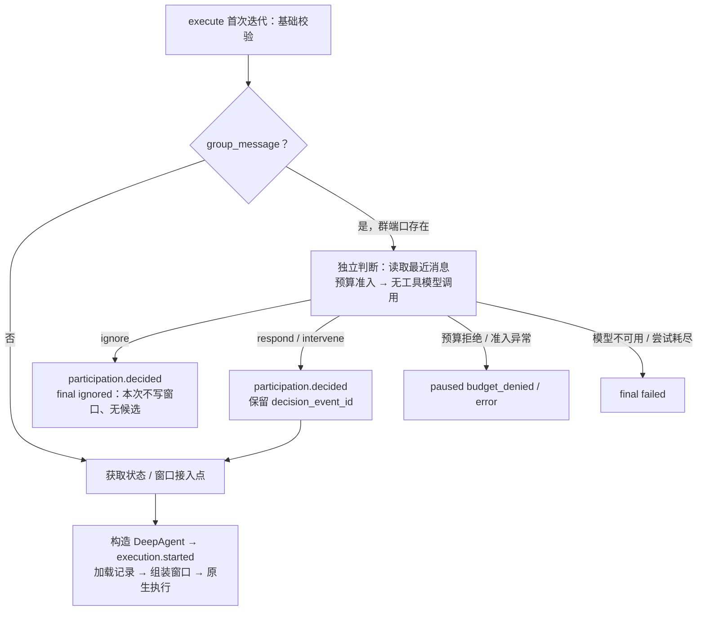
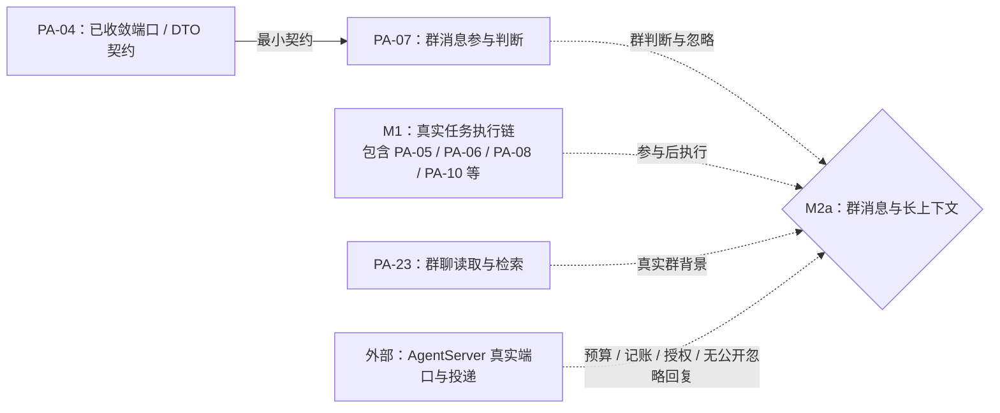

# F_07 群消息参与判断设计方案

## 1. 阅读与维护说明

### 1.1 元信息与完成口径

| 项 | 内容 |
| --- | --- |
| 类型 / 计划条目 | feature；PA-07，F_07 为本目录的文档编号 |
| 日期 | 原阶段归档：2026-10-09；本次文档修订：2026-10-12；引用修订：2026-10-13 |
| 原实现范围 | 内部 `persistent_agent/execution/participation.py`、`execution/entries.py`；组件测试 `tests/unit_tests/harness/persistent_agent/test_entries.py` |
| 本次修订范围 | 重组设计、取舍、依赖和验证记录，补齐输入、预算、事件与失败边界；不改变代码、公共接口或已确认架构 |
| 唯一开发计划 | [Persistent Agent 开发计划](../designs/persistent-agent-development-plan.md) PA-07；认领、状态、排期与交付节点在该计划维护 |
| 负责人 / 当前边界 | 计划认领为 Chang Yucong；已完成群参与判断组件验收，AgentServer 联调仍待进行 |
| 方案依据 | 沿用已确认架构与现行 spec；实现细节经源码和现有测试核对，本次不新增设计确认 |
| 验证摘要 | 原阶段记录 PA 包 289 passed；本次定向复核 10 passed / 61 deselected / 5 warnings。两者适用范围不同，详见第 4 节 |
| Refs / 关联 PR | 对应开发计划 PA-07；原记录未提供 issue / PR，不补造编号 |

本文参考用户指定的[特性开发计划模板](../../../docs/templates/feature-development-plan-template.md)，按“范围与口径 → 特性与验收 → 依赖与联合交付 → 验证与进展”组织；按[特性设计模板](../../../docs/templates/feature-design-template.md)和[目录约定](../AGENTS.md)补充技术方案、取舍与演进依据。不另建进度台账，也不把组件完成解释为群消息业务链路已开放。

### 1.2 设计依据与职责边界

| 依据 | 本文使用的内容 |
| --- | --- |
| [Overview](../designs/persistent-agent-overview.md)第 3.1、5.1 节；[架构设计](../designs/persistent-agent-architecture.md)第 4.3、6.2～6.3、11.1.2 节及附录 B | 判断先于正式执行；忽略不占窗口、不公开回复；Session 排队与后续扩展边界 |
| [S_01 执行入口与结局](../specs/S_01_public-api-and-execution.md)第 3、4.1～4.4 节 | RequestInput、参与判断、模型预算、错误分类和执行门禁 |
| [S_02 事件与结果交接](../specs/S_02_events-and-result-handoff.md) | 事件身份、普通 / 关键记账、展示与持久化 / 投递的区别 |
| [S_09 群聊与授权知识](../specs/S_09_group-chat-and-knowledge.md)第 2.1、3、4.1～4.2 节 | 群消息、归属校验、授权过滤、结果完整性及 GroupMessageReader 接入 |
| [S_03 上下文与窗口](../specs/S_03_context-and-windows.md)、[S_07 构造与绑定](../specs/S_07_construction-and-binding.md) | 正式执行后的窗口责任、宿主上下文与实例隔离 |
| [F_04 契约收敛](F_04_contract-convergence.md)、[F_05 执行入口](F_05_execution-entries.md) | PA-07 的协议基础及参与后的执行接缝 |

PA-07 负责消费宿主提供的群消息，作出三选一判断并交接结果。AgentServer 负责可信来源、授权过滤、群消息存储、Request 受理、Session 串行调度、预算账户、事件持久化和渠道投递；身份字段及附件引用本身不证明授权。

本期每条群消息已经是队列中的一个 Request，轮到时才判断。“忽略不生成正式任务”指不进入 DeepAgent 正式执行体，不表示撤销已受理的 Request 或跳过 Session 队列。被忽略的消息本次不写入窗口；后续 Execution 可由 PA-23、PA-06 将它作为最近群消息背景读取和注入，不能把它变成新的当前指令。

## 2. 特性定义与设计

### 2.1 背景、目标与范围

原执行入口在校验 RequestInput 时拒绝全部群消息。PA-07 将群消息分流为 `ignore / respond / intervene`，让无须参与的消息在正式 Agent 构造和窗口加载之前结束；需要参与的消息才进入已有执行路径。人类与其他 Agent 的消息走同一判断流程，@ 只是强信号，不强制回答。

本项包含独立模型调用、有限重试、预算消费、判断事件和终结分支，以及回应 / 插话与 `execution.started` 的关联。不包含群消息存储和检索适配（PA-23）、窗口组装与会话记录（PA-06、PA-10）、候选交接与发送（PA-08 / AgentServer），也不新增推理循环、前端页面或排队前判断入口。

当前忽略、判断失败和预算暂停路径已有组件实现，可以在上述窗口接入点不可用时结束。回应 / 插话分支仍受正式执行门禁约束：`session_state_store` getter 尚未接入；`window_assembler` 已接入，群读取、知识导航及容量验收仍按各自条件验证，不能以替身测试宣称完整业务执行已可用。

### 2.2 总体方案

[execute_persistent_request](../../execution/entries.py)先校验模式、上下文及 NoopCheckpointer、RequestInput、续做限制和群端口，再建立 emitter 并启动 runner。只有 `kind == group_message` 调用 [judge_participation](../../execution/participation.py)。判断直接读取 `GroupChatPort.recent_messages`，不调用尚不可用的 `seams.group_message_reader`。



图表示分支与调用顺序，成功模型调用的用量与事件顺序见第 2.5 节。基础校验失败直接抛异常；模型失败分支不一定立即终结，允许在三次尝试内重试。正式执行体的接入点当前仍拒绝，图中后半段是已有入口编排，不代表真实组件已经就绪。

### 2.3 关键决策与替代方案

| 决策 | 选择、依据与代价 |
| --- | --- |
| D-01：判断前置且独立 | 只提供职责、当前消息和少量群背景，`tools=None`。忽略不构造 DeepAgent、不调用状态存储或窗口组装，也不产生候选回复；代价是不能使用正式窗口中的工作历史来判断 |
| D-02：直接消费宿主群端口 | 依赖 PA-04 已有的 GroupChatPort / DTO 契约，避开未实现的 GroupMessageReader，允许与 PA-06、PA-23 并行；后续若统一读取接缝，须保持无需加载窗口和现有错误语义 |
| D-03：三选一由模型判断 | 保留 @、发送者、回复关系和附件证据，不采用“被 @ 必回应”的硬规则；respond 与 intervene 当前使用相同执行路径，仅决策标签不同 |
| D-04：失败、忽略与暂停分开 | 合法 ignore 才记 ignored；读取 / 模型 / 格式错误有限尝试后记 failed；预算拒绝或准入异常记 paused，避免把执行障碍解释为同事主动不参与 |
| D-05：每次真实调用独立计量 | 每次准入生成新的 model_call_id，调用成功或模型异常均报告用量并产生 model.completed；未知用量明确标 unknown，不能伪造零消耗 |

| 原候选方案 | 拒绝或暂缓原因 | 重新评估条件 |
| --- | --- | --- |
| 在完整 DeepAgent 回合后用静默标记跳过回复 | 已经加载 / 写入窗口并消耗正式执行资源，违背 D-01 | 只有产品明确改变忽略与窗口边界时才重新讨论 |
| 通过 group_message_reader 读取最近消息 | getter 当前固定拒绝；会将 PA-23 错加为 PA-07 的开工硬前置 | PA-23 接入后可评估复用，但须重新验证独立判断边界 |
| 判断失败时记录 ignored | 混淆无法判断与主动不参与，宿主无法正确重试或报错 | 不适用于现有结局契约 |
| 增加不占 Session 队列的判断路径 | 本期每条群消息已受理为 Request；排队前判断属于架构附录 B 的后续扩展 | 明确服务端受理、身份、预算和事件归属后另行设计 |

### 2.4 输入、模型与输出契约

接口与完整 Schema 以 S_01、S_09 及 [request.py](../../schema/request.py)、[context.py](../../schema/context.py)为准。下表描述当前判断实际消费的子范围。

| 输入 / 设置 | 当前实现 |
| --- | --- |
| 职责 | 优先使用非空白 `spec.system_prompt`；否则使用 AgentCard 的 `name`（无 name 时用 `id`）及 `description`，不是只取名称 |
| 当前消息 | 来自 `request.source`：正文、发送者名称 / ID / human 或 agent、是否提及 `execution.agent_id`、reply_to、attachment_refs；无正文用占位文本。判断不读取附件正文，也不使用顶层 `request.text` 替代来源正文 |
| 最近群消息 | 每次尝试调用 `recent_messages(execution, None, 8)`；重新校验 GroupMessagesResult 并 `assert_matches(execution)`，排除与触发 source.message_id 相同的记录。不加载窗口游标、不追读 next_cursor、不调用 search_messages |
| 最近消息的提示格式 | 按端口返回顺序保留发送者名称和正文；queued_request 标为“排队背景”，其他为“群消息”；recalled 或 text 为 None 显示“已撤回”。后者是当前展示实现，并不证明无正文消息都已撤回 |
| 模型 | 复用发布配置中的 `spec.model.build()`，在尝试循环之前构建一次；缺少模型或 build 异常立即 final(failed)。没有单独的参与模型配置 |
| 调用 | 两条消息：system 给出判断指令，user 提供职责、当前消息和最近背景；直接 `model.invoke(..., tools=None)`，不挂正式 Agent 的工具或 Rails、不起草公开回复 |
| 输出 | 期望一个 JSON 对象，decision 为 ignore / respond / intervene，reason 为非空字符串；reason 压缩空白并截到 4096 字符 |

“最近 8 条”是请求端口的 limit，不是本地强制上限：实现仅排除触发消息，不再次切片；GroupMessagesResult 的 Schema 上限为 500。符合 limit 的宿主最多提供 8 条，排除触发消息后可能更少。当前不补足条数，也不保证所取页面涵盖全部历史。

“轻量”表示输入与职责有限、无工具且独立于正式执行；没有独立小模型、总 token 上限或本层超时保证。正常成功只调用一次模型，异常可能增加到三次，最近消息读取失败则可能一次模型也不调用。

输出解析先从响应提取文本：字符串直接使用；列表仅拼接字符串或字典中的 text。随后用 `_DECISION` 的贪婪 `{.*}` 匹配提取 JSON，再验证 decision / reason。因此可接受对象外的包裹文本，多个对象则可能解析失败；它不是严格的结构化输出 API，也不校验模型对象中的额外键。模型返回有效标签只证明决策可消费，不证明语义判断准确率。

#### 2.4.1 关键类、判断函数与接口定义

以下按 2026-10-12 当前实现补充，模块为 `openjiuwen.harness.persistent_agent.execution.participation`。本特性新增内部生产函数与结果载体，复用已有宿主 Protocol、RequestInput 和事件 DTO，不增加外层公共 API。

关键类是 [ParticipationOutcome](../../execution/participation.py)，定义为 `@dataclass(frozen=True)`，生成构造器接受 `terminal: bool` 和 `event_id: str | None = None`。它无显式基类、运行资源句柄或自定义方法，生命周期限于一次前置判断；`terminal=True` 表示该分支已通过 emitter 处理 final / paused，`terminal=False` 携本次 participation.decided 的 ID，供 started 关联。字段在构造时确定，不作为持久状态、投递回执或模型判断准确率证据。

| 关键函数 / 完整源码签名 | 调用方、输入和返回值 | 异常与副作用 |
| --- | --- | --- |
| `async judge_participation(spec, context, request, emitter) -> ParticipationOutcome` | execute 的 runner 在状态 / 窗口加载和 Agent 构造之前调用；spec / context / request 分别为已校验的 PersistentAgentSpec、PersistentBuildContext、group_message RequestInput，emitter 为本 Execution 的 EventEmitter | 构建模型一次，最多三次尝试读取背景和判断；可产生预算预留、用量回报、model.completed、participation.decided、final / paused；关键记账异常传播，不加载 / 保存窗口 |
| `_parse(text: str) -> tuple[str, str]`（同步） | 判断响应文本经 `_content(response) -> str` 提取后解析，返回合法 decision 和压缩、限长后的 reason | 无可匹配对象、标签或原因非法为 ValueError，坏 JSON 为 JSONDecodeError；不接受模型证据 ID，不产生事件 |
| `async _recent(port, execution, trigger_id: str)` | 使用 GroupChatPort，返回去掉触发消息后的 GroupMessage tuple；原调用是 recent_messages(execution, None, 8) | 重新校验响应并匹配归属；incomplete 为 RuntimeError，端口 / DTO 异常传播给判断重试；不追读游标或补足 8 条 |
| `_usage(response) -> ModelUsage`（同步） | 从 usage_metadata 的两项计数构造 known；缺 metadata 或任一计数为 unknown | 不伪造零用量；计数类型错误仍可触发 DTO ValidationError，不能把所有非法 metadata 都写成已兜底 |
| `async _report(budget, execution, model_call_id: str, usage: ModelUsage) -> None` | await BudgetPort.report，重新校验 BudgetReport 与调用归属 | 普通 Exception 只记诊断；report 是宿主记账副作用，失败不重跑已完成的模型 |
| `async _finish_failed(emitter, reason: str) -> ParticipationOutcome` | 压缩原因并产生 final(failed)，返回 terminal=True | 关键记账失败传播；不伪装成 ignored，不保存空窗口 |

这些签名没有为未注解参数补造类型声明；完整定义与辅助格式化函数来源均为 [participation.py](../../execution/participation.py)。`_duty(spec) -> str` 选择非空 system_prompt 或 Card 职责，`_current_block(source, agent_id: str) -> str` / `_recent_block(messages) -> str` 只构造判断文本，原始消息、排队背景及撤回处理见第 2.4 节。它们不读取附件内容，也不向群发送消息。

| 复用接口及定义来源 | 实现方、注入与当前消费约束 |
| --- | --- |
| GroupChatPort / BudgetPort / CommitPort，完整方法见 [F_02 第 5.6 节](F_02_execution-protocol.md#56-关键类方法与宿主接口定义) | 宿主通过 context.ports 注入；判断自行读取 recent_messages、admit / report，事件统一通过 emitter.emit → CommitPort.record 路径；不调用 search_messages，也不额外保存流中事件 |
| 发布模型 `spec.model.build()`，定义见[模型配置 Spec](../../../schema/deep_agent_spec.py)；调用接口见 [Model.invoke](../../../../core/foundation/llm/model.py) | build 返回既有模型对象；判断调用 invoke 的两条 system / user 消息且 tools=None，无正式 Agent Rails；不另建参与模型配置或工具接口 |
| `EventEmitter.emit`，完整签名见 [F_05 第 2.3.1 节](F_05_execution-entries.md#231-关键运行类函数与扩展接口定义) | 当前 Execution 专有 emitter 在 execute 的 `_start` 建立；决策普通记账、final / paused 关键记账，完成条件按第 2.5 节 |

参与模型调用和端口响应均 await，但本函数未定义独立超时或取消回滚机制；原生推理阶段的控制测试不能证明判断阶段已检查 stop / cancel。重试不是跨 Execution 去重，已有预算和事件不会被撤销，边界见第 2.6 节。

### 2.5 正常流程、预算与事件交接

1. 群消息基础校验通过后 `_start` 创建本次 Execution 的 EventEmitter；上下文已有 emitter 时拒绝复用。缺少 GroupChatPort 在 `_start` 之前抛 `DEEPAGENT_CONFIG_PARAM_ERROR`，错误文本为 `group chat port is required for group participation`，不产生事件或构造实例。
2. 构建判断模型。每次尝试先读取并校验最近消息；读取失败不申请模型额度。读取成功后生成 `mc_` 加 UUID 的新调用 ID，调用 `BudgetPort.admit`，重新校验 BudgetAdmission 并匹配执行归属与调用 ID。
3. 准入后调用模型。成功时提取 known / unknown 用量，先调用 `BudgetPort.report` 并校验 BudgetReport，再产生 `model.completed(model_call_id, config_version, usage)`，随后解析输出。缺少输入或输出 token 计数时用量为 unknown。
4. 合法输出产生 `participation.decided`，携带 decision、reason、model_call_id 和 evidence_refs。证据引用按“触发消息 ID → 本次最近消息 ID”的顺序去重，最多 128 项；引用由实现生成，不接受模型猜造的消息 ID。
5. ignore 随后记 `execution.final(status=ignored, reason=reason)`，output_refs 默认空，结束 runner。无 execution.started、reply.delta、output.proposed，也不读取 / 保存会话记录、不改写工作目标或窗口。
6. respond / intervene 返回内部 `ParticipationOutcome(terminal=False, event_id=...)`。入口取得状态 / 窗口接入点，构造并复核 DeepAgent 后，才产生 `execution.started(goal=request.text, decision_event_id=...)`，随后 load → assemble → 原生执行。参与判断本身不完成任务或发送回复。

[ParticipationPayload](../../schema/events.py)已有 DTO；本项新增的是生产者接入。participation.decided 和 model.completed 默认 visibility=private，属于普通事件；不能直接当作群公开回复。final 和 paused 属于关键事件，失败不得伪装成终结成功。

[EventEmitter](../../execution/emitter.py)顺序 await `CommitPort.record` 后向流交出事件。普通事件失败只记诊断，仍可展示并继续；关键事件须由宿主确认自身落盘，record 失败登记 fatal 并抛 `DEEPAGENT_RUNTIME_ERROR`，该事件不向流交出。final(ignored) 成功不保证普通判断日志完整，decision_event_id 也不保证被引用普通事件必然已持久化。宿主消费原事件流时不再次记账，收到 final / paused 后仍须消费至结束。

“整理窗口 → 保存记录 → 结束记账”适用于已进入正式任务体的收尾。前置判断终结没有加载窗口，直接记 final / paused，不调用 `_finish`；不能为满足正式执行的保存顺序而额外写入空记录。

### 2.6 异常、重试与已有事实

`_ATTEMPTS=3` 是总尝试数，不是首次调用之后再重试三次。每次循环重新读取最近消息，已有模型调用和普通事件不会因重试撤销。

| 情况 | 当前处置与可观察结果 |
| --- | --- |
| 群端口读取异常、DTO / 归属校验失败、status=incomplete | 消耗一次尝试，尚不申请额度或调用模型；最多三次后 final(failed)。incomplete 即使有部分消息也不当作 empty |
| status=empty | 完整确认没有背景，使用“无”继续判断；空背景不自动决定 ignore |
| BudgetPort.admit 拒绝 | 立即 paused(budget_denied)，不调用模型、不 report、不产生 model.completed / participation.decided，不继续循环 |
| admit 异常或响应校验 / 归属匹配失败 | 立即 paused(error)，detail 记录准入失败；同样不调用模型，不重试准入 |
| 模型调用异常 | report unknown(reason=model call failed)，产生 unknown 的 model.completed，再进入下次尝试；耗尽后 final(failed) |
| 模型返回但输出缺失 / 不可解析 / decision 或 reason 非法 | 本次 report 与 model.completed 已发生，继续尝试；耗尽后 final(failed)，不生成 participation.decided 或 ignored |
| report 调用、DTO 或归属校验异常 | 只记录诊断，不重复已经发生的模型调用，也不阻止后续解析；合法 rejected 响应不转换为暂停，由宿主对账 |
| 关键 final / paused 记账失败 | 入口抛运行异常，不纳入判断尝试、不改判 ignored / failed；宿主核对真实落盘结局 |
| respond / intervene 后接入点不可用 | 抛配置错误；已产生的 model.completed / participation.decided 不撤销，也尚未产生 execution.started，不以判断成功冒充任务完成 |

本地三次判断重试不提供跨 Execution 的决策缓存或业务请求去重；宿主再次执行需使用新的上下文，并自行核对已有结局。提前关闭事件流的收敛沿用 PA-05，不能作为已记录取消的证据。判断函数没有主动检查 stop / cancel 标志或结局锁定，判断期间的业务控制边界须单独验证，不能由原生推理阶段的控制测试推导其已受覆盖。

### 2.7 实施影响与兼容性

| 位置 | 原特性落地点 / 本次核对结果 |
| --- | --- |
| [participation.py](../../execution/participation.py) | 独立模型、消息格式化、校验 / 重试、预算、决策和前置终结 |
| [entries.py](../../execution/entries.py) | `_require_request` 不再无条件拒绝群消息；execute 检查群端口并在接入点及实例构造前判断；started 关联决策 ID |
| [ports.py](../../ports.py)、[schema/events.py](../../schema/events.py) | 消费已有 GroupChatPort、BudgetPort、CommitPort 和判断 DTO，不新增公开端口或事件类型 |
| [seams.py](../../execution/seams.py) | group_message_reader 仍拒绝；本项绕过该 getter，不把 PA-23 声明为已接入 |
| [test_entries.py](../../../../../tests/unit_tests/harness/persistent_agent/test_entries.py) | 使用真实 DeepAgent、本地模型和端口 / 窗口替身验证组件编排 |

旧私聊和定时任务不读取群端口、不产生参与事件，继续沿用执行入口。群消息由“全部拒绝”变为“先判断，再按接入情况继续”；缺少端口、不合法模式 / 输入及尚未接入能力仍明确拒绝。没有新增窗口数据或迁移格式；`enabled_features` 仍只有 construction / workspace_read，未加入 execution。本次只修订文档，不改变上述行为。

### 2.8 独立验收场景

验收范围唯一来源为[开发计划](../designs/persistent-agent-development-plan.md) PA-07；原条目未分配场景 ID，本文以 `PA-07-V-*` 展开技术验证，不新增特性或更改原验收门槛。条件为合法 Spec（显式 enable_task_loop=False、无子代理）、新的隔离 Session / NoopCheckpointer、有效执行上下文、模拟预算 / 记账 / 群端口；回应 / 插话另用 PA-06、PA-10 替身。所有事件流消费至结束。

| 场景 | 操作与预期 | 现有测试 / 证据边界 |
| --- | --- | --- |
| PA-07-V-01：缺少群端口 | 执行合法群请求但不注入 GroupChatPort；在事件和实例构造之前拒绝 | `test_group_message_without_port_is_rejected_before_events` |
| PA-07-V-02：被 @ 仍可忽略 | 返回 ignore；验证职责、发送者、提及、回复关系及附件引用，排除触发消息；只产生 model.completed → participation.decided → final(ignored)，不构造、不加载 / 保存、不组装、不交候选 | `test_mentioned_group_message_can_be_ignored_without_opening_a_task` |
| PA-07-V-03：未被 @ 可回应或插话 | 分别返回 respond / intervene；started 引用同一个决策事件，替身窗口后进入原生流 | `test_unmentioned_group_message_can_continue_into_execution`（两个参数）；不证明真实窗口和渠道发送 |
| PA-07-V-04：判断失败不记忽略 | 格式错误或模型异常三次；final(failed)，无 participation.decided、无正式模型流、无窗口调用 | `test_participation_failure_after_retries_is_not_ignored`（两个参数） |
| PA-07-V-05：预算拒绝 | admit denied；只产生 paused(budget_denied)，不调用模型、不 report、不加载窗口 | `test_budget_denial_skips_the_participation_model` |
| PA-07-V-06：不完整群背景 | 连续返回 incomplete；群读取三次、模型零次、final(failed)，无决策和窗口加载 | `test_incomplete_group_history_is_not_treated_as_ignore` |
| PA-07-V-07：私聊 / 定时旁路 | 两类输入直接进入原生任务路径；群端口和判断模型零调用，started 无决策引用 | `test_direct_and_scheduled_requests_skip_participation`（两个参数） |
| PA-07-V-08：其他来源及协议边界 | Agent 来源沿同一流程；核对 empty、撤回 / 排队背景、职责回退、输出合法性、重试用量和新的调用 ID、准入 / 报告异常、关键记账失败及真实过滤 | 当前行为已逐项对照源码；上述组合尚无本次定向测试结果，不将其他原生路径测试扩大解释为群判断覆盖 |

V-01～V-07 对应本次执行的 10 个参数化用例。V-08 记录进一步验证入口和边界，不声称本次新建或运行了这些测试；群 DTO 与归属基础可参考 [test_protocol.py](../../../../../tests/unit_tests/harness/persistent_agent/test_protocol.py)，请求来源结构可参考 [test_request.py](../../../../../tests/unit_tests/harness/persistent_agent/test_request.py)。

## 3. 开工依赖、并行与联合交付

唯一开工硬前置为 PA-04 提供的已收敛 RequestInput、群端口 / 结果、预算和事件契约。模拟宿主即可独立实现和验证；真实 AgentServer、PA-23、PA-06、PA-10 不作为本项的开工硬前置。入口接线复用 PA-05 已有编排，不增加本计划定义的依赖边。



这是 PA-07 的局部协作视图，省略 M2a 的换窗、知识和失效管理等参与范围；完整节点条件及交付顺序只在统一计划第 3 节维护。实线表示开工硬前置，虚线表示联合验收汇合，不表示 PA-07 等待这些组件才可开工。PA-07 与 PA-06、PA-23 可独立推进；可并行不等于已经排定同时开工。

真实联合验证须由 PA-07 主责判断与忽略场景，PA-05、PA-06、PA-10 协同“参与后执行”，PA-08 与 AgentServer 协同结果交接和投递，PA-23 协同真实群背景。至少要证明授权后消息被正确提供，预算 / 关键记账由真实端口兑现，ignore 不公开发送，而 respond / intervene 进入真实执行链后再交出候选。群消息能力的产品交付归 M2a，不能凭 PA-07 组件通过宣告 M1、M2a 完成；无须为此基础组件新增页面。

## 4. 验证、当前结论与遗留

### 4.1 实际执行记录

| 日期 / 范围 | 环境与复现入口 | 实际结果 | 适用边界 |
| --- | --- | --- | --- |
| 2026-10-09 原阶段 | 原 F_07 记录 `tests/unit_tests/harness/persistent_agent`；未提供完整命令、环境或独立日志 | PA 包 289 passed；改动文件 Ruff check / format 通过 | 历史组件证据，保留原结论；不作为本次全包回归或真实 AgentServer 联调结果 |
| 2026-10-12 本次定向复核 | Windows、本仓 `.venv`；Python 3.13.12、pytest 9.1.1；本地模型、模拟宿主端口和窗口接缝，真实 DeepAgent | 10 passed / 61 deselected / 5 warnings；V-01～V-07 均通过 | 仅群判断定向用例；全量 PA 包、Ruff 及真实服务端联调本次未执行。5 条 warning 来自既有 Pydantic / SQLAlchemy 弃用提示 |
| 2026-10-12 文档与实现核对 | 模板、架构第 4.3 节、现行 S_01 / S_02 / S_03 / S_07 / S_09、participation / entries / emitter / seams 与测试断言 | 纠正职责回退、8 条限制、模型异常记账、输出解析和正式门禁表述；28 个相对链接、8 个场景 ID、7 个测试引用核对通过，git diff --check 通过 | 源码核对不代替 V-08 的专门测试或真实授权、结算、持久化 / 投递验证 |

本次实现基于 agent-core `dca8baad0c7a55996cadadf9011331d21f4173bd` 工作区；相关设计文档存在本地修订，本次未改 Python 实现。以下命令在 `src/agent-core` 目录实际执行：

```powershell
.\.venv\Scripts\python.exe -m pytest tests/unit_tests/harness/persistent_agent/test_entries.py -k 'group_message or participation or incomplete_group or direct_and_scheduled' -q
```

### 4.2 验证结论

现有定向测试证明：缺端口前置拒绝、被 @ 可忽略且不触碰正式窗口、未被 @ 可回应 / 插话并关联 started、格式或模型错误三次后失败、预算拒绝不调用模型、incomplete 不伪装为空或忽略，以及私聊 / 定时任务旁路。原阶段组件完成结论在该范围得到复核，状态、负责人、依赖及完成数不因此变化。

替身提供了 PA-06、PA-10 的协作，因此“参与后 completed”只证明入口组合契约。当前生产 getter 仍拒绝，真实授权、群消息存储、预算对账、关键记账落盘、候选发送与模型判断质量未由本次测试证明。F_05 另有正式入口回归和未通过场景，以其验证记录为准；本次 10 项通过不覆盖或关闭那些缺口。

### 4.3 已知遗留与限制

| 项 | 当前处置与影响 | 后续责任 / 验证入口 |
| --- | --- | --- |
| 最近消息存储、游标和检索未接入 | 本项只消费注入的 GroupChatPort，group_message_reader 仍拒绝；判断使用 cursor=None，不更新会话游标 | PA-23 / AgentServer；验证真实授权过滤、分页 / 增量读取和来源隔离 |
| 参与后窗口及候选链路未闭合 | PA-06、PA-10 getter 尚未接入；ignore 本次不写窗口，后续作为背景出现仍需相关组件实现 | PA-05、PA-06、PA-10、PA-08；真实执行与交接联合验证 |
| 服务端忽略与投递未联调 | ignored 后不向群发送是宿主职责；私有决策 / 用量事件不能直接公开 | AgentServer / PA-07；M2a 联调，核对关键落盘和无公开忽略回复 |
| 输入容量与格式边界 | 请求 limit=8 但不本地截断，无总 token 上限；text=None 展示为“已撤回”；采用文本 JSON 提取 | 后续针对超额端口返回、无正文消息和包裹 / 多对象输出增加定向验证；若改变契约同步 S_01 / S_09 |
| 判断阶段控制和效果尚未专门验证 | 未主动检查 stop / cancel；现有群测试只有 human 来源，Agent 来源、预算异常等组合见 V-08；无真实模型准确率或时延证据 | PA-05 / PA-07；补充判断阶段控制与 V-08 场景，明确预期后再考虑代码调整 |
| 判断仍占 Session 排队位置 | 长任务期间新群消息判断会滞后；本期不新增排队前路径 | 架构附录 B 后续扩展，需另行设计受理和事件归属 |

### 4.4 设计演进与本次修订

- **2026-10-09：群判断组件落地。** 原执行入口无条件拒绝群消息；改为在窗口接入和正式实例构造之前判断，直接使用 GroupChatPort，绕过尚未实现的 GroupMessageReader。ignore 与失败分别终结，respond / intervene 关联后续 started；原 PA 包 289 passed、Ruff 通过记录保留其历史适用范围。
- **2026-10-12：按模板重构归档。** 原文内容整合为当前方案、决策 / 拒绝理由、流程与异常表、局部依赖图、验收及证据，补齐模型异常用量、report 失败、模型 / 职责来源、JSON 解析、8 条限制和接入点失败后的已有事件。不保留完整旧原文；旧“最多 8 条”“职责缺省只用名称”“成功才记 model.completed”的不精确表述由第 2.4～2.6 节替代，代码行为未变。
- **引用与差异处理。** 原 Refs 的“架构 §6”更新为现行第 4.3、6.2～6.3 节；S_01 已维护参与判断，S_02 不再列为待接入生产者。架构第 5.1.1 节的概括步骤先列构造、后列参与判断，与第 4.3 节及当前实现顺序不一致；本文按后两者描述实际顺序，保留该待对齐点，不据概括步骤把构造提前，也不在本次擅自修改架构设计。
- **同步范围。** 开发计划 PA-07 行同步本次定向证据并校正 ignore 事件摘要；不调整状态、负责人、排期、硬前置、交付分类或完成数。现行 spec 已包含相关行为，本次未改变契约，不新增或改写 spec。
