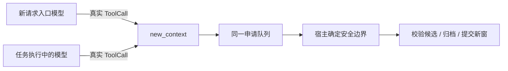
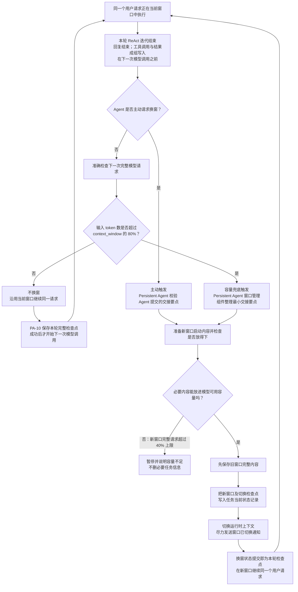
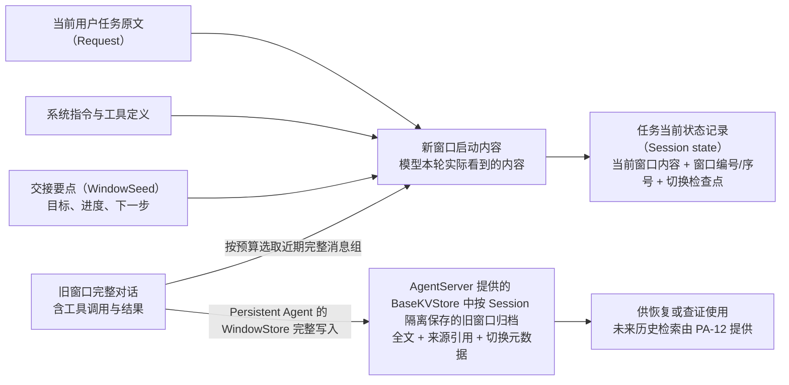
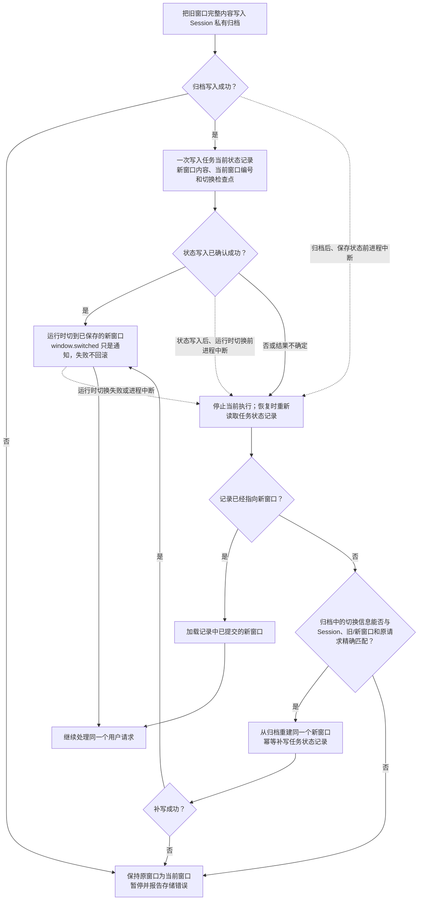

# F_11 上下文窗口管理设计方案

## 2026-10-25 已确认增量：入口与执行中共用 new_context 工具

用户确认采用真实工具调用方案：独立入口模型仅开放已有 `new_context` 的 ToolInfo，
需要切换时返回标准 ToolCall（WindowSeed 参数）；不切换只返回 continue 和理由。
旧的 switch+seed JSON 协议不再接受。模型调用仍至多一次，不添加第二次总结调用。
`PersistentNewContextTool` 统一校验、去重及排队；宿主构造时绑定 request_entry 或 agent，
不向模型开放 trigger_kind / 安全边界参数。管理器消费同一 pending_window_switch，
删除独立 `_entry_seed` 路径，入口仍用 request_start/0，执行中仍等待完整工具轮次。
工具回执及私有 tool.completed 只表示申请接收，不表示归档/提交成功。
80% 兜底仍由框架内部触发，40% 复核与已实现的归档/恢复规则不变。
采用真工具调用而非框架把 switch JSON 代转工具，消除两套模型输出协议；
不取消入口判断，避免重新完全依赖业务模型自发调用。组件实现已接线，验证另记；
真实模型的工具选择效果和宿主联调尚未验证。

上图统一的是工具与申请队列，不是把两次模型调用合成一次；入口仍在回答前切换，
执行中仍等待整批工具收敛。容量兜底不经过模型工具选择，继续复用后续提交流水线。

## 2026-10-23 已确认：新请求入口的独立换窗判断

本节保留当时设计依据；其中 switch+seed 文本输出及独立入口申请路径已由上方
2026-10-25 统一工具协议替代，安全边界与持久化约束不变。

群参与判断仍在前，不参与的消息不得读取私有窗口。接受的新私聊/群聊请求，
加载同 Agent、同 Session 历史后，在正式回答前至多调用一次模型判断 continue/switch；
只给有界可见历史及当前请求，不给思维链和工具原始输出。switch 同次返回有界交接，
复用现有候选重建、40% 复核、旧窗归档与状态提交，不另调总结模型。
首次空窗、确认恢复、崩溃续跑、定时及 Bot 内部请求跳过；失败或超时只降级继续原窗并留私有诊断，
真实归档/提交失败仍显式停止。模型判断计入预算，无工具、无应用层重试。
入口是独立 request_start 安全边界（iteration_seq=0），不伪造已完成的 ReAct；
归档 trigger_kind=request_entry，原有 agent/capacity_fallback、80% 兜底和个人版不变。
先保存该入口检查点再归档，恢复仍必须匹配请求、执行、配置指纹及候选指纹。
判断输入限当前请求前 6000 字符、最近 8 条可见文本（每条 1500 字符）及前一目标；
不发送思维链、工具参数或结果。模型输出上限 2048 token、调用超时 20 秒，无应用层重试。
这使判断成为必经步骤，不保证真实模型的语义判断总是正确；被截断材料需谨慎处理。
执行计划见 docs/superpowers/plans/2026-10-23-request-entry-window-decision.md。

## 1. 元信息

| 项 | 值 |
| --- | --- |
| 类型 | feature |
| 建档日期 | 2026-10-13 |
| 修订日期 | 2026-10-22：补充自主换窗提示词、修复候选旧用量基线，并按可信完成状态缩减工具记录；自动触发维持 80%，新窗口独立限制为 40% |
| 范围 | Persistent Agent 的 Agent 主动换窗、容量兜底、窗口归档、切换检查点及恢复对账；不改变通用 DeepAgent 默认行为 |
| 方案成熟度 | PA-11 的 agent-core 组件实现与测试已完成；未启用前直接采用 schema_version=1 的最终记录结构，不保留旧结构兼容层。真实 BaseKVStore、模型 hard limit 与 JiuwenSwarm 联调仍待验证 |
| 计划条目 | PA-11；状态与负责人以[开发计划](../designs/persistent-agent-development-plan.md)为准 |
| 负责人 | Yan Zhijun（与 PA-11 计划条目一致） |
| 状态 | 进行中 |
| 设计依据 | [S_03 上下文窗口、会话状态与归档规约](../specs/S_03_context-and-windows.md)；[详细架构设计 §4.4、§5.2.2、§7](../designs/persistent-agent-architecture.md) |
| 关联 feature | 前置：[F_05 执行入口](F_05_execution-entries.md)、[F_06 窗口组装](F_06_window-assembly.md)；依赖 PA-10；后续：[PA-12 历史检索](../designs/persistent-agent-development-plan.md) |
| 验证摘要 | agent-core 定向测试已通过；真实服务端持久化与跨仓闭环未验证，见第 8 节 |
| Refs | 用户对话中确认 PA-11 可调整，并指定主动换窗为主、容量阈值兜底 |

## 2. 背景、目标与范围

### 2.1 背景与问题

截至 2026-10-19，PA-11 的逐轮检查点、主动 `new_context`、容量兜底、归档、活动状态提交及精确恢复已接入 agent-core 的 Persistent Agent 执行链，并通过组件测试。真实服务端 BaseKVStore、模型容量边界与 JiuwenSwarm 侧仍待联调。容量兜底使用 `floor(context_window × 80%)`，新窗口候选及重建请求限制为 `floor(context_window × 40%)`；完整请求的 token 计数改为复用上下文引擎压缩器的用量感知策略。

当前实现遵循以下方向：Agent 主动请求是主路径；若 Agent 没有请求，下一次完整模型请求按上下文引擎策略计算出的 token 数超过 `floor(context_window × 80%)` 时触发保护性换窗。计数优先使用最近一次有效模型 `total_tokens` 并估算其后的新增消息；没有有效用量基线时，使用当前上下文引擎计数器，缺失或失败则按清理后的文本长度估算。80% 是换窗阈值，不是 provider hard limit 或生成输出长度的保证。两种触发都执行同一条归档、状态提交和上下文替换流水线。本文记录设计与组件实现；真实宿主和 provider 行为尚未完成联调验收。

### 2.2 目标与关键场景

| 场景 / 触发条件 | 当前行为 | 目标行为 / 可观察变化 |
| --- | --- | --- |
| Agent 判断已完成一个阶段、适合整理上下文 | `new_context` 控制动作和安全边界已有组件实现 | Agent 在安全边界提交受约束的 handoff；Persistent Agent 校验后运行统一换窗流水线 |
| Agent 未主动换窗，下一次完整请求超过 `context_window` 的 80% | 容量兜底组件已实现；真实 provider 容量边界尚待联调 | 按上下文引擎计数策略得到的完整请求 token 数大于 `floor(context_window × 80%)` 时触发同一流水线 |
| 一轮 ReAct 完成，Agent 将继续下一轮 | PA-10 的 V1 完整轮次检查点已接入组件执行链 | 下一次模型调用前将完整轮次写为检查点；如果本轮触发换窗，换窗提交本身就是该轮检查点 |
| 必要 handoff 和任务输入仍超出可用容量 | 组件路径已实现并有测试 | 以 `paused(context_unfit)` 结束，不静默删除必要内容或伪造完整摘要 |
| 进程在归档和状态提交之间中断 | 组件按精确身份与内容重建、校验候选并补写；真实后端故障语义待联调 | 以 Session 状态记录判断当前窗口，不由普通事件推断提交结果；无法精确恢复时失败关闭 |

### 2.3 本次范围与非目标

- 本次包含：PA-11 内部控制动作、容量兜底判定、窗口换窗安全边界、窗口种子、近期成组上下文、Session 私有归档、切换状态检查点、失败处置和对账验证。
- 本次不包含：PA-12 面向 Agent 的历史检索工具；新的长期记忆服务；自动生成长篇摘要的独立模型调用；跨进程执行权接管；改变用户 Request、Session 或 Execution 的身份关系；将归档放进 Agent 可读写的办公空间。
- 本次不新增第二种换窗算法，也不引入 replacement_history。切换来源只有主动请求或容量兜底，之后使用同一事务流程。
- 本次不把 Codex 的私有 history / notes 工具、provider 的 opaque compaction item 或 Codex 内部数据结构复制成 agent-core 公共接口。

## 3. 设计约束、假设与待决问题

- **当前实现边界：** `PersistentPorts` 注入 `window_backend`；PA-10 / PA-11 共用的 V1 `SessionStateStore`、逐轮 checkpoint、WindowStore 归档与换窗管理均已有 agent-core 组件实现和测试。测试替身证明组件逻辑，不证明真实 BaseKVStore 的持久性、隔离性、单写入语义或 JiuwenSwarm 的 Session 串行保证。
- **用户已确认且已实现的方向：** Agent 主动换窗为主路径；容量阈值仅兜底；每个完整 ReAct 轮次在下一次模型调用前形成检查点，Execution 结束仍按 PA-10 终态保存。PA-11 组件测试已通过；真实宿主与 provider 联调尚未完成。
- **记录结构与恢复实现：** schema_version=1 的唯一记录结构保存当前检查点（Execution / Request 身份、完整 ReAct 轮次序号、检查点类型和群消息扫描游标）；`ending` 只表示已结束的 Execution，中途检查点不伪造结局。未启用真实持久化前直接采用最终 V1 结构，不实现旧结构读取 / 映射；未知版本或损坏记录失败关闭。归档保存完整旧窗口、WindowSeed、保留消息组引用和候选指纹；加载时按原快照重建候选、校验指纹，成功持久化修复记录后才暴露恢复后的 Session 状态。启用前仍须检查后端并显式迁移或清理任何旧结构记录。
- **关键假设：** AgentServer 保证同一 Session 由单一执行者串行处理，并提供持久、隔离的 BaseKVStore；当前上下文引擎能解析出正整数有效窗口。PA-11 对最终请求复用上下文引擎压缩器的计数策略：优先使用最近一次有效模型 `total_tokens` 加新增消息估算；否则使用当前上下文计数器，计数器缺失或失败时回退到清理后文本长度估算。该估算结果用于与对应的 80% 触发线或 40% 新窗上限比较，不因计数为估算值单独暂停。若后端不能提供持久、隔离的单键写入，PA-11 不能开放。
- **待实现时校准：** 不同 provider 的 token 计量误差、80% 触发线和 40% 新窗上限在真实模型上的适用性、窗口种子最大预算、近期轮次预算和 archive 保留期。80% 定义自动换窗触发线，40% 定义新窗口完整请求上限，不构成 provider hard-limit 保证，也不预言模型会生成多少 token。

## 4. 总体方案与设计取舍

### 4.1 什么时候换窗、怎么换窗

PA-11 有两个触发入口，但只有一套换窗流程：

- **Agent 主动请求是主路径。** Agent 判断当前阶段适合交接时，通过内部 `new_context` 控制动作提交交接要点（handoff，例如当前目标、已完成进度和下一步）。它不是用户调用的业务工具，也不直接改写存储。
- **新用户请求有一次入口判断。** 接受消息并加载私有历史后，模型用有界可见材料选择继续或真正调用 `new_context`；工具接收申请后在正式回答前完成换窗，不再接受 switch+seed 文本协议。首次、恢复、定时与 Bot 内部请求跳过，判断失败继续原窗。
- **Persistent Agent 容量检查是兜底。** 如果 Agent 没请求，Persistent Agent 按上下文引擎策略计算下一次完整模型请求；若 `next_request_tokens > floor(context_window × 80%)`，触发同一条换窗流程，并根据已保存的任务目标、执行事实和最近完整交互整理最小交接要点。正好等于阈值时不换窗。计数采用上下文引擎既有策略，不因估算或计数器缺失 / 失败单独暂停。`context_window` 来自当前运行中 `ModelContext.context_window_tokens()` 解析出的有效窗口，每次模型调用前刷新。
- **只在安全边界切换。** 新请求入口判断使用独立 `request_start` 边界，尚无已完成 ReAct 轮次（序号 0）。执行中工具主动或容量兜底仍只在完整 ReAct 迭代之间切换：模型回复、整批工具和结果全部收敛后，在下一次模型调用前提交；不允许在工具批次中途切换。

图中的容量检查由 Persistent Agent 的窗口管理组件执行，是系统的换窗策略，不是模型要使用的预算工具。它按上下文引擎的用量感知策略计算完整请求，触发检查与 80% 比较，新窗口检查与 40% 比较。两种触发只影响交接要点的来源；从“准备新窗口启动内容”开始，后续归档、状态保存和运行时切换完全共用一条流程。新窗口到底包含什么见第 4.2 节；保存失败后的处置见第 4.3 节。

### 4.2 新窗口里有什么，旧窗口保存在哪里

2026-10-22 已确认的预算调整：自动换窗仍在完整请求超过 `floor(context_window × 80%)` 时触发；新窗口独立限制为 `floor(context_window × 40%)`，包含系统指令、工具定义和候选消息。必要内容、可选近期消息回填和重建后的最终请求均检查 40%，等于上限允许。两项阈值均随当前有效窗口刷新；必要内容超限则暂停并保留旧窗，不截断未决操作或文件登记。主动换窗和容量兜底共用此限制；不是执行过程中始终限制 40%。拒绝沿用单一 80% 上限，以避免换窗后仍近满载。验证覆盖 40% 边界、80% 触发不变、可选组裁剪、系统 / 工具开销及最终复核回滚；实施与测试结果见本次后续记录。

换窗时要区分三样东西：**新窗口启动内容、旧窗口完整归档、任务当前状态记录**。它们用途不同：模型只收到新窗口启动内容；旧窗口归档保留完整历史；任务当前状态记录说明系统现在应从哪个窗口继续。

- **新窗口启动内容（模型会看到）：** 当前用户任务的原始输入（Request）、系统指令和工具定义、经过校验的交接要点（WindowSeed，即目标、进度和下一步），以及按容量预算选出的近期完整消息组。工具调用和它的结果必须成组保留。容量兜底时由 Persistent Agent 的窗口管理组件生成最小交接要点；不调用额外模型生成摘要，也不把旧窗口全文塞进新窗口。
- **旧窗口归档（模型不会自动看到）：** 被换出窗口的完整规范化对话历史、工具调用及结果、必要来源引用，以及用于恢复切换的少量元数据。Persistent Agent 的 WindowStore 按 Session（一次持续任务的会话）组织并写入 AgentServer 提供的 BaseKVStore；AgentServer 保证不同 Session 的存储隔离。归档不因换窗而删除，也不代表 Agent 已获得搜索它的能力。PA-12 的历史检索是后续独立能力。
- **任务当前状态记录（Session state）：** 可以把它理解成 Persistent Agent 保存的“当前任务接续卡”。它记录最近一次完整 ReAct 轮次提交后的当前窗口；换窗时记录切换后的窗口、唯一编号、窗口序号和最近一次切换检查点。底层持久化由 AgentServer 提供的 BaseKVStore 承载。它不是旧窗口全文，也不是给模型自动追加的摘要；恢复时以它判断哪个窗口是当前有效窗口。

因此，“旧窗口已保存”不等于“旧内容进入新窗口”；而“任务状态记录”只维护当前有效窗口及最近切换信息，不再复制一份完整历史。PA-11 不新增 `replacement_history`。

例如从窗口 1 切到窗口 2：归档保存窗口 1 的完整对话和所有工具结果；窗口 2 只装原始任务、交接要点、系统指令 / 工具定义，以及预算内选取的近期完整对话；任务当前状态记录则标明当前窗口编号为 2，并保存窗口 2 的内容。

### 4.3 存储提交与中断后恢复

旧窗口归档与任务当前状态记录是两次分别提交的写入，不能假定它们要么一起成功、要么一起失败。可能出现的中间状态是：旧窗口已经保存，但当前状态记录仍指向旧窗口。顺序是**先归档旧窗口，再保存新窗口状态，最后切换运行时上下文**。如果进程中途退出，恢复时先读取任务当前状态记录，再用归档里的切换信息核对是否有未完成的换窗。

图中的虚线表示进程可能在写入之间中断。无论中断发生在旧窗口归档后，还是新状态写入后、运行时切换前，恢复时都先读取任务当前状态记录：若记录已经指向新窗口，就加载该窗口继续；若仍指向旧窗口，再核对归档中的切换信息。

对账时使用稳定的归档标识和转换元数据，保证重试重建的是同一个新窗口，不覆盖不同内容。这里的“幂等”是指同一次切换重复执行仍复用同一份归档和同一个新窗口，不会多造一份或覆盖成另一份内容。若归档、Session 身份或原 Request / Spec 无法精确匹配，就失败关闭：保留最后一次确认的状态，不在未提交的新窗口继续调用模型，并通过执行日志核查。普通 `window.switched` 事件可能缺失，但不影响判断当前窗口；它不是恢复依据。

### 4.4 关键决策

#### D-01 主动换窗为主、容量兜底为辅

- **选择与依据：** Agent 知道阶段目标、剩余工作和适合交接的时点；Persistent Agent 的窗口管理组件依据 AgentServer 提供的模型容量信息兜底。两种触发汇入一个窗口转换流水线，避免两套行为和恢复逻辑。
- **代价与成立条件：** Agent 可能忘记主动请求，因此仍需在下一次模型调用前做容量检查；用量基线后的新增消息及无基线时的完整请求可能使用字符估算，80% 是策略阈值而非 provider hard limit。
- **实现体现：** 内部 new_context 控制请求和 token-budget fallback 仅决定 trigger_kind，不分别实现摘要、存储或恢复逻辑。
- **相关候选：** R-01 固定阈值单主路径；R-02 纯 Agent 主动、无兜底；R-03 两种触发各自一套流水线。
- **确认依据：** 用户已明确要求主动换窗优先、容量阈值兜底；正式契约已于 2026-10-15 同步到 S_03、详细架构和设计概览。精确预算仍需结合模型能力与真实请求校准。

#### D-02 只保留一份旧窗归档和一份当前状态

- **选择与依据：** 完整旧规范化历史作为不可变 Archive；当前活动窗口及 PA-10 的逐轮检查点、最近一次切换信息写入同一条 Session 状态记录。检查点是当前状态记录的元数据，不是另一份历史、队列或恢复数据库。
- **代价与成立条件：** Archive 与 Session 状态是两个单键写入，不能假定跨键事务；使用稳定 archive_ref、幂等归档和加载时对账处理部分成功。状态记录是唯一当前窗口指针。
- **实现体现：** 不创建 replacement_history；不另建独立 WindowTransition 存储表；沿用 window.switched 事件，不扩充其 payload。
- **相关候选：** R-04 把所有转换过程写入另一套 replacement_history；R-05 只依赖普通事件恢复当前窗口。

#### D-03 handoff 是有界交接，不是“上一个窗口摘要”

- **选择与依据：** 新窗携带本任务必须继续的目标、已完成与下一步、约束和未决事项，以及近期完整的工具交互组。旧窗全量历史留在归档，不默认复制；按需回查属于 PA-12。
- **代价与成立条件：** handoff 可能遗漏细节；它不是事实权威，事实需由工具回执、持久状态或历史原文复核。容量不足时明确暂停。
- **实现体现：** WindowSeed 限定结构和大小；Persistent Agent 的窗口管理组件校验字段，并将当前 Request 原始输入加入新窗口；近期消息按 token 预算且按完整消息组保留。
- **相关候选：** R-06 每次为旧窗口再调用一个模型生成独立长摘要；R-07 将完整旧历史全部带到新窗。

### 4.5 替代方案与排除理由

| 候选 / 关联决策 | 候选目的与关键差异 | 拒绝或暂缓原因 | 重新评估条件 |
| --- | --- | --- | --- |
| R-01 / D-01 固定 70% 自动切窗 | 仅按固定比例触发自动切窗 | Agent 无法按任务阶段主动交接；固定值不适配不同模型与输出预留。原规则标记为被替代，见第 10 节 | 新的产品数据表明固定比例更可靠，且仍满足主动交接需求时 |
| R-02 / D-01 只允许 Agent 主动请求 | 没有容量兜底 | Agent 忘记或延迟请求时可能撞 hard limit | 经真实任务证明可可靠自主触发，且 provider 有足够硬保护时 |
| R-03 / D-01 两条独立换窗流水线 | 主动路径与阈值路径分别压缩 / 保存 | 增加两份异常、状态、恢复和测试逻辑；不符合统一行为 | 无；仅当两者行为本质不同且有独立契约时重新立项 |
| R-04 / D-02 replacement_history | 复制一份压缩后的替换记录并兼容多种 compaction item | 与 Archive、Session state、事件并存会形成多份权威，恢复和清理更复杂 | provider 明确要求 opaque replacement item 且另行评审其事实归属时 |
| R-05 / D-02 仅依靠 window.switched 事件定位当前窗口 | 不增加状态记录字段 | 该事件是普通事件，可能缺失；S_02 明确它不能代替 Session 状态提交 | 不采用 |
| R-06 / D-03 额外调用模型生成摘要 | 可把长对话压成自然语言摘要 | 增加模型预算、调用失败面和摘要幻觉；主动 Agent 已可提交 handoff | 实测证明特定任务必须额外摘要且有独立预算与验证时 |
| R-07 / D-03 把完整旧历史带入新窗 | 信息表面上最完整 | 不释放窗口容量，无法解决 hard limit；违背换窗目的 | 仅作为受 token 预算约束的近期完整消息组，不作为全量策略 |

#### 同类产品的公开做法对比

说明：下面保留产品和代码中的关键英文名词，并在后面用括号补充直观例子。这里的 token 是模型计量输入长度的单位（有些汉字或英文词可能会拆成多个 token）；它不是按汉字数一对一计算的。

| 产品 | 策略类型 | 触发 / 主要机制 | 旧信息如何继续可用 | 与 PA-11 的关系 |
| --- | --- | --- | --- | --- |
| Codex | Agent 主动请求与 Codex 执行循环的容量兜底并存。`Feature::TokenBudget`（TokenBudget 功能开关）开启时，主动请求或容量触发后都走免摘要的新窗口重建；关闭时按 provider 能力走远端或本地总结式 compaction（压缩旧对话后继续） | 开启该功能时，Codex 向模型提供 `new_context`（主动请求开新窗口）和 `get_context_remaining`（查询当前窗口剩余 token）工具。Agent 可主动请求；Codex 执行循环另行检查自动压缩阈值和模型完整上下文上限。若配置了 fallback prompt（兜底提示）及 buffer（缓冲额度），基础额度用尽时先提示 Agent，并留出缓冲；耗尽缓冲或触及完整上下文上限后，Codex 执行循环才强制换窗 | TokenBudget 新窗重建系统指令、工具和当前 WorldState（模型可见的当前运行状态，例如环境与权限），不把旧窗口聊天全文或自动摘要带入；旧 rollout（会话持久记录）仍与活动 Prompt（本次发给模型的内容）分离。单独启用的历史 notes / developer message 保留能力不等于恢复完整旧对话 | 借鉴主动请求、Codex 执行循环在安全边界处理换窗、容量兜底和窗口标识；不照搬 Codex 的功能开关、token 默认值、history / notes 工具或内部数据结构。源码参照：[工具注册](https://github.com/openai/codex/blob/ea53c8d4f78e3f2c9ae2bafcb387d677f33d8b6a/codex-rs/core/src/tools/spec_plan.rs#L1206-L1208)、[触发条件与分发](https://github.com/openai/codex/blob/ea53c8d4f78e3f2c9ae2bafcb387d677f33d8b6a/codex-rs/core/src/session/turn.rs#L527-L598)、[TokenBudget 容量配置与提示](https://github.com/openai/codex/blob/ea53c8d4f78e3f2c9ae2bafcb387d677f33d8b6a/codex-rs/core/src/session/token_budget.rs#L81-L218)、[容量阈值计算](https://github.com/openai/codex/blob/ea53c8d4f78e3f2c9ae2bafcb387d677f33d8b6a/codex-rs/core/src/session/context_window.rs#L52-L119)、[免摘要新窗实现](https://github.com/openai/codex/blob/ea53c8d4f78e3f2c9ae2bafcb387d677f33d8b6a/codex-rs/core/src/compact_token_budget.rs#L22-L90) |
| Letta | Stateful Agent（能跨多次调用保留状态的智能体）的分层记忆与上下文编译（把持久状态整理成这一轮模型输入），不是显式换窗协议 | 每次模型调用都根据 Agent 的持久状态组织上下文；Core Memory blocks（核心记忆块，例如用户偏好或当前目标）可由 Agent 或 API（供程序调用的接口）更新；历史和外部知识按需检索（需要时搜索并取回相关内容） | 最近消息提供当前工作上下文；Recall Memory（对话回忆，例如可搜索的原始聊天记录）保存会话历史；Archival Memory（归档记忆，例如整理后的项目知识）保存外部知识；多个 conversation（彼此独立的对话线程）可共享同一 Agent 的持久记忆 | 参照“当前上下文、原始历史、整理记忆”分层；不据此把 PA-11 扩成通用记忆产品。参考：[Letta 智能体记忆说明](https://www.letta.com/blog/agent-memory/)、[Letta 有状态智能体机制](https://www.letta.com/blog/stateful-agents/)、[Letta 多对话机制](https://www.letta.com/blog/conversations/) |
| Manus | 文件系统外置工作状态与上下文工程（安排模型本轮能看到哪些信息），不是公开的显式换窗协议 | 在长工具循环中保持稳定 prompt 前缀（每次发给模型时开头不变的指令），并追加 action/observation（动作及其结果，例如调用网页工具后得到的页面内容）；大块材料写入工作区文件，持续更新 todo 清单（任务清单）以让当前目标靠近上下文末尾 | 模型按需读文件；当上下文中省略网页/文档正文时保留 URL（网页地址）或文件路径，使内容可恢复；失败操作及其结果也可留在轨迹中作为后续证据 | 参照可恢复的外置状态、来源引用和目标复述；PA-11 可把这些落实为受控 Archive（旧窗口归档）/WindowSeed（新窗口启动时交接的任务要点），而不是赋予 Agent 任意存储权限。参考：[Manus 上下文管理文章](https://manus.im/blog/Context-Engineering-for-AI-Agents-Lessons-from-Building-Manus) |

##### Codex：模型主动请求，Codex 执行循环在安全边界重建

1. **发起方式。** 在提供该能力的会话中，Codex 向模型提供无参数的 `new_context`（“请开始一个新上下文窗口”）控制工具。工具说明表示新窗口不会清理、重置或改变环境状态；handler（接收工具调用并登记换窗请求的函数）收到调用后登记换窗请求，响应也告知模型将开始新窗口。此调用本身不让模型直接改写 Session（一次持续任务的会话状态）历史或持久化数据。[Codex 工具定义](https://github.com/openai/codex/blob/ea53c8d4f78e3f2c9ae2bafcb387d677f33d8b6a/codex-rs/core/src/tools/handlers/new_context_window_spec.rs#L6-L15)；[Codex 工具处理代码](https://github.com/openai/codex/blob/ea53c8d4f78e3f2c9ae2bafcb387d677f33d8b6a/codex-rs/core/src/tools/handlers/new_context_window.rs#L13-L42)
2. **何时执行。** Turn loop（模型和工具交替运行的一轮执行循环）在一次模型响应及其工具调用处理结束后，判断是否还要继续、是否有待处理输入以及 token 使用量。执行中的 rollover 条件是“仍需 follow-up（例如工具刚返回结果，模型还要继续处理）”且“收到 `new_context` 请求或达到 token limit（上下文容量上限）”。此外，如果下一次模型调用前已经达到容量限制，turn loop 会先做 pre-turn compaction（下一轮模型调用前的上下文处理）。因此换窗可以发生在同一项用户任务仍在执行时，不必等用户请求整体结束；触发检查则位于模型响应处理的边界，不会把尚未完成的模型响应或工具调用截断。[执行中触发与容量检查](https://github.com/openai/codex/blob/ea53c8d4f78e3f2c9ae2bafcb387d677f33d8b6a/codex-rs/core/src/session/turn.rs#L527-L598)；[下一次模型调用前检查](https://github.com/openai/codex/blob/ea53c8d4f78e3f2c9ae2bafcb387d677f33d8b6a/codex-rs/core/src/session/turn.rs#L1200-L1229)
3. **TokenBudget 到底是什么。** 源码里要区分三个名字：`Feature::TokenBudget` 是功能开关；`TokenBudgetConfig` 是提醒与兜底提示 / 缓冲额度等配置；实际容量边界来自自动压缩 token 限制及模型完整上下文窗口。因此 TokenBudget 不是模型主动调用 `new_context` 的替代品，也不是单独一个固定 token 数。功能开启时，Codex 才注册 `new_context` 和 `get_context_remaining` 工具，让模型主动发起换窗或查询剩余额度。这里的 Codex 功能不等同于本方案第 5 节的 token budget：PA-11 将后者定义为 Persistent Agent 侧的容量测算与兜底触发，不复制 Codex 的功能开关或整套调度路径。[工具注册](https://github.com/openai/codex/blob/ea53c8d4f78e3f2c9ae2bafcb387d677f33d8b6a/codex-rs/core/src/tools/spec_plan.rs#L1206-L1208)；[剩余额度工具](https://github.com/openai/codex/blob/ea53c8d4f78e3f2c9ae2bafcb387d677f33d8b6a/codex-rs/core/src/tools/handlers/get_context_remaining.rs#L1-L76)；[TokenBudget 配置](https://github.com/openai/codex/blob/ea53c8d4f78e3f2c9ae2bafcb387d677f33d8b6a/codex-rs/core/src/config/mod.rs#L1143-L1255)
4. **主动请求与容量兜底如何配合。** 若配置了 `auto_compact_fallback_prompt`（自动压缩前交给模型的兜底提示），当基础额度耗尽时 Codex 会先把提示追加给模型；配置的 `auto_compact_fallback_buffer_tokens`（额外缓冲 token）留给 Agent 保存必要进度或主动调用 `new_context`。缓冲耗尽，或模型完整上下文上限到达时，Codex 执行循环根据 token limit 强制进入 rollover，不再依赖模型是否想起调用工具。这里的自动限制是保护机制，主动请求仍是独立触发入口；具体阈值按模型和配置计算，不是固定比例。[容量计算](https://github.com/openai/codex/blob/ea53c8d4f78e3f2c9ae2bafcb387d677f33d8b6a/codex-rs/core/src/session/context_window.rs#L52-L119)；[提醒和 fallback 提示](https://github.com/openai/codex/blob/ea53c8d4f78e3f2c9ae2bafcb387d677f33d8b6a/codex-rs/core/src/session/token_budget.rs#L167-L218)
5. **根据配置选择重建策略。** Turn loop 将已触发的 rollover 交给统一的 `run_auto_compact`（自动处理上下文容量的分发入口）。启用 `Feature::TokenBudget` 时，该入口调用专用路径：跳过模型 / 服务端摘要，构造当前 WorldState（当前运行状态，例如环境和权限信息）并安装新窗口；关闭时则按 provider（模型服务方或接口类型）的能力选择本地或远端总结式 compaction（把一部分旧对话总结后再继续）。所以 `new_context` 是 Agent 的主动触发，token limit 是 Codex 执行循环的容量触发，TokenBudget 开关决定触发后走哪种重建策略——三者不是同一层决策。[路径分发](https://github.com/openai/codex/blob/ea53c8d4f78e3f2c9ae2bafcb387d677f33d8b6a/codex-rs/core/src/session/turn.rs#L1367-L1424)；[免摘要新窗实现](https://github.com/openai/codex/blob/ea53c8d4f78e3f2c9ae2bafcb387d677f33d8b6a/codex-rs/core/src/compact_token_budget.rs#L22-L90)
6. **新窗里有什么。** Codex 执行循环推进当前窗口编号 / ID（窗口的唯一标识，例如同一任务里的第 1 个、第 2 个窗口），根据当前任务配置构造新上下文，写入当前 WorldState，再替换活动历史。WorldState 按稳定的 section ID（状态分区标识）组织模型可见信息及其 snapshot（快照，即某一时点的状态）/增量（相对上次状态的变化），不是旧窗口 transcript（完整对话文本）的别名。特定 feature（功能开关）还可按配置保留 client-authored developer messages（客户端补充的开发者指令，例如产品额外注入的约束），所以不能概括成“新窗绝对只含 WorldState”。[Session 上下文重建](https://github.com/openai/codex/blob/ea53c8d4f78e3f2c9ae2bafcb387d677f33d8b6a/codex-rs/core/src/session/mod.rs#L4335-L4380)；[WorldState 中的窗口信息](https://github.com/openai/codex/blob/ea53c8d4f78e3f2c9ae2bafcb387d677f33d8b6a/codex-rs/core/src/session/world_state.rs#L122-L145)
7. **任务连续性不是换窗自动保证的。** `new_context` 本身没有 handoff（交接）参数；TokenBudget 新窗不会自动把旧窗口全文或一段对话摘要带入新窗口。若要跨窗延续具体任务，Agent 还需把必要进度保存在独立状态中，并在新窗中读取 / 恢复；这依赖额外可用的持久化与检索能力（例如先保存任务进度，再在新窗口读回），不能从 `new_context` 调用成功推导出来。
8. **旧窗口与 compaction 的边界。** “活动历史被替换”不等于旧 rollout（保存在会话记录里的历史输入、工具调用及结果）被删除，也不等于旧聊天全文重新注入新窗口。TokenBudget 新窗与总结式 compaction 使用不同的历史重建方式；对 PA-11 的核心借鉴是 Agent 发起、Persistent Agent 在安全边界处理换窗，以及通过显式窗口标识组织连续性，不是复制 Codex 的内部历史表示、压缩分发或存储结构。

##### Letta：把长期连续性放在持久记忆层

1. **活动上下文。** Letta 将 context（当前模型本轮能看到的信息）看作每次推理时选择和组织的内容，而不是把全部历史永久塞进 prompt（发给模型的上下文）。Core Memory blocks（核心记忆块）是可编辑的小段持久信息，例如“用户偏好中文”或“当前目标是完成 PA-11 文档”；它们会放入 Agent 的上下文，适合承载比较稳定、经筛选且经常需要的信息。[Letta 智能体记忆说明](https://www.letta.com/blog/agent-memory/)；[Letta 有状态智能体机制](https://www.letta.com/blog/stateful-agents/)
2. **历史与知识分层。** Recall Memory（对话回忆）面向完整交互历史，会自动保存并支持搜索，例如找回用户上周确认过的一个决定；Archival Memory（归档记忆）面向 Agent 明确整理后写入的外部知识，例如归纳后的项目规范。需要时通过搜索取回相关内容，而不是每次把全部记录都放进模型上下文。[Letta 智能体记忆说明](https://www.letta.com/blog/agent-memory/)
3. **多会话连续性。** 2026 年公开的 Conversations API（管理多个独立对话的程序接口）允许同一 Agent 同时拥有多个 conversation（对话线程）；每条对话保留自己的交互记录，但可以形成并共享 Agent 级记忆，Agent 也能跨对话搜索。它解决的是多个对话之间如何共享记忆，不表示某条对话通过专门的 `new_context` 指令完成了 PA-11 意义上的窗口转换。[Letta 多对话机制](https://www.letta.com/blog/conversations/)
4. **对 PA-11 的启示与边界。** 可借鉴将“当前窗口工作集”和“可持久化、可检索的长期信息”分开；但 PA-11 的 WindowSeed（新窗口启动时交接的任务要点）是本次任务交接载荷，不应因此演变为 Core/Recall/Archival 三套记忆系统。若未来要跨窗口检索旧内容，应作为独立能力和权威来源设计，而不是把搜索结果默认为任务事实或副作用回执（例如工具确实完成了写文件这一动作的明确结果）。

##### Manus：让文件成为可恢复的外部工作记忆

1. **降低上下文增长的代价。** Manus 公开文章描述其 agent loop（模型反复“看信息—做动作—看结果”的循环）会把 action 与 observation（动作和结果，例如点击网页后收到页面内容）追加进上下文，并强调稳定 prompt 前缀（每次请求开头尽量相同的指令）、确定性序列化（相同数据总按同样顺序组织，例如 JSON 字段顺序固定）和尽量 append-only（只追加新内容，不回头改写旧动作/结果），以改善 KV-cache（键值缓存：复用已经处理过的相同前缀，减少重复计算）命中率。这里的重点是让迭代上下文稳定、成本可控，并不是公开了某种独立换窗事务。[Manus 上下文管理文章](https://manus.im/blog/Context-Engineering-for-AI-Agents-Lessons-from-Building-Manus)
2. **外置大材料且保留恢复入口。** 网页、PDF 等大段观察结果可写入文件系统，不必把完整正文一直放在模型上下文；若省略正文，保留 URL（网页地址）或 sandbox（隔离工作区，例如 Agent 专用的临时目录）内文件路径，Agent 之后仍可重新打开 / 读取。文章特别强调压缩 / 省略应可恢复，避免不可逆丢弃重要材料。[Manus 把文件系统用作外部上下文](https://manus.im/blog/Context-Engineering-for-AI-Agents-Lessons-from-Building-Manus)
3. **把当前目标放回注意力范围。** 复杂任务中持续创建和更新 `todo.md`（一个普通文本任务清单文件，例如列出“已完成 / 正在做 / 下一步”），相当于将全局计划重新写到近期上下文中，帮助 Agent 不因长工具轨迹而偏离目标。Manus 还主张保留失败动作及错误结果，作为避免重复犯错的证据，而不是为了让轨迹“干净”就一律删除。[Manus 反复提示任务目标并保留失败记录](https://manus.im/blog/Context-Engineering-for-AI-Agents-Lessons-from-Building-Manus)
4. **对 PA-11 的启示与边界。** WindowSeed（新窗口启动时交接的任务要点）可借鉴“目标、当前阶段、下一步、关键引用”的短小结构；旧窗归档可以保留证据与可恢复引用。但 PA-11 由 Persistent Agent 内部的 WindowStore（窗口归档与状态存储组件）管理归档与 Session（一次持续任务的会话）状态，不能把 Manus 的 Agent 可操作工作区等同于 PA-11 的权威持久化存储，也不能据此认为 Manus 公开实现了单独的窗口 ID（窗口唯一标识）或换窗 API（程序调用接口）。

## 5. 详细设计

### 5.1 模块责任与关键不变量

| 参与方 | 责任 | 不承担的责任 |
| --- | --- | --- |
| Agent 内部控制动作 | 在阶段边界提交受限 handoff；不自行写存储或决定提交成功 | 不能宣称未经工具回执确认的副作用已成功 |
| Turn loop / WindowSwitchManager（目标设计） | 在安全边界仲裁主动请求与容量兜底；构造候选、调用 Store、替换 ContextEngine | 不提供对任意 Session 的切换入口，不改变 Request / Execution 身份 |
| WindowStore（PA-10～PA-12） | 按 Session 隔离保存状态、旧窗归档、索引和最近切换检查点；提供幂等写入与恢复对账 | 不放在模型可访问的 SysOperation 或办公空间 |
| AgentServer | 提供持久 BaseKVStore、Session 间存储隔离、单 Session 单执行者，以及模型容量与计量信息、执行日志 | 不需要解析 Agent 的 handoff 正文来裁定事实 |
| EventEmitter | 在切换已提交后记录 window.switched | 普通事件不作为切换事务的提交屏障 |

关键不变量：

1. **一个 Session 一个当前窗口：** SessionState 中的 current_window_id 是唯一权威；归档和 event log 不能产生第二个活动指针。
2. **只在完整 ReAct 迭代之间换窗：** 当前模型响应结束，所有并行工具完成或取消收敛，工具调用与结果成组写入上下文；在下一次模型调用之前切换，不截断进行中的 tool call，也不必等整个 Agent 调用结束。
3. **先归档、再提交、后切换：** 归档失败不提交新窗口；状态保存失败不在候选窗继续调用模型。
4. **检查点内嵌状态记录：** 每次换窗提交当前上下文、窗口标识和 last_rollover 信息到 PA-10 的同一 Session state；不另建 replacement_history。
5. **事件是通知，不是权威：** window.switched 可以缺失；状态记录与归档负责恢复当前窗口。
6. **事实与 handoff 分离：** WindowSeed 是 Agent 提供的任务交接建议；工具结果、授权、已提交副作用和完成结论仍以既有状态、回执和日志为准。
7. **容量不足显式结束：** 不删除必要任务输入、工具调用结果或用户约束来“挤进”新窗。

### 5.2 关键类与函数设计

以下均为目标设计，不是当前已导出或已实现的 API。建议保持在 Persistent Agent 内部，不扩成公开 Agent 类型。

| 类 / 函数 | 目标职责 | 生命周期与边界 |
| --- | --- | --- |
| WindowSeed | 有界、结构化的任务交接载荷 | 由 Agent 控制动作提供；由 Persistent Agent 的窗口管理组件校验长度、字段数和引用格式；不含任意路径、凭证或可执行代码 |
| WindowSwitchManager | 统一编排主动请求和容量 fallback | 绑定一次 Execution；仅在安全边界调用；依赖 WindowStore、窗口 token 估算和 ContextEngine 替换能力 |
| RolloverCheckpoint | 记录最后一次已提交转换的 window id、archive_ref、trigger_kind 和 token usage | 嵌入 SessionState；不作为独立历史系统 |
| WindowStore.archive_and_record_transition(...) | 以稳定 archive_ref 幂等保存旧窗及转换元数据 | Session 私有持久化；返回已存在的相同归档时复用；冲突内容不得覆盖 |
| WindowStore.save_state(...) | 原子覆盖单条 Session 状态记录 | 当前新窗口与检查点一起保存；不保证与归档或事件跨键事务 |
| WindowSwitchManager.maybe_switch(...) | 判定安全边界、主动请求优先级、fallback 和提交结果 | 主动请求未出现时才检查容量；重复通知不得创建第二个窗口 |

建议的内部接口草案：

~~~python
async def switch_window(
    execution: ExecutionContext,
    request: WindowSwitchRequest,
) -> WindowSwitchResult:
    """在安全边界通过同一流水线替换当前 Session 的活动窗口。"""
~~~

WindowSwitchRequest 仅包含 trigger_kind（agent 或 capacity_fallback）、可选 WindowSeed、当前 request_id / execution_id，以及 Persistent Agent 窗口管理组件计算的 token usage / estimate。它不接受 Agent 自选 archive key、Session ID、window_seq 或物理存储路径。实现必须校验请求归属与当前 Session 匹配。函数抛出的存储、容量错误按 S_01 的暂停类型映射；签名只是实现草案，定稿契约应同步 S_03。

### 5.3 接口定义与消息契约

内部控制动作建议名为 new_context。它不是给用户调用的业务工具，也不是新的公共 Python API。模型输出该控制动作后，由原生 loop 转成内部 WindowSwitchRequest；不能把“模型生成了 tool call”直接等同于已换窗。

`new_context` 的模型可见说明按“用途、调用时机、交接内容、完成边界”组织：先说明开始新上下文继续当前任务，不重置工作空间、文件或已执行操作；当一个任务阶段已完成、准备进入下一阶段，且此前探索或工具输出不再需要持续保留在上下文中时，鼓励主动调用，不必等到窗口耗尽。任务已完成、可以直接回答用户时无需换窗。调用须提交精简的任务目标、已完成事项、下一步、关键约束、未确认事项及必要证据引用；需要旧窗口原始细节时使用 PA-12 `search_session_history`。请求已接收不等于切换已提交，不应因此重复执行已完成的操作。实际文案维护在 [PersistentNewContextTool](../../tools/new_context.py)，不另加系统提示词或修改 `WindowSeed`、安全边界与 80% 阈值。

| 入口 / 消息 | 调用方 / 消费者 | 输入与成功结果 | 失败语义 |
| --- | --- | --- | --- |
| new_context(WindowSeed) | Agent → Persistent turn loop | 提交交接候选；只有归档及 Session 状态提交成功后才代表切换完成 | handoff 无效时拒绝该次请求；存储失败不换窗，不发成功事件 |
| capacity fallback | WindowSwitchManager 内部 | Agent 未请求且上下文引擎策略计算出的下一次完整请求 token 数大于 `floor(context_window × 80%)` 时触发同类 request | 新窗完整请求超过独立 40% 上限时暂停为 `context_unfit`；窗口无法解析或计数过程异常时暂停为 `error` |
| window.switched | EventEmitter → AgentServer 消费者 | 复用现有 WindowSwitchedPayload：archive_ref、window_seq | 普通事件记录失败只记诊断；不得回滚已持久化的状态 |

WindowSeed 的目标字段：

| 字段 | 类型 / 约束 | 语义 |
| --- | --- | --- |
| objective | 短文本，必填且有字符上限 | 当前 Request 的目标；Persistent Agent 仍从 Request 保留原始任务输入 |
| completed | 有界列表 | Agent 认为已完成的阶段；事实性结论需回查工具回执 |
| next_steps | 有界列表 | 建议的后续动作，不代表已授权 |
| constraints_and_decisions | 有界列表 | 继续任务所需的约束、已作决定及简短理由 |
| open_questions | 有界列表 | 尚未解决的问题与需确认事项 |
| pending_effects | 引用列表 | Persistent Agent 根据执行日志校验未确认副作用；Agent 不能将 unknown 改写为 succeeded |
| evidence_refs | 稳定来源引用列表 | 指向可重新读取的工具结果或授权来源；读取时仍按来源模块校验权限 |

Persistent Agent 的窗口管理组件在新上下文中加入当前系统指令、工具定义和本次原始 Request 输入；它们不由 WindowSeed 替代。WindowSeed 不是完整旧窗、不是持久事实数据库，也不要求叫 WorldState。

#### 5.3.1 2026-10-22 按可信完成状态保留工具结果（已实现、组件验证）

真实长任务在一次 Execution 内连续触发 19 次容量换窗，最终必要内容超限：按名称保护所有 Bash / 写操作，会把已完成的大段脚本和输出反复搬入候选。按用户确认，改为以下状态规则，不改变工具副作用分类、写前意图或 80% 阈值：

| 可信状态 | 新窗口处理 |
| --- | --- |
| 普通写操作的最终工具回执明确成功 | 完整调用组只留在旧窗归档，不再作为可选消息填回新窗；交接仅追加有界的完成线索和已脱敏参数短预览，不宣称业务验收成功 |
| 写操作失败、超时、中断、结果未知或缺少可信标记 | 保守保留完整调用组，交接标为待核实；失败不能证明没有副作用，不自动重做 |
| 后台任务仅启动 / 仍在运行 | 不视为操作已完成；工具调用的安全边界不代表后台工作已结束 |
| 当前确认链有效的 share_file 登记 | 继续完整保留调用与成功结果，沿用现有最终文件交接流程 |

由 [PersistentToolIntentRail](../../execution/tool_intent_rail.py) 调用内部 [tool_outcome](../../execution/tool_outcome.py)，在原生 ToolMessage 的 metadata 中记录完成依据，绑定调用身份 / 参数和结果正文指纹；只接受原始结构化 `success=True` 的终态结果，不能解析模型文字或工具正文里的“成功”充当依据。结果被其他 Rail 改写、身份 / 参数不符、缺标记或仅接受 / 启动均保守处理。Bash 的后台参数、返回中的 pid / started 状态，以及常见后台启动语法（单 `&`、nohup、start、Start-Process / Job 等）均不能作为完成依据；语法识别是保守的保留启发式，不是安全检查，也不能证明任意脚本没有隐藏异步工作。该标记随既有消息编解码保存，不修改公共事件、WindowSeed 或归档 schema；历史无标记记录不追认成功，不读取实时数据库补写。

主动路径保留 Agent 提交的交接内容；两条路径均可在 WindowSeed.completed 剩余空间追加至多 5 条说明（最多 4 个近期操作短预览），总条数、单项和总字节上限不变。自动提示若超过 seed 的大小限制则不追加，若挤占必要候选的 token 空间则退回原 seed 重新构建；原始交接内容不被截断。完整事实仍查旧窗或执行日志，不额外调用模型总结。归档保存实际使用的 seed 和保留组引用，恢复仍按这些数据重建并校验指纹，不重新按新规则挑选历史记录。验证结果见第 8.3 节。

### 5.4 配置与能力控制

- Persistent Session 显式启用 PA-11 时才接入换窗控制；普通 DeepAgent 和个人版默认路径不变。
- 2026-10-22 补充：构造时为启用 `window_management` 的 Persistent Agent 增加独立的 `persistent_context_management` 系统提示词分节，按现有 `cn/en` 语言选择规则渲染。策略说明在自然断点保留必要状态、主动判断换窗收益、交接后继续任务；不要求用户点名工具，也不强制每个阶段换窗。沿用已有提示词模式的分节过滤（`full` 展示本分节，`minimal/none` 仍按其原有规则过滤），不修改用户人设、已发布 Spec 或其指纹；不增加每轮动态注入。工具描述与 80% 阈值不变。组件测试只验证装配、语言选择与能力门控，模型自主调用效果须另外用不含换窗指令的任务验证。
- Spec 的 `model_input_limit_tokens`、`capacity_safety_margin_tokens` 为可选兼容字段，保留原值和指纹，但不参与执行准入或 80% 阈值判断；删除旧四项容量配置的构造门槛，不要求额外填写这两个字段或输出预留。
- 使用两个独立固定阈值：`rollover_threshold = floor(context_window × 80%)`。主动换窗仍优先；未主动换窗时，下一次完整请求按上下文引擎策略计算的 token 数超过该阈值才触发兜底；候选新窗口完整请求必须不超过 `new_window_limit = floor(context_window × 40%)`。
- 每次模型调用前，从当前 `ModelContext.context_window_tokens()` 读取有效窗口并重算 80% 触发线和 40% 新窗上限；不新增用户可调比例字段。PA-11 的 80% 阈值只负责提前换窗，不等同于模型 provider 的最终准入上限或未来输出 token 预测。
- PA-10 的持久 WindowStore 未接入、上下文引擎未能解析出正整数窗口或当前窗口不能安全读取时，PA-11 不得静默降级为无状态运行；窗口解析失败或不可恢复的计数异常时按 `paused(error)` 处理。上下文引擎本身的字符估算是有效回退，不因它是估算而暂停。

### 5.5 数据模型与事实归属

第 4.2 节用图说明了模型看到的新窗口、Persistent Agent 通过 WindowStore 保存的旧窗口归档和任务当前状态记录之间的关系。本节明确它们各自的权威位置与生命周期；恢复流程见第 4.3 节。

| 数据 | 语义与隔离范围 | 权威位置 | 创建、更新与释放 |
| --- | --- | --- | --- |
| ActiveWindow（当前模型窗口） | 当前一次模型调用可见的规范化消息序列 | 运行时 ContextEngine；跨 Execution 以任务当前状态记录中的窗口为准 | 新用户任务由 PA-06 组装；换窗时整体替换 |
| WindowArchive | 被换出的完整规范化旧窗、来源引用及一份精简转换元数据 | WindowStore 中 Session 私有归档，实际写入 AgentServer 提供的 BaseKVStore | 换窗前幂等写入；保留期与删除由 AgentServer 策略决定 |
| WindowSeed | 新窗的有界 handoff 信息 | 仅作为归档转换元数据及新活动上下文的一部分，不单独成为事实权威 | 主动请求由 Agent 提供；fallback 由 Persistent Agent 的窗口管理组件构造最小值 |
| RolloverCheckpoint | 最近一次成功切换的 old/new window id、archive_ref、触发类型、token usage | PA-10 Session state 单记录内的 last_rollover 字段 | 与新 ActiveWindow 同一次状态写入 |
| window.switched | 切换已提交后的通知 | 普通事件日志；非权威 | 状态写入和内存替换后记录，缺失不改变当前窗口 |
| retained context | 新窗中保留的近期完整消息组及 handoff | 新 ActiveWindow 的组成部分，不另建存储 | 按 token 预算选择；工具调用和结果必须成组 |

现有 S_03 的键空间为 Session state、archive 和 archive_index。目标方案沿用既有键空间，不新增 replacement_history 键。archive_ref 应由 WindowStore 根据 agent_id、session_id 和被替换窗口的稳定身份派生；优先以被换出窗口的 window_seq 派生，使一次旧窗只对应一个稳定归档，调用方不能指定任意 key。完整原文与来源引用按 S_03 及 PA-14 / PA-23 来源权限处理：可重新获取且权限可复核的外部内容存稳定引用；一次性模型输出、工具回执及无法重取内容保留原文。大对象仅在已有受控持久来源时引用，不把物理路径或凭证写入模型可见内容。

Archive 的转换元数据只需保存恢复同一个候选所需的信息：old/new window id 与序号、trigger_kind、WindowSeed、近期完整消息组在旧归档中的稳定 item 引用、token usage，以及 request_id / execution_id 和原 Spec 指纹。它不再保存第二份完整 transcript。这样在 archive 已提交而 Session state 写入结果未知时，WindowStore 可从旧归档和原 Spec 重建同一个新窗口候选，再幂等提交 Session state；若元数据不完整或身份不匹配，则失败关闭并通过执行日志查证。

### 5.6 状态机与生命周期

下表中的英文状态名是目标实现可采用的内部标签；括号内先用日常语言说明该状态下系统已经完成了什么。

| 当前状态 | 输入 / 条件与转移主体 | 下一状态 | 写入 / 事件顺序 | 非法或重复操作 |
| --- | --- | --- | --- | --- |
| 当前窗口正在使用（`active`） | Agent 提出有效交接，或 Persistent Agent 的窗口管理组件触发容量兜底 | 新窗口内容已准备、尚未提交（`rollover_candidate`） | 先准备内容；当前窗口编号不变 | 未到安全边界时延后，不拆开工具调用 |
| 新窗口内容已准备、尚未提交（`rollover_candidate`） | 旧窗口归档成功 | 旧窗口已保存、任务状态待提交（`archived_pending_commit`） | 归档写入带稳定标识及转换信息 | 已存在相同归档则复用；内容冲突时停止并报错 |
| 旧窗口已保存、任务状态待提交（`archived_pending_commit`） | Session 状态单记录成功 | 新窗口状态已持久化（`committed`） | 同一条记录保存新窗口内容与最近切换检查点 | 写入失败不在新窗口调用模型；下次加载对账 |
| 新窗口状态已持久化（`committed`） | 运行时上下文替换成功 | 新窗口正在使用（`active_new_window`） | 再尽力记录普通 `window.switched` 通知 | 通知缺失不回滚已提交状态 |
| 新窗口内容已准备或旧窗口已保存、任务状态待提交 | 校验、容量或持久化错误且无法恢复 | 暂停（`paused`） | 保持最后已提交窗口；按 S_01 产出暂停或错误 | 禁止静默按原窗口继续发送超限请求 |

### 5.7 正常执行流程

以下步骤展开执行中的模型主动申请与容量兜底；新请求入口的同工具申请及 request_start 边界见本文开头的 2026-10-25 修订。安全边界与新窗口内容的约束共用。

1. 每轮 ReAct 迭代结束后，turn loop 确认模型回复和整批工具结果均已完成、没有未配对工具调用或仍在运行的并行工具；尚未完成的模型流或工具批次不是检查点。
2. 若本轮会结束 Execution，走现有结束保存并写入终态；若将继续，先检查是否有有效 new_context 请求；没有主动请求时，按上下文引擎计数策略计算下一次完整模型请求，再与 `floor(context_window × 80%)` 比较。窗口无法解析或计数过程异常时暂停为 `error`，不继续调用模型。
3. 若不换窗，PA-10 同步原生窗口和 DeepAgent 状态，把本轮完整窗口及检查点元数据作为一条记录写入同一 Session state 键；不删除临时背景、不压缩执行头、不追加结束标记。写入确认成功后才开始下一次模型调用。
4. 若主动请求或容量兜底触发换窗，构造候选新窗：固定系统提示与工具定义 + 当前 Request 原始任务输入 + 经过字段 / 大小校验的 WindowSeed + 预算内最近完整消息组。若是 fallback 且没有 Agent handoff，窗口管理组件使用已保存任务目标、当前执行事实和最后完整交互组构造最小 seed，不调用额外摘要模型。
5. 候选通过校验后，先持久化本轮源窗口检查点，再将同一份旧 ActiveWindow 的完整规范化历史及必要来源引用按稳定 archive_ref 幂等归档；不能把上一轮检查点当作本轮归档的源。归档转换元数据包含新窗口序号、handoff、所选近期消息组的 item 引用、触发类型、token 用量及原 Spec 指纹，供状态提交失败后的 load 对账和候选重建。
6. 在 PA-10 Session state 的同一条记录中保存新上下文、current_window_id、window_seq、last_rollover 和 rollover 检查点元数据，覆盖上述源检查点。只有写成功才发布新窗口并继续模型调用。
7. 将运行时 ContextEngine 替换为已提交的新上下文，随后通过现有普通事件生产者记录 window.switched。事件缺失由状态记录和归档元数据识别，不回滚换窗。

主动切换与容量兜底的区别只在步骤 2 的 trigger 和 seed 来源；步骤 3～6 完全共用。

### 5.8 异常、中断与重试处理

下表细化第 4.3 节恢复图中的失败分支，分别说明失败时已经保存了什么，以及后续是否允许继续。

| 失败点 | 已产生的事实 | 处理 |
| --- | --- | --- |
| handoff 字段无效、超长或身份不匹配 | 尚未归档和切换 | 拒绝该控制请求；可让 Agent 修正。容量已逼近 hard limit 时不得因此无界重试 |
| 当前仍有工具运行或工具调用未配对 | 工具执行状态尚不完整 | 等待工具收敛；无法安全收敛则结束当前执行，不能切窗 |
| Archive 写入失败 | 当前活动状态未切换 | 不调用新窗；存储异常按 S_01 映射为 paused(error)。若剩余容量已无法继续，暂停并明确原因 |
| Archive 成功、Session state 写入失败 | 完整旧窗及可重建候选所需的 seed、item 引用、身份信息和候选指纹已保存；当前窗口权威指针仍未确认更新 | 不调用候选新窗。下次加载核对旧窗快照及 Session、Request、recovery_ref、Spec 指纹和轮次身份；从归档旧窗、seed、引用重建候选并校验指纹，匹配后先补写状态记录再加载；缺失或不匹配时失败关闭，不暴露候选状态 |
| Session state 写入成功、内存替换失败 | 新窗口已经是持久权威 | 不在旧内存窗继续模型调用；结束当前实例。后续加载新 state |
| window.switched 普通事件失败 | 状态和内存窗口已切换 | 只记录诊断；允许继续，不回滚、不伪造第二次 transition |
| 新窗仍超过 hard limit | 旧窗已安全归档，但新调用不适配 | 产出 paused(context_unfit)，不截断任务输入或必要事实 |
| ContextEngine 有效窗口无法解析，或计数过程发生不可恢复异常 | 无法执行窗口阈值判断 | PA-11 暂停为 `error`，不调用模型；正常的用量缺失、计数器缺失或计数器失败由 ContextEngine 的字符估算回退处理 |
| 普通逐轮 checkpoint 写入前同步、校验或编码失败 | 本轮尚未成为持久化检查点 | 停止当前 Execution 的后续模型调用；保留最后一次成功 checkpoint，由执行日志核对本轮可能发生的外部效果 |
| 普通逐轮 checkpoint 的 BaseKVStore `set` 抛错 | 写入可能尚未发生，也可能已落盘 | 停止当前 Execution，不开始下一次模型调用；不假定旧记录未变。恢复时重载 state 并结合 Execution 日志判定，不能盲目重放本轮工具 |

幂等边界：一个 Session 的同一旧 window_id 最多提交一个后继窗口；archive_ref 与转换标识稳定。归档已存在时核对窗口身份和转换元数据，禁止用重试覆盖不同内容。WindowStore.load 以 Session state 的 current_window_id 为起点，并只完成能与该指针及 archive 元数据精确匹配的未完成转换。

### 5.9 并发与一致性

AgentServer 保证同一 Session 只有一个活动 Execution，这是 PA-11 的前置条件；PA-11 不在 agent-core 内增加分布式租约或跨进程围栏。每个完整 ReAct 轮次只允许一个 checkpoint 提交；WindowSwitchManager 对同一个 Execution 只允许一个进行中的 rollover，主动请求和 fallback 不能并行触发两次提交。若多工具并发，必须先等待它们都结束并写入完整结果。

每轮都覆盖写入完整 Session 状态记录，会增加后端写入次数、序列化开销和延迟；PA-11 需在真实 BaseKVStore 上测量，不得把“每轮 checkpoint”解释为每个 token 或工具执行中的实时写入。归档和状态写入是两个顺序单键操作，不是跨键原子事务。归档先成功而状态提交失败会产生“有归档但旧 state 仍为当前”的短暂窗口；稳定 archive_ref、归档内转换元数据和 load 对账用于收敛。普通 window.switched 事件更晚且可丢失，不参与事务原子性。

### 5.10 持久化与恢复

本节给出第 4.3 节恢复图所依据的权威规则：任务当前状态记录决定当前窗口；旧窗口归档及其中的切换信息只用于核对和重建未完成的转换。

PA-10 当前的结束保存仍负责整理窗口、添加结束标记并保存 `ending`。新增的逐轮 checkpoint 则在完整 ReAct 轮次结束、Execution 继续前保存当时完整窗口，不整理、不添加结束标记。若该轮换窗，PA-11 的归档及新窗口提交同时作为本轮 checkpoint，不再额外写一份普通快照；每次成功写入都让当前活动窗口、窗口 ID / 序号、群消息扫描游标和 checkpoint 元数据保持一致。Execution 最终结束时继续由 PA-10 终态保存更新记录并填入 `ending`。实现需通过序列化校验确保一个损坏字段不会被当作空 Session。

进程崩溃后，从最近一次成功提交的完整轮次 checkpoint 加载；尚未完成的当前 ReAct 轮次不在窗口中，需结合执行日志核实已发生的工具副作用，不能仅凭 checkpoint 缺少调用结果就重做。

恢复以 Session state 为权威；若归档已成功但新 state 没有保存，加载时检查与该 state 当前窗口匹配的 archive transition metadata，确认旧窗口快照及 Session、Request、recovery_ref、原 Spec 指纹和轮次身份一致，再用 seed 和旧归档 item 引用重建候选，并与归档中的候选指纹比对。只有候选匹配且修复后的状态记录成功持久化，才将新窗口放入本次 Session；任何身份、内容或指纹不匹配均失败关闭。`window.switched` 普通事件缺失不阻止恢复；不根据普通日志缺失认定工具未执行。

这不是精确的模型栈恢复，也不保证模型继续同一 token 位置。换窗后续做是从已保存的新活动窗口和执行事实继续工作；旧完整 transcript 仅作为归档证据，需 PA-12 检索时才重新进入模型上下文。

### 5.11 按需专项设计：token 兜底规则

`TokenBudgetPolicy` 是 PA-11 中由 Persistent Agent 执行的窗口切换规则，不是提供给模型使用的预算工具。它复用上下文引擎压缩器对下一次完整请求（消息、工具定义）的计数策略，覆盖已装配的系统指令、活动消息和工具定义。存在有效模型用量时，以最近一次 `total_tokens` 为基线并估算其后的新增消息；否则使用当前 ModelContext 计数器，计数器缺失或失败时以清理后的内容长度估算。这里的 token 是模型计量上下文长度的单位，不等于汉字或字符数；回退估算是策略的一部分，不代表精确 tokenizer 结果：

~~~text
rollover_threshold = floor(context_window × 80%)
new_window_limit = floor(context_window × 40%)
next_request_tokens = context_engine_count(final_messages, final_tool_schemas)
~~~

当 Agent 本回合没有主动请求且 `next_request_tokens > rollover_threshold` 时，在调用模型前触发 fallback；正好等于阈值时不换窗。新窗口的完整候选请求也必须满足 `candidate_tokens <= floor(context_window × 40%)`，否则暂停为 `context_unfit`。正常的用量缺失、计数器估算或回退估算均按上下文引擎策略得出可比较结果；有效窗口解析失败或计数过程异常时按 `paused(error)` 处理。80% 是 PA-11 的换窗阈值，不是 provider hard-limit 保证，也不表示系统能预知模型下次会生成多少 token。

候选新窗已重组消息前缀，保留消息上的旧 `total_tokens` 不能作为候选用量基线。候选预检查须在计数副本中使旧 usage 失效，再复用上下文引擎计数器及其回退策略计算系统指令、候选消息和工具定义；不得修改原消息、原用量或归档内容。当前活动窗口的正常追加仍沿用有效模型用量，候选装入后仍须重建并复核完整请求。本项不改变个人版压缩器、80% 阈值或暂停通知流程。

若工具结果自身已大于剩余窗口：

1. 如果现有工具已将完整结果持久化并能提供受控引用，可在消息中放入引用和必要短预览；必须保留真实状态、长度和来源，不得把引用包装成完整原文。
2. 若没有受控可读引用，不静默截断结果。尝试立即安全换窗；若必要结果和任务 seed 无法放入新窗，则 paused(context_unfit)，保留完整结果在已有执行日志或来源存储中的事实。
3. 受控结果外置能力不是本方案假定已经存在的通用能力，必须在 PA-14 / PA-16 与 AgentServer 的联调中验证。

## 6. 影响面与实施设计

### 6.1 修改点与实施顺序

| 实施项 | 模块 / 文件或符号 | 修改内容与责任 | 必要前置 / 独立验证产物 |
| --- | --- | --- | --- |
| I-01 | schema/integration.py、seams.py、execution/session_state.py、schema/session_record.py | 增加 PA-10 逐轮 checkpoint 协议；将未启用的记录格式直接定为 schema_version=1 最终结构，不提供旧结构映射；结束保存与 PA-11 换窗提交共用同一 Session state key | PA-10 既有终态保存；协议、编解码及旧结构拒绝测试 |
| I-02 | WindowStore（目标内部组件） | 归档、Session state 单记录更新、稳定 archive_ref、幂等与 load 对账 | 注入 BaseKVStore；故障注入测试 |
| I-03 | Persistent turn loop / WindowSwitchManager | 在完整 ReAct 轮次边界接入 checkpoint；接入内部 new_context、safe boundary、token fallback 和单一转换流水线；确保 checkpoint 成功后才开始下一次模型调用 | PA-04、PA-06、PA-10 checkpoint 接口；原生工具调用与安全边界测试 |
| I-04 | schema/events.py、EventEmitter 消费点（仅必要时） | 复用现有 WindowSwitchedPayload；不增加 payload 字段，验证普通事件失败不回滚 | S_02 现有事件协议；事件顺序测试 |
| I-05 | tests/unit_tests/harness/persistent_agent/ | 覆盖主动换窗、fallback、归档失败、状态写失败、load 对账、并发重复请求、context_unfit | fake store 与可控 token counter；后续真实后端联调另验 |
| I-06 | PA 文档 | 同步 S_03、架构设计、概览中旧阈值和 PA-11 开发计划；实现后补验证证据 | 架构更新按模块 AGENTS 确认规则执行 |

建议顺序：先定稿 S_03 状态 / archive / 检查点语义和 S_02 事件关系；再实现 WindowStore 幂等事务与对账；随后接入 turn loop 主动控制和 fallback；最后验证真实 BaseKVStore 与 AgentServer 单 Session 串行前提。PA-12 检索工具仍单独实现，不阻塞 PA-11 归档组件测试，但 PA-12 必须依赖 PA-11 归档契约。

### 6.2 文档同步

- **spec：** 已修订 [S_03](../specs/S_03_context-and-windows.md)，将 PA-11 容量兜底与新窗上限分为 `floor(context_window × 80%)` 和 `floor(context_window × 40%)`，并补充逐轮 checkpoint、WindowSeed、current_window_id、Session state 中的 last_rollover、归档与状态写入之间的对账语义。schema_version=1 的最终结构、`ending` 与 checkpoint 分离已实现；不兼容此前未启用的旧 V1 结构，启用真实后端前须检查并处理旧结构记录。S_02 已将 window.switched 定为普通事件，无需改 payload。
- **架构 / 模块约定：** 已于 2026-10-15 同步详细架构 §4.4、§5.2.2、§7 及设计概览中的旧阈值、旧顺序和验证要求；仅适用于 Persistent Agent，不改变普通 DeepAgent / 个人版默认行为。
- **开发计划：** PA-11 验收和 M2a 汇合标准改为本方案；PA-10 终态保存顺序不变，逐轮 checkpoint 与记录扩展已由 PA-11 在 agent-core 完成；生产容量计量、写入开销和超大工具结果仍按开发计划验证。
- **对端 / 使用说明：** AgentServer 需保证 Session 单执行者、BaseKVStore 持久隔离和 context limit 元数据可用；PA-12 后续增加历史查询工具时更新对外说明。本项不改变个人版。

## 7. 兼容与迁移

- **已有执行与会话：** PA-11 agent-core 组件已实现并测试，但尚未接入真实持久化后端；当前没有已启用的生产 rollover 数据。最终记录直接使用 schema_version=1，游标位于顶层，活动记录包含 checkpoint、终态记录包含 ending；不读取或映射此前组件级旧 V1 结构，旧结构和未知版本均失败关闭。启用真实后端前若发现旧结构记录，须先明确迁移或清理，不得静默按空状态处理。
- **旧 70% 规则：** 它是尚未落地的设计规则，不是生产行为承诺；已由 S_03、详细架构和设计概览中的 PA-11 契约替代。不得同时保留“固定 70% 已生效”和本方案作为两条当前规则。
- **历史设计：** 设计演进见[本文第 10 节](#10-设计演进与修订)，当前方案以本文件为准。
- **回退边界：** 这是启用前的 V1 格式调整，不提供与旧 V1 代码的存储兼容。启用前确保旧结构数据不存在，且不能让旧版和新版代码并发读写同一后端；启用后回滚须恢复兼容代码或显式清理 / 迁移记录。关闭主动换窗也不能删除已归档数据。

## 8. 验证设计、执行记录与结论

### 8.1 验证设计与通过条件

PA-11 的验收标准以[开发计划](../designs/persistent-agent-development-plan.md) PA-11 条目为唯一来源。以下场景验证技术细节，编号后续实现时可对应测试。

| 验证 ID | 场景 / 前置状态与输入 | 操作或验证入口 | 预期结果 / 通过条件 | 验证层级与环境 |
| --- | --- | --- | --- | --- |
| F_11-V-01 | Agent 在模型回合结束、工具均配对后请求 new_context | 驱动真实 turn-loop 集成或等价 loop fixture | 只调用一次统一流水线；seed 字段受限；archive、state、内存切换和普通事件顺序正确 | 单测 + Harness 组件测试 |
| F_11-V-02 | Agent 未请求，按上下文引擎计数策略计算的下一调用超过 `floor(context_window × 80%)` | 注入上下文引擎解析出的有效窗口、模型 usage 和不同状态的 token counter | 使用有效窗口而非 Spec 请求配置计算阈值；估算回退照常参与比较；正好等于阈值不触发；不运行额外摘要模型；Agent 主动请求时 fallback 不重复启动 | WindowSwitchManager 单测 |
| F_11-V-11 | 有效用量基线、计数器估算 / 缺失 / 失败以及有效窗口不可用 | 注入 usage metadata、估算或失败的 token counter，并注入无效窗口 | 计数按上下文引擎策略得到估算值并参与 80% 判断；窗口无法解析或计数过程异常才暂停为 `error` | 容量策略单测 |
| F_11-V-03 | archive 写入失败 | fake store 在写前失败 | current_window_id 不变；不调用候选窗模型；不产生 window.switched 成功事件 | 故障注入 |
| F_11-V-04 | archive 成功、Session state set 失败或返回未知 | 控制 set 提交点后抛错；随后重新 load | 当前实例不继续候选窗；archive 不被覆盖；下次加载可由 archive metadata 幂等完成或明确失败关闭 | 故障注入 + 持久化 fake |
| F_11-V-05 | Session state 成功、普通 window.switched record 失败 | CommitPort 对普通事件报错 | 新 state 仍是权威；窗口不回滚；只记录诊断 | EventEmitter 集成测试 |
| F_11-V-06 | handoff 含越权、超长、工具状态伪造或其他 Session 引用 | 构造无效 seed 与错配 ExecutionContext | 拒绝切换；不写其他 Session；副作用状态以日志 / 回执校验 | 协议及隔离测试 |
| F_11-V-07 | safe boundary 之外请求切换，或并发工具未完成 | 工具执行期间发出控制信号 | 不拆分 tool call/result；收敛后最多提交一次转换 | 并发控制测试 |
| F_11-V-08 | seed、任务输入和完整消息组组成的新窗请求超过 `floor(context_window × 40%)` | 极小模型窗口或超大一次性结果 | paused(context_unfit)；必要原文 / 来源事实保留；无静默截断 | 边界测试 |
| F_11-V-09 | event 缺失、archive 重复请求或 state / archive 版本冲突 | 对同一 window_id 重复归档并注入冲突 | 相同内容幂等；冲突不覆盖；加载不以普通事件缺失推断状态 | 恢复与幂等测试 |
| F_11-V-10 | 与 AgentServer 提供的真实 BaseKVStore 和 Session 串行策略联调 | 使用 AgentServer 实际注入的存储端口与隔离命名空间，重启后重新加载 | 持久性、隔离、状态对账和真实 context limit 均符合设计；记录 AgentServer 版本 | 跨仓真实联调 |
| F_11-V-12 | 完整 ReAct 轮次结束，Execution 继续且未换窗 | 使用可观测的 Persistent turn loop 与记录替身 | 完整窗口和递增轮次 checkpoint 在下一次模型调用前已保存；后端写入一次 | Harness 组件测试 |
| F_11-V-13 | 工具批次尚未全部完成、存在未配对调用或模型流尚未结束 | 在每个不完整边界注入停止 / 阻塞 | 不写逐轮 checkpoint，也不启动下一次模型调用；终态保存按 PA-10 既有规则处理 | turn-loop 边界测试 |
| F_11-V-14 | 普通 checkpoint 写入前失败或 BaseKVStore 写入后抛错 | 分别在同步、校验、序列化和 set 阶段注入故障 | 不调用下一次模型；保留最后已确认 checkpoint；写入结果不确定时下次重载并对照执行日志，不盲目重做 | 故障注入 + 续做组件测试 |
| F_11-V-15 | 验证 schema_version=1 的最终结构及旧结构拒绝 | 分别构造活动 checkpoint、终态记录、此前未启用的旧 V1 结构、未知版本及损坏记录 | 活动与终态记录往返正确；旧结构、未知版本或损坏记录失败关闭，不降级为空或覆盖 | 记录 schema / 编解码测试 |
| F_11-V-16 | ContextEngine 返回的有效窗口在模型调用间变化，或无法解析有效窗口 | 改变 `ModelContext.context_window_tokens()` 返回值；另注入 None、非正整数或异常 | 每次模型调用前刷新窗口、80% 触发线及 40% 新窗上限；模型切换后使用新值；窗口不可用时暂停为 `error`，不调用模型 | WindowSwitchManager 单测 |
| F_11-V-17 | 启用换窗不要求旧容量字段，既有值保留序列化与指纹 | 复用 [F_20](F_20_continuation.md) PA-18-V-31 的公共构造与正式入口场景 | 旧字段不影响构造和 80% 阈值，不改变运行中的 Spec | 见 PA-18-V-31 |
| F_11-V-18 | 启用窗口管理时装配自主换窗系统提示词 | 构造 `cn/en` 实例，分别带与不带宿主 addendum；对照未启用能力及个人版实例 | 分节按所选语言进入外层与 ReAct 提示词，原人设、addendum、Spec 内容与指纹不变；对照实例不注入 | 无真实模型的构造组件测试；不证明模型自主选择效果 |
| F_11-V-19 | 新窗保留的工具批次带有旧窗口累计 usage，可能高于或低于实际候选大小 | 主动 / 容量触发，旧用量 128120、有效窗口 131072；另验证低用量与真正超限、计数器缺失 | 候选按新前缀计系统、消息与工具；小候选可重建并提交，真正超限仍暂停；原消息及旧用量不变 | 真实 ModelContext + 存储 / 事件替身组件测试、候选计数单测；不替代真实 provider 联调 |
| F_11-V-20 | 同次任务存在大量已成功写操作、结果不明的写操作与 share_file | 主动 / 兜底路径注入 20 个成功大结果；另用正式执行入口、真实 DeepAgent 和内存 WindowStore | 成功大结果只存旧窗，候选只带有界完成线索；未决及交付登记仍完整成组；旧窗可检索，原文与重建用 seed / 引用一致 | 组件测试；模型 / 工具后端替身，不证明真实业务成功 |
| F_11-V-21 | 异常、后台启动、标记缺失、参数 / 结果被改写、混合调用组和交接容量边界 | 注入超时、failed、仅成功文字、started / accepted / pid、后台参数及常见启动语法；填满原 seed 或缩小窗口 | 不把未知效果当成功；任一未决调用保护全组；可选提示不挤掉原交接；前台 && 和 2>&1 不被当作后台 | 保留策略单测与真实 Persistent 工具回调；后台识别不是通用终态证明 |

并发 / 故障测试应控制 archive、state、event 三处写入点并在每处重复运行；验证断言至少覆盖可见 current_window_id、归档条数 / 内容、模型调用次数、事件类型和暂停结果。Fake store 仅证明逻辑，不证明生产 KV 的持久性或单 Session 串行能力。

### 8.2 实际执行与证据

| 执行日期 / 验证范围 | 实现版本与环境 | 命令 / 复现步骤 / 记录链接 | 实际结果 | 未覆盖项 / 失败原因 |
| --- | --- | --- | --- | --- |
| 2026-10-17：agent-core 组件验证 | Windows、Python 3.11.9；InMemoryKVStore、模型与端口替身 | `uv run --frozen pytest tests/unit_tests/harness/persistent_agent -q` | 839 passed、10 skipped；覆盖完整 PA 包，包括主动换窗、容量兜底、checkpoint、archive 幂等及精确崩溃恢复 | 不证明生产 BaseKVStore 的持久性、隔离与单 Session 串行；不证明真实 provider hard limit 或写入开销 |
| 2026-10-17：通用 ReAct 回归 | Windows、Python 3.11.9 | `uv run --frozen pytest tests/unit_tests/core/single_agent -q` | 160 passed；包含最终请求重建接缝及原有 ReAct / Rail 行为 | 不替代 JiuwenSwarm 真实执行链和生产后端联调 |
| 2026-10-19：PA-11 80% 阈值与 Persistent Agent 回归 | Windows、Python 3.11.9；模型和存储替身 | `uv run --frozen pytest tests/unit_tests/harness/persistent_agent -q` | 857 passed、10 skipped、2 warnings；覆盖 80% 边界、容量兜底、新窗口候选适配及完整 PA 包 | 不证明真实 BaseKVStore 持久性、provider 容量边界或 JiuwenSwarm 联调 |
| 2026-10-19：PA-11 有效窗口来源与 Persistent Agent 回归 | Windows、Python 3.11.9；模型和存储替身 | `uv run --frozen pytest tests/unit_tests/harness/persistent_agent -q` | 860 passed、10 skipped、2 warnings；覆盖有效窗口来源、模型调用间窗口刷新、窗口不可用暂停、80% 边界及完整 PA 包 | 不证明真实 BaseKVStore 持久性、provider 容量边界或 JiuwenSwarm 联调 |
| 2026-10-19：上下文压缩窗口解析回归 | Windows、Python 3.11.9 | `uv run --frozen pytest tests/unit_tests/core/context_engine/test_round_level_compressor.py tests/unit_tests/core/context_engine/test_model_rebind.py -q` | 12 passed、2 warnings；压缩比例与模型重绑逻辑保持通过 | 不替代真实模型和生产上下文配置联调 |
| 2026-10-19：通用 ReAct / 个人版回归 | Windows、Python 3.11.9 | `uv run --frozen pytest tests/unit_tests/core/single_agent -q` | 160 passed、2 warnings；PA-11 未启用时的原生 ReAct 路径保持通过 | 不替代 JiuwenSwarm 真实执行链和生产后端联调 |
| 2026-10-19：PA-18 主仓适配与共享 Spec 构造门槛修复 | macOS、项目 Python 3.11；scratch 快照，模型和存储替身 | PA 包与 core 最终请求接缝；命令与证据见 [F_20 第 8.2.3 节](F_20_continuation.md#823-2026-10-19-主仓-2975fe761-适配与旧构造门槛修复) | 862 passed；V-31 / F_11-V-17 的 4 个反例先红后绿；主仓窗口管理源码和测试保持不变 | 仅验证旧字段不再阻断构造 / 执行及既有组件回归；未验证真实 provider 或 AgentServer |
| 2026-10-19：PA-11 共享上下文计数策略回归 | Windows、Python 3.11；模型与存储替身 | `uv run --frozen --no-sync python -m pytest -o addopts= -o asyncio_mode=auto tests/unit_tests/harness/persistent_agent tests/unit_tests/core/context_engine/test_compressor_token_budget.py tests/unit_tests/core/context_engine/test_round_level_compressor.py tests/unit_tests/core/context_engine/test_model_rebind.py -q` | 863 passed、10 skipped、2 warnings；覆盖 Persistent Agent 全包与相关 forked compressor、压缩器和模型重绑回归 | 不证明真实 provider 容量边界、AgentServer 持久性或 JiuwenSwarm 联调 |
| 2026-10-19：个人版 ReAct 回归 | Windows、Python 3.11 | `uv run --frozen --no-sync python -m pytest -o addopts= -o asyncio_mode=auto tests/unit_tests/core/single_agent -q` | 160 passed、2 warnings；默认 ReAct 路径回归通过 | 不替代 JiuwenSwarm 真实执行链和生产后端联调 |
| 2026-10-22：主动换窗工具说明优化回归 | Windows、Python 3.11.9；本地 `.venv`，模型与存储替身 | `.\.venv\Scripts\python.exe -m pytest -o addopts= -o asyncio_mode=auto tests/unit_tests/harness/persistent_agent/test_window_management.py tests/unit_tests/harness/persistent_agent/test_session_history.py tests/unit_tests/harness/persistent_agent/test_session_state.py tests/unit_tests/core/single_agent -q` | 271 passed、2 warnings；覆盖主动请求、安全边界、容量阈值、归档与恢复、旧窗口检索、Session 状态及通用 ReAct 回归；告警来自既有 Pydantic class-based config | 仅调整工具描述，未做真实模型调用意愿评估；未执行全仓测试或 JiuwenSwarm 联调 |

### 8.3 验证结论

- **2026-10-22 工具保留调整验证：** 长任务反例先红（2 failed、8 passed），实现后覆盖成功组归档、未决 / 混合组保护、share_file、标记变更、后台语法和可选提示容量回退；复核反例亦先红后绿。定向 `test_window_management.py`、`test_tool_intent_rail.py`、`test_entries.py` 共 **232 passed、2 warnings**。扩大回归沿用下一条所列命令，结果 **1149 passed、10 skipped、2 warnings**；Ruff 对本轮 3 个执行文件与 2 个测试文件检查通过。正式入口测试使用真实 DeepAgent、原生工具调用链和 InMemoryKVStore，模型及写工具为替身，证明已移出正文的结果仍可由 PA-12 检索；不证明真实模型续做质量或真实存储崩溃持久性。全仓收集仍因缺少 `opentelemetry.exporter` 中止。未重启服务、修改实时数据库或重试暂停任务；候选 tokenizer / 模型计量偏差和暂停通知不在本项修复范围。
- **2026-10-22 候选计数修复验证：** 新增反例先复现 7 failed、1 passed：高旧用量使小候选误报 `context_unfit`，低旧用量使超大候选错误放行。修复后 `test_window_management.py` 为 **38 passed、2 warnings**，包括真实 `SessionModelContext` 的候选替换、重建后复核与换窗提交（存储 / 事件为替身）。扩大回归命令为 `.\.venv\Scripts\python.exe -m pytest tests/unit_tests/harness/persistent_agent tests/unit_tests/harness/prompts tests/unit_tests/core/context_engine/test_compressor_token_budget.py tests/unit_tests/core/context_engine/test_round_level_compressor.py tests/unit_tests/core/context_engine/test_model_rebind.py tests/unit_tests/core/single_agent -q -o addopts='' -o asyncio_mode=auto --tb=short`，结果 **1126 passed、10 skipped、2 warnings**。告警仍来自既有 Pydantic 配置。未改上下文引擎源码、活动窗口用量策略、80% 阈值、暂停通知或存储协议；未重启 JiuwenSwarm 或恢复既有暂停请求。
- **2026-10-22 系统提示词补充验证：** `.\.venv\Scripts\python.exe -m pytest tests/unit_tests/harness/persistent_agent tests/unit_tests/harness/prompts tests/unit_tests/core/single_agent -q -o addopts='' --tb=short`：Windows、Python 3.11.9、本地 `.venv`，**1095 passed、10 skipped、2 warnings**。新增装配场景先复现中英文均无分节（2 failed、1 passed），实现后通过，并补充无宿主 addendum 的两种语言；覆盖完整 Persistent Agent 包、提示词与通用 ReAct。两个告警为既有 Pydantic class-based config 弃用。未用真实模型验证自主调用意愿。
- **全仓验证边界：** 已尝试 `.\.venv\Scripts\python.exe -m pytest -q -o addopts='' --maxfail=1 --tb=short`，在收集 `tests/cli/e2e/test_auto_harness.py` 时因 `ModuleNotFoundError: No module named 'opentelemetry.exporter'` 中止，1 error、2 warnings；不宣称全仓通过，未为本次改动安装依赖。
- **已证明范围：** agent-core 组件中，PA-10 V1 活动 checkpoint 与原有终态保存并存；每个完整 ReAct 轮次在下一次模型调用前保存；主动控制和容量兜底共用换窗流水线；新窗口与容量兜底复用上下文引擎的用量感知计数和估算回退，并覆盖 ContextEngine 有效窗口来源、模型调用间窗口刷新、80% 边界与超阈值候选拒绝；旧窗口归档、单记录状态提交、上下文重建、事件通知的顺序正确；归档幂等、索引重建、状态提交失败后的精确匹配恢复及错配失败关闭均有测试。PA-11 仅在 Persistent Agent 显式启用时安装；此前 860 项 PA 测试通过（10 skipped），本次共享计数变更的专项结果见新增 8.2 记录。
- **未覆盖或未通过的承诺：** 真实 AgentServer BaseKVStore 的持久性、命名空间隔离、单 Session 串行、写入延迟 / 记录大小及 80% 阈值对 provider 实际容量边界的适用性仍未联调；JiuwenSwarm 未接入该存储与恢复路径；启用真实后端前仍须核实并处理旧 V1 结构记录。
- **可支持的交付判断：** agent-core 组件阶段已实现并通过当前测试，但 PA-11 尚未完成或对宿主开放；开发计划状态保持“进行中”，还需真实后端和 M2a 跨仓验收。

2026-10-22 / 40% 新窗上限验证（Windows / Python 3.11.9，当前工作区）：新增测试先在旧实现下复现可选历史及重建请求超过 40% 仍放行，再实现独立限制。扩大回归命令为 `.\.venv\Scripts\python.exe -m pytest tests/unit_tests/harness/persistent_agent tests/unit_tests/harness/prompts tests/unit_tests/core/context_engine/test_compressor_token_budget.py tests/unit_tests/core/context_engine/test_round_level_compressor.py tests/unit_tests/core/context_engine/test_model_rebind.py tests/unit_tests/core/single_agent -q -o addopts='' -o asyncio_mode=auto --tb=short`，结果 1162 passed、10 skipped、2 个既有 Pydantic warnings。覆盖可选历史裁剪、必要内容超限不写入、系统 / 工具开销、40% 等值允许与多一个 token 拒绝、非整除窗口向下取整、重建期间模型窗口缩小回滚、80% 等值不触发与超过后兜底；Ruff 与 `git diff --check` 通过。全仓 `pytest -q --maxfail=1 -o addopts='' -o asyncio_mode=auto --tb=short` 仍在 `tests/cli/e2e/test_auto_harness.py` 收集阶段因缺少 `opentelemetry.exporter` 中止，不宣称全仓通过。未重启真实宿主或修改数据库；估算计数仍不是 provider hard-limit 保证。

### 8.4 2026-10-25 请求入口判断组件验证

- 独立审查发现并复现两项整合缺陷（2 failed）：入口换窗漏带本次群聊背景，seed 被结束整理删除。已补当前前缀必要项、持久 window_handoff 标记与候选格式 2 的精确引用恢复；既有归档缺少 candidate_version 时按 1 重建，保持旧重建规则。故障注入再复现原生随机消息 ID 导致指纹不匹配，以及执行中切换的上一轮源检查点不匹配；修复为确定性 seed ID、候选 stale 元数据一致化、归档前保存准确源检查点，未放宽恢复校验。独立复审 23 项定向测试通过，无剩余问题。

- 新增 `test_window_decision.py`；入口、零序号安全边界、40% 复核和归档恢复分别在 `test_entries.py`、`test_window_management.py`、`test_continuation.py` 补充。假模型只返回业务数据，不接真实服务。
- 红绿证据：初始分类器 7 failed → 7 passed；入口/记录扩展先出现 6 failed、4 passed，再接线转绿。后续先复现“执行头/改写交付正文误当目标”和“Bot 内部消息多判断一次”，再修复。
- 最终回归命令：`.venv/Scripts/python.exe -m pytest tests/unit_tests/harness/persistent_agent tests/unit_tests/core/single_agent -o addopts='' -o asyncio_mode=auto -q --tb=short --show-capture=no`，结果 **1097 passed、10 skipped、2 warnings**（既有 Pydantic 配置弃用警告）；相关改动文件 Ruff 检查通过，`git diff --check` 通过。
- 全仓尝试：同解释器 `-m pytest -o addopts='' -o asyncio_mode=auto -q --tb=short --show-capture=no --maxfail=5`，收集阶段 **5 errors、1 skipped**：缺少 `prompt_toolkit` 与 `opentelemetry.exporter`。不安装依赖、不称全仓通过。
- 已证明：一次判断/无工具时先切换再回答；continue/无效 JSON/超时/预算拒绝降级；忽略群消息在读私窗前结束；确认、续做、定时、Bot 内部消息和关闭功能跳过；入口 archive-before-state 恢复仍核对身份、快照和指纹，真实存储错误停止业务调用。
- 未证明：真实模型是否正确识别所有话题/阶段边界、有界预览省略信息的影响、真实 provider 延迟与宿主端到端。判断结果的私有日志不等于提交成功，以 `last_rollover`、归档及 `window.switched` 核对；不重启服务或重放真实请求。

### 8.5 2026-10-25 统一真实 new_context 工具调用验证

- 采用方案的确认依据为用户选择“入口模型真正调用工具”，保留独立预判。入口只传一个 ToolInfo，执行实际响应里的函数调用；不把旧 switch+seed 文本代转工具，不伪造 ReAct 工具消息。
- TDD：首轮新场景 3 failed / 6 passed，分别发现未开放工具、未执行真实调用和缺少可信入口绑定；旧文本拒绝场景另有 2 failed / 3 passed。实现后 14 项定向通过，再运行入口/窗口/分类器 267 项通过；新增日志故障及去重场景后分类器 23 项通过。
- 最终相关回归：`.venv/Scripts/python.exe -m pytest tests/unit_tests/harness/persistent_agent tests/unit_tests/core/single_agent -o addopts='' -o asyncio_mode=auto -q --tb=short --show-capture=no` → **1108 passed、10 skipped、2 warnings**。相关改动 Ruff 与 `git diff --check` 通过。
- 全仓尝试同解释器 `-m pytest -o addopts='' -o asyncio_mode=auto -q --tb=short --show-capture=no --maxfail=5` → **5 个收集错误、1 skipped**，仍缺 `prompt_toolkit`、`opentelemetry.exporter`；未修改依赖，不称全仓通过。
- 覆盖：同工具 Schema/校验/去重与队列，真实调用 ID 的私有回执先于 window.switched；多调用、未知工具、无效参数/调用标识、伪造边界不能部分排队；普通回执写入失败不撤销接收；原有入口/执行中归档故障恢复与 40% 规则仍通过。独立只读审查无 Critical/Important/Minor 问题；真实模型工具选择及宿主端到端未验证，未重启服务、未提交代码。

## 9. 风险与已知遗留

### 9.1 设计风险

| 风险 / 触发条件 | 对本次方案的影响 | 已有应对措施 | 核实或验证方式 |
| --- | --- | --- | --- |
| provider token 计量或实际上下文边界与 80% 阈值不匹配 | 80% 可能触发过早，或不足以避免 provider 拒绝请求；上下文引擎的估算也可能偏离服务端计量 | 80% 作为固定换窗阈值，复用上下文引擎用量基线和估算回退；不宣称其为 hard-limit 保证 | 多模型真实请求记录与边界测试 |
| handoff 丢失仍重要但未进入 seed 的事实 | 新窗偏离任务或重复副作用 | 完整旧窗归档；seed 不作权威；PA-12 按需查询；副作用查日志 | 长任务跨多次主动换窗和崩溃恢复测试 |
| Archive 与 Session state 是分开的单键写入 | 中间故障会暂时留下孤儿归档或待对账状态 | 稳定 archive_ref、幂等写入、archive metadata 和 load reconciliation | 在每个持久化点注入崩溃 |
| 每个完整 ReAct 轮次都覆盖写入完整状态记录 | KV 写入次数、JSON 序列化开销和执行延迟增加 | 仅在完整轮次边界写入；rollover 写入合并为同一 checkpoint；通过 Session 窗口上限控制单条记录体积 | 在 AgentServer 实际 BaseKVStore 上测量长短任务的写入次数、延迟和记录大小 |
| 一次工具结果超过剩余窗口且无外置引用 | 无法将完整结果送入模型 | 不静默截断；先换窗，仍不适配则 context_unfit | 使用大结果与受控引用能力分别联调 |

### 9.2 已知遗留

| 遗留项 | 未处理原因 / 性质 | 影响与现有处置 | 后续入口 / 条件及所需验证 |
| --- | --- | --- | --- |
| 真实 BaseKVStore 与启用前数据边界 | agent-core 的 checkpoint、归档与恢复目前以 InMemoryKVStore 完成组件验证；真实后端尚未接入 | 代码已使用唯一 V1 结构；PA-10 原有 Execution 收尾整理与 ending 语义保持不变 | 接入真实 BaseKVStore 前检查旧 V1 记录；再验证持久性、隔离、单 Session 串行和写入开销 |
| AgentServer 真实 BaseKVStore 的单 Session 隔离、单写可靠性及容量元数据 | AgentServer 责任，当前未联调 | 本地 fake 无法证明生产持久化、隔离或额度精度 | M2a 前由 AgentServer 提供真实端口并完成跨仓验证 |
| PA-12 历史检索接口 | 明确属于后续特性 | PA-11 可保存归档；Agent 暂不能用专用工具检索全部历史 | PA-12 依赖归档契约单独实现 |

## 10. 设计演进与修订

### 2026-10-13 主动换窗主路径与单一流水线

- **原结论与适用范围：** 原方案及当前 S_03 / 架构设计以固定 70% 阈值自动换窗为当前规则，主动换窗列为扩展。
- **新证据与原因：** 用户明确希望以 Agent 主动换窗为主、容量阈值为兜底，并指出开发计划中的 PA-11 不是不可变约束；结合 Codex 当前源码，主动 new context 可作为独立的 Agent 控制动作，而容量保护仍有必要。
- **最终变化：** 本 feature 将目标方案改为主动优先、容量兜底的一条流水线；保留单一 Session state 和 archive，last_rollover checkpoint 内嵌 Session state，不采用 replacement_history。
- **旧结论的效力：** 固定 70% 是 S_03 / 架构文档当前记录的旧规则，尚待按模块要求同步替换；本文目标方案在正式同步前不代表代码契约已变更。
- **影响与同步：** PA-11 验收、M2a 和第 1.2 节待确认事项应链接本文件；S_03、架构、overview 后续需核对更新；旧草案保留并标为历史材料。
- **验证：** 仅完成文档设计及公开资料核对；代码、测试与跨仓联调未执行。

### 2026-10-15 正式规约与架构同步

- **修订：** 按本方案同步 [S_03](../specs/S_03_context-and-windows.md)、[详细架构](../designs/persistent-agent-architecture.md) 与[设计概览](../designs/persistent-agent-overview.md)，统一主动换窗、容量兜底、归档 / 状态提交顺序、恢复对账和未实现状态。
- **保留边界：** PA-11 代码与验证仍未开始；当日 PA-10 schema_version 1 的旧结构读取策略及中途保存时 `ending` 语义仍是编码前待定项。该待决项先由 2026-10-17 checkpoint 设计解决，版本选择随后于同日修订，见本文件 §10。

### 2026-10-17 完整 ReAct 轮次检查点与 PA-10 协作扩展

- **确认的保存边界：** 不按 token、流式片段或未完成工具调用实时写盘；每个完整 ReAct 轮次结束后，若 Execution 继续，在下一次模型调用前保存当前完整窗口。Execution 结束时仍执行 PA-10 的终态整理与保存。
- **换窗与普通检查点：** 未换窗时调用 PA-10 checkpoint 保存当前完整窗口；该轮触发换窗时，归档旧窗并将新 ActiveWindow、窗口指针、游标及轮次元数据写入同一条记录，这次写入直接充当轮次 checkpoint，不重复写旧窗快照。
- **记录与恢复：** 当时决定新记录 schema_version 2；检查点元数据与可选 `ending` 分开，`ending` 只代表一次已结束 Execution；群消息扫描游标置于记录顶层，并显式读取 v1。此版本策略已由同日后续修订替代，当前采用 schema_version=1 的最终结构且不保留旧 V1 兼容层。checkpoint 写入失败时不得开始下一次模型调用；写入异常可能发生在数据落地后，恢复须结合执行日志，不盲目重放。
- **PA-10 影响：** 现有 PA-10 代码及 F_17 仅实现 v1 的 load 和 Execution 终态 save，故需要有界的协议、记录版本、保存方法及测试扩展；PA-10 原有终态整理和结束记账顺序不变。该扩展作为 PA-11 的硬依赖 / 协作工作，不代表 PA-10 基线已重新验收，也不改变其负责人或当前进度。
- **同步与验证状态：** 本次同步 F_11、F_17、S_03、详细架构、设计概览和开发计划。checkpoint 设计尚未实现或验证；不改变 PA-11 状态、负责人、排期或完成数。

### 2026-10-17 未启用记录直接采用 V1

- **修订原因：** PA-10 状态记录尚未接入真实 AgentServer 持久化后端；当前 V1 仅有组件级实现与测试，没有需要保留的已启用记录。为避免尚未上线就引入双版本解码和迁移逻辑，开发前直接把最终结构定为 schema_version=1。
- **当前格式：** V1 记录包含顶层群消息游标，以及互斥的 `checkpoint` / `ending`：活动记录有 checkpoint、无 ending；终态记录有 ending、无 checkpoint。完整 ReAct checkpoint、换窗提交和终态保存共用此唯一格式。
- **兼容边界：** 不兼容此前组件实现的旧 V1 结构，不增加旧格式读取映射。启用前须确认真实后端没有旧结构记录；若发现则先显式迁移或清理。未知版本、旧结构或损坏记录均失败关闭，不得降级为空状态。
- **后续版本规则：** schema_version=1 是本次首次启用的格式；启用后若发生不兼容结构变更，再递增 schema_version，并按届时真实数据制定迁移方案。
- **影响与验证：** PA-10 仍需修改 schema、协议和测试，但省去尚未上线时的双格式兼容与迁移层；PA-11 仍负责轮次循环接入及 rollover 合并。原终态整理语义、个人版行为、负责人、状态和排期不变。以上为设计决策，代码和测试尚未实现。

### 2026-10-19 PA-11 使用 80% `context_window` 阈值（计数策略后续更新）

后续替代：2026-10-22 用户确认将新窗口上限独立设为 40%；本节中的 80% 当前只继续适用于自动触发，不再适用于新窗候选检查。现行规则见第 4.2、5.11 节。

- **修订原因：** 明确 PA-11 的容量兜底和新窗口候选检查均使用 `context_window` 的 80% 阈值。
- **当时确定的规则：** `rollover_threshold = floor(context_window × 80%)`。当时文档要求准确计数，计数不可靠时暂停为 `error`；该计数要求已由 2026-10-19 后续修订替代，80% 阈值本身保持不变。
- **边界：** 该阈值只定义 PA-11 换窗策略，不是 provider hard-limit 或未来输出长度保证。
- **实现与验证：** WindowSwitchManager 在每次模型调用前读取当前 `ModelContext.context_window_tokens()`；模型切换后刷新有效窗口及其 80% 阈值。计数策略见本节 2026-10-19 后续修订。个人版默认路径保持不变。

### 2026-10-13 按 Codex 源码澄清 TokenBudget

- **原表述的问题：** 将 Agent 调用 `new_context` 主动触发、Codex 执行循环按 token limit 兜底触发，以及 TokenBudget 选择换窗处理策略写在同一句中，容易误读成 TokenBudget 代替 Agent 决定换窗，或 TokenBudget 仅表示一个容量阈值。
- **核对依据：** 按 `openai/codex` commit `ea53c8d4f78e3f2c9ae2bafcb387d677f33d8b6a` 检查 `session/turn.rs`、`session/context_window.rs`、`session/token_budget.rs`、`compact_token_budget.rs` 及相关工具注册和集成测试。
- **修订：** 分开说明 `Feature::TokenBudget` 功能开关、`TokenBudgetConfig` 提示 / 缓冲配置、Agent 主动 `new_context`、Codex 执行循环的 token-limit 兜底，以及触发后免摘要或总结式处理路径；并明确 PA-11 的 token budget 不是 Codex 同名功能的一比一复制。

### 2026-10-13 按主线重组换窗、存储与恢复说明

- **原表述的问题：** 触发策略、窗口内容、旧窗归档、Session 状态和中断恢复分散在多处，首次阅读时难以看出换窗的完整因果顺序，且内部术语缺少直白解释。
- **修订：** 将总体方案按“什么时候换窗、怎么换窗、新窗口里有什么、旧窗口保存在哪里”组织；单列任务当前状态记录及其与旧窗口归档的区别；补充换窗主流程、内容去向和中断恢复三张 Mermaid 图，并在图旁说明提交点与恢复条件。
- **保持不变：** Agent 主动优先、容量检查兜底、旧窗先归档、单条 Session 状态记录、无 `replacement_history`、普通 `window.switched` 事件不作为权威等方案结论均未改变。
- **验证：** 本次仅调整设计文档和 Mermaid 图；代码与测试未执行。

### 2026-10-19 容量规则归属表述同步

- 原表述：容量判断“复用 PA-18 的规则”“按 PA-18 暂停为 `error`”。
- 原因：开发者决定移除 PA-18 的最终请求容量检查（见 [F_20](F_20_continuation.md) D-09）；旧容量解析仅保留内部兼容，PA-11 独立使用当前有效窗口的 80% 阈值。
- 变化：修正上述归属表述及旧草案的失效引用；该修订当时沿用准确计数，后续已改为复用上下文引擎的用量感知计数策略；删除共享 Spec 的旧容量构造门槛，两个旧字段仅兼容保留。`window_management.py` 的换窗主流程不变。

### 2026-10-19 PA-11 复用上下文引擎计数策略

- **修订原因：** PA-11 的容量兜底与候选窗口检查需要和上下文压缩器对请求 token 的估算行为一致，避免压缩器能用上下文引擎已有的 usage / tokenizer / 文本回退逻辑，而换窗路径却因结果被标记为估算而暂停。
- **当前策略：** 抽取共享的 ContextEngine 请求计数实现供压缩器和 PA-11 共用。存在有效模型 `usage_metadata.total_tokens` 时，以它作为最近一次模型调用的累计基线，并对其后的新增消息按清理后文本长度 `/ 3` 估算；该基线已经包含当次系统提示和工具定义，不重复相加。没有有效基线时，使用当前 `ModelContext` 的 token counter 计数完整消息与工具定义；counter 缺失或调用失败时，对清理后的消息和工具描述按长度 `/ 3` 估算。估算结果照常与 80% 阈值比较，不因估算本身暂停。
- **保持不变：** 有效窗口仍在每次模型调用前从 `ModelContext.context_window_tokens()` 读取；PA-11 触发比例仍为 80%，主动换窗、安全边界、归档和状态提交不变；窗口解析失败仍为 `paused(error)`，必要候选内容超出 80% 仍为 `paused(context_unfit)`。该改动仅在 Persistent Agent 显式启用 PA-11 时生效，不改变个人版默认路径，也不恢复 PA-18 容量检查。
- **验证：** 代码通过新增共享上下文计数模块同时供 forked compressor 和 PA-11 使用；定向 PA-11 / 窗口压缩测试结果另记在第 8.2 节。

### 2026-10-22 主动换窗工具说明优化

- **原因与选择：** 原说明以“当前阶段适合整理任务”开头，调用时机不够明确。参考已核对的 Codex `new_context` 描述先说明用途和环境状态不变，再补充 PA-11 自身的阶段切换时机、有界交接与 PA-12 历史检索入口。
- **范围与取舍：** 仅调整工具描述；不照搬 Codex 的无参数接口，不新增系统提示词、工具或配置，不修改换窗执行、归档、检索及 80% 阈值。已完成任务不要求为了换窗而继续执行。
- **验证：** 现有 PA-11、PA-12、PA-10 与通用 ReAct 定向回归 271 passed、2 warnings，命令与范围见第 8.2 节；未新增锁定文案字句的测试。真实模型主动调用意愿的变化尚未评估，不能仅凭文案和组件测试断言效果提升。

### 2026-10-22 自主换窗系统提示词

- **原因与确认：** 点名 `new_context` 的任务只能验证显式调用链，不能验证模型自主选择时机。用户确认将自然断点、精简交接和继续任务的策略加入 Persistent Agent 系统提示词，并补齐英文。
- **实现与边界：** `factory.create_persistent_agent` 为启用 `window_management` 的实例加入 `persistent_context_management` 分节；`prompts.py` 提供 `cn/en` 文案，沿用提示词模式和语言选择。既有宿主 addendum 保留，不修改用户人设、Spec 序列化或指纹；工具描述、80% 阈值和个人版构造路径不变。替代的是“只靠工具描述传达策略”，不是引入强制阶段换窗。
- **验证口径：** 构造测试覆盖中英文、是否有宿主 addendum、能力未启用和个人版；只证明提示词正确进入消费链，不证明真实模型必然自主调用。先红后绿记录与回归结果见第 8.2 节。真实测试的用户消息应只描述业务任务，不再点名换窗工具或指定换窗时机。

### 2026-10-22 候选新窗不沿用旧累计用量

- **原因：** 保留的 Assistant 工具调用携带旧窗口 `usage_metadata.total_tokens`；候选虽然已移除大量旧历史，共享计数器仍优先采用这份旧累计基线，既可能误报超限，也可能漏报真实超限。
- **实现：** 仅在 `WindowSwitchManager._count_candidate` 的深拷贝中调用既有 `ContextUtils.invalidate_usage_metadata`，再复用上下文引擎计数及回退策略；实际消息、旧 usage 和归档证据不被预检查修改。当前窗口仍用有效模型基线，候选装入后仍经原生上下文替换和最终请求复核。
- **范围：** 不改个人版压缩器、共享计数器、80% 阈值、换窗触发优先级、归档协议或暂停通知。测试与全仓依赖阻塞记录见第 8.3 节；生产暂停请求未自动重试。

### 2026-10-22 已完成工具记录退出候选正文

- **原因与确认：** 真实编码任务的所有 Bash / 写操作被按工具名永久保护，导致反复换窗仍保留大量已完成脚本与输出。用户确认改为“已完成不带完整原文，未决保留线索”，并继续保护文件交付登记。
- **采用方案：** Persistent 回调记录与调用和结果绑定的内部完成标记；普通成功写操作只归档，交接承接少量线索。未知、失败可能部分成功、后台工作及无标记旧记录仍保守保留完整组，任一未决调用保护全批；不改变副作用工具白名单或写前意图。
- **拒绝方案：** 不从“成功”文本猜结果，不把 failed 当作没有副作用，不把已完成组又按剩余空间填回候选，也不取消 share_file 的收尾依据。自动提示不能反过来导致必要候选超限。
- **边界与证据：** 安全边界、80% 比例、个人版和存储 schema 不变；没有自动补标旧记录。未知组仍可能真实超限，不能保证任意长任务永不暂停。组件、正式入口与回归结果见第 8.3 节；真实模型与宿主端到端复测仍需重启后重新发起任务。

### 2026-10-23 分块上下文管理指引

- **确认与范围：** 用户确认五部分系统提示词，并将话题切换补充为主动换窗时机；合并精简交接要求，删除先前限制继续当前窗口的句子。`prompts.py` 中英文同步，章节使用 H1，内部小节使用 H2。
- **采用与排除：** 沿用既有能力门控和运行时注入，不改用户人设、发布 Spec、个人版或通用 PromptBuilder；不在宿主新增强制话题识别，也不根据提示词推断模型已经换窗。安全边界、80% 兜底和 40% 候选上限不变。
- **跨仓配套：** JiuwenSwarm 的内置办公目录、命令、网页、资源、飞书 CLI 和执行目录章节改用 H1；旧发布配置沿既有能力刷新升级标题，保留用户自定义内容和旧请求固定版本。宿主的回归及遗留在对端 F_14 记录。
- **验证：** `python -m pytest tests/unit_tests/harness/persistent_agent/test_construction.py -o addopts='' -q --tb=short`：55 passed，2 项既有 Pydantic 弃用警告。覆盖中英文提示进入内外层 Builder、能力关闭和个人版不注入；未调用真实模型、未启动服务，不能证明模型自主换窗概率提升。
- **扩大回归与基线：** `python -m pytest tests/unit_tests/harness/persistent_agent -o addopts='' -q --tb=short`：893 passed、10 skipped、2 failed、2 warnings。失败为 `test_completed_execution_records_events_in_order` 和 `test_confirmation_pause_then_resume_completes`，均因实际 `model.completed` 出现在旧断言期待的 `reply.delta` 之前。仅在内存中将 `WINDOW_MANAGEMENT_PROMPT` 替换为 HEAD 文案后重跑这两个用例，仍复现同样失败；未回写源码或修改检查点，不将其记为本轮提示词通过项，也未扩大修复事件协议。

### 2026-10-23 统一主动换窗的模型侧指引

- **原因与确认：** 真实多轮话题切换测试未出现 `new_context` 调用；正式请求日志确认系统策略和工具均已下发，但工具说明仍保留“可以直接回答用户时无需换窗”的豁免，与系统的话题切换规则不一致。用户确认修正文案，不据此断言已证明模型未调用的唯一原因。
- **采用方案：** `prompts.py.WINDOW_SWITCH_GUIDANCE` 同源维护主动换窗时机与操作顺序；系统分节按既有语言选择中英文版本，工具沿用中文说明并复用中文版本。进入新话题 / 新阶段前先交接并请求换窗，不因新问题可以直接回答而跳过。同一转折已成功换窗后继续任务，不重复申请。
- **排除与边界：** 不新增宿主话题分类或强制换窗，不改工具参数、归档、安全边界、80% 兜底、40% 新窗上限及个人版。不启动服务、修改现用数据库或调用真实模型；已有窗口不自动重置。
- **验证：** 新增 `test_model_facing_window_tool_and_system_share_the_same_transition_policy`，真实构造后检查系统第二节的策略完整进入模型可见工具卡片，先在旧代码上得到 1 failed，再修改为同源装配；不锁定某句文案，也不使用模拟模型选择来声称调用意愿通过。Windows / Python 3.11.9，`.venv/Scripts/python.exe -m pytest tests/unit_tests/harness/persistent_agent/test_construction.py tests/unit_tests/harness/persistent_agent/test_window_management.py tests/unit_tests/harness/persistent_agent/test_session_history.py tests/unit_tests/harness/persistent_agent/test_session_state.py -o addopts='' -o asyncio_mode=auto -q --tb=short --show-capture=no`：209 passed；扩大为 `tests/unit_tests/harness/persistent_agent tests/unit_tests/core/single_agent` 同参数：1056 passed、10 skipped。均有两项既有 Pydantic 弃用警告。组件检查不能证明真实模型自主换窗意愿，需重新加载代码后重测。
- **全仓尝试与遗留：** `.venv/Scripts/python.exe -m pytest -o addopts='' -o asyncio_mode=auto -q --tb=short --show-capture=no --maxfail=5` 在收集阶段停止：`tests/cli/e2e/test_auto_harness.py`、`tests/system_tests/rsi/test_evaluator_agent_live.py` 缺 `opentelemetry.exporter`；`tests/cli/integration/test_repl_dispatch.py`、`tests/cli/unit/test_skill_slash_commands.py`、`tests/cli/unit/test_slash_completer.py` 缺 `prompt_toolkit`，合计 5 errors、1 skipped。未安装或修改依赖，不将定向回归扩大为全仓通过；未启动服务、未写入现用数据库、未调用真实模型或发送飞书消息。
- **独立审查与检查边界：** 无 Critical / Important 问题。审查指出一项 Minor：同源正文包含检查不能检测任意后续追加的矛盾句，也不能评估中英文语义是否漂移；保留为检查边界，不把测试描述为语义一致性或真实模型调用验收。重复申请约束也仅是模型指引，未新增跨批次的宿主转折去重状态。
