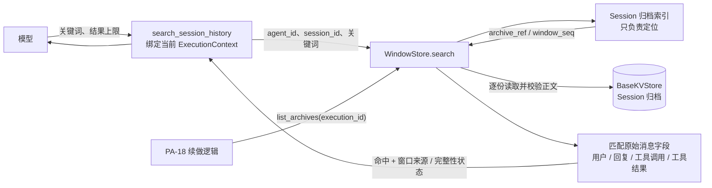
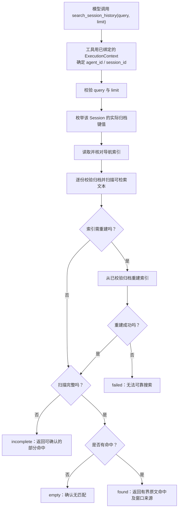

# F_12 Session 历史窗口检索设计方案

## 1. 元信息

| 项 | 值 |
| --- | --- |
| 类型 | feature |
| 建档日期 | 2026-10-18 |
| 范围 | PA-12：检索当前 Session 已归档的历史窗口；不搜索当前活动窗口，不与群聊历史检索合并 |
| 方案成熟度 | 已按当前方案开始 agent-core 实施；真实 JiuwenSwarm 后端联调未完成 |
| 计划条目 | [PA-12](../designs/persistent-agent-development-plan.md#pa-12-检索本-session-的历史窗口归档)；状态与负责人以开发计划为准 |
| 负责人 | Yan Zhijun（与 PA-12 计划条目一致） |
| 状态 | 待验收：PA 全包与个人版定向回归通过；真实 JiuwenSwarm 后端联调待验证 |
| 设计依据 | [S_03 上下文窗口、会话状态与归档规约](../specs/S_03_context-and-windows.md)、[详细架构设计](../designs/persistent-agent-architecture.md)、[F_11 窗口管理](F_11_window-management.md) |
| 关联 feature | 前置：[F_11 窗口管理](F_11_window-management.md)；相关但独立：[F_23 群聊历史检索](F_23_group-chat-history-retrieval.md)；PA-18 续做关联见 [F_20](F_20_continuation.md) |
| 验证摘要 | agent-core 组件实现及定向测试已完成；真实 JiuwenSwarm 后端验证未执行，详见第 8 节 |
| Refs | Persistent Agent 开发计划 PA-12；当前 agent-core 的 `WindowStore` 与窗口归档结构 |

## 2. 背景、目标与范围

### 2.1 背景与问题

PA-11 已在 agent-core 组件中实现窗口切换、完整旧窗口归档和可重建的归档索引。PA-12 已在 agent-core 增加 `WindowStore.search`、`list_archives(execution_id)` 过滤和 Persistent 专用 `search_session_history` 工具，使 Agent 能从同一 Session 的旧窗口归档中查找对话证据。组件测试不证明真实 JiuwenSwarm `BaseKVStore` 的持久性、隔离和跨重启行为；这些仍需跨仓验证。

归档内容是一组有顺序的模型消息。一次旧窗口切换到新窗口时，归档记录包含 `old_window_id`、`new_window_id` 以及旧窗口的 `messages`；`window_seq` 表示 Session 内窗口的先后次序。`execution_id` 则记录触发该次归档切换的 Execution，不能当作窗口 ID，也不代表归档里的每条消息都由该 Execution 产生。

### 2.2 目标与关键场景

| 场景 / 触发条件 | 当前行为 | 目标行为 / 可观察变化 |
| --- | --- | --- |
| 模型需要查找本 Session 较早窗口中的一句用户消息或模型回复 | 只能依赖当前窗口或 PA-11 新窗口交接要点；没有归档搜索工具 | 调用 `search_session_history`，获得匹配原文、消息角色和归档窗口来源 |
| 模型需要查找旧窗口中的工具操作及其结果 | 工具调用和结果保存在归档消息中，但不能按关键词查找 | 可搜索工具名称、调用参数和工具结果正文，并区分命中字段 |
| 关键词在所有已归档窗口中都不存在 | 当前没有确定性搜索结果 | 只有所有目标归档均成功扫描后才返回“确定没有匹配” |
| 某份归档读不到或结构损坏 | 当前没有搜索语义 | 返回“未查完”并说明结果不完整；不得把损坏或缺失当作无匹配 |
| PA-18 需要按某次 Execution 找到相关归档 | `list_archives` 目前只能按 Session 列出归档 | 扩展 `list_archives` 支持按归档记录中的 `execution_id` 过滤；这与模型的关键词搜索分开 |

### 2.3 本次范围与非目标

- 本次包含：Persistent Agent 专用的 `search_session_history` 工具；`WindowStore.search`；`list_archives(execution_id)` 过滤；结果完整性语义；对应组件测试。
- 搜索默认覆盖当前 Session 的全部**已归档旧窗口**，不搜索当前活动窗口。当前窗口已作为本次执行上下文的一部分；PA-12 的目标是找回被换出的窗口。
- 可搜索字段包括用户消息正文、模型面向对话的回复正文、模型工具调用名称与参数、工具返回结果正文。消息正文中的可读文本块和文本形式的结构化内容可搜索。
- 搜索结果中的归档原文是历史资料，不是当前指令；Agent 只应将其作为查证过去发生事项的证据。
- 本次不包含：跨 Session 搜索、群聊记录搜索、语义 / 向量检索、系统提示与工具定义搜索、隐藏推理搜索、附件二进制内容解析或附件文件正文搜索、摘要生成、独立全文索引服务。
- PA-12 不改变个人版 DeepAgent 的工具定义、上下文和 ReAct 路径；工具只在 Persistent Agent 构造链中注册。

## 3. 设计约束、假设与待决问题

- **计划约束：** 开发计划 PA-12 的开工硬前置为 PA-11。PA-11 的 agent-core 归档组件已实现；其真实 JiuwenSwarm `BaseKVStore` 持久性、隔离和单 Session 串行仍待闭环验证。PA-12 组件可以复用现有归档契约，但完整宿主验证不能替代 PA-11 的未验收项。
- **可信身份：** 搜索范围由工具构造时绑定的当前 `ExecutionContext.agent_id` 和 `session_id` 决定。模型参数不接受 `agent_id` 或 `session_id`，也不能借传入其他 Session 标识扩大范围。
- **存储约束：** 复用 `PersistentPorts.window_backend` 注入的 `BaseKVStore` 和 `WindowStore`。宿主负责提供持久、按 Agent / Session 隔离的后端；agent-core 不新增文件目录、数据库、跨仓端口或第二份授权表。
- **事实来源：** 归档正文是历史消息的权威来源；`archive_index` 仅用于定位归档，属于可重建索引。索引不能单独证明归档正文存在或搜索无命中。“确定没有”仅指当前宿主保留的 Session 归档；若宿主按保留策略删除单份归档，必须同步维护索引，否则搜索应返回不完整。
- **消息范围：** 搜索 `content` 中可读文本、`AssistantMessage.tool_calls` 的工具名和参数、`ToolMessage` 的结果文本及工具名。排除 `reasoning_content`、用量与 provider 元数据、系统提示和工具定义。图片、音频等非文本载荷不做识别；若消息里仅保存附件引用，可匹配其中存下来的文字引用，但不读取附件内容。
- **查询语义：** 关键词按不区分大小写的字面子串匹配；不使用正则、分词、模糊匹配或语义模型。不同消息字段分别匹配，不把相邻字段拼在一起制造跨字段命中。
- **容量边界：** 默认返回 50 条、最多 500 条；关键词最多 4096 字符；单条摘录最多 2048 字符；模型可见 JSON 最多 32768 字符。即使达到返回上限仍继续扫描，以确认完整性及是否还有未展示命中。
- **后端扫描限制：** 当前 `BaseKVStore.get_by_prefix` 一次返回完整键值映射，搜索按归档逐项校验和扫描，但后端调用会暂时物化该 Session 的归档值；因此模型结果有界，扫描瞬时内存仍随归档总量增长。本期不新增分页 / 流式存储接口，真实负载若证明内存不可接受，再单独设计。

## 4. 总体方案与设计取舍

### 4.1 方案概览

模型调用 Persistent Agent 的只读历史工具。工具使用绑定的 `ExecutionContext` 取得当前 Agent 和 Session，再调用内部 `WindowStore.search`。`WindowStore` 通过 `BaseKVStore.get_by_prefix` 枚举该 Session 的实际归档键值，并与归档索引核对；逐项校验归档正文，再按关键词扫描消息文本字段。索引仅用于导航和完整性核对，搜索结论以实际可读归档为准。命中结果带原始消息片段及窗口来源；归档缺失、损坏或扫描中断时明确返回不完整状态。

PA-18 所需的 `list_archives(execution_id)` 是 WindowStore 的另一项内部查询：它按归档记录中“触发窗口切换的 Execution”过滤归档，不是 `search_session_history` 的输入参数。普通历史搜索不要求模型知道 `execution_id` 或 `window_id`；每条命中会返回归档的 `old_window_id` 和 `window_seq`，说明消息来自哪个旧窗口。

图中的 `execution_id` 查询只供 PA-18 续做链路定位归档；模型搜索按工具绑定的当前 Session 执行。索引不是正文事实来源；只有已加载、校验的归档消息才参与匹配。

### 4.2 关键决策

#### D-01 搜索边界是当前 Session 的所有旧窗口归档

- 选择与依据：与 PA-12 开发计划一致，搜索范围由当前 `ExecutionContext` 中的 Agent / Session 身份确定；默认遍历该 Session 的已归档窗口。
- 代价与成立条件：搜索成本随该 Session 的归档数量和文本总量线性增长；依赖宿主按 Agent / Session 隔离 `BaseKVStore`，并保证同一 Session 单执行者。
- 实现体现：工具不接收 Agent / Session ID；命中记录返回 `archive_ref`、`old_window_id`、`old_window_seq` 和消息位置。
- 相关候选：按用户提供的 ID 搜索或跨 Session 搜索均会增加身份混淆和越权风险，不采用。

#### D-02 关键词检索原始消息内容，不以摘要作为证据

- 选择与依据：完整旧窗口已由 PA-11 归档；PA-12 验收要求不以摘要替代原文。工具调用和工具结果也是消息历史的一部分，应与用户消息和模型回复一样可检索。
- 代价与成立条件：结果可能包含较长或结构化的工具内容，必须限制输出并标明截断；附件二进制内容无法通过文本匹配覆盖。
- 实现体现：对每条消息的明确文本字段做不区分大小写字面匹配；返回原始来源字段的摘录，不生成模型摘要。
- 相关候选：对话摘要、向量索引和独立全文索引涉及新事实副本、更新与一致性维护，超出 PA-12 本期范围。

#### D-03 把“搜索是否完整”与“返回内容是否截断”分开

- 选择与依据：PA-12 必须区分确定无结果、搜索未完成和失败。返回条数上限导致的摘录展示截断，并不等于归档扫描没有完成。
- 代价与成立条件：结果需分别提供查询完整性和展示截断标记，不能只用一个 `status` 表达两种含义。
- 实现体现：只有完整扫描且无命中才返回 `empty`；扫描不完整返回 `incomplete`；命中数量超过展示上限时仍可返回 `found`，同时设置 `results_truncated=true`。
- 相关候选：把超过展示上限直接报告为“无结果”或“搜索完成且已返回全部命中”都会误导模型，拒绝。

#### D-04 按 Execution 查归档是独立于关键词搜索的内部接口

- 选择与依据：PA-12 计划明确要求 `list_archives` 按 `execution_id` 查归档供 PA-18 使用；该 ID 是触发窗口切换的 Execution 身份，不是窗口身份或每条消息的来源身份。
- 代价与成立条件：调用方必须把当前 Session 身份与目标 `execution_id` 一起传入，且只能在该 Session 的归档集合中筛选。
- 实现体现：扩展 `WindowStore.list_archives(agent_id, session_id, execution_id=None)`；`search_session_history` 不公开 `execution_id` 参数。
- 相关候选：让模型通过 `execution_id` 任意选取历史或把它与 `window_id` 混用，会混淆用途，拒绝。

### 4.3 替代方案与排除理由

| 候选 / 关联决策 | 候选目的与关键差异 | 拒绝或暂缓原因 | 重新评估条件 |
| --- | --- | --- | --- |
| R-01 / D-02 向量或语义检索 | 支持近义表达和概念召回 | 需要向量模型、索引更新与一致性策略；本期验收明确为关键词匹配 | 关键词检索经真实使用证明不足，并有独立需求及索引生命周期方案时 |
| R-02 / D-02 归档摘要 | 降低搜索和返回成本 | 摘要是派生内容，不能代替原文证据；引入摘要生成与更新成本 | 后续作为单独的派生视图能力设计，且仍保留可追溯原文 |
| R-03 / D-03 每个查询只返回有限归档并停止扫描 | 限制单次存储读取量 | 未扫描的归档无法证明“确定没有匹配”；需要游标及跨页快照契约，本期计划未要求 | 实测全量逐份扫描成本不可接受，并先设计安全续查游标与完整性语义 |

## 5. 详细设计

### 5.1 模块责任与关键不变量

| 模块 | 责任 | 不变量 |
| --- | --- | --- |
| Persistent Agent 专用工具 | 校验模型传入的查询参数；绑定构造时的 `ExecutionContext`；将内部结果限制为模型可读的有限结构 | 不接受模型提供的 `agent_id`、`session_id` 或任意存储 key；工具只在 Persistent Agent 注册 |
| `WindowStore.search` | 枚举当前 Session 的归档键值，核对 / 修复导航索引，逐项校验并扫描消息字段 | 归档正文是内容事实；索引缺失或失效不能被解释为“无匹配”；不同 Session 不混查 |
| `WindowStore.list_archives` | 供内部续做逻辑按 Session 列出归档，可按 `execution_id` 过滤 | `execution_id` 只用于筛选归档记录；最终结果仍以校验后的归档为准 |
| AgentServer / 宿主 | 提供持久且隔离的 `BaseKVStore`，保证同 Session 串行执行并负责保留期 | agent-core 的组件测试不等于真实宿主后端持久性和隔离已验证 |

### 5.2 关键类与函数设计

#### `WindowStore`

复用 [session_state.py](../../execution/session_state.py) 中现有的内部 `WindowStore`，不新增存储端口或另一套归档管理器。

| 方法 | 目标签名 | 行为 |
| --- | --- | --- |
| `search` | `async def search(self, agent_id: str, session_id: str, query: str, *, limit: int = 50) -> SessionHistorySearchResult` | 从该 Session 的实际归档键值建立扫描集合，核对索引并逐项校验归档；按窗口序号和消息位置从新到旧返回；达到上限后仍继续扫描 |
| `list_archives` | `async def list_archives(self, agent_id: str, session_id: str, execution_id: str | None = None) -> list[RecordWindowArchive]` | 无过滤时返回该 Session 的归档；提供 `execution_id` 时只返回归档记录中该字段相同的项，顺序按 `old_window_seq` 递增 |

索引仅用于导航。搜索枚举 Session 实际归档键值后读取索引并核对集合；结构有效但漏项的索引不能用于宣称“没有匹配”。索引缺失、损坏或漏列仍存在的归档时，从全部可校验归档重建；索引引用了不存在的归档时返回 `incomplete`，不静默抹掉缺口。每条归档使用现有 `_parse_archive` 校验 Agent / Session 身份、归档序号、引用和结构；损坏归档不参与匹配。搜索命中来源中的 `old_window_id` 从已校验归档记录读取，而不是假设索引中有该字段。由于现有 `get_by_prefix` 返回完整键值映射，归档值会在一次后端读取中暂时驻留内存；逐项扫描不等于后端流式读取。

当前 `RecordArchiveIndexEntry` 已含 `archive_ref`、`old_window_seq`、`request_id`、`execution_id`、`created_at`；`RecordWindowArchive` 含旧 / 新窗口 ID 和完整消息。首版不改归档格式，也不要求给索引增加 `window_id`。`execution_id` 的过滤依据是归档本身记录的切换 Execution，不代表消息逐条归属该 Execution。

#### `PersistentSessionHistorySearchTool`

在 `tools/session_history.py` 新增 Persistent Agent 专用只读工具。它绑定构造时传入的 `ExecutionContext` 与 WindowStore，不在工具参数中暴露 Agent、Session 或存储身份。若内部搜索抛出存储异常，不把异常详情、key 或后端内容返回模型；按下文状态映射安全返回。

### 5.3 工具参数与结果契约

工具名固定为 `search_session_history`，输入参数为：

| 字段 | 类型、必填与默认值 | 约束 | 语义 |
| --- | --- | --- | --- |
| `query` | 字符串，必填 | 去除首尾空白后非空，最多 4096 字符 | 对归档消息文本做不区分大小写的字面关键词匹配 |
| `limit` | 正整数，可选，默认 50 | 最大 500 | 最多返回多少条命中；达到上限仍继续扫描，以区分“结果被截短”和“搜索没完成” |

结果至少包含：

| 字段 | 含义 |
| --- | --- |
| `status` | `found`、`empty`、`incomplete` 或 `failed` |
| `query_complete` | 是否已完成目标 Session 全部归档的扫描；`incomplete` / `failed` 必须为 false |
| `hits` | 有界命中列表；可能包含原始角色、工具名称、命中字段、精确原文摘录及截断标记 |
| `results_truncated` | 因 `limit` 或结果字符上限而省略命中时为 true；它表示展示有截断，不代表扫描不完整 |
| `reason` | 不泄露后端细节的原因说明；`incomplete` / `failed` 时必填 |

工具结果的 JSON 字符数最多 32768；单条摘录最多 2048 字符。实现与测试按这两个上限约束模型可见输出；超出总字符上限时继续缩减命中展示并设置 `results_truncated=true`，不会把展示截断误报成扫描不完整。

每条命中的目标字段如下：

| 字段 | 类型 | 含义 |
| --- | --- | --- |
| `archive_ref` | 字符串 | PA-11 分配的归档引用 |
| `old_window_id` / `old_window_seq` | 字符串 / 整数 | 这条消息所在的已归档窗口及其 Session 内顺序 |
| `message_index` | 非负整数 | 消息在该归档原始 `messages` 列表中的位置 |
| `role` | 字符串 | 消息角色，如 `user`、`assistant`、`tool` |
| `matched_field` | 字符串 | 命中的原始字段路径，例如 `content[0].text`、`tool_calls[1].function.arguments`、`tool_result.name` 或 `tool_result.content` |
| `tool_name` | 字符串或空 | 命中工具调用或结果时的工具名称 |
| `excerpt` / `excerpt_truncated` | 字符串 / 布尔值 | 原文连续摘录及是否因长度上限截断 |

每条命中代表一个匹配字段；同一条消息的多个字段都命中时，可以有多条命中，`message_index` 与 `matched_field` 共同定位原文。结果必须同时满足：`empty` 等价于 `query_complete=true` 且 `hits` 为空；`found` 等价于 `query_complete=true` 且 `hits` 非空；`incomplete` / `failed` 时 `query_complete=false` 且 `reason` 非空。`incomplete` 可以带部分已验证命中；`failed` 不返回命中。

`status` 的严格含义：

| 状态 | 条件 | 搜索结论 |
| --- | --- | --- |
| `found` | 所有目标归档均成功读取、校验和扫描，且至少一个命中 | 找到记录；如 `results_truncated=true`，只说明返回列表省略了部分命中 |
| `empty` | 所有目标归档均成功读取、校验和扫描，且没有命中 | 可以确定当前已保存归档中没有匹配关键词 |
| `incomplete` | 至少一份归档缺失、损坏或无法读取，但仍取得部分可用扫描结果 | 可返回已找到的部分命中；不得断言没有匹配或搜索完整 |
| `failed` | 参数无效，或搜索无法可靠开始 / 继续（例如无法读取索引且无法重建） | 不返回命中；不得据此判断有无历史记录 |

若归档在扫描开始前因后端故障不可读，返回 `failed`；若扫描部分归档后故障，则返回 `incomplete` 并可保留已验证的命中。取消按执行框架的取消语义传播，不转换成 `empty`。不把归档级的 `execution_id` 标成消息来源；所有摘录必须是归档原文的连续片段，不由模型或搜索代码改写成摘要。

### 5.4 能力注册与只读分类

在 `PersistentAgentSpec.resolve_parts` 中注册保留名称 `search_session_history`，并将它加入 `READ_ONLY_TOOL_ALLOWLIST`，避免只读搜索被写工具意图门禁当成外部写操作。它依赖 Persistent Agent 已有的必需 `window_backend`，不新增 `enabled_features` 开关，不把工具挂到通用 `DeepAgentSpec` 或个人版 Agent。

若调用者配置了同名自定义工具，构造时按现有 Persistent 专用工具惯例拒绝覆盖；PersistentAgent 的工具定义在同一 Request 的 Execution 间保持稳定。工具构造只绑定已有后端，不在构造阶段扫描或读取归档。

### 5.5 正常执行流程

即使达到返回条数上限，仍继续完成归档扫描并确认是否有更多命中，最后通过 `results_truncated` 标记展示省略。这样“搜索完成”与“展示了全部命中”不会混为一谈。

### 5.6 持久化与索引恢复

- 不新增搜索结果持久化、全文索引或向量库。搜索只读归档正文和 Session 状态；索引缺失或失效时仅重建派生 `archive_index`，不改归档正文或 Session 状态。
- `archive_index` 仅作导航和完整性核对，不是消息内容来源。搜索先枚举 Session 下实际归档键值，再扫描已校验归档；索引缺失、结构损坏、重复或漏列现存归档时，从可校验归档重建。
- 搜索不得仅凭索引内容认定其覆盖完整。索引引用的归档在实际归档列表中不存在时返回 `incomplete`，不把该缺口静默当作无历史。
- 每份实际归档通过现有 `_parse_archive` 校验 Agent / Session 身份、序号、引用和结构后才参与匹配；损坏归档不参与匹配。
- `execution_id` 过滤同样以校验后的归档字段为最终依据；索引不是内容来源，也不能成为续做材料的内容来源。
- 不改变 PA-11 的“先归档旧窗口，再提交新活动窗口状态”顺序，也不提供 PA-11 尚未验证的宿主持久性保证。

### 5.7 异常与重试

- 查询为空白、字段类型错误或超出长度 / 上限：返回 `failed` 的安全参数错误，不读取后端。
- 索引缺失或损坏：尝试重建；成功则继续搜索，失败则 `failed`。
- 一条归档键缺失、归档内容损坏或索引与归档不一致：该条不得算作“无匹配”；如果仍有其它已校验归档，返回 `incomplete`，否则返回 `failed`。
- 存储读取整体失败：尚未取得可靠扫描结果时返回 `failed`；已扫描部分归档后发生失败则返回 `incomplete` 并标明未完成。
- 同一关键词重复调用不会修改归档正文或 Session 状态；必要时只修复派生 `archive_index`。存储错误详情仅记安全诊断，不暴露密钥、键名或其他 Session 信息。

## 6. 影响面与实施设计

### 6.1 修改点与实施顺序

| 实施项 | 模块 / 文件或符号 | 修改内容与责任 | 必要前置 / 独立验证产物 |
| --- | --- | --- | --- |
| I-01 | `schema/session_record.py` | 增加本 Session 搜索查询 / 命中 / 结果类型；不改 `RecordWindowArchive` 或归档索引版本 | PA-11 归档 DTO 已可用；模型校验和状态语义测试 |
| I-02 | `execution/session_state.py` 的 `WindowStore` | 增加逐份扫描 `search`；扩展 `list_archives` 的 `execution_id` 过滤，校验索引候选与归档正文 | PA-11 WindowStore 组件测试；索引重建、损坏与隔离测试 |
| I-03 | 新增 `tools/session_history.py` | 新增 Persistent 专用 `search_session_history` 只读工具，绑定当前执行身份并限制结果展示 | 工具 Schema、字段提取和安全错误测试 |
| I-04 | `schema/spec.py`、`tools/effect_policy.py` | PersistentAgentSpec 注册保留工具名，并标记为只读；不修改通用 Agent 装配 | 构造 / 工具门禁测试及个人版回归 |
| I-05 | `tests/unit_tests/harness/persistent_agent/` | 覆盖匹配、完整性、隔离、索引重建、执行过滤与个人版不受影响 | 组件测试通过 |
| I-06 | PA 文档 | 已将归档检索契约同步到 `S_03`，并在开发计划记录实现 / 验证证据 | 未修改架构或宿主端口；真实 JiuwenSwarm 验证仍待完成 |

建议顺序：先定稿消息字段提取与状态语义；再实现并测试 `WindowStore` 搜索和 `execution_id` 归档过滤；随后接入 Persistent 专用工具和只读白名单；最后运行 PA 定向测试与个人版回归。真实 JiuwenSwarm 验证使用现有 `BaseKVStore` 接入，不新增 JiuwenSwarm 搜索接口。

### 6.2 文档同步

- **spec：** 已同步 [S_03](../specs/S_03_context-and-windows.md)，明确搜索字段、Session 边界、结果完整性和 `list_archives(execution_id)` 契约。
- **架构：** 当前不改变模块边界、宿主职责或端口，无需改详细架构；若实现发现必须增加宿主接口，再先重新评审范围。
- **开发计划：** 已将 PA-12 更新为“待验收”并记录组件实现与测试证据；不改变负责人、硬前置或完成数。真实 JiuwenSwarm 后端验证仍未完成。
- **JiuwenSwarm：** 不新增业务 API；宿主继续提供既有隔离、持久的 `BaseKVStore`。真实后端验证属于 PA-11 / 总体验收联调，不由 agent-core 组件测试替代。

## 7. 兼容与迁移

- 不改 PA-11 的 `RecordWindowArchive` 字段、键格式、`archive_index` schema_version 或 Session 状态记录；现有归档无需迁移。
- `RecordArchiveIndexEntry` 当前不含 `window_id`。搜索命中通过读取归档正文取得 `old_window_id`，无需给索引增加窗口 ID。
- 仅 Persistent Agent 构造链新增工具，不改变通用 Harness / 个人版 Agent 的工具列表、工具运行逻辑或历史上下文。
- `list_archives` 的原有无过滤调用保持行为；新增 `execution_id` 参数为可选过滤条件，未传时仍返回当前 Session 全部归档。

## 8. 验证设计、执行记录与结论

### 8.1 验证设计与通过条件

PA-12 的验收标准以[开发计划](../designs/persistent-agent-development-plan.md#pa-12-检索本-session-的历史窗口归档)为唯一来源。以下场景验证工具和归档扫描的技术细节。

| 验证 ID | 场景 / 前置状态与输入 | 操作或验证入口 | 预期结果 / 通过条件 | 验证层级与环境 |
| --- | --- | --- | --- | --- |
| F_12-V-01 | 多个归档窗口中，用户消息或模型可见回复包含关键词 | 调用 `WindowStore.search` / 工具 | 返回原文摘录、消息角色、`old_window_id`、`old_window_seq` 和消息位置；不返回摘要代替原文 | agent-core 单元测试 |
| F_12-V-02 | 关键词分别出现在工具名称、工具调用参数和工具返回正文 | 分别调用搜索工具 | 三类字段均可命中，结果标明命中字段和工具名；不把 `reasoning_content` 当作模型回复 | agent-core 单元测试 |
| F_12-V-03 | 两个 Session 的消息含相同关键词 | 从 Session A 执行搜索 | 只返回 A 的归档；模型参数不能覆盖 Agent / Session 身份 | agent-core 单元测试 |
| F_12-V-04 | 全部归档完整且无匹配 | 调用搜索工具 | 返回 `empty` 且 `query_complete=true` | agent-core 单元测试 |
| F_12-V-05 | 索引缺失或损坏，但权威归档可读 | 删除 / 篡改测试索引后查询 | 从归档重建索引并完成搜索；不丢失命中 | agent-core 单元测试 |
| F_12-V-06 | 一个归档缺失、损坏或读取失败；其它归档有可验证命中 | 对指定归档注入故障后搜索 | 返回 `incomplete`，可带已校验部分命中；不得返回 `empty` 或声明查询完成 | agent-core 单元测试 |
| F_12-V-07 | `execution_id=E` 对应同一 Session 的一个或多个换窗归档 | 调用 `list_archives(..., execution_id=E)` | 只返回归档记录中切换 Execution 为 E 的归档；空结果不跨 Session 查找 | agent-core 单元测试 |
| F_12-V-08 | 在普通 / 个人版 Agent 中构造同类 ReAct 流程 | 运行现有单 Agent 工具与 ReAct 回归 | 不注册 PA-12 工具，不改变普通 Agent 行为 | core single-agent 回归 |
| F_12-V-09 | 真实 JiuwenSwarm BaseKVStore 持久化及 Session 隔离 | AgentServer 跨执行、重启后检索 | 归档仍可读且 Session 隔离成立；需记录真实 JiuwenSwarm 版本与后端 | 跨仓联调；当前未执行 |

### 8.2 实际执行与证据

| 执行日期 / 验证范围 | 实现版本与环境 | 命令 / 复现步骤 / 记录链接 | 实际结果 | 未覆盖项 / 失败原因 |
| --- | --- | --- | --- | --- |
| 2026-10-18；PA 单元测试 | 当前工作区 `jiuwenmate_v0.1.20` | `uv run pytest tests/unit_tests/harness/persistent_agent/test_session_history.py tests/unit_tests/harness/persistent_agent/test_construction.py tests/unit_tests/harness/persistent_agent/test_effect_policy.py -q` | 77 passed，2 warnings | 完整 PA 回归、个人版专项回归和真实 JiuwenSwarm `BaseKVStore` 跨执行 / 重启验证仍待执行 |
| 2026-10-18；Persistent Agent 全包 | 当前工作区 `jiuwenmate_v0.1.20` | `uv run pytest tests/unit_tests/harness/persistent_agent -q` | 856 passed，10 skipped，2 warnings | 真实 JiuwenSwarm `BaseKVStore` 跨执行 / 重启验证仍待执行 |
| 2026-10-18；个人版定向回归 | 当前工作区 `jiuwenmate_v0.1.20` | `uv run pytest tests/unit_tests/harness/test_deep_agent_cold_build.py tests/unit_tests/harness/test_deep_agent_interaction.py tests/unit_tests/harness/test_deep_agent_workspace.py tests/unit_tests/core/single_agent -q` | 243 passed，3 warnings | 完整 harness 回归未能收集：当前环境未安装 `observability` 可选依赖，`test_deep_agent.py` 及相关观测性测试因缺少 `opentelemetry.exporter` 在收集阶段失败；本次未安装额外依赖 |

### 8.3 验证结论

- **已证明范围：** agent-core 已实现归档扫描、字面关键词匹配、结果边界、完整性状态、索引恢复、`execution_id` 过滤及 Persistent-only 只读工具注册；第 8.2 节所列定向组件测试通过。
- **未覆盖或未通过的承诺：** 完整 harness 全量回归因环境缺少 `observability` 可选依赖未能收集；本轮 PA 全包和个人版定向回归已通过。真实 JiuwenSwarm `BaseKVStore` 的持久性、隔离、跨 Execution / 重启检索和大规模归档负载未验证。
- **可支持的交付判断：** agent-core 组件实现已具备，PA-12 尚不能判定闭环或标记完成；真实宿主验证及 PA-11 相关持久化验收仍是剩余项。

## 9. 风险与已知遗留

### 9.1 设计风险

| 风险 / 触发条件 | 对本次方案的影响 | 已有应对措施 | 核实或验证方式 |
| --- | --- | --- | --- |
| Session 归档持续增长 | 逐份扫描的延迟和 `get_by_prefix` 返回值的瞬时内存随归档量增长 | 首版沿用逐份扫描，不预建全文索引；限制模型可见结果不代表限制后端扫描内存；当前不增加分页 / 流式端口 | 真实负载测量；若不可接受，再单独设计带完整性保证的索引 / 游标方案 |
| 工具调用参数或结果包含敏感文本 | 匹配摘录进入当前模型上下文 | 仅对当前 Agent / Session 开放；只返回命中摘录并受长度限制；不返回其它 Session 数据 | 检查字段筛选、输出上限及跨 Session 隔离测试 |
| 宿主后端不满足 PA-11 的持久隔离要求 | 重启后归档可能不可检索，或 Session 间串读 | 不把组件测试等同宿主保证；保留 PA-11 真实后端验收 | JiuwenSwarm 跨执行和重启后联调 |

### 9.2 已知遗留

| 遗留项 | 未处理原因 / 性质 | 影响与现有处置 | 后续入口 / 条件及所需验证 |
| --- | --- | --- | --- |
| 真实 JiuwenSwarm 宿主检索闭环 | agent-core 组件已经实现；真实后端联调尚未执行 | 当前组件测试使用内存后端，不能证明持久性、Session 隔离或跨重启可检索 | 用 JiuwenSwarm 实际注入的 `BaseKVStore` 验证跨 Execution、重启和隔离；同时完成本轮回归 |
| 单个 Session 的大规模归档性能 | 未验证；一期按计划逐份扫描 | 极长 Session 可能增加查询延迟 | 有实际负载证据后再决定是否需要全文索引或安全分页 |

