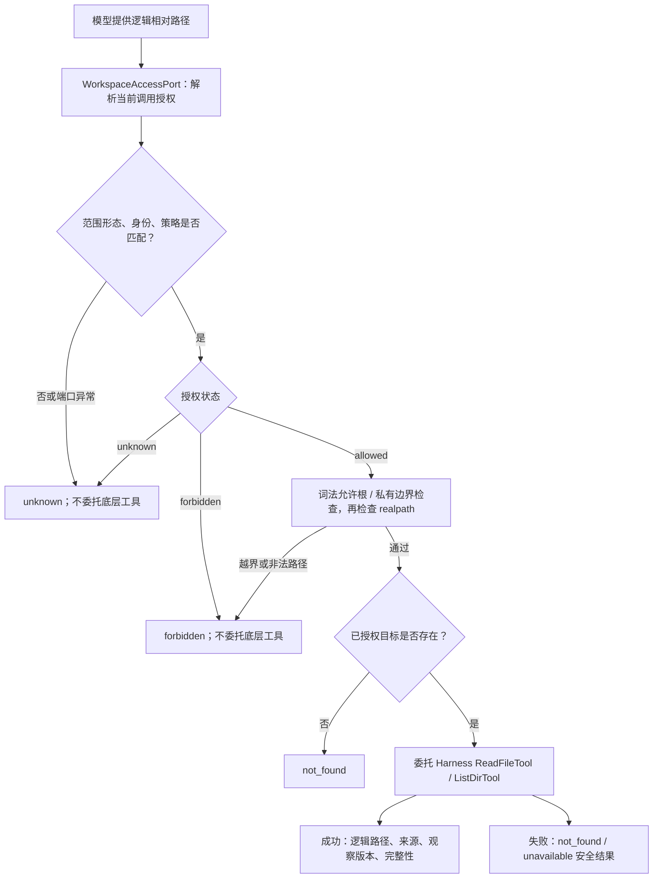

# F_14 按调用授权读取办公空间文件

## 1. 元信息与阅读说明

| 项 | 内容 |
| --- | --- |
| 类型 / 计划条目 | feature；PA-14 按调用授权读取办公空间文件 |
| 建档日期 | 2026-10-09 |
| 日期 / 最近修订 | 2026-10-12 |
| 负责人 | Yan Zhijun，与统一开发计划 PA-14 一致 |
| 状态 | 进行中：agent-core 只读组件已实现；公共导出已由目标分支后续提交修正，工具说明仍有缺口，JiuwenSwarm 宿主适配和真实联调未完成 |
| 范围 | `openjiuwen/harness/persistent_agent/` 的授权端口、构造门控、路径策略、读取 Rail、工具包装器、公共导出声明及对应单测 |
| 验证摘要 | 当前四组组件测试 26 passed、1 skipped；公共工作空间符号导入失败；详见第 8 节，不代表整项或 M2b 完成 |
| 进度权威 | [Persistent Agent 开发计划](../designs/persistent-agent-development-plan.md)第 2 节 PA-14、第 3 节 D 工作线 / M2b、第 4 节进度台账 |
| Refs | 未提供关联 issue / PR；实现与测试入口见第 6、8 节 |

本文保留 PA-14 的背景、实现方案、设计取舍、接入安排和验证证据。参考[特性开发计划模板](../../../docs/templates/feature-development-plan-template.md)的责任边界、最小硬前置、独立验证和联合交付口径，同时按[特性设计模板](../../../docs/templates/feature-design-template.md)组织单项设计。这里不另建项目进度台账，不重新分配 PA 编号，不用组件通过替代产品验收。

阅读路径：第 2～3 节确认范围和前提，第 4～5 节理解实现与限制，第 6～7 节定位代码和宿主接入，第 8 节核对验收及实际证据，第 9～10 节查看遗留和演进。

| 设计依据 | 本文使用的内容 |
| --- | --- |
| [架构 §4.7 办公空间与知识](../designs/persistent-agent-architecture.md#47-办公空间与知识)、[§9 权限与隔离](../designs/persistent-agent-architecture.md#9-权限隔离与资源限制) | 复用 Harness；公共文件与 Session 私有草稿分开；状态和归档不得置于模型工具可访问范围 |
| [S_04 办公空间授权与读取](../specs/S_04_tools-and-workspace.md) | 本特性的端口、路径和结果契约，以及当前公共导出限制 |
| [S_07 构造与绑定](../specs/S_07_construction-and-binding.md) | 配置指纹、能力快照、真实 Session、调用独立实例及 owner 生命周期 |
| [S_08 工具副作用与意图](../specs/S_08_tool-effects-and-intent.md)、[F_15](F_15_tool-intent-before-side-effect.md) | 只读分类、写前意图、只读调用完成事件及原生重试边界 |
| [Harness 工作空间](../../../docs/specs/S_09_workspace.md)、[工具](../../../docs/specs/S_05_tools-contract.md)、[安全引擎](../../../docs/specs/S_08_security-engine.md) | Workspace / SysOperation 和既有文件工具、安全 Rail 的公共机制 |

架构描述的是整体方案，并非每段均已实现。本次以相关代码和测试核对当前行为；不修改架构方案，不把对端拟议规约写成已存在接口。

## 2. 背景、目标与范围

### 2.1 要解决的问题

同一个 Agent 可以服务多个 Session，公共办公文件可以共享，但一个 Session 的私有草稿不能因此被其他 Session 读取。Harness 已有 `Workspace`、`ReadFileTool`、`ListDirTool` 和通用权限机制；PA-14 补充的是当前 Execution 的业务授权，而不是新建文件系统或执行循环。

仅提供工作空间路径、相同 Agent 身份或提示词中的目录说明，不能证明当前主体具有读取权。授权无法确认时必须停止读取；模型提供的路径也不能直接成为任意主机路径。

### 2.2 可观察目标

在每次 `read_file` / `list_files` 调用前，取得宿主授权范围，核对调用身份和策略版本，检查逻辑路径与真实路径。授权通过后复用 Harness 工具，返回逻辑路径、来源引用和观察版本；拒绝时返回固定安全错误，不将宿主诊断交给模型。

| 场景 | 当前组件行为与目标边界 |
| --- | --- |
| 读取授权公共文件或当前 Session 草稿 | 委托原生读取工具，成功结果附来源及观察版本 |
| 列举授权目录 | 返回文件名和目录名；不提供分页，也不逐项过滤未授权子条目 |
| 越界、绝对路径、路径遍历、其他 Session 私有路径 | 在底层工具执行前拒绝 |
| 宿主返回 unknown、端口异常或身份 / 策略错配 | 返回 unknown，不按允许处理 |
| 已授权目标缺失或后端读取失败 | 区分 not_found 与 unavailable；分类限制见第 5.4 节 |

### 2.3 范围与责任

agent-core 负责端口及范围对象、能力校验、路径解析、受保护的读取 / 列举适配、调用生命周期和安全结果。JiuwenSwarm / AgentServer 负责可信主体、实时业务授权、目录部署、平台映射、旧目录迁移和实际文件系统边界。

本读取 Rail 只新增 `read_file`、`list_files`。它不注册写入、编辑、Shell、CLI、MCP 或上传能力，也不清空其他配置贡献的工具；不能将“只注册两个读取工具”理解为整个 Agent 已被限制成只读沙箱。

本特性不实现 PA-12 历史窗口归档检索、PA-15 写意图、PA-16 文件修改与写冲突、PA-18 未知效果查证、PA-22 上下文来源失效，也不负责查群成员、解析 Feishu 身份、上传文件或发消息。办公文件向群成员交接仍走 PA-08 候选输出和宿主投递；文件读到或保存成功不表示任务完成或群内可见。

## 3. 设计约束、开工条件与交付关系

### 3.1 最小硬前置与独立验证

- **开工硬前置：** 沿用开发计划的 PA-01，使用 Execution 身份和运行端口契约；PA-15、PA-16 不是只读组件开工前置。
- **装配条件：** `enabled_features` 含 `workspace_read`、`enable_sys_operation=True`、`PersistentPorts.workspace_access` 存在且 `resolve_read_scope` 为异步方法。配置和调用身份须满足 S_07。
- **独立验证条件：** 真实本地临时文件系统、Agent Session 和构造对象；宿主授权、底层工具及存储可以使用明确标识的测试替身。组件测试不要求真实群聊、Feishu 或生产授权服务。
- **独立验证入口：** 第 8 节四组已有单测及公共导入检查；没有独立前端，前端验收不适用。

`PersistentPorts.validate()` 只检查端口形状和存储类型；可选 `workspace_access` 即使未开启能力，只要提供也会检查异步方法。构造不查询授权端口或窗口后端，运行时每次读取才查询授权。工厂返回原生 `DeepAgent`，不启动业务执行。

### 3.2 并行开发与联合交付

PA-14 只读组件可与 PA-15 意图记账并行推进。PA-16 的开工仍依赖 PA-14、PA-15 的相应产物；本项已有测试不能替它们完成验收。

完整依赖图和当前安排维护在统一开发计划。M2b 在 M1 后汇入 PA-14～PA-16，并与 PA-22 验证文件来源失效。PA-14 在该节点承担真实授权读取、目录映射和私有隔离；写前落盘、并发写冲突及来源失效分别由相关特性主责。节点门槛不因 PA-22 本轮暂缓而降低。

PA-14 独立只读交付须补齐公共入口 / 工具说明缺口，并验证真实宿主范围及实际工具链。持续使用可变或可撤权内容时，还须按开发计划的开放条件联调 PA-22；逐次文件鉴权不能证明已经进入窗口或派生摘要的旧内容已被撤回。

### 3.3 宿主必须成立的前提

宿主必须从可信身份和当前授权事实生成范围，落实原 Request 的启动上限、来源限制和当前授权收紧；组件不自行解释 `startup_scope` / `source_scope` 的业务含义。`policy_revision` 须关联本 Execution 的策略，不能用当前时间或 Agent `updated_at` 冒充，也不能仅复制 Execution 字段来证明查询结果新鲜。

范围对象目前不校验根目录的绝对性、布局包含关系或私有目录与 Session ID 的业务映射。宿主须提供稳定的绝对根路径，保证 `allowed_roots` 和当前 Session 根是实际获授权资源，排除凭证、MCP 配置、运行状态和归档。`current_session_root` 不是纯诊断字段：在 allowed 范围中会被路径策略额外视为可读根。

包装器在本进程使用 `exists`、`realpath` 和 `stat`。这些本地路径须与 SysOperation 后端访问同一文件系统视图；不能据此承诺远程或容器文件系统映射已自动适配。真实授权源、平台 Session 映射与目录布局仍待宿主实现和联调，不影响已有组件核对，但影响整项交付。

## 4. 总体方案与设计取舍

### 4.1 调用流程

每次工具调用重新取得授权，范围不缓存成跨 Session 或永久授权。路径检查是对既有权限链的补充；宿主 allowed 不代表原生 allow / ask / deny 已通过，直接调用包装器也不能证明执行了完整安全 Rail 链。



图表示包装器内的调用顺序，不表示授权、读取和版本观察之间存在事务，也不包含完整原生权限 / 确认及 PA-15 事件链。

### 4.2 关键决策

| 决策 | 选择与依据 | 代价和成立条件 |
| --- | --- | --- |
| D-01 显式能力门控 | 默认 `enabled_features={construction}`；开启 workspace_read 才加读取 Rail，复用父 Spec 装配 | 必须提前提供 SysOperation 和端口；未开启不自动提供本保护 |
| D-02 宿主逐次授权 | agent-core 只消费不可变范围；宿主保留业务身份、渠道和资源判定 | 每次工具调用多一次授权查询；宿主须解决新鲜度和可信映射 |
| D-03 两层路径检查 | 先词法允许根 / 私有边界，再 realpath 边界，禁止模型任意主机路径 | 不提供 OS 沙箱或防检查后替换的原子文件打开 |
| D-04 包装原生文件工具 | 复用 ToolCard、读取格式及 SysOperation，补充结果来源和安全失败 | 继承读取上限、渲染和内部缓存行为；工具说明尚与相对路径约束冲突 |
| D-05 观察版本与读取完整性分开 | 返回 stat 摘要和显式范围标记，不虚构分页或写冲突令牌 | 不是内容快照；默认 complete 不能证明已覆盖底层截断前的全文件 |
| D-06 宿主迁移不侵入核心 | 目录初始化、旧路径迁移和平台 SDK 留在 JiuwenSwarm | 真正交付还须跨仓适配；历史组件位置不能冒充当前源码 |

### 4.3 拒绝的方案及原因

| 候选方案 | 排除原因 |
| --- | --- |
| 只按 workspace_root / 路径前缀授权 | 无法表达主体、Session 私有范围和动态业务授权 |
| 将 agent_id、owner_user_id、channel_chat_id 或同项目根当作凭证 | 配置归属、渠道定位与本次资源授权不同；共享 Agent 不授予跨 Session 草稿访问 |
| 构造时解析一次授权后复用静态范围 | 无法反映两个工具调用间的授权变化；应逐次取得当前范围 |
| 复制旧 agent_workspace.py 或整套 Persistent Runtime | 会把平台 SDK、目录产品约定、生命周期和渠道职责带入 agent-core |
| 重写 ReadFileTool / ListDirTool | 分叉现有格式、底层操作和维护路径，本项只需调用级保护 |
| 用 not_found 掩盖 forbidden / unknown | 混淆授权与存在性，可能泄露目标状态或误导后续处理 |
| 本阶段一并开放写入，或用读取成功证明可恢复 | 写入还需 PA-15、PA-16；只读来源和版本不证明写效果、交接或崩溃恢复 |

最后一项不表示读取没有工具事件：PA-15 接入后，正式执行中的只读调用也可产生 `tool.completed`，具体见第 5.6 节。

## 5. 详细设计与当前实现边界

### 5.1 模块分工与不变量

沿用 S_04 的 I-1～I-5：逐次授权、私有范围隔离、逻辑与真实路径受控、安全失败、只读适配边界。范围可信性由宿主负责，调用绑定由 S_07 负责，权限 / 确认由 Harness 负责，事件分类由 S_08 负责；每一层通过均不能替代其他层。

### 5.2 授权端口与范围数据

```python
async def resolve_read_scope(execution: ExecutionContext) -> WorkspaceReadScope:
    ...
```

`WorkspaceAccessPort` 为运行时可检查的 Protocol；`WorkspaceReadScope` 为 `frozen=True, kw_only=True` dataclass，不进入可序列化 Spec，不持有 Session、锁或取消状态。完整字段契约见 S_04，关键消费方式如下。

| 字段组 | 代码中的校验与消费 |
| --- | --- |
| status | 只允许 allowed / forbidden / unknown；路径解析先处理状态，unknown 不放行 |
| agent_id、session_id | 非空字符串，必须与 ExecutionContext 相同 |
| principal_ref | 可选，提供时必须非空并与 ExecutionContext 相同；省略不会触发主体等值检查，不代表宿主可省略主体授权 |
| workspace_root、allowed_roots | 字符串 / Path 转换为 Path，根集合转为 tuple；不查询文件系统，不验证业务授权或布局 |
| private_sessions_root、current_session_root | 字段须传入，可为 None；私有保护依赖宿主正确提供；allowed 时当前根即使不在 allowed_roots 中仍可读 |
| source_ref、policy_revision | 非空字符串；来源拼接逻辑路径，策略版本必须匹配 ExecutionContext |
| reason | 可选字符串，留作宿主诊断；包装器不直接交给模型 |

`validate_read_scope` 拒绝错误返回类型、Agent / Session 错配、提供的主体错配或策略错配；包装器把这类异常和端口异常转换为 unknown。相等的策略字符串只证明调用关联，不证明授权服务已经检查当前权限。

### 5.3 配置、路径与注册生命周期

`PersistentBuildContext.validate()` 校验能力依赖；`PersistentAgentSpec.resolve_parts()` 在父装配后再次检查并添加 `PersistentWorkspaceReadRail`。Rail priority 为 100，在 init 时用当前 SysOperation、语言和 Agent ID 创建两个包装器，注册到 AbilityManager；重复 init 不再添加，uninit 按工具名移除本 Rail 注册的能力并清空列表。调用 owner、构造失败及执行清理遵循 S_07。

工具沿用原 ToolCard：`read_file` 的路径键为 `file_path`，范围参数为 `offset` / `limit`，PDF 可使用 `pages`；`list_files` 的路径键为 `path`，缺省为 `.`，支持 `show_hidden`。包装器不另定义参数 Schema，stream 通过一次 invoke 交出一份 ToolOutput，并非底层内容逐块流式读取。

`resolve_read_path` 当前按以下规则执行：

1. 非字符串、NUL、POSIX 绝对路径、Windows 驱动器路径、UNC / 根路径及任何 `..` 段拒绝；反斜杠转换为斜杠，移除空段和 `.` 段。空字符串按 `.` 归一化；缺失 read_file 路径不会因此自动补为根。
2. 从 workspace_root 拼接词法候选。若处于 private_sessions_root 内且不处于 current_session_root 内，拒绝；再要求候选处于 allowed_roots 或当前 Session 根。
3. 对候选和各根做 realpath，重复相同的私有与允许根检查，阻止静态符号链接逃逸。
4. 保留请求的规范逻辑路径，生成 `source_ref.rstrip('/') + '/' + relative_path`；根路径不追加 `/.`。只有内部委托使用真实路径。

路径检查不硬编码 `sessions/<session_id>`，也不从目录名推导授权。提供 `current_session_root` 即代表宿主授予 allowed 状态下的本 Session 读取；未授权时应返回 forbidden / unknown，不能只清空 allowed_roots 后仍返回 allowed 和当前根。

### 5.4 失败状态与存在性检查

失败返回 `ToolOutput(success=False, data={status: ...}, error=固定安全说明)`；不回传原后端 error、端口异常或 scope.reason。

| status | 触发条件 | 当前边界 |
| --- | --- | --- |
| forbidden | scope 明确拒绝，非法路径，词法 / 真实路径越界或其他 Session 私有路径 | 不委托底层读取；词法拒绝发生在目标 exists / stat 前 |
| unknown | scope 未知，宿主异常，返回类型 / 身份 / 策略错配，路径解析的非预期异常 | 不委托底层读取；授权状态未知时不进入路径文件系统处理 |
| not_found | 授权后 `Path.exists()` 为 false，或底层失败后复查为 false | `_target_exists` 将 OSError 也视为 false，因此不是严格的 ENOENT 分类 |
| unavailable | 底层异常 / success=False 且目标仍存在，或返回对象不是 ToolOutput | 底层大小、格式等具体错误也可能被折叠；不暴露主机错误细节 |

成功 ToolOutput 的 data 若为 Mapping 则复制；None 变为空对象，其他值包装为 content。不能把所有非字典 data 都写成“非法后端形态”。检查 realpath 会涉及文件系统路径解析，不能把“不委托后端读取”扩大为“所有越权路径都完全无文件系统触碰”。

### 5.5 成功结果、渲染和观察版本

保留 Harness 内容或 `files` / `dirs` 数据，并补充以下字段。

| 字段 | 当前语义 |
| --- | --- |
| file_path / path | 工作空间逻辑相对路径，根为 `.` |
| source_refs | 单个引用，由宿主 source_ref 和请求逻辑路径生成；列表引用目录，不为每个条目另建授权来源 |
| version | 底层读取成功后 stat 的文件类型、大小、mtime_ns、ctime_ns 拼接值的 SHA-256；stat 失败为 None |
| status / completeness | read_file 非零 offset 或非 None limit 为 partial / partial；其余为 ok / complete；list_files 始终为 ok / complete |
| next_cursor | 固定 None；没有读取 / 列举游标协议 |
| content、line_count 或 files、dirs 等 | 原工具的数据，沿用格式、多模态处理和读取限制 |

partial 只按调用参数判定，不核对实际全文件覆盖。底层 ReadFileTool 默认最多 2000 行，还存在大小及内容类型限制；PDF pages 选择也不参与包装器 partial 判定。因此 complete 表示当前包装器未标记显式行范围，不是不可截断的全文件或历史完整性保证。ListDirTool 分别取得文件与目录名称、按名称排序，默认隐藏点号开头条目；两次列举不是目录快照。

路径清理递归处理 data 中的 `file_path`、`path`、`source_path`、`target_path`，只将匹配本次目标绝对路径的值换为逻辑路径；content、extracted_content、long_term_memory 字符串替换本次目标的原路径及斜杠拼写。其他路径、任意正文秘密和未知字段没有通用脱敏保证。包装器沿用底层 `render_for_llm`，尤其 list_files 默认渲染只是目录 / 文件名称；结构化来源和版本虽在 ToolOutput 中，也不能宣称一定展示到模型文本里。

version 在读取后观察，与返回正文不在同一个原子快照内；文件可在授权、解析、读取和 stat 之间变化。它不是内容哈希、条件更新令牌、持久事实或写冲突检测，不能据此自动恢复或授予下一次访问。后续 Execution 的来源依赖、更新和撤权传播由 PA-22 负责。

### 5.6 状态、副作用与相邻特性

PA-14 包装器不自行写 WindowStore、会话状态记录或执行日志，不产生写意图或写 operation_id，也不改 CommitPort 的契约。但复用的 ReadFileTool 会更新 Harness 进程内读取状态登记，供其写 / 编辑保护使用；“只读”指不修改办公文件，不表示执行完全没有内存状态变化。

当前 Spec 同时装配 PA-15 的 `PersistentToolIntentRail`。正式执行中 `read_file`、`list_files` 精确命中只读白名单，不记 tool.intent；通过 dispatch 后若有 emitter，最终调用结果仍可记 tool.completed，只读 operation_id 为 None。低层无 emitter 的白名单调用不产生持久事件。白名单不检查实现类，不能将它当作业务授权或保证同名自定义工具安全。

重试沿用原生 ToolCallResilienceRail，并由 PA-15 限制为 ToolCard 明确 `idempotent=True`；本项没有新重试循环，也不因只读分类自动赋予幂等声明。确认、停止、取消和执行日志可靠性引用 S_07 / S_08 及正式入口契约；成功读取不改变 Request 完成与投递判断。

### 5.7 关键类、函数与工具接口定义

以下补充 2026-10-12 当前实现，模块前缀为 `openjiuwen.harness.persistent_agent`。WorkspaceReadScope / WorkspaceAccessPort 列在外层 `__all__` 中，但文档重写时的导入失败属于目标分支修正前的历史结果，见第 8～9 节；内部工具有模块 `__all__` 不等于成为外层公共 API。

| 类 / 定义来源 | 变更、关系与构造定义 | 关键属性、作用域与资源责任 |
| --- | --- | --- |
| [workspace.access.WorkspaceReadScope](../../persistent_agent/workspace/access.py) | 新增 frozen、kw_only dataclass，完整字段构造见第 5.2 节及源码 | 必传 status、agent_id、session_id、workspace_root、allowed_roots、private_sessions_root、current_session_root、source_ref、policy_revision；principal_ref / reason 默认 None。构造归一化 Path / tuple，不访问文件系统；每次读取由宿主重新返回 |
| [workspace.path_policy.ResolvedWorkspacePath](../../persistent_agent/workspace/path_policy.py) | 新增内部 `@dataclass(frozen=True, slots=True)` | 必传 `path: Path`、`relative_path: str`、`source_ref: str`；组合后端真实路径与模型可见逻辑引用，不向模型公开 path |
| [workspace.path_policy.WorkspacePathError](../../persistent_agent/workspace/path_policy.py) | 新增内部 ValueError 子类；`__init__(self, status: PathDecisionStatus, reason: str = "workspace path is not readable")` | status 为 forbidden / unknown，原因使用安全说明；由路径函数抛出、包装工具转成安全 ToolOutput |
| [tools.workspace_read._PersistentWorkspaceReadTool](../../persistent_agent/tools/workspace_read.py) | 新增内部 Tool 子类；`__init__(self, *, base_tool: Any, execution: ExecutionContext, workspace_access: WorkspaceAccessPort) -> None` | 组合 `_base_tool`、固定 `_execution` 与 `_workspace_access`，复用底层 Card；无授权缓存，每次 invoke 授权 |
| [PersistentWorkspaceReadTool / PersistentWorkspaceListTool](../../persistent_agent/tools/workspace_read.py) | 新增内部包装类，均继承上述基类及构造器 | Read 的 `_path_key="file_path"`、缺省路径 None；List 的 `_path_key="path"`、`_default_path="."`。分别包装 ReadFileTool / ListDirTool，只开放模型已有只读参数 |
| [workspace.file_access.PersistentWorkspaceReadRail](../../persistent_agent/workspace/file_access.py) | 新增内部 DeepAgentRail 子类；`__init__(self, execution: ExecutionContext, workspace_access: WorkspaceAccessPort) -> None` | execution / workspace_access 固定，tools 初始空 list、priority=100；首次原生初始化构造两包装工具并注册，uninit 移除能力并清空 tools |

| 关键方法 / 完整源码签名 | 输入输出、调用条件及异常 / 副作用 |
| --- | --- |
| `WorkspaceReadScope.__post_init__(self) -> None` | 构造后校验形状并转换 Path / tuple；错误为 CONTEXT_PARAM_ERROR；不证明目录授权或当前存在 |
| `async _PersistentWorkspaceReadTool.invoke(self, inputs: Mapping[str, Any] \| None, **kwargs: Any) -> ToolOutput` | 先取逻辑路径、每次授权、路径校验、exists，再委托底层；只替换副本中的路径键，kwargs 透传。普通授权 / 后端异常按第 5.4 节转安全状态，底层成功按第 5.5 节装饰 |
| `async _PersistentWorkspaceReadTool.stream(self, inputs: Mapping[str, Any] \| None, **kwargs: Any) -> AsyncIterator[ToolOutput]` | 首次迭代执行同一 invoke，产出一个结果；没有第二套绕过授权的流式读取 |
| `_PersistentWorkspaceReadTool.render_for_llm(self, output: Any) -> str`（同步） | 有底层 renderer 时委托，否则调用 Tool 默认渲染；结构化来源 / 版本不保证进入模型文本 |
| `PersistentWorkspaceReadRail.init(self, agent) -> None` / `uninit(self, agent) -> None`（同步） | 原生 Rail 初始化 / 卸载调用；init 重复且 tools 非空时返回，缺 sys_operation 为 CONTEXT_PARAM_ERROR；uninit 移除能力，不能据此宣称完整后端资源或所有 Runner 注册都已释放 |

关键独立函数均为本特性新增内部函数，定义如下。路径检查既区分词法路径，也使用真实路径防止静态符号链接越界；没有承诺授权到实际读取之间的原子性。

| 函数 / 模块与完整签名（同步） | 输入、返回值、异常及副作用 |
| --- | --- |
| [access.validate_read_scope](../../persistent_agent/workspace/access.py)：`validate_read_scope(scope: WorkspaceReadScope, execution: ExecutionContext) -> WorkspaceReadScope` | 复核返回类型、Agent / Session、可选 principal 及 policy_revision；有效时返回原 scope，错配为 CONTEXT_PARAM_ERROR；不比较所有 Execution 字段、不查询授权 |
| [path_policy.resolve_read_path](../../persistent_agent/workspace/path_policy.py)：`resolve_read_path(scope: WorkspaceReadScope, requested_path: str) -> ResolvedWorkspacePath` | 只接受工作空间相对路径；失败抛 WorkspacePathError；realpath 涉及路径解析，函数不委托内容读取或目标 exists / stat |
| [path_policy.observe_version](../../persistent_agent/workspace/path_policy.py)：`observe_version(path: str \| os.PathLike[str]) -> str \| None` | 读取成功后观察 stat 元数据，返回 SHA-256 版本；OSError 返回 None；不散列正文，也不是条件写令牌 |
| [workspace_read._logicalize_path_metadata](../../persistent_agent/tools/workspace_read.py)：`_logicalize_path_metadata(value: Any, absolute_path: Any, relative_path: str, key: str \| None = None) -> Any` | 递归复制 Mapping / list / tuple，将指定路径键及 content 中匹配目标的路径替为逻辑路径；规则范围见第 5.5 节，不提供任意秘密脱敏 |

宿主授权接口完整定义为：

```python
@runtime_checkable
class WorkspaceAccessPort(Protocol):
    async def resolve_read_scope(self, execution: ExecutionContext) -> WorkspaceReadScope:
        ...
```

定义来源为 [workspace/access.py](../../persistent_agent/workspace/access.py)，宿主实现通过 PersistentPorts.workspace_access 注入，再由 Spec.resolve_parts 传入 Rail / 包装工具；构造仅检查异步方法形状。调用方每次读取 await 当前授权决定，不把上次 scope 缓存为授权；端口不读取文件。抛异常、类型或身份错配统一转 unknown，不把宿主异常细节透出。接口没有超时默认值、跨读取幂等保证或撤权原子锁。

模型可见接口仍是 `read_file` 与 `list_files`：完整 ToolCard 参数 Schema 复用 [ReadFileTool](../../../tools/filesystem.py) / [ListDirTool](../../../tools/filesystem.py)，包装器不新增让模型指定 Agent / Session / 宿主根目录的参数。invoke 成功返回 ToolOutput，安全失败状态及部分结果定义见第 5.4～5.5 节；每次重复调用都重新授权及读取，可得到新内容和版本。读取工具的内部状态变化、意图分类及清理由第 5.6 节与 F_03 / F_15 衔接。

## 6. 影响面与实施顺序

| 实现位置 | 本项责任 / 当前影响 |
| --- | --- |
| [workspace/access.py](../../persistent_agent/workspace/access.py) | Scope 不可变数据、Protocol、形态与调用身份校验 |
| [workspace/path_policy.py](../../persistent_agent/workspace/path_policy.py) | 逻辑路径、词法 / realpath 边界、来源和观察版本 |
| [workspace/file_access.py](../../persistent_agent/workspace/file_access.py) | 两个受保护读取工具的 init / uninit |
| [tools/workspace_read.py](../../persistent_agent/tools/workspace_read.py)、[tools/__init__.py](../../persistent_agent/tools/__init__.py) | 授权后委托、invoke / stream、安全失败、路径清理和结果装饰 |
| [ports.py](../../persistent_agent/ports.py) | 可选 workspace_access 及异步方法校验 |
| [schema/build_context.py](../../persistent_agent/schema/build_context.py)、[schema/spec.py](../../persistent_agent/schema/spec.py) | workspace_read 能力、依赖门控和读取 Rail 装配 |
| [外层 __init__.py](../../__init__.py) | 声明 WorkspaceAccessPort / WorkspaceReadScope 公共符号；当前映射错误，尚不可用 |
| [Harness filesystem.py](../../../tools/filesystem.py)、[工具说明](../../../prompts/tools/filesystem.py) | 复用现有读取 / 列举实现和 ToolCard；保留原格式、限制与缓存语义 |

实施顺序为：落实 PA-01 的调用契约 → 形成授权范围和路径策略 → 包装并装配原生读取工具 → 独立组件验证 → 补齐公共入口和工具说明 → 宿主目录 / 授权适配 → 真实工具链联调。PA-15 可并行，PA-16 和完整 M2b 按统一计划汇合；这里不新增排期、负责人或完成状态。

未开启 workspace_read 时不挂载本读取 Rail，普通 DeepAgent / 个人版不会自动取得本调用授权机制。Persistent Agent 当前是否装配 PA-15 独立于本开关，不能照旧文宣称未开启时所有 Persistent Rail 行为均未变化。Spec 只保存可序列化配置，端口和范围对象只在运行时调用上下文存在，不新增 Agent 类或推理循环。

本次仅重构文档，保留现有代码和工作区其他修改；以上实现缺口不在本次擅自修复。以后更改端口、路径、结果或能力契约时同步 S_04 / S_07，相邻事件变化归 S_08，执行进展归统一计划。

## 7. JiuwenSwarm 接入与迁移

### 7.1 宿主适配责任

宿主每次新 Execution 创建独立适配器，绑定 Agent / Session / 当前主体，读取实时业务授权，再返回 WorkspaceReadScope；不要在进程级 Agent Manager 缓存跨 Session 可变范围。共享 allowed_roots 应限定到明确获授权公共目录，Session 根单独提供。

会话创建 / 恢复时先准备目录，工具 resolve_read_scope 中不创建目录、不迁移文件、不写模板。`sessions/feishu/<chat_id>` 等平台路径须经宿主可信映射到本 Execution 的 Session；不能将 owner 或群聊标识直接当作资源授权。宿主 scope.reason、SDK 对象、凭证和后端绝对路径不应作为模型输入或错误文本；Spec 不承载运行句柄，已有 WorkspaceSpec 路径仍遵循 S_07。

### 7.2 历史组件与当前入口

原方案引用的下列组件位于旧版 JiuwenSwarm `server/runtime/persistent_agents/`。2026-10-12 当前工作树中该目录及所列符号不存在；下表保留迁移职责来源，不是当前可调用接口，也不建立失效文件链接。

| 历史组件 / 字段 | 接入时应保留或承接的职责 | 不迁入 agent-core 的部分 |
| --- | --- | --- |
| agent_workspace.py：ensure_conversation_session_workspace、ConversationSessionWorkspace | 会话创建 / 恢复时准备物理目录并取得当前 Session 根 | scratch / outputs 产品布局、旧 work 迁移、manifest 兼容 |
| resource_scope.py：PersistentResourceScope.workspace_dir | Agent 公共办公空间根的来源 | resource_dir、MCP、Lark CLI、runtime、凭据目录不能顺带成为可读根 |
| models.py：PersistentAgentRecord.workspace_dir、PersistentConversationRecord.runtime_session_id | Agent 路径及与 ExecutionContext.session_id 对齐的业务映射 | owner_user_id / channel_chat_id 不能替代当前主体与资源授权 |
| service.py：_ensure_im_session_workspace | 宿主生命周期中“目录已准备好”的接入点 | 不移到每次工具读取授权中执行 |
| render_conversation_workspace_instructions、旧 agent_manager.py 的 workspace_dir / mcp_resource_root 接入 | 目录提示和运行配置只能作为接入线索 | 提示词和环境路径不能替代 WorkspaceAccessPort |

当前可核对入口位于 JiuwenSwarm 的 [runtime/agent_manager.py](../../../../../../jiuwenswarm/jiuwenswarm/server/runtime/agent_manager.py)、[common/runtime_workspace.py](../../../../../../jiuwenswarm/jiuwenswarm/common/runtime_workspace.py) 和 [gateway_adapter/workspace_file_adapter.py](../../../../../../jiuwenswarm/jiuwenswarm/server/runtime/gateway_adapter/workspace_file_adapter.py)。它们分别涉及运行管理、工作空间绑定与文件交互，不能因具备路径处理就认定已实现本授权端口。

宿主目标授权边界见 [JiuwenMate S_08](../../../../../../jiuwenswarm/jiuwenswarm/server/jiuwenmate/docs/specs/S_08_authorization-and-workspace.md)。该文档标注为拟议契约，包含本特性之外的即时撤权、稳定资产引用及写效果要求；引用它不表示这些能力已经落地。本次搜索当前 JiuwenSwarm 未找到 WorkspaceAccessPort / WorkspaceReadScope 接入。

### 7.3 接入骨架与调用顺序

以下为职责示意，不是当前 JiuwenSwarm 可直接运行的实现。`authorizer`、`decision`、目录记录及下方运行对象由宿主提供；公共 Scope 的导出已修正，调用方应从外层包导入。当前为说明已实现的数据结构使用内部路径，它不构成新的稳定公开 API。

```python
from pathlib import Path

from openjiuwen.harness.persistent_agent import (
    PersistentAgentSpec,
    PersistentBuildContext,
    PersistentPorts,
    create_persistent_agent,
)
# 临时用于展示当前实现；正式宿主接入前须修复并验证外层懒导出。
from openjiuwen.harness.persistent_agent.workspace.access import (
    WorkspaceReadScope,
)


class JiuwenSwarmWorkspaceAccess:
    def __init__(self, *, agent, conversation, session_workspace, authorizer):
        self._agent = agent
        self._conversation = conversation
        self._session_workspace = session_workspace
        self._authorizer = authorizer
        self._workspace_root = Path(agent.workspace_dir).resolve()
        self._session_root = Path(session_workspace.root).resolve()

    async def resolve_read_scope(self, execution):
        # 宿主内部接口示意，必须核对记录与 execution 的 Agent / Session，
        # 验证可信主体、启动上限、来源限制及当前授权，而非只复制执行身份。
        decision = await self._authorizer.resolve_workspace_read(
            execution=execution,
            agent=self._agent,
            conversation=self._conversation,
            session_workspace=self._session_workspace,
        )
        status = decision.status
        if status not in {'allowed', 'forbidden'}:
            status = 'unknown'
        if decision.policy_revision != execution.policy_revision:
            status = 'unknown'

        # shared_roots / session_read_allowed 均来自真实授权事实。
        # 不把包含所有 sessions 的整个 Agent 根授予目录列举。
        shared_roots = (
            tuple(Path(root).resolve() for root in decision.shared_roots)
            if status == 'allowed' else ()
        )
        current_root = (
            self._session_root
            if status == 'allowed' and decision.session_read_allowed else None
        )
        return WorkspaceReadScope(
            status=status,
            agent_id=execution.agent_id,
            session_id=execution.session_id,
            principal_ref=execution.principal_ref,
            policy_revision=execution.policy_revision,
            workspace_root=self._workspace_root,
            allowed_roots=shared_roots,
            private_sessions_root=self._workspace_root / 'sessions',
            current_session_root=current_root,
            source_ref=f'workspace://agent/{execution.agent_id}',
            reason=getattr(decision, 'reason', None),
        )


# 会话生命周期先准备目录；这里只引用已经准备好的宿主对象。
workspace_access = JiuwenSwarmWorkspaceAccess(
    agent=agent_record,
    conversation=conversation_record,
    session_workspace=session_workspace,
    authorizer=workspace_authorizer,
)
ports = PersistentPorts(
    commit=commit_port,
    budget=budget_port,
    window_backend=window_backend,
    workspace_access=workspace_access,
)
spec = PersistentAgentSpec(
    card=agent_card,
    enable_sys_operation=True,
    enable_task_loop=False,
    auto_create_workspace=False,
    enabled_features=frozenset({'construction', 'workspace_read'}),
    # 模型、Prompt、预建 Workspace、工具与 Skill 等沿用真实发布配置。
)
# 须在 spec 确定后生成 execution_context：fingerprint、capability_snapshot、
# Agent / Session 及策略版本与本次配置一致，不能沿用另一调用上下文。
context = PersistentBuildContext(
    execution=execution_context,
    session=agent_session,
    ports=ports,
)
deep_agent = create_persistent_agent(spec, context=context)
# 构造仅返回 DeepAgent；正式业务执行走 execute_persistent_request 等入口。
```

调用顺序为：宿主目录准备 → 按固定 Request 配置创建 ExecutionContext → 为本 Execution 创建授权适配器 → 注入 PersistentPorts 并开启能力 → 构造 DeepAgent / 初始化读取 Rail → 每次工具调用重新鉴权、解析路径并委托文件工具。

宿主查询失败可抛异常由包装器转为 unknown，也可返回有效的 unknown 范围；不要返回放宽的 allowed。真实适配仍须验证目录位于批准布局内、SysOperation 的文件系统视图一致以及公共父目录不泄露私有条目。办公文件交接、历史归档和个人知识继续使用各自契约，不合并进本端口。

## 8. 验收设计、执行记录与结论

### 8.1 验收场景与证据入口

下表展开开发计划 PA-14 的验收要求，保留 PA-14 作为主责 ID。预期在此维护，实际执行见第 8.2 节；完整特性和 M2b 状态仍在统一进度台账维护。

| 验收 ID | 前置 / 操作与通过条件 | 独立或联合验证入口 |
| --- | --- | --- |
| PA-14-V-01 构造门控 | 开启能力且依赖齐全时挂载读取 Rail；缺端口 / SysOperation 时构造前拒绝，不查询宿主或存储；未开启不新增本 Rail | [test_workspace_access.py](../../../../../tests/unit_tests/harness/persistent_agent/test_workspace_access.py)、[test_workspace_read_rail.py](../../../../../tests/unit_tests/harness/persistent_agent/test_workspace_read_rail.py)；开关缺省分支还需补充明确断言 |
| PA-14-V-02 范围与身份 | Scope 不可变，正确关联 Agent / Session / 提供的主体 / 策略；错配、端口异常、错误类型及 unknown 均不放行底层读取 | access 测试及 [test_workspace_read_tools.py](../../../../../tests/unit_tests/harness/persistent_agent/test_workspace_read_tools.py)；现有错配测试主要覆盖 Agent，其他分支须补验证 |
| PA-14-V-03 路径隔离 | 授权公共根和当前 Session 可解析；遍历、绝对路径、其他 Session 私有路径及静态符号链接逃逸拒绝 | [test_workspace_path_policy.py](../../../../../tests/unit_tests/harness/persistent_agent/test_workspace_path_policy.py)；符号链接须在支持环境执行 |
| PA-14-V-04 读取结果与安全错误 | 授权读取 / 列举返回逻辑路径、source_refs、观察版本和范围标记；forbidden / unknown 不调用后端，失败不回传目标主机路径 | tools 测试；unavailable、stream、策略变更与元数据不可用须补充明确验证 |
| PA-14-V-05 公开入口与模型说明 | 外层导入两个 Workspace 符号成功；模型可见读取说明与逻辑相对路径契约一致；实际注册工具使用保护链 | 外层真实导入、ToolCard 检查与真实工具调用；当前导入失败、说明冲突 |
| PA-14-V-06 真实宿主授权 | 真实两 Session 共享公共文件、各自草稿隔离；授权收紧 / 未知后下一次读取不放行；当前根不被误授予，父目录不泄露私有条目 | JiuwenSwarm 生产适配与授权服务、实际目录 / SysOperation，未执行；PA-14 主责，AgentServer 协作，汇入 M2b |
| PA-14-V-07 相邻链路回归 | 正式执行只读不记写意图，完成事件按 S_08；文件更新 / 撤权后的下一 Execution 不沿用失效上下文；写入不由只读通过而开放 | PA-15 主责事件、PA-22 主责失效、PA-16 主责写入；PA-14 协同，完整结论引用相应特性及 M2b，未做真实联合验收 |

范围来源对应架构 §4.7、§9.1～9.2、S_04 I-1～I-5 及开发计划 PA-14。V-06 的完整只读要求由本文维护，协同方引用；V-07 不复制写意图和来源失效的完整验收规范。没有为本项虚构新的架构附录验证点或交付节点。

### 8.2 实际执行记录

执行目录：`src/agent-core`。本次使用当前工作树既有代码和四组单测，没有修改或新增测试。

```text
.\.venv\Scripts\python.exe -m pytest -q tests/unit_tests/harness/persistent_agent/test_workspace_access.py tests/unit_tests/harness/persistent_agent/test_workspace_path_policy.py tests/unit_tests/harness/persistent_agent/test_workspace_read_rail.py tests/unit_tests/harness/persistent_agent/test_workspace_read_tools.py --tb=short
```

环境准备好的同一仓库也可使用原命令前缀 `uv run pytest` 执行同一测试集合；本次实际执行的是上述本地虚拟环境命令。

| 日期 / 检查 | 实际结果 | 证据支持的范围与剩余验证 |
| --- | --- | --- |
| 2026-10-09 原归档记录 | 24 passed、1 skipped，记录 2 个 Pydantic 警告 | 历史组件基线，本次未复现当时工作树；不覆盖后续 PA-15 或宿主联调 |
| 2026-10-12 四组现有单测 | Windows、Python 3.13.12、pytest 9.1.1；共 27 项，26 passed、1 skipped、5 warnings | 授权值对象、Agent 错配、依赖门控、路径与受控后端替身调用、结果来源和显式 limit 标记等已有断言通过；不是 V-01～V-04 的所有异常分支都已有测试 |
| 本次跳过项 | test_symlink_escape_is_rejected_when_symlinks_are_available | Windows 环境未允许创建目录符号链接；本次不记为符号链接验证通过 |
| 本次警告 | 2 个 Pydantic class Config 弃用警告，3 个 SQLAlchemy declarative_mixin 弃用警告 | 来自已有依赖代码，未在本文改动中处理 |
| 2026-10-12 外层导入 | WorkspaceAccessPort、WorkspaceReadScope 均抛 ModuleNotFoundError | `_MODULES` 含 persistent_agent.workspace.access，又由 __getattr__ 拼接实现包前缀，出现多一层 persistent_agent；V-05 未通过 |
| 2026-10-12 源码和宿主索引核对 | 读取 Rail 复用原生工具；模型说明仍要求绝对 file_path；旧宿主目录 / 符号未找到；JiuwenSwarm 未找到本端口接入 | 仅源码核对，不是修复或真实联调证据；V-05～V-07 有明确剩余项 |

公共导入复现入口：

```python
import openjiuwen.harness.persistent_agent as package

# 当前两次访问均失败；修复懒映射后应重新验证。
getattr(package, 'WorkspaceAccessPort')
getattr(package, 'WorkspaceReadScope')
```

### 8.3 验证结论

结论为**部分验证**：内部只读组件及现有测试通过，公共导入明确失败；符号链接测试跳过，部分异常分支只有代码核对，工具说明与保护契约尚不一致。测试使用临时真实文件与宿主 / 底层读取替身，不证明实际 Harness 后端、完整权限 Rail 链、平台身份或生产目录隔离。

PA-14 仍为进行中，宿主适配和真实联调未完成；PA-15、PA-16、PA-22 和 M2b 不能因这组测试提前开放或标为完成。本次只修改文档，没有提交或推送；这不作为长期验收事实。

**2026-10-13 同步说明：** 目标分支 PA-16 提交已将读取 Rail 迁入 workspace/file_access.py，并修正 WorkspaceAccessPort / WorkspaceReadScope 的公共导出映射。第 8 节的 2026-10-12 原始检查结果保留为修正前历史证据，不表示当前仍无法导入；真实宿主联调未完成的结论不变。

## 9. 风险与已知遗留

| 遗留 / 责任范围 | 已确认限制与后续验证要求 |
| --- | --- |
| 公共懒导出 / PA-14 | 修复外层 `_MODULES` 的额外包层，再真实导入两个符号；当前内部类存在不等于公共 API 可用 |
| 工具说明 / PA-14 | 原 ReadFileTool ToolCard 说明 file_path 必须绝对，而包装器拒绝绝对路径；需在保持保护机制的前提下使模型可见说明一致，再验证中英文说明和真实调用 |
| 目录映射与授权 / JiuwenSwarm | 当前无生产 WorkspaceAccessPort；须核实可信主体、策略新鲜度、启动上限、Session 映射、绝对根和同一文件系统视图；不能靠复制身份字段或路径提示通过 |
| 目录列举 / PA-14 与宿主 | 只校验被列举目录，不按每个条目的权限过滤；允许共享父目录会暴露私有子目录名称。宿主优先授予明确公共根和获授权当前根；不把含所有 sessions 的 Agent 根作为可列举根 |
| 版本与竞态 / PA-14、PA-16、PA-22 | 无不可变内容快照、条件读取或跨进程协调；realpath 检查到实际打开之间仍有路径替换窗口，读取后 stat 也不与正文原子绑定；观察版本不能解决写冲突或恢复 |
| 完整性与大目录 / PA-14 | partial 仅按 offset / limit 判断，默认行上限、PDF pages 与全文件覆盖未统一；list_files 无分页 / 大目录有界游标，不虚构 next_cursor |
| 安全结果与可见来源 / PA-14 | 只替换本次目标路径的已知字段 / 拼写，不保证全文脱敏；底层 renderer 不保证展示来源版本；OSError 可能被归入 not_found，应按实际能力细化后再扩展承诺 |
| 验证补齐 / PA-14 | 公共入口失败、符号链接跳过、未知 / 失败异常与 stream 等覆盖缺口按第 8 节补齐；不能将源码存在视为测试通过 |
| 隔离和正式开放 / Harness 与宿主 | 路径策略不提供 Shell、CLI、MCP、子进程的 OS 隔离；配置中的其他能力须独立受控；状态后端和归档不得因设置私有草稿目录而暴露给工具 |
| 相邻能力 / 对应 PA | 历史归档检索、写意图、文件修改、未知结果续做和上下文失效归各自特性；本项不把文件读取成功解释为完整任务、可靠恢复或群内交付 |

## 10. 设计演进与修订记录

| 日期 | 变化及原因 | 当前适用结论 |
| --- | --- | --- |
| 2026-10-09 | 建立调用授权范围、路径 / Session 隔离、Harness 包装和 JiuwenSwarm 接入方案；保留原定向验证基线 | agent-core 组件实现，不等于真实宿主交付 |
| 2026-10-10 PA-15 后续实现 | Persistent Spec 统一装配工具意图 Rail，两个精确只读名称纳入白名单 | 只读不记写意图，但正式执行可产生完成事件；原“读取不涉及工具事件”不再适用 |
| 2026-10-12 文档重构 | 参考开发计划和特性设计模板，补齐责任、前提、验收 ID、证据和迁移状态；核对公共导出、ToolCard、当前根授权、读取上限与观察版本；执行现有组件测试 | 26 passed / 1 skipped，公开导入失败、宿主与真实联调待完成；未改代码、架构或统一进度状态 |
