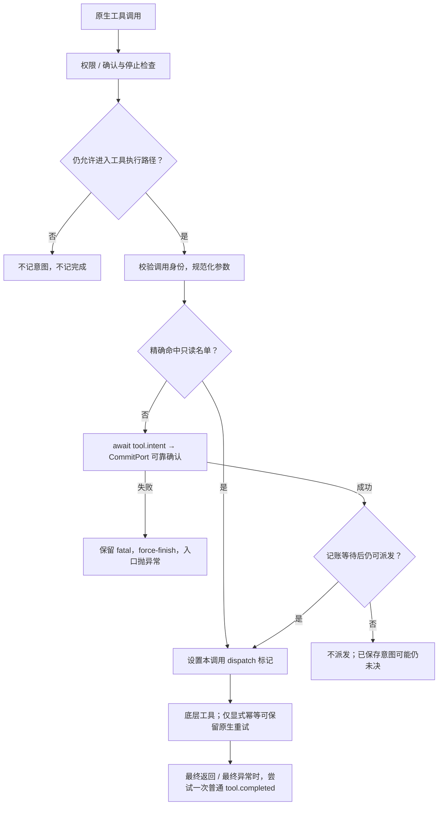
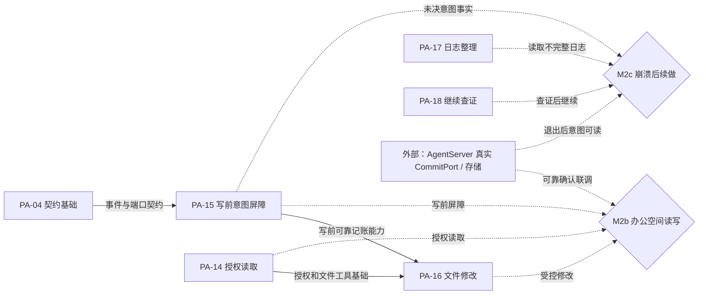

# F_15 写操作执行前同步记账意图设计方案

## 1. 阅读与维护说明

### 1.1 元信息与完成口径

| 项 | 内容 |
| --- | --- |
| 类型 / 计划条目 | feature；PA-15，F_15 为文档编号 |
| 日期 | 原阶段设计及实现记录：2026-10-10；本次文档修订：2026-10-12；引用修订：2026-10-13 |
| 负责人 | Yan Zhijun；认领和后续安排以统一开发计划为准 |
| 状态 | 进行中；agent-core 已有组件实现，真实宿主持久化确认及跨仓联调未完成 |
| 方案依据 | 沿用现行架构、spec 和原记录中的名称白名单决策；本次核对实现，不改变架构或公共契约 |
| 原实现范围 | `openjiuwen/harness/persistent_agent/` 内的 `schema/spec.py`、`tools/effect_policy.py`、`execution/tool_intent_rail.py` 及对应单测；复用已有执行入口和事件通道 |
| 本次修订范围 | 重组方案、取舍、验收、依赖和验证记录，纠正身份、去重、摘要及结果判定的适用范围；不修改代码或测试 |
| 唯一开发计划 | [Persistent Agent 开发计划](../designs/persistent-agent-development-plan.md) PA-15；开发状态、负责人、排期及 M2b / M2c 进展在那里维护 |
| 验证摘要 | 历史组件记录与本次结果分开维护。本次 PA 包及共享重试测试合计 344 passed、1 skipped、2 failed；确认同意后的恢复分支未由失败用例验证到，详见第 4 节 |
| Refs / 关联 PR | 原记录未提供 issue / PR，本次不补造编号 |

本文参考用户指定的[特性开发计划模板](../../../docs/templates/feature-development-plan-template.md)，按“范围与口径 → 方案与验收 → 依赖与联合交付 → 验证与进展”组织；同时按[特性设计模板](../../../docs/templates/feature-design-template.md)和[目录约定](../AGENTS.md)保留设计理由、拒绝方案及已知遗留。本文提供 PA-15 的设计与验证记录，不另建排期或完成率台账。

### 1.2 目标、范围与非目标

PA-15 解决的崩溃窗口是：写工具已经改变文件或外部系统，但进程在记录结果前退出，续做方误以为从未执行。目标是在**底层写工具开始执行前**，先通过宿主确认本条 `tool.intent` 已可靠保存；有意图而无结果时，后续能发现未决操作并先查证。

本项覆盖工具名称分类、写前同步屏障、操作关联、回调内去重、失败关闭、最终工具结果事件及与原生幂等重试的衔接。所有经当前 Persistent Agent 工具回调派发的工具采用同一规则；只读工具实际调用后也产生普通完成事件。

本项不实现宿主事件队列或数据库、办公空间写工具、文件冲突处理、任务完成交接、未知结果查询、取消、补偿或程序级精确重放。写意图与外部执行之间没有跨系统事务，不能据此承诺外部操作恰好执行一次。Task-loop 和子代理仍属于 PA-24～PA-26 的后续开放范围，不能把当前主 Agent 的回调保证扩大到未接入的执行路径。

### 1.3 设计依据与事实归属

| 依据 | 本文采用的内容 |
| --- | --- |
| [Overview](../designs/persistent-agent-overview.md)、[架构设计](../designs/persistent-agent-architecture.md) §6.2、§8.2～8.3 | 写意图同步保存、普通日志允许缺失、未知结果先查证 |
| [S_08 工具副作用与意图](../specs/S_08_tool-effects-and-intent.md) | 名称分类、写前屏障、调用内一致性、最终结果及重试的现行契约 |
| [S_02 事件与结果交接](../specs/S_02_events-and-result-handoff.md) | 事件 Schema、event_id / local_seq、唯一 CommitPort、关键与普通确认等级 |
| [S_01 执行入口](../specs/S_01_public-api-and-execution.md)、[F_05](F_05_execution-entries.md) | 正式执行 emitter、fatal 传播、原生流和收尾；当前未接入能力的门禁 |
| [S_07 构造与绑定](../specs/S_07_construction-and-binding.md)、[F_04](F_04_contract-convergence.md) | Spec 装配、单次构造绑定和既有协议基础 |
| [S_04 办公空间](../specs/S_04_tools-and-workspace.md)、[F_14](F_14_workspace-file-read.md) | 初始两个只读名称、调用授权及路径保护；不由白名单替代授权 |
| [S_05 确认、控制与续做](../specs/S_05_confirmation-and-continuation.md) | 确认恢复、取消及未决操作的继续规则；PA-09、PA-17、PA-18 的后续边界 |

工具副作用和调用屏障以 S_08 为契约来源，事件结构以 S_02 为来源；本文解释选择和实现，不维护第二套 Schema。预期验收统一在第 2.10 节，实际结果在第 4 节。源码链接指向当前工作树，历史数字只证明其记录时的边界。

## 2. 特性方案与验收要求

### 2.1 核心决策与成立条件

| 决策 | 选择及依据 | 代价与成立条件 |
| --- | --- | --- |
| D-01 默认写、精确名称白名单 | 当前 ToolCard 有 `idempotent`，没有只读 / 副作用字段。agent-core 内部显式登记只读名称，名单外一律先记意图 | 依赖 Harness 当前按模型可见工具名唯一解析能力的注册语义；不检查实现类，同名替换须遵守只读约定 |
| D-02 Persistent 统一装配 | Spec 构造统一挂载意图 Rail，不增加 ToolCard 字段、Spec 开关或宿主分类端口 | 普通 DeepAgent 不安装该 Rail；低层无 emitter 的写调用失败关闭 |
| D-03 复用唯一事件通道 | 复用 ToolIntentPayload、ToolCompletedPayload、EventEmitter 和 CommitPort，不另建日志或确认通道 | agent-core 只能等待端口返回；真正的落盘保证由宿主兑现并验证 |
| D-04 调用内状态与稳定操作关联 | 每个回调上下文独立保存状态；operation_id 不含 execution_id，便于同 Request 跨执行关联 | 调用内去重不等于跨 Execution 的持久化去重；新的工具调用 ID 是新的操作 |
| D-05 意图关键、结果普通 | 意图失败阻止写工具；完成事件失败只诊断；无法确认的写异常按 unknown | 完成日志允许缺失，继续时必须查证源状态；结果事件不作为后续步骤的可靠提交屏障 |
| D-06 重试仍依赖显式幂等 | 仅保留原生 Resilience Rail 对显式 `ToolCard.idempotent=True` 工具的重试请求 | 白名单不声明幂等，Persistent 不新增自动重试、查询、取消或补偿 |

D-01 的名称约定和 D-03 的宿主可靠确认是方案成立的重要前提。若模型可见名称允许指向不同副作用能力，须重新评估分类；若宿主仅入内存队列就返回，须先补齐关键事件确认，不能宣称可靠意图记账。

### 2.2 分类及低层入口

[effect_policy.py](../../tools/effect_policy.py) 是唯一分类来源：

```python
READ_ONLY_TOOL_ALLOWLIST = frozenset({"read_file", "list_files"})

def is_read_only_tool_name(tool_name: str | None) -> bool:
    return tool_name in READ_ONLY_TOOL_ALLOWLIST
```

只读取 Harness 实际暴露给模型、进入 `ToolCallInputs.tool_name` 的完整名称。不折叠大小写，不猜别名，不匹配前后缀或 `read` / `search` 关键词，也不核验 AbilityManager 当前绑定的实例或实现类。

| 条件 | 当前处理 |
| --- | --- |
| 身份和参数有效，名称精确为 read_file / list_files | 不产生 tool.intent；派发后有 emitter 时产生 tool.completed，operation_id 为 None |
| 已注册但名单外，或未知、自定义、MCP、宿主新增名称 | 按有副作用处理，必须等待写意图确认后才允许底层派发；此分类不证明工具已注册或一定可执行 |
| 工具调用 ID / 名称缺失、非字符串、空值或含空白 | 只读和写调用均失败关闭，不因命中白名单豁免身份检查 |
| 参数无法规范化或摘要生成失败 | 只读和写调用均失败关闭，不放行底层工具 |
| 无正式 emitter | 身份 / 参数有效的白名单调用可执行，但无持久事件；写调用失败关闭 |

只有经过审查、确认不改变外部状态的能力才可加入白名单。PA-12、PA-23 等新增只读工具时，由对应特性登记确切暴露名称；登记前仍按写处理。JiuwenSwarm 不维护第二份运行时名单。白名单既不授予办公空间访问权，也不能保证宿主将任意同名自定义工具替换为只读实现。

### 2.3 组件与接入位置

以下链接中的 `persistent_agent/` 指外层包下的实际实现子包。

| 组件 / 关键符号 | 责任与本次关系 |
| --- | --- |
| [effect_policy.py](../../tools/effect_policy.py) | 内部名称分类函数和常量，不扩展外层公共 API |
| [PersistentToolIntentRail](../../execution/tool_intent_rail.py) | 继承 DeepAgentRail；构造参数为 `binding: ConstructionBinding`；before_tool_call、on_tool_exception、after_tool_call 均为异步回调 |
| [PersistentAgentSpec.resolve_parts](../../schema/spec.py) | 统一追加意图 Rail，传入实际类型为 ConstructionBinding 的 `context.binding`；通过绑定取得当前 ExecutionContext 和 ExecutionControl |
| [ConstructionBinding](../../schema/build_context.py)、[ExecutionControl](../../execution/control.py) | 构造上下文持有调用级控制；control 保存 emitter、首个 fatal 和停止 / 取消原因 |
| [EventEmitter.emit](../../execution/emitter.py) | `async def emit(self, event_type: EventType, payload: Any) -> AgentEvent`；锁内创建和顺序记账，再交给展示队列 |
| [CommitPort.record](../../ports.py) | `async def record(self, execution: ExecutionContext, event: AgentEvent) -> None`；宿主实现，不新增 PA-15 专用端口 |
| [entries.py](../../execution/entries.py)、[model_rail.py](../../execution/model_rail.py) | 正式入口安装 emitter、保留并重新抛出 fatal，控制后续模型及工具调用 |
| [ToolCallResilienceRail](../../../rails/tool_call_resilience_rail.py) | 复用共享原生重试；Persistent 在其异常回调之后约束重试，不修改个人版行为 |

Rail 实例只持有 binding。`ctx.extra["_persistent_tool_intent_state"]` 保存本调用的 ID、工具名、参数哈希、摘要、operation_id、dispatched 和 completed；不在 Rail 上建立所有工具共用的可变字典。新 Execution 的新实例不会自动恢复该字典。

#### 2.3.1 关键类、函数与回调接口定义

本节按 2026-10-12 当前实现补充。实现模块前缀为 `openjiuwen.harness.persistent_agent`；本特性新增内部策略和 Rail，复用已公开的事件 DTO，不新增宿主 Protocol 或外层入口。

核心类 [execution.tool_intent_rail.PersistentToolIntentRail](../../execution/tool_intent_rail.py) 继承 `DeepAgentRail`，构造签名为 `__init__(self, binding: ConstructionBinding)`（源码未标返回类型），由 PersistentAgentSpec.resolve_parts 创建并追加到 parts.rails。实例只持有 `_binding`，作用域为一次构造；依赖通过 binding.execution / control 间接取得，不拥有宿主连接或关闭宿主端口。priority=5，AFTER_TOOL_CALL 回调优先级单独提高，具体顺序见第 2.4 节。

| 关键成员 / 初始值 | 创建与更新主体 | 约束与作用 |
| --- | --- | --- |
| `_binding: ConstructionBinding` | Rail 构造器设定，不重绑 | 取固定 Execution、emitter、fatal 和 abort_reason；完整绑定类见 F_01 |
| `ctx.extra["_persistent_tool_intent_state"]` | 首次成功通过屏障时建立，同回调上下文重试复用 | dict 保存 tool_call_id、tool_name、params_digest、args_summary、operation_id、dispatched、completed；completed 初始 False，尝试最终完成事件前置 True；不是 Rail 属性或持久操作索引 |

| 核心方法 / 完整源码签名 | 输入、返回值与调用条件 | 异常及副作用 |
| --- | --- | --- |
| `callback_priority(self, event: AgentCallbackEvent) -> int`（同步） | 返回 AFTER_TOOL_CALL 的 1,000,005 或其他事件的 5 | 无事件 / 资源副作用，用于原生选择注册回调顺序 |
| `async before_tool_call(self, ctx: AgentCallbackContext) -> None` | 权限 / 确认及停止守卫之后消费 ToolCallInputs；校验身份与参数，白名单直接设状态，其余 await tool.intent 后再次检查控制 | 失败标 fatal、request_force_finish 并可能抛运行错误；只有通过屏障才允许底层派发；本方法自身不调用工具 |
| `async on_tool_exception(self, ctx: AgentCallbackContext) -> None` | 共享重试 Rail 提出请求后检查实际 ToolCard.idempotent | fatal 或非显式 True 时 consume_retry_request；不重新记账或自行发起工具重试 |
| `async after_tool_call(self, ctx: AgentCallbackContext) -> None` | 原始最终结果 / 异常、已 dispatched、未 completed 且有 emitter 时处理 | 先置 completed，再尝试一次普通 tool.completed；摘要或事件失败只诊断，不覆盖原结果；未派发不伪造完成 |
| `_operation_id(self, tool_call_id: str) -> str`（同步） | 返回五项身份的 `op_` SHA-256；不含 execution_id / source_ref | 无外部副作用；跨 Execution 相同值不等于禁止重复写入 |
| `_params_digest(arguments: Any) -> str`（staticmethod） | JSON 字符串先解码，None 作空对象，生成规范 JSON 哈希 | 不可序列化、NaN 或 UTF-8 错误可抛异常，before_tool_call 转 fatal；不在事件保存原始参数 |
| `_args_summary(cls, arguments: Any) -> str` / `_result_summary(cls, result: Any, exception: BaseException \| None) -> str`（classmethod） | 返回最多 500 字符脱敏摘要；坏参数 JSON、原始文本 / 异常结果使用省略说明 | 无存储副作用；过滤范围见第 2.5～2.7 节，不承诺任意嵌套容器或正文脱敏 |

上述方法完整定义来自 tool_intent_rail.py；方法的类名限定和调用方向见第 2.3 节，不把内部辅助方法导出为 API。ToolIntentPayload / ToolCompletedPayload 的字段、必填项、默认值与关联规则引用第 2.5 / 2.7 节及 [events.py](../../schema/events.py)，两类继承 ProtocolModel，字段构造 / 校验本身不代表写操作已经发生。

| 独立函数 / 完整签名 | 变更与调用方 | 输入输出、异常及副作用 |
| --- | --- | --- |
| [tools.effect_policy.is_read_only_tool_name](../../tools/effect_policy.py)：`is_read_only_tool_name(tool_name: str \| None) -> bool`（同步） | 本特性新增内部函数，before_tool_call 消费；定义已在第 2.2 节给出 | 精确白名单成员判断，无外部副作用，不授予路径权限或校验实现类 |
| [execution.entries.redact_arguments](../../execution/entries.py)：`redact_arguments(arguments: Any) -> str`（同步） | 复用内部函数，参数 / 结果摘要及确认卡片消费 | 返回最多 TEXT_MAX_CHARS 字符的 JSON / 文本；dict / list 敏感键值替为 `***`，坏 JSON 原串在此函数中仅 strip / 截断，Rail 另用省略策略。未知对象 default=str，递归结构等异常由调用方处理 |

扩展接口是原生 Rail 回调：完整 AgentCallbackContext / AgentCallbackEvent 定义见[原生回调基类](../../../../core/single_agent/rail/base.py)，DeepAgentRail 定义见[Harness Rail 基类](../../../rails/base.py)。原生框架注入 ctx.inputs、ctx.extra、ctx.exception、ctx.agent 和停止 / 重试控制方法；Rail 经 parts.rails 装配并由原生首次初始化注册，调用方不直接把任意 dict 当回调上下文。before 与 exception / after 的优先级语义见第 2.4 / 2.8 节，取消或框架跳过收尾时不保证 after 一定发生。

持久化接口复用 `EventEmitter.emit` 与 `CommitPort.record`，完整签名分别由 [F_05 第 2.3.1 节](F_05_execution-entries.md#231-关键运行类函数与扩展接口定义) 和 [F_02 第 5.6 节](F_02_execution-protocol.md#56-关键类方法与宿主接口定义)维护。宿主必须在 tool.intent 自身可靠保存后返回；普通 tool.completed 的返回不证明落盘。Rail 没有自定义超时、取消补偿或跨 Execution 去重接口，未知结果查证归后续续做能力。

### 2.4 授权、记账与派发顺序

回调 priority 越大越先运行。意图 Rail 默认 priority 为 5，before_tool_call 位于权限 / 中断 Rail 和 PersistentModelCallRail（priority 10）的停止检查之后；after_tool_call 单独使用 1,000,005，以便在工具结果转换前读取原始结果。它是既有保护链末端的写前屏障；新增更晚改参或改变派发决定的 Rail 时须重新核对顺序，不能仅靠“最后一道”表述保证任意扩展组合安全。



权限等待、拒绝、force-finish、fatal、停止 / 取消或原生 skip 标记已经阻止调用时，不提前登记“即将执行”的意图。`_skip_tool` 和按调用 ID 的 `_skip_tool_calls` 都在屏障检查范围内。确认同意后若原生恢复实际派发被拦截工具，仍须走同一写前屏障；正常确认恢复与崩溃续做不是同一条路径。

dispatch 标记表示通过屏障、允许派发，不是外部写入成功的事实。只有名称 / 参数校验通过且只读，或写意图记录成功并完成停止复核后，才设置它。没有标记的 after_tool_call 不产生完成事件。

### 2.5 操作身份、参数和调用内去重

`tool.intent` 沿用既有 [ToolIntentPayload](../../schema/events.py)，字段处理如下：

| 字段 | 当前生成规则与限制 |
| --- | --- |
| tool_call_id / tool_name | 原生调用 ID 和模型可见工具名；必须为非空且不含空白的字符串 |
| operation_id | `op_` 加 namespace_id、agent_id、session_id、request_id、tool_call_id 五项身份的规范 JSON SHA-256；不含 execution_id，也不含 source_ref |
| params_digest | 参数规范 JSON 的 SHA-256：字符串先尝试 JSON 解码；排序键、紧凑分隔、UTF-8、不允许 NaN；None 按空对象。非法 JSON 字符串仍以原字符串参与哈希 |
| target_ref | 仅接受显式参数 target_ref：非空、不含空白、最长 512 字符的字符串；其他情况为 None，不从 file_path、path、正文或名称推断目标 |
| args_summary | JSON 参数复用 entries.redact_arguments，最多 500 字符；非法 JSON 字符串用固定省略说明，不把原串写入摘要 |

同一回调上下文重入时，核对 tool_call_id、工具名和 params_digest 全部一致，再复用 operation_id 和已登记意图；名称、ID 或参数变化会标记 fatal 并阻止执行，不静默当作重试。JSON 对象键顺序变化不改变哈希；新的工具调用 ID 表示新操作。

**去重的作用域是同一调用上下文。** 相同身份跨 Execution 可生成相同 operation_id，但新上下文会再次产生意图事件；不同 Execution 的 event_id 也不同。当前 Rail 没有持久化操作索引，不主动查询历史意图或已完成结果。稳定关联不等于跨 Execution 禁止重复派发，更不是外部系统的幂等键保证；跨进程继续须由 PA-17、PA-18 查证。

参数与结构化结果摘要按字典键名过滤：不区分大小写，键名含 password、secret、token、key、credential、authorization 时将值替换为 `***`，递归处理字典和列表。参数哈希不能还原调用参数，脱敏摘要也不能用作精确重放正文。这套过滤不保证检测任意正文、未知对象或所有嵌套容器内的秘密。

### 2.6 关键失败与并行边界

写调用必须 `await emitter.emit(TOOL_INTENT, ...)`；只有宿主 `record` 成功返回才继续。record 的关键失败由 emitter 保存 `DEEPAGENT_RUNTIME_ERROR` 到首个 fatal 并抛出。事件构造等其他异常若尚未设置 fatal，由 Rail 补记关键运行错误。

原生 before_tool_call 框架可能捕获回调异常，单纯抛异常不足以阻止包裹的工具方法；因此 Rail 同时 request_force_finish。入口发现 fatal 后重新抛出，后续模型 / 工具也受控制 Rail 阻止；不能把该错误降为普通工具失败或 `execution.paused(error)`。force-finish 载荷中的 `persistent_pause / error` 是内部停止信号，不等于已经提交正式暂停事件。

同一 Execution 的事件使用 emitter 锁顺序记账，允许 local_seq 缺口。前序普通日志失败不阻止本条关键意图确认，也不要求所有普通事件都先落盘。意图等待结束后复核 fatal、abort_reason 和 force-finish，防止等待锁的兄弟调用在另一调用失败 / 停止后继续派发。

这项复核可能留下“意图已保存但实际未派发”的记录；不得将它直接判定为成功或未执行。屏障也不能撤回已经派发的外部请求；已在途的其他工具可能已产生效果，取消、补偿和继续查证仍按 S_05 处理。

### 2.7 最终完成事件与摘要

只在有调用状态、已通过 dispatch、尚未 completed 且有 emitter 时，after_tool_call 尝试提交一次 `tool.completed`。只读 operation_id 为 None，写调用关联前序意图。ToolCompletedPayload 沿用 tool_call_id、tool_name、args_summary、status、result_summary、operation_id、reason 和可选 result_refs；**当前 Rail 未填充 result_refs，采用默认空元组**。

| 当前观察 | 状态 / reason | 能证明的边界 |
| --- | --- | --- |
| 无异常，且没有显式失败结果 | succeeded；reason 为 None | 工具正常返回，不等于 Request 完成或外部业务经独立查证成功 |
| 原始字典 `success is False`，或对象属性 `success is False` | failed；固定业务失败说明 | 明确报告业务失败，不保证失败前完全没有局部副作用 |
| 只读调用异常 | failed；异常类型与只读失败说明 | 不记录异常正文 |
| 写调用异常 | unknown；异常类型与外部效果未知说明 | 不按异常类型推断未产生效果；当前实现没有额外的“证明无副作用”分支 |

显式失败只读取原始字典 / 对象的 success 标记；JSON 字符串即使包含 `success: false`，也不会为状态判定自动解码。工具适配器应返回符合契约的结构化结果。不能把“任意失败文本”或“函数没有抛异常”扩展解释为完整业务结论。

各状态都有非空 result_summary；failed / unknown 另有非空 reason。摘要最多 500 字符，不由引用替代：异常路径只写异常类型并省略结果内容；非 JSON 文本只记长度及省略说明；结构化 JSON / 数据模型按既有键名规则脱敏；None、空结果和未知对象类型都有固定说明。摘要生成异常时使用固定兜底，不把循环结构、大段输出或凭证回显到日志。

completed 标记在提交前设置，避免同一上下文重复收尾；普通事件构造或 record 失败只诊断，不替换原生结果，也不自动补发完成事件。record 失败后 emitter 仍可能向展示队列交出事件，因此流中看到 tool.completed 不证明它已保存。后续步骤不等待“完成回执落盘”才能继续。

原生重试跳过中间尝试的 after_tool_call；最终成功或最后一次异常才产生最终完成事件。取消 / 退出使框架跳过收尾时，不伪造 tool.completed，已登记意图保留未决；查证实际结果属于 PA-18。

### 2.8 与原生幂等重试的衔接

`ToolCard.idempotent` 只声明可安全重复调用，不用于只读 / 写分类。Shared ToolCallResilienceRail（priority 70）先提出重试请求，本 Rail（priority 5）的 on_tool_exception 随后检查 AbilityManager 中的实际 ToolCard：只有 `idempotent is True` 且无 fatal 才保留请求；默认 False、缺失 ToolCard、非 ToolCard 能力或 fatal 均清除请求。

这是 Persistent 侧的收紧，不改共享 Resilience Rail 对普通 DeepAgent 的既有行为。显式幂等只是允许保留已提出的请求，不保证所有异常都必然重试；重试类型、次数和退避仍由原生策略决定。同一原生重试复用上下文，仍校验身份 / 参数哈希，不重复记意图，只记录最终完成结果。

PA-15 不主动重试未知写结果，不要求外部系统提供幂等键、查询、取消或补偿接口。外部超时虽可在明确幂等的条件下安全重试，仍不能被自动解释为“上次没有执行”。

### 2.9 拒绝的方案及契约影响

| 候选方案 | 不采用的原因 / 重新评估条件 |
| --- | --- |
| 给 ToolCard 新增只读 / 副作用字段 | 扩公共 Card 会影响创建者、序列化和已有集成；当前内部白名单满足范围。若需更广泛的声明契约再评估 |
| 只把已知写工具列入黑名单 | 新工具、MCP 和宿主自定义能力易漏列，绕过屏障；采用默认写 |
| 按 read / search 关键词或前缀分类 | 名称不能证明行为，混合读写易误放行；只接受精确登记 |
| 白名单同时校验实现类 | 当前名称唯一解析约定可分类；实现类检查会耦合 PA-14 内部实现。注册语义变化时再评估 |
| JiuwenSwarm 传入另一分类表 | 形成两份来源，配置遗漏导致行为不一致；名单在 agent-core 一处维护 |
| 每次 Execution 随机生成操作 ID | 确认恢复和同 Request 的日志无法稳定关联；采用完整作用域身份派生，仍明确去重作用域 |
| 意图失败继续执行，或降级普通错误 | 重现“写已发生却无意图”的崩溃窗口；须 fatal 加阻止派发 |
| 在 PA-15 自动查询、重试未知结果或补偿 | 可能重复已经生效的操作，超出调用屏障范围；交后续查证与恢复 |
| 用写工具异常直接断言 failed | 超时 / 断连不能证明外部未生效；保守记 unknown |

不修改 ToolCard、AgentEvent、ToolIntentPayload、ToolCompletedPayload、PersistentPorts 或 ExecutionContext 公共字段；不增加 Spec 副作用开关和公共导出。关键 / 普通事件等级沿用现行架构 §6.2 和 S_02，而非旧章节编号。新增的内部策略和 Rail 只影响 Persistent 的工具调用；只读完成事件、写操作关联及显式幂等约束以 S_08 为准。

### 2.10 验收场景与证据入口

下表展开总计划 PA-15 的既有行为边界，使用 PA-15-V-* 定位预期；测试实际通过、失败和未执行统一见第 4 节。无独立前端页面，不为本能力新建页面或把模拟确认算作产品验收。

| 验收 ID | 前置 / 操作与通过条件 | 独立或联合验证入口 |
| --- | --- | --- |
| PA-15-V-01 分类 | 精确命中两个名称免意图；大小写、近似、自定义、MCP 和未知名称均默认写；分类不查实现类 | [test_effect_policy.py](../../../../../tests/unit_tests/harness/persistent_agent/test_effect_policy.py) |
| PA-15-V-02 身份与关联 | 有效调用生成稳定作用域操作 ID；同上下文 JSON 键序变化不重复意图；ID / 名称 / 参数冲突、身份缺失及不可规范化参数不派发 | [test_tool_intent_rail.py](../../../../../tests/unit_tests/harness/persistent_agent/test_tool_intent_rail.py)；跨 Execution 只验证 ID 稳定，不扩展为持久去重 |
| PA-15-V-03 写前确认与 fatal | 阻塞 record 时工具未调用；成功后才调用；失败时工具调用为零、入口重抛同一 fatal；普通日志缺口不阻止后续关键事件 | rail、[test_entries.py](../../../../../tests/unit_tests/harness/persistent_agent/test_entries.py)、[test_emitter.py](../../../../../tests/unit_tests/harness/persistent_agent/test_emitter.py)；真实落盘另见 V-08 |
| PA-15-V-04 授权与确认恢复 | 等待 / 拒绝 / skip / force-finish 不记工具意图或完成；同意后实际执行写工具前先记意图，再产生关联完成事件 | entries 的确认恢复 / 拒绝测试与 rail skip 测试；组件替身验证；真实确认由 PA-09、PA-10 联合 |
| PA-15-V-05 原生重试 | 显式幂等时可保留原生请求，缺卡 / 非幂等 / fatal 时清除；真实原生超时重试只记一条意图和最终完成，沿用同一操作 ID | rail、entries 的原生重试测试及 [共享重试测试](../../../../../tests/unit_tests/core/single_agent/test_tool_call_resilience_rail.py) |
| PA-15-V-06 完成与摘要 | 只读 / 写调用结果正确关联，成功 / 显式失败 / 写异常 unknown 符合规则；摘要非空、限长、按既有规则脱敏，异常正文省略，普通完成失败不改工具结果 | rail、entries、协议负载测试；精确到第 2.7 节的结构化判定，不承诺任意正文秘密检测 |
| PA-15-V-07 并行与装配 | 兄弟调用 fatal 后等待中的写调用不派发；每调用状态隔离；Persistent 统一挂载、普通 DeepAgent 不挂载；低层无 emitter 只读可运行、写关闭 | rail、[test_binding.py](../../../../../tests/unit_tests/harness/persistent_agent/test_binding.py)、[test_workspace_read_rail.py](../../../../../tests/unit_tests/harness/persistent_agent/test_workspace_read_rail.py) |
| PA-15-V-08 真实宿主持久化 | 真实 CommitPort 在意图可靠保存后返回，存储失败阻止写；event_id 重传不重复建账，普通完成丢失不改变工具结局；进程退出后仍能读到派发前意图 | JiuwenSwarm / AgentServer 真实 CommitPort、存储和受控写工具；PA-15 主责屏障，宿主负责持久化，汇入 M2b / M2c |

来源映射：架构 §6.2、§8.2 及 S_08 I-1～I-5 → V-01～V-08；S_02 I-1 / I-2 / I-4 → V-03、V-06、V-08。PA-14-V-07 的事件子范围引用本文，不另复制一套验收。

架构 §12.2.1 验证点 5（工具中途停止）和 7（确认恢复后崩溃）是共享场景：PA-15 提供意图 / 结果事实，PA-09 / PA-18 及窗口特性承担控制、旧现场整理和继续查证；主责与结论仍按总计划对应行维护。PA-15 的 V-04 / V-08 只是其中输入侧子范围，不能凭组件通过关闭完整验证点或 M2c。

## 3. 依赖、并行开发与联合交付

### 3.1 最小硬前置与独立验证条件

**PA-15 的开工硬前置仍为 PA-04**：需要收敛后的 ToolIntentPayload / ToolCompletedPayload、CommitPort、ExecutionContext 归属及关键 / 普通事件契约。当前执行入口和 emitter 已提供组件接缝，可用测试替身独立验证屏障，不重新实现推理循环。

PA-14 不是 PA-15 的硬前置：两个白名单名称由该能力提供，但分类、意图及失败测试可用同名只读替身和名单外写替身完成。PA-15 不要求先实现 PA-14 的办公空间授权适配；也不把 PA-09、PA-10、PA-16 或 PA-18 的完整实现全部列为开工条件。

独立验证采用真实 DeepAgent / 原生工具回调和本地模型，CommitPort、预算、会话状态、窗口组装与确认转换可用遵守同一契约的测试替身。正式生产 execute 仍受 PA-06 / PA-10 接入门禁约束，resume 受 PA-09 / PA-10 门禁约束，recovery_ref 续做当前拒绝；不能用替身测试证明这些生产入口已全面开放。

### 3.2 依赖及交付关系

以下为 **PA-15 局部辅助视图**：细实线是开工硬前置，虚线是联合验收；省略全局其他特性和 M1 的内部依赖，完整关系及 M1 后交付顺序以统一开发计划为准。M2b / M2c 节点只表示 PA-15 参与的子范围，不表示图中参与方已齐全。



PA-14、PA-15 和宿主端口可以按契约并行推进。PA-16 需要 PA-14 的授权读取和 PA-15 的意图记账都达到相应范围后才能开放。PA-17 / PA-18 可以准备日志整理与查证规则，最终在 M2c 联合验证未决写操作；这不是 PA-15 等待整个恢复特性才能开发。

本轮 PA-15 纳入开发，负责人和后续排期引用总计划；本次不推测工期，也不新增人员分工。总计划中 PA-09、PA-22 等暂缓安排不降低 M1、M2b、M2c 的完整验收门槛。

### 3.3 JiuwenSwarm / AgentServer 适配责任

白名单分类不要求 JiuwenSwarm 增加适配器或副作用表。未登记的宿主只读工具仍按写处理，安全代价是多一条意图；如果需免记账，应先在 agent-core 审查登记名称。

完整保证要求宿主兑现既有 `PersistentPorts.commit.record(execution, event)`：

1. `tool.intent` 返回前确认本条事件已可靠保存，不能只放入内存队列；失败抛异常，使 agent-core 阻止对应工具。
2. 按既有 Session / Request / Execution 归属保存，并按 event_id 幂等处理**同一事件**重传；同 ID 不同内容不能覆盖。operation_id 用于关联，不等于本端已实现跨 Execution 的操作去重。
3. `tool.completed` 等普通事件可按架构入队后返回；入队或异步保存失败允许缺口，不将其升级成写执行屏障，不阻止后续关键事件。
4. 事件队列不随 Agent 实例清理取消；已保存日志可按 execution_id 读取并按 local_seq 返回。入口流只展示，宿主不把流消费当作第二条持久化通道。
5. 不把 tool.intent 解释为操作成功。完成事件反映工具报告，外部事实仍由文件 / 系统状态及回执查证；缺少完成结果由 PA-17 / PA-18 先查证、查不清询问发起人。

若现有 CommitPort 已提供关键确认，无需为白名单再造宿主通道；若只入内存队列就返回，须先补齐关键确认。两者都需要真实证据。本次只读检索本地 `src/jiuwenswarm` Python 源码中的 PersistentPorts、CommitPort、tool.intent 和正式入口名称，未找到对应接入，不能据此断言其他分支或部署环境不存在实现。

### 3.4 实施顺序与开放门槛

| 顺序 | 产物 / 责任 | 独立验证或交接条件 |
| --- | --- | --- |
| 1 | agent-core 分类、Rail、统一装配及现有 emitter / fatal 接入 | 以 V-01～V-07 核对实际组件行为；实现位置见第 2.3 节 |
| 2 | 入口回归缺口复核及修复；PA-05 / 流式事件维护者，PA-15 协同 | 解决第 4 节两项失败，并重新实际执行确认同意后写前记账分支，不只调整文档为通过 |
| 3 | 宿主真实 CommitPort 接入；AgentServer 持久化维护者与 PA-15 | V-08：可靠确认、失败阻断、重传与退出后可读证据；记录对端版本、环境及复现步骤 |
| 4 | 文件写入和确认链；PA-14～PA-16、PA-09 及相关窗口 / 来源特性 | M2b 按总计划完整验收；授权、文件修改和冲突不能由 PA-15 代替 |
| 5 | 日志及未知结果继续；PA-17、PA-18 与宿主 | M2c 按总计划演示崩溃和非确认暂停后继续，避免直接重放旧写调用 |

本项未改变接口或状态，不新增迁移数据、配置开关或第二份分类来源。未来契约变更需同步所属 spec；状态和真实联调证据更新总计划 PA-15 及受影响节点。宿主意图可靠确认未验证前，不开放依赖该保证的写能力；M2c 通过前，AgentServer 不自动续做未完成 Request。子代理将来开放时，其写调用未接入同等意图屏障须禁用。

## 4. 验证记录、进展与已知遗留

### 4.1 实际执行记录

本次使用当前工作树既有代码和测试，Windows、Python 3.13.12、pytest 9.1.1；执行目录为 `src/agent-core`。实际命令如下，测试采用组件替身，不连接生产持久化或真实外部写平台：

```text
.\.venv\Scripts\python.exe -m pytest tests/unit_tests/harness/persistent_agent tests/unit_tests/core/single_agent/test_tool_call_resilience_rail.py -q

.\.venv\Scripts\python.exe -m pytest tests/unit_tests/harness/persistent_agent/test_entries.py::test_completed_execution_records_events_in_order tests/unit_tests/harness/persistent_agent/test_entries.py::test_confirmation_pause_then_resume_completes -q --tb=short --show-capture=no
```

| 日期 / 检查 | 实际结果 | 证据范围与限制 |
| --- | --- | --- |
| 2026-10-10 原阶段组件记录 | PA 包 325 passed、1 skipped；共享 ToolCallResilienceRail 11 passed；Ruff lint / format 通过；记录 2 个 Pydantic 弃用警告 | 保留历史基线；本次未复现当时环境，不用该数字覆盖当前失败，历史 Ruff 结果也不算本次执行 |
| 2026-10-12 PA 包及共享重试回归 | 共 347 项：344 passed、1 skipped、2 failed、5 warnings；其中 PA 包 333 passed / 1 skipped / 2 failed，共享重试 11 passed | 分类、意图 Rail、写前失败阻断、原生重试、完成结果、低层 emitter 和装配等现有断言通过；整包未全通过 |
| 2026-10-12 两个失败用例单独复跑 | 2 failed，均在事件序列断言处观察到 index 1 为 model.completed，而预期 reply.delta | `test_completed_execution_records_events_in_order` 在第 380 行失败；`test_confirmation_pause_then_resume_completes` 在第 703 行失败，尚未进入同意后的 resume 分支；失败根因待对应入口 / 流式链维护者定位 |
| 本次跳过 / 警告 | 符号链接逃逸用例在当前 Windows 环境跳过；2 个 Pydantic class Config、3 个 SQLAlchemy declarative_mixin 弃用警告 | 跳过属于 PA-14 路径验证，不计为通过；警告来自已有代码，本次未处理 |
| 2026-10-12 源码及测试核对 | 统一装配、五项身份派生、回调上下文去重、显式 target_ref、状态判定及普通完成失败边界均已逐项核对 | 源码核对不代替缺失断言、真实宿主确认或跨进程验证 |
| 2026-10-12 文档一致性检查 | 35 个相对链接可解析，8 个验收 ID 唯一，代码围栏成对，git diff --check 通过 | 核对模板路径、源码 / 测试入口、预期与证据分离；不替代运行及真实联调 |
| JiuwenSwarm 关键确认及跨仓联调 | 未执行；没有真实持久化确认、崩溃退出后读取或端到端证据 | V-08 与 M2b / M2c 仍待验证，不因本地测试或端口定义存在而宣告通过 |

各通过用例的入口见第 2.10 节；本次失败与 [F_05 当前流式展示回归记录](F_05_execution-entries.md)所列两项一致。原确认测试虽包含恢复后写前顺序断言，本次执行没有到达该分支，不能将测试文件存在或旧记录等同于当前通过。

### 4.2 验证结论与进展维护

结论为**部分验证**。V-01、V-02、V-03、V-05～V-07 的现有组件断言通过，但不扩大为未写断言的所有分支；V-04 的拒绝 / skip 等已有断言通过，同意后恢复的当前回归因前段序列失败而未验证到；V-08 未执行。取消跳过收尾、外部已执行但完成日志丢失、跨进程查证及旧中断状态清理属于共享联合场景，仍待 PA-18 / 宿主证据。

PA-15 保持进行中：已有 agent-core 实现不等于完整宿主保证，也不等于 PA-16 或 M2b 可开放。状态、负责人、关联 PR、剩余工作和日期统一在开发计划 PA-15 行维护；M2b / M2c 引用该证据，不能把组件测试的结果计作整项或产品完成。

### 4.3 风险与已知遗留

| 遗留 / 责任范围 | 当前限制及后续验证要求 |
| --- | --- |
| 真正持久化确认 / AgentServer 与 PA-15 | 未完成真实 CommitPort 联调；须验证 V-08，内存排队确认不能替代可靠保存 |
| 入口流式回归 / PA-05 与 PA-15 协同 | 两项事件序列测试失败；恢复后写前顺序分支本次未到达，定位并修复后重跑完整适用场景 |
| 名称白名单 / agent-core 及工具注册方 | 仅 read_file / list_files；其他只读名称也记意图。按名唯一解析不防止错误的同名写实现替换，新增或变更能力须重新审查 |
| 去重和崩溃边界 / PA-17、PA-18 | 仅上下文内去重；稳定 operation_id 不禁止新 Execution 重派发。意图有而完成无时先查证，不从缺日志推断未执行 |
| 摘要与状态适配 / 工具适配方 | 无全文秘密检测和恢复参数存储；target_ref 只取显式字段，result_refs 未填；显式失败需结构化 success=False，failed 也不能证明无局部副作用 |
| 并行与取消 / 执行链及 PA-18 | 等待意图的调用可被停止复核阻断，已派发调用不能由屏障撤回；跳过收尾后保留未决，不伪造结果或自动补偿 |
| 正式入口 / PA-06、PA-09、PA-10 | 未接入状态、组装及确认转换时生产入口仍拒绝；低层 invoke_bound / stream_bound 无 emitter 不能作为可靠写入口 |
| 办公空间与后续执行模式 / PA-14、PA-16、PA-24～PA-26 | PA-14 有自己的授权 / 公共导出等遗留，PA-16 仍需文件修改与冲突验证；当前 Rail 不能证明未开放子代理及 task-loop 的写调用已汇聚 |
| 非目标后续能力 / 对应特性 | 外部回执查询、未知结果继续、文件冲突、输出交接和渠道投递分别由后续特性 / 宿主负责；写入或工具正常返回不等于任务完成 |

### 4.4 设计演进与修订记录

| 日期 | 变更 / 依据 | 适用范围与当前替代关系 |
| --- | --- | --- |
| 2026-10-10 原设计记录 | 先考虑名称及实现身份同时匹配，后按反馈简化为精确工具名白名单；不扩 ToolCard 字段 | 当前 D-01 沿用后一决策，原实现类检查不再作为要求 |
| 2026-10-10 实现记录 | 装配 Rail、写前屏障、完成事件、稳定关联、fatal / force-finish、原生重试约束及回归 | 历史测试基线见第 4.1 节；未包含真实宿主持久化联调 |
| 2026-10-12 文档重构 | 对照两个模板、现行架构 / specs 和代码整理范围、决策、局部依赖、验收及证据；校准绑定类型、五项操作身份、上下文内去重、显式目标、摘要 / 状态边界 | 不修改代码、公共契约、架构、负责人、硬前置或特性完成数；本次测试结果和剩余边界取代“当前全通过”的表述，历史记录仍保留 |
