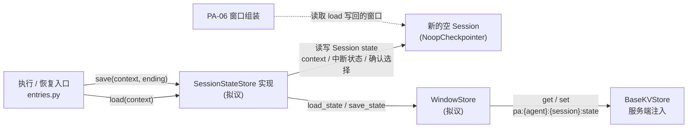
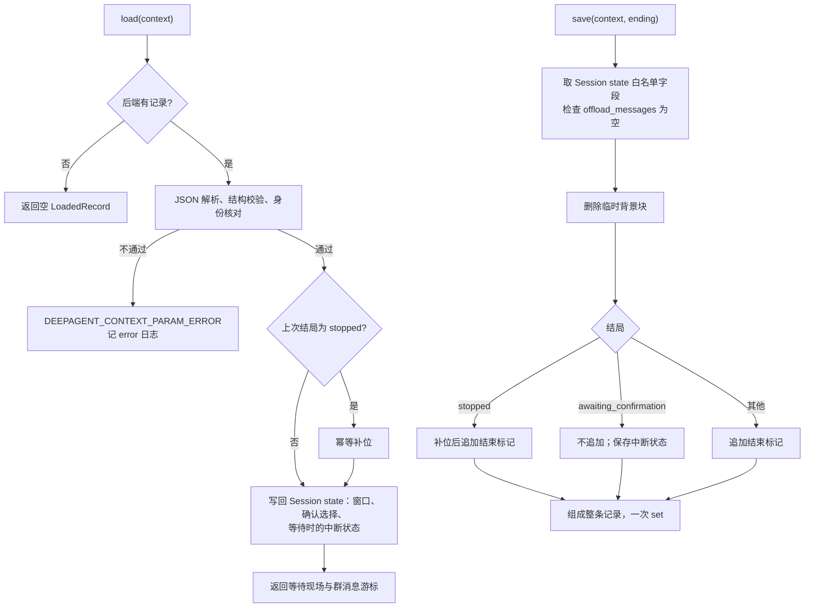

# 会话状态记录的加载与保存设计方案

## 1. 元信息

| 项 | 值 |
| --- | --- |
| 建档日期 | 2026-10-13 |
| 范围 | agent-core `openjiuwen/harness/persistent_agent`：内部组件 `WindowStore` 与 `SessionStateStore` 接入点的实现、会话状态记录的结构与序列化、Execution 结束时的窗口整理、停止后的占位补位，以及执行入口对记录错误的分类；不含换窗、归档与检索（PA-11、PA-12） |
| 方案成熟度 | 草稿：第 4.2 节各项决策按默认方案起草，逐项待开发者确认；停止时真实执行事实的取得方式暂缓，见第 3 节 Q-01 |
| 计划条目 | [开发计划](../designs/persistent-agent-development-plan.md) PA-10 |
| 负责人 | Song Haoran、Chen Ran |
| 状态 | 进行中（设计中，尚未实现） |
| 设计依据 | [架构设计](../designs/persistent-agent-architecture.md) §4.4.2、§7.2、§7.3、§8.1；[S_03](../specs/S_03_context-and-windows.md) 第 4.1、4.3、5.2、5.3 节；[S_01](../specs/S_01_public-api-and-execution.md) 执行编排 |
| 关联 feature | [F_05](F_05_execution-entries.md)（入口调用 `load` / `save` 的位置与顺序）；[F_06](F_06_window-assembly.md)（窗口标记、未配对工具调用的兜底拒绝）；PA-08 的结果交接方案尚未归档，联动点见本文第 3 节 |
| 验证摘要 | 未执行；验证设计见第 7 节 |
| Refs | 未关联 issue / PR |

## 2. 背景、目标与范围

### 2.1 背景与问题

执行入口已经按固定顺序调用会话状态记录接入点：`execution.started` 之后 `load`，原生调用结束、交出候选之后 `save`，再记账 `paused` / `final`（[entries.py](../../execution/entries.py) 的 `_load`、`_finish`）。接入点 `seams.session_state_store` 目前抛“未接入”，因此正式入口仍拒绝执行；共享契约 `LoadedRecord`、`ExecutionEnding`、`WaitingScene` 与 `SessionStateStore` 协议定义在 [integration.py](../../schema/integration.py)。

跨 Execution 的状态只能来自会话状态记录（S_03 I-1）。每次 Execution 使用新的空 Session 并注入 `NoopCheckpointer`，原生的 checkpointer 恢复和保存不读写存储（PA-05 已实现）。记录需要保存的 Session state 字段已经核实：

| Session state 键 | 内容与类型 | 写入方 |
| --- | --- | --- |
| `context` | `{context_id: ModelContext.save_state()}`；当前窗口在 `default_context_id` 下的 `messages`，元素为 `BaseMessage` 子类实例 | ContextEngine `save_contexts`（[context_engine.py](../../../../core/context_engine/context_engine.py)） |
| `__react_agent_interruption__` | `ToolInterruptionState`（pydantic 模型） | 原生中断提交（[handler.py](../../../../core/single_agent/interrupt/handler.py) `commit_interrupt`） |
| `__interrupt_auto_confirm__` | `dict[str, bool]`，“本会话记住”的确认选择 | 原生恢复时写入（同上） |

另外，核对停止路径时发现一个尚未解决的设计缺口：工具执行中途被停止时，原生收尾会删除不完整的工具调用组，PA-10 在其后保存，拿不到这组调用的事实。该问题暂缓，见第 3 节 Q-01。

### 2.2 目标与关键场景

| 场景 / 触发条件 | 当前行为 | 目标行为 / 可观察变化 |
| --- | --- | --- |
| Session 第一次执行 | 接入点拒绝，正式入口不能执行 | 读不到记录，返回空 `LoadedRecord`，从空窗口开始；结束时保存第一条记录 |
| 同一 Session 的后续 Execution | 同上 | 加载最新记录写回新 Session，窗口、确认选择和群消息游标延续；其他 Session 的记录不可见 |
| Execution 正常结束、取消、失败或非确认暂停 | 同上 | 删除临时背景块，追加执行结束标记，整条记录一次写入后再记账结束事件 |
| 等待用户确认 | 同上 | 窗口末尾待结果的工具调用不动，中断状态随记录保存；结束标记只记在记录元信息里；确认恢复时加载出等待现场 |
| 被停止 | 同上 | 保存已取得的执行事实；缺结果的工具调用补 `stopped_tool_placeholder`；加载已知停止的旧记录时幂等修补 |
| 存储读写失败 / 记录损坏 | 同上 | 读写失败按运行异常处理，不开始执行或不记结束事件；记录损坏按校验拒绝处理并记 error 日志（D-01，待确认） |

### 2.3 本次范围与非目标

- 本次包含：记录结构与序列化；`WindowStore` 的 `load_state` / `save_state`；`SessionStateStore` 实现及 `seams.session_state_store` 接线；结束整理（临时背景、执行头、结束标记）；等待确认现场的保存与加载；停止后的占位补位及加载时修补；群消息游标的保存与恢复；`ExecutionEnding` 全部字段的保存；执行入口对记录错误的分类。
- 本次不包含：换窗、旧窗归档与历史检索（PA-11、PA-12）；可重新获取的大结果改为来源引用（容量相关，待“容量边界”对齐）；续做时清理过期中断现场和读取执行日志（PA-17、PA-18）；交互回复适配（PA-09）；DeepAgent 运行状态（D-03）；工具执行中途停止时恢复被原生删除的调用（Q-01，暂缓）。

## 3. 设计约束、假设与待决问题

- **已确认约束与依赖：**
  - 架构 §7.2 的顺序：整理窗口 → 保存会话状态记录 → 记账 `paused` / `final`；只覆盖保存整理后的当前窗口，不另存快照。
  - 架构 §7.3：白名单以外的 Session state 一律不保存；所有字段写在同一条记录里，用后端 `set` 一次写入；键为 `pa:{agent_id}:{session_id}:state`；后端是服务端注入的 `BaseKVStore`（[ports.py](../../ports.py) 构造时检查类型），由服务端保证持久化、隔离和工具不可访问。
  - 架构 §7.3 的失败语义：加载失败不开始执行，保存失败按崩溃续做处理；加载失败不能降级为空窗口（S_03 第 4.1 节）。
  - 窗口标记沿用 PA-06：`WINDOW_PART_KEY` 的取值 `execution_header`、`temporary_background`；停止补位标记 `stopped_tool_placeholder` 已在 [integration.py](../../schema/integration.py) 定义。
  - PA-06 在加载之后、追加之前兜底检查未配对的工具调用和等待中的中断，发现即校验拒绝（[window_assembly.py](../../execution/window_assembly.py)）。
- **关键假设：**
  - 一期不开 task-loop 和子代理（PA-05 已在执行前拒绝），Session state `context` 中只有 `default_context_id` 一个窗口，且不挂上下文处理器，`offload_messages` 为空。实现时用测试核实；不成立时影响 D-03、D-04。
  - 消息类 `UserMessage`、`AssistantMessage`、`ToolMessage`、`SystemMessage` 能经 pydantic JSON 导出后按 `role` 无损还原，含 `metadata`、`tool_calls`、`tool_call_id`。实现时用往返测试核实。
- **待决问题：**
  - **Q-01 停止时真实执行事实的取得方式（暂缓）。** PA-05 的停止取消整个原生流式任务；同一批工具的结果要等这一批全部结束才写入窗口，所以已执行完的工具结果也未进入窗口。原生 ReAct 收尾时由 `_sanitize_cancelled_turn_messages` 删除不完整的工具调用组（assistant 消息与已有结果一并删除），再写回 Session state；原生没有跳过这一步的开关。PA-10 在其后保存，拿不到这组调用，架构 §7.2 的补位要求只能对“模型调用中途停止”等不涉及该清理的情况成立。候选见第 4.3 节 R-01～R-03。在 Q-01 确定前：PA-10 按架构实现补位与加载时修补；工具执行中途停止的验证（PA-10-V-07）不能关闭；架构 §7.2 中“上游在清理前保留真实执行事实”的责任主体待随 Q-01 确认。
  - **与 PA-08 的联动。** PA-08 的结果交接方案尚未确认。D9（超长最终回答）选择拆分时会删除 `ExecutionEnding.pending_answer`，本方案的 D-09 随之调整；D3（暂停时的候选）若选择“把未交出的登记存进会话状态记录”，本方案须增加按 Request 保存和清理登记的结构。D3 的其他选项只要求 `output_refs` 按结局原样保存，本方案已满足。

## 4. 总体方案与设计取舍

### 4.1 方案概览

`SessionStateStore` 的实现位于执行入口与存储后端之间：`load` 从后端读出整条记录，校验身份和格式后写回新 Session 的 state；`save` 从 Session state 取出白名单字段，整理窗口后连同结束信息组成一条记录，用一次 `set` 写入。`WindowStore` 只负责键的派生和记录的读写，不理解窗口内容。

实线是调用方向，虚线表示 PA-06 在 `load` 之后读取同一份 Session state。存储基础设施（持久化、命名空间隔离、保留期清理）由服务端提供，本模块只定义记录格式和读写逻辑。

### 4.2 关键决策

以下决策均按默认方案起草，逐项待开发者确认；确认后在此更新确认依据；确认结果与原默认方案不同时，在文末“设计演进与修订”中记录。

#### D-01 记录读取失败的分类

- 选择与依据：后端 `get` / `set` 抛错按运行异常处理（加载时不开始执行，保存时不记结束事件，服务端按崩溃续做处理）；记录存在但 JSON 解析、结构校验或身份核对不通过，按校验拒绝处理，使用 `DEEPAGENT_CONTEXT_PARAM_ERROR` 并记 error 日志。损坏的记录被续做重新读到只会再次失败，与 PA-06 对未配对工具调用的处理一致，不新增 core 错误分类。执行入口的 `_store_call` 目前把所有异常包成 `DEEPAGENT_RUNTIME_ERROR`，需改为已分类的 `BaseError` 原样透传。
- 代价与成立条件：损坏的记录会让该 Session 之后的 Request 都被拒绝，需要服务端告警并人工处理；依赖服务端按错误类型区分续做与否。
- 实现体现：第 5.6 节；I-05；PA-10-V-09、V-10。
- 相关候选：全部按运行异常处理（会反复续做）；损坏时按空窗口继续（违背“加载失败不降级为空窗口”）。
- 确认依据：待开发者确认。

#### D-02 记录格式：JSON 加版本号

- 选择与依据：记录序列化为 JSON。消息用 pydantic 导出，加载时按 `role` 还原为对应消息类；中断状态用 `ToolInterruptionState` 的模型导出与校验；记录带 `schema_version=1`。JSON 不执行代码，存储中的数据被篡改也只会校验失败；版本号让以后的格式变化可以判断和迁移。
- 代价与成立条件：消息和中断状态的字段随 core 演进，需要往返测试守住；字段不兼容时按 D-01 校验拒绝，再按版本迁移。
- 实现体现：第 5.4 节；I-01；PA-10-V-01、V-11。
- 相关候选：pickle（存储内容可被利用执行代码，且绑定 Python 与 core 内部版本）；不带版本号的 JSON（以后迁移只能靠猜）。
- 确认依据：待开发者确认。

#### D-03 一期不保存 DeepAgent 运行状态

- 选择与依据：架构 §7.3 把 DeepAgent 运行状态（task_plan 等）列为可选。一期不开 task-loop，没有可保存的内容，本次不放入白名单，PA-24 开放 task-loop 时再补。
- 代价与成立条件：依赖“一期不开 task-loop”的执行前拒绝；该前提改变时须先扩展记录结构和版本。
- 实现体现：第 5.4 节白名单。
- 相关候选：现在就预留字段（没有内容可验证，属于为未来预留）。
- 确认依据：待开发者确认。

#### D-04 卸载缓冲不为空时保存失败

- 选择与依据：一期不挂上下文处理器，`ModelContext.save_state()` 中的 `offload_messages` 应为空。若不为空，说明有内容被移出窗口，只保存 `messages` 会丢掉这部分事实，因此本次保存失败，按运行异常处理，不静默丢弃。
- 代价与成立条件：该前提被打破时 Execution 会以保存失败结束；挂上下文处理器之前须先扩展记录结构。
- 实现体现：第 5.6 节；PA-10-V-12。
- 相关候选：丢弃并记 warning（悄悄丢内容）；一并保存（记录中多一种 core 内部格式，且一期没有可验证的使用者）。
- 确认依据：待开发者确认。

#### D-05 执行结束标记的形式

- 选择与依据：在窗口末尾追加一条 `UserMessage`，`metadata` 带 `WINDOW_PART_KEY=execution_end`（新增取值），内容为一行，写明 request_id、execution_id、结局（完成 / 暂停及原因 / 取消 / 失败）、交出的候选（`output_refs`，注明以结束记录为准）和群消息扫描位置。与执行头、临时背景块同为带标记的用户消息，下一 Execution 在其后追加执行头。
- 代价与成立条件：窗口中会出现连续的用户消息（结束标记后紧跟下一次的执行头）；依赖所用模型接口接受连续的用户消息，PA-06 的执行头已经如此。
- 实现体现：第 5.5 节；PA-10-V-03。
- 相关候选：用 `AssistantMessage`（像是模型自己说的话）；用 `SystemMessage`（对话中途出现系统消息，部分模型接口不支持）。
- 确认依据：待开发者确认。

#### D-06 等待确认的结束标记只进元信息

- 选择与依据：架构 §7.2 规定等待确认时末尾待结果的工具调用一律不动，结束标记记在记录元信息里。确认恢复的那次 Execution 结束时写自己的结束标记，暂停时的标记随之作废，不补进窗口。
- 代价与成立条件：窗口里看不到“这件事曾经暂停等待确认”这一行；确认过程本身在执行日志中可查。
- 实现体现：第 5.5 节；PA-10-V-04。
- 相关候选：恢复后把暂停标记也补进窗口（窗口中出现前后两条标记，且插入位置在已恢复的工具结果之后，顺序不直观）。
- 确认依据：待开发者确认。

#### D-07 执行头保持原样

- 选择与依据：架构要求结束时把执行头压缩为一行；PA-06 生成的执行头已是一行，保存时不再改写，避免改动已发送过的前缀。
- 代价与成立条件：执行头中的发送者、回复关系等字段会留在历史里。
- 实现体现：第 5.5 节。
- 相关候选：再精简为类型、request_id 和 execution_id。
- 确认依据：待开发者确认。

#### D-08 加载时只修补已知停止的记录

- 选择与依据：记录的结束信息标明上次结局为 `stopped` 时，加载后对缺结果的工具调用幂等补位；其他记录出现缺结果的调用视为损坏，交给 PA-06 的兜底检查拒绝。
- 代价与成立条件：保存时补位失败、而记录又不是停止结局的异常情况无法自动修复，需要人工处理。
- 实现体现：第 5.5 节；PA-10-V-08。
- 相关候选：所有记录都补位（会悄悄“修好”损坏的记录，掩盖问题）。
- 确认依据：待开发者确认。

#### D-09 `pending_answer` 按现行计划原样保存

- 选择与依据：开发计划要求原样保存 `ExecutionEnding.pending_answer`，供 PA-08 继续交接。本次按 `ExecutionEnding` 交来的字段原样保存，不在加载时交还；若 PA-08 选择拆分超长回答，则在 PA-08 的改动中删除该字段。
- 代价与成立条件：PA-08 选择拆分时，本次保存该字段的代码和测试需随之删除。
- 实现体现：第 5.4 节；PA-10-V-13。
- 相关候选：等 PA-08 确定后再决定（本方案的结束信息结构先空缺这部分）。
- 确认依据：待开发者确认。

### 4.3 替代方案与排除理由

| 候选 / 关联决策 | 候选目的与关键差异 | 拒绝或暂缓原因 | 重新评估条件 |
| --- | --- | --- | --- |
| R-01 / Q-01 Persistent 侧记录本轮工具调用 | 用 Persistent 内部 Rail 在模型产出工具调用后记下 assistant 消息、在每个工具完成后记下真实 `ToolMessage`（`ToolCallInputs.tool_msg`）；停止保存时把被原生删除的调用组放回，已完成的放真实结果，未完成的补占位；不改 core | 暂缓（开发者 2026-10-13 决定先不定停止方案） | Q-01 恢复讨论时 |
| R-02 / Q-01 core 增加“停止时保留不完整工具调用”的开关 | Persistent 打开开关后原生不删除调用组，PA-10 统一补占位 | 暂缓；需要改 core，已完成调用的真实结果仍未进入窗口，只能补成“结果未取得” | 同上 |
| R-03 / Q-01 接受原生行为 | 窗口中不保留被删除的调用组，事实只在执行日志中 | 暂缓；与架构 §7.2 已确认的补位要求冲突，下一任务看不到结果未知的外部操作，可能重复执行 | 同上；选择时须先修改架构 |
| R-04 / D-02 pickle 序列化 | 实现最简单 | 存储内容可被利用执行代码；格式绑定 Python 与 core 内部版本 | 无 |
| R-05 / 记录结构 | 窗口与中断状态分键保存 | 违背架构 §7.3“一次写入”，会出现窗口已保存而中断状态未保存 | 无 |

## 5. 详细设计

### 5.1 模块责任与关键不变量

- **执行入口（PA-05，已实现）**：决定何时 `load`、`save`，把结局、回复目标、交出的候选和群消息游标组成 `ExecutionEnding` 交给 `save`。本次只调整 `_store_call` 的错误透传（D-01）。
- **`SessionStateStore` 实现（本次，拟议）**：理解 Session state 白名单字段、窗口标记和结束信息，负责整理、补位和格式校验。
- **`WindowStore`（本次，拟议）**：派生键、读写整条记录，不理解内容；后续 PA-11、PA-12 在同一组件上增加归档和检索。
- **服务端**：注入持久的 `BaseKVStore`，保证命名空间隔离、工具不可访问和按前缀清理。

本次须保持的不变量沿用 [S_03](../specs/S_03_context-and-windows.md)：I-1 唯一状态、I-3 最新窗口、I-4 保存先行、I-5 私有存储。另外保证：

- 记录只含白名单字段，整条记录一次 `set` 写入；读到的记录必须属于本 Agent、本 Session。
- 等待确认时窗口末尾待结果的工具调用不被追加、补位或删除。
- 补位幂等：已有真实结果、原生“已中断”结果或已有补位的调用不重复补位。

### 5.2 关键类与函数设计

以下均为拟议的目标设计，路径和名称在实现时可调整，调整后同步本节。

#### 5.2.1 关键类定义与说明

| 类名 / 所属模块 | 变更类型与可见范围 | 职责与边界 | 继承 / 实现 / 组合关系 |
| --- | --- | --- | --- |
| `schema/session_record.py` 的 `SessionStateRecord`（拟议） | 新增；内部 | 会话状态记录的结构与校验，负责 JSON 编解码 | pydantic 模型 |
| `execution/session_state.py` 的 `WindowStore`（拟议） | 新增；内部 | 派生键，读写整条记录 | 组合注入的 `BaseKVStore` |
| `execution/session_state.py` 的 `ExecutionStateStore`（拟议） | 新增；内部 | 实现 `SessionStateStore` 协议：加载写回、整理、补位、保存 | 实现 [integration.py](../../schema/integration.py) 的 `SessionStateStore`；组合 `WindowStore` |

##### SessionStateRecord

- 类定义：`class SessionStateRecord(BaseModel)`，`model_config` 禁止额外字段。
- 构造与生命周期：保存时由 `ExecutionStateStore.save` 构造并序列化；加载时由 JSON 校验得到；不持有资源。

| 关键属性 | 类型与初始值 | 含义与约束 | 更新主体与时机 |
| --- | --- | --- | --- |
| `schema_version` | `Literal[1]` | 记录格式版本；不认识的版本按 D-01 校验拒绝 | 保存时固定写入 |
| `agent_id` / `session_id` | `str` | 记录所属身份；加载时须与本次执行一致 | 保存时取自 `context.execution` |
| `messages` | `list[dict]` | 整理后的窗口，元素为消息的 JSON 导出，含 `role` | 保存时 |
| `interruption` | `dict \| None = None` | `ToolInterruptionState` 的导出；只在结局为等待确认时非空 | 保存时 |
| `auto_confirm` | `dict[str, bool] = {}` | “本会话记住”的确认选择 | 保存时取自 Session state |
| `ending` | `RecordEnding` | 结束信息：`outcome`、`request_id`、`execution_id`、`reply_target`、`output_refs`、`pending_answer`、`last_group_message_id` | 保存时取自 `ExecutionEnding` 和 `context.execution` |

##### WindowStore

| 关键方法签名 | 职责与调用条件 | 参数与返回值说明 | 异常与副作用 |
| --- | --- | --- | --- |
| `async def load_state(self, agent_id: str, session_id: str) -> str \| None` | 读取该 Session 的记录 | 返回原始 JSON；没有记录时返回 `None` | 后端异常原样抛出，由入口按运行异常处理 |
| `async def save_state(self, agent_id: str, session_id: str, payload: str) -> None` | 一次 `set` 写入整条记录 | `payload` 为已序列化的记录 | 同上；覆盖原记录 |

键为 `pa:{agent_id}:{session_id}:state`（架构 §7.3）。

##### ExecutionStateStore

| 关键方法签名 | 职责与调用条件 | 参数与返回值说明 | 异常与副作用 |
| --- | --- | --- | --- |
| `async def load(self, context: PersistentBuildContext) -> LoadedRecord` | 入口在 `execution.started` 之后调用 | 返回等待现场（结局为等待确认时）与群消息游标；没有记录时返回空 `LoadedRecord` | 写入 Session state 的 `context`、确认选择及（等待时）中断状态；记录损坏时抛 `DEEPAGENT_CONTEXT_PARAM_ERROR` |
| `async def save(self, context: PersistentBuildContext, ending: ExecutionEnding) -> None` | 入口在交出候选之后、记账结束事件之前调用 | `ending` 由入口构造 | 一次写入后端；`offload_messages` 非空等异常时抛运行异常，不写入 |

#### 5.2.2 关键函数定义与说明

| 函数 / 所属模块 | 完整签名与变更类型 | 职责与调用方 | 输入输出及行为约束 |
| --- | --- | --- | --- |
| `execution/session_state.py` 的 `tidy_window`（拟议） | `def tidy_window(messages: list[BaseMessage], ending: ExecutionEnding, execution_id: str) -> list[BaseMessage]`；同步；新增 | `save` 调用 | 删除 `temporary_background` 标记的消息；结局不是等待确认时追加结束标记；不修改其他消息 |
| `execution/session_state.py` 的 `patch_stopped_calls`（拟议） | `def patch_stopped_calls(messages: list[BaseMessage]) -> list[BaseMessage]`；同步；新增 | 停止结局的 `save`，以及加载已知停止的记录时调用 | 为缺结果的工具调用在其所在调用组之后补 `stopped_tool_placeholder` 结果；幂等 |
| `execution/seams.py` 的 `session_state_store` | `def session_state_store(context: PersistentBuildContext) -> SessionStateStore`；修改 | 入口取接入点 | 由抛“未接入”改为返回绑定 `context.ports.window_backend` 的 `ExecutionStateStore` |
| `execution/entries.py` 的 `_store_call` | `async def _store_call(operation: str, call) -> Any`；修改 | 入口包装 `load` / `save` | 已分类的 `BaseError` 原样透传，其他异常仍包成 `DEEPAGENT_RUNTIME_ERROR`（D-01） |

窗口所在的 Session state 键 `context` 与 `default_context_id` 目前是 [window_assembly.py](../../execution/window_assembly.py) 的私有常量，本次移到 [integration.py](../../schema/integration.py) 供两处共用，并新增标记取值 `EXECUTION_END = "execution_end"`。

### 5.3 接口定义与消息契约

`SessionStateStore` 协议签名不变（[integration.py](../../schema/integration.py)）。本次变化：

| 入口 / 消息 | 调用方 / 消费者 | 输入与成功结果 | 失败语义 |
| --- | --- | --- | --- |
| `load(context) -> LoadedRecord` | 执行与恢复入口 | 最新记录写回新 Session；无记录时返回空 `LoadedRecord` | 后端异常：运行异常，不开始执行；记录损坏：`DEEPAGENT_CONTEXT_PARAM_ERROR` 加 error 日志（D-01） |
| `save(context, ending) -> None` | 执行与恢复入口 | 整理后的整条记录写入后端 | 后端异常或保存前检查失败：运行异常，不记结束事件 |

`LoadedRecord.waiting` 在记录结局为 `awaiting_confirmation` 时取 `WaitingScene(request_id, reply_target)`，其余为 `None`；`last_group_message_id` 取记录结束信息中的群消息游标。

### 5.4 数据模型与事实归属

| 数据 | 语义与隔离范围 | 权威位置 | 创建、更新与释放 |
| --- | --- | --- | --- |
| 会话状态记录 | Session 最新已保存的现场；按 Agent 与 Session 隔离 | 后端键 `pa:{agent_id}:{session_id}:state` | 每次 Execution 结束覆盖保存；服务端按前缀清理 |
| 窗口 `messages` | 当前窗口；只取 `default_context_id`（一期只有这一个） | 记录的 `messages` | 加载时写回 Session state，执行中由原生和 PA-06 追加，保存时整理后写回记录 |
| 中断状态 | 等待确认的现场 | 记录的 `interruption` | 只在结局为等待确认时保存；加载时写回 `__react_agent_interruption__` |
| 确认选择 | “本会话记住”，Session 内有效 | 记录的 `auto_confirm` | 每次保存；加载时写回 `__interrupt_auto_confirm__` |
| 结束信息 | 上次 Execution 的结局、交出的候选、超长答案、群消息游标 | 记录的 `ending` | 每次保存覆盖 |

白名单之外的 Session state（例如 `__session_memory__`、`offload_messages`、`last_context_window_access_at`、DeepAgent 运行状态）一律不保存（D-03、D-04）。

### 5.5 正常执行流程

1. **加载**：读出记录后先校验再写回。结局为 `stopped` 的记录先补位（D-08）。窗口写回 `context` 的 `default_context_id`；确认选择总是写回；中断状态只在结局为等待确认时写回。返回的等待现场让恢复入口校验回复，也让 PA-06 拒绝在等待期间开始新 Request。
2. **执行中**：PA-06 在加载的窗口末尾追加执行头和临时背景块，原生 ReAct 追加任务输入和工作过程，本次不介入。
3. **保存**：
   - 只取 `default_context_id` 的 `messages`；`offload_messages` 不为空时保存失败（D-04）。
   - 删除带 `temporary_background` 标记的消息；执行头保持原样（D-07）。
   - 结局为 `stopped` 时先补位：缺结果的工具调用在其调用组之后补一条 `ToolMessage`，`tool_call_id` 匹配，`metadata` 带 `WINDOW_PART_KEY=stopped_tool_placeholder`，内容为“执行已停止，结果未取得，实际效果需核实”。已有真实结果、原生“已中断”结果或已有补位的调用不重复补位。
   - 结局不是等待确认时追加结束标记（D-05）；等待确认时窗口末尾的工具调用不动，结束信息只在记录的 `ending` 中（D-06）。
   - 组成 `SessionStateRecord`，序列化后一次 `set` 写入。

结束标记示例（拟议格式，与执行头的写法一致）：`【执行结束】request_id：R1；execution_id：E1；结局：已完成；交出候选：out_…（以结束记录为准）；群消息已扫描到：M180`。

### 5.6 异常、中断与重试处理

- **加载时后端异常**：入口包成 `DEEPAGENT_RUNTIME_ERROR`，不开始原生执行；此时已记 `execution.started`，服务端按运行异常核对后续做。
- **加载时记录损坏**：JSON 无法解析、结构不符、版本不认识、身份与本次执行不符或消息无法还原，抛 `DEEPAGENT_CONTEXT_PARAM_ERROR`，记 error 日志（含 Session 与 execution_id，不含记录内容）。入口透传，服务端不续做（D-01）。
- **保存时异常**：后端 `set` 失败或保存前检查失败（D-04），入口包成运行异常，不记结束事件；服务端按崩溃续做处理。候选可能已交出，处理见 PA-08 方案。
- **停止**：模型调用中途停止时，窗口中已有的内容（含完整的工具调用组）按上述流程保存，原生追加的 `[Request cancelled by user]` 回复原样保留。工具执行中途停止时，被原生删除的调用组本次不恢复（Q-01，暂缓）。
- **重复加载**：补位幂等；同一记录多次加载得到相同窗口。

### 5.7 并发与一致性

同一 Session 同一时间只有一个执行者，由服务端保证（架构 §3.4 第 1 条），记录读写不加锁、不做条件写入。记录保存与结束事件记账分别确认，不构成跨存储事务：保存成功而结束记账失败时，下一次加载得到的记录已含本次结果，续做按结束标记和执行日志判断（S_03 第 5.3 节）。

### 5.8 持久化与恢复

记录每次 Execution 结束时覆盖保存一次，不保存执行中的中间状态；进程在执行中崩溃时，下一次加载得到的是上一次结束时的记录，本次工作只能靠执行日志续做（PA-17、PA-18）。恢复的粒度是“上一次结束时的窗口与现场”，不恢复执行位置。

## 6. 影响面与实施设计

### 6.1 修改点与实施顺序

| 实施项 | 模块 / 文件或符号 | 修改内容与责任 | 必要前置 / 独立验证产物 |
| --- | --- | --- | --- |
| I-01 | `schema/session_record.py`（拟议） | 记录结构、版本与 JSON 编解码；消息按 `role` 还原 | 无；PA-10-V-01、V-11 |
| I-02 | [integration.py](../../schema/integration.py)、[window_assembly.py](../../execution/window_assembly.py) | 共用窗口所在的 Session state 键；新增 `EXECUTION_END` 标记 | 无；PA-06 既有测试回归 |
| I-03 | `execution/session_state.py`（拟议） | `WindowStore`、`ExecutionStateStore`、整理与补位 | I-01、I-02；PA-10-V-01～V-08、V-12、V-13 |
| I-04 | [seams.py](../../execution/seams.py) | `session_state_store` 返回实现 | I-03；入口测试中替身改为真实实现的场景 |
| I-05 | [entries.py](../../execution/entries.py) `_store_call` | 已分类错误透传（D-01） | 无；PA-10-V-09、V-10 |
| I-06 | `tests/unit_tests/harness/persistent_agent/` | 记录、整理、补位、失败分类单测；用真实 DeepAgent 与 `InMemoryKVStore` 的组件测试 | I-03～I-05 |

核对范围：`SessionStateStore` 的调用方只有执行与恢复入口；入口测试现用替身实现，接入后保留替身场景并增加真实实现场景。此前没有任何已保存的记录（接入点一直拒绝），不存在旧数据兼容问题，不需要迁移。

### 6.2 文档同步

- spec：实现时修订 [S_03](../specs/S_03_context-and-windows.md)：第 4.1 节加载失败的分类（D-01）、第 5.2 节结束标记与补位的实际规则、第 6 节“损坏校验与存储格式”补为有效契约；记录结构不在 spec 中复制，引用本文。
- 架构：Q-01 确定后，按所选方案确认架构 §7.2 中“上游在清理前保留真实执行事实”的责任主体，按模块规则先取得确认再修改。
- 开发计划：PA-10 状态改为进行中，进展说明指向本文；PA-08 确定 D3、D9 后同步 PA-10 验收中 `pending_answer` 的表述。

## 7. 验证设计、执行记录与结论

### 7.1 验证设计与通过条件

| 验证 ID | 场景 / 前置状态与输入 | 操作或验证入口 | 预期结果 / 通过条件 | 验证层级与环境 |
| --- | --- | --- | --- | --- |
| PA-10-V-01 | 新 Session 第一次执行私聊任务 | 正式入口，真实 DeepAgent，`InMemoryKVStore` | 加载得到空 `LoadedRecord`；结束后后端只有一个键，记录含白名单字段与版本号，`set` 调用一次 | 组件测试 |
| PA-10-V-02 | 同一 Session 第二个 Request；另一 Session 的 Request | 同上 | 第二次的原生输入含第一次的窗口；另一 Session 从空窗口开始 | 组件测试 |
| PA-10-V-03 | 完成、取消、失败、预算暂停各一次 | 同上 | 临时背景块被删除，执行头不变，末尾追加一条带 `execution_end` 标记的结束标记，内容含结局与游标 | 组件测试 |
| PA-10-V-04 | 权限中断后保存，再恢复 | 执行入口加恢复入口，交互适配用替身（PA-09 未接入） | 窗口末尾待结果的工具调用不变、无结束标记；中断状态与确认选择保存；恢复时加载出等待现场并通过回复校验 | 组件测试 |
| PA-10-V-05 | 群 Session 两次执行 | 读取器替身返回扫描位置 | 第一次保存的游标在第二次加载后传给组装器 | 组件测试 |
| PA-10-V-06 | 模型调用中途停止 | 正式入口，停止控制 | 已有内容与原生中断回复原样保存，记 `paused(stopped)` | 组件测试 |
| PA-10-V-07 | 工具执行中途停止 | 同上 | 待 Q-01 确定后补充预期；当前只验证保存后的窗口能被 PA-06 安全追加 | 组件测试（受 Q-01 限制） |
| PA-10-V-08 | 加载一条结局为 `stopped`、含缺结果工具调用的记录 | 直接构造记录 | 补位后可安全追加；再次加载不重复补位；结局不是 `stopped` 的同类记录被 PA-06 拒绝 | 单测 |
| PA-10-V-09 | 后端 `get` / `set` 抛错 | 故障替身 | 加载失败时不调用模型，入口抛 `DEEPAGENT_RUNTIME_ERROR`；保存失败时不记结束事件 | 单测 / 组件测试 |
| PA-10-V-10 | 记录损坏：非法 JSON、未知版本、身份不符、消息无法还原 | 直接写入后端 | 入口抛 `DEEPAGENT_CONTEXT_PARAM_ERROR`，有 error 日志，不调用模型 | 单测 |
| PA-10-V-11 | 消息与中断状态往返 | 含 `metadata`、`tool_calls` 的各类消息和 `ToolInterruptionState` | 序列化再还原后与原对象相等 | 单测 |
| PA-10-V-12 | `offload_messages` 不为空 | 构造 Session state | 保存失败，不写后端 | 单测 |
| PA-10-V-13 | 超长最终回答 | 入口产生 `pending_answer` | 记录的 `ending.pending_answer` 与原文完全一致 | 组件测试 |
| PA-10-V-14 | 停止 → 保存 → 重新加载 → 执行下一任务 | 真实 DeepAgent 与内存后端 | 下一任务正常完成，窗口中保留停止前的事实 | 组件测试；真实服务端联调另行记录 |

### 7.2 实际执行与证据

| 执行日期 / 验证范围 | 实现版本与环境 | 命令 / 复现步骤 / 记录链接 | 实际结果 | 未覆盖项 / 失败原因 |
| --- | --- | --- | --- | --- |
| — | — | — | 未执行 | 方案为草稿，尚未实现 |

### 7.3 验证结论

- 已证明范围：无，尚未实现。
- 未覆盖或未通过的承诺：全部；工具执行中途停止的真实事实受 Q-01 限制。
- 可支持的交付判断：不能声明 PA-10 完成。组件验证通过后，真实服务端后端的持久化与隔离仍需联调证明（S_03 I-5）。

## 8. 风险与已知遗留

### 8.1 设计风险

| 风险 / 触发条件 | 对本次方案的影响 | 已有应对措施 | 核实或验证方式 |
| --- | --- | --- | --- |
| core 消息或中断状态的字段变化 | 旧记录无法还原 | 版本号与往返测试；不兼容时校验拒绝 | PA-10-V-11；core 升级时回归 |
| 记录体积随窗口增长 | 后端单值大小可能受限 | 换窗（PA-11）控制窗口大小 | 待“容量边界”对齐后评估 |

### 8.2 已知遗留

| 遗留项 | 未处理原因 / 性质 | 影响与现有处置 | 后续入口 / 条件及所需验证 |
| --- | --- | --- | --- |
| 工具执行中途停止时被原生删除的调用组 | 暂缓（Q-01） | 下一任务看不到这组调用；事实只在执行日志中 | Q-01 确定后补充设计与 PA-10-V-07 |
| `pending_answer` 的去留 | 依赖 PA-08 的 D9 | 按现行计划保存 | PA-08 确认后同步 |
| DeepAgent 运行状态 | 一期不开 task-loop（D-03） | 不保存 | PA-24 开放时扩展记录与版本 |
| 大结果改为来源引用 | 容量相关，范围外 | 原样保存 | “容量边界”对齐后由相应特性处理 |
