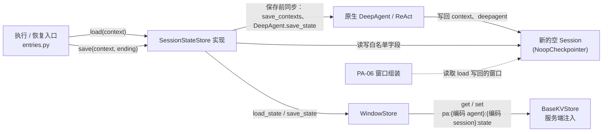
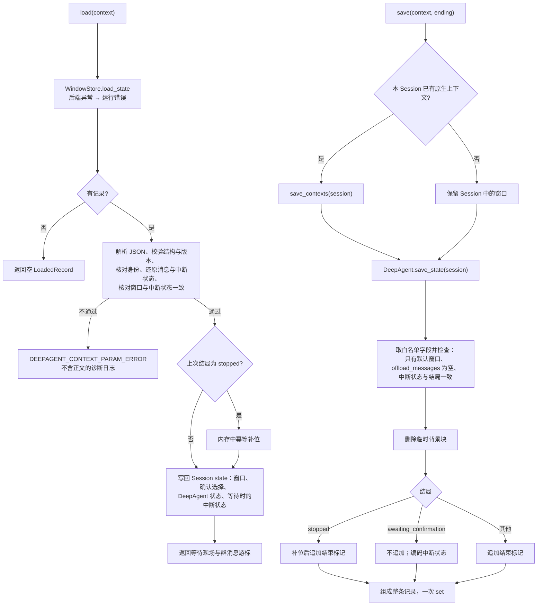

# 会话状态记录的加载与保存设计方案

## 1. 元信息

| 项 | 值 |
| --- | --- |
| 建档日期 | 2026-10-13 |
| 修订日期 | 2026-10-14：开发者确认决策，方案由草稿改为已确认，见第 9 节 |
| 范围 | agent-core `openjiuwen/harness/persistent_agent`：`SessionStateStore` 接入点与内部组件 `WindowStore` 的实现、会话状态记录的结构与序列化、保存前的窗口同步、Execution 结束时的窗口整理、停止后的占位补位、记录错误分类、存储键编码、卸载缓冲的前置拒绝；以及原生执行路径保留真实工具事实所需的 core 改动（接口方案待确认，见第 3 节 Q-01）。不含换窗、归档与检索（PA-11、PA-12），只提供它们共用的键编码 |
| 方案成熟度 | 已确认（2026-10-14）：D-01～D-05、D-07～D-10 已确认；D-06 的方向已确认，共享接口及影响范围待确认，确认前不实施 core 改动 |
| 计划条目 | [开发计划](../designs/persistent-agent-development-plan.md) PA-10 |
| 负责人 | Song Haoran、Chen Ran |
| 状态 | 进行中（设计已确认，尚未实现） |
| 设计依据 | [架构设计](../designs/persistent-agent-architecture.md) §3.4、§4.4.2、§7.2、§7.3、§8.1；[S_03](../specs/S_03_context-and-windows.md) 第 4.1、4.3、5.2、5.3 节；[S_01](../specs/S_01_public-api-and-execution.md) 执行编排 |
| 关联 feature | [F_05](F_05_execution-entries.md)（入口调用 `load` / `save` 的位置与顺序，共享接入契约见其第 3.2 节）；[F_06](F_06_window-assembly.md)（窗口标记、未配对工具调用的兜底拒绝）；PA-08 的结果交接方案尚未归档，联动点见本文第 3 节 |
| 验证摘要 | 未执行；验证设计见第 7 节 |
| Refs | 未关联 issue / PR |

## 2. 背景、目标与范围

### 2.1 背景与问题

执行入口已经按固定顺序调用会话状态记录接入点：`execution.started` 之后 `load`，原生调用结束、交出候选之后 `save`，再记账 `paused` / `final`（[entries.py](../../execution/entries.py) 的 `_load`、`_finish`）。接入点 `seams.session_state_store` 目前抛“未接入”，因此正式入口仍拒绝执行；共享契约 `LoadedRecord`、`ExecutionEnding`、`WaitingScene` 与 `SessionStateStore` 协议定义在 [integration.py](../../schema/integration.py)。

跨 Execution 的状态只能来自会话状态记录（S_03 I-1）。每次 Execution 使用新的空 Session 并注入 `NoopCheckpointer`，原生的 checkpointer 恢复和保存不读写存储（PA-05 已实现）。记录涉及的 Session state 字段已经核实：

| Session state 键 | 内容与类型 | 写入方 |
| --- | --- | --- |
| `context` | `{context_id: ModelContext.save_state()}`；当前窗口在 `default_context_id` 下，含 `messages`（`BaseMessage` 子类实例）、`offload_messages`、`last_context_window_access_at` | ContextEngine `save_contexts`（[context_engine.py](../../../../core/context_engine/context_engine.py)） |
| `__react_agent_interruption__` | `ToolInterruptionState`（pydantic 模型）；其中 `interrupt_requests` 的值为 `InterruptRequest` 或其子类 `AskUserRequest` | 原生中断提交（[handler.py](../../../../core/single_agent/interrupt/handler.py) `commit_interrupt`） |
| `__interrupt_auto_confirm__` | `dict[str, bool]`，“本会话记住”的确认选择 | 原生恢复时写入（同上） |
| `deepagent` | `DeepAgentState.to_session_dict()` 的结果（[state.py](../../../schema/state.py)） | `DeepAgent.save_state`；运行中的最新值缓存在 Session 对象上 |

核对代码时发现四处会影响保存结果的事实：

- **窗口可能未同步。** 原生在正常结束、中断和中止时会调用 `save_contexts` 写回 Session state，但 DeepAgent 外层的后续处理可能在其后改变内存中的上下文。另外，`save_contexts` 在当前 Session 没有原生上下文时，会把 `{}` 写入 `context`，覆盖已加载的窗口。
- **DeepAgent 状态只在正常结束时写回。** 流式路径在正常结束时才调用 `save_state` 把缓存写回 Session state；停止和异常时不写回，缓存仍挂在 Session 对象上。
- **中断请求的子类字段会丢。** `interrupt_requests` 的字段类型是 `InterruptRequest`，按模型导出时只保留基类字段，`AskUserRequest.questions` 会丢失，恢复后无法区分用户回答和工具授权。
- **工具执行中途结束时真实事实丢失。** 同一批工具的结果要等整批返回后才写入窗口；停止、取消或执行中报错时，原生收尾由 `_sanitize_cancelled_turn_messages` 删除不完整的工具调用组（assistant 消息与已有结果一并删除）。PA-10 在其后保存，拿不到这组调用，由 D-06 解决。

### 2.2 目标与关键场景

| 场景 / 触发条件 | 当前行为 | 目标行为 / 可观察变化 |
| --- | --- | --- |
| Session 第一次执行 | 接入点拒绝，正式入口不能执行 | 读不到记录，返回空 `LoadedRecord`，从空窗口开始；结束时保存第一条记录 |
| 同一 Session 的后续 Execution | 同上 | 加载最新记录写回新 Session，窗口、确认选择、DeepAgent 状态和群消息游标延续；其他 Session 的记录不可见 |
| Execution 正常结束、取消、失败或非确认暂停 | 同上 | 保存前同步原生窗口，删除临时背景块，追加执行结束标记，整条记录一次写入后再记账结束事件 |
| 等待用户确认 | 同上 | 窗口末尾待结果的工具调用不动，中断状态连同请求子类字段一起保存；结束信息只进记录元信息；确认恢复时加载出等待现场 |
| 工具执行中途被停止 | 原生删除不完整的调用组 | 原生保留调用组和已取得的真实结果（D-06，待实施）；PA-10 为缺结果的调用补 `stopped_tool_placeholder`；新实例加载后可执行下一任务 |
| 存储读写失败 | 同上 | 按运行异常处理：加载时不调用模型，保存时不记结束事件 |
| 记录损坏 | 同上 | 按校验拒绝处理（`DEEPAGENT_CONTEXT_PARAM_ERROR`），记录不含正文的诊断日志；不调用模型、不退回空窗口、不覆盖原记录 |
| 挂载会产生消息卸载的处理器 | 构造时只按 Rail 类型拒绝 `ContextProcessorRail` | 构造时和 Rail 注册完成后分别检查实际的处理器列表，执行前拒绝；保存时卸载缓冲不为空则保存失败 |

### 2.3 本次范围与非目标

- 本次包含：记录结构与序列化；`WindowStore` 的 `load_state` / `save_state`；`SessionStateStore` 实现及 `seams.session_state_store` 接线；保存前的窗口与 DeepAgent 状态同步；结束整理；等待确认现场的保存与加载；停止补位及加载时修补；群消息游标；`ExecutionEnding` 全部字段的保存；记录错误分类及入口加载路径的映射；存储键编码与公开的键前缀函数；卸载处理器的执行前拒绝与保存兜底；原生事实保留的 core 改动（D-06 确认后实施）。
- 本次不包含：换窗、旧窗归档与历史检索（PA-11、PA-12）；可重新获取的大结果改为来源引用（容量相关，待“容量边界”对齐）；续做时清理过期中断现场和读取执行日志（PA-17、PA-18）；交互回复适配（PA-09）；`pending_answer` 跨 Request 的保留与清理（D-08，待 PA-08 方案）；task-loop 与子代理继续按 PA-05 门禁拒绝。

## 3. 设计约束、假设与待决问题

- **已确认约束与依赖：**
  - 架构 §7.2 的顺序：整理窗口 → 保存会话状态记录 → 记账 `paused` / `final`；只覆盖保存整理后的当前窗口，不另存快照。
  - 架构 §7.3：白名单以外的 Session state 不保存；所有字段写在同一条记录里，用后端 `set` 一次写入；后端是服务端注入的 `BaseKVStore`（[ports.py](../../ports.py) 构造时检查类型），由服务端保证持久化、命名空间隔离和工具不可访问。
  - 失败语义：加载失败不开始执行、不退回空窗口；保存失败按崩溃续做处理，不记结束事件（S_03 第 4.1、4.3 节）。
  - [错误码规则](../../../../../.claude/rules/error-codes.md)：只经统一异常体系抛错，不新增私有异常类或 core 错误码，不按错误码分支。
  - 窗口标记沿用 PA-06：`WINDOW_PART_KEY` 的取值 `execution_header`、`temporary_background`；停止补位标记 `stopped_tool_placeholder` 已在 [integration.py](../../schema/integration.py) 定义。
  - PA-06 在加载之后、追加之前兜底检查未配对的工具调用和等待中的中断（[window_assembly.py](../../execution/window_assembly.py)），本次保留。
- **关键假设：**
  - 一期不开 task-loop 和子代理，Session state `context` 中只有 `default_context_id` 一个窗口；子代理的中断路径不会出现。实现时用测试核实，不成立时保存失败（第 5.6 节）。
  - 消息类 `UserMessage`、`AssistantMessage`、`ToolMessage`、`SystemMessage` 能经 JSON 导出后按 `role` 无损还原，含 `metadata`、`tool_calls`、`tool_call_id`。实现时用往返测试核实。
- **待决问题：**
  - **Q-01 原生事实保留的共享接口与影响范围（D-06）。** 方向已确认：由原生执行路径保留事实，Persistent 通过显式开关启用，个人版行为不变。接口方案见第 5.9 节。核实发现原生只有一个清理入口 `_handle_context_abort`，外部取消和执行中报错都走它，而 Persistent 的停止和取消在 core 层都表现为取消，无法区分。开关加在这个入口上会同时影响停止、取消和报错三种结束情况，需开发者在第 5.9 节的选项 A、B、C 中确认后再实施；PA-10 补位的适用结局和架构 §7.2 的措辞随之确定。确认前，工具执行中途结束仍会丢失被删除的调用组，PA-10-V-07 与 V-14 不能关闭。
  - **与 PA-08 的联动。** `pending_answer` 的生命周期暂缓（D-08）。PA-08 的 D3 若选择“把未交出的登记存进会话状态记录”，本方案须增加按 Request 保存和清理登记的结构；D3 的其他选项只要求 `output_refs` 按结局原样保存，本方案已满足。

## 4. 总体方案与设计取舍

### 4.1 方案概览

`SessionStateStore` 的实现位于执行入口与存储后端之间：`load` 从后端读出整条记录，先校验再写回新 Session 的 state；`save` 先让原生把最新窗口和 DeepAgent 状态同步到 Session state，再取出白名单字段，整理窗口后连同结束信息组成一条记录，用一次 `set` 写入。`WindowStore` 负责键的派生和后端读写，把后端异常统一转成运行错误，不理解记录内容。原生执行路径在开关打开时保留中途结束的工具调用组和已取得的结果（D-06），PA-10 只负责补位和保存。

实线是调用方向，虚线表示 PA-06 在 `load` 之后读取同一份 Session state。存储基础设施由服务端提供，本模块只定义记录格式、键编码和读写逻辑。

### 4.2 关键决策

以下决策由开发者于 2026-10-14 确认；D-06 只确认了方向，共享接口和影响范围见 Q-01。

#### D-01 保存前同步真实窗口

- 选择与依据：`save` 先通过构造绑定中的实例弱引用取得 `DeepAgent.react_agent.context_engine`，用 `get_context(session_id=…)` 判断本 Session 是否已有原生上下文。有则调用 `save_contexts(session)`，把内存中的最新窗口写回 Session state；没有（原生尚未创建上下文，例如在第一次模型调用前就被停止）则保留 Session 中已加载或已装配的窗口，不调用 `save_contexts`，避免 `{}` 覆盖有效内容。同步失败时终止保存：不写后端、不保存旧快照、不记结束事件。
- 代价与成立条件：依赖构造绑定在 `save` 时仍持有实例（`save` 在实例关闭前调用）。
- 实现体现：第 5.5、5.6 节；PA-10-V-15、V-16。
- 确认依据：开发者 2026-10-14 决策 1。

#### D-02 带类型标记的中断状态编解码

- 选择与依据：`ToolInterruptionState` 的各层结构逐层显式编码，`interrupt_requests` 中每个请求带稳定的类型标记，保存该类型的全部字段，加载时按标记恢复对应的原生对象。类型白名单为 `InterruptRequest`（标记 `interrupt_request`，权限、确认、安全类 Rail 使用）和 `AskUserRequest`（标记 `ask_user_request`，保留 `questions`）。按精确类型匹配，白名单类的子类也视为未知类型；未知类型或未知标记明确失败，不降级为基类，不根据存储内容动态导入类型。
- 代价与成立条件：新增中断请求类型时须扩充白名单和测试；子代理的中断路径一期不出现，出现即失败。
- 实现体现：第 5.2、5.4 节；PA-10-V-04、V-17。
- 相关候选：直接用 `ToolInterruptionState.model_dump` / `model_validate` 往返（子类字段丢失）。
- 确认依据：开发者 2026-10-14 决策 2。

#### D-03 保存 DeepAgent 状态快照

- 选择与依据：把 DeepAgent 已定义的可序列化快照（Session state 的 `deepagent`，`DeepAgentState.to_session_dict()`）纳入白名单。保存前调用 `DeepAgent.save_state(session)`，把缓存在 Session 对象上的最新状态写回 Session state；没有缓存时保留加载时写回的值。加载时原样写回 `deepagent`，由 DeepAgent 按需读取。task-loop 和子代理继续按 PA-05 门禁拒绝，不因保存状态而开放。
- 代价与成立条件：快照中只有 `plan_mode` 是会话级字段，`iteration`、`task_plan`、`stop_condition_state`、`pending_follow_ups` 按次使用。一期单轮执行时，后三者只在 task-loop 路径中读写，跨 Request 恢复不产生效果；task-loop 只在正常结束时清空 `stop_condition_state`，`pending_follow_ups` 是排队中的追加消息。因此在开发计划 PA-24 增加门禁：开放 task-loop 前须核实这些字段跨 Request 的生命周期。
- 实现体现：第 5.4、5.5 节；PA-10-V-18。
- 相关候选：只保存 `plan_mode`（未采用）；一期不保存（原草稿 D-03，已替代，见第 9 节）。
- 确认依据：开发者 2026-10-14 决策 3。

#### D-04 区分无效记录与存储运行故障

- 选择与依据：采用统一异常体系，按处理边界区分：
  1. 后端 `get` / `set` 抛出的任何异常，在 `WindowStore` 中统一转成 `DEEPAGENT_RUNTIME_ERROR` 并保留原因；即使后端抛出的是校验类异常，也不据此认定记录损坏。
  2. 读取成功后再解析和校验：JSON 损坏、结构不合法、版本不支持、身份不匹配、消息或中断请求无法恢复、窗口与中断状态不一致，使用 `build_error(DEEPAGENT_CONTEXT_PARAM_ERROR, …)`，并记录不含正文的诊断日志。pydantic 的 `ValidationError` 在解析边界转换，不让它冒充框架的同名异常。
  3. 入口的加载路径按异常类型放行框架的 `ValidationError`，其他异常按运行故障处理；保存路径的所有失败仍按运行故障处理。不比较错误码，不把所有 `BaseError` 透传。
  加载失败不调用模型、不退回空窗口、不自动覆盖原记录；保存失败不记结束事件。`load` / `save` 接口不变。
- 代价与成立条件：损坏的记录会让该 Session 之后的 Request 都被拒绝，需要服务端告警并人工处理。
- 实现体现：第 5.3、5.6 节；I-05；PA-10-V-09、V-10。
- 相关候选：包内私有异常类（不能豁免错误码规则）；已分类的 `BaseError` 全部透传（会把后端抛出的校验类异常误判为记录损坏）。
- 确认依据：开发者 2026-10-14 决策 4。

#### D-05 存储键分别编码并导出键前缀函数

- 选择与依据：对 `agent_id` 和 `session_id` 分别做标准百分号编码（`urllib.parse.quote(value, safe="")`，冒号和百分号都转义），再拼成 `pa:{编码 agent_id}:{编码 session_id}:`，状态键为前缀加 `state`。归档键、归档索引键（PA-11、PA-12）和宿主按前缀清理都用同一规则；`openjiuwen.harness.persistent_agent` 导出 `session_key_prefix(agent_id, session_id)` 供宿主直接调用，避免两边各写一套编码。记录中保留原始 ID，身份比较用原值，不做大小写、空白或其他归一化。宿主的命名空间隔离责任不变。
- 代价与成立条件：新增一个公开函数；架构 §7.3 的键表改为编码后的写法。
- 实现体现：第 5.2 节；PA-10-V-19。
- 确认依据：开发者 2026-10-14 决策 5。

#### D-06 由原生执行路径保留中途结束时的真实工具事实

- 选择与依据：在原生执行路径中增加事实保留能力，由 Persistent 通过显式开关启用，个人版沿用现有清理行为。每个工具一拿到结果就先记下，整理完成后更新为最终结果；整批结果成功写入窗口后才清空临时记录；中途结束时保留调用组和已取得的结果。PA-10 为仍缺结果的调用补 `stopped_tool_placeholder` 结果，内容为“执行已停止，结果未取得，实际效果需核实”，不推断工具成功或失败，不重复已有真实结果、原生中断结果或已有补位；正常等待确认的调用不补位；加载已知停止的记录时幂等修补。
- 代价与成立条件：需要改 core 的 `react_agent.py` 与 `ability_manager.py`，合并前由 core 维护者评审；影响范围待确认（Q-01）。
- 实现体现：第 5.9 节；PA-10-V-07、V-14、V-20。
- 相关候选：R-03、R-04、R-05（第 4.3 节）。
- 确认依据：方向为开发者 2026-10-14 决策 6；接口方案及影响范围待确认。

#### D-07 一期不支持消息卸载

- 选择与依据：会写卸载缓冲的是 core 的四个上下文处理器：`ToolResultBudgetProcessor`、`MessageOffloader`、`MessageSummaryOffloader` 和分叉版 `MessageOffloader`（经 `ContextProcessor.offload_messages`；卸载到文件时写入工作空间目录，同样不允许）。它们只能经 `ReActAgentConfig.context_processors` 挂载，而 Rail 在首次调用时才注册，Rail 的 `init` 可以在构造检查之后写入该列表。因此分三层：
  1. 构造时：保留按类型拒绝 `ContextProcessorRail`，并检查装配后的 `context_processors`。
  2. Rail 注册完成后、ReAct 创建上下文前：`PersistentModelCallRail` 增加 `before_invoke` 回调，检查实际的处理器列表，发现上述类型即按 `DEEPAGENT_CONFIG_PARAM_ERROR` 标记致命错误并停止，入口在原生退出后抛出该错误，不保存、不记结束事件。
  3. 保存时：`offload_messages` 不为空则保存失败，按运行异常处理，不丢弃缓冲内容、不覆盖旧记录、不记结束事件。
- 代价与成立条件：按类型名单识别；core 新增会卸载的处理器时须同步名单。`ContextEngineConfig` 本身没有卸载开关。
- 实现体现：第 5.6 节；PA-10-V-12、V-21。
- 确认依据：开发者 2026-10-14 决策 7。

#### D-08 待交接完整答案的生命周期暂缓

- 选择与依据：在 PA-08 明确无损拆分及失败恢复方案之前，现行契约（保存完整答案）仍有效：`save` 把 `ExecutionEnding.pending_answer` 原样写入记录的结束信息，PA-10 验证这一保存。下一 Execution 保存时结束信息会被覆盖，因此这不是完整方案；不删除该字段，不实现待交接答案集合。加载的记录带有 `pending_answer`、而本次保存会覆盖它时，记录一条不含正文的 error 日志（含 Session、两次的 request_id 与 execution_id），便于发现丢失。
- 代价与成立条件：完整链路需 PA-05、PA-08、PA-10 联合验收；PA-08 负责主验证。
- 实现体现：第 5.5 节；PA-10-V-13、V-22。
- 确认依据：开发者 2026-10-14 决策 8。

#### D-09 窗口整理规则

- 选择与依据：按架构 §7.2 细化：已保存的历史段落原样保留；删除带 `temporary_background` 标记的消息；PA-06 的执行头已是一行，保持原样。结局不是等待确认时，在窗口末尾追加一条 `UserMessage`，`metadata` 带 `WINDOW_PART_KEY=execution_end`（新增取值），内容为一行，写法与执行头一致，含 request_id、execution_id、结局、交出的候选（注明以结束记录为准）和群消息扫描位置。等待确认时，窗口末尾待结果的调用保持不动，结束信息只进记录元信息；确认恢复的 Execution 结束时写自己的结束标记。正常等待确认的未配对调用是合法现场，不判为记录损坏。
- 代价与成立条件：窗口中会出现连续的用户消息（结束标记后紧跟下一次的执行头），PA-06 的执行头与背景已是如此。
- 实现体现：第 5.5 节；PA-10-V-03、V-04。
- 相关候选：结束标记用 `AssistantMessage`（像是模型自己说的话）或 `SystemMessage`（部分模型接口不支持对话中途的系统消息）。
- 确认依据：开发者 2026-10-14“其余窗口整理规则按当前架构细化”。

#### D-10 记录格式：JSON 加版本号

- 选择与依据：记录序列化为 JSON，带 `schema_version=1`。消息按 `role` 还原为对应消息类，中断状态按 D-02 编解码。JSON 不执行代码，数据被篡改只会校验失败；版本号让以后的格式变化可判断、可迁移。
- 代价与成立条件：core 消息或中断状态的字段变化可能导致旧记录无法还原，由往返测试守住；不兼容时按 D-04 校验拒绝。
- 实现体现：第 5.4 节；PA-10-V-11。
- 相关候选：pickle（存储内容可被利用执行代码，且格式绑定 Python 与 core 内部版本）。
- 确认依据：开发者 2026-10-14 决策 4 中“非法 JSON、版本不支持”的分类。

### 4.3 替代方案与排除理由

| 候选 / 关联决策 | 候选目的与关键差异 | 拒绝或暂缓原因 | 重新评估条件 |
| --- | --- | --- | --- |
| R-01 / D-04 包内私有异常类 | 用只在本包使用的异常类型标记无效记录 | 内部使用不能豁免错误码规则 | 无 |
| R-02 / D-04 透传所有已分类的 `BaseError` | 入口不区分来源 | 后端抛出的校验类异常会被误判为记录损坏 | 无 |
| R-03 / D-06 Persistent 侧 Rail 记录本轮工具调用 | 不改 core，停止后由 PA-10 把被删除的调用组放回 | 开发者选择由原生执行路径保留事实（2026-10-14） | 无 |
| R-04 / D-06 接受原生删除 | 事实只留在执行日志 | 与架构 §7.2 的补位要求冲突，下一任务可能重复执行有外部效果的操作 | 无 |
| R-05 / D-06 每个结果完成即写入窗口 | 不需要临时记录 | 改变正常路径上结果的顺序和可见性，影响面更大 | 无 |
| R-06 / D-03 只保存 `plan_mode` | 避开按次使用的字段 | 开发者选择保存已定义的完整快照，按次字段由 PA-24 门禁核实 | PA-24 核实发现跨 Request 有害时 |
| R-07 / D-05 宿主自行实现编码 | 不新增公开函数 | 两边各写一套编码容易不一致 | 无 |
| R-08 / D-10 pickle | 实现最简单 | 安全与版本绑定问题 | 无 |
| R-09 / 记录结构 窗口与中断状态分键保存 | 分别读写 | 违背架构 §7.3“一次写入” | 无 |

## 5. 详细设计

### 5.1 模块责任与关键不变量

- **执行入口（PA-05，已实现）**：决定何时 `load`、`save`，把结局、回复目标、交出的候选、超长答案和群消息游标组成 `ExecutionEnding` 交给 `save`。本次只调整 `_load` 的错误映射（D-04）。
- **`SessionStateStore` 实现（本次）**：同步、整理、补位、编解码与校验；理解 Session state 白名单字段、窗口标记和结束信息。
- **`WindowStore`（本次）**：派生键、读写整条记录，把后端异常转成运行错误；后续 PA-11、PA-12 在同一组件上增加归档和检索。
- **`PersistentModelCallRail`（PA-05，本次增加检查）**：Rail 注册完成后检查实际挂载的处理器（D-07）。
- **原生执行路径（core，D-06）**：开关打开时保留中途结束的工具调用组与已取得的结果。
- **服务端**：注入持久的 `BaseKVStore`，保证命名空间隔离、工具不可访问；用 `session_key_prefix` 按前缀清理。

本次须保持的不变量沿用 [S_03](../specs/S_03_context-and-windows.md)：I-1 唯一状态、I-3 最新窗口、I-4 保存先行、I-5 私有存储。另外保证：

- 记录只含白名单字段，整条记录一次 `set` 写入；读到的记录必须属于本 Agent、本 Session（原始 ID 精确比较）。
- 加载或保存失败时不写后端；加载时的修补只作用于内存，不回写。
- 等待确认时窗口末尾待结果的工具调用不被追加、补位或删除。
- 补位幂等：已有真实结果、原生中断结果或已有补位的调用不重复补位。

### 5.2 关键类与函数设计

以下路径和名称为本次的目标设计，实现时如有调整同步本节。

#### 5.2.1 关键类定义与说明

| 类名 / 所属模块 | 变更类型与可见范围 | 职责与边界 | 继承 / 实现 / 组合关系 |
| --- | --- | --- | --- |
| `schema/session_record.py` 的 `SessionStateRecord` | 新增；内部 | 记录结构与校验；消息、中断状态的编解码 | pydantic 模型，`extra="forbid"` |
| `execution/session_state.py` 的 `WindowStore` | 新增；内部 | 派生键，读写整条记录，后端异常转运行错误 | 组合注入的 `BaseKVStore` |
| `execution/session_state.py` 的 `ExecutionStateStore` | 新增；内部 | 实现 `SessionStateStore`：加载写回、同步、整理、补位、保存 | 实现 [integration.py](../../schema/integration.py) 的协议；组合 `WindowStore` |

##### SessionStateRecord

| 关键属性 | 类型与初始值 | 含义与约束 | 更新主体与时机 |
| --- | --- | --- | --- |
| `schema_version` | `Literal[1]` | 记录格式版本；其他值按 D-04 校验拒绝 | 保存时固定写入 |
| `agent_id` / `session_id` | `str` | 原始身份；加载时须与本次执行精确相等 | 保存时取自 `context.execution` |
| `messages` | `list[dict]` | 整理后的窗口，元素为消息的 JSON 导出，含 `role` | 保存时 |
| `interruption` | `dict \| None = None` | D-02 编码的中断状态；只在结局为等待确认时非空 | 保存时 |
| `auto_confirm` | `dict[str, bool] = {}` | “本会话记住”的确认选择 | 保存时 |
| `deepagent_state` | `dict \| None = None` | `DeepAgentState.to_session_dict()` 的结果 | 保存时 |
| `ending` | `RecordEnding` | `outcome`、`request_id`、`execution_id`、`reply_target`、`output_refs`、`pending_answer`、`last_group_message_id` | 保存时取自 `ExecutionEnding` 和 `context.execution` |

##### WindowStore

| 关键方法签名 | 职责与调用条件 | 参数与返回值说明 | 异常与副作用 |
| --- | --- | --- | --- |
| `async def load_state(self, agent_id: str, session_id: str) -> str \| bytes \| None` | 读取该 Session 的记录 | 返回原始值；没有记录时返回 `None` | 后端任何异常转为 `DEEPAGENT_RUNTIME_ERROR`，保留原因 |
| `async def save_state(self, agent_id: str, session_id: str, payload: str) -> None` | 一次 `set` 写入整条记录 | `payload` 为已序列化的记录 | 同上；覆盖原记录 |

##### ExecutionStateStore

| 关键方法签名 | 职责与调用条件 | 参数与返回值说明 | 异常与副作用 |
| --- | --- | --- | --- |
| `async def load(self, context: PersistentBuildContext) -> LoadedRecord` | 入口在 `execution.started` 之后调用 | 返回等待现场（结局为等待确认时）与群消息游标；没有记录时返回空 `LoadedRecord` | 写回 Session state；记录无效时抛 `DEEPAGENT_CONTEXT_PARAM_ERROR`，不写 Session state |
| `async def save(self, context: PersistentBuildContext, ending: ExecutionEnding) -> None` | 入口在交出候选之后、记账结束事件之前调用 | `ending` 由入口构造 | 同步原生状态后一次写入后端；任何失败抛运行错误，不写后端 |

#### 5.2.2 关键函数定义与说明

| 函数 / 所属模块 | 完整签名与变更类型 | 职责与调用方 | 输入输出及行为约束 |
| --- | --- | --- | --- |
| `execution/session_state.py` 的 `session_key_prefix` | `def session_key_prefix(agent_id: str, session_id: str) -> str`；新增；公开（经 `openjiuwen.harness.persistent_agent` 导出） | 本模块派生状态键；PA-11、PA-12 派生归档键；宿主按前缀清理 | 返回 `pa:{quote(agent_id, safe="")}:{quote(session_id, safe="")}:`；不同身份组合不会得到相同前缀 |
| `schema/session_record.py` 的中断状态编解码 | `def encode_interruption(state: ToolInterruptionState) -> dict`；`def decode_interruption(data: dict) -> ToolInterruptionState`；新增；内部 | `save` / `load` 调用 | 按 D-02 的类型白名单精确匹配；编码遇到未知类型抛运行错误，解码遇到未知标记抛 `DEEPAGENT_CONTEXT_PARAM_ERROR` |
| `execution/session_state.py` 的 `tidy_window` | `def tidy_window(messages: list[BaseMessage], ending: ExecutionEnding, execution_id: str) -> list[BaseMessage]`；新增 | `save` 调用 | 按 D-09 删除临时背景块、追加结束标记；不修改其他消息 |
| `execution/session_state.py` 的 `patch_stopped_calls` | `def patch_stopped_calls(messages: list[BaseMessage]) -> list[BaseMessage]`；新增 | 停止结局的 `save`，以及加载已知停止的记录时调用 | 为缺结果的调用在其调用组之后补占位结果；幂等 |
| `execution/seams.py` 的 `session_state_store` | 修改 | 入口取接入点 | 由抛“未接入”改为返回绑定 `context.ports.window_backend` 的 `ExecutionStateStore` |
| `execution/entries.py` 的 `_load` | 修改 | 入口加载记录 | 框架的 `ValidationError` 原样透传，其他异常包成 `DEEPAGENT_RUNTIME_ERROR`；保存路径不变 |
| `execution/model_rail.py` 的 `PersistentModelCallRail.before_invoke` | 新增回调 | Rail 注册完成后、ReAct 创建上下文前 | 按 D-07 检查实际处理器；发现会卸载的类型即标记致命错误并停止 |

窗口所在的 Session state 键 `context` 与 `default_context_id` 目前是 [window_assembly.py](../../execution/window_assembly.py) 的私有常量，本次移到 [integration.py](../../schema/integration.py) 供两处共用，并新增标记取值 `EXECUTION_END = "execution_end"`。

### 5.3 接口定义与消息契约

`SessionStateStore` 协议签名不变（[integration.py](../../schema/integration.py)）：

| 入口 / 消息 | 调用方 / 消费者 | 输入与成功结果 | 失败语义 |
| --- | --- | --- | --- |
| `load(context) -> LoadedRecord` | 执行与恢复入口 | 最新记录写回新 Session；无记录时返回空 `LoadedRecord` | 后端异常：运行错误，不开始执行；记录无效：`DEEPAGENT_CONTEXT_PARAM_ERROR` 加诊断日志，入口透传 |
| `save(context, ending) -> None` | 执行与恢复入口 | 同步后整理的整条记录写入后端 | 任何失败：运行错误，不记结束事件 |
| `session_key_prefix(agent_id, session_id) -> str` | 本模块、PA-11 / PA-12、宿主 | 编码后的键前缀 | 无 |

`LoadedRecord.waiting` 在记录结局为 `awaiting_confirmation` 时取 `WaitingScene(request_id, reply_target)`，其余为 `None`；`last_group_message_id` 取记录结束信息中的群消息游标。

### 5.4 数据模型与事实归属

| 数据 | 语义与隔离范围 | 权威位置 | 创建、更新与释放 |
| --- | --- | --- | --- |
| 会话状态记录 | Session 最新已保存的现场；按 Agent 与 Session 隔离 | 后端键 `session_key_prefix(…) + "state"` | 每次 Execution 结束覆盖保存；服务端按前缀清理 |
| 窗口 `messages` | 当前窗口；只取 `default_context_id` | 记录的 `messages` | 加载时写回 Session state；执行中由原生和 PA-06 追加；保存时同步、整理后写回记录 |
| 中断状态 | 等待确认的现场，含请求子类字段 | 记录的 `interruption` | 只在结局为等待确认时保存；加载时写回 `__react_agent_interruption__` |
| 确认选择 | “本会话记住”，Session 内有效 | 记录的 `auto_confirm` | 每次保存；加载时写回 `__interrupt_auto_confirm__` |
| DeepAgent 状态 | `DeepAgentState` 的可序列化快照 | 记录的 `deepagent_state` | 每次保存（先同步缓存）；加载时写回 `deepagent` |
| 结束信息 | 上次 Execution 的结局、交出的候选、超长答案、群消息游标 | 记录的 `ending` | 每次保存覆盖（D-08 的缺口） |

白名单之外的 Session state（例如 `__session_memory__`、`offload_messages`、`last_context_window_access_at`、各 Rail 的私有状态）不保存。消息只认 `user`、`assistant`、`tool`、`system` 四种 `role`。

### 5.5 正常执行流程

1. **加载**：后端读取与解析校验分开处理（D-04）。窗口与中断状态的一致性规则：结局为等待确认当且仅当有中断状态；等待确认时，窗口中缺结果的调用都必须属于中断状态的 `interrupted_tools`，这是合法现场；结局为 `stopped` 时，缺结果的调用按 D-06 补位；其他结局出现缺结果的调用判为无效。校验通过后才写回 Session state。
2. **执行中**：PA-06 在加载的窗口末尾追加执行头和临时背景块，原生 ReAct 追加任务输入和工作过程，本次不介入。
3. **保存**：
   - 同步原生窗口（D-01）和 DeepAgent 状态（D-03）。
   - 取 `default_context_id` 的 `messages`；存在其他窗口、`offload_messages` 不为空、结局为等待确认却没有中断状态，均按保存失败处理（D-07、5.6 节）。
   - 删除临时背景块，执行头保持原样，结局为 `stopped` 时补位，按 D-09 处理结束标记。
   - 加载时带有 `pending_answer`、本次会覆盖它时记 error 日志（D-08）。
   - 组成 `SessionStateRecord`，序列化后一次 `set` 写入。

结束标记示例：`【执行结束】request_id：R1；execution_id：E1；结局：已完成；交出候选：out_…（以结束记录为准）；群消息已扫描到：M180`。

### 5.6 异常、中断与重试处理

- **加载时后端异常**：`WindowStore` 转成运行错误，入口包成 `DEEPAGENT_RUNTIME_ERROR`，不调用模型；已记 `execution.started`，服务端按运行异常核对后续做。
- **加载时记录无效**：抛 `DEEPAGENT_CONTEXT_PARAM_ERROR`，诊断日志含 Session、execution_id 与失败类别，不含记录正文；入口透传，服务端不续做；不退回空窗口，不覆盖原记录。
- **保存前同步失败、保存前检查失败、编码失败或后端 `set` 失败**：运行错误，不写后端，不记结束事件；服务端按崩溃续做处理。候选可能已交出，处理见 PA-08 方案。
- **执行前发现会卸载的处理器**：构造时直接校验拒绝；Rail 注册后发现时标记致命错误，入口在原生退出后抛出 `DEEPAGENT_CONFIG_PARAM_ERROR`，不保存、不记结束事件。
- **中途结束**：模型调用中途停止时，已有内容（含完整的工具调用组）与原生中断回复原样保存。工具执行中途结束时，D-06 实施后保留调用组与已取得的结果，PA-10 补位；实施前被原生删除的调用组无法恢复。
- **重复加载**：补位只在内存中进行且幂等；同一记录多次加载得到相同窗口。

### 5.7 并发与一致性

同一 Session 同一时间只有一个执行者，由服务端保证（架构 §3.4 第 1 条），记录读写不加锁、不做条件写入。记录保存与结束事件记账分别确认，不构成跨存储事务：保存成功而结束记账失败时，下一次加载得到的记录已含本次结果，续做按结束标记和执行日志判断（S_03 第 5.3 节）。

### 5.8 持久化与恢复

记录每次 Execution 结束时覆盖保存一次，不保存执行中的中间状态；进程在执行中崩溃时，下一次加载得到的是上一次结束时的记录，本次工作只能靠执行日志续做（PA-17、PA-18），跨进程崩溃恢复沿用现有恢复契约。恢复的粒度是“上一次结束时的窗口与现场”，不恢复执行位置。

### 5.9 原生执行路径的事实保留（D-06 接口方案，待确认）

本节是待开发者确认的共享接口方案；确认前不实施。

- **开关**：core 的 `ReActAgentConfig` 新增可选字段 `retain_tool_facts_on_abort: bool = False`。默认关闭，个人版行为不变。Persistent 在构造时打开，构造后的检查核实已打开。
- **随到随记**：`AbilityManager.execute` 新增可选参数 `on_tool_result`，只在开关打开时由 ReAct 传入。回调分两次：
  1. 工具调用返回结果或抛出执行错误后、下一次 `await` 之前，同步记下按现有渲染方式生成的工具消息（`_render_tool_result` 是同步函数，拿到结果与记录之间没有可被取消的点）；执行错误记成与现有转换一致的错误消息。这样即使工具已完成外部操作、后续整理还没结束时被停止，真实结果也不会丢。
  2. `AFTER_TOOL_CALL` 等后续处理完成后，用最终的工具消息覆盖第一次的记录。
- **临时记录的生命周期**：按 Session 隔离（个人版的一个实例可能同时服务多个 Session），每批工具开始时建立。正常路径下，整批结果仍按现有顺序写入窗口，**全部写入成功后**才清空；写入过程中被中断时不清空，交给中止清理使用。中止清理用完即清空；实例关闭时清空；不持久化。
- **中止清理**：开关打开时，`_handle_context_abort` 不删除不完整的调用组：保留 assistant 消息及已在窗口中的结果，再按调用顺序补入临时记录中有、窗口中没有的结果；仍缺结果的调用留给 PA-10 补位。没有对应调用的孤立结果仍删除；末尾是用户消息时追加原生中断回复的逻辑不变。
- **影响范围（待确认）**：`_handle_context_abort` 同时服务外部取消（标记 `[Request cancelled by user]`）和执行中报错（标记 `[Request interrupted by an unexpected error]`）；Persistent 的停止和取消都通过取消原生任务实现，core 层无法区分。可选：
  - **A（建议）**：开关作用于整个清理入口，停止、取消和报错都保留事实。PA-10 对 `stopped`、`cancelled`、`error` 结局都补位（文案不变），加载修补的适用结局随之扩展；架构 §7.2 的补位范围由“被停止”改为这三种结局。理由：三种情况都会丢失已执行工具的事实，取消后下一任务同样看不到外部效果。
  - **B**：只作用于取消分支（停止与取消），报错仍按原逻辑删除。PA-10 对 `stopped`、`cancelled` 补位；架构 §7.2 扩展到取消。
  - **C**：只作用于停止。需要把停止原因传入 core（例如给 `DeepAgent.abort` 增加原因参数，或按 Session 设置标志），共享接口更大；取消和报错仍丢事实。
- **兼容**：配置字段与回调参数都是可选的新增项，默认值保持现有行为；个人版现有清理测试不变。新增测试：开关打开时的并行工具（一个已完成、一个执行中）、顺序工具、取得结果后整理期间被中断、写入窗口期间被中断、同一批里同时有确认中断与停止。
- **评审**：合并前由 core 维护者评审。

## 6. 影响面与实施设计

### 6.1 修改点与实施顺序

| 实施项 | 模块 / 文件或符号 | 修改内容与责任 | 必要前置 / 独立验证产物 |
| --- | --- | --- | --- |
| I-01 | `schema/session_record.py` | 记录结构、版本、消息与中断状态编解码、校验 | 无；PA-10-V-10、V-11、V-17 |
| I-02 | [integration.py](../../schema/integration.py)、[window_assembly.py](../../execution/window_assembly.py) | 共用窗口所在的 Session state 键；新增 `EXECUTION_END` | 无；PA-06 既有测试回归 |
| I-03 | `execution/session_state.py` | `session_key_prefix`、`WindowStore`、`ExecutionStateStore`、同步、整理与补位 | I-01、I-02；PA-10-V-01～V-06、V-08、V-12、V-13、V-15、V-16、V-18、V-19、V-22 |
| I-04 | [seams.py](../../execution/seams.py)、包导出 | `session_state_store` 返回实现；导出 `session_key_prefix` | I-03 |
| I-05 | [entries.py](../../execution/entries.py) `_load` | 加载路径的错误映射（D-04） | 无；PA-10-V-09、V-10 |
| I-06 | [model_rail.py](../../execution/model_rail.py)、[spec.py](../../schema/spec.py) | 卸载处理器的构造时与 Rail 注册后检查（D-07） | 无；PA-10-V-21 |
| I-07 | `tests/unit_tests/harness/persistent_agent/` | 记录、整理、补位、错误分类单测；真实 DeepAgent 与 `InMemoryKVStore` 的组件测试 | I-01～I-06 |
| I-08 | core `react_agent.py`、`ability_manager.py` 及其测试 | D-06 原生事实保留 | Q-01 确认；core 维护者评审；PA-10-V-07、V-14、V-20 |

I-01～I-07 不依赖 Q-01，先实施；I-08 在确认后实施。核对范围：`SessionStateStore` 的调用方只有执行与恢复入口；此前没有任何已保存的记录（接入点一直拒绝），不存在旧数据兼容问题，不需要迁移。

### 6.2 文档同步

- spec：实现时修订 [S_03](../specs/S_03_context-and-windows.md)：第 4.1 节加载失败的分类（D-04）、第 4.3 节保存前同步与白名单（D-01、D-03）、第 5.2 节整理与结束标记（D-09）、第 5.3 节键编码与 `session_key_prefix`（D-05）、第 6 节把存储格式与损坏校验补为有效契约；记录结构不在 spec 中复制，引用本文。[S_01](../specs/S_01_public-api-and-execution.md) 补充加载路径的错误映射与 Rail 注册后的卸载检查。
- 架构：§7.3 的键表改为编码后的写法，并写明宿主使用 `session_key_prefix`，DeepAgent 状态改为保存（均在已确认决策范围内）；§7.2 的补位范围随 Q-01 的选项确定后修改。
- 开发计划：PA-10 进展；PA-24 增加门禁（开放 task-loop 前核实 DeepAgent 状态中按次字段跨 Request 的生命周期）；PA-11、PA-12 使用同一键编码。
- 其他入口：[F_05](F_05_execution-entries.md) 的入口错误语义、[F_06](F_06_window-assembly.md) 中“未配对工具调用由 PA-10 保证”的遗留，按实现结果就近注明。

## 7. 验证设计、执行记录与结论

### 7.1 验证设计与通过条件

| 验证 ID | 场景 / 前置状态与输入 | 操作或验证入口 | 预期结果 / 通过条件 | 验证层级与环境 |
| --- | --- | --- | --- | --- |
| PA-10-V-01 | 新 Session 第一次执行私聊任务 | 正式入口，真实 DeepAgent，`InMemoryKVStore` | 加载得到空 `LoadedRecord`；结束后后端只有一个键，记录含白名单字段与版本号，`set` 调用一次 | 组件测试 |
| PA-10-V-02 | 同一 Session 第二个 Request；另一 Session 的 Request | 同上 | 第二次的原生输入含第一次的窗口；另一 Session 从空窗口开始 | 组件测试 |
| PA-10-V-03 | 完成、取消、失败、预算暂停各一次 | 同上 | 临时背景块被删除，执行头不变，末尾追加一条 `execution_end` 结束标记，内容含结局与游标 | 组件测试 |
| PA-10-V-04 | 权限中断与 `ask_user` 中断后保存，再恢复 | 执行入口加恢复入口，交互适配用替身（PA-09 未接入） | 窗口末尾待结果的调用不变、无结束标记；中断状态（含 `questions`）与确认选择保存；恢复时加载出等待现场并通过回复校验 | 组件测试 |
| PA-10-V-05 | 群 Session 两次执行 | 读取器替身返回扫描位置 | 第一次保存的游标在第二次加载后传给组装器 | 组件测试 |
| PA-10-V-06 | 模型调用中途停止 | 正式入口，停止控制 | 已有内容与原生中断回复原样保存，记 `paused(stopped)` | 组件测试 |
| PA-10-V-07 | 工具执行中途停止 | 同上 | 调用组与已取得的真实结果保留，缺结果的调用补位（D-06 实施后） | 组件测试；受 Q-01 限制 |
| PA-10-V-08 | 加载结局为 `stopped`、含缺结果调用的记录 | 直接构造记录 | 补位后可安全追加；再次加载不重复补位；其他结局的同类记录判为无效 | 单测 |
| PA-10-V-09 | 后端 `get` / `set` 抛错，含抛出校验类异常的情况 | 故障替身 | 加载失败时不调用模型，入口抛 `DEEPAGENT_RUNTIME_ERROR`；保存失败时不记结束事件 | 单测 / 组件测试 |
| PA-10-V-10 | 记录无效：非法 JSON、未知版本、身份不符、消息无法还原、未知中断类型、窗口与中断状态不一致 | 直接写入后端 | 入口抛 `DEEPAGENT_CONTEXT_PARAM_ERROR`，诊断日志不含正文，不调用模型，后端记录未被改写 | 单测 |
| PA-10-V-11 | 消息往返 | 含 `metadata`、`tool_calls` 的各类消息 | 序列化再还原后与原对象相等 | 单测 |
| PA-10-V-12 | `offload_messages` 不为空 | 构造 Session state | 保存失败，不写后端，不记结束事件 | 单测 / 组件测试 |
| PA-10-V-13 | 超长最终回答 | 入口产生 `pending_answer` | 记录的 `ending.pending_answer` 与原文完全一致 | 组件测试 |
| PA-10-V-14 | 工具执行中停止 → 保存 → 新实例加载 → 执行下一任务 | 真实 DeepAgent 与内存后端 | 下一任务正常完成，窗口中保留停止前的事实与补位 | 组件测试；D-06 实施后；真实服务端联调另行记录 |
| PA-10-V-15 | 原生上下文在保存时与 Session state 不一致 | 在原生写回后修改内存上下文 | 保存的窗口与内存中的最新上下文一致 | 组件测试 |
| PA-10-V-16 | 原生尚未创建上下文（第一次模型调用前停止）；`save_contexts` 抛错 | 停止控制；故障替身 | 前者保存加载与装配的窗口，不被空快照覆盖；后者保存失败，不写后端，不记结束事件 | 组件测试 |
| PA-10-V-17 | 中断状态往返 | `InterruptRequest`、`AskUserRequest`、白名单类的子类 | 前两者往返后类型与字段完全一致；子类编码失败 | 单测 |
| PA-10-V-18 | DeepAgent 状态 | 正常结束、停止、异常路径各一次，状态缓存中有变化 | 保存的快照与缓存一致；加载后写回 `deepagent` | 组件测试 |
| PA-10-V-19 | 键编码 | 含冒号、百分号、非 ASCII 的身份组合 | 不同组合得到不同前缀；记录中保留原始 ID | 单测 |
| PA-10-V-20 | 个人版回归 | 不打开开关的 ReAct 与 DeepAgent | 现有中止清理行为与测试不变 | core 单测；D-06 实施后 |
| PA-10-V-21 | 卸载处理器 | 构造时挂载；Rail 在 `init` 中写入处理器 | 前者构造时拒绝；后者在调用模型前拒绝，入口抛 `DEEPAGENT_CONFIG_PARAM_ERROR`，不保存、不记结束事件 | 组件测试 |
| PA-10-V-22 | 覆盖带 `pending_answer` 的记录 | 先保存超长答案，再执行另一 Request | 记录 error 日志，不含正文 | 组件测试 |

### 7.2 实际执行与证据

| 执行日期 / 验证范围 | 实现版本与环境 | 命令 / 复现步骤 / 记录链接 | 实际结果 | 未覆盖项 / 失败原因 |
| --- | --- | --- | --- | --- |
| — | — | — | 未执行 | 尚未实现 |

### 7.3 验证结论

- 已证明范围：无，尚未实现。
- 未覆盖或未通过的承诺：全部；工具执行中途结束的真实事实受 Q-01 限制；`pending_answer` 的生命周期受 D-08 限制。
- 可支持的交付判断：不能声明 PA-10 完成。设计完成、代码完成与真实集成验收分别报告；组件验证通过后，真实服务端后端的持久化与隔离仍需联调证明（S_03 I-5），`pending_answer` 的完整链路需 PA-05、PA-08、PA-10 联合验收。

## 8. 风险与已知遗留

### 8.1 设计风险

| 风险 / 触发条件 | 对本次方案的影响 | 已有应对措施 | 核实或验证方式 |
| --- | --- | --- | --- |
| core 消息、中断状态或 DeepAgent 状态的字段变化 | 旧记录无法还原 | 版本号、白名单与往返测试；不兼容时校验拒绝 | PA-10-V-11、V-17、V-18；core 升级时回归 |
| 记录体积随窗口增长 | 后端单值大小可能受限 | 换窗（PA-11）控制窗口大小 | 待“容量边界”对齐后评估 |
| core 新增会卸载的处理器 | 前置检查漏判 | 保存兜底（D-07 第 3 层） | PA-10-V-12 |

### 8.2 已知遗留

| 遗留项 | 未处理原因 / 性质 | 影响与现有处置 | 后续入口 / 条件及所需验证 |
| --- | --- | --- | --- |
| 工具执行中途结束时被原生删除的调用组 | D-06 的接口与影响范围待确认（Q-01） | 实施前下一任务看不到这组调用；事实只在执行日志中 | Q-01 确认后实施 I-08，验证 PA-10-V-07、V-14、V-20 |
| `pending_answer` 的生命周期 | 暂缓（D-08） | 下一 Execution 保存时被覆盖，记 error 日志 | PA-08 方案确认后联合验收 |
| DeepAgent 状态中的按次字段 | 一期单轮不产生效果（D-03） | 原样保存 | PA-24 开放 task-loop 前核实 |
| 大结果改为来源引用 | 容量相关，范围外 | 原样保存 | “容量边界”对齐后由相应特性处理 |

## 9. 设计演进与修订

### 2026-10-14 开发者确认决策

- 原结论与适用范围：2026-10-13 草稿的 D-01～D-09 按默认方案起草，停止时真实事实的取得方式暂缓（原 Q-01）。
- 新证据与原因：开发者逐项确认决策；核对代码补充了四处事实（第 2.1 节）。
- 最终变化：
  - 新增保存前同步窗口（D-01）、带类型标记的中断状态编解码（D-02）、存储键编码与公开键前缀函数（D-05）。
  - 原草稿“一期不保存 DeepAgent 运行状态”改为保存快照并增加 PA-24 门禁（D-03）。
  - 原草稿“已分类的 `BaseError` 全部透传”改为按处理边界区分、加载路径只放行框架校验错误（D-04）。
  - 原 Q-01 的方向确定为由原生执行路径保留事实（D-06），接口方案见第 5.9 节，影响范围待确认（新 Q-01）。
  - 卸载缓冲由“只在保存时兜底”扩展为构造时、Rail 注册后和保存时三层（D-07）。
  - `pending_answer` 按现行契约保存，生命周期暂缓，覆盖时记 error 日志（D-08）。
  - 窗口整理规则沿用草稿的结束标记写法，明确正常等待确认的未配对调用是合法现场（D-09）。
- 旧结论的效力：2026-10-13 草稿的决策编号与内容已由本节及第 4.2 节替代。
- 影响与同步：开发计划 PA-10 进展同步；spec、架构与其他文档的修订按本文第 6.2 节在实现时进行。
- 验证：未执行。
