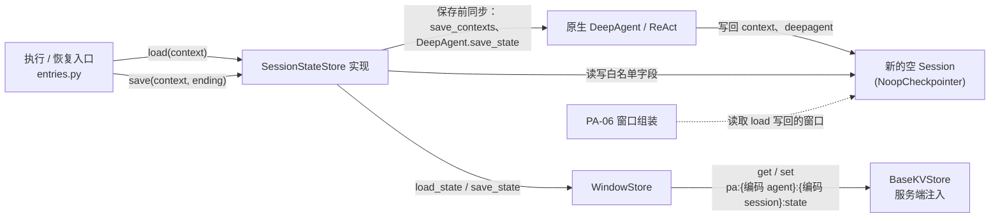
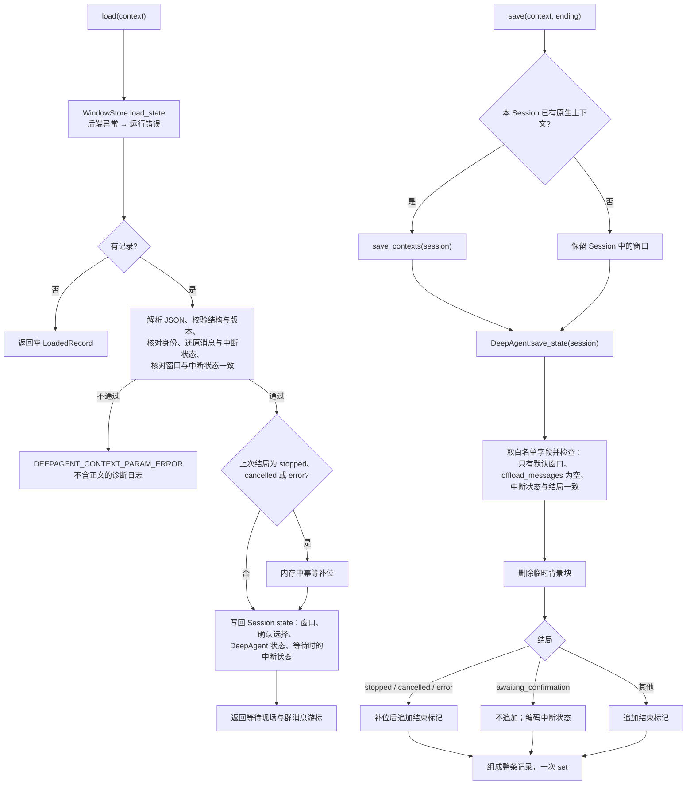

# 会话状态记录的加载与保存设计方案

## 1. 元信息

| 项 | 值 |
| --- | --- |
| 建档日期 | 2026-10-13 |
| 修订日期 | 2026-10-14：开发者确认决策，方案由草稿改为已确认；同日确认 D-06 的影响范围与后续处理未完成时的保存规则，实现 I-08 并按审阅修复配对、卸载检查与记录校验；同日确认 Q-02、Q-03 与宿主安全 Rail 约定，等待现场改为按调用内容核对，并明确两项保留限制；按第四轮审阅收紧保存失败、防篡改、消息往返与安全保证的表述；2026-10-16：补充 v0.1.20 基线冲突修复与验证，见第 9 节 |
| 范围 | agent-core `openjiuwen/harness/persistent_agent`：`SessionStateStore` 接入点与内部组件 `WindowStore` 的实现、会话状态记录的结构与序列化、保存前的窗口同步、Execution 结束时的窗口整理、中途结束后的占位补位、记录错误分类、存储键编码、卸载缓冲的前置拒绝；以及原生执行路径保留真实工具事实所需的 core 改动（D-06）。不含换窗、归档与检索（PA-11、PA-12），只提供它们共用的键编码 |
| 方案成熟度 | 已确认（2026-10-14）：D-01～D-10 均已确认；D-06 的 core 改动需要维护者评审，按开发者最新决定以“待评审”标注交付，不作为本次合入前置；Q-01～Q-03 均已确认 |
| 计划条目 | [开发计划](../designs/persistent-agent-development-plan.md) PA-10 |
| 负责人 | Song Haoran、Chen Ran |
| 状态 | 进行中：I-01～I-08 已实现并通过组件验证（2026-10-14），I-08 与审阅修复已提交，core 维护者评审待完成；真实服务端未联调，PA-10 未通过验收 |
| 设计依据 | [架构设计](../designs/persistent-agent-architecture.md) §3.4、§4.4.2、§7.2、§7.3、§8.1；[S_03](../specs/S_03_context-and-windows.md) 第 4.1、4.3、5.2、5.3 节；[S_01](../specs/S_01_public-api-and-execution.md) 执行编排 |
| 关联 feature | [F_05](F_05_execution-entries.md)（入口调用 `load` / `save` 的位置与顺序，共享接入契约见其第 3.2 节）；[F_06](F_06_window-assembly.md)（窗口标记、未配对工具调用的兜底拒绝）；PA-08 的结果交接见 [F_18](F_18_output-handoff.md)，本文 D-08 的遗留由其解决（2026-10-14） |
| 验证摘要 | 2026-10-14：I-01～I-07 组件验证 872 passed、变异检查 5 项（历史记录保留）；I-08 与三轮审阅修复后 core single_agent、agent、harness、core session 与 context_engine 共 7010 passed，变异检查 23 项均被测试发现；类型检查：`session_record.py`、`session_state.py`、`model_rail.py`、`factory.py` 自身零报错，`ability_manager.py`、`react_agent.py` 与基线相比无新增（各有 26、167 处既有错误）；PA-05 PR #72 合入后的推送前复核为 7012 passed、42 skipped，指定范围覆盖率 87.00%；完整静态检查仍有既有诊断，见第 7 节；真实服务端未验证 |
| Refs | 未关联 issue / PR |

## 2. 背景、目标与范围

### 2.1 背景与问题

实现前基线（2026-10-13）：执行入口已经按固定顺序调用会话状态记录接入点：`execution.started` 之后 `load`，原生调用结束、交出候选之后 `save`，再记账 `paused` / `final`（[entries.py](../../execution/entries.py) 的 `_load`、`_finish`）。接入点 `seams.session_state_store` 当时抛“未接入”，正式入口因此拒绝执行（I-04 起返回正式实现，见第 5.2.2 节）；共享契约 `LoadedRecord`、`ExecutionEnding`、`WaitingScene` 与 `SessionStateStore` 协议定义在 [integration.py](../../schema/integration.py)。

跨 Execution 的状态只能来自会话状态记录（S_03 I-1）。每次 Execution 使用新的空 Session 并注入 `NoopCheckpointer`，原生的 checkpointer 恢复和保存不读写存储（PA-05 已实现）。记录涉及的 Session state 字段已经核实：

| Session state 键 | 内容与类型 | 写入方 |
| --- | --- | --- |
| `context` | `{context_id: ModelContext.save_state()}`；当前窗口在 `default_context_id` 下，含 `messages`（`BaseMessage` 子类实例）、`offload_messages`、`last_context_window_access_at` | ContextEngine `save_contexts`（[context_engine.py](../../../../core/context_engine/context_engine.py)） |
| `__react_agent_interruption__` | `ToolInterruptionState`（pydantic 模型）；其中 `interrupt_requests` 的值为 `InterruptRequest` 或其子类 `AskUserRequest` | 原生中断提交（[handler.py](../../../../core/single_agent/interrupt/handler.py) `commit_interrupt`） |
| `__interrupt_auto_confirm__` | `dict[str, bool]`，“本会话记住”的确认选择 | 原生恢复时写入（同上） |
| `deepagent` | `DeepAgentState.to_session_dict()` 的结果（[state.py](../../../schema/state.py)） | `DeepAgent.save_state`；运行中的最新值缓存在 Session 对象上 |

核对代码时发现四处会影响保存结果的事实：

- **窗口可能未同步。** 原生在正常结束、中断和中止时会调用 `save_contexts` 写回 Session state，但 DeepAgent 外层的后续处理可能在其后改变内存中的上下文。另外，`save_contexts` 在当前 Session 没有原生上下文时，会把 `{}` 写入 `context`，覆盖已加载的窗口。
- **DeepAgent 状态只在正常结束时写回。** 流式路径在正常结束时才调用 `save_state` 把缓存写回 Session state；停止和异常时不写回，缓存仍挂在 Session 对象上。
- **中断请求的子类字段会丢。** `interrupt_requests` 的字段类型是 `InterruptRequest`，按模型导出时只保留基类字段，`AskUserRequest.questions` 会丢失，恢复后无法区分用户回答和工具授权。
- **工具执行中途结束时真实事实丢失或失真。** 同一批工具的结果要等整批返回后才写入窗口。停止、取消或执行中报错的结果取决于执行路径，并不总是删除整组调用：
  - 取消或错误穿出这批工具时（可并行的工具并行执行，或关闭并行执行），原生收尾 `_handle_context_abort` 调用 `_sanitize_cancelled_turn_messages`，删除不完整的工具调用组（assistant 消息与已有结果一并删除）。外部取消和执行中报错共用这一入口，Persistent 的停止和取消在 core 层都表现为取消。
  - 正在执行的是不可并行的工具时，等待它的位置吸收这次取消，整批照常收尾、不删除调用组：执行中的调用得到原生结果 “[Interrupted] Tool … execution was cancelled by user.”；已经返回、但 `AFTER_TOOL_CALL` 等后续处理还没结束的调用也得到同一结果，它已返回的事实丢失；同批尚未开始的调用由 Persistent 控制 Rail 拒绝派发。
  - 工具已返回、后续处理以中止异常结束时，原生把未经后续处理（含宿主安全 Rail 的替换）的原始结果写入窗口。
  PA-10 在其后保存：第一种拿不到这组调用，后两种保存的内容失真或未经处理，由 D-06 解决。

### 2.2 目标与关键场景

| 场景 / 触发条件 | 当前行为 | 目标行为 / 可观察变化 |
| --- | --- | --- |
| Session 第一次执行 | 接入点拒绝，正式入口不能执行 | 读不到记录，返回空 `LoadedRecord`，从空窗口开始；结束时保存第一条记录 |
| 同一 Session 的后续 Execution | 同上 | 加载最新记录写回新 Session，窗口、确认选择、DeepAgent 状态和群消息游标延续；其他 Session 的记录不可见 |
| Execution 正常结束、取消、失败或非确认暂停 | 同上 | 保存前同步原生窗口，删除临时背景块，追加执行结束标记，整条记录一次写入后再记账结束事件 |
| 等待用户确认 | 同上 | 窗口末尾待结果的工具调用不动，中断状态连同请求子类字段一起保存；结束信息只进记录元信息；确认恢复时加载出等待现场 |
| 工具执行中途被停止、取消或执行报错 | 按执行路径删除不完整的调用组，或把已返回、处理未完成的调用写成被取消；后续处理中止时写入未经处理的原始结果 | 原生保留调用组（D-06）：后续处理全部完成的结果按最终结果保留，含安全 Rail 替换后的内容；已返回或已抛错、但后续处理未完成的调用只保留说明，不含返回或错误内容（事件链走完不等于安全检查成功，拦截依赖宿主安全 Rail 的约定，见第 8.1 节）；PA-10 为仍缺结果的调用补 `stopped_tool_placeholder` 结果，内容为“结果未取得，实际效果需核实”；新实例加载后可执行下一任务；加载、保存和关键记账失败仍按原规则报错 |
| 存储读写失败 | 同上 | 按运行异常处理：加载时不调用模型，保存时不记结束事件 |
| 记录损坏 | 同上 | 按校验拒绝处理（`DEEPAGENT_CONTEXT_PARAM_ERROR`），记录不含正文的诊断日志；不调用模型、不退回空窗口、不覆盖原记录 |
| 挂载会产生消息卸载的处理器 | 构造时只按 Rail 类型拒绝 `ContextProcessorRail` | 构造时和 Rail 注册完成后分别检查实际的处理器列表，执行前拒绝；保存时卸载缓冲不为空则保存失败 |

### 2.3 本次范围与非目标

- 本次包含：记录结构与序列化；`WindowStore` 的 `load_state` / `save_state`；`SessionStateStore` 实现及 `seams.session_state_store` 接线；保存前的窗口与 DeepAgent 状态同步；结束整理；等待确认现场的保存与加载；中途结束的补位及加载时修补；群消息游标；`ExecutionEnding` 全部字段的保存；记录错误分类及入口加载路径的映射；存储键编码与公开的键前缀函数；卸载处理器的执行前拒绝与保存兜底；原生事实保留的 core 改动（D-06）。
- 本次不包含：换窗、旧窗归档与历史检索（PA-11、PA-12）；可重新获取的大结果改为来源引用（容量相关，待“容量边界”对齐）；续做时清理过期中断现场和读取执行日志（PA-17、PA-18）；交互回复适配（PA-09）；`pending_answer` 跨 Request 的保留与清理（D-08；2026-10-14 由 F_18 退出 `pending_answer`，开发阶段无历史数据，兼容代码已删除）；task-loop 与子代理继续按 PA-05 门禁拒绝；宿主安全 Rail 拦截后立即阻断同批尚未开始的调用（一期边界，见第 8.2 节）；确认恢复后把实际执行的参数写回窗口（开放确认恢复前的验收条件，见第 8.2 节）。

## 3. 设计约束、假设与待决问题

- **已确认约束与依赖：**
  - 架构 §7.2 的顺序：整理窗口 → 保存会话状态记录 → 记账 `paused` / `final`；只覆盖保存整理后的当前窗口，不另存快照。
  - 架构 §7.3：白名单以外的 Session state 不保存；所有字段写在同一条记录里，用后端 `set` 一次写入；后端是服务端注入的 `BaseKVStore`（[ports.py](../../ports.py) 构造时检查类型），由服务端保证持久化、命名空间隔离和工具不可访问。
  - 失败语义：加载失败不开始执行、不退回空窗口；保存失败按崩溃续做处理，不记结束事件（S_03 第 4.1、4.3 节）。
  - [错误码规则](../../../../../.claude/rules/error-codes.md)：只经统一异常体系抛错，不新增私有异常类或 core 错误码，不按错误码分支。
  - 窗口标记沿用 PA-06：`WINDOW_PART_KEY` 的取值 `execution_header`、`temporary_background`；停止补位标记 `stopped_tool_placeholder` 已在 [integration.py](../../schema/integration.py) 定义。
  - PA-06 在加载之后、追加之前兜底检查未配对的工具调用和等待中的中断（[window_assembly.py](../../execution/window_assembly.py)），本次保留。
- **关键假设：**
  - 一期不开 task-loop 和子代理，Session state `context` 中只有 `default_context_id` 一个窗口；子代理的中断路径不会出现。实现时用测试核实，不成立时保存失败（第 5.6 节）。
  - 消息类 `UserMessage`、`AssistantMessage`、`ToolMessage`、`SystemMessage` 能经 JSON 导出后按 `role` 还原：执行相关字段（工具调用的 `id`、`type`、`name`、`arguments`、`response_item_id` 与 `tool_call_id`）和 `metadata` 保持一致；工具调用的流式 `index` 不保留——消息格式不写出它，它只用于流式拼接。实现时用往返测试核实。
- **待决问题：**
  - **Q-01 原生事实保留的影响范围（2026-10-14 已解决）。** 原生只有一个清理入口 `_handle_context_abort`，外部取消和执行中报错都走它，Persistent 的停止和取消在 core 层都表现为取消。开发者确认选项 A：开关作用于整个清理入口，停止、取消和执行报错都保留已取得的真实工具结果，不需要把停止原因传入 core。方案见 D-06 与第 5.9 节，被排除的选项见第 4.3 节 R-10、R-11。
  - **Q-02 core 说明文字的语言（2026-10-14 已解决）。** 已返回或已抛错、但后续处理未完成的调用，由 core 生成说明（D-06 规则 2、3）。开发者确认保持英文，与原生已有的 “[Interrupted] …” 一致，语义与开发者给出的中文说明相同；不新增 core 与 PA-10 之间的标记约定。
  - **Q-03 停止后被拒绝派发的调用在窗口中的结果（2026-10-14 已解决）。** 停止、取消或致命错误之后，`PersistentModelCallRail.before_tool_call` 用强制结束跳过尚未开始的调用，原生原本把强制结束载荷的文字作为该调用的结果写入窗口，例如 `{'result_type': 'persistent_pause', 'reason': 'error', 'detail': 'execution is stopping', 'output': ''}`，PA-10 接入后会随记录进入下一任务，停止时也显示 `error`。开发者批准修改 PA-05 的控制 Rail：跳过调用时同时写入工具结果“本次执行正在结束，该工具未调用。”（`SKIPPED_TOOL_TEXT`）。同一处代码处理停止、取消和致命错误，文案按三者通用的写法；致命错误时入口抛出原错误、不保存记录，说明只出现在内存窗口中。强制结束载荷不变，入口仍据此判定结局（[F_05](F_05_execution-entries.md) 附录 A.2）。
  - **宿主安全 Rail 的约定（2026-10-14 已确认）。** 回调框架对 Rail 的普通异常只记日志、继续执行其余 Rail，不算处理被打断（第 8.1 节）。开发者确认：宿主安全 Rail 要拦截一个工具结果时，先把结果替换成安全说明，再请求强制结束；窗口保留安全说明，然后结束任务。强制结束在整批工具收尾后停止后续推理，不能保证阻止同批尚未开始的调用；同批其他调用由模型在看到被拦截内容之前发出。这作为一期边界保留；宿主若要求立即阻断后续操作，须另行确认 core 方案。
  - **与 PA-08 的联动。** `pending_answer` 的生命周期暂缓（D-08）。PA-08 的 D3 若选择“把未交出的登记存进会话状态记录”，本方案须增加按 Request 保存和清理登记的结构；D3 的其他选项只要求 `output_refs` 按结局原样保存，本方案已满足。（2026-10-14 结论：F_18 采用增强窗口方案 A′，登记依据保存在窗口中，不新增按 Request 保存的结构；`pending_answer` 退出，记录版本保持 1。）

## 4. 总体方案与设计取舍

### 4.1 方案概览

`SessionStateStore` 的实现位于执行入口与存储后端之间：`load` 从后端读出整条记录，先校验再写回新 Session 的 state；`save` 先让原生把最新窗口和 DeepAgent 状态同步到 Session state，再取出白名单字段，整理窗口后连同结束信息组成一条记录，用一次 `set` 写入。`WindowStore` 负责键的派生和后端读写，把后端异常统一转成运行错误，不理解记录内容。原生执行路径在开关打开时保留中途结束的工具调用组，后续处理已完成的结果按最终结果保留、未完成的只留说明（D-06），PA-10 只负责补位和保存。



实线是调用方向，虚线表示 PA-06 在 `load` 之后读取同一份 Session state。存储基础设施由服务端提供，本模块只定义记录格式、键编码和读写逻辑。

### 4.2 关键决策

以下决策均由开发者于 2026-10-14 确认；D-06 的影响范围于同日确认，见第 3 节 Q-01。

#### D-01 保存前同步真实窗口

- 选择与依据：`save` 先通过构造绑定中的实例弱引用取得 `DeepAgent.react_agent.context_engine`，用 `get_context(session_id=…)` 判断本 Session 是否已有原生上下文。有则调用 `save_contexts(session)`，把内存中的最新窗口写回 Session state；没有（原生尚未创建上下文，例如在第一次模型调用前就被停止）则保留 Session 中已加载或已装配的窗口，不调用 `save_contexts`，避免 `{}` 覆盖有效内容。同步失败时终止保存：不调用后端写入、不保存旧快照、不记结束事件。
- 代价与成立条件：依赖构造绑定在 `save` 时仍持有实例（`save` 在实例关闭前调用）。
- 实现体现：第 5.5、5.6 节；PA-10-V-15、V-16。
- 确认依据：开发者 2026-10-14 决策 1。

#### D-02 带类型标记的中断状态编解码

- 选择与依据：`ToolInterruptionState` 的各层结构逐层显式编码，`interrupt_requests` 中每个请求带稳定的类型标记，保存该类型的全部字段，加载时按标记恢复对应的原生对象。类型白名单为 `InterruptRequest`（标记 `interrupt_request`，权限、确认、安全类 Rail 使用）和 `AskUserRequest`（标记 `ask_user_request`，保留 `questions`）。按精确类型匹配，白名单类的子类也视为未知类型；未知类型或未知标记明确失败，不降级为基类，不根据存储内容动态导入类型。
- 代价与成立条件：新增中断请求类型时须扩充白名单和测试；子代理的中断路径一期不出现，出现即失败。
- 实现体现：第 5.2、5.4 节；PA-10-V-04、V-17。
- 相关候选：直接用 `ToolInterruptionState.model_dump` / `model_validate` 往返（子类字段丢失）。
- 确认依据：开发者 2026-10-14 决策 2。

#### D-03 保存 DeepAgent 状态快照

- 选择与依据：把 DeepAgent 已定义的可序列化快照（Session state 的 `deepagent`，`DeepAgentState.to_session_dict()`）纳入白名单。保存前调用 `DeepAgent.save_state(session)`，把缓存在 Session 对象上的最新状态写回 Session state；没有缓存时保留加载时写回的值。加载时原样写回 `deepagent`，由 DeepAgent 按需读取。task-loop 和子代理继续按 PA-05 门禁拒绝，不因保存状态而开放。
- 代价与成立条件：快照中只有 `plan_mode` 是会话级字段，`iteration`、`task_plan`、`stop_condition_state`、`pending_follow_ups` 按次使用。一期单轮执行时，后三者只在 task-loop 路径中读写，跨 Request 恢复不产生效果；task-loop 只在正常结束时清空 `stop_condition_state`，`pending_follow_ups` 是排队中的追加消息。因此在开发计划 PA-24 增加门禁：开放 task-loop 前须核实这些字段跨 Request 的生命周期。
- 实现体现：第 5.4、5.5 节；PA-10-V-18。
- 相关候选：只保存 `plan_mode`（未采用）；一期不保存（原草稿 D-03，已替代，见第 9 节）。
- 确认依据：开发者 2026-10-14 决策 3。

#### D-04 区分无效记录与存储运行故障

- 选择与依据：采用统一异常体系，按处理边界区分：
  1. 后端 `get` / `set` 抛出的任何异常，在 `WindowStore` 中统一转成 `DEEPAGENT_RUNTIME_ERROR` 并保留原因；即使后端抛出的是校验类异常，也不据此认定记录损坏。
  2. 读取成功后再解析和校验：JSON 损坏、结构不合法、版本不支持、身份不匹配、消息或中断请求无法恢复、窗口与中断状态不一致，使用 `build_error(DEEPAGENT_CONTEXT_PARAM_ERROR, …)`，并记录不含正文的诊断日志。pydantic 的 `ValidationError` 在解析边界转换，不让它冒充框架的同名异常。
  3. 入口的加载路径按异常类型放行框架的 `ValidationError`，其他异常按运行故障处理；保存路径的所有失败仍按运行故障处理。不比较错误码，不把所有 `BaseError` 透传。
  加载失败不调用模型、不退回空窗口、不自动覆盖原记录；保存失败不记结束事件。`load` / `save` 接口不变。
- 代价与成立条件：损坏的记录会让该 Session 之后的 Request 都被拒绝，需要服务端告警并人工处理。
- 实现体现：第 5.3、5.6 节；I-05；PA-10-V-09、V-10。
- 相关候选：包内私有异常类（不能豁免错误码规则）；已分类的 `BaseError` 全部透传（会把后端抛出的校验类异常误判为记录损坏）。
- 确认依据：开发者 2026-10-14 决策 4。

#### D-05 存储键分别编码并导出键前缀函数

- 选择与依据：对 `agent_id` 和 `session_id` 分别做标准百分号编码（`urllib.parse.quote(value, safe="")`，冒号和百分号都转义），再拼成 `pa:{编码 agent_id}:{编码 session_id}:`，状态键为前缀加 `state`。归档键、归档索引键（PA-11、PA-12）和宿主按前缀清理都用同一规则；`openjiuwen.harness.persistent_agent` 导出 `session_key_prefix(agent_id, session_id)` 供宿主直接调用，避免两边各写一套编码。记录中保留原始 ID，身份比较用原值，不做大小写、空白或其他归一化。宿主的命名空间隔离责任不变。
- 代价与成立条件：新增一个公开函数；架构 §7.3 的键表改为编码后的写法。
- 实现体现：第 5.2 节；PA-10-V-19。
- 确认依据：开发者 2026-10-14 决策 5。

#### D-06 由原生执行路径保留中途结束时的真实工具事实

- 选择与依据：在原生执行路径中增加事实保留能力，由 Persistent 通过显式开关启用，个人版沿用现有行为。实现明确区分“刚取得结果”和“后续处理全部完成”（`AFTER_TOOL_CALL`、`ON_TOOL_EXCEPTION` 等 Rail，含宿主安全 Rail 的替换）；临时记录里只放可以进入窗口的消息，不能因为临时记录里已有消息就使用原始内容。按三条规则处理：
  1. 后续处理全部完成：保存最终处理后的结果，包括安全 Rail 替换后的内容。
  2. 工具已经返回，但后续处理被停止、取消或报错打断：只保存说明——工具调用已返回，但结果处理未完成；返回内容未纳入窗口，实际效果需核实。
  3. 工具自身抛出异常，错误内容的后续处理未完成：只记录说明——工具调用抛出异常，错误内容未纳入窗口，实际效果需核实；不写成工具已执行完毕。

  整批结果成功写入窗口后才清空临时记录；停止、取消或执行中报错时保留调用组和临时记录中的消息。批内吸收取消后的整批收尾（不可并行的工具）与中止清理两条路径都遵循以上规则。工具甲已上传成功、工具乙执行时报错的情况与停止、取消相同，统一处理。这些事实能帮助下一任务避免盲目重做，但不能保证绝不重复执行，也不能证明外部操作成功。PA-10 为仍缺结果的调用补 `stopped_tool_placeholder` 结果，内容统一为“结果未取得，实际效果需核实”，不把报错描述成停止，具体结束原因由结束记录说明；该标记沿用原名，覆盖停止、取消和报错三种情况。不推断工具成功或失败，不重复已有真实结果、原生中断结果或已有补位；正常等待确认的调用不补位；保存和加载修补都覆盖 `stopped`、`cancelled` 或 `error` 三种结局。补位不改变故障处理：加载、保存和关键记账失败仍按原规则报错，不当作普通执行结束。
- 代价与成立条件：需要改 core 的 `react_agent.py` 与 `ability_manager.py`，需要 core 维护者评审；开发者确认以“待评审”标注交付，不作为本次合入前置（第 9 节）。开关打开时报错路径的清理行为也随之改变。后续处理被打断的调用只留说明，下一任务看不到返回内容，须自行核实；说明文字由 core 生成，现为英文（Q-02）。只有让后续处理真正中止的情况才按规则 2、3 处理：回调框架记录 Rail 的普通异常后继续执行其余 Rail，这种情况视为处理完成（第 8.1 节）。
- 实现体现：第 5.5、5.9 节；PA-10-V-07、V-14、V-20、V-23～V-30。
- 相关候选：R-03、R-04、R-05、R-10、R-11、R-12（第 4.3 节）。
- 确认依据：方向为开发者 2026-10-14 决策 6；影响范围为同日确认的选项 A，并调整补位文案与适用结局；后续处理未完成时的保存规则为同日确认的选项 B。

#### D-07 一期不支持消息卸载

- 选择与依据：会写卸载缓冲的是 core 的四个上下文处理器：`ToolResultBudgetProcessor`、`MessageOffloader`、`MessageSummaryOffloader` 和分叉版 `MessageOffloader`（经 `ContextProcessor.offload_messages`；卸载到文件时写入工作空间目录，同样不允许）。它们只能经 `ReActAgentConfig.context_processors` 挂载，而 Rail 在首次调用时才注册，Rail 的 `init` 可以在构造检查之后写入该列表。因此分三层：
  1. 构造时：保留按类型拒绝 `ContextProcessorRail`，并检查装配后的 `context_processors`。
  2. Rail 注册完成后、ReAct 创建上下文前：`PersistentModelCallRail` 增加 `before_invoke` 回调，检查实际的处理器列表，发现上述类型即按 `DEEPAGENT_CONFIG_PARAM_ERROR` 标记致命错误并停止，入口在原生退出后抛出该错误，不保存、不记结束事件。
  3. 保存时：`offload_messages` 不为空则保存失败，按运行异常处理，不丢弃缓冲内容、不覆盖旧记录、不记结束事件。
- 代价与成立条件：按类型名单识别；core 新增会卸载的处理器时须同步名单。`ContextEngineConfig` 本身没有卸载开关。
- 实现体现：第 5.6 节；PA-10-V-12、V-21。
- 确认依据：开发者 2026-10-14 决策 7。

#### D-08 待交接完整答案的生命周期暂缓

- 选择与依据：在 PA-08 明确无损拆分及失败恢复方案之前，现行契约（保存完整答案）仍有效：`save` 把 `ExecutionEnding.pending_answer` 原样写入记录的结束信息，PA-10 验证这一保存。下一 Execution 保存时结束信息会被覆盖，因此这不是完整方案；不删除该字段，不实现待交接答案集合。加载的记录带有 `pending_answer`、而本次保存会覆盖它时，记录一条不含正文的 error 日志（含 Session、两次的 request_id 与 execution_id），便于发现丢失。
- 代价与成立条件：完整链路需 PA-05、PA-08、PA-10 联合验收；PA-08 负责主验证。
- 后续（2026-10-14）：由 [F_18](F_18_output-handoff.md) 解决。超长回答拆成有序分段交出，完整正文随窗口保存，不再产生 `pending_answer`；记录版本保持 1；覆盖 error 日志随之删除。开发阶段尚未实际运行、没有历史数据，`RecordEnding` 不再有该字段，带该键的记录（含值为 null）按严格模型判为无效记录，不做迁移（F_18 第 7 节）。本节上文为当时结论。
- 实现体现：第 5.5 节；PA-10-V-13、V-22。
- 确认依据：开发者 2026-10-14 决策 8。

#### D-09 窗口整理规则

- 选择与依据：按架构 §7.2 细化：已保存的历史段落原样保留；删除带 `temporary_background` 标记的消息；PA-06 的执行头已是一行，保持原样。结局不是等待确认时，在窗口末尾追加一条 `UserMessage`，`metadata` 带 `WINDOW_PART_KEY=execution_end`（新增取值），内容为一行，写法与执行头一致，含 request_id、execution_id、结局、交出的候选（注明以结束记录为准）和群消息扫描位置。等待确认时，窗口末尾待结果的调用保持不动，结束信息只进记录元信息；确认恢复的 Execution 结束时写自己的结束标记。正常等待确认的未配对调用是合法现场，不判为记录损坏。
- 代价与成立条件：窗口中会出现连续的用户消息（结束标记后紧跟下一次的执行头），PA-06 的执行头与背景已是如此。
- 实现体现：第 5.5 节；PA-10-V-03、V-04。
- 相关候选：结束标记用 `AssistantMessage`（像是模型自己说的话）或 `SystemMessage`（部分模型接口不支持对话中途的系统消息）。
- 确认依据：开发者 2026-10-14“其余窗口整理规则按当前架构细化”。

#### D-10 记录格式：JSON 加版本号

- 选择与依据：记录序列化为 JSON，带 `schema_version=1`。消息按 `role` 还原为对应消息类，中断状态按 D-02 编解码。JSON 不会在反序列化时执行代码；结构、版本与身份校验拒绝非法记录，但结构合法的改动（例如改写消息正文）仍能加载，不能当作防篡改保证——记录不被工具改写依赖宿主对存储的隔离（架构 §7.3）。版本号让以后的格式变化可判断、可迁移。
- 代价与成立条件：core 消息或中断状态的字段变化可能导致旧记录无法还原，由往返测试守住；不兼容时按 D-04 校验拒绝。
- 实现体现：第 5.4 节；PA-10-V-11。
- 相关候选：pickle（存储内容可被利用执行代码，且格式绑定 Python 与 core 内部版本）。
- 确认依据：开发者 2026-10-14 决策 4 中“非法 JSON、版本不支持”的分类。

### 4.3 替代方案与排除理由

| 候选 / 关联决策 | 候选目的与关键差异 | 拒绝或暂缓原因 | 重新评估条件 |
| --- | --- | --- | --- |
| R-01 / D-04 包内私有异常类 | 用只在本包使用的异常类型标记无效记录 | 内部使用不能豁免错误码规则 | 无 |
| R-02 / D-04 透传所有已分类的 `BaseError` | 入口不区分来源 | 后端抛出的校验类异常会被误判为记录损坏 | 无 |
| R-03 / D-06 Persistent 侧 Rail 记录本轮工具调用 | 不改 core，停止后由 PA-10 把被删除的调用组放回 | 开发者选择由原生执行路径保留事实（2026-10-14） | 无 |
| R-04 / D-06 接受原生删除 | 事实只留在执行日志 | 与架构 §7.2 的补位要求冲突，下一任务可能重复执行有外部效果的操作 | 无 |
| R-05 / D-06 每个结果完成即写入窗口 | 不需要临时记录 | 改变正常路径上结果的顺序和可见性，影响面更大 | 无 |
| R-06 / D-03 只保存 `plan_mode` | 避开按次使用的字段 | 开发者选择保存已定义的完整快照，按次字段由 PA-24 门禁核实 | PA-24 核实发现跨 Request 有害时 |
| R-07 / D-05 宿主自行实现编码 | 不新增公开函数 | 两边各写一套编码容易不一致 | 无 |
| R-08 / D-10 pickle | 实现最简单 | 安全与版本绑定问题 | 无 |
| R-09 / 记录结构 窗口与中断状态分键保存 | 分别读写 | 违背架构 §7.3“一次写入” | 无 |
| R-10 / D-06 开关只作用于取消分支 | 停止与取消保留事实，报错仍删除 | 报错时已执行工具的事实同样会丢，与停止、取消属于同一问题（开发者 2026-10-14） | 无 |
| R-11 / D-06 开关只作用于停止 | 把停止原因传入 core，只在停止时保留 | 共享接口更大，取消与报错仍丢事实（开发者 2026-10-14） | 无 |
| R-12 / D-06 保存刚取得的原始结果 | 工具一返回就把原始结果记为可用，后续处理未完成时直接写入窗口 | 未经安全 Rail 等后续处理的内容可能含应被替换或拦截的信息，会进入窗口和记录（开发者 2026-10-14 选择 B） | 无 |

## 5. 详细设计

### 5.1 模块责任与关键不变量

- **执行入口（PA-05，已实现）**：决定何时 `load`、`save`，把结局、回复目标、交出的候选、超长答案和群消息游标组成 `ExecutionEnding` 交给 `save`。本次只调整 `_load` 的错误映射（D-04）。
- **`SessionStateStore` 实现（本次）**：同步、整理、补位、编解码与校验；理解 Session state 白名单字段、窗口标记和结束信息。
- **`WindowStore`（本次）**：派生键、读写整条记录，把后端异常转成运行错误；后续 PA-11、PA-12 在同一组件上增加归档和检索。
- **`PersistentModelCallRail`（PA-05，本次增加检查）**：Rail 注册完成后检查实际挂载的处理器（D-07）。
- **原生执行路径（core，D-06）**：开关打开时保留中途结束的工具调用组，按后续处理是否完成保留最终结果或说明。
- **服务端**：注入持久的 `BaseKVStore`，保证命名空间隔离、工具不可访问；用 `session_key_prefix` 按前缀清理。

本次须保持的不变量沿用 [S_03](../specs/S_03_context-and-windows.md)：I-1 唯一状态、I-3 最新窗口、I-4 保存先行、I-5 私有存储。另外保证：

- 记录只含白名单字段，整条记录一次 `set` 写入；读到的记录必须属于本 Agent、本 Session（原始 ID 精确比较）。
- 加载失败时不写后端；保存在写入前失败（同步、检查、编码）时不调用后端写入，原记录不变；后端写入本身抛错时不能保证记录未改变，后端可能已写入新记录。加载时的修补只作用于内存，不回写。
- 等待确认时窗口末尾待结果的工具调用不被追加、补位或删除。
- 补位幂等：已有真实结果、原生中断结果或已有补位的调用不重复补位。

### 5.2 关键类与函数设计

以下路径和名称为本次的目标设计，实现时如有调整同步本节。

#### 5.2.1 关键类定义与说明

| 类名 / 所属模块 | 变更类型与可见范围 | 职责与边界 | 继承 / 实现 / 组合关系 |
| --- | --- | --- | --- |
| `schema/session_record.py` 的 `SessionStateRecord` | 新增；内部 | 记录结构与校验；消息、中断状态的编解码 | pydantic 模型，`extra="forbid"` |
| `execution/session_state.py` 的 `WindowStore` | 新增；内部 | 派生键，读写整条记录，后端异常转运行错误 | 组合注入的 `BaseKVStore` |
| `execution/session_state.py` 的 `ExecutionStateStore` | 新增；内部 | 实现 `SessionStateStore`：加载写回、同步、整理、补位、保存 | 实现 [integration.py](../../schema/integration.py) 的协议；组合 `WindowStore` |

##### SessionStateRecord

| 关键属性 | 类型与初始值 | 含义与约束 | 更新主体与时机 |
| --- | --- | --- | --- |
| `schema_version` | `Literal[1]` | 记录格式版本；其他值按 D-04 校验拒绝 | 保存时固定写入 |
| `agent_id` / `session_id` | `str` | 原始身份；加载时须与本次执行精确相等 | 保存时取自 `context.execution` |
| `messages` | `list[dict]` | 整理后的窗口，元素为消息的 JSON 导出，含 `role` | 保存时 |
| `interruption` | `dict \| None = None` | D-02 编码的中断状态；只在结局为等待确认时非空 | 保存时 |
| `auto_confirm` | `dict[str, bool] = {}` | “本会话记住”的确认选择 | 保存时 |
| `deepagent_state` | `dict \| None = None` | `DeepAgentState.to_session_dict()` 的结果 | 保存时 |
| `ending` | `RecordEnding` | `outcome`、`request_id`、`execution_id`、`reply_target`、`output_refs`、`last_group_message_id` | 保存时取自 `ExecutionEnding` 和 `context.execution`；原有的 `pending_answer` 已于 2026-10-14 删除，带该键的记录判为无效（D-08 后续） |

##### WindowStore

| 关键方法签名 | 职责与调用条件 | 参数与返回值说明 | 异常与副作用 |
| --- | --- | --- | --- |
| `async def load_state(self, agent_id: str, session_id: str) -> str \| bytes \| None` | 读取该 Session 的记录 | 返回原始值；没有记录时返回 `None` | 后端任何异常转为 `DEEPAGENT_RUNTIME_ERROR`，保留原因 |
| `async def save_state(self, agent_id: str, session_id: str, payload: str) -> None` | 一次 `set` 写入整条记录 | `payload` 为已序列化的记录 | 同上；覆盖原记录 |

##### ExecutionStateStore

| 关键方法签名 | 职责与调用条件 | 参数与返回值说明 | 异常与副作用 |
| --- | --- | --- | --- |
| `async def load(self, context: PersistentBuildContext) -> LoadedRecord` | 入口在 `execution.started` 之后调用 | 返回等待现场（结局为等待确认时）与群消息游标；没有记录时返回空 `LoadedRecord` | 写回 Session state；记录无效时抛 `DEEPAGENT_CONTEXT_PARAM_ERROR`，不写 Session state |
| `async def save(self, context: PersistentBuildContext, ending: ExecutionEnding) -> None` | 入口在交出候选之后、记账结束事件之前调用 | `ending` 由入口构造 | 同步原生状态后一次写入后端；任何失败抛运行错误：写入前失败不调用写入，后端写入抛错时记录可能已改变 |

#### 5.2.2 关键函数定义与说明

| 函数 / 所属模块 | 完整签名与变更类型 | 职责与调用方 | 输入输出及行为约束 |
| --- | --- | --- | --- |
| `execution/session_state.py` 的 `session_key_prefix` | `def session_key_prefix(agent_id: str, session_id: str) -> str`；新增；公开（经 `openjiuwen.harness.persistent_agent` 导出） | 本模块派生状态键；PA-11、PA-12 派生归档键；宿主按前缀清理 | 返回 `pa:{quote(agent_id, safe="")}:{quote(session_id, safe="")}:`；不同身份组合不会得到相同前缀 |
| `schema/session_record.py` 的中断状态编解码 | `def encode_interruption(state: ToolInterruptionState) -> dict`；`def decode_interruption(data: dict) -> ToolInterruptionState`；新增；内部 | `save` / `load` 调用 | 按 D-02 的类型白名单精确匹配；编码遇到未知类型抛运行错误，解码遇到未知标记抛 `DEEPAGENT_CONTEXT_PARAM_ERROR` |
| `execution/session_state.py` 的 `tidy_window` | `def tidy_window(messages: list[BaseMessage], ending: ExecutionEnding, execution_id: str) -> list[BaseMessage]`；新增 | `save` 调用 | 按 D-09 删除临时背景块、追加结束标记；不修改其他消息 |
| `execution/session_state.py` 的 `patch_stopped_calls` | `def patch_stopped_calls(messages: list[BaseMessage]) -> list[BaseMessage]`；新增 | 结局为 `stopped`、`cancelled` 或 `error` 的 `save`，以及加载这三种结局的记录时调用 | 按调用组判断：本组调用之后连续的工具消息里没有结果的调用，在该组结果之后补占位结果，内容为“结果未取得，实际效果需核实”；幂等；其他组用过的同一调用 ID 不算本组的结果 |
| `execution/session_state.py` 的 `unpaired_tool_calls` | `def unpaired_tool_calls(messages: list) -> list[str]`；新增 | 加载校验、保存检查与补位判断 | 按调用组配对：结果只在本组调用之后连续的工具消息中计入；按窗口顺序返回没有结果的调用；补位与原生中断结果都算结果 |
| `execution/session_state.py` 的 `offloading_processors` | `def offloading_processors(agent) -> list[str]`；新增 | 构造入口与 `PersistentModelCallRail.before_invoke` | 识别 `ReActAgentConfig.context_processors` 中会卸载消息的处理器：配置名是已知卸载处理器之一，或引擎登记的类继承自 `MessageOffloader` 或分叉版 `MessageSummaryOffloader`（以新名称登记的子类也能识别）；按类路径比较，不导入处理器模块，避免重新登记 |
| `execution/seams.py` 的 `session_state_store` | 修改 | 入口取接入点 | 由抛“未接入”改为返回绑定 `context.ports.window_backend` 的 `ExecutionStateStore` |
| `execution/entries.py` 的 `_load` | 修改 | 入口加载记录 | 框架的 `ValidationError` 原样透传，其他异常包成 `DEEPAGENT_RUNTIME_ERROR`；保存路径不变 |
| `execution/model_rail.py` 的 `PersistentModelCallRail.before_invoke` | 新增回调 | Rail 注册完成后、ReAct 创建上下文前 | 按 D-07 检查实际处理器；发现会卸载的类型即标记致命错误并停止 |

窗口所在的 Session state 键 `context` 与 `default_context_id` 目前是 [window_assembly.py](../../execution/window_assembly.py) 的私有常量，本次移到 [integration.py](../../schema/integration.py) 供两处共用，并新增标记取值 `EXECUTION_END = "execution_end"`。

### 5.3 接口定义与消息契约

`SessionStateStore` 协议签名不变（[integration.py](../../schema/integration.py)）：

| 入口 / 消息 | 调用方 / 消费者 | 输入与成功结果 | 失败语义 |
| --- | --- | --- | --- |
| `load(context) -> LoadedRecord` | 执行与恢复入口 | 最新记录写回新 Session；无记录时返回空 `LoadedRecord` | 后端异常：运行错误，不开始执行；记录无效：`DEEPAGENT_CONTEXT_PARAM_ERROR` 加诊断日志，入口透传 |
| `save(context, ending) -> None` | 执行与恢复入口 | 同步后整理的整条记录写入后端 | 任何失败：运行错误，不记结束事件 |
| `session_key_prefix(agent_id, session_id) -> str` | 本模块、PA-11 / PA-12、宿主 | 编码后的键前缀 | 无 |

`LoadedRecord.waiting` 在记录结局为 `awaiting_confirmation` 时取 `WaitingScene(request_id, reply_target)`，其余为 `None`；`last_group_message_id` 取记录结束信息中的群消息游标。

### 5.4 数据模型与事实归属

| 数据 | 语义与隔离范围 | 权威位置 | 创建、更新与释放 |
| --- | --- | --- | --- |
| 会话状态记录 | Session 最新已保存的现场；按 Agent 与 Session 隔离 | 后端键 `session_key_prefix(…) + "state"` | 每次 Execution 结束覆盖保存；服务端按前缀清理 |
| 窗口 `messages` | 当前窗口；只取 `default_context_id` | 记录的 `messages` | 加载时写回 Session state；执行中由原生和 PA-06 追加；保存时同步、整理后写回记录 |
| 中断状态 | 等待确认的现场，含请求子类字段 | 记录的 `interruption` | 只在结局为等待确认时保存；加载时写回 `__react_agent_interruption__` |
| 确认选择 | “本会话记住”，Session 内有效 | 记录的 `auto_confirm` | 每次保存；加载时写回 `__interrupt_auto_confirm__` |
| DeepAgent 状态 | `DeepAgentState` 的可序列化快照 | 记录的 `deepagent_state` | 每次保存（先同步缓存）；加载时写回 `deepagent` |
| 结束信息 | 上次 Execution 的结局、交出的候选、群消息游标（超长答案自 2026-10-14 起不再保存，见 D-08 后续） | 记录的 `ending` | 每次保存覆盖 |

白名单之外的 Session state（例如 `__session_memory__`、`offload_messages`、`last_context_window_access_at`、各 Rail 的私有状态）不保存。消息只认 `user`、`assistant`、`tool`、`system` 四种 `role`。

### 5.5 正常执行流程



1. **加载**：后端读取与解析校验分开处理（D-04）。消息的 `role` 不是字符串、或还原时抛出类型错误，都按无效记录处理。工具结果只能紧跟在本组调用之后，出现在其他位置、属于其他组或重复的结果判为无效。窗口与中断状态的一致性规则：结局为等待确认当且仅当有中断状态；等待确认时，只有最后一组调用可以缺结果，该组的调用与中断状态 `ai_message` 的调用逐个一致，缺结果的调用恰好是 `interrupted_tools` 中的调用，每个中断条目中的调用也与窗口中同 ID 的调用一致，这是合法现场。调用按 ID、类型、名称和参数比较，不只比较 ID：原生恢复执行的是中断条目中调用的副本，必须与窗口中显示的调用相同；`index` 只用于流式拼接，消息格式不保存，不参与比较。保存时不在三者之间互相覆盖，不一致即保存失败，加载时判为无效；结局为 `stopped`、`cancelled` 或 `error` 时，缺结果的调用按 D-06 补位；其他结局出现缺结果的调用判为无效。校验通过后才写回 Session state。
2. **执行中**：PA-06 在加载的窗口末尾追加执行头和临时背景块，原生 ReAct 追加任务输入和工作过程，本次不介入。
3. **保存**：
   - 同步原生窗口（D-01）和 DeepAgent 状态（D-03）。
   - 取 `default_context_id` 的 `messages`；存在其他窗口、`offload_messages` 不为空、结局为等待确认却没有中断状态，均按保存失败处理（D-07、5.6 节）。
   - 删除临时背景块，执行头保持原样，结局为 `stopped`、`cancelled` 或 `error` 时补位，按 D-09 处理结束标记。其他结局（不含等待确认）若仍有缺结果的调用，按保存失败处理，因为这样的记录加载时会被判为无效；工具结果不紧跟本组调用、或等待现场与中断状态不符时同样按保存失败处理。
   - 组成 `SessionStateRecord`，序列化后一次 `set` 写入。
   - 写入成功后，若加载时带有 `pending_answer` 而本次覆盖了它，记 error 日志（D-08）；后端写入抛错时同样记一条，注明“可能已覆盖”；写入前失败时原记录不变，不记该日志。（2026-10-14 随 `pending_answer` 退出删除，见 D-08 后续。）

结束标记示例：`【执行结束】request_id：R1；execution_id：E1；结局：已完成；交出候选：out_…（以结束记录为准）；群消息已扫描到：M180`。（2026-10-14 起“交出候选”改写交接摘要，例如“最终回答 1 段、文件 reports/q3.md（upload，out_…）”，整批准备失败时追加“未交接原因”，见 [F_18](F_18_output-handoff.md) 第 5.5 节。）

### 5.6 异常、中断与重试处理

- **加载时后端异常**：`WindowStore` 转成运行错误，入口包成 `DEEPAGENT_RUNTIME_ERROR`，不调用模型；已记 `execution.started`，服务端按运行异常核对后续做。
- **加载时记录无效**：抛 `DEEPAGENT_CONTEXT_PARAM_ERROR`，诊断日志含 Session、execution_id 与失败类别，不含记录正文；入口透传，服务端不续做；不退回空窗口，不覆盖原记录。
- **保存前同步失败、保存前检查失败或编码失败**：运行错误，不调用后端写入，原记录不变，不记结束事件；服务端按崩溃续做处理。候选可能已交出，但未被任何落盘的结束记录引用，服务端不投递（[F_18](F_18_output-handoff.md) 第 5.8 节）。
- **后端 `set` 抛错**：运行错误，不记结束事件；不能保证记录未改变——后端可能在写入落地后才报错（例如超时）。下一次加载可能读到本次的新记录，续做以执行日志为准（第 5.7 节）。
- **执行前发现会卸载的处理器**：构造时直接校验拒绝；Rail 注册后发现时标记致命错误，入口在原生退出后抛出 `DEEPAGENT_CONFIG_PARAM_ERROR`，不保存、不记结束事件。
- **中途结束**：模型调用中途停止时，已有内容（含完整的工具调用组）与原生中断回复原样保存。工具执行中途被停止、取消或报错时，原生按 D-06 保留调用组、后续处理完成的结果和处理未完成的说明，PA-10 为仍缺结果的调用补位。补位不改变故障处理：中途结束后保存或关键记账失败，仍按上述规则报错。
- **重复加载**：补位只在内存中进行且幂等；同一记录多次加载得到相同窗口。
- **Rail 改写工具参数**：原生在调用真正执行时才把 `BEFORE_TOOL_CALL` 改写的参数写回调用对象，窗口中的 assistant 消息与 `ai_message` 共用该对象，因此正常执行时保存的窗口显示改写后的参数。确认中断发生在执行之前，改写不会写回，等待现场保存的是模型发出的原调用，三者一致；恢复时原生对中断条目调用的副本重新应用 Rail 并执行改写后的参数，窗口仍显示原参数（第 8.2 节）。

### 5.7 并发与一致性

同一 Session 同一时间只有一个执行者，由服务端保证（架构 §3.4 第 1 条），记录读写不加锁、不做条件写入。记录保存与结束事件记账分别确认，不构成跨存储事务：保存成功而结束记账失败时，下一次加载得到的记录已含本次结果，续做按结束标记和执行日志判断（S_03 第 5.3 节）。后端写入抛错但新记录已经落地时情形相同：入口按失败处理、不记结束事件，下一次加载却得到本次记录。

### 5.8 持久化与恢复

记录每次 Execution 结束时覆盖保存一次，不保存执行中的中间状态；进程在执行中崩溃时，下一次加载得到的是上一次结束时的记录，本次工作只能靠执行日志续做（PA-17、PA-18），跨进程崩溃恢复沿用现有恢复契约。恢复的粒度是“上一次结束时的窗口与现场”，不恢复执行位置。

### 5.9 原生执行路径的事实保留（D-06 接口方案）

本节为开发者 2026-10-14 确认的共享接口方案，已实现（I-08）；core 维护者评审仍待完成，按开发者最新决定以“待评审”标注交付，不作为本次合入前置。

**公开配置与参数**（均为可选新增项，默认值保持现有行为）：

| 位置 | 完整签名 | 说明 |
| --- | --- | --- |
| `ReActAgentConfig`（[react_agent.py](../../../../core/single_agent/agents/react_agent.py)） | `retain_tool_facts_on_abort: bool = Field(default=False, ...)` | 打开后，中途结束时保留已发出的调用组和按下表可以进入窗口的消息。Persistent 在构造时打开（[factory.py](../../factory.py)），个人版不打开 |
| `AbilityManager.execute`（[ability_manager.py](../../../../core/single_agent/ability_manager.py)） | `async def execute(self, ctx: AgentCallbackContext, tool_call: Union[ToolCall, List[ToolCall]], session: Session, parallel_tool_calls: bool = True, tag=None, *, on_tool_result: Optional[Callable[[ToolCall, Optional[ToolMessage]], None]] = None) -> List[Tuple[Any, ToolMessage]]` | 同步回调；只在开关打开时由 ReAct 传入，不打开时不传该参数，包装或替换 `execute` 的调用方不受影响 |

**各阶段回调的内容**：回调收到的每条消息都可以进入窗口，“刚取得结果”只报告说明，不报告内容。

| 阶段 | 判定点 | 回调参数 | 被取消时批内收尾用的消息 | 中止清理时 |
| --- | --- | --- | --- | --- |
| 尝试开始（含重试） | `BEFORE_TOOL_CALL` 完成、调用工具之前 | `None`，丢弃此前尝试的记录 | 原生 “[Interrupted] Tool '<name>' execution was cancelled by user.” | 无结果，PA-10 补位 |
| 工具返回 | 工具返回后、`AFTER_TOOL_CALL` 之前 | 说明 `[Result not included] Tool '<name>' returned, but processing of its result did not finish; the content is not included in the context. Verify the actual effect.` | 该说明 | 该说明 |
| 工具抛错（含 `_build_execution_error` 构造的执行错误） | 抛出后、`ON_TOOL_EXCEPTION` 之前 | 说明 `[Error not included] Tool '<name>' raised an exception, but processing of the error did not finish; the error content is not included in the context. Verify the actual effect.` | 该说明 | 该说明 |
| 后续处理全部完成 | 见下文判定 | 最终工具消息（`resolve_tool_message` 的结果，含 Rail 的替换） | 最终消息 | 最终消息 |
| 确认中断 | `ToolInterruptException` | 不报告 | 原生中断处理 | 等待确认现场 |

**“后续处理全部完成”的判定**：成功路径上，`@rail` 包装正常返回，即 `AFTER_TOOL_CALL` 链没有抛出。错误路径上，抛出的仍是工具自己的那个异常，且本次尝试中没有 Rail 链抛出。`@rail` 包装对错误路径上失败的 `ON_TOOL_EXCEPTION` / `AFTER_TOOL_CALL` 链只记日志、照常抛出原错误，因此开关打开时，每个调用的回调上下文改用内部子类 `_ObservedToolCallContext`，记录链抛出的事件，每次尝试开始时清空。判定不满足时保留说明。回调框架对 Rail 的普通异常记录后继续执行其余 Rail，这类失败不会抛出，不计为中止（第 8.1 节）。

**批内收尾**：开关打开时，`execute` 组装结果的两个位置按上表取消息：被取消的调用（不可并行的工具在等待处吸收取消，整批照常收尾）已返回或已抛错时使用说明，不再写成 “cancelled by user”；后续处理以异常中止（例如 `AbortError` 穿出 `AFTER_TOOL_CALL`）时使用说明，不使用 `inputs.tool_msg` 上未经处理的原始结果，也不使用未处理完的错误。开关关闭时两处行为不变。

**临时记录的生命周期**：ReAct 的 `_tool_fact_journals: Dict[str, Dict[str, ToolMessage]]` 按 Session ID 隔离（个人版的一个实例可能同时服务多个 Session）。每批开始时由 `_open_tool_fact_journal` 建立本批记录；回调收到消息时写入，收到 `None` 时删除该调用的记录。整批结果按现有顺序**全部写入窗口后**才清除；写入中被中断时不清除，交给中止清理。中止清理取出即清除；同一 Session 的下一批开始时覆盖；随实例释放，不持久化。

**中止清理**：开关打开时，`_handle_context_abort` 改用 `_retain_cancelled_turn_messages`，不删除不完整的调用组：保留 assistant 消息及紧跟其后、属于本组的结果，再按调用顺序补入临时记录中有、窗口中没有的消息（最终结果或说明）；仍缺结果的调用留给 PA-10 补位。没有对应调用的孤立结果仍删除，紧跟调用组但不属于本组的结果按孤立结果删除；末尾是用户消息时追加原生中断回复的逻辑不变。

**处理失败时保存什么**：后续处理被停止、取消或中止 → 说明；后续处理完成后写入窗口失败 → 临时记录中的最终结果（含安全 Rail 替换后的内容），由中止清理补入；工具仍在执行 → 不可并行路径为原生 “[Interrupted] …” 结果，可并行路径无结果、由 PA-10 补位。

**影响范围（已确认选项 A）**：开关作用于整个清理入口 `_handle_context_abort`，外部取消（标记 `[Request cancelled by user]`，含 Persistent 的停止与取消）和执行中报错（标记 `[Request interrupted by an unexpected error]`）都保留事实，不需要把停止原因传入 core。PA-10 对 `stopped`、`cancelled` 或 `error` 三种结局补位，文案统一为“结果未取得，实际效果需核实”，标记沿用 `stopped_tool_placeholder`，具体结束原因由结束记录说明。

**兼容与评审**：个人版现有中止清理与中断测试不变；测试与证据见第 7.2 节。需要 core 维护者评审，交付时明确标注“待评审”，不作为本次合入前置。

## 6. 影响面与实施设计

### 6.1 修改点与实施顺序

| 实施项 | 模块 / 文件或符号 | 修改内容与责任 | 必要前置 / 独立验证产物 |
| --- | --- | --- | --- |
| I-01 | `schema/session_record.py` | 记录结构、版本、消息与中断状态编解码、校验 | 无；PA-10-V-10、V-11、V-17 |
| I-02 | [integration.py](../../schema/integration.py)、[window_assembly.py](../../execution/window_assembly.py) | 共用窗口所在的 Session state 键；新增 `EXECUTION_END` | 无；PA-06 既有测试回归 |
| I-03 | `execution/session_state.py` | `session_key_prefix`、`WindowStore`、`ExecutionStateStore`、同步、整理与补位 | I-01、I-02；PA-10-V-01～V-06、V-08、V-12、V-13、V-15、V-16、V-18、V-19、V-22 |
| I-04 | [seams.py](../../execution/seams.py)、包导出 | `session_state_store` 返回实现；导出 `session_key_prefix` | I-03 |
| I-05 | [entries.py](../../execution/entries.py) `_load` | 加载路径的错误映射（D-04） | 无；PA-10-V-09、V-10 |
| I-06 | [model_rail.py](../../execution/model_rail.py)、[spec.py](../../schema/spec.py) | 卸载处理器的构造时与 Rail 注册后检查（D-07） | 无；PA-10-V-21 |
| I-07 | `tests/unit_tests/harness/persistent_agent/` | 记录、整理、补位、错误分类单测；真实 DeepAgent 与 `InMemoryKVStore` 的组件测试 | I-01～I-06 |
| I-08 | core `react_agent.py`、`ability_manager.py` 及其测试；Persistent 构造时打开开关 | D-06 原生事实保留 | core 维护者评审标为待完成，不作为本次合入前置；独立验证：PA-10-V-07、V-14、V-20、V-23、V-24、V-26～V-30 |

I-01～I-07 与 I-08 分别提交；I-08 交付时标注需要 core 维护者评审，不作为本次合入前置。核对范围：`SessionStateStore` 的调用方只有执行与恢复入口；此前没有任何已保存的记录（接入点一直拒绝），不存在旧数据兼容问题，不需要迁移。

### 6.2 文档同步

- spec：实现时修订 [S_03](../specs/S_03_context-and-windows.md)：第 4.1 节加载失败的分类（D-04）、第 4.3 节保存前同步与白名单（D-01、D-03）、第 5.2 节整理与结束标记（D-09）、第 5.3 节键编码与 `session_key_prefix`（D-05）、第 6 节把存储格式与损坏校验补为有效契约；记录结构不在 spec 中复制，引用本文。[S_01](../specs/S_01_public-api-and-execution.md) 补充加载路径的错误映射与 Rail 注册后的卸载检查。
- 架构：§7.2 中途结束的补位范围与文案、§7.3 的键编码与 DeepAgent 状态，已于 2026-10-14 同步（均在已确认决策范围内）；同日补充后续处理未完成时只保留说明（D-06 规则 2、3）。
- 开发计划：PA-10 进展；PA-24 增加门禁（开放 task-loop 前核实 DeepAgent 状态中按次字段跨 Request 的生命周期）；PA-11、PA-12 使用同一键编码。
- 其他入口：[F_05](F_05_execution-entries.md) 的入口错误语义、[F_06](F_06_window-assembly.md) 中“未配对工具调用由 PA-10 保证”的遗留，按实现结果就近注明。

## 7. 验证设计、执行记录与结论

### 7.1 验证设计与通过条件

| 验证 ID | 场景 / 前置状态与输入 | 操作或验证入口 | 预期结果 / 通过条件 | 验证层级与环境 |
| --- | --- | --- | --- | --- |
| PA-10-V-01 | 新 Session 第一次执行私聊任务 | 正式入口，真实 DeepAgent，`InMemoryKVStore` | 加载得到空 `LoadedRecord`；结束后后端只有一个键，记录含白名单字段与版本号，`set` 调用一次 | 组件测试 |
| PA-10-V-02 | 同一 Session 第二个 Request；另一 Session 的 Request | 同上 | 第二次的原生输入含第一次的窗口；另一 Session 从空窗口开始 | 组件测试 |
| PA-10-V-03 | 完成、取消、失败、预算暂停各一次 | 同上 | 临时背景块被删除，执行头不变，末尾追加一条 `execution_end` 结束标记，内容含结局与游标 | 组件测试 |
| PA-10-V-04 | 权限中断与 `ask_user` 中断后保存，再恢复；另有 Rail 在确认前改写参数 | 执行入口加恢复入口，交互适配用替身（PA-09 未接入） | 窗口末尾待结果的调用不变、无结束标记；中断状态（含 `questions`）与确认选择保存；窗口、`ai_message` 与中断条目中的调用一致，为模型发出的原调用；恢复时加载出等待现场并通过回复校验 | 组件测试 |
| PA-10-V-05 | 群 Session 两次执行 | 读取器替身返回扫描位置 | 第一次保存的游标在第二次加载后传给组装器 | 组件测试 |
| PA-10-V-06 | 模型调用中途停止 | 正式入口，停止控制 | 已有内容与原生中断回复原样保存，记 `paused(stopped)` | 组件测试 |
| PA-10-V-07 | 工具执行中途停止；可并行与不可并行的工具各一次 | 同上 | 调用组与后续处理完成的结果保留；可并行路径缺结果的调用补位，内容为“结果未取得，实际效果需核实”；不可并行路径执行中的调用带原生 “[Interrupted] …” 结果，不重复补位 | 组件测试 |
| PA-10-V-08 | 加载结局为 `stopped`、`cancelled` 或 `error`、含缺结果调用的记录，含后续调用组重用同一调用 ID | 直接构造记录 | 按调用组补位后可安全追加；重用 ID 的新调用也补位；再次加载不重复补位；其他结局的同类记录判为无效 | 单测 |
| PA-10-V-09 | 后端 `get` / `set` 抛错，含抛出校验类异常、以及写入落地后才抛错的情况 | 故障替身 | 加载失败时不调用模型，入口抛 `DEEPAGENT_RUNTIME_ERROR`；保存失败时不记结束事件；写入落地后抛错时记录已是新记录，不承诺未改变 | 单测 / 组件测试 |
| PA-10-V-10 | 记录无效：非法 JSON、未知版本、身份不符、消息无法还原、`role` 不是字符串、未知中断类型、工具结果不紧跟本组调用、窗口与中断状态不一致（含已有结果的中断调用、更早的组缺结果、最后一组与中断批次不符、中断条目的工具名或参数与窗口不同、`ai_message` 与窗口不同）；中断条目带流式 `index` 时仍有效 | 直接写入后端 | 入口抛 `DEEPAGENT_CONTEXT_PARAM_ERROR`，诊断日志不含正文，不调用模型，后端记录未被改写 | 单测 |
| PA-10-V-11 | 消息往返 | 含 `metadata`、`tool_calls` 的各类消息；带流式 `index` 与 `response_item_id` 的工具调用 | 执行相关字段与 `metadata` 保持一致，不带 `index` 的消息还原后与原对象相等；流式 `index` 不保留 | 单测 |
| PA-10-V-12 | `offload_messages` 不为空 | 构造 Session state | 保存失败，不调用后端写入，原记录不变，不记结束事件 | 单测 / 组件测试 |
| PA-10-V-13 | 超长最终回答 | 入口产生 `pending_answer` | 记录的 `ending.pending_answer` 与原文完全一致 | 组件测试（2026-10-14 由 F_18 PA-08-V-09、V-14 替代） |
| PA-10-V-14 | 工具执行中停止 → 保存 → 新实例加载 → 执行下一任务 | 真实 DeepAgent 与内存后端 | 下一任务正常完成，窗口中保留停止前的事实与补位 | 组件测试；真实服务端联调另行记录 |
| PA-10-V-15 | 原生上下文在保存时与 Session state 不一致 | 在原生写回后修改内存上下文 | 保存的窗口与内存中的最新上下文一致 | 组件测试 |
| PA-10-V-16 | 原生尚未创建上下文（第一次模型调用前停止）；`save_contexts` 抛错 | 停止控制；故障替身 | 前者保存加载与装配的窗口，不被空快照覆盖；后者保存失败，不调用后端写入，不记结束事件 | 组件测试 |
| PA-10-V-17 | 中断状态往返 | `InterruptRequest`、`AskUserRequest`、白名单类的子类 | 前两者往返后类型与字段完全一致；子类编码失败 | 单测 |
| PA-10-V-18 | DeepAgent 状态 | 正常结束、停止、异常路径各一次，状态缓存中有变化 | 保存的快照与缓存一致；加载后写回 `deepagent` | 组件测试 |
| PA-10-V-19 | 键编码 | 含冒号、百分号、非 ASCII 的身份组合 | 不同组合得到不同前缀；记录中保留原始 ID | 单测 |
| PA-10-V-20 | 个人版回归 | 不打开开关的 ReAct 与 DeepAgent | 现有中止清理行为与测试不变 | core 单测 |
| PA-10-V-21 | 卸载处理器 | 构造时挂载；Rail 在 `init` 中写入处理器；以新名称登记的卸载处理器子类 | 前者构造时拒绝；后者在调用模型前拒绝，入口抛 `DEEPAGENT_CONFIG_PARAM_ERROR`，不保存、不记结束事件；子类同样识别 | 组件测试 / 单测 |
| PA-10-V-22 | 覆盖带 `pending_answer` 的记录 | 先保存超长答案，再执行另一 Request；另注入后端写入失败 | 写入成功后记录 error 日志，不含正文；后端写入抛错时记“可能已覆盖”；写入前失败不记 | 组件测试 / 单测（2026-10-14 随日志删除；写入失败部分保留在 PA-10-V-09，旧记录读取由 F_18 PA-08-V-14 覆盖） |
| PA-10-V-23 | 取消 → 保存 → 新实例加载 → 执行下一任务 | 真实 DeepAgent 与内存后端，工具甲已完成、工具乙执行中时取消；可并行与不可并行的工具各一次 | 甲的真实结果仍在窗口中，乙按 V-07 的路径规则补位或带原生结果；下一任务正常完成 | 组件测试 |
| PA-10-V-24 | 执行报错 → 保存 → 新实例加载 → 执行下一任务 | 两个工具都已完成，写入工具乙的结果时报错 | 两个真实结果仍在窗口中，缺结果的调用补位；下一任务正常完成 | 组件测试 |
| PA-10-V-25 | 中途结束后保存或关键记账失败 | 停止、取消、报错后注入保存失败或结束记账失败 | 仍按原规则抛运行异常，不当作普通结束 | 组件测试 |
| PA-10-V-26 | 宿主安全 Rail 处理工具甲的结果期间停止或取消 | 测试 Rail 在 `AFTER_TOOL_CALL` 替换每个结果，处理甲时挂起 | 甲只留“已返回、处理未完成”的说明，原始内容不进入窗口和记录；下一任务看到说明 | 组件测试；core 单测 |
| PA-10-V-27 | 工具甲抛错，宿主 Rail 处理错误期间停止 | 测试 Rail 在 `ON_TOOL_EXCEPTION` 挂起 | 甲只留“抛出异常、错误内容未纳入”的说明，错误内容不进入记录，不写成已执行完毕 | 组件测试；core 单测 |
| PA-10-V-28 | 宿主安全 Rail 处理工具甲的结果时中止（`AbortError`） | 同批工具乙正常处理 | 甲只留说明，原始内容不进入窗口和记录；乙为替换后的结果 | 组件测试；core 单测 |
| PA-10-V-29 | 工具甲抛错，宿主 Rail 处理错误时中止 | Rail 在 `ON_TOOL_EXCEPTION` 或 `AFTER_TOOL_CALL` 抛出 `AbortError`，被 `@rail` 包装记录后屏蔽 | 甲只留说明，错误内容不进入记录；重试后完整处理的错误按最终结果保存 | 组件测试；core 单测 |
| PA-10-V-30 | 安全 Rail 替换完成后写入窗口失败 | 两个结果都已替换，写入乙时报错 | 记录中两条都是替换后的结果，原始内容不出现 | 组件测试 |
| PA-10-V-31 | 被控制 Rail 拒绝派发的调用（Q-03） | 不可并行的工具甲执行中停止或取消，工具乙被拒绝；另直接调用控制 Rail 覆盖致命错误 | 乙的结果为“本次执行正在结束，该工具未调用。”，记录中不出现内部停止信号；致命错误时写入相同说明，强制结束载荷不变 | 组件测试；单测 |
| PA-10-V-32 | 宿主安全 Rail 拦截结果 | 测试 Rail 先替换成安全说明，再请求强制结束 | 窗口保留安全说明、原始内容不出现，不再调用模型，结局为暂停（error） | 组件测试 |

### 7.2 实际执行与证据

| 执行日期 / 验证范围 | 实现版本与环境 | 命令 / 复现步骤 / 记录链接 | 实际结果 | 未覆盖项 / 失败原因 |
| --- | --- | --- | --- | --- |
| 2026-10-14 I-01～I-07：PA-10-V-01～V-06、V-08～V-13、V-15～V-19、V-21、V-22、V-25 | feature/pa-10-session-state 的 feat 与 test 提交（基于 jiuwenmate 8e0d1067）；macOS、Python 3.11.17、pytest 9.0.2；真实 DeepAgent、本地模型、`InMemoryKVStore`，确认适配（PA-09）用替身 | `PYTHONPATH=$PWD .venv/bin/python -m pytest tests/unit_tests/harness/persistent_agent tests/unit_tests/core/session -q`；单元测试 [test_session_state.py](../../../../../tests/unit_tests/harness/persistent_agent/test_session_state.py)，组件测试 [test_entries.py](../../../../../tests/unit_tests/harness/persistent_agent/test_entries.py) 中使用 `real_state` 的用例 | 872 passed（新增单元 40、组件 15）；变异检查 5 项（去掉无上下文跳过、去掉 DeepAgent 状态同步、入口不放行校验错误、中断请求不带类型、去掉窗口同步）均被测试发现 | PA-10-V-04 只覆盖 `InterruptRequest` 的端到端恢复，`AskUserRequest` 在单元层验证；内存后端不证明真实服务端的持久化与隔离 |
| 2026-10-14 I-08：PA-10-V-07、V-14、V-20、V-23、V-24、V-26～V-30 | feature/pa-10-session-state 工作区（基于 jiuwenmate 8e0d1067，I-08 尚未提交）；环境同上 | `PYTHONPATH=$PWD .venv/bin/python -m pytest tests/unit_tests/core/single_agent tests/unit_tests/agent tests/unit_tests/harness tests/unit_tests/core/session tests/unit_tests/core/context_engine -q`；core 单测 [test_ability_manager_tool_results.py](../../../../../tests/unit_tests/core/single_agent/test_ability_manager_tool_results.py)、[test_react_agent_tool_fact_retention.py](../../../../../tests/unit_tests/agent/react_agent/test_react_agent_tool_fact_retention.py)，组件测试 test_entries.py 中的事实保留与宿主安全 Rail 用例 | 6996 passed、42 skipped；10 项变异检查（返回时不记说明、吸收取消后不用记录、处理中止后用原始结果、未处理完当作完成、忽略被屏蔽的 Rail 链失败、跨尝试保留失败记录、写入前清空临时记录、`None` 不清除记录、中止清理不用临时记录、构造时不打开开关）均被发现；关闭开关时 PA 层 10 个事实保留用例中 8 个失败，另 2 个是原生本就保留调用组的不可并行路径 | core、agent、harness 全部单测另跑：11656 passed，4 failed 与 23 errors（memory、vector_store、shell、sandbox）在基线 8e0d1067 上同样出现，与本次改动无关；真实服务端未联调；core 维护者未评审 |
| 2026-10-14 审阅修复：PA-10-V-08、V-10、V-21、V-22、V-29 | 同上 | 同上；单元测试 [test_session_state.py](../../../../../tests/unit_tests/harness/persistent_agent/test_session_state.py) | 按调用组配对与等待现场核对、卸载处理器子类识别、`role` 类型校验、覆盖日志改在写入成功后、错误路径上被屏蔽的 Rail 链失败按处理未完成，均先复现后修复；8 项变异检查（全局配对、接受位置错误的结果、等待现场只查子集、忽略更早的组、忽略中断批次、只按名称识别卸载处理器、不校验 `role` 类型、写入前记覆盖日志）均被发现 | 同上 |
| 2026-10-14 第二轮审阅与决策：PA-10-V-04、V-10、V-31、V-32 | 同上 | 同上 | 构造“窗口为 remember(call-1)、中断条目为 delete_file(call-1)”的记录先复现加载成功，修复后判为无效；确认前改写参数时三者一致、恢复执行改写后的参数；7004 passed；5 项变异检查（只比较 ID、比较流式 `index`、不比较中断条目、不比较 `ai_message`、被拒绝的调用不写说明）均被发现 | 同上 |
| 2026-10-14 第三轮审阅：PA-10-V-31 与类型检查 | 同上 | 同上；类型检查命令见本表下方 | Q-03 文案改为三种原因通用，停止、取消的组件测试与控制 Rail 的停止、取消、致命错误单测通过；7008 passed；类型检查见第四轮 | 同上 |
| 2026-10-14 第四轮审阅：PA-10-V-09、V-11、V-22 与类型检查 | 同上 | 测试命令同上；类型检查命令见本表下方 | 后端先写入再抛错的替身复现“入口报错、新记录已存在”，按此收紧表述，失败路径改记“可能已覆盖”日志；写入前失败时原记录不变、不记日志；工具调用往返保留执行相关字段与 `metadata`，`index` 为空；7010 passed。类型检查——全部通过（文件自身零报错）：`session_record.py`（基线 3 处，修复版本常量与消息、中断请求类型标注）、`session_state.py`、`model_rail.py`、`factory.py`；无新增但未全部通过：`ability_manager.py` 26 处、`react_agent.py` 167 处既有错误，与基线相同 | 同上 |
| 2026-10-14 PA-05 合入后的 PA-10 推送前复核 | PA-05 [PR #72](https://gitcode.com/huenrui_/agent-core/pull/72) 合入节点 `65178e40`；PA-10 以 `c8eb5f00` 合并该节点，保留既有历史；本轮 core 代码 / 测试为 `eb2bf3b0` / `9d4a75b7`，harness 代码 / 测试为 `d91cc991` / `d6a6de24`；macOS、Python 3.11.17，本地模型、真实 DeepAgent、内存后端与宿主 Rail 替身 | 完整命令见下方；PA-05 控制 Rail 与两个测试函数和已合入版本相同 | 7012 passed、42 skipped、323 warnings、4 subtests passed；指定范围覆盖率 87.00%，达到 80% 门槛；恢复 PA-05 原断言后定向复核 5 passed、102 deselected、2 warnings；15 个 Python 文件语法解析通过；14 份 Markdown、23 个 Mermaid、482 个本地链接（含 26 个章节链接）及表格检查通过；差异格式与拼写检查通过；Ruff 有 5 项既有 I001、两个 core 文件格式未通过，其余 13 个文件格式通过；Pylint 与基线均为 100 项、没有新增诊断类别，但 execute 的局部变量 / 分支 / 语句数由 32 / 29 / 96 增至 37 / 32 / 107 | 未重跑变异检查或包含已知基线失败的更大范围的 core 套件；类型检查沿用第三、四轮及交付审阅的对照结果，core 实现与该次检查一致；真实宿主及 core 维护者评审待完成；Makefile 会忽略子命令失败，不能仅按退出码声明静态检查通过 |

第三、四轮类型检查的完整命令（在仓库根目录执行，`.venv` 由 `uv sync` 创建；基线为本分支已提交的 dbeca9b0，其中 core 文件与 jiuwenmate 8e0d1067 相同）。单文件检查会同时报出被导入模块的既有错误，因此只取该文件自身的报错，并去掉行号后与基线比较：

```bash
FILES="openjiuwen/core/single_agent/ability_manager.py openjiuwen/core/single_agent/agents/react_agent.py \
  openjiuwen/harness/persistent_agent/execution/session_state.py openjiuwen/harness/persistent_agent/execution/model_rail.py \
  openjiuwen/harness/persistent_agent/factory.py openjiuwen/harness/persistent_agent/schema/session_record.py"
REPO=$PWD; BASE=$(mktemp -d)
git archive dbeca9b0 openjiuwen | tar -x -C "$BASE"
for f in $FILES; do
  .venv/bin/mypy "$f" | grep "^$f:" | sed -E 's/^[^:]+:[0-9]+: //; s/line [0-9]+/line N/' | sort > /tmp/now.txt
  (cd "$BASE" && "$REPO/.venv/bin/mypy" --config-file "$REPO/pyproject.toml" "$f") \
    | grep "^$f:" | sed -E 's/^[^:]+:[0-9]+: //; s/line [0-9]+/line N/' | sort > /tmp/base.txt
  echo "$f base=$(wc -l < /tmp/base.txt) now=$(wc -l < /tmp/now.txt) new=$(comm -13 /tmp/base.txt /tmp/now.txt | wc -l)"
done
```


推送前复核在 PA-10 工作树执行，使用根目录共享虚拟环境。实际联合测试命令如下；覆盖率只统计两个 `--cov` 指定目录：

```bash
make test UV=no PYTHON=/Users/lasvie/Documents/openJiuwen/openJiuwen_PersistentAgent/.venv/bin/python TESTFLAGS='tests/unit_tests/core/single_agent tests/unit_tests/agent tests/unit_tests/harness tests/unit_tests/core/session tests/unit_tests/core/context_engine -q --tb=short -o addopts="" --disable-warnings --cov=openjiuwen/core/single_agent --cov=openjiuwen/harness/persistent_agent --cov-report=json:/var/folders/_l/c87b96ts3xx_s3fhy4_m4w4m0000gn/T/pa10-after-pa05-merge-zqjnlxrf/coverage.json --cov-report=term --cov-fail-under=80'
```

静态检查通过 Python 调用以下 `make check` 命令，选择相对 `65178e40` 的 15 个 Python 文件。codespell 只安装到临时目录，临时转发器将模块名转为 `codespell_lib`，其他工具保持原命令；仓库工具配置未修改。具体失败见表，Makefile 返回零不等于全部检查通过：

```bash
PYLINTHOME=/var/folders/_l/c87b96ts3xx_s3fhy4_m4w4m0000gn/T/pa10-after-pa05-merge-zqjnlxrf/pylint-cache make check UV=no PYTHON=/Users/lasvie/Documents/openJiuwen/openJiuwen_PersistentAgent/.venv/bin/python RUN_CMD='/Users/lasvie/Documents/openJiuwen/openJiuwen_PersistentAgent/.venv/bin/python /var/folders/_l/c87b96ts3xx_s3fhy4_m4w4m0000gn/T/pa10-agents-audit-85xsadqh/run_check_tool.py' CHANGES_RAW='openjiuwen/core/single_agent/ability_manager.py openjiuwen/core/single_agent/agents/react_agent.py openjiuwen/harness/persistent_agent/__init__.py openjiuwen/harness/persistent_agent/execution/entries.py openjiuwen/harness/persistent_agent/execution/model_rail.py openjiuwen/harness/persistent_agent/execution/seams.py openjiuwen/harness/persistent_agent/execution/session_state.py openjiuwen/harness/persistent_agent/execution/window_assembly.py openjiuwen/harness/persistent_agent/factory.py openjiuwen/harness/persistent_agent/schema/integration.py openjiuwen/harness/persistent_agent/schema/session_record.py tests/unit_tests/agent/react_agent/test_react_agent_tool_fact_retention.py tests/unit_tests/core/single_agent/test_ability_manager_tool_results.py tests/unit_tests/harness/persistent_agent/test_entries.py tests/unit_tests/harness/persistent_agent/test_session_state.py'
```

### 7.3 验证结论

- 已证明范围：记录的加载与保存、保存前同步窗口与 DeepAgent 状态、中断请求类型、无效记录与存储故障的区分、键编码、窗口整理与结束标记、按调用组的配对与补位、模型调用中途停止及第一次模型调用前停止的保存与再执行、加载修补、卸载处理器（含子类）的两层拒绝与保存兜底、`pending_answer` 的原样保存与覆盖日志；工具执行中途停止、取消、报错时按 D-06 三条规则保留事实，宿主安全 Rail 处理未完成时原始内容不进入窗口和记录（组件层，内存后端，测试替身模拟宿主 Rail）。
- 未覆盖或未通过的承诺：core 维护者评审待完成；真实服务端后端与真实宿主安全 Rail 未联调；`pending_answer` 的生命周期受 D-08 限制；回调框架吞掉 Rail 普通异常的情况不在规则 2、3 覆盖范围内，宿主安全 Rail 须按已确认的约定拦截（第 8.1 节）；确认恢复后窗口显示的参数可能与实际执行的不同，列为开放确认恢复前的验收条件；宿主安全 Rail 拦截后同批调用仍会执行，作为一期边界保留（第 8.2 节）。
- 可支持的交付判断：不能声明 PA-10 完成。设计完成、代码完成与真实集成验收分别报告；组件验证通过后，真实服务端后端的持久化与隔离仍需联调证明（S_03 I-5），`pending_answer` 的完整链路需 PA-05、PA-08、PA-10 联合验收。

## 8. 风险与已知遗留

### 8.1 设计风险

| 风险 / 触发条件 | 对本次方案的影响 | 已有应对措施 | 核实或验证方式 |
| --- | --- | --- | --- |
| core 消息、中断状态或 DeepAgent 状态的字段变化 | 旧记录无法还原 | 版本号、白名单与往返测试；不兼容时校验拒绝 | PA-10-V-11、V-17、V-18；core 升级时回归 |
| 记录体积随窗口增长 | 后端单值大小可能受限 | 换窗（PA-11）控制窗口大小 | 待“容量边界”对齐后评估 |
| 确认中断在 PA-09 接入前出现 | PA-10 接入后新任务入口可执行；若执行中出现确认中断，等待现场会被保存，但确认恢复入口在 PA-09 接入前仍拒绝，该 Session 之后的新 Request 会被 PA-06 拒绝 | 本特性不改变能力开放范围 | 需开发者决定 PA-09 接入前如何限制会产生确认中断的配置 |
| core 新增会卸载的处理器 | 前置检查漏判；不继承已知卸载处理器的新类同样漏判 | 已知类的子类按继承链识别；保存兜底（D-07 第 3 层） | PA-10-V-12、V-21 |
| Rail 抛错不一定中止后续处理 | 回调框架对 Rail 的普通异常只记日志、继续执行其余 Rail，框架层面处理视为完成；宿主安全 Rail 若靠普通异常拦截，原始内容仍会进入窗口（个人版相同） | 规则 2、3 覆盖停止、取消、穿出的中止和 `@rail` 包装屏蔽的链失败；已确认的约定：宿主安全 Rail 先替换成安全说明，再请求强制结束（PA-10-V-32） | 真实宿主联调时核实其写法 |

### 8.2 已知遗留

| 遗留项 | 未处理原因 / 性质 | 影响与现有处置 | 后续入口 / 条件及所需验证 |
| --- | --- | --- | --- |
| I-08 的 core 改动 | 已实现并提交，待 core 维护者评审；按开发者决定不作为本次合入前置 | 交付与 PR 保留待评审标注；评审意见涉及接口时同步第 5.9 节 | core 评审；PA-10-V-07、V-14、V-20、V-23、V-24、V-26～V-30 回归 |
| 确认恢复后窗口中的调用参数 | 暂缓：原生恢复对中断条目调用的副本应用 Rail，改写后的参数不写回窗口 | Rail 在确认前改写参数时，恢复后窗口显示模型发出的原参数，结果来自改写后的调用；确认恢复入口在 PA-09 接入前拒绝，当前不影响已开放能力 | 开放确认恢复前的验收条件：PA-09 接入时联调验证恢复后窗口中的调用与实际执行的参数一致；若需修复，位置在原生恢复执行与窗口更新（core），不由只负责回复转换的 PA-09 承担 |
| 宿主安全 Rail 拦截后同批其他调用 | 一期边界：强制结束在整批收尾后停止后续推理 | 不能保证阻止同批尚未开始的调用；同批调用在模型看到被拦截内容之前发出 | 宿主若要求立即阻断后续操作，须另行确认 core 方案 |
| `pending_answer` 的生命周期 | 已由 F_18 解决（2026-10-14） | 不再产生；开发阶段无历史数据，兼容代码已删除，带该键的记录按无效记录拒绝 | — |
| DeepAgent 状态中的按次字段 | 一期单轮不产生效果（D-03） | 原样保存 | PA-24 开放 task-loop 前核实 |
| 大结果改为来源引用 | 容量相关，范围外 | 原样保存 | “容量边界”对齐后由相应特性处理 |

## 9. 设计演进与修订

### 2026-10-14 开发者确认决策

- 原结论与适用范围：2026-10-13 草稿的 D-01～D-09 按默认方案起草，停止时真实事实的取得方式暂缓（原 Q-01）。
- 新证据与原因：开发者逐项确认决策；核对代码补充了四处事实（第 2.1 节）。
- 最终变化：
  - 新增保存前同步窗口（D-01）、带类型标记的中断状态编解码（D-02）、存储键编码与公开键前缀函数（D-05）。
  - 原草稿“一期不保存 DeepAgent 运行状态”改为保存快照并增加 PA-24 门禁（D-03）。
  - 原草稿“已分类的 `BaseError` 全部透传”改为按处理边界区分、加载路径只放行框架校验错误（D-04）。
  - 原 Q-01 的方向确定为由原生执行路径保留事实（D-06），接口方案见第 5.9 节，影响范围待确认（新 Q-01）。
  - 卸载缓冲由“只在保存时兜底”扩展为构造时、Rail 注册后和保存时三层（D-07）。
  - `pending_answer` 按现行契约保存，生命周期暂缓，覆盖时记 error 日志（D-08）。
  - 窗口整理规则沿用草稿的结束标记写法，明确正常等待确认的未配对调用是合法现场（D-09）。
- 旧结论的效力：2026-10-13 草稿的决策编号与内容已由本节及第 4.2 节替代。
- 影响与同步：开发计划 PA-10 进展同步；spec、架构与其他文档的修订按本文第 6.2 节在实现时进行。
- 验证：未执行。

### 2026-10-14 确定原生事实保留的影响范围

- 原结论与适用范围：同日修订稿中 D-06 的影响范围待确认（Q-01），补位只覆盖停止，文案为“执行已停止，结果未取得，实际效果需核实”。
- 新证据与原因：原生清理入口同时服务外部取消和执行中报错；报错清理同样会删除已执行工具的事实，例如工具甲已上传成功、工具乙执行时报错。
- 最终变化：开发者确认选项 A，停止、取消和执行报错统一保留事实；补位文案统一为“结果未取得，实际效果需核实”，标记沿用 `stopped_tool_placeholder` 并覆盖三种情况；保存与加载修补覆盖 `stopped`、`cancelled` 或 `error`；补位不改变加载、保存和关键记账失败的处理；执行错误的记录点在 `_build_execution_error`，与成功路径分开覆盖。
- 旧结论的效力：只覆盖停止的补位范围与原文案已替代；架构 §7.2、S_03 第 5.2 节、开发计划 PA-10、概览、F_05 与 F_06 已同步，原文案在 F_05、F_06 中就近注明。
- 影响与同步：新增 PA-10-V-23～V-25；当时 I-08 的前置只剩 core 维护者评审。该合入前置后来按开发者决定改为交付时保留“待评审”标注，见本节后续修订。
- 验证：未执行。

### 2026-10-14 实现 I-01～I-07

- 原结论与适用范围：第 4.2 节 D-01～D-05、D-07～D-10 与第 5 节的目标设计。
- 新证据与原因：实现与测试中确认了以下细节，均未改变已确认的决策。
- 最终变化：
  - 卸载处理器的识别抽成 `offloading_processors`，构造入口与 `PersistentModelCallRail.before_invoke` 共用；运行时检查复用 PA-05 的致命错误机制，入口在原生退出后抛出配置错误。
  - 非完成、非取消的结局在结束标记中写作“暂停（原因）”，原因取 PA-05 的结局名称。
  - 解析失败一律不保留 pydantic 异常作为原因，因为其中带有记录原文；后端异常保留原始原因。
  - 精确类型检查（消息类、中断状态与请求类型）保留，不改为 `isinstance`，避免子类字段被静默丢弃。
  - 测试夹具增加共享后端与按执行上下文创建 Session，原“状态存储未接入时拒绝”的用例随接入删除。
- 旧结论的效力：仍适用。
- 影响与同步：S_01、S_03、S_05、架构实现状态、开发计划与 F_02、F_03、F_05、F_06、F_07 的接入状态已同步；PA-10 接入后新任务入口可执行，确认恢复入口在 PA-09 接入前仍拒绝（见本文第 8.1 节的风险）。
- 验证：见第 7.2 节。

### 2026-10-14 后续处理未完成时的保存规则、实现 I-08 与审阅修复

- 原结论与适用范围：第 5.9 节原方案在工具返回后立即记下原始结果；第 2.1 节称停止、取消或报错时原生一律删除不完整的调用组；`unpaired_tool_calls` 与补位按整个窗口配对；卸载处理器只按名称识别。
- 新证据与原因：
  - 工具返回到后续处理（含宿主安全 Rail 的替换）完成之间被打断时，按原方案会把未经处理的原始结果写入窗口和记录；原生在后续处理以中止异常结束时也会写入原始结果。
  - 不可并行的工具在等待处吸收取消，整批照常收尾，不删除调用组；已返回、处理未完成的调用被写成 “cancelled by user”，返回的事实丢失。
  - 审阅复现：工具抛错后，处理错误的 Rail 链中止被 `@rail` 包装屏蔽，错误内容仍被当作处理完成保存；历史调用 ID 被新调用重用时不补位；工具结果出现在后续用户消息之后时加载放行；以新名称登记的卸载处理器子类绕过前置拒绝；`role` 为列表或对象时成为运行错误；保存失败时日志误报已覆盖 `pending_answer`。
- 最终变化：
  - 开发者选择 B：后续处理全部完成才保存最终结果；已返回或已抛错、但处理未完成时只保存说明；批内收尾与中止清理都遵循（D-06、第 5.9 节）。错误路径以“抛出的仍是工具自身异常且没有 Rail 链抛出”判定处理完成。
  - 第 2.1 节背景按执行路径重写；D-06 的措辞改为能帮助下一任务避免盲目重做，但不能保证绝不重复执行，也不能证明外部操作成功。
  - 配对改为按调用组；等待现场核对最后一组与中断批次一致、缺结果的调用恰好是中断的调用；位置错误的工具结果在加载时判为无效、保存时失败。
  - 卸载处理器按配置名或登记类的继承链识别；`role` 类型错误与还原时的类型错误按无效记录处理；覆盖日志改在写入成功后记录。
  - 中止清理删除紧跟调用组但不属于本组的结果；新增 PA-10-V-26～V-30，修订 V-07、V-08、V-10、V-21～V-24。
- 旧结论的效力：第 5.9 节“工具返回后立即记下原始结果”、上一条修订中“执行错误的记录点在 `_build_execution_error`”（改为在单个调用抛错处记下说明，覆盖 `_build_execution_error` 构造的执行错误）、第 2.1 节“一律删除”及整窗配对已替代。
- 影响与同步：架构 §7.2、S_03、概览与开发计划 PA-10 已同步；新增待确认问题 Q-02、Q-03 与第 8.1 节 Rail 异常风险。
- 验证：见第 7.2 节；真实服务端未联调。

### 2026-10-14 等待现场按调用内容核对、Q-02 与 Q-03 的确认、宿主安全 Rail 约定

- 原结论与适用范围：等待现场只按调用 ID 核对窗口、`interruption.ai_message` 与中断条目；Q-02、Q-03 待确认；宿主安全 Rail 的拦截方式未约定。
- 新证据与原因：审阅构造了“窗口为 remember(call-1)、中断条目为 delete_file(call-1)”的记录，加载成功；原生恢复执行的是中断条目中调用的副本，会执行与窗口不同的操作。核对代码发现：消息格式把调用写成 `function.name` / `function.arguments`，不保存流式 `index`；Rail 在确认前改写的参数不写回调用对象，恢复时原生对副本重新改写。
- 最终变化：
  - 等待现场按 ID、类型、名称和参数逐个比较窗口、`ai_message` 与中断条目，不比较 `index`；三者不一致时保存失败、加载判为无效，不互相覆盖。
  - Q-02：core 说明保持英文。Q-03：控制 Rail 跳过调用时写入“执行已停止，该工具未调用”。
  - 宿主安全 Rail 约定：先替换成安全说明，再请求强制结束；窗口保留安全说明，然后结束任务。
  - 新增 PA-10-V-31、V-32，修订 V-04、V-10；第 8.2 节新增确认恢复后参数显示与同批调用两项遗留。
- 旧结论的效力：只按 ID 核对等待现场的规则已替代。
- 影响与同步：S_03 加载规则、F_05 控制 Rail 说明、开发计划已同步。
- 验证：见第 7.2 节。

### 2026-10-14 Q-03 文案按三种原因统一，明确两项保留限制

- 原结论与适用范围：Q-03 的说明写作“执行已停止，该工具未调用”，测试只覆盖停止；确认恢复后的参数显示“随 PA-09 决定”；同批调用继续执行只记为遗留。
- 新证据与原因：控制 Rail 的同一处代码处理停止、取消和致命错误；PA-09 只负责回复转换，不应承担执行参数回写；强制结束只在整批收尾后生效。审阅另指出新增的 `session_record.py` 有类型检查错误。
- 最终变化：说明统一为“本次执行正在结束，该工具未调用。”，补取消路径的组件测试与致命错误的控制 Rail 单测；确认恢复后窗口与实际执行参数一致列为开放确认恢复前的验收条件，修复位置在原生恢复执行与窗口更新；同批调用继续执行作为一期边界保留，立即阻断须另行确认 core 方案；修正版本常量与消息、中断请求类型标注。
- 旧结论的效力：原 Q-03 文案与“随 PA-09 决定”的处置已替代。
- 影响与同步：F_05 控制 Rail 说明、开发计划 PA-09 验收标准与 PA-10 进展已同步。
- 验证：见第 7.2 节。

### 2026-10-14 按第四轮审阅收紧保证范围

- 原结论与适用范围：保存失败一律“不写后端”；D-10 称数据被篡改只会校验失败；消息往返称无损、与原对象相等；第 2.1 节以现在时描述实现前的接入状态；类型检查记录使用占位命令。
- 新证据与原因：先写入再抛错的后端替身下，入口报错但新记录已存在；结构合法、只改正文的记录能够加载；工具调用往返后 `index` 变为空；架构与 S_03 的“处理完成”容易被读成检查失败也会拦截。
- 最终变化：保存失败分为写入前失败（不调用写入，原记录不变）与后端写入抛错（不能保证记录未改变），两者都不记结束事件，后者改记“可能已覆盖”日志；D-10 改为 JSON 不执行代码、结构校验拒绝非法记录，防改写依赖宿主隔离；往返验收改为执行相关字段与 `metadata` 一致、流式 `index` 不保留；第 2.1 节标为实现前基线；类型检查写出完整命令与基线对照，并把“全部通过”与“无新增”分开；架构 §7.2、S_03 第 5.2 节与概览补充“事件链走完不等于安全检查成功”。
- 旧结论的效力：上述旧表述已替代。
- 影响与同步：S_03、架构、概览与 F_05（当前接入状态与 Rail 钩子）已同步；同日复核后，把概览、F_01、F_02、F_04、F_05、F_06、F_07 中“PA-10 仍拒绝 / 待接入（括号注明已接入）”这类自相矛盾的当前状态改为与代码一致的说明，带条件的写法与带日期的历史验证记录不变。
- 验证：见第 7.2 节。


### 2026-10-14 PA-08 解决 D-08

- 原结论与适用范围：D-08 暂缓 `pending_answer` 的生命周期，按现行契约原样保存，覆盖时记 error 日志。
- 新证据与原因：PA-08 方案（[F_18](F_18_output-handoff.md)）确认超长回答拆成有序分段交出，恢复依据保存在窗口中（方案 A′）。
- 最终变化：新流程退出 `pending_answer`，新记录不写该键，记录版本保持 1（开发者 2026-10-14 确认，新旧代码互相可读）；开发阶段无历史数据，兼容代码删除，带该键的记录按严格模型拒绝（见 F_18 第 7 节，经独立审阅与开发者确认）；覆盖 error 日志删除；结束标记的“交出候选”改为交接摘要并可带“未交接原因”，改写过的最终回答以 `handoff_text` 消息保留在窗口中。
- 旧结论的效力：D-08、第 5.4～5.6 节与 PA-10-V-13、V-22 中关于 `pending_answer` 的现行要求由本条替代，原文保留为当时结论。
- 影响与同步：S_03、F_05、开发计划 PA-10 已同步；验证见 F_18 第 8 节。

### 2026-10-14 core 评审改为交付时标注待完成

- 原结论与适用范围：D-06 与 I-08 要求 core 维护者评审在合入前完成。
- 确认依据：开发者明确要求“标注一下需要评审就行，不要纠结”。
- 最终变化：core 维护者评审继续保留为待完成项，在交付报告与 PR 中明确标注，不作为本次合入前置；不宣称已评审通过。
- 旧结论的效力：本文现行方案中“合并前完成 core 评审”的要求由本条替代；其他验收条件与已确认设计不变。
- 影响与同步：本文元信息、D-06、接口方案、实施顺序与遗留，以及开发计划 PA-10 进展已同步。代码、共享接口和架构没有改变。
- 验证：仅调整评审安排；此前已执行的组件测试与静态检查结果不变，不将本次决定计为测试通过或 PA-10 验收完成。

### 2026-10-14 PA-05 独立合入后的提交与推送前复核

- 原结论与适用范围：I-08 与审阅修复尚未提交，最新联合回归为 7010 passed；PA-05 控制拒绝说明曾与 PA-10 工作区修改一起维护。
- 确认依据：开发者要求 PA-05 与 PA-10 分开 PR，并确认先创建、普通合入 PA-05 PR，再提交和推送 PA-10。
- 最终变化：PA-05 控制拒绝说明与五个测试先独立合入 PR #72；PA-10 合并该节点，保留既有历史与两个原生窗口用例。core 代码与测试、harness 代码与测试已分别提交，相关设计与验证记录同步归档。
- 旧结论的效力：“I-08 未提交”由本条替代；此前 7010 与变异检查保留为历史证据，未将未重跑项目写成本轮通过。
- 影响与同步：F_05 保留独立修复和当前接入说明，统一计划 §4.1 更新已提交范围与推送前证据；负责人修改只限该节 PA-05、PA-06、PA-10 三行。真实宿主未联调，core 维护者评审待完成，PA-10 仍进行中。
- 验证：第 7.2 节本轮复核，7012 passed；完整静态检查的既有失败与复杂度增加分别列出。主仓 PA-10 PR 仍须在子仓推送后取得开发者单独确认。

### 2026-10-16 v0.1.20 基线冲突修复

- 范围与确认依据：开发者确认在父仓 `jiuwenmate_v0.1.20` 的最新基线修复剩余冲突并补回 F_19 历史记录；本次基线为 `bc6100f69`，PA-18 不纳入本次工作，不改变已确认的 D-06 或共享契约。
- 合并方案：`ReActAgent` 导入去重并保留 `ToolCall`；保留默认关闭的 `retain_tool_facts_on_abort` 和新基线的方法声明；同时初始化新基线的 `_last_model_tools` 与本特性的 `_tool_fact_journals`。保留 v0.1.20 其余实现及已合入的流生命周期适配，不用旧版整文件覆盖 core。
- 测试与文档：完整保留 PA-05、PA-10、PA-08 的入口测试及所需消息类型；开发计划与 F_05 按旧分支已提交版本 `e145fc562` 清理叠加的历史状态，不使用工作区未提交内容；从原合并提交恢复 F_19 第 8.2.2 节，并保持其旧基线历史证据身份。
- 基线适配：首轮相关回归为 1123 passed、3 failed。新基线增加模型瞬态错误重试，旧测试的一次普通异常会在重试后取得替身的默认成功回答，未进入原定的终结错误场景。测试替身明确区分不可重试错误与瞬态错误，保留既有暂停与交接断言，并补充瞬态错误恢复、重试耗尽及各次模型调用记账的入口验证；生产重试策略不修改。
- 验证范围：先检查语法及冲突标记，再验证 PA 包、工具事实保留与默认取消行为、Session/checkpointer、流提前关闭与反复取消，以及新基线的上下文工具用量统计；按结果扩大到 Harness 共享回归。以下为本次新执行的结果，前述旧基线记录不作为新基线通过证据。

实际环境为 macOS arm64、Python 3.11.17，使用主 checkout 的既有 `.venv`，命令在基于 `bc6100f69` 的隔离工作树根目录执行。`$PY` 指向该虚拟环境的 `bin/python`；`PATH` 前置同一 `bin`，设置 `PYTHONDONTWRITEBYTECODE=1`、`PYTHONPATH=.`，Ruff、Pylint 与 mypy 缓存放在 `/private/tmp/pa-v0120-*`，未暂存文件或修改工具配置。

| 范围 | 实际入口 | 本次结果与边界 |
| --- | --- | --- |
| 终结错误与瞬态重试的入口验证 | `make test UV=no PYTHON="$PY" TESTFLAGS='tests/unit_tests/harness/persistent_agent/test_entries.py -k "native_failures_pause_without_output or native_transient_failures_keep_retries or pauses_hand_off_listed_files_and_controls_hand_off_nothing or a_listing_whose_result_a_host_rail_withheld_is_not_handed_off" -q -p no:cacheprovider -o addopts= --disable-warnings --tb=short --show-capture=no'` | 10 passed、125 deselected、2 warnings；原终结错误断言不变，新增重试恢复与耗尽两种情况 |
| Harness、Session、工具事实与上下文统计回归 | `make test UV=no PYTHON="$PY" TESTFLAGS='tests/unit_tests/harness tests/unit_tests/core/session tests/unit_tests/agent/react_agent/test_react_agent_tool_fact_retention.py tests/unit_tests/agent/react_agent/test_react_agent_cancel_context.py tests/unit_tests/agent/react_agent/test_react_agent_context_config.py tests/unit_tests/core/single_agent/test_context_usage_events.py tests/unit_tests/core/context_engine/test_context_usage.py -q -p no:cacheprovider -o addopts= --disable-warnings --tb=short --show-capture=no'` | 7699 passed、128 skipped、93 warnings、4 subtests passed；96.39 秒。包括流提前关闭、重复取消、默认关闭的清理行为，以及实际工具列表的用量统计 |
| 两个改动的 Python 文件 | `make check UV=no RUN_CMD=env PYTHON="$PY" CHANGES_RAW='openjiuwen/core/single_agent/agents/react_agent.py tests/unit_tests/harness/persistent_agent/test_entries.py'` | Ruff 导入、格式、规则与 codespell 通过；Pylint 27 条诊断，9.71/10，未通过。测试目录按配置不做 Pylint 检查 |
| 同一 Python 文件清单 | `make type-check UV=no RUN_CMD=env PYTHON="$PY" CHANGES_RAW='openjiuwen/core/single_agent/agents/react_agent.py tests/unit_tests/harness/persistent_agent/test_entries.py'` | mypy 204 条诊断（core 189、入口测试 15），未通过。Makefile 忽略检查器退出码，不把 make 返回 0 记成通过 |
| 内容与文档核对 | Python AST、原合并提交比较、相对链接及章节锚点扫描、`codespell -q 3 <本次 4 个 Markdown 文件>`、`git diff --check` | core AST 与三个冲突块的预定合并结果一致，其他差异仅为格式；原 86 个入口测试函数的 AST 全部保留；F_19 第 8.2.2 节与原合并提交 `9c11f2b3e` 一致；PA 文档 800 个相对链接、其中 61 个章节锚点均有效；跟踪的 Python / Markdown 无 Git 冲突标记，差异格式与文档拼写通过 |

静态诊断对照使用当前依赖与工具配置，将旧 PA 基线 `e145fc562`、新 release 基线 `5cc21e0f2` 的源文件分别送入 Pylint `--from-stdin` / mypy `--shadow-file`，不改工作树。Pylint 两侧分别为 27、25 条；合并后的诊断按符号与消息对照，差异为模块总行数及组合后的 `_execute_tool_call` 局部变量数（17/15）、`_inner_stream` 语句数（51/50）。mypy 两侧 core 分别为 159、190 条；本次 core 189 条按符号与消息归一化行号后，均可在至少一侧找到；入口测试与旧版本同为 15 条，忽略行号位移后无新增。该对照仅说明诊断来源，不等于完整静态检查通过；本次不为消除这些诊断做无关重构。

验收边界：本次未运行全仓测试、真实 AgentServer 联调、覆盖率或变异检查；不证明续做接入、确认恢复开放、容量验收或其他暂缓能力完成。PA-18 未应用，D-06 的 core 维护者评审仍待完成；开发计划中的负责人、状态、依赖和完成数不变。
