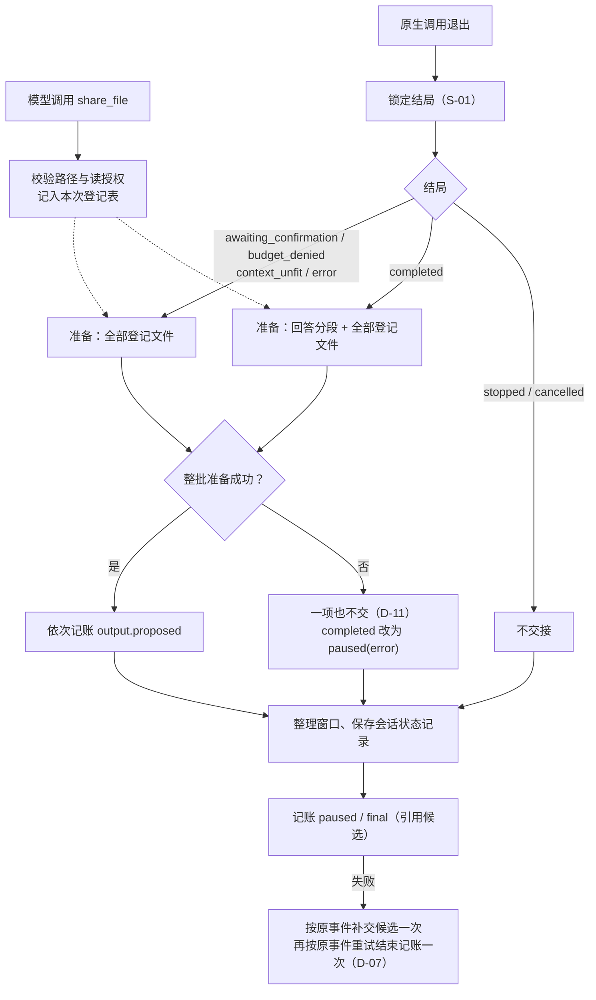
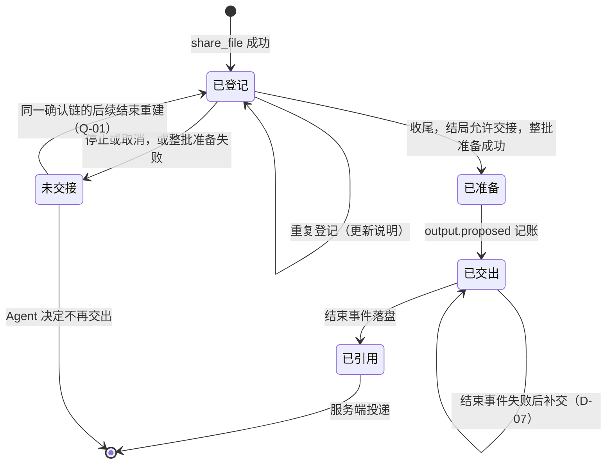

# 候选回复与文件结果的可靠交接设计方案

## 1. 元信息

| 项 | 值 |
| --- | --- |
| 建档日期 | 2026-10-14 |
| 范围 | agent-core `openjiuwen/harness/persistent_agent`：最终回答与显式登记文件两类候选的产生、身份、分段、整批准备与交接；暂停事件的候选引用；结束记账失败后的同一 Execution 内补交；`share_file` 工具；确认事件的参数摘要；会话状态记录退出 `pending_answer`。候选的接收、留存、投递与发送由 AgentServer 负责，本文只写出 Agent 一侧需要的服务端保证 |
| 方案成熟度 | 已确认：D-01～D-13、S-01、第 3 节 Q-01～Q-04、第 5.4 节文件大小上限配置与第 5.11 节文件检查分层均由开发者 2026-10-14 确认 |
| 计划条目 | [开发计划](../designs/persistent-agent-development-plan.md) PA-08 |
| 负责人 | Song Haoran、Chen Ran |
| 状态 | 进行中：I-01～I-08 已实现并通过组件验证；独立审阅与复审发现的登记有效性、同格式改写回执、参与判断结束事件重试已修复（2026-10-14～15）；代码、测试与文档按三个连续提交交付；开发阶段无历史数据，`pending_answer` 及兼容代码已删除；审阅第 3 项（极端输入下确认事件超限）暂缓；服务端保证（PA-08-V-15）待与 JiuwenSwarm 联调，PA-08 未通过验收 |
| 设计依据 | [架构设计](../designs/persistent-agent-architecture.md) §6.2、§6.3、§8.3.2；[S_02](../specs/S_02_events-and-result-handoff.md) 第 4.4、5 节；[S_04](../specs/S_04_tools-and-workspace.md)；[S_03](../specs/S_03_context-and-windows.md) 第 5.2 节 |
| 关联 feature | [F_05](F_05_execution-entries.md)（收尾顺序与结局锁定，本文修改其中的交接与结束记账）；[F_14](F_14_workspace-file-read.md)（读授权与路径规则，`share_file` 复用）；[F_15](F_15_tool-intent-before-side-effect.md)（意图白名单）；[F_17](F_17_session-state-record.md)（会话状态记录，本文解决其 D-08 的 `pending_answer` 遗留）。本文替代 `docs/pa-08-output-handoff-design` 分支上未合入的 F_08 草稿（2026-10-08），关系见第 10 节 |
| 验证摘要 | 2026-10-15 复审修复后的最终组件验证：PA 包 621 passed；harness 与 core Session 6243 passed、39 skipped；42 项变异检查全部被发现；Ruff、codespell 通过；Pylint 与 mypy 余留诊断见第 8.2 节（新文件 `share_file.py` 出现 4 条与 PA-14 同因的 mypy override 诊断）；Codex 独立复核：覆盖率 92.77%，用 Mermaid 12.2.0 的 `mermaid.parse` 解析 14 份改动文档中的 23 段图，0 失败；未做 SVG 渲染；V-15 未执行 |
| Refs | 未关联 issue / PR |

## 2. 背景、目标与范围

### 2.1 背景与问题

PA-05 已实现最终回答的交接：原生结果为 answer 时生成一条 `output.proposed`（`share_mode=message`，`target_ref` 为回复目标），列入 `execution.final.output_refs`，收尾顺序为“交出候选 → 整理窗口 → 保存会话状态记录 → 记账 final”（[entries.py](../../execution/entries.py) 的 `_finish`）。对照开发计划 PA-08 的验收要求，当前还有以下缺口（均已核对代码）：

- **没有文件交接。** Agent 无法说明“哪个文件要交给群里、怎样共享”。文件写进办公空间不等于群内可见（架构 §4.7）。
- **身份按 Execution 派生。** `_output_id` 由 `execution_id` 派生，同一成果在后续 Execution 中再次交接时必然得到新身份，服务端无法去重。
- **超长回答以暂停结束。** 回答超过事件容量时结局为 `paused(error)`，完整答案放进 `ExecutionEnding.pending_answer`；该字段被下一次 Execution 的保存覆盖，生命周期一直暂缓（F_17 D-08）。
- **暂停事件不能引用候选。** `PausedPayload` 没有 `output_refs`，暂停前已经完成的文件无处交出。
- **结束记账失败直接停止。** emitter 在关键记账第一次失败时即登记致命错误，没有“按原事件补交候选再重试”的路径。
- **确认事件的参数可能超出容量。** `redact_arguments` 只在 65536 字符处截断且不加标记；一次暂停最多 64 个被拦截的调用，合计可能超过整个事件 256 KiB 的上限，导致暂停记账失败。

### 2.2 目标与关键场景

| 场景 / 触发条件 | 当前行为 | 目标行为 / 可观察变化 |
| --- | --- | --- |
| 正常完成，有最终回答 | 一条 message 候选，身份按 Execution | 按内容派生身份的 message 候选；超长时拆成有序多段，照常 `final(completed)` |
| 模型调用 `share_file` 登记文件 | 不支持 | 调用时校验并登记；结束时按文件当时的内容生成 upload / attachment 候选 |
| awaiting_confirmation、budget_denied、context_unfit、error 暂停 | 不交接 | 交接已登记文件，暂停事件带 `output_refs`；不交最终回答 |
| 被接受的停止、取消 | 不交接 | 不变：不交接任何候选 |
| 任一文件在收尾时准备失败 | 不适用 | 整批不交接；正常完成改为 `paused(error)`，等待确认保留确认结局和现场；窗口留下恢复依据 |
| 结束事件记账失败 | 致命错误，入口抛异常 | 按原事件补交被引用的候选一次，再按原事件重试结束记账一次；仍失败才报告异常 |
| 后续 Execution 再次交出同一成果 | 新身份，可能重复投递 | 内容和发送信息不变时身份相同，服务端去重 |
| 被拦截的调用参数很长或很多 | 静默截断，可能超出事件容量 | 按事件容量预算生成脱敏摘要，截断时明确标记 |

### 2.3 本次范围与非目标

- 本次包含：两类候选来源及准备；`share_file` 工具；候选身份派生；回答分段；整批准备与失败处理；暂停事件引用候选；结束记账失败后的同一 Execution 内补交；同一确认链内登记的重建（按 Q-01 的结论）；窗口中的交接依据；会话状态记录退出 `pending_answer`（开发阶段无历史数据，直接删除兼容代码，见第 7 节）；确认事件参数摘要。
- 本次不包含：服务端的候选留存、发送检查、投递、回执与告知发起人（AgentServer，本文只列出需要的保证）；`link` 共享方式；向当前回复目标以外的群或会话发送；撤回或替换已送达的版本；`dependency_refs` 的填写（PA-22）；换窗时保留交接依据的实现（PA-11，本文只提出要求）；续做提示与执行日志整理（PA-17、PA-18）；确认卡片的展示（服务端与 PA-09）。

## 3. 设计约束、假设与待决问题

- **已确认约束与依赖：**
  - Agent 只交候选，不发送、不上传；发送检查、上传、投递和回执归 AgentServer（架构 §3、§6.2）。
  - `output.proposed` 是普通事件，入队后返回；结束事件成功时，其 `output_refs` 引用的候选内容与交接信息已可靠保存；缺失时结束事件失败，不能删掉引用后宣告完成（S_02 I-3）。本文把这一保证从 final 扩展到暂停事件（D-03）。
  - 事件容量：文本字段最多 `TEXT_MAX_CHARS`（65536 字符），标识最长 512 字符且不含空白，`detail` 等原因文本最多 4096 字符（[protocol.py](../../schema/protocol.py)）；完整事件最多 `EVENT_MAX_BYTES`（262144 个 UTF-8 字节），`References` 最多 128 项（[events.py](../../schema/events.py)）。
  - `event_id` 由完整调用归属（含 `execution_id`）和 `local_seq` 派生，只有同一 Execution 能用原 `event_id` 重交；跨 Execution 只能沿用 `output_id`。
  - 结局锁定沿用 PA-05：原生调用退出后锁定，此后到达的停止或取消不被接受（S-01）。
  - 办公空间读取复用 PA-14 的宿主授权与路径规则（[access.py](../../workspace/access.py)、[path_policy.py](../../workspace/path_policy.py)）；授权结果未知时失败关闭。
  - 无副作用工具按 PA-15 的精确名单识别（[effect_policy.py](../../tools/effect_policy.py)）。
  - 会话状态记录是严格模型、禁止多余字段；本特性之前的记录结构都带 `ending.pending_answer` 键（[session_record.py](../../schema/session_record.py)）；开发阶段尚未实际运行，没有已保存的记录。
- **关键假设：**
  - 服务端能按办公空间的逻辑路径读取 Agent 写好的文件，并在保存候选时留存一份不可变版本。办公空间由宿主提供和授权（PA-14），这一点与现有接入方式一致；跨进程部署时须重新核实。核实方式：与 JiuwenSwarm 联调（M1）。
  - 同一 Request 内，模型重复交出完全相同的成果时，用户期望只收到一次。若不成立，D-08 的去重范围需要重新评估。
- **已解决的问题（2026-10-14 开发者确认）：**
  - **Q-01 确认链内恢复旧登记：采纳。** 确认恢复时自动重建同一 Request、同一确认链中的有效登记，与本次登记合并后准备候选。相同规范化路径与共享方式重复登记时，采用最新有效说明、保留首次顺序；数量上限作用于合并后的集合。停止、崩溃和非确认暂停后的继续，仍由 Agent 查证并决定是否重新登记。见 D-12。
  - **Q-02 `share_file` 的装配条件：启用 `workspace_read` 时装配，不增加新的能力标记。** 登记和收尾时都检查读授权，调用仍经过 FileGuard；读授权不代表允许公开，服务端继续负责发送检查。见第 5.4 节。
  - **Q-03 PA-15 名单语义：加入现有名单并说明口径。** 注释写明分类依据是“不直接修改办公空间或外部系统”，允许修改本次执行的内部登记状态；名单名称保持不变，是否改名由 Yan Zhijun 统一处理。见 D-06。
  - **Q-04 文件大小上限：有界、可配置，开发默认暂定 32 MiB。** 32 MiB 是开发占位值，正式值由 Chang Yucong 与服务端对齐，双方使用同一有效限制；按实际读取的字节数检查，分块读取，不把整个文件加载到内存；临时默认值不写进长期的事件 Schema。见 D-04 / D-05 与第 5.4 节。
- **待决问题：** 无。文件检查分层（第 5.11 节）与 `share_file_max_bytes` 配置（第 5.4 节）已由开发者 2026-10-14 确认。

## 4. 总体方案与设计取舍

### 4.1 方案概览

模型在执行中调用 `share_file` 登记要交付的文件，登记只做校验并记入本次 Execution 的登记表。原生调用退出、结局锁定后，收尾阶段按结局决定交什么：完成时交最终回答和登记的文件，非停止的暂停只交文件，停止和取消不交。所有候选先整批准备（回答分段、文件重新授权并计算摘要、容量试算），任一失败则整批不交；准备成功后依次记账 `output.proposed`，再保存会话状态记录，最后记账结束事件。结束事件失败时，按原事件补交被引用的候选并重试一次。



实线是收尾顺序，虚线表示登记表在收尾时被读取。服务端在结束事件落盘后才处理被引用的候选，交接不等于已送达。

### 4.2 关键决策

#### D-01 候选只来自最终回答与显式登记的文件

- 选择与依据：文本候选只取执行结束时实际交接的最终回答（含 `after_invoke` 改写后的内容）。文件由模型调用 `share_file` 显式登记，收尾时按文件当时的内容准备候选。登记成功表示文件已列入交付范围，不代表已经发送。`reply.delta`、`progress.updated` 的中间结论、工具结果、错误与暂停说明、推理内容都不会成为候选；写进办公空间但未登记的文件不会交出。
- 代价与成立条件：登记后模型仍可修改文件，交出的是收尾时的版本；收尾读取与服务端留存之间有时间差，由 D-04 / D-05 的摘要核对兜住。
- 实现体现：第 5.2、5.7 节；PA-08-V-01、V-02、V-04。
- 确认依据：开发者 2026-10-14 决策 D1。

#### D-02 投递目标由程序固定为当前 Request 的回复目标

- 选择与依据：文本和文件候选的 `target_ref` 一律由程序设为当前 Request 的回复目标：新任务和续做取 `RequestInput.reply_target`，确认恢复取等待现场的 `reply_target`（与 PA-05 相同）。`share_file` 不提供目标参数，模型只选择交付内容，投递归属由程序控制。
- 代价与成立条件：不支持向其他群或会话交付；私聊、定时任务的目标是否支持上传群空间由服务端投递策略决定。
- 实现体现：第 5.3 节；PA-08-V-01、V-03。
- 确认依据：开发者 2026-10-14 决策 D2。

#### D-03 正常完成与非停止暂停交接，停止和取消不交接

- 选择与依据：`completed` 交接最终回答和登记文件；`awaiting_confirmation`、`budget_denied`、`context_unfit`、`error` 暂停只交接登记文件，模型过程片段不作为最终回答；被接受的 `stopped`、`cancelled` 不交接任何候选。`PausedPayload` 新增 `output_refs`，服务端对暂停事件引用的候选给出与 final 相同的保证。等待确认时先交出的文件，确认后若内容或说明变化，形成新候选再次交付，此前版本不撤回、不替换；完全相同的由服务端去重。
- 代价与成立条件：修改事件协议、架构 §6.2 与 S_02；暂停记账也要等被引用的候选保存好，候选缺失时暂停记账失败（适用 D-07）。等待确认时先交出的版本可能早于确认后的修改送达。
- 实现体现：第 5.3、5.6、5.7 节；PA-08-V-05。
- 确认依据：开发者 2026-10-14 决策 D3，以及同日对“确认后文件变化再交新版本”的确认。

#### D-04 / D-05 文件候选带内容摘要，服务端读取、核对并留存交接版本

- 选择与依据：Agent 先将文件保存到办公空间，再登记。收尾时 Agent 经 PA-14 授权路径读取文件，计算 `sha256` 内容摘要与大小，写入候选的 `file_ref`（`sha256:<64 位小写十六进制>`）、`file_path`（逻辑相对路径）和 `file_size`。服务端保存候选时按逻辑路径读取文件，核对大小与摘要，一致才留存为本次交接的不可变版本；之后的投递及发送失败重试都使用该版本。PA-14 的观察版本是 stat 元数据的哈希，不能判断内容是否变化，因此不用于交接。
- 代价与成立条件：收尾时要完整读取每个登记文件。读取分块进行，边读边计算摘要并累计实际读取的字节数，超过有效上限即停止并按准备失败处理，不把整个文件加载到内存；`file_size` 记录实际读取的字节数。上限可配置，开发默认 32 MiB 只是占位，正式值由服务端对齐，双方使用同一有效限制；事件 Schema 只要求非负整数，不固化这一上限（Q-04）。收尾计算摘要后、服务端读取前文件被改动时摘要不符，候选按未保存处理，结束事件失败（第 5.9 节）。
- 实现体现：第 5.3 节；PA-08-V-03、V-04、V-15。
- 相关候选：R-04、R-05。
- 确认依据：开发者 2026-10-14 决策 D4 / D5。

#### D-06 `share_file` 按无外部副作用工具分类

- 选择与依据：`share_file` 只校验和登记，不改变文件，也没有外部效果；真正的上传与发送由服务端在结束事件落盘后执行，并按身份去重。因此加入 PA-15 的精确工具名名单，调用时不记 `tool.intent`，仍按工具调用流程记录 `tool.completed`。它仍须经过权限引擎的读取检查和 PA-14 的读授权。
- 代价与成立条件：名单名称 `READ_ONLY_TOOL_ALLOWLIST` 保持不变，注释写明分类依据是“不直接修改办公空间或外部系统”，允许修改本次执行的内部登记状态；是否改名由 PA-15 负责人统一处理（Q-03）。
- 实现体现：I-06；PA-08-V-03。
- 确认依据：开发者 2026-10-14 决策 D6 与 Q-03。

#### D-07 同一 Execution 内结束记账失败后补交并重试一次

- 选择与依据：结束事件（paused 或 final）首次记账失败时，先不登记致命错误；按原事件对象把该结束事件引用的全部候选重新记账一次，再按原事件对象重试结束记账一次，保留原 `event_id`、`local_seq`、`occurred_at` 和内容。只补交一轮，不重新保存会话状态记录，不调用模型，不执行工具。再次失败时登记致命错误，入口向宿主抛出运行异常。
- 代价与成立条件：服务端按 `event_id` 去重，重复记账没有副作用；Agent 分不清失败是候选缺失还是结束事件自身未保存，也不需要分清。
- 适用范围：所有 paused / final 都经 `EventEmitter.emit_ending` 记账，包括没有候选引用的结束事件和群参与判断路径的 final(failed / ignored)、paused(budget_denied / error)（2026-10-15 独立复审后补齐，此前参与判断路径仍首次失败即停止）。
- 实现体现：第 5.8 节；PA-08-V-07。
- 确认依据：开发者 2026-10-14 决策 D7。

#### D-08 候选身份在 Request 范围内按内容派生

- 选择与依据：程序按租户、Agent、Session、Request、目标、共享方式和实际交付内容派生 `output_id`：

  ```text
  output_id = "out_" + sha256(规范 JSON{namespace_id, agent_id, session_id, request_id,
                                       target_ref, share_mode, content})[:32]
  message 的 content = {answer_sha256, segment_index, segment_count}
  文件的 content    = {file_sha256, file_size, file_path, caption}
  ```

  相同成果复用身份；内容或影响发送的信息（目标、共享方式、文件路径即文件名、说明、分段位置）变化则生成新身份。message 分段的身份包含整段回答的摘要和段数，避免两份不同回答恰好有一段相同而被服务端合并、导致后一份缺段。新 Execution 生成新事件，不保证逐字重放旧回答；Agent 自主查证并决定继续工作还是再次交接（架构 §8.3.2 续做规则 3），服务端负责去重和投递。
- 代价与成立条件：同一 Request 内完全相同的成果只投递一次，模型有意重复发送也会被去重。替换 PA-05 现有的按 `execution_id` 派生。
- 实现体现：`candidate_output_id`（第 5.2.2 节）；PA-08-V-08。
- 确认依据：开发者 2026-10-14 对 D8 的确认。

#### D-09 超长最终回答拆成有序消息候选

- 选择与依据：回答超过单事件容量时，拆成多个 message 候选，每段同时满足字符与完整事件字节限额，所有分段按顺序列入结束事件的 `output_refs`，拼接后与原文完全一致，服务端按该顺序处理和发送。分段在限额内优先从最后一个换行处断开，否则按字符边界断开。分段按本 Request 任一 Execution 的最宽事件计算（execution_id 与 source_ref 取 512 个四字节字符的最长标识、最大序号、最长时间格式，其余身份与目标取实际值），不随本次 `local_seq`、时间或 Execution 变化，保证同一回答在不同 Execution 中切出相同的段，D-08 的身份才能复用；每段不留下只含空白的内容，否则按“回答无法分段”的准备失败处理。超长回答不再以暂停结束，`ExecutionEnding.pending_answer` 退出新流程（D-11）。
- 代价与成立条件：回答段数加文件数不超过 128 个引用；超出时按整批准备失败处理（D-11）。
- 实现体现：`split_answer`（第 5.2.2 节）；PA-08-V-09。
- 确认依据：开发者 2026-10-14 决策 D9。

#### D-10 文件共享支持 upload 与 attachment

- 选择与依据：`share_file` 的 `share_mode` 取 `upload`（上传到目标群空间）或 `attachment`（作为附件发送到回复目标），候选明确记录共享方式，服务端据此投递。协议中保留的 `link` 本轮不开放。
- 实现体现：第 5.3 节；PA-08-V-03。
- 确认依据：开发者 2026-10-14 决策 D10。

#### D-11 任一文件准备失败时整批不交接，恢复依据保存在窗口中

- 选择与依据：收尾时先完成整个候选批次的准备（回答分段、文件重新授权与摘要、引用数与容量试算），任一失败则本批文本和文件都不交接：
  - 原本 `completed` 的改为 `paused(error)`，`detail` 写明是哪个文件、什么原因（多个文件失败时列出前几项并注明总数，保持在 4096 字符内）；
  - 原本 `awaiting_confirmation` 的保留确认结局和中断现场，`detail` 写明失败原因；
  - 其他暂停保留原原因，在 `detail` 中补充失败原因。
  恢复依据采用增强窗口方案（A′），不新增按 Request 保存的集合：实际用于交接的最终正文、文件登记依据和结束标记保存在窗口中，供 Agent 恢复时查询和判断，不要求程序自动重放完整批次：
  - 最终正文：窗口中已有原生最终回答；只有 `after_invoke` 改写了正文时，在结束标记之前追加一条带 `handoff_text` 标记的用户消息，内容为实际交接的正文，相同则不重复；
  - 文件登记依据：`share_file` 的调用与结构化结果本来就在窗口中（D-12）；
  - 结束标记：PA-10 的结束标记补充交接摘要与未交接原因（第 5.5 节）；
  - 换窗时须保留尚未交出的登记依据（对 PA-11 的要求）。
  `ExecutionEnding.pending_answer` 退出，会话状态记录版本保持 1；开发阶段尚未实际运行、没有历史数据，兼容代码直接删除，带该键的记录按严格模型判为无效（第 7 节）。
- 代价与成立条件：确认等待期间准备失败时窗口中没有结束标记，失败原因只在暂停事件里，模型在确认恢复后看不到，由 Q-01 的确认链重建兜住。
- 实现体现：第 5.5、5.8 节、第 7 节；PA-08-V-06、V-10、V-14。
- 确认依据：开发者 2026-10-14 决策 D11 与对 A′ 的确认。

#### D-12 文件登记从窗口中的执行事实确定性重建

- 选择与依据：恢复时由程序识别窗口中的 `share_file` 调用及其工具结果，重建文件路径、共享方式、说明和登记关联。只识别本工具自己产出、内容未被改动的结构化成功结果（第 5.3 节的固定格式，内容校验值须与路径、共享方式和说明重新计算的结果一致；校验值只是内容校验，不是签名：它能发现保留原校验值、改动了路径、共享方式或说明的结果，但不能证明结果一定来自本工具，也发现不了同时重算校验值的改写（Rail 属于受信的宿主代码））；以下都按“未登记”处理，由模型自行重新登记：PA-10 / core 的“未纳入”说明、原生“[Interrupted]”结果、补位“结果未取得”、控制 Rail 的拒绝说明、被宿主 Rail 改写过的结果。只扫描当前确认链（窗口中最后一个结束标记之后）的消息，不会把其他 Request 的登记交给当前回复目标。已处理项的识别交给 D-08 的身份与服务端去重：未变化的成果再次交出时身份相同、不会重复投递。停止后明确继续时，旧登记作为恢复依据保留在窗口中，由 Agent 检查文件、授权和交接状态后决定沿用（重新调用 `share_file`）、重新登记或继续工作，程序不因此自动发送。
  收尾时，程序先同步实时窗口，再从最终窗口重建有效登记并据此准备候选：只认所有 Rail 处理完成后，窗口中仍为固定格式的 `share_file` 成功结果，规则与确认恢复相同。内存中的登记表只用于调用时的合并与 64 项上限（2026-10-14 独立审阅后修订：原写法“收尾按内存登记表准备”会把宿主 Rail 已阻断的登记交出）。
  确认恢复时（Q-01），程序在恢复入口加载窗口后、原生恢复之前，把当前确认链的有效登记写入本次 Execution 的登记表，之后模型调用 `share_file` 与之合并：相同规范化路径与共享方式只保留一项，说明取最新一次有效登记，顺序取首次；64 项上限作用于合并后的集合，因此调用时就能看到超限。被宿主 Rail 改写的登记在调用时已写入登记表，仍计入上限（偏保守）。
- 代价与成立条件：重建依赖工具结果在窗口中完整保留；换窗（PA-11）须保留依据。
- 实现体现：`rebuild_registrations`（第 5.2.2 节）；PA-08-V-11。
- 确认依据：开发者 2026-10-14 决策 D12、Q-01，以及同日对“停止后继续由 Agent 决定”的确认。

#### D-13 确认事件使用可截断的脱敏摘要，完整参数留在中断状态中

- 选择与依据：暂停事件中的被拦截调用按事件容量预算生成脱敏摘要：先扣除 `output_refs`、`detail` 等其余字段，再把剩余预算在各调用之间平均分配、未用完的预算依次补给其他调用；需要截断时按字符边界截断并设 `arguments_truncated=true`，让确认人知道看到的是摘要。确认人可以依据明确标注为截断摘要的内容批准，批准关联完整的被拦截调用（交互 ID）；恢复执行使用中断状态中保存的完整参数（PA-10 已核对窗口、`ai_message` 与中断条目的调用一致）。
- 代价与成立条件：接受确认人可能未看到全部参数细节。属于 PA-05 的确认事件生成，卡片展示由服务端与 PA-09 负责。
- 实现体现：第 5.3 节；PA-08-V-12。
- 确认依据：开发者 2026-10-14 决策 D13 及对 D13-A 的确认。

#### S-01 停止沿用 PA-05 的结局锁定边界

- 选择与依据：结局锁定前被接受的停止参与结局判定，并阻止候选交接；锁定后不再接受停止，也不改写已锁定的结局。锁定本身不表示状态已保存、结束事件已落盘或候选已送达。
- 实现体现：沿用 [entries.py](../../execution/entries.py) 的 `_lock`；PA-08-V-13。
- 确认依据：开发者 2026-10-14 决策 S1。

### 4.3 替代方案与排除理由

| 候选 / 关联决策 | 候选目的与关键差异 | 拒绝或暂缓原因 | 重新评估条件 |
| --- | --- | --- | --- |
| R-01 / D-01 写进约定目录即自动交出 | 免去显式登记 | 违背“文件写好不等于群内可见”，草稿可能被误发 | 无 |
| R-02 / D-01 从最终回答中解析交付声明 | 免去工具 | 控制语法混进公开文本；格式写错时文件被悄悄漏掉 | 无 |
| R-03 / D-02 模型从白名单中选择目标 | 支持跨群交付 | 越出 Session 与当前群的发送检查，需要新的白名单契约 | 出现跨群交付需求时 |
| R-04 / D-04 用 PA-14 的观察版本代替内容摘要 | 不用读全文件 | 观察版本是 stat 元数据哈希，不能判断内容变化，D-08 无法按内容派生身份 | 无 |
| R-05 / D-05 新增端口由 Agent 上传文件字节 | 不依赖服务端读取办公空间 | 多一个端口契约；办公空间由宿主提供，服务端可直接读取 | 跨进程部署且服务端不能读取办公空间时 |
| R-06 / D-03 暂停时不交、跨 Execution 携带登记 | 不改暂停事件契约 | 暂停后同一 Session 可先处理其他 Request，需按 Request 保存和清理登记 | 无 |
| R-07 / D-08 身份按 Execution 派生、续做时新身份 | 实现简单（PA-05 现状） | 同一成果在后续 Execution 中再次交出会重复投递 | 无 |
| R-08 / D-09 超长回答转为文件或保持 paused(error) | 不拆分消息 | 转文件需要程序写办公空间且所有目标都要支持附件；保持暂停则用户收不到回答 | 无 |
| R-09 / D-11 按 Request 保存未交接集合（方案 B） | 程序可直接重放 | 需定义清理规则（服务端取消暂停任务后残留）并扩展记录结构；开发者选择 A′ | A′ 在换窗后无法保留依据时 |
| R-10 / D-07 无限重试或多轮补交 | 提高成功率 | 关键记账失败必须停止；一轮补交已覆盖候选异步保存失败 | 无 |

## 5. 详细设计

### 5.1 模块责任与关键不变量

- **`share_file` 工具（新增）**：校验路径与读授权，登记到本次 Execution 的登记表，返回结构化结果。
- **交接模块 `execution/handoff.py`（新增）**：身份派生、回答分段、登记重建、整批准备、按顺序记账候选、结束记账与补交。
- **执行入口（PA-05，修改）**：`_finish` 改为调用交接模块；超长回答的暂停分支删除。
- **emitter（修改）**：提供不登记致命错误的结束事件首次记账与按原事件重交。
- **会话状态记录（PA-10，修改）**：结束信息不再携带 `pending_answer`，结束标记补充交接摘要与未交接原因，记录版本保持 1。
- **服务端（JiuwenSwarm）**：候选留存、核对、去重、投递与发送（第 5.11 节）。

本次须保持的不变量：

- **HI-1 来源受限：** 只有最终回答和显式登记的文件会成为候选（PA-08-V-01、V-02、V-04）。
- **HI-2 目标由程序设定：** 候选的 `target_ref` 只来自当前 Request 的回复目标（PA-08-V-01）。
- **HI-3 整批原子：** 一次结束要么交出整批准备好的候选，要么一项也不交（PA-08-V-06）。
- **HI-4 引用即保存：** paused / final 成功时，其 `output_refs` 引用的候选已可靠保存（服务端保证，PA-08-V-15）。
- **HI-5 身份按内容：** 同一 Request 内相同成果得到相同 `output_id`，任何影响发送的信息变化都得到新身份（PA-08-V-08）。
- **HI-6 停止与取消不交接**（PA-08-V-05）。
- **HI-7 分段无损且确定：** 分段拼接等于原文；相同输入在任何 Execution 中切出相同的段（PA-08-V-09）。
- **HI-8 以最终窗口为准：** 交出的文件只来自最终窗口中当前确认链内仍为固定格式的 `share_file` 成功结果；被宿主 Rail 改写或阻断、被说明或补位替换、中断的结果都不交（PA-08-V-11、V-17）。

### 5.2 关键类与函数设计

以下为目标设计，路径与名称在实现时如有调整同步本节。

#### 5.2.1 关键类定义与说明

| 类名 / 所属模块 | 变更类型与可见范围 | 职责与边界 | 继承 / 实现 / 组合关系 |
| --- | --- | --- | --- |
| [share_file.py](../../execution/share_file.py) 的 `ShareFileTool` | 新增；内部 | 校验参数、授权、路径与文件，写入登记表，返回结构化结果；不读取文件内容 | 继承 `Tool`；组合 `WorkspaceAccessPort`、`ExecutionContext` 与本次的登记表；授权与路径解析复用 PA-14（第 5.11 节） |
| [share_file.py](../../execution/share_file.py) 的 `ShareFileRail` | 新增；内部 | 启用 `workspace_read` 时由 Spec 装配，`init` 注册 `share_file`，`uninit` 移除 | 继承 `DeepAgentRail`，不注册回调 |
| [handoff.py](../../execution/handoff.py) 的 `Registration` | 新增；内部 | 一项登记：逻辑路径、共享方式、说明；顺序由登记表的插入顺序保持 | 冻结 dataclass |
| [handoff.py](../../execution/handoff.py) 的 `PreparedBatch` | 新增；内部 | 一次结束的候选批次：按投递顺序的负载、回答段数、文件（路径、共享方式、output_id）、准备失败项；`output_refs` 由负载派生 | 冻结 dataclass |
| [handoff.py](../../execution/handoff.py) 的 `HandoffFileError` | 新增；内部 | 文件检查失败，只带类别，不带宿主路径或诊断；不跨出模块边界 | 继承 `ValueError`，与 PA-14 的 `WorkspacePathError` 同一做法 |
| [control.py](../../execution/control.py) 的 `ExecutionControl` | 修改；内部 | 增加本次 Execution 的登记表 `registrations: dict[tuple[str, str], Registration]` | 沿用 |

##### ShareFileTool

| 关键方法签名 | 职责与调用条件 | 参数与返回值说明 | 异常与副作用 |
| --- | --- | --- | --- |
| `async def invoke(self, inputs, **kwargs) -> ToolOutput` | 模型调用时 | `file_path`（逻辑相对路径）、`share_mode`（`upload` / `attachment`）、可选 `caption`；返回第 5.3 节的结构化结果 | 按第 5.11 节分层检查，任一项不通过返回失败结果、不登记；合并后超过 64 项时拒绝；成功时写入登记表（同一规范化路径与共享方式只保留一项，说明取最新一次，位置取首次） |

#### 5.2.2 关键函数定义与说明

| 函数 / 所属模块 | 完整签名与变更类型 | 职责与调用方 | 输入输出及行为约束 |
| --- | --- | --- | --- |
| `handoff.candidate_output_id` | `def candidate_output_id(execution: ExecutionContext, target_ref: str, share_mode: str, content: dict) -> str`；新增 | 准备批次时派生身份 | 按 D-08 的规范 JSON 计算；同输入同输出 |
| `handoff.split_answer` | `def split_answer(text: str, room: int) -> list[str] \| None`；新增 | 准备最终回答 | `room` 为最宽事件中正文可用的字节数（D-09）；换行优先，不留下只含空白的段；拼接等于原文；有段会只含空白时返回 None |
| `handoff.rebuild_registrations` | `def rebuild_registrations(messages: list) -> list[Registration]`；新增 | `_finish` 收尾准备候选前（HI-8），以及确认恢复入口在原生恢复之前（Q-01） | 只扫描最后一个结束标记之后的消息；只识别 `share_file` 调用组内、固定格式的成功结果；同一规范化路径与共享方式取最新说明、保持首次位置 |
| `handoff.merge_registration` / `registration_result` | `def merge_registration(registrations: dict, registration: Registration) -> bool`；`def registration_result(registration: Registration) -> str`；新增 | `share_file` 与重建共用 | 前者合并并在超过 64 项时返回 False、不修改登记表；后者生成第 5.3 节的固定 JSON |
| `handoff.read_scope` / `resolve_shared_path` | `async def read_scope(execution, access) -> WorkspaceReadScope`；`def resolve_shared_path(scope, requested: str) -> ResolvedWorkspacePath`；新增 | 授权层与路径层，复用 PA-14 | 端口异常与身份不符都转为 `unknown`；路径拒绝沿用 PA-14 的类别 |
| `handoff.check_shared_file` | `def check_shared_file(resolved: ResolvedWorkspacePath, max_bytes: int) -> None`；新增 | `share_file` 调用时，在线程中执行 | 第 5.11 节文件层：不跟随末级符号链接、非阻塞打开，打开后核对类型与设备号、inode；当前大小超过上限即失败；不读内容 |
| `handoff.read_for_handoff` | `def read_for_handoff(resolved: ResolvedWorkspacePath, max_bytes: int) -> tuple[str, int]`；新增 | `prepare_batch` 对每个文件在线程中调用 | 文件层检查后分块读取，边读边算 sha256 并累计实际字节数，最多读到上限加一字节即失败；返回（`sha256:<hex>`，实际字节数）；不返回、不记录文件内容 |
| `handoff.prepare_batch` | `async def prepare_batch(execution, access, target_ref: str, answer: str \| None, registrations: list[Registration], max_bytes: int) -> PreparedBatch`；新增 | `_finish` 在锁定结局后调用 | 回答分段、文件重新授权与读取、身份派生、引用数核对；失败项全部收集在 `failures` 中，此时不带任何负载；不产生事件 |
| `handoff.describe_failures` | `def describe_failures(failures) -> str`；新增 | `_finish` 写 detail 与结束标记 | `<逻辑路径>: <类别>` 以分号连接，列前 5 项并注明总数，不超过 4096 字符 |
| `handoff.hand_off` | `async def hand_off(emitter: EventEmitter, batch: PreparedBatch) -> tuple[AgentEvent, ...]`；新增 | 准备成功后 | 依次记账 `output.proposed`，返回事件对象供 D-07 重交；普通记账失败不停止执行 |
| `emitter.widest_size` | `def widest_size(execution, event_type, payload, *, any_execution: bool) -> int`；新增 | 回答分段与确认摘要预算 | 最大序号、最长时间格式下的事件字节数；`any_execution` 时 execution_id 与 source_ref 也取最长 |
| `emitter.EventEmitter.emit_ending` | `async def emit_ending(self, event_type: EventType, payload: Any, proposals: tuple[AgentEvent, ...] = ()) -> AgentEvent`；新增 | `_finish` 与群参与判断（[participation.py](../../execution/participation.py)）记账所有 paused / final | 首次失败不登记致命错误；按原事件重交 `proposals`（其中失败只记诊断）后按原事件重试一次；再失败登记致命错误并抛运行异常；重交的事件不再次进入展示队列 |
| `emitter.EventEmitter.emit_if_fits` | 删除 | — | 由回答分段替代 |
| `entries._finish` | 修改：增加 `spec` 参数 | 执行与恢复入口 | 整批准备 → 交出 → 保存 → `emit_ending`；准备失败按 D-11 调整结局 |
| `entries._fit_intercepted` | `def _fit_intercepted(context, paused: dict) -> dict`；新增 | `_finish` 记账等待确认暂停前 | D-13：扣除其余字段后平均分配预算，未用完的补给其他调用；截断时设 `arguments_truncated=true` |
| `entries._rebuild_registrations` | `def _rebuild_registrations(context) -> None`；新增 | 启用 `workspace_read` 时的确认恢复入口 | 把加载后窗口中确认链的有效登记合并到登记表，用于调用时的上限 |
| `entries._effective_registrations` | `async def _effective_registrations(context, spec) -> list[Registration]`；新增 | `_finish` 准备候选前 | 启用 `workspace_read` 时先 `sync_native` 同步实时窗口，再从最终窗口重建有效登记（HI-8）；未启用时为空 |
| `session_state.sync_native` / `window_messages` | `async def sync_native(context) -> None`；`def window_messages(session) -> list`；新增（由 `ExecutionStateStore._sync_native` 提出） | `_finish` 与会话状态保存 | 前者让原生 Agent 把实时窗口与 DeepAgent 状态写回 Session，失败为保存类运行错误；后者读取 Session 中的默认窗口 |
| `entries.redact_arguments` | 修改 | 确认事件与 PA-15 摘要 | 不再截断，长度由调用方限制（PA-15 截取 500 字符，确认事件按 D-13） |
| `entries._output_id` | 删除 | — | 由 `candidate_output_id` 替代 |

### 5.3 接口定义与消息契约

**事件负载（[events.py](../../schema/events.py)，修改，需与服务端同步）：**

| 字段 | 类型、必填与默认值 | 约束 | 语义 |
| --- | --- | --- | --- |
| `OutputPayload.file_ref` | `Identifier \| None` | 文件方式必填，格式 `sha256:<64 位小写十六进制>` | 收尾时的内容摘要 |
| `OutputPayload.file_path`（新增） | `str \| None` | 文件方式必填；逻辑相对 POSIX 路径，最多 1024 字符，不含绝对路径、`..` 与控制字符；message 不得携带 | 服务端读取位置与展示文件名 |
| `OutputPayload.file_size`（新增） | `int \| None` | 文件方式必填，非负整数；message 不得携带。Schema 不固化大小上限，上限是运行时配置（Q-04） | 实际读取的字节数，服务端核对 |
| `OutputPayload.text` | `Text \| None` | message 必填；文件方式为可选说明，最多 4096 字符 | 正文或随文件公开的说明 |
| `PausedPayload.output_refs`（新增） | `References = ()` | `stopped` 必须为空 | 本次暂停交出的文件候选，顺序即投递顺序 |
| `InterceptedToolCall.arguments_truncated`（新增） | `bool = False` | — | 参数摘要是否被截断 |

`FinalPayload` 不变，`artifact_refs` 仍不用于交接。

**`share_file` 工具：** 参数 `file_path`（必填）、`share_mode`（`upload` / `attachment`，必填）、`caption`（可选，最多 4096 字符）。成功结果为固定格式的 JSON 文本，D-12 只识别此格式：

```json
{"share_file": "registered", "file_path": "reports/q3.md", "share_mode": "upload", "caption": "第三季度报告",
 "note": "已列入本次交付；执行结束时按文件当时的内容交给服务端；登记不等于已发送",
 "receipt": "<32 位十六进制>"}
```

`receipt` 是对 `file_path`、`share_mode`、`caption` 规范 JSON 计算的 SHA-256 前 32 位十六进制，重建登记时重新计算并比对。校验值只是内容校验，不是签名：它能发现保留原校验值、改动了路径、共享方式或说明的结果，但不能证明结果一定来自本工具，也发现不了同时重算校验值的改写（Rail 属于受信的宿主代码）。

没有说明时 `caption` 为 null；空白说明视为没有。失败结果为 `ToolOutput(success=false)`，`data` 只含 `status`：forbidden、unknown、not_found、unavailable（沿用 PA-14）、not_a_file、too_large、invalid_arguments（参数缺失或非法、说明过长、逻辑路径无法写入输出事件）、too_many_files；说明为固定的中文文字，不含宿主路径或宿主诊断，模型可当场改正。工具描述写明：只登记已完成、可以公开的文件；说明文字会公开；目标由程序决定；登记不等于已发送。

**服务端保证（JiuwenSwarm AgentServer，跨仓契约）：** 见第 5.11 节。

### 5.4 配置与能力控制

- **装配：** `PersistentAgentSpec.resolve_parts` 在 `enabled_features` 含 `workspace_read` 时装配 `share_file`，与 `PersistentWorkspaceReadRail` 共用 `context.ports.workspace_access`；不新增能力标记（Q-02）。没有 `workspace_read` 时不装配，模型看不到该工具。
- **文件大小上限：** `PersistentAgentSpec` 新增 `share_file_max_bytes: int`，默认 `32 * 1024 * 1024`，校验为正整数且不超过一个保护性的硬上限（实现时取 1 GiB，防止误配置）。Spec 由服务端发布，Agent 与服务端读到的是同一份有效值；默认值是开发占位，正式值由 Chang Yucong 与服务端对齐后写入发布配置（Q-04）。该字段进入 Spec 指纹。
- **生效时机：** 一次 Execution 内不变；`share_file` 调用时与收尾准备时使用同一有效值。

### 5.5 数据模型与事实归属

| 数据 | 语义与隔离范围 | 权威位置 | 创建、更新与释放 |
| --- | --- | --- | --- |
| 登记表 | 本次 Execution 接受的登记，含确认链重建的登记；用于调用时的合并与上限 | `ExecutionControl.registrations`（内存） | `share_file` 成功时写入；确认恢复时并入确认链的登记；随实例释放；收尾不以它为准 |
| 登记依据 | 窗口中的 `share_file` 调用与结构化结果 | 会话状态记录的窗口 | 原生写入；PA-10 保存；换窗时 PA-11 保留 |
| 交接正文 | `after_invoke` 改写后的实际正文 | 窗口中带 `handoff_text` 标记的用户消息 | 只在正文被改写时由 `_finish` 追加 |
| 结束标记 | 本次结局、交出的候选、未交接原因 | 窗口中 PA-10 的结束标记 | PA-10 保存时生成；本文补充“交出候选”的写法与“未交接原因”字段 |
| 候选与交接版本 | 已交出的候选及文件版本 | 服务端 | 服务端保存 `output.proposed` 时留存 |

结束标记的交接部分：`交出候选：最终回答 N 段、文件 reports/q3.md（upload，out_…）（以结束记录为准）`，没有候选写“无”；整批准备失败时追加 `未交接原因：<逻辑路径>: <类别>; …`（与暂停事件的 detail 相同）。交接正文消息的内容为 `【实际交出的最终回答】` 换行后接正文，只在它与本 Execution 最后一条原生回复不同时追加，整批准备失败时同样追加。等待确认时 PA-10 不写结束标记，失败原因只在暂停事件中（见 Q-01）。

### 5.6 状态机与生命周期



“已交出”但结束事件最终未落盘的候选不会被投递（服务端只投递被已落盘结束记录引用的候选）。

### 5.7 正常执行流程

1. 原生调用退出，按 PA-05 锁定结局（S-01）。
2. 结局为 `completed` 时取实际交接正文（含 `after_invoke` 改写）；启用 `workspace_read` 时同步实时窗口，从最终窗口当前确认链内的有效 `share_file` 结果重建登记（HI-8）。
3. 按 D-03 决定本次批次的组成，调用 `prepare_batch`：回答分段（D-09）；每个文件重新取得读授权、解析路径、读取并计算摘要与大小；派生身份（D-08）；核对引用数与每个事件的容量。
4. 准备成功：`hand_off` 依次记账候选，回答各段在前，文件按登记顺序在后。准备失败：一项也不交，按 D-11 调整结局与 `detail`。
5. 正文被改写时在窗口追加 `handoff_text` 消息；整理窗口，保存会话状态记录（结束标记含交接摘要与未交接原因）。
6. `emit_ending` 记账 paused / final，`output_refs` 为本次交出的全部候选，顺序即投递顺序。
7. 清理资源。

### 5.8 异常、中断与重试处理

- **准备失败（D-11）：** 不产生任何候选事件；`completed` 改为 `paused(error)`，其他结局保留并补充 `detail`。失败类别：forbidden（授权拒绝或路径越界）、unknown（授权未知或身份不符）、not_found、not_a_file、unavailable（读取失败）、too_large（超出大小上限）、answer_unsplittable（回答会切出只含空白的段）、too_many_outputs（引用数超过 128）。文件候选的路径与说明长度有界，不会单独超出事件容量。
- **候选记账失败：** 普通事件，只记诊断；是否已保存由结束事件的结果判断。
- **结束记账失败（D-07）：** 按原事件补交被引用的候选一次，再按原事件重试结束事件一次；仍失败登记致命错误，入口抛运行异常，由服务端按续做规则处理。
- **会话状态记录保存失败：** 沿用 PA-10：不记结束事件。此时候选已交出但未被任何落盘的结束记录引用，服务端不投递。
- **停止与取消：** 锁定前被接受的停止或取消不交接，登记依据仍在窗口中；锁定后的停止或取消不被接受（S-01）。
- **崩溃：** 已交出但未被引用的候选不投递；续做由 Agent 按续做规则决定是否再次交出，相同成果身份相同，服务端去重。

### 5.9 并发与一致性

同一 Session 同一时间只有一个执行者。收尾计算摘要后、服务端读取前，同一 Agent 的其他 Session 可能修改同一个公共文件，服务端核对摘要不符时按候选未保存处理，结束事件失败，进入 D-07 的补交与重试；仍不符则抛运行异常转入续做。把要交出的文件放在本 Session 的私有目录可以避免这一窗口。身份派生只依赖内容与发送信息，不依赖时间或序号，重复派生结果一致。

### 5.10 持久化与恢复

- 登记表只在内存中；恢复依据是窗口中的登记依据、交接正文与结束标记（D-11、D-12）。
- 确认恢复：按 Q-01 把同一确认链的有效登记计入调用时的上限；收尾时最终窗口本身包含这条确认链，按 HI-8 准备。
- 停止后明确继续、崩溃续做、非确认暂停后继续：Agent 依据窗口和执行日志决定是否重新登记，程序不自动纳入旧登记。
- 换窗（PA-11）：新窗须保留当前确认链中尚未交出的登记依据，否则重建与 Agent 查询都会缺项。

### 5.11 专项设计

**安全与授权边界：文件检查分层。** 复用 PA-14 的授权层与路径层，不复制实现；PA-14 不探测目标文件本身，文件内容层由本特性补充：

| 层 | 检查内容 | 实现来源 | 调用时（登记） | 收尾准备时 |
| --- | --- | --- | --- | --- |
| 授权层 | 取得宿主读授权并核对与本次执行的身份一致（Agent、Session、principal、策略版本）；授权未知或核对失败时失败关闭 | 复用 PA-14：`WorkspaceAccessPort.resolve_read_scope`、`validate_read_scope`（[access.py](../../workspace/access.py)） | 是 | 是（重新取得，覆盖期间撤权） |
| 路径层 | 拒绝空字节、绝对路径与盘符、`..`；词法与真实路径两次核对：在允许根目录或本 Session 目录内、不在兄弟 Session 私有目录内；得到规范路径与逻辑相对路径 | 复用 PA-14：`resolve_read_path`（[path_policy.py](../../workspace/path_policy.py)） | 是 | 是 |
| 规则层 | 权限引擎按“读”检查，沿用 FileGuard 对敏感路径的拒绝或确认规则 | 复用 Harness：`register_file_tool(FileToolSpec("share_file", "file_path", "read"))` | 是（工具调用前） | 否：收尾不是工具调用，不能发起确认；路径不变时规则结论不变 |
| 文件层 | 目标存在且是普通文件（拒绝目录、FIFO、设备与套接字，且不打开它们）；不跟随末级符号链接、非阻塞打开，打开后用已打开的文件描述符确认是普通文件，并核对设备号与 inode 与打开前一致；调用时另按打开后的文件大小提前拒绝超过上限的文件 | 本特性新增 `check_shared_file`、`read_for_handoff` | 是（只打开校验，不读内容） | 是 |
| 内容层 | 分块读取，累计实际字节数并计算 sha256，超过有效上限立即失败；不加载整个文件，不记录文件内容 | 本特性新增 `read_for_handoff` | 否 | 是 |
| 登记层 | `share_mode` 只允许 upload / attachment；说明最多 4096 字符；解析后的逻辑路径能写入输出事件（1～1024 字符，不含控制字符与反斜杠）；合并后不超过 64 项 | 本特性新增 `is_logical_path`、`merge_registration` | 是 | 是（合并后的集合） |

- 不复用 PA-14 的 `ReadFileTool` 包装：它面向文本阅读，有 256 KB、2000 行等限制并改写渲染结果，不能用于计算整个文件的摘要。不复用 `observe_version`：它是 stat 元数据哈希（R-04）。
- 失败结果沿用 PA-14 的安全错误类别（`forbidden`、`unknown`、`not_found`、`unavailable`），新增 `not_a_file`、`too_large`；返回给模型的说明不含宿主路径或宿主诊断。收尾准备失败时 `detail` 写逻辑路径与类别。
- 剩余风险与 PA-14 相同：真实路径核对与打开之间，中间目录可能被替换为符号链接；末级符号链接由不跟随打开防住，打开后的设备号与 inode 核对能发现目标被替换。服务端按逻辑路径读取时自行做授权与核对（第 5.11 节服务端保证第 1 条）。
- **有效回执：** 收尾时只认最终窗口中的有效结果（HI-8）。宿主 Rail 在调用后阻断或改写结果（包括保留固定格式、只改内容的改写）、PA-10 因后续处理未完成换成说明、补位与中断结果都不算登记成功；调用时写入内存登记表不等于最终有效。校验值只是内容校验，不是签名：它能发现保留原校验值、改动了路径、共享方式或说明的结果，但不能证明结果一定来自本工具，也发现不了同时重算校验值的改写（Rail 属于受信的宿主代码）；宿主要阻止登记，仍应按 PA-10 的宿主约定把结果替换为说明。
- 读授权不代表允许公开：是否能发送到目标群由服务端的发送检查决定（Q-02）。
- 最终回答与文件说明是公开内容；程序只保证其他内容不会被当作候选，内容本身由服务端的发送检查把关。
- 候选与确认摘要不携带宿主诊断；确认摘要沿用敏感键名脱敏。

**跨仓 / 宿主保证（JiuwenSwarm AgentServer）：**

1. 保存 `output.proposed` 时保存完整候选；文件候选按逻辑路径读取，核对大小与摘要后留存不可变版本，作为“已可靠保存”的一部分，不符视为候选未保存。
2. `execution.paused` 与 `execution.final` 在记账成功前确认 `output_refs` 引用的候选已可靠保存；缺失或不符时抛异常，且结束事件本身不落盘。
3. 重交按 `event_id` 去重；同一 `output_id` 只接受一份内容，内容不同视为冲突。
4. 只投递被已落盘结束记录引用的候选，按 `output_refs` 顺序；未被引用的候选不投递，重启后也不补发。
5. 投递按 `output_id + target_ref + share_mode` 去重；失败只用已留存的版本重试发送，不重开 Execution；无法投递时告知发起人。
6. 发布给 Persistent Agent 的工具中不包含绕过本出口直接发送或上传的工具。
7. 确认卡片在 `arguments_truncated=true` 时提示摘要已截断；批准按交互 ID 关联完整调用。

## 6. 影响面与实施设计

### 6.1 修改点与实施顺序

| 实施项 | 模块 / 文件或符号 | 修改内容与责任 | 必要前置 / 独立验证产物 |
| --- | --- | --- | --- |
| I-01 | [events.py](../../schema/events.py) | `OutputPayload` 新字段与校验；`PausedPayload.output_refs`；`InterceptedToolCall.arguments_truncated` | 服务端确认字段；PA-08-V-03、V-05、V-12 |
| I-02 | [emitter.py](../../execution/emitter.py)、[participation.py](../../execution/participation.py) | 提取按任意负载分段的函数（固定最坏情况信封）；新增 `emit_ending`；群参与判断的 4 处结束事件改用 `emit_ending`（2026-10-15） | 无；PA-08-V-07、V-09 |
| I-03 | `execution/handoff.py`（新增） | 身份派生、分段、重建、整批准备、文件读取与摘要（`read_for_handoff`）、交出 | I-01、I-02；PA-08-V-06、V-08～V-11、V-16 |
| I-04 | `execution/share_file.py`（新增）、[spec.py](../../schema/spec.py)、[control.py](../../execution/control.py) | 工具、登记表、文件防护登记；启用 `workspace_read` 时装配；Spec 新增 `share_file_max_bytes`；确认恢复入口在原生恢复前重建登记 | PA-08-V-03、V-11 |
| I-05 | [entries.py](../../execution/entries.py) `_finish`、`redact_arguments`、`_intercepted_call` | 改为调用交接模块，收尾前同步窗口并以最终窗口确定有效登记；删除 `_output_id`、`_CAPACITY_DETAIL` 与超限暂停分支；确认摘要预算 | I-01～I-04；PA-08-V-01～V-07、V-12、V-13 |
| I-06 | [effect_policy.py](../../tools/effect_policy.py) | 名单加入 `share_file`，注释写明分类依据（Q-03） | PA-08-V-03 |
| I-07 | [integration.py](../../schema/integration.py)、[session_record.py](../../schema/session_record.py)、[session_state.py](../../execution/session_state.py) | 删除 `ExecutionEnding.pending_answer`，增加交接摘要字段；删除 `RecordEnding.pending_answer` 及其读取与写出逻辑，记录版本保持 1，带该键的记录按严格模型拒绝（第 7 节）；结束标记交接摘要与未交接原因，`handoff_text` 消息；删除覆盖日志 | PA-08-V-10、V-14 |
| I-08 | 测试 | 新增 `test_handoff.py`、`test_share_file.py`；更新 `test_entries.py`、`test_emitter.py`、`test_protocol.py`、`test_session_state.py`、`test_effect_policy.py` | I-01～I-07 |

提交按 harness 约定拆成 `feat(harness)` → `test(harness)` → `docs(harness)` 三个连续提交。

### 6.2 文档同步

- spec：[S_02](../specs/S_02_events-and-result-handoff.md) 的候选字段、暂停引用、身份派生、分段、补交与服务端保证；[S_01](../specs/S_01_public-api-and-execution.md) 中“最终答案超限改判 `paused(error)`、放入 `pending_answer`”改为分段交出；[S_03](../specs/S_03_context-and-windows.md) 结束信息不再携带未交接答案、结束标记的交接摘要与 `handoff_text`；[S_04](../specs/S_04_tools-and-workspace.md) 增加 `share_file`。
- 架构：§6.2（暂停事件引用候选及其保证）、§6.3（超长回答分段、文件交接）、§4.7（`share_file` 登记）、§6.2.2 事件表、变更记录。开发者已于 2026-10-14 确认方向，按确认后的方案修改。
- 开发计划：PA-08 状态与验收文字（“拆成多条候选或转为文件交接在本项确定”改为分段方案）；PA-09（确认卡片显示截断标记）；PA-10（`pending_answer` 退出）；PA-11（换窗保留登记依据）；PA-15（名单加入 `share_file`）；PA-17、PA-18（日志保留候选及引用情况，续做时由 Agent 决定是否重新交出）。
- 其他入口：[F_05](F_05_execution-entries.md) 已知遗留中的超长回答一条指向本文；[F_17](F_17_session-state-record.md) D-08 标为由本文解决。

## 7. 兼容与迁移

- **影响对象：** 会话状态记录的结构（`ending` 原有 `pending_answer` 键）；服务端对事件负载的解析；已发布 Spec 的指纹。
- **已确认：** 记录版本保持 `schema_version=1`（开发者 2026-10-14 确认，替代原稿的“升至 v2”）。不产生、不写入 `pending_answer`：超长回答按 D-09 分段交出，完整正文随窗口保存——原生回复本来就在窗口中，after_invoke 改写后的正文以 `handoff_text` 消息保存（D-11）；不新增待交接集合。事件负载新增字段均为可选或按共享方式条件必填，服务端须先于 Agent 发布支持新字段的版本。
- **旧记录（开发者 2026-10-14 确认）：** 开发阶段尚未实际运行，没有任何历史数据，因此不做迁移，直接删除兼容代码：`RecordEnding.pending_answer` 字段、`dump_record` 的排除规则和加载时的处理都已删除。记录模型保持禁止多余字段，带该键的记录即使值为 null 也按无效记录拒绝，不默默丢弃。没有持久化数据需要清理。之前曾考虑迁移（把旧正文转成 `handoff_text`）或带 warning 丢弃，过程见第 10 节。
- **Spec 指纹：** `share_file_max_bytes` 带默认值并进入指纹，按同一份发布内容用新代码计算的指纹与旧代码不同。宿主如果保存了升级前算出的指纹并在恢复时原样传入，升级前暂停的 Request 恢复时会因指纹不符被拒绝；需由服务端确认指纹是否随代码重新计算，或在升级前处理完等待中的确认（与 Chang Yucong 对齐）。
- **必要步骤：** 服务端支持新负载并确认指纹处理 → Agent 发布。
- **回退边界：** 回退 Agent 代码时，旧代码可以读取新记录（缺少的 `pending_answer` 取默认值，记录版本相同）；回退后旧代码重新按 execution_id 派生身份、超长回答重新以暂停结束，事件不再带新字段。

## 8. 验证设计、执行记录与结论

### 8.1 验证设计与通过条件

| 验证 ID | 场景 / 前置状态与输入 | 操作或验证入口 | 预期结果 / 通过条件 | 验证层级与环境 |
| --- | --- | --- | --- | --- |
| PA-08-V-01 | 私聊、定时任务完成；确认恢复后完成 | 正式入口，真实 DeepAgent，内存后端 | `output.proposed` 的 `target_ref` 为回复目标（恢复时取等待现场）；结束事件引用全部候选且有序 | 组件测试 |
| PA-08-V-02 | 有中间结论、展示片段、工具结果、错误、推理内容 | 同上 | 只有最终回答成为 message 候选，正文不含推理内容 | 组件测试 |
| PA-08-V-03 | `share_file` 各类输入 | 工具单测与组件测试 | 越界、符号链接越界、兄弟 Session 私有目录、目录、FIFO、不存在、授权 forbidden / unknown、身份核对不符、合并后超过 64 项均拒绝且不登记；重复登记只算一项，说明取最新；文件防护拒绝时不执行；未启用 `workspace_read` 时不装配；不产生 `tool.intent` | 单测 / 组件测试 |
| PA-08-V-04 | 写文件不登记；登记后再修改 | 组件测试 | 前者无文件候选；后者摘要为收尾时的内容 | 组件测试 |
| PA-08-V-05 | completed、各类暂停、停止、取消 | 组件测试 | completed 交回答与文件；四类暂停只交文件且暂停事件带 `output_refs`；停止、取消不交 | 组件测试 |
| PA-08-V-06 | 收尾时登记文件已删除或越权；引用数超限 | 组件测试 | 一项也不交；completed 改为 `paused(error)` 且 `detail` 指明文件；等待确认保留确认结局与现场；其他暂停保留原因 | 组件测试 |
| PA-08-V-07 | 服务端替身首次拒绝结束事件（执行收尾，以及群参与判断的 final(ignored / failed)、paused(budget_denied / error)） | 组件测试 | 按原事件补交全部被引用的候选（事件逐字节相同），再按原事件重试一次后成功；两次都失败时抛运行异常；只补交一轮，状态只保存一次，不重新判断、不调用模型、不执行工具 | 组件测试 |
| PA-08-V-08 | 身份派生 | 单测 | 相同输入身份相同，跨 Execution 相同；目标、共享方式、路径、说明、内容、Request 任一变化身份不同；两份不同回答含相同分段时身份不同 | 单测 |
| PA-08-V-09 | 超长回答 | 单测 / 组件测试 | 字符超限、字节超限（四字节字符、须转义的控制字符）各一例：每段满足两条限额，拼接等于原文，`final(completed)`；不同序号与时间下分段相同 | 单测 / 组件测试 |
| PA-08-V-10 | `after_invoke` 改写正文；准备失败 | 组件测试 | 改写时窗口有 `handoff_text` 消息、未改写时不重复；结束标记含交接摘要与未交接原因 | 组件测试 |
| PA-08-V-11 | 重建登记 | 单测 / 组件测试 | 只识别结构化成功结果；说明、补位、中断结果、拒绝说明、被改写的结果均不算；只扫描最后一个结束标记之后；确认恢复时与本次登记合并：同一规范化路径与共享方式取最新说明、保留首次顺序，上限作用于合并后的集合；停止后继续不自动纳入 | 单测 / 组件测试 |
| PA-08-V-12 | 64 个被拦截调用、参数很长 | 单测 / 组件测试 | 暂停事件在容量内；截断的调用 `arguments_truncated=true`；恢复使用完整参数 | 单测 / 组件测试 |
| PA-08-V-13 | 收尾期间到达停止或取消 | 组件测试 | 不被接受，不改变交出的候选 | 组件测试 |
| PA-08-V-14 | 退役字段 | 单测 | 新记录版本仍为 1、不带 `pending_answer`；带该键的记录（值为正文或 null）都按无效记录拒绝，后端中的原记录不变 | 单测 |
| PA-08-V-16 | 文件读取与大小上限 | 单测 | 分块读取，摘要与整文件哈希一致；实际字节数恰为上限时通过、超过一字节时失败且不再继续读取；读取期间文件变长按实际字节数判定；打开后被替换为其他文件时失败；Schema 接受任意非负 `file_size` | 单测 |
| PA-08-V-17 | 宿主 Rail 改写或阻断 `share_file` 的结果；原生写回之后实时窗口中才出现的登记 | 单测 / 组件测试 | 改写并终止、改写但不终止、检查中止后报错三种情况都不交出该文件，窗口显示原因；保留固定格式、只改说明的改写（终止与不终止）同样不交出；路径、共享方式、说明或校验值任一被改动的回执重建时都不算；收尾读取的是同步后的实时窗口 | 单测 / 组件测试 |
| PA-08-V-15 | 服务端保证 | 与 JiuwenSwarm 联调（M1） | 未被引用的候选不投递；重复记账只投递一次；摘要不符时结束事件失败；投递失败只用留存版本重试 | 真实联调 |

回归：PA 包、`tests/unit_tests/harness` 与 `tests/unit_tests/core/session`；改动文件的 Ruff 与类型检查。

### 8.2 实际执行与证据

| 执行日期 / 验证范围 | 实现版本与环境 | 命令 / 复现步骤 / 记录链接 | 实际结果 | 未覆盖项 / 失败原因 |
| --- | --- | --- | --- | --- |
| 2026-10-15 / PA-08-V-01～V-14、V-16、V-17（复审修复后，最终） | 分支 `feature/pa-08-output-handoff` 工作区（基于 9eb336b4，未提交），包含审阅与复审修复、`pending_answer` 兼容代码删除；macOS、Python 3.11.17；真实 DeepAgent、本地模型、临时目录办公空间、`InMemoryKVStore`；宿主端口与宿主 Rail 用测试替身 | `python -m pytest tests/unit_tests/harness/persistent_agent -q -p no:cacheprovider` | 621 passed；复审提供的 3 个复现用例（参与判断 ignored / budget_denied 的记账重试、同格式改写回执）由失败变为通过 | V-15 须与服务端联调；替身不证明真实宿主行为 |
| 2026-10-15 / 回归（最终） | 同上 | `python -m pytest tests/unit_tests/harness tests/unit_tests/core/session -q -p no:cacheprovider` | 6243 passed、39 skipped（最后一次源码修改之后运行，此后只改文档） | — |
| 2026-10-15 / 测试有效性（最终） | 同上 | 草稿区脚本逐项修改源码（共 42 项：在此前 37 项基础上增加回执校验值不比对、参与判断 4 种结束事件不重试；两项因代码重构更新了锚点），每项跑 PA 包后恢复，事后核对 `git diff --stat` 不变 | 42/42 被发现。首轮“不检查 note”一项未被发现（已有用例改 note 时也改了路径），补“只改 note”“只改登记标记”两个用例后发现 | — |
| 2026-10-15 / 静态检查（最终） | 同上 | `make check UV=no PYTHON=<共享虚拟环境的 Python> CHANGES_RAW="<20 个改动的 Python 文件>"`（以命令行传入文件，不改暂存区）；codespell 2.4.3 用 `python -m codespell_lib` 对同批 Python 文件与 14 个改动文档运行（`make` 的 spelling 目标调用的 `python -m codespell` 在该工具包中不可用）；mypy 对 14 个文件运行，并在 HEAD 导出目录对同批文件对照 | Ruff 格式与 lint 通过；codespell 无报错。Pylint 余 12 条，全部在 HEAD 上已有（`ports.py` 8 条 W2301、`events.py` E1133、`spec.py` R0914 17/15、`participation.py` R0914 与 R0911）；本次新增的 Pylint 提示已处理（`output_refs` 等补说明，`_file_payloads` 拆出 `_file_payload`，`spec.py` 的装配移到辅助函数，`hand_off` 用显式循环并注明不用 `tuple(await ...)` 的原因）。mypy：HEAD 对照 6 条（`events.py` attr-defined、`spec.py` override、`workspace_read.py` 4 条 override）；当前 27 条，其中 `workspace/file_access.py` 17 条与 HEAD 单独检查完全相同（未改动，新导入关系使它被一并检查）；新文件 `share_file.py` 出现 4 条 override，与 PA-14 `workspace_read.py` 同因，源于 core `Tool` 的 `Input` / `Output` TypeVar 与 `stream` 声明约定，本轮不改 core | Codex 独立复核用 Mermaid 12.2.0 的 `mermaid.parse` 解析 14 份改动文档中的 23 段图，0 失败；未做 SVG 渲染 |
| 2026-10-15 / 独立复核（Codex） | 同上，复核开始时 20 个改动 Python 文件的哈希与上面几行所测版本一致 | 复核方的测试、覆盖率、静态检查与文档检查（日志位于仓库外的复核目录） | PA 包 621 passed，覆盖率 92.77%；harness 与 core Session 6243 passed、39 skipped；3 个复现用例通过；Ruff、format、codespell 通过；Pylint 余 12 条均对照 HEAD；13 个改动源码的 scoped mypy 为 6 条（2 条原有，`share_file.py` 新文件 4 条同因诊断）；508 处相对引用与 feature 编号通过；Codex 独立复核用 Mermaid 12.2.0 的 `mermaid.parse` 解析 14 份改动文档中的 23 段图，0 失败；未做 SVG 渲染 | 未做 SVG 渲染；V-15 未执行 |
| 2026-10-14 / 审阅修复后（历史） | 同上，删除 `pending_answer` 兼容代码之前 | 同上 | PA 包 605 passed；harness 与 core Session 6227 passed、39 skipped；36 项变异全部被发现 | 已由上面几行替代 |
| 2026-10-14 / 首轮实现（历史） | 同上，审阅修复之前 | 同上 | PA 包 600 passed；harness 与 core Session 6220 passed、39 skipped | 已由上面几行替代 |
| — / PA-08-V-15 | — | 与 JiuwenSwarm 联调（M1） | 未执行 | 服务端支持新负载与七条保证后进行 |

### 8.3 验证结论

- 已证明范围（组件层）：候选来源与目标、文件登记的分层检查、收尾以最终窗口确定有效登记（宿主 Rail 改写或阻断、处理未完成换成说明的都不交）、按内容派生身份、超长回答的确定性分段、整批准备与失败处理、暂停交接文件、停止与取消不交接、结束事件补交与重试、确认链登记计入上限、确认摘要截断与标记、交接正文与结束标记、带退役字段的记录被拒绝。
- 未覆盖：服务端保证（V-15）、真实宿主授权端口与办公空间部署、跨进程部署时服务端读取办公空间（D-05 假设）；极端合法输入下确认事件仍可能超限（审阅第 3 项，暂缓，第 9 节）。
- 交付判断：设计与代码已完成组件验证，按 PA-08 交付单元组织代码、测试、文档三个连续提交；主仓 PR 的创建与合入须另行确认。PA-08 仍为进行中，真实集成验收待 M1 联调。
- 文档检查范围：改动的 Markdown 文档中，相对链接与章节锚点全部可解析，`PA-08-V-xx`、`D-xx`、`HI-x` 的引用都有定义；本方对 Mermaid 只做了图类型、括号与引号配对的结构检查；Codex 独立复核用 Mermaid 12.2.0 的 `mermaid.parse` 解析 14 份改动文档中的 23 段图，0 失败；未做 SVG 渲染。

## 9. 风险与已知遗留

| 风险 / 遗留 | 影响 | 应对 / 后续入口 |
| --- | --- | --- |
| 收尾摘要与服务端读取之间文件被改动 | 结束事件失败，转入续做 | D-07 补交一轮；建议把待交出文件放在本 Session 私有目录 |
| 等待确认时先交出的版本早于确认后的修改送达 | 群里先收到旧版本，再收到新版本 | 已确认接受；不撤回、不替换 |
| 确认人依据截断摘要批准 | 可能未看到全部参数细节 | 已确认接受（D-13）；卡片明确提示截断 |
| 换窗丢失登记依据 | 重建与 Agent 查询缺项 | 对 PA-11 的要求（第 5.10 节） |
| `dependency_refs` 未填写 | 服务端无法按来源检查已撤权的内容 | PA-22 |
| 跨进程部署时服务端不能读取办公空间 | D-05 不成立 | 重新评估 R-05 |
| 宿主 Rail 改写 `share_file` 的结果 | 该登记不交出（HI-8），也不算确认链的登记；但调用时已写入内存登记表，仍计入 64 项上限 | 按未登记处理，模型可重新登记 |
| 回执校验值不是签名 | 不能证明回执一定来自本工具；同时重算校验值的改写发现不了 | Rail 属于受信宿主代码；宿主阻止登记应按约定替换为说明；本轮不引入密钥或额外恢复结构 |
| 大量长标识符挤占确认事件的预算（独立审阅第 3 项） | 64 个被拦截调用的 tool_call_id 与工具名都接近 512 个多字节字符时，截断后的参数仍至少保留一个字符（`longest_prefix` 至少返回一个字符），暂停事件可能超过 256 KiB；而且截断发生在保存记录之后，记账失败时入口抛运行异常 | 开发者 2026-10-14 决定本轮暂缓，未修复；候选修法（允许零长度前缀并用 ASCII 占位、保存前校验结束事件容量）待后续确认 |
| 收尾直接读取宿主路径，不经 SysOperation | PA-16 为兼容远程 provider 经 SysOperation 读取；SysOperation 是远程沙箱时宿主路径不可读，交接准备失败。读取也不持有 FsOperation 的读锁，并发写入时可能读到写了一半的内容，服务端核对摘要不符，结束事件失败 | 与 PA-14 路径规则、D-05 假设相同，都要求办公空间在宿主本地；跨进程或远程沙箱部署时重新评估，并评估改经 SysOperation 流式读取 |
| Spec 新字段改变指纹 | 宿主若原样传入升级前的指纹，升级前暂停的 Request 恢复时被拒绝 | 第 7 节；与服务端确认指纹处理 |

## 10. 设计演进与修订

### 2026-10-14 以开发者确认的决策重建 PA-08 方案

- 原结论与适用范围：`docs/pa-08-output-handoff-design` 分支上的 F_08 草稿（2026-10-08，未合入），基于当时尚未接入 PA-06、PA-10、PA-14～PA-16 的代码，推荐方案 D1～D10。
- 新证据与原因：PA-10 已接入会话状态记录，PA-14 / PA-15 已有读授权与意图名单；开发者 2026-10-14 确认 D1～D13 与 S1，并就 D8、D11、确认后的新版本、停止后继续与 D13 作出补充确认。按 feature 编号规则（现有最大号加一）改为 F_18。
- 最终变化：沿用草稿的 D1、D2、D4～D7、D9、D10 推荐方案；D3 改为停止也不交接；D8 由“续做时新身份、不复用”改为 Request 范围内按内容派生身份；新增 D11～D13 与 S1；`pending_answer` 退出并兼容读取 v1 记录；路径校验改为复用 PA-14；PA-15 依赖改为加入精确名单。
- 旧结论的效力：F_08 草稿不再作为设计依据，分支保留，不合入。
- 影响与同步：见第 6.2 节。
- 验证：未执行。

### 2026-10-14 确认 Q-01～Q-04，补充文件检查分层

- 原结论与适用范围：Q-01～Q-04 待确认；文件检查只写了“复用 PA-14 的读授权与路径规则”。
- 新证据与原因：开发者确认 Q-01～Q-04。核对 PA-14 代码：`resolve_read_path` 只做路径判断、不探测目标文件，读取包装面向文本阅读（256 KB、2000 行限制），`observe_version` 是 stat 元数据哈希。
- 最终变化：确认恢复时在原生恢复前重建登记并与本次登记合并，上限作用于合并后的集合；`share_file` 随 `workspace_read` 装配；PA-15 名单加入 `share_file` 并写明分类依据；文件大小上限可配置（Spec 字段，开发默认 32 MiB），按实际读取字节数分块检查，Schema 不固化上限；文件检查分为授权、路径、规则、文件、内容、登记六层，前三层复用现有实现，后三层由本特性补充。
- 旧结论的效力：第 3 节原待决问题已替代。开发者同日确认文件检查分层与 `share_file_max_bytes`（默认 32 MiB、保护性硬上限 1 GiB），本稿转为已确认方案。
- 验证：未执行；新增 PA-08-V-16。

### 2026-10-14 实现、记录版本决定与实现细化

- 原结论与适用范围：第 7 节原写会话状态记录升至 v2、兼容读取 v1；第 5.2 节的签名为目标设计。
- 新证据与原因：核对代码发现 `pending_answer` 在原记录结构中本来就是可选字段，写入时不带该键即为合法的版本 1 记录，旧代码可以直接读取；升到 v2 反而使旧代码拒读全部新记录。开发者 2026-10-14 确认保持版本 1。
- 最终变化：
  - 记录版本保持 1，写入不带 `pending_answer`，读取旧记录时值非空记 warning 后丢弃；回退不需要迁移（第 7 节）。（“丢弃”一项后经独立审阅修订，最终确认开发阶段无历史数据，直接删除兼容代码，见本节最后一条。）
  - 第 5.2 节按实现更新：`split_answer` 改为接收正文可用字节数，`prepare_batch` 把失败项放在返回值中而不抛异常，新增 `check_shared_file`、`read_scope`、`resolve_shared_path`、`merge_registration`、`registration_result`、`describe_failures`、`widest_size`、`_fit_intercepted`、`_rebuild_registrations`，删除 `emit_if_fits`。
  - `share_file` 调用时按打开后的文件大小提前拒绝超限文件，并拒绝无法写入输出事件的逻辑路径（新增 `invalid_arguments`、`too_many_files` 两类失败）；收尾仍以实际读取字节数为准。
  - 分段的最宽事件明确为 execution_id 与 source_ref 取最长标识；回答若会切出只含空白的段，按“回答无法分段”的准备失败处理。
  - 第 7 节补充 Spec 指纹变化的兼容影响；第 9 节补充宿主路径直读与读锁的风险。
- 旧结论的效力：第 7 节原“升至 v2”与第 5.2 节原签名由本条替代。
- 影响与同步：架构 §4.7、§6.2、§6.3 与变更记录，概览，S_01～S_04、S_08，F_05（就近注明替代），F_17（D-08 关闭），开发计划 PA-08～PA-11、PA-15、PA-17、PA-18 与 M1 已同步。
- 验证：见第 8.2 节。

### 2026-10-14 独立审阅后的修订

- 原结论与适用范围：收尾按内存登记表准备文件候选；第 7 节称旧记录中的 `pending_answer` 可以丢弃，因为“窗口中仍有原生最终回答”；确认摘要的预算按每个调用至少一字节估算。
- 新证据与原因：独立审阅（Codex 转交）复现三点。第一，宿主 Rail 在调用后阻断 `share_file` 的结果并强制结束，文件仍被暂停事件引用交出，与 D-12“被改写的结果按未登记处理”矛盾。第二，F_05 §2.6 已说明原生窗口可能只有模型原始回答，被改写的正文只在 `pending_answer` 中，丢弃会丢失它。第三，极端合法输入下，截断后的确认事件仍可能超过 256 KiB。
- 开发者决定与最终变化：
  - 第一项（已授权修复）：收尾时先同步实时窗口，再从最终窗口当前确认链内的有效结果重建登记（HI-8）。内存登记表只用于调用时的合并与上限，确认恢复时并入确认链的登记。新增 PA-08-V-17 及确认链计入上限的测试。
  - 第二项：确认新流程退役 `pending_answer`，长回答分段交付、完整正文随窗口保存，版本保持 1。已保存旧记录的处理（迁移或确认无历史数据后删除兼容代码）尚未决定；当前代码保持临时行为，文档不再写成确认方案（第 7 节）。
  - 第三项：本轮暂缓，不修复，列入第 9 节遗留。
- 旧结论的效力：D-12“收尾按合并后的登记表准备候选”与第 7 节的丢弃理由由本条替代。
- 影响与同步：S_01～S_04、F_17、架构 §6.3 与变更记录、开发计划 PA-08、PA-10 与变更记录已同步。
- 验证：见第 8.2 节。

### 2026-10-14 确认无历史数据，删除 `pending_answer` 兼容代码

- 原结论与适用范围：上一条修订把已保存旧记录的处理列为待决定，代码暂时保留只读字段、写出时的排除规则和加载时“记 warning 后不写回”的临时行为。
- 确认依据：开发者确认“现在还在开发，没有实际运行过，没有数据”。
- 最终变化：不做迁移，删除 `RecordEnding.pending_answer`、`dump_record` 的该字段排除规则，以及加载时读取旧字段、记 warning 的逻辑和注释；记录版本保持 1，严格模型保持禁止多余字段，带该键的记录（含 null）按无效记录拒绝。PA-08-V-14 改为验证新记录不带该键、带该键的记录被拒绝。长回答分段与 `handoff_text` 保留改写正文的行为不变。
- 旧结论的效力：第 7 节与第 9 节中关于旧记录“待决定”“临时实现”的内容由本条替代。
- 影响与同步：F_17（D-08 后续与当前记录结构）、S_03、开发计划 PA-08、PA-10 与变更记录已同步；F_05 与 F_17 的历史设计保留并注明替代。
- 验证（2026-10-15）：PA 包 606 passed；harness 与 core Session 6228 passed、39 skipped；37 项变异检查全部被发现；Ruff 通过，mypy 无新增问题类别（第 8.2 节）。

### 2026-10-15 独立复审后的修订

- 原结论与适用范围：重建登记只检查回执的固定格式与字段合法性；D-07 的重试只接在执行收尾的 `_finish`。
- 新证据与原因：独立复审（Codex 转交）复现两点。第一，宿主 Rail 保留固定格式、只改说明并强制结束时，改写后的回执仍被当作有效登记，暂停事件引用了它，与 D-12、HI-8“被改写的结果不交接”不符。第二，群参与判断路径的 final(ignored / failed)、paused(budget_denied / error) 仍直接调用 `emit`，记账临时失败一次即致命，与 S_02 第 4.2 节“所有 paused / final 经 `emit_ending`”不符。
- 判断与最终变化：
  - 第一项：契约不变，补齐实现。回执增加内容校验值 `receipt`，重建时重新计算并比对，不一致即不算登记；不引入密钥，不增加恢复结构，同一规则适用于确认链。校验值的能力边界写入第 5.3、5.11、9 节：它是内容校验，不是签名，不能证明来源，也发现不了同时重算校验值的改写。
  - 第二项：群参与判断的 4 处结束事件改用 `emit_ending`，没有候选可补交，首次失败按原事件重试一次；判断策略、事件顺序与 PA-07 负责人不变，F_07 就近注明。
  - 同时补齐其他文档中与当前代码矛盾的说明：F_02（候选字段、paused 引用、超长回答）、F_15（名单加入 `share_file`），历史原文保留并注明替代。
- 验证（2026-10-15）：PA 包 621 passed；harness 与 core Session 6243 passed、39 skipped；42 项变异检查全部被发现；复审的 3 个复现用例通过；静态检查结果见第 8.2 节。

### 2026-10-15 按 PA-08 交付单元组织提交

- 确认依据：开发者确认按 PA 交付目标合入，必要集成随当前 PA 交付，PA-17 另行开发与交付。
- 最终变化：本批次包含 PA-08 及其对公共事件、构造、执行入口、群参与结束记账、会话记录和工具名单的必要集成；共 13 个源码、7 个测试、14 个文档，按 feat(harness) → test(harness) → docs(harness) 三个连续提交组织。不包含根 checkout 既有计划修改或 PA-17 的新改动。
- 验证：提交前核对 20 个 Python 文件与第 8.2 节已验证版本的哈希一致；实际暂存范围的 Makefile 格式、拼写与 Ruff 检查通过，Pylint 仍为已对照的 12 条 HEAD 基线诊断。未因仅整理提交而重复运行测试或变异检查，沿用第 8.2 节的实际结果。
- 验收边界：服务端联调（V-15）、Spec 指纹及正式大小上限对齐尚未完成；极端确认事件容量问题仍按决定暂缓。子仓推送与主仓合入分别确认，不因代码提交而改变 PA-08 的进行中状态或完成数。
