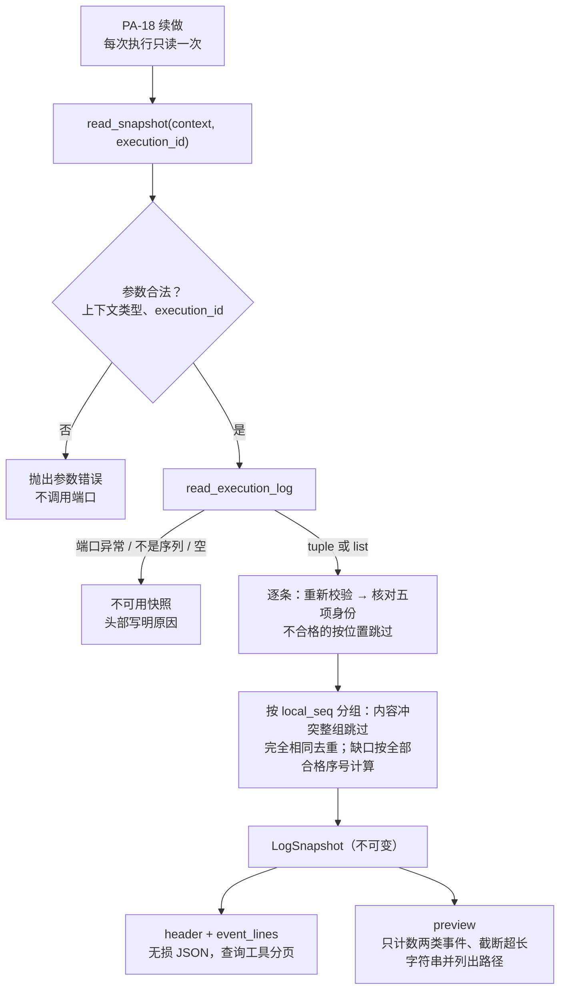

# 执行日志的读取与整理设计方案

## 1. 元信息

| 项 | 值 |
| --- | --- |
| 建档日期 | 2026-10-15 |
| 归档日期 | 2026-10-15 |
| 修订日期 | 2026-10-22：按第三轮审阅修复记录说明分页与回复片段表述（第 10 节）；2026-10-21：按开发者确认的方案改为逐条校验的事件快照、无损 JSON 记录与带截断元数据的注入预览，不再合并、翻译或分层摘要（第 10 节）；2026-10-19：PA-18 移除最终请求容量检查的联动说明；2026-10-16：恢复第 8.2.2 节旧基线验证记录；PA-18 分层材料与受控查询契约同步；基线冲突修复证据见 [F_17 第 9 节](F_17_session-state-record.md#2026-10-16-v0120-基线冲突修复) |
| 范围 | agent-core `openjiuwen/harness/persistent_agent`：读取同一 Request 下指定历史 Execution 的已保存事件，逐条校验后形成一次性快照；把快照渲染成无损的 JSON 记录（供查询工具分页）和续做注入用的预览。不含续做触发、旧中断现场清理、窗口注入、续做规则、查询工具与 `recovery_ref` 入口开放（PA-18），不含按 execution_id 查询归档（PA-11、PA-12） |
| 方案成熟度 | 已确认：D-01～D-06 由开发者 2026-10-21 按两轮审阅意见确认（替代 2026-10-15 确认的整份弃用与自然语言整理）；P-01、P-06 仍有效，P-02～P-05、P-07 按第 3 节说明调整 |
| 计划条目 | [开发计划](../designs/persistent-agent-development-plan.md) PA-17 |
| 负责人 | Song Haoran |
| 状态 | 进行中：组件已实现并通过组件验证（第 8.2 节）；按 execution_id 查询归档待 PA-12、PA-18；整体容量验收未关闭（第 9 节）；续做接入归 PA-18 |
| 设计依据 | [架构设计](../designs/persistent-agent-architecture.md) §5.2.4 第 4 步、§8.3.3；[S_02](../specs/S_02_events-and-result-handoff.md) 第 4.3 节；[S_05](../specs/S_05_confirmation-and-continuation.md) 第 5.3 节 |
| 关联 feature | [F_04](F_04_contract-convergence.md)（`read_execution_log` 端口契约）；[F_15](F_15_tool-intent-before-side-effect.md)（`tool.intent` / `tool.completed`、operation_id、只读名单）；[F_18](F_18_output-handoff.md)（候选字段）；[F_20](F_20_continuation.md)（PA-18，消费方：快照生命周期、续做规则与查询工具） |
| 验证摘要 | 最新项目工作区验证见第 8.2 节：PA 包与 core 接缝 859 passed，扩大回归 8535 passed / 128 skipped，make check 通过；Swarm 基线与补丁的 158 项结果一致（3 项既有失败）。历史原型验证与变异记录保留，不作为本轮重跑结果 |
| Refs | 未关联 issue / PR |

## 2. 背景、目标与范围

### 2.1 背景与问题

崩溃续做与非确认暂停后继续时，窗口可能缺少上一次执行的部分事实：崩溃时新窗口没有保存，停止清理可能删掉没有结果的工具调用。架构规定由程序读取 `recovery_ref` 指向的执行日志交给 Agent 查证进度（§5.2.4、§8.3.3）。PA-17 的目的是让 Agent 能依据日志从中断处接续，可读性是次要的。

2026-10-15 的方案把日志整理成中文条目：合并意图与结果、加注释与提示，任何一条事件不合规就整份弃用。2026-10-21 检视发现两类问题（第 10 节）：一是会吞日志——宿主返回 list、混入一条他人事件或同序号冲突时，整份日志连同未决写操作一起消失；等待确认的被拦截调用、流式回复片段、事件时间与原始序号在整理中丢失；续做实际使用的分层摘要只给只读调用的次数。二是太复杂：合并状态机、多种注释文案，以及为分页中文文本而设的版本校验值与字符偏移，测试大量绑定措辞。

### 2.2 目标与关键场景

| 场景 / 触发条件 | 2026-10-15 方案 | 目标行为 / 可观察变化 |
| --- | --- | --- |
| 日志可用 | 合并、翻译后的中文条目 | 每条事件一行 JSON，按 local_seq 排序，不合并、不翻译、不加结论；记录说明（头部）给出身份、编码版本、缺口、跳过项与结束事件 |
| 一条事件不合规（无法重新校验、属于他人、同序号内容冲突） | 整份弃用 | 只跳过该条（冲突则整组），其余照用；头部按固定类别列出位置 |
| 宿主返回 list | 整份弃用 | 作为容错接受（契约仍是 tuple） |
| 来源不一致 | 整份弃用 | 保留，事件行写出自己的 source_ref，头部标记 `source_mismatch` |
| 读取失败、空日志、返回值不是序列、没有一条可用事件 | 记录缺失 | 快照不可用，头部写明原因；不代表上次没有执行 |
| 续做注入 | 分层摘要（只读只计次数、正文只给字数） | 预览：除 `model.completed` 与 `reply.delta` 只计数外，所有事件逐行列出；超过 2000 字的字符串截断，并在 `truncated` 中给出事件、JSON 路径与原长 |
| 查询详细记录 | 每次重新读取并整份校验，再分页中文文本 | 由 PA-18 用同一快照按事件分页（F_20 D-08），不重读 |

### 2.3 本次范围与非目标

- 本次包含：读取一次、逐条校验与归属核对、冲突组排除与重复去重、缺口计算、无损 JSON 渲染、注入预览（只计数的事件、截断及其元数据）、不可用原因与诊断。
- 本次不包含：意图与结果的关联判断（交给模型，规则在 PA-18）；续做规则、快照的保存与释放、查询工具（PA-18）；按 execution_id 查询归档（PA-11、PA-12）；投递状态（AgentServer）；整体容量设计。

## 3. 设计约束、假设与已确认问题

- **已确认约束：**
  - 日志由服务端按 Execution 保存，只允许读取同一 Session、同一 Request；端口声明返回 `tuple[AgentEvent, ...]`；消费方必须重新校验事件并核对归属（S_02 第 4.3 节）。
  - 普通事件入队即返回、允许重试保存，契约不保证按序号落盘；非空日志不代表完整（S_02 I-2、I-4）。因此一次读取的结果只代表那一刻已保存的事件。
  - event_id 是完整调用身份（含 source_ref）与 local_seq 的规范 JSON 哈希（S_02 第 2 节），重新校验时核对；模型不能可靠地自行计算它。
  - 单条事件最大 256 KiB（`EVENT_MAX_BYTES`），单个文本字段最多 65536 字符。
  - 工具参数摘要与结果摘要在写入时已截到 500 字符（PA-15），结论在写入时已截到 500 字符（`model_rail.py`）。
- **已确认的问题：**
  - **P-01 候选引用（2026-10-15，仍有效）：** paused 与 final 的 `output_refs` 都算引用；被引用不代表已送达。本组件不再写引用说明，事件原样给出，由 PA-18 规则说明。
  - **P-02 `share_file`（2026-10-15，已不适用）：** 不再做只读聚合，`share_file` 登记与其他事件一样逐条保留。
  - **P-03 端口返回类型（2026-10-21 调整）：** 契约仍是 tuple；消费端把 list 作为容错接受，不能据此认为宿主符合契约。其他类型判为不可用并记 error。
  - **P-04 裁剪与聚合（2026-10-21 调整）：** 快照与查询工具无损；只有注入预览截断超长字符串（D-05）。
  - **P-05 归档参数（2026-10-15，仍有效）：** 不增加归档参数；`window.switched` 事件原样给出，按 execution_id 查询归档待 PA-12、PA-18。
  - **P-06 落地（仍有效）：** 仓库落地与提交由开发者负责。
  - **P-07 来源一致（2026-10-21 调整）：** 来源不一致不再拒绝；头部 source_ref 取自目标日志（不借用当前续做执行的来源），不同的事件行写出自己的 source_ref，头部 `source_mismatch` 为 true。

## 4. 总体方案与设计取舍

### 4.1 方案概览



组件只读不写：不调用模型、不改窗口、不记事件，也不解释事件。快照由 PA-18 在续做开始时建立并保存在本次执行的控制状态中，预览与查询工具共用（F_20 D-08）。

### 4.2 关键决策

#### D-01 范围与返回值（2026-10-21 修订）

- `read_snapshot(context, execution_id) -> LogSnapshot`：读取一次并逐条校验；`header(snapshot)` 与 `event_lines(snapshot)` 给出无损记录；`preview(snapshot)` 给出注入预览。不再提供 `summarize_execution`、`record_blocks` 与 `ExecutionLogSummary`。
- 快照的 `unusable` 只表示这次没有取得可用事件，不表示上次没有执行。
- 不判断意图是否有结果，不生成“未决写操作”清单：只用集合差会漏掉结果为 unknown、operation_id 复用与调用身份不一致的情况；怎样核对写操作写在 PA-18 的续做规则里。

#### D-02 逐条校验与不可用（2026-10-21 修订）

| 情况 | 处理 | 头部记法 |
| --- | --- | --- |
| 端口抛异常 | 快照不可用，诊断 warning，只记异常类名 | `usable: false`，`unusable_reason: read_failed` |
| 返回值既不是 tuple 也不是 list | 快照不可用，诊断 error | `not_a_sequence` |
| 空序列 | 快照不可用，诊断 warning | `empty` |
| 某项不能通过 `AgentEvent` 重新校验 | 跳过该项；它自带的 local_seq 不可信，按返回序列中的位置记 | `skipped.invalid_event`：`count` 与 `indexes`（从 0 起） |
| 某项的租户、Agent、Session、Request 或 execution_id 与目标不符 | 跳过，按位置记，不输出它的任何内容 | `skipped.foreign_event` |
| 同一 local_seq 有内容不同的事件（比较 `proposal_digest`） | 整组跳过，不保留先遇到的一条 | `skipped.conflicting_events`：事件数与 `local_seqs` |
| 完全相同的重复事件 | 去重，只保留一条 | `duplicates_removed` |
| 去掉上述各项后没有一条可用事件 | 快照不可用 | `no_usable_event`，同时列出 `skipped` |

- 每个类别最多列出 20 个位置，`count` 始终是精确数；诊断只写类别与数量、定位身份，不含事件内容或异常正文。有跳过项时记 error（宿主违反端口契约）。
- 取舍：宿主部分违约时，仍使用其余通过校验与归属核对的事件。他人事件一律不显示，隔离不变；这比只给“记录缺失”提供更多恢复依据，但不能保证没有其他错误，所以跳过项必须在头部写明。

#### D-03 排序、去重与缺口（2026-10-21 修订）

- 按 local_seq 排序。缺口按全部通过校验与归属核对的序号计算（含冲突组的序号），在任何渲染省略之前算出，因此只计数的事件不会被误报为缺失；校验失败的项序号不可信，可能落在缺口里，由头部 `skipped` 说明。
- 头部 `ending_seqs` 列出 paused / final 的序号；没有结束事件时为空列表。即使序号连续且有结束事件，也不代表日志完整（PA-18 规则说明）。

#### D-04 无损 JSON 记录（2026-10-21 修订）

- **编码：** 第一行是头部（`kind: execution_log`、`encoding: pa17-jsonl/1`、`event_schema_version: 1`、`preview`、`usable`、五项身份与 source_ref、`events`、`missing_seq_ranges`、`skipped`、`duplicates_removed`、`source_mismatch`、`ending_seqs`）。之后每条事件一行，直接取 `AgentEvent.model_dump(mode="json")`，不挑字段。
- **只做无损的省略：** 头部已写的五项身份与 `schema_version` 不重复；与头部相同的 source_ref 不重复；`event_id` 只在被其他事件引用（`decision_event_id`、`correlation_refs`）时保留，其余可由身份与 local_seq 重新计算；只省略 `null` 与空集合，`0`、`false`、`"private"` 等值一律保留（模型看不到 schema，不能靠默认值还原）。
- **可还原：** 头部字段加回一行即可重新校验得到原事件，`event_id` 与 `proposal_digest` 不变（PA-17-V-01）。
- **完整记录的行：** `record_lines` 以记录说明为第 0 行，其后为各条事件（local_seq 从 1 起）；查询工具按行分页，记录说明过长（缺口很多、身份字段很长）时与超长事件一样分段（F_20 D-08）。
- 不合并 `reply.delta`：合并需要另定合成记录的序号、时间与缺口规则，首版逐条保留。

#### D-05 注入预览（2026-10-21 修订）

- 头部与记录相同，`preview: true`，另加 `counted_only` 与 `truncated`。
- `model.completed` 与 `reply.delta` 只计数：`counted_only` 给出各自条数，`reply.delta` 另给总字数（流式回复片段；emitter 只记账并放入输出队列，记录不代表用户已经收到）。其余事件全部逐行列出。
- 超过 `PREVIEW_MAX_CHARS`（2000）字的字符串只保留开头，`truncated` 逐项给出 `local_seq`、JSON Pointer 路径（如 `/payload/intercepted/1/arguments`，键中的 `~`、`/` 转义）、原长与保留长度。截断只作用于注入副本，快照与记录不变。
- 预览不是完整记录：相关事件都在，但部分字符串只是开头；需要完整内容时用查询工具（PA-18 规则 7）。2000 字阈值只控制单个字段，不构成整体容量保证（第 9 节）。

#### D-06 归档引用（2026-10-15 确认，2026-10-21 调整写法）

- 不增加归档参数；`window.switched` 事件原样出现在记录与预览中，不再另写“归档”行。
- PA-11 负责归档及索引，PA-12 提供按 execution_id 查询；完整归档验收待 PA-12 查询及 PA-18 集成验证，不以日志中的换窗事件替代。

#### D-07 与 PA-18 的分工

本组件只提供读取、校验与渲染。何时读取、快照保存在哪里与何时释放、续做执行头与临时背景的追加、续做规则（含怎样核对写操作、怎样理解跳过与截断）、查询工具与分页、归档查询结果的使用及正式入口门禁归 PA-18。

### 4.3 替代方案与排除理由

| 候选 / 关联决策 | 候选目的与关键差异 | 拒绝或暂缓原因 | 重新评估条件 |
| --- | --- | --- | --- |
| R-01 / D-02 任一事件不合规即整份弃用（2026-10-15 方案） | 宿主违约时不使用任何内容 | 一条错误就让未决写操作一并消失，续做无从查证；改为逐条跳过并在头部写明 | 无 |
| R-02 / D-01 合并意图与结果、翻译成中文条目（2026-10-15 方案） | 可读 | 合并状态机复杂易错，翻译与注释丢字段；可读性是次要目标 | 无 |
| R-03 / D-01 用集合差列出“未决写操作” | 给模型现成清单 | 结果 unknown、operation_id 复用、调用身份不一致时都会漏列，可能误导 | 模型实际判断出错且有统一分组规则时 |
| R-04 / D-04 序列化完整事件（含 event_id、默认值与重复身份） | 不做任何省略 | 32 条事件实测约是旧完整整理的 5 倍 token；身份、未被引用的 event_id 与空值可无损省略 | 无 |
| R-05 / D-04 省略所有等于默认值的字段 | 更短 | 模型看不到 schema，`false`、`"private"` 等缺失后无法还原 | 无 |
| R-06 / D-04 合并连续的 `reply.delta` | 更短 | 需另定合成记录的序号、时间、缺口与分页规则 | 首版运行中确有需要时 |
| R-07 / D-05 预览只注入首页 | 有长度上限 | 意图的结果可能在后面几页，模型会误以为没有结果 | 无 |
| R-08 / D-05 预览挑选“关键字段” | 更短 | 仍会丢 event_id、params_digest、intercepted 等，只是把有损中文换成有损 JSON | 无 |
| R-09 / D-06 预留 `archive_refs` 参数 | PA-18 传入查询结果后合并 | 查询能力尚未提供（P-05） | PA-12 提供按 execution_id 查询时 |
| R-10 / D-02 只接受 tuple | 严格按契约 | 宽松实现的宿主会让续做总拿不到记录；作为容错接受 list，契约不变 | 无 |

## 5. 详细设计

### 5.1 模块责任与关键不变量

- **LI-1 只读不写：** 不调用模型、不改窗口、不记事件，不解释事件。
- **LI-2 一次读取：** 一个快照只对应一次端口读取；之后到达的事件不在其中。
- **LI-3 只跳过不合格的：** 不合格的项按位置或序号跳过并写明，其余事件原样保留；他人事件不输出任何内容。
- **LI-4 不把未知当未执行：** 不可用、缺口与跳过都只说明记录不全。
- **LI-5 记录无损：** `header` 加 `event_lines` 可还原每条可用事件；预览的截断与只计数都有元数据，不改快照。
- **LI-6 参数错误不是记录缺失：** 参数非法时不调用端口，直接抛出。

### 5.2 关键类与函数

| 名称 | 签名与变更类型 | 职责 | 约束 |
| --- | --- | --- | --- |
| `LogSnapshot` | 冻结 dataclass；新增，替代 `ExecutionLogSummary` | 一次读取的结果 | `execution_id`、`events`、`unusable`、`skipped`（类别与位置）、`duplicates`、`missing`（缺口区间） |
| `read_snapshot` | `async def read_snapshot(context: PersistentBuildContext, execution_id: str) -> LogSnapshot`；新增，替代 `summarize_execution` 与 `record_blocks` | 读取一次并逐条校验 | 先校验上下文与执行标识，非法即抛 `DEEPAGENT_CONTEXT_PARAM_ERROR` / `DEEPAGENT_INPUT_PARAM_ERROR`，不调用端口；端口异常转为不可用；取消照常传播 |
| `header` | `def header(snapshot: LogSnapshot) -> dict[str, Any]`；新增 | 记录说明 | 第 4.2 节 D-04 的字段 |
| `event_lines` | `def event_lines(snapshot: LogSnapshot) -> tuple[tuple[int, str], ...]`；新增 | 每条事件的 (local_seq, JSON 行) | 无损（D-04） |
| `record_lines` | `def record_lines(snapshot: LogSnapshot) -> tuple[tuple[int, str], ...]`；新增 | 完整记录：记录说明为第 0 行，其后为事件 | 查询工具分页的数据源 |
| `preview` | `def preview(snapshot: LogSnapshot) -> str`；新增 | 注入预览 | D-05；不改快照 |
| `ENCODING`、`EVENT_SCHEMA_VERSION`、`PREVIEW_MAX_CHARS`、`COUNTED_ONLY`、`RECORD_TOOL` | 常量 | 编码版本、事件 schema 版本、截断阈值、只计数的事件类型、查询工具名 | `EVENT_SCHEMA_VERSION` 与 `AgentEvent.schema_version` 的一致性有测试 |

### 5.3 输出格式

预览示例（换行为说明而加，实际每条一行）：

```text
{"kind":"execution_log","encoding":"pa17-jsonl/1","event_schema_version":1,"preview":true,"execution_id":"E4","usable":true,
 "namespace_id":"tenant","agent_id":"agent-a","session_id":"session-a","request_id":"Q3","source_ref":"source:message-1",
 "source_mismatch":false,"events":4,"missing_seq_ranges":[[3,3]],"skipped":{},"duplicates_removed":0,"ending_seqs":[],
 "counted_only":{"model.completed":{"events":1},"reply.delta":{"events":0,"chars":0}},"truncated":[]}
{"event_type":"tool.completed","local_seq":1,"occurred_at":"2026-10-15T08:00:00Z","visibility":"private","payload":{"tool_call_id":"call-1","tool_name":"read_file","args_summary":"reports/0930报销单.xlsx","status":"succeeded","result_summary":"已读取，共 12 行"}}
{"event_type":"progress.updated","local_seq":2,"occurred_at":"2026-10-15T08:00:01Z","visibility":"progress","payload":{"text":"审批停在财务复核环节"}}
{"event_type":"tool.intent","local_seq":4,"occurred_at":"2026-10-15T08:00:03Z","visibility":"private","payload":{"operation_id":"op_12","tool_call_id":"call-12","tool_name":"submit_reminder","target_ref":"reminder:BX-0930","params_digest":"…","args_summary":"单号=BX-0930"}}
```

不可用时只有头部，例如 `{"kind":"execution_log",…,"usable":false,"unusable_reason":"read_failed","events":0,"missing_seq_ranges":[],"skipped":{},…}`。

## 6. 影响面与实施设计

| 实施项 | 模块 / 文件 | 内容 | 验证 |
| --- | --- | --- | --- |
| I-01 | `execution/execution_log.py`（2026-10-21 重写） | 快照、逐条校验、无损记录与预览 | PA-17-V-01～V-05、V-08、V-15～V-24 |
| I-02 | `tests/unit_tests/harness/persistent_agent/test_execution_log.py`（2026-10-21 重写） | 断言结构化字段，不绑定措辞 | 同上 |
| I-03 | PA-18 消费方：`execution/continuation.py`、`execution/record_tool.py`、`execution/control.py` | 快照保存、预览注入、续做规则、按事件分页 | F_20 第 8 节 |
| I-04 | 文档 | 本文；F_20；S_02 第 4.3 节；S_05 第 5.3 节；架构 §8.3.3 与附录 C；开发计划 PA-17、PA-18 | 链接与一致性检查 |

本特性不改宿主端口与事件契约；`summarize_execution`、`record_blocks` 是内部函数，只有 PA-18 使用，随之替换。

## 7. 兼容与迁移

已持久化的 `AgentEvent` 格式、版本及宿主 `read_execution_log` 端口不变。改变的是读取后的内部渲染接口与输出：中文整理替换为 JSONL 记录和注入预览，内部函数替换见第 6 节。PA-18 的 `read_execution_record` 参数及返回结构也随之变化，迁移约定见 F_20 D-08；不能把本次改动理解为查询工具兼容旧 `cursor`。续做在正式入口仍按 F_20 D-10 关闭，没有已开放的正式续做调用方需要迁移。

## 8. 验证设计、执行记录与结论

### 8.1 验证设计与通过条件

2026-10-21 起的通过条件如下。V-06、V-07、V-09～V-14 对应 2026-10-15 方案的合并与中文整理规则，随之撤销，编号不再复用；第 8.2 节中 2026-10-15 的执行记录对应当时的条件。

| 验证 ID | 场景 | 通过条件 |
| --- | --- | --- |
| PA-17-V-01 | 含参与判断、开始、模型用量、读写工具、候选、换窗、等待确认暂停的日志 | 每条事件一行；头部加回后重新校验得到原事件，`event_id` 与 `proposal_digest` 相同；`ending_seqs` 正确 |
| PA-17-V-02 | 空日志 | 不可用（`empty`），诊断 warning；没有事件行 |
| PA-17-V-03 | 端口抛异常 | 不可用（`read_failed`）；诊断 warning，只有异常类名；预览与诊断不含异常正文 |
| PA-17-V-04 | 混入一条四项身份或 execution_id 不符的事件、或一项无法重新校验 | 只跳过该项，按返回序列位置记录；其余事件与未决写意图保留；预览、头部与诊断不含其内容；诊断 error |
| PA-17-V-05 | 有缺口，且有只计数的事件 | 缺口按全部合格序号计算，只计数的事件不算缺失 |
| PA-17-V-08 | 很长的日志 | 所有意图与结果逐条保留，按序号排列，不合并 |
| PA-17-V-15 | execution_id 非法（空、含空格、NUL、换行、513 字符、None、整数、bytes）；上下文类型不对 | 抛对应参数错误码；端口调用次数为零 |
| PA-17-V-16 | 同一序号有不同内容；完全相同的重复 | 冲突组整组跳过并列出序号，冲突序号不算缺口；重复去重并计数 |
| PA-17-V-17 | 来源不一致；来源与当前执行不同 | 保留事件，不同的事件行写出 source_ref，头部标记；头部来源取自目标日志 |
| PA-17-V-18 | 返回 None、字符串、映射；返回 list | 前者不可用（`not_a_sequence`，诊断 error）；list 按容错接受 |
| PA-17-V-19 | 没有一条可用事件 | 不可用（`no_usable_event`），头部列出跳过项 |
| PA-17-V-20 | 被引用与未被引用的事件；值为 `false` 的字段；默认可见性 | 只有被引用的保留 event_id；`false` 与 `"private"` 保留；`null` 与空集合省略；身份不重复 |
| PA-17-V-21 | 模型用量与回复片段 | 预览只给条数与回复总字数，其余事件逐行列出；记录保留它们 |
| PA-17-V-22 | 超长正文与嵌套确认参数；键需转义 | 预览截断并列出 JSON Pointer 路径、原长与保留长度；短字段不变；快照与记录不变 |
| PA-17-V-23 | 30 个跳过项 | `count` 为 30，列出前 20 个位置 |
| PA-17-V-24 | 编码声明 | `EVENT_SCHEMA_VERSION` 与 `AgentEvent.schema_version` 一致 |
| 其他 | 任务取消 | 取消照常传播 |

### 8.2 实际执行与证据

#### 2026-10-21 事件快照方案

- **基线与范围：** 以 `jiuwenmate` 的 `c6c24c44a` 导出 scratch 快照（`git archive`），只改 PA-17 与其 PA-18 消费方的代码、测试与文档；根目录 checkout 未改动。
- **环境与命令：** macOS、项目 `.venv/bin/python`（Python 3.11），工作目录为快照根。基线用同一命令在未改动的快照上运行。

| 检查 | 命令 | 实际结果及边界 |
| --- | --- | --- |
| 本特性用例 | `$PY -m pytest tests/unit_tests/harness/persistent_agent/test_execution_log.py -q -p no:cacheprovider -o addopts=` | 35 passed |
| PA 包与 core 接缝 | `$PY -m pytest tests/unit_tests/harness/persistent_agent tests/unit_tests/core/single_agent/test_final_request_check.py -q -p no:cacheprovider -o addopts=` | 848 passed；基线 858 passed，差额来自重写的三个测试文件，增删的测试函数见 F_20 第 8.2.4 节 |
| 扩大回归 | `PYTHONDONTWRITEBYTECODE=1 PYTHONPATH=. $PY -m pytest tests/unit_tests/harness tests/unit_tests/core/session tests/unit_tests/core/single_agent tests/unit_tests/core/context_engine -q -p no:cacheprovider -o addopts=` | 8524 passed、128 skipped；基线 8534 passed、128 skipped，差额 10 与 PA 包一致，均为重写的测试 |
| 变异 | scratch `pa17v2/mutate.py`（未入库）逐项改坏规则后运行三个测试文件 | 13/13 被发现：整份弃用、冲突组保留首条、缺口按省略后计算、删去被引用的 event_id、把 0 / false 当空值、截断不登记、头部来源取当前执行、拒绝 list、预览列出只计数事件、续做不保存快照、部分读取时推进 after_seq、分片与整条同页、工具重读日志 |
| Ruff / format / codespell | `ruff check`、`ruff format --check`、`codespell_lib`，范围为改动的 4 个源码与 3 个测试文件 | 均通过 |
| Pylint | `pylint --rcfile=pyproject.toml <4 个源码文件>` | 0 条，基线 0 条 |
| mypy | `mypy --config-file pyproject.toml --follow-imports=silent <源码与测试>` | 3 条，基线 4 条；均为测试中既有的写法（`**fields` 构造 `ExecutionContext`、故意传入错误上下文），无新增 |
| 预览体积 | 32 条事件的样例（12 次只读、4 个意图、3 条结果、12 条模型用量、1 条结论），cl100k 计数 | 预览 1891 token，无损记录 2694 token；2026-10-15 方案的完整整理 926 token、分层摘要 445 token。只作选型依据，不构成容量验收 |

未覆盖：全仓测试、`make check`、覆盖率；大量写操作、多候选、多层嵌套确认的压力样例；真实宿主与 M2c 联调。

#### 2026-10-22 第三轮审阅修复

命令与环境同上。

| 检查 | 实际结果及边界 |
| --- | --- |
| 审阅复现场景 | 500 条事件（序号 1、3、5……999）、499 个缺口：14 页读完，每页不超过 6000 字符（最大 5985），首页是记录说明的分段，拼接后与完整记录一致 |
| 定向用例 | `test_execution_log.py` 35 passed，`test_record_tool.py` 30 passed，`test_continuation.py` 38 passed |
| PA 包与 core 接缝 | 857 passed；基线 858 passed |
| 扩大回归 | 8533 passed、128 skipped；基线 8534 passed、128 skipped |
| 变异 | 18/18 被发现；新增 5 项：记录说明不能分段、显式 null 当作缺省、忽略旧 cursor 等未声明参数、读记录说明中途的 next 带 after_seq、规则把日志写成送达 |
| 静态检查 | 改动的 4 个源码与 3 个测试文件：Ruff、格式、codespell 通过；Pylint 0 条（修复中一度出现的 R0914 已消除）；mypy 3 条既有诊断，无新增 |

#### 2026-10-22 最新主仓基线落地复核

本方案与第三轮审阅修复已应用到项目工作区，主仓基线为 `jiuwenmate_v0.1.20` 的 `9d2ee2704`；原有未提交计划修改单独保留，不混入交付。实际环境、命令、适用范围及完整结果统一见 [F_20 第 8.2.6 节](F_20_continuation.md#826-2026-10-22-最新主仓基线落地与-swarm-兼容复核)：PA 包与 core 接缝 859 passed，扩大回归 8535 passed / 128 skipped，4 个改动源码模块覆盖率约 99%；make check 通过。定向 mypy 源码无诊断，测试保留 3 条既有诊断。Swarm 同版本对照的 158 项结果逐项一致（154 通过、3 个既有失败、1 跳过）；真实 SQLite 日志端口与分页工具验证通过，不等于完整续做业务联调。没有重跑原型变异脚本，历史变异结果仍只对应各自阶段。

#### 2026-10-15 原方案验证（历史，对应当时的通过条件）

- **固定基线：** jiuwenmate 提交 dd648886 的源码快照（`git archive dd648886 openjiuwen tests examples pyproject.toml Makefile`；`openjiuwen`、`tests`、`pyproject.toml`、`Makefile` 的 git 树哈希与仓库 dd648886 逐项一致），应用本特性补丁（源码、测试与本文、S_02、S_05、开发计划 4 个文档）。
- **工作目录：** 上述快照的根目录，位于开发者本机仓库外的草稿区，不是仓库工作区。所有命令都在这里执行。
- **环境与版本：** macOS；`$PY` 为项目 `.venv/bin/python`（Python 3.11）；Ruff 0.15.4、Pylint 4.0.5、mypy 1.19.1；codespell 2.4.3 未装在项目 `.venv` 中，使用单独安装的版本，以 `PYTHONPATH=<codespell 安装目录> $PY -m codespell_lib` 调用。测试与检查均设 `PYTHONDONTWRITEBYTECODE=1`。
- **配置：** Ruff、Pylint、mypy 读取快照根目录的 `pyproject.toml`：`[tool.ruff]` 行宽 120、规则 E / F / I / ASYNC；`[tool.pylint]` 的 `ignore-paths` 排除 `tests/` 与 `examples/`；`[tool.mypy]`。仓库没有 codespell 配置，使用默认词典。
- **静态检查的文件范围：** 源码 `openjiuwen/harness/persistent_agent/execution/execution_log.py`；测试 `tests/unit_tests/harness/persistent_agent/test_execution_log.py`；文档为本文、`docs/specs/S_02_events-and-result-handoff.md`、`docs/specs/S_05_confirmation-and-continuation.md`、`docs/designs/persistent-agent-development-plan.md`（均在 `openjiuwen/harness/persistent_agent/` 下）。下表以 `<源码>`、`<测试>`、`<4 个文档>` 指代这些文件；静态检查只覆盖它们，不代表全仓检查。
- **与 Makefile 的关系：** 未执行 `make check` / `make type-check`。它们按暂存区或最近提交选取 `.py` 文件，而本次在仓库外的快照中执行；下表运行与 `make format`、`make lint`、`make pylint`、`make spelling` 对应的命令并显式给出文件清单；差别是 Pylint 显式指定 `--rcfile=pyproject.toml`，codespell 以模块方式调用并加入 4 个文档。

| 执行日期 / 范围 | 命令 | 结果 | 未覆盖 |
| --- | --- | --- | --- |
| 2026-10-15 / 本特性用例 | `PYTHONDONTWRITEBYTECODE=1 PYTHONPATH=. $PY -m pytest tests/unit_tests/harness/persistent_agent/test_execution_log.py -q -p no:cacheprovider -o addopts=` | 40 passed | — |
| 2026-10-15 / PA 包 | `PYTHONDONTWRITEBYTECODE=1 PYTHONPATH=. $PY -m pytest tests/unit_tests/harness/persistent_agent -q -p no:cacheprovider -o addopts=` | 661 passed | — |
| 2026-10-15 / harness 与 core Session 回归 | `PYTHONDONTWRITEBYTECODE=1 PYTHONPATH=. $PY -m pytest tests/unit_tests/harness tests/unit_tests/core/session -q -p no:cacheprovider -o addopts=` | 6283 passed、39 skipped | 跳过项为既有用例，与本特性无关 |
| 2026-10-15 / Ruff 导入顺序与格式（同 `make format`） | `$PY -m ruff check --select I <源码> <测试>`；`$PY -m ruff format --check <源码> <测试>` | All checks passed；2 files already formatted；退出码均为 0 | 只覆盖源码与测试 2 个文件 |
| 2026-10-15 / Ruff 规则检查（同 `make lint`） | `$PY -m ruff check --show-fixes <源码> <测试>` | All checks passed；退出码 0 | 只覆盖源码与测试 2 个文件 |
| 2026-10-15 / Pylint（同 `make pylint`） | `PYTHONPATH=. $PY -m pylint --rcfile=pyproject.toml <源码>`；对 `<测试>` 单独执行同一命令 | 源码 10.00/10，退出码 0；测试文件被 `ignore-paths` 排除，无评分输出，退出码 0 | 测试文件未经 Pylint 检查 |
| 2026-10-15 / mypy | `MYPYPATH=. $PY -m mypy --config-file pyproject.toml --follow-imports=silent <文件>`，源码与测试分别执行 | 源码：Success: no issues found，退出码 0。测试：4 条诊断，退出码 1，分别是第 46 行测试辅助函数以 `**fields` 构造 `ExecutionContext`（2 条 arg-type）、第 249 行故意传入 `object()` 验证上下文校验（arg-type）、第 295 行把故意不合规的端口返回值（None、字符串、映射、list）赋给原先存放 tuple 的变量（assignment）；未修改测试 | `--follow-imports=silent` 不报告被导入模块的诊断。对照：同目录 dd648886 中未改动的测试文件用同一命令，`test_window_assembly.py` 7 条、`test_entries.py` 15 条、`test_session_state.py` 0 条 |
| 2026-10-15 / codespell（`make spelling` 只查 `.py`，本次另加文档） | `PYTHONPATH=<codespell 安装目录> $PY -m codespell_lib <源码> <测试> <4 个文档>` | 无输出，退出码 0 | 只覆盖上述 6 个文件 |
| 2026-10-15 / 变异检查 | 入口：`$PY mutate_pa17.py <快照根> $PY`（在快照根目录外执行亦可，脚本按参数定位文件）。脚本不在仓库内，随本特性交付记录提供（SHA-256 `d93a8831eb63291de80cdec0fe718ab37da9a062a13639babde9544f940db052`），完整命令与输出见同一交付记录中的 `pa17-mutation.log`。每项把 `execution_log.py` 中唯一出现的一段原文替换为改写文本（41 项，如去掉来源一致检查、结果之后的意图仍可合并、契约问题只记 warning、不展示结果引用），运行 `pytest tests/unit_tests/harness/persistent_agent/test_execution_log.py -x`，测试失败即算被发现，随后恢复原文 | 41/41 被发现，退出码 0；执行前后源码哈希不变 | 只改写 `execution_log.py`；按 event_id 去重一项在 P-07 之后成为等价变异，已移出清单；脚本与日志未入库，仓库读者需从交付记录获取 |

未覆盖：全仓静态检查与 `make check` / `make type-check`；测试文件的 Pylint 检查与 mypy 诊断处理；PA-18 接入与 M2c 联调；按 execution_id 查询归档（PA-12）；容量验收。

### 8.3 验证结论

2026-10-21 的通过条件（第 8.1 节）有组件证据。按 execution_id 列出归档与整体容量验收未完成，PA-17 不能标为完成。

## 9. 风险与已知遗留

| 风险 / 遗留 | 影响 | 应对 / 后续入口 |
| --- | --- | --- |
| 宿主部分违约时仍使用其余事件 | 剩下的事件也可能有未发现的问题 | 他人事件不显示；跳过项在头部写明并记 error；不宣称日志完整 |
| 注入总量没有上限 | 写操作很多、候选很多或嵌套字段很多时，预览仍可能很大；2000 字只限单个字段 | 整体容量验收保持未关闭；补压力样例；不恢复已撤销的 PA-18 容量门禁 |
| 预览是部分内容 | 截断字段只有开头，只计数的事件没有正文 | `truncated`、`counted_only` 写明；PA-18 规则要求需要时查原记录 |
| 快照不含之后才落盘的事件 | 迟到的事件本次续做看不到 | F_20 D-08 写明；之后的续做会重新读取 |
| 按 execution_id 查询归档依赖 PA-11、PA-12 | 崩溃前已归档但 `window.switched` 未保存的归档不出现 | D-06；PA-12 接入后由 PA-18 合入 |
| 意图与结果的对应交给模型 | 模型可能看漏 | 所有意图与结果都在预览中；PA-18 规则写明核对方法；若实际出错再评估 R-03 的分组方案 |
| 结束记录引用只说明应当投递 | Agent 不知道是否送达 | 投递状态归服务端 |

## 10. 设计演进与修订

### 2026-10-15 按开发者批注修订

- 原结论与适用范围：初稿返回状态、文本与结构化摘要；四种读取失败分开返回；整段目标 8000 字符，超长时合并只读项、省略较早结论；归档接收调用方传入的引用。
- 新证据与原因：开发者批注确认 D-01～D-03，采纳 D-04、D-05 的方向，D-06 待确认。
- 最终变化：接口改为 `summarize_execution(context, execution_id)` 返回 `ExecutionLogSummary(text, missing)`；五类不可用情况统一为 `missing=True`，类别只进诊断；不再固化整段上限，当前不裁剪、不聚合、不省略；意图与结果只在唯一关联时合并；写操作识别复用 PA-15 名单；候选正文原样保留；结局冲突与未见候选单独注明；归档只列日志中的引用并注明未查询。
- 旧结论的效力：初稿的 D-01、D-03、D-09 与接口签名由本条替代。

### 2026-10-15 按确认表与补充规则修订

- 原结论与适用范围：P-01～P-05 为建议；P-03 建议 tuple 与 list 都接受；operation_id 复用后，只要当前只有一条待定意图就合并；合并不核对调用身份；execution_id 只检查非空字符串。
- 新证据与原因：开发者确认表确认 P-01～P-05，其中 P-03 改为只接受 tuple；补充三项规则：复用后不误配、合并时核对调用身份、非法 execution_id 前置拒绝。
- 最终变化：D-04～D-06 改为已确认；返回值不是 tuple 即整份弃用；operation_id 出现第二条意图后不再合并任何结果；合并须 tool_call_id 与工具名一致，不一致分开列出（`missing=False`）；execution_id 按 `Identifier` 严格校验，非法时不调用端口；去重只按 local_seq 比较；新增 PA-17-V-14、V-15。
- 旧结论的效力：上一条修订中的 list 兼容与“当前仅一条待定意图即合并”作废。

### 2026-10-15 按审阅意见修订

- 原结论与适用范围：复用只按意图次数判断；P-07 待确认；工具项不列调用 ID、目标与结果引用；诊断一律 warning；示例中有与代码不一致之处；验证记录没有固定基线与命令。
- 新证据与原因：开发者转交的审阅复现两点。第一，“未见意图的旧结果 → 同 operation_id 的新意图 → 旧结果重复出现”会把新意图标成成功。第二，合法事件中的 `target_ref`、`result_refs` 不进入整理文本。审阅同时指出 P-07 已确认未实现、诊断等级与本模块惯例不一致、示例与代码矛盾。
- 最终变化：意图总在自己的结果之前记账，因此结果之后出现同 ID 的意图按复用处理（补充规则 1 的适用细化）；实现 P-07，日志内 source_ref 须一致，可与当前执行不同；工具项列出调用 ID、目标与结果引用；契约不符记 error，读取失败与空日志记 warning；示例改为与代码一致（只读工具用 `read_file`，没有结束记录时候选写“无法判断是否被引用”）；“只写上一次记录缺失”明确为固定的提示文本，只含目标执行 ID 与处理说明，不含事件内容；补充 `_Tools` 关联状态（第 5.2.1 节）、固定基线与命令；同步 S_02 第 4.3 节、S_05 第 5.3 节与开发计划。
- 旧结论的效力：上一条修订中“operation_id 出现第二条意图后不再合并”扩展为“出现第二条意图或在结果之后出现意图”。
- 验证：第 8.2 节。

### 2026-10-16 追加分层摘要与分页数据源（F_20 D-08）

- 原结论与适用范围：`summarize_execution(context, execution_id)` 只有完整整理；P-04 规定不裁剪、不聚合、不省略。
- 新证据与原因：开发者 2026-10-16 确认 F_20 Q-04 与 D-08：续做自动提供关键进度、成果与所有未决写操作的分层摘要，详细记录由受控工具分页读取。
- 最终变化：追加关键字参数 `detail`（默认 `full`，行为不变）与 `brief` 规则；新增 `record_blocks`，在同样的整份校验后返回完整整理的各行与各条目。只读名单加入 `read_execution_record`。
- 旧结论的效力：P-04 与 D-05 继续约束完整整理；分层摘要的省略按 F_20 D-08 执行，并在文本中单独注明。
- 验证：分层摘要与 `record_blocks` 的用例在本特性测试文件中，执行记录见 [F_20](F_20_continuation.md) 第 8.2 节。

### 2026-10-16 补齐 PA-18 联动接口与容量说明

- 原缺口：D-01 已补 detail，但归档参数说明、关键接口表、长日志验收与示意图仍只表达旧完整整理，存在同文档冲突。
- 最终变化：统一 summarize_execution 的关键字参数 detail，补 record_blocks 的完整返回类型、共享校验与先关联后分页语义；分别说明 full 与 brief，更新 D-05、LI-5、图和历史规则的适用范围。PA-18 的最终容量检查已接入，不再写为提供方或位置待定；可选材料筛选及换窗验收继续保留。
- 验证：本轮为文档同步，检查结果维护于 F_20 第 8.2 节；不修改 PA-17 的事件校验、关联算法或默认 full 行为。

### 2026-10-16 Q-09 实际提示同步

- 推送复查发现缺失提示与页脚仍含“查不清询问发起人”的旧措辞，与本文第 4 节和 F_20 Q-09 的模型自主判断不一致。
- 同步 execution_log.py 的 _MISSING / _FOOTER 和第 5.3 节示例：未决写操作先查证实际效果、不能直接重做；查不清时可以询问，是否询问由模型判断。
- full、brief 和 missing 三条材料路径均有固定文案之外的约束测试；本次实际执行结果随 F_20 第 8.2 节记录，不以原有组件结果代替。

### 2026-10-19 PA-18 移除最终请求容量检查

- 原结论与范围：2026-10-16 起写明 PA-18 在最终请求装配后统一检查容量，超限或计数不可靠时阻断调用。
- 新依据与变化：开发者决定移除 PA-18 的容量检查（应用端使用不同模型，context window 各不相同，部分模型的上限未知），见 F_20 D-09。本组件的读取、整理、full / brief 与 `record_blocks` 不变。
- 当前效力：第 4 节与第 9 节中关于 PA-18 最终容量检查的说明已改写；容量验收仍按“容量边界”保留。

### 2026-10-21 改为事件快照与无损 JSON

- 原结论与适用范围：2026-10-15 确认的 D-02（任一事件不合规即整份弃用）、D-04（合并意图与结果、中文条目与注释）、D-05（full / brief 两层）、P-03（只接受 tuple）、P-07（来源不一致即弃用），以及 2026-10-16 起的 `record_blocks` 分页数据源。
- 新证据与原因：开发者 2026-10-21 指出 PA-17 的主要目的是让 Agent 能依据日志断点继续，可读性次要，原方案过于复杂、可能吞日志。检视实测：宿主返回 list、混入一条他人或来源不同的事件、同序号冲突、一项无法校验时，整份日志连同未决写操作消失；被拦截的确认调用、流式回复片段、事件时间与原始序号丢失；分层摘要只给只读调用次数、打乱顺序，且不一定更短。两轮审阅补充：集合差算不出全部未决写操作；整数游标需要固定快照；大事件需要分片；序列化完整事件 token 约为旧完整整理的 5 倍，需无损省略；预览与无损记录要分开表述，截断须带字段路径；被引用的 event_id 要保留；只省略 null 与空集合。
- 最终变化：本文第 1～9 节按新方案改写（D-01～D-06、R-01～R-10、LI-1～LI-6、V-15～V-24）；接口改为 `read_snapshot`、`header`、`event_lines`、`preview`；PA-18 改用快照、续做规则说明怎样核对写操作，查询工具按事件分页（F_20 D-08）。
- 旧结论的效力：本节此前记录中的整份弃用、合并规则、中文写法、brief 规则、只接受 tuple 与来源一致要求作废；V-06、V-07、V-09～V-14 撤销；2026-10-15 的执行记录只证明当时的方案。
- 验证：第 8.2 节。

### 2026-10-22 按第三轮审阅修复分页与表述

- 原结论与适用范围：查询工具把记录说明固定放在首页、只对事件分段；D-05 称 reply.delta 是“已经流式发给用户的回复片段”。
- 新证据与原因：第三轮审阅（只读复测）指出三处：缺口很多或身份字段很长时，记录说明超过一页，固定放在首页且不能分段，首页返回 page_too_small（500 条事件、499 个缺口即可复现）；续做规则把 reply.delta 写成“已经流式发给用户”，而 emitter 只记账并放入输出队列，没有送达确认；查询工具忽略未声明的参数（旧 cursor 会悄悄返回首页）并把显式 null 当作缺省。
- 最终变化：新增 `record_lines`，记录说明为第 0 行，查询工具按行分页，记录说明与超长事件一样可分段（F_20 D-08）；reply.delta 改述为流式回复片段，记录不代表用户已经收到；查询工具的参数校验见 F_20。
- 旧结论的效力：“记录说明只在首页整条返回”与“已经流式发给用户”的表述作废。
- 验证：第 8.2 节“2026-10-22 第三轮审阅修复”。
