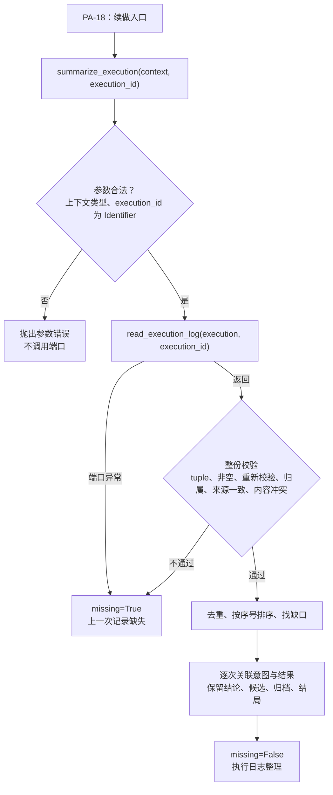

# 执行日志的读取与整理设计方案

## 1. 元信息

| 项 | 值 |
| --- | --- |
| 建档日期 | 2026-10-15 |
| 归档日期 | 2026-10-15 |
| 范围 | agent-core `openjiuwen/harness/persistent_agent`：读取同一 Request 下指定历史 Execution 的已保存事件，按契约整份校验，整理成供 Agent 使用的执行日志整理。不含续做触发、旧中断现场清理、窗口注入与 `recovery_ref` 入口开放（PA-18），不含按 execution_id 查询归档（PA-11、PA-12） |
| 方案成熟度 | 已确认：D-01～D-03 由开发者 2026-10-15 批注确认；D-04～D-06、P-01～P-07 及三项补充规则由开发者 2026-10-15 确认；D-04 中“结果之后出现同 ID 的意图按复用处理”是补充规则 1 的适用细化，依据开发者 2026-10-15 转交的审阅意见 |
| 计划条目 | [开发计划](../designs/persistent-agent-development-plan.md) PA-17 |
| 负责人 | Song Haoran |
| 状态 | 进行中：组件已实现并通过组件验证（第 8.2 节）；按 execution_id 查询归档待 PA-12、PA-18，容量验收待“容量边界”对齐，续做接入归 PA-18 |
| 设计依据 | [架构设计](../designs/persistent-agent-architecture.md) §5.2.4 第 4 步、§8.3.3；[S_02](../specs/S_02_events-and-result-handoff.md) 第 4.3 节；[S_05](../specs/S_05_confirmation-and-continuation.md) 第 5.3 节 |
| 关联 feature | [F_04](F_04_contract-convergence.md)（`read_execution_log` 端口契约）；[F_15](F_15_tool-intent-before-side-effect.md)（`tool.intent` / `tool.completed`、operation_id、只读名单）；[F_18](F_18_output-handoff.md)（候选字段，paused / final 引用候选）；PA-18 续做（消费方） |
| 验证摘要 | 组件验证：本特性用例 40 个通过；PA 包 661 passed；harness 与 core Session 6283 passed、39 skipped；41 项变异检查全部被发现。静态检查只针对本特性改动的文件（第 8.2 节），不是全仓检查：Ruff、codespell 通过；Pylint 10.00/10（仅源码，测试目录按配置不检查）；mypy 源码无报错，测试文件有 4 条诊断未处理 |
| Refs | 未关联 issue / PR |

## 2. 背景、目标与范围

### 2.1 背景与问题

崩溃续做与非确认暂停后继续时，窗口可能缺少上一次执行的部分事实：崩溃时新窗口没有保存，停止清理可能删掉没有结果的工具调用。架构规定由程序读取 `recovery_ref` 指向的执行日志，整理后作为临时背景交给 Agent 查证进度（§5.2.4、§8.3.3）。此前只有端口契约 `CommitPort.read_execution_log(execution, execution_id)`（PA-04），没有读取、校验与整理的实现。

### 2.2 目标与关键场景

| 场景 / 触发条件 | 之前 | 目标行为 / 可观察变化 |
| --- | --- | --- |
| 上一次执行的日志可用 | 不支持 | 按序号列出工具操作、结论与候选，最后列出结局、引用与归档 |
| 写操作登记了意图但没有结果 | 不支持 | 标为“已登记，无结果”，提示结果不明、先查证、不能直接重做 |
| 序号有缺口或没有结束事件 | 不支持 | 写明缺少哪些序号；写“未记录结束；无法仅凭日志确定执行是否已结束” |
| 读取失败、空日志、结构不合法、归属错配、内容冲突 | 不支持 | 整份弃用，`missing=True`，只给出“上一次记录缺失”提示，不交出任何事件内容 |
| operation_id 复用或调用身份不一致 | 不支持 | 各条分开列出并注明，已有结果不会算到后来的未决意图上 |
| 日志很长 | 不支持 | 不截断、不省略，交给 PA-18 判断能否注入 |

### 2.3 本次范围与非目标

- 本次包含：读取、整份校验、排序去重、缺口检测、意图与结果的逐次关联、结论、候选、换窗归档引用与结局的整理，以及“上一次记录缺失”的提示。
- 本次不包含：续做触发、加载记录后清理旧中断现场、把整理结果追加到窗口、开放 `recovery_ref` 入口与续做规则提示词（PA-18）；按 execution_id 查询归档（PA-11、PA-12）；投递状态（AgentServer）；整体容量设计。

## 3. 设计约束、假设与已确认问题

- **已确认约束：**
  - 日志由服务端按 Execution 保存，只允许读取同一 Session、同一 Request；返回值为 `tuple[AgentEvent, ...]`；消费方必须重新校验事件并核对归属（S_02 第 4.3 节）。
  - 普通事件允许缺失，关键事件只证明自身落盘；非空日志不代表完整（S_02 I-2、I-4）。
  - event_id 是完整调用身份（含 source_ref）与 local_seq 的规范 JSON 哈希（S_02 第 2 节）。
  - operation_id 由调用身份与 tool_call_id 派生（PA-15），同一 Request 内 operation_id 复用即 tool_call_id 复用。同一 Execution 内，意图在执行前记账，一定排在它自己的结果之前。
  - 只读工具按 PA-15 的精确名单识别（[effect_policy.py](../../tools/effect_policy.py)，当前为 `read_file`、`list_files`、`share_file`）；名单外的调用有写意图，`tool.completed` 带同一 operation_id。
  - 结束事件首次记账失败时按原事件补交候选并重试（F_18 D-07），日志中可能出现内容相同的重复事件。
  - 工具参数摘要与结果摘要在写入时已截到 500 字符（PA-15），结论在写入时已截到 500 字符（`model_rail.py`）。
- **已确认的问题（开发者 2026-10-15）：**
  - **P-01 候选引用：** paused 与 final 的 `output_refs` 都算引用；被引用不代表已送达。
  - **P-02 `share_file`：** 保持只读名单分类，但将来引入只读聚合时须排除它，逐次保留文件登记依据。
  - **P-03 端口返回类型：** 只接受 tuple，逐条重新校验。list 等其他类型按契约不符处理：整份弃用，`missing=True`，诊断记失败类别与定位身份，由端口提供方修正。不做 list 兼容。
  - **P-04 裁剪与聚合：** 当前不裁剪、不聚合、不省略，不启用单项 200 字符或整段上限；后续规则另行确认，容量验收待完成。
  - **P-05 归档参数：** 不增加 `archive_refs` 参数，保持 `summarize_execution(context, execution_id)` 签名；只列日志中的归档引用并注明“尚未按 execution_id 查询，可能不全”；完整归档验收待 PA-12、PA-18。
  - **P-06 落地：** 仓库落地与提交由开发者负责。
  - **P-07 日志内来源一致：** 一个 Execution 只有一个 source_ref。日志内各事件的 source_ref 不一致即归属错配，整份弃用；日志的 source_ref 可以与当前执行不同，不拿当前执行比较。

## 4. 总体方案与设计取舍

### 4.1 方案概览



组件只读不写：不调用模型、不改窗口、不记事件。何时调用、怎样放进窗口、按 `missing` 怎样继续，都归 PA-18。

### 4.2 关键决策

#### D-01 范围与返回值（已确认）

- 只负责读取、校验、整理执行日志。新增 `execution/execution_log.py`，提供内部函数 `summarize_execution(context, execution_id)`，返回不可变的 `ExecutionLogSummary(text, missing)`。
- 不改执行入口；接入由 PA-18 完成。
- `missing` 只表示本次没有取得可用日志，不表示上次没有执行。
- 确认依据：开发者 2026-10-15 批注 1。

#### D-02 日志可用性与异常边界（已确认）

无法取得一个非空、且整份通过基础契约校验的执行事件集合，就判为不可用，返回 `missing=True`：

| 情况 | 判定依据 |
| --- | --- |
| 读取失败 | 正确调用端口后，端口抛出读取、超时、权限拒绝等异常 |
| 空日志 | 返回空 tuple |
| 返回结构不合法 | 返回值不是 tuple（list、None、字符串、映射等都不接受，由端口提供方修正），或任一事件不能通过 `AgentEvent` 重新校验 |
| 归属错配 | 租户、Agent、Session、Request 不匹配，事件的 execution_id 不是目标执行，或日志内各事件的 source_ref 不一致（P-07） |
| 内容冲突 | 同 event_id 或同 local_seq 对应不同的完整提案内容；比较规范化后的提案（`proposal_digest`），不比较 JSON 排版。整份通过归属与来源核对后 event_id 只随 local_seq 变化，按 local_seq 比较即覆盖两种情况 |

- 任一情况成立，整份弃用，不向模型交出任何事件内容。文本固定为“上一次执行 <execution_id>：上一次记录缺失：……”（第 5.3 节），只含调用方给出的目标执行 ID 与固定的处理说明。
- 诊断日志只记录失败类别和定位身份（Session、Request、目标执行），不含事件内容、异常正文或完整校验错误；端口异常只记异常类名。读取失败与空日志记 warning（可能是服务端临时故障，或确实没有保存任何事件）；其余情况说明服务端违反端口契约，记 error。与本模块其他诊断一致：会话状态记录无效、窗口不能安全追加记 error，端口临时失败记 warning。
- 以下情况仍返回 `missing=False`：序号有缺口、没有结束事件；写意图缺少完成结果；结束事件引用了日志中未见的候选；operation_id 复用或调用身份不一致导致关联有歧义；日志很长，或只包含模型用量、展示片段等事件。
- 先整份校验，再过滤和去重。任务取消、调用参数非法、整理程序自身出错，直接传播异常；异常捕获只放在端口读取与事件重新校验两处。
- **参数前置校验：** 上下文必须是 `PersistentBuildContext`，否则抛 `DEEPAGENT_CONTEXT_PARAM_ERROR`；execution_id 复用协议的 `Identifier` 约束严格校验（必须是 str，1～512 字符，不含空白与控制字符），否则抛 `DEEPAGENT_INPUT_PARAM_ERROR`。两者都在调用端口之前完成，不转为记录缺失。
- 确认依据：开发者 2026-10-15 批注 2；返回类型为 P-03；来源一致为 P-07；参数前置校验为补充规则 3。

#### D-03 排序、去重与缺口（已确认）

- 按 local_seq 排序；完整提案相同的重复事件只保留一条。
- 从序号 1 开始检测缺口，列明缺失区间（“日志缺少第 2～3、6～8 条记录。”）。
- 没有结束事件时写：“未记录结束；无法仅凭日志确定执行是否已结束。”
- 即使序号连续且存在结束事件，也不宣称日志完整（末尾说明固定写明）。
- 整理造成的省略须单独注明，不与存储日志的缺口混淆（当前不做省略，见 D-05）。
- 确认依据：开发者 2026-10-15 批注 3。

#### D-04 整理规则（已确认）

- **噪声：** 丢弃 `reply.delta`、`model.completed`、`execution.started` 与参与判断。
- **工具操作逐次整理：** 写操作的意图与结果只在能唯一关联时合并。合并须同时满足：该 operation_id 此前没有出现过意图或结果，该意图尚无结果，且结果的 tool_call_id 与工具名都与意图一致。关联状态与方法见第 5.2.1 节。
  - **operation_id 复用：** 同一 operation_id 出现第二条意图，或在出现过结果之后才出现意图，都说明 ID 被复用（意图总在自己的结果之前记账）。此后该 operation_id 的任何结果都不合并。仍无结果的意图保持“已登记，无结果”并注明“operation_id 与其他调用重复，结果无法唯一关联”；结果单独成行并注明“无法确定对应哪次意图，未合并”。例：“意图 A → A 成功 → 意图 B → A 的重复结果”，以及“未见意图的旧结果 → 意图 B → 旧结果重复出现”，B 都保持未决。复用之前已合并的结果不受影响。
  - **调用身份不一致：** operation_id 相同但 tool_call_id 或工具名与待定意图不一致时分开保留，意图注明“有一条调用身份不一致的结果，未合并”，结果注明“调用身份与意图不一致（tool_call_id 或工具名），未合并”。这是可用但不完整的日志，`missing=False`。
  - 没有意图的写结果注明“未见对应的意图记录”；同一 operation_id 已有结果后再出现的结果注明“该 operation_id 已有一条结果，本条未合并”。只读操作没有意图，每次结果单独成行。
- **查证依据：** 每个工具项都列出 tool_call_id（便于与窗口中的调用对应）；意图的 `target_ref` 写为“目标”；结果的 `result_refs` 写为“结果引用”。这些是事件中的受控标识与引用，结果摘要只给概括时，详细回执要靠它们查找。
- **写操作的识别：** 有意图、带 operation_id，或工具名不在 PA-15 只读名单中，都按写操作处理（复用 `is_read_only_tool_name`，不另建名单）。`share_file` 保持只读分类；将来引入只读聚合时须排除它，逐次保留（P-02）。
- **写操作状态：** 成功；失败（注明“失败不代表没有副作用，必要时查证”）；结果不明（注明先查证，不能直接重做）；已登记，无结果（注明结果不明，先查证，不能直接重做）。
- **结论：** `progress.updated` 整理为“结论”。
- **候选：** 保留 output_id、目标、共享方式、受控文件引用（`sha256:…`）、文件大小、文件路径、依赖引用及正文（message 正文与文件说明原样保留，多行正文缩进列出）；有结束记录时注明是否被引用、被哪条结束记录引用，paused 与 final 都算（P-01）；没有结束记录时写“未见结束记录，无法判断是否被引用”；不把候选或结束记录写成“已送达”。
- **结局：** 最后列出结局及其引用的候选。有多条不同的结束事件时写“结局记录冲突，无法确定以哪一条为准”并逐条列出，不擅自选择一个；结束事件引用了日志中未见的候选时单独注明。
- 确认依据：开发者 2026-10-15 批注 4；P-01、P-02；补充规则 1、2；结果之后的意图与查证依据两项按 2026-10-15 转交的审阅意见补充（第 10 节）。

#### D-05 长度与容量（已确认）

- 不固化整段字数上限，不采用此前建议的 8000 字符。
- 当前不裁剪、不聚合、不省略，不启用单项 200 字符上限：各项按事件中的文字原样保留（工具摘要与结论在写入时已有 500 字符的上限）；候选正文、写操作、结局和引用都不会因长度被删除。
- 能否注入由 PA-18 根据模型实际容量、已加载窗口及其他背景判断。
- 后续如启用裁剪或聚合，规则另行确认，须在文本中注明，并与日志缺口区分。
- 整理规则不能替代整体容量设计，容量验收继续保留，待完成。
- 确认依据：开发者 2026-10-15 批注 5；P-04。

#### D-06 归档引用（已确认）

- 不增加 `archive_refs` 参数，签名保持 `summarize_execution(context, execution_id)`。
- 只列出日志中 `window.switched` 记下的归档引用，并注明“仅为日志中的归档引用，尚未按 execution_id 查询，可能不全”；日志中没有换窗记录时也写明。
- PA-11 负责归档及索引，PA-12 提供按 execution_id 查询，沿用 Yan Zhijun 的既有分工。完整归档验收标为“待 PA-12 查询及 PA-18 集成验证”，不以日志中的换窗事件替代。
- 确认依据：P-05。

#### D-07 与 PA-18 的分工

本组件只提供读取与整理。调用时机、旧中断现场清理、续做执行头与临时背景的追加、续做规则提示词、按 `missing` 决定继续还是失败、按实际容量决定能否注入、归档查询结果的使用，以及开放 `recovery_ref` 入口，都归 PA-18。

### 4.3 替代方案与排除理由

| 候选 / 关联决策 | 候选目的与关键差异 | 拒绝或暂缓原因 | 重新评估条件 |
| --- | --- | --- | --- |
| R-01 / D-02 只丢弃不合格的事件，其余照用 | 保留更多信息 | 归属错配或内容冲突说明宿主返回了错误数据，其余内容同样不可信 | 无 |
| R-02 / D-01 返回多种状态与结构化摘要 | PA-18 可按类别处理 | 开发者确认只返回文本与 `missing`；类别写进诊断日志 | PA-18 设计需要时 |
| R-03 / D-04 operation_id 的结果覆盖到最近一次意图，或只要当前仅有一条待定意图就合并 | 实现简单 | operation_id 复用时会把前一次调用的迟到结果算到后来的未决意图上，掩盖需要查证的写操作 | 无 |
| R-04 / D-04 只按意图次数判断复用 | 实现简单 | 意图事件丢失时，旧结果在前、新意图在后，重复出现的旧结果会把新意图标成成功 | 无 |
| R-05 / D-04 只按 operation_id 合并，不核对 tool_call_id 与工具名 | 实现简单 | 宿主数据错误时会把别的调用的结果算到这条意图上 | 无 |
| R-06 / D-02 端口返回 list 也接受 | 兼容宽松实现 | 契约规定 tuple；放宽会掩盖端口提供方的问题（P-03） | 端口契约修订时 |
| R-07 / D-02 日志的 source_ref 须与当前执行一致 | 归属核对更严格 | 续做执行与被续做的执行可能来自不同来源；只要求日志内部一致（P-07） | 无 |
| R-08 / D-05 固定整段 8000 字符并省略结论 | 控制注入长度 | 容量应按实际 token 与窗口判断；固定数字会让 PA-17 替代整体容量设计 | 整体容量设计确定后 |
| R-09 / D-06 预留 `archive_refs` 参数 | PA-18 传入查询结果后合并 | 查询能力尚未提供，提前加参数没有真实调用方（P-05） | PA-12 提供按 execution_id 查询时 |
| R-10 / D-04 在整理中写投递结果 | 让 Agent 知道是否送达 | 投递状态归服务端，Agent 侧没有权威来源 | 服务端提供投递查询端口时 |

## 5. 详细设计

### 5.1 模块责任与关键不变量

- **LI-1 只读不写：** 不调用模型、不改窗口、不记事件。
- **LI-2 整份可用或整份弃用：** 只要有一条不合格，不向模型交出任何事件内容。
- **LI-3 不把未知当未执行：** 记录缺失、缺口、没有结果的写意图，都不会被写成“没有执行”。
- **LI-4 不误配结果：** operation_id 复用后不再合并；调用身份不一致不合并；已有结果不算到其他意图上。
- **LI-5 不删减关键事实：** 写操作、候选正文、结局、引用与查证依据不因长度被删除；当前不做任何省略。
- **LI-6 不越权陈述投递：** 候选只写是否被结束记录引用。
- **LI-7 参数错误不是记录缺失：** 参数非法时不调用端口，直接抛出。

### 5.2 关键类与函数

| 名称 | 签名与变更类型 | 职责 | 约束 |
| --- | --- | --- | --- |
| `ExecutionLogSummary` | 冻结 dataclass；新增 | 整理结果 | `text: str`；`missing: bool` |
| `summarize_execution` | `async def summarize_execution(context: PersistentBuildContext, execution_id: str) -> ExecutionLogSummary`；新增 | PA-18 在续做入口调用 | 先校验参数（非法即抛 `DEEPAGENT_CONTEXT_PARAM_ERROR` / `DEEPAGENT_INPUT_PARAM_ERROR`，不调用端口）；端口为 `context.ports.commit`；端口异常转为 `missing=True`；取消照常传播 |
| `_validated` / `_checked` / `_foreign` | 内部 | 整份校验（只接受 tuple、归属、来源一致）、按 local_seq 去重与排序 | 任一不合格返回失败类别 |
| `_diagnose` | 内部 | 写诊断 | 只含类别与定位身份；契约不符记 error，读取失败与空日志记 warning |
| `_Tools` | 内部 | 按 operation_id 逐次关联意图与结果 | 见第 5.2.1 节 |
| `_header` / `_body` / `_tail` | 内部 | 渲染 | 缺口在开头；结局、未见候选、归档与说明在末尾 |

#### 5.2.1 `_Tools` 关联状态

- **作用域：** 每次整理新建一个实例，按 local_seq 顺序依次接收 `tool.intent` 与 `tool.completed`；所有状态以 operation_id 为键，只在本次整理内有效。只读结果没有 operation_id，每次单独成行，不进入这些状态。
- **状态：** `intents`（每个 operation_id 出现过的意图）；`pending`（可以接收结果的唯一一条意图）；`reused`（已判定复用、不再合并的 operation_id）；`resulted`（出现过结果的 operation_id）。
- **`intent(event)`：** 记下意图及其目标。该 operation_id 已有意图或已有结果时，加入 `reused`，撤下 `pending`，给所有仍无结果的意图注明无法唯一关联；否则成为 `pending`。
- **`result(event)`：** `pending` 中有意图，且 tool_call_id 与工具名都一致时合并；否则单独成行，按“调用身份不一致 → 复用 → 未见意图 → 已有结果”的顺序注明原因。带 operation_id 的结果都记入 `resulted`。结果的状态、摘要、原因与结果引用写到合并后或单独的那一项上。

### 5.3 输出格式

```text
上一次执行 E4（请求 Q3）的执行日志整理：
日志缺少第 3、7～9 条记录。
1. [成功] read_file(reports/0930报销单.xlsx) → 已读取，共 12 行（调用 call-1）
2. [结论] 审批停在财务复核环节
3. [已登记，无结果] submit_reminder(单号=BX-0930)（写操作 op_12，调用 call-12，目标 reminder:BX-0930）：结果不明，先查证，不能直接重做
4. [交出候选] 文件 reports/q3.md（out_…，目标 chat-1，upload，sha256:…，13 字节）：未见结束记录，无法判断是否被引用：季度报告
结局：未记录结束；无法仅凭日志确定执行是否已结束。
归档：archive#7（仅为日志中的归档引用，尚未按 execution_id 查询，可能不全）
说明：以上由程序从执行日志整理；即使序号连续且有结束记录，也不代表日志完整。结果不明、没有结果或失败的写操作先查证，查不清询问发起人。
```

成功的写操作带结果引用时写作：`[成功] submit_reminder(单号=BX-0930) → 已提醒（结果引用 receipt:77）（写操作 op_12，调用 call-12，目标 reminder:BX-0930）`。不在只读名单中的工具（例如 `search_group_messages`）按写操作列出，带“写操作”标记。

不可用时：`上一次执行 E4：上一次记录缺失：没有取得可用的执行日志。不能据此认为上一次没有执行；涉及写操作先查证，查不清询问发起人。`

## 6. 影响面与实施设计

| 实施项 | 模块 / 文件 | 内容 | 验证 |
| --- | --- | --- | --- |
| I-01 | `execution/execution_log.py`（新增） | 读取、整份校验、关联、渲染 | PA-17-V-01～V-15 |
| I-02 | `tests/unit_tests/harness/persistent_agent/test_execution_log.py`（新增） | 各路径单测 | 同上 |
| I-03 | 文档 | S_02 第 4.3 节补消费方整份校验、`missing` 语义与诊断；S_05 第 5.3 节改为引用本文的整理规则；开发计划 PA-17 状态、负责人、证据与变更记录 | 链接与一致性检查 |

本特性不改公共接口、宿主端口和正式入口行为。

## 7. 兼容与迁移

不涉及：新增内部模块，不改已有接口、记录或事件。

## 8. 验证设计、执行记录与结论

### 8.1 验证设计与通过条件

| 验证 ID | 场景 | 通过条件 |
| --- | --- | --- |
| PA-17-V-01 | 正常日志（含展示片段、模型用量、开始事件；写操作带目标与结果引用） | 噪声丢弃；工具、结论、候选按序号列出，工具项带调用 ID、目标与结果引用；最后是结局、归档与说明 |
| PA-17-V-02 | 空日志 | `missing=True`，只给出“上一次记录缺失”提示；诊断为 warning，类别为空日志 |
| PA-17-V-03 | 端口抛异常 | `missing=True`；诊断为 warning，只有异常类名；文本与诊断都不含异常正文 |
| PA-17-V-04 | 归属错配（四项身份、目标执行、日志内来源不一致）、不能重新校验、同 event_id / 同序号内容冲突、返回值不是 tuple（含 list、None、字符串、映射）；另验证来源与当前执行不同但日志内一致时可用 | 不合规时 `missing=True`，不交出任何事件内容，诊断为 error、不含内容；返回类型不符时类别为“not a tuple”，来源不一致时类别为“different sources” |
| PA-17-V-05 | 序号缺口；没有结束事件 | 列出缺失区间；写“未记录结束”；`missing=False` |
| PA-17-V-06 | 写操作各状态；名单外工具没有意图 | 按 D-04 的写法；名单外工具按写操作处理 |
| PA-17-V-07 | 候选被 final 引用、被 paused 引用、未被引用、没有结束事件；多行正文；文件说明 | 按 D-04 标注；正文原样保留；不出现“已投递”“已送达” |
| PA-17-V-08 | 很长的日志 | 不截断、不聚合、不省略，写操作全部保留 |
| PA-17-V-09 | 换窗归档 | 列出并注明“尚未按 execution_id 查询” |
| PA-17-V-10 | 内容相同的重复事件 | 只算一次，不误报缺口 |
| PA-17-V-11 | operation_id 复用（A → A 成功 → B；再加 A 的重复结果）、未见意图的旧结果 → B → 旧结果重复出现、两条待定意图、重复结果 | 复用前的合并保留；B 保持“已登记，无结果”；其余结果分开列出并注明 |
| PA-17-V-12 | 结束事件冲突；引用了未见的候选 | 写明冲突并逐条列出；注明未见候选 |
| PA-17-V-13 | 只含展示与用量事件 | `missing=False`，写明没有可整理的记录 |
| PA-17-V-14 | 结果的 tool_call_id 或工具名与待定意图不一致 | 分开列出，双方注明身份不一致；`missing=False` |
| PA-17-V-15 | execution_id 非法（空、含空格、NUL、换行、513 字符、None、整数、bytes）；上下文类型不对 | 抛对应参数错误码；端口调用次数为零 |
| 其他 | 任务取消 | 取消照常传播 |

### 8.2 实际执行与证据

以下为仓库外组件验证记录；仓库落地后的检查见第 8.2.1 节。

- **固定基线：** jiuwenmate 提交 dd648886 的源码快照（`git archive dd648886 openjiuwen tests examples pyproject.toml Makefile`；`openjiuwen`、`tests`、`pyproject.toml`、`Makefile` 的 git 树哈希与仓库 dd648886 逐项一致），应用本特性补丁（源码、测试与本文、S_02、S_05、开发计划 4 个文档）。
- **工作目录：** 上述快照的根目录，位于开发者本机仓库外的草稿区，不是仓库工作区。所有命令都在这里执行。
- **环境与版本：** macOS；`$PY` 为项目 `.venv/bin/python`（Python 3.11）；Ruff 0.15.4、Pylint 4.0.5、mypy 1.19.1；codespell 2.4.3 未装在项目 `.venv` 中，使用单独安装的版本，以 `PYTHONPATH=<codespell 安装目录> $PY -m codespell_lib` 调用。测试与检查均设 `PYTHONDONTWRITEBYTECODE=1`。
- **配置：** Ruff、Pylint、mypy 读取快照根目录的 `pyproject.toml`：`[tool.ruff]` 行宽 120、规则 E / F / I / ASYNC；`[tool.pylint]` 的 `ignore-paths` 排除 `tests/` 与 `examples/`；`[tool.mypy]`。仓库没有 codespell 配置，使用默认词典。
- **静态检查的文件范围：** 源码 `openjiuwen/harness/persistent_agent/execution/execution_log.py`；测试 `tests/unit_tests/harness/persistent_agent/test_execution_log.py`；文档为本文、`docs/specs/S_02_events-and-result-handoff.md`、`docs/specs/S_05_confirmation-and-continuation.md`、`docs/designs/persistent-agent-development-plan.md`（均在 `openjiuwen/harness/persistent_agent/` 下）。下表以 `<源码>`、`<测试>`、`<4 个文档>` 指代这些文件；静态检查只覆盖它们，不代表全仓检查。
- **与 Makefile 的关系：** 未执行 `make check` / `make type-check`。它们按暂存区或最近提交选取 `.py` 文件，而本次在仓库外的快照中执行；下表运行与 `make format`、`make lint`、`make pylint`、`make spelling` 对应的命令并显式给出文件清单；差别是 Pylint 显式指定 `--rcfile=pyproject.toml`，codespell 以模块方式调用并加入 4 个文档。

| 执行日期 / 范围 | 命令 | 结果 | 未覆盖 |
| --- | --- | --- | --- |
| 2026-10-15 / 本特性用例 | `PYTHONDONTWRITEBYTECODE=1 PYTHONPATH=. $PY -m pytest tests/unit_tests/harness/persistent_agent/test_execution_log.py -q -p no:cacheprovider -o addopts=` | 40 passed | — |
| 2026-10-15 / PA 包 | `PYTHONDONTWRITEBYTECODE=1 PYTHONPATH=. $PY -m pytest tests/unit_tests/harness/persistent_agent -q -p no:cacheprovider -o addopts=` | 661 passed | — |
| 2026-10-15 / harness 与 core Session 回归 | `PYTHONDONTWRITEBYTECODE=1 PYTHONPATH=. $PY -m pytest tests/unit_tests/harness tests/unit_tests/core/session -q -p no:cacheprovider -o addopts=` | 6283 passed、39 skipped | 跳过项为既有用例，与本特性无关 |
| 2026-10-15 / Ruff 导入顺序与格式（同 `make format`） | `$PY -m ruff check --select I <源码> <测试>`；`$PY -m ruff format --check <源码> <测试>` | All checks passed；2 files already formatted；退出码均为 0 | 只覆盖源码与测试 2 个文件 |
| 2026-10-15 / Ruff 规则检查（同 `make lint`） | `$PY -m ruff check --show-fixes <源码> <测试>` | All checks passed；退出码 0 | 只覆盖源码与测试 2 个文件 |
| 2026-10-15 / Pylint（同 `make pylint`） | `PYTHONPATH=. $PY -m pylint --rcfile=pyproject.toml <源码>`；对 `<测试>` 单独执行同一命令 | 源码 10.00/10，退出码 0；测试文件被 `ignore-paths` 排除，无评分输出，退出码 0 | 测试文件未经 Pylint 检查 |
| 2026-10-15 / mypy | `MYPYPATH=. $PY -m mypy --config-file pyproject.toml --follow-imports=silent <文件>`，源码与测试分别执行 | 源码：Success: no issues found，退出码 0。测试：4 条诊断，退出码 1，分别是第 46 行测试辅助函数以 `**fields` 构造 `ExecutionContext`（2 条 arg-type）、第 249 行故意传入 `object()` 验证上下文校验（arg-type）、第 295 行把故意不合规的端口返回值（None、字符串、映射、list）赋给原先存放 tuple 的变量（assignment）；未修改测试 | `--follow-imports=silent` 不报告被导入模块的诊断。对照：同目录 dd648886 中未改动的测试文件用同一命令，`test_window_assembly.py` 7 条、`test_entries.py` 15 条、`test_session_state.py` 0 条 |
| 2026-10-15 / codespell（`make spelling` 只查 `.py`，本次另加文档） | `PYTHONPATH=<codespell 安装目录> $PY -m codespell_lib <源码> <测试> <4 个文档>` | 无输出，退出码 0 | 只覆盖上述 6 个文件 |
| 2026-10-15 / 变异检查 | 入口：`$PY mutate_pa17.py <快照根> $PY`（在快照根目录外执行亦可，脚本按参数定位文件）。脚本不在仓库内，随本特性交付记录提供（SHA-256 `d93a8831eb63291de80cdec0fe718ab37da9a062a13639babde9544f940db052`），完整命令与输出见同一交付记录中的 `pa17-mutation.log`。每项把 `execution_log.py` 中唯一出现的一段原文替换为改写文本（41 项，如去掉来源一致检查、结果之后的意图仍可合并、契约问题只记 warning、不展示结果引用），运行 `pytest tests/unit_tests/harness/persistent_agent/test_execution_log.py -x`，测试失败即算被发现，随后恢复原文 | 41/41 被发现，退出码 0；执行前后源码哈希不变 | 只改写 `execution_log.py`；按 event_id 去重一项在 P-07 之后成为等价变异，已移出清单；脚本与日志未入库，仓库读者需从交付记录获取 |

上述仓库外验证未覆盖：全仓静态检查与 `make check` / `make type-check`；测试文件的 Pylint 检查与 mypy 诊断处理；PA-18 接入与 M2c 联调；按 execution_id 查询归档（PA-12）；容量验收。

#### 8.2.1 仓库落地后的检查

2026-10-15 按开发者授权，在基于 dd648886 的隔离 Git 工作树应用 PA-17 补丁；未应用 PA-18 补丁，未创建新分支。源码与测试保持补丁原样，仅补充本文的归档日期与落地验证记录。工作目录为该工作树根目录，`$PY` 为项目 `.venv/bin/python`；`PATH` 前置该解释器的 bin 目录，设置 `PYTHONPATH=.`、`PYTHONDONTWRITEBYTECODE=1`，Pylint 与 mypy 缓存放在仓库外验证目录。

| 范围 | 实际命令 | 结果 | 未覆盖 / 说明 |
| --- | --- | --- | --- |
| PA-17 定向用例 | `PYTHONDONTWRITEBYTECODE=1 PYTHONPATH=. $PY -m pytest tests/unit_tests/harness/persistent_agent/test_execution_log.py -q -p no:cacheprovider -o addopts= --disable-warnings` | 40 passed | 组件验证 |
| harness 与 core Session 回归 | `make test PYTHON="$PY" UV=no RUN_CMD=env TESTFLAGS="tests/unit_tests/harness tests/unit_tests/core/session -q -p no:cacheprovider -o addopts= --disable-warnings"` | 6283 passed、39 skipped、4 subtests passed | 89 warnings；不是真实 AgentServer 联调 |
| 暂存的 PA-17 源码与测试 | `make check PYTHON="$PY" UV=no RUN_CMD=env` | Ruff 导入顺序、格式、规则与 codespell 通过；Pylint 源码 10.00/10 | 测试目录按 Pylint 配置排除；不是全仓静态检查 |
| 暂存的 PA-17 源码与测试 | `make type-check PYTHON="$PY" UV=no RUN_CMD=env` | mypy 报告测试文件 4 条已知诊断，源码无诊断 | Makefile 忽略 mypy 的退出码 1，故 make 返回 0；类型检查不能记为通过。诊断位置及原因见上表，未修改测试 |
| 文档一致性 | 检查 4 份文档的相对链接与章节锚点、PA-17-V 编号；使用 Mermaid 解析本文与计划的图；`codespell -q 3 <4 个文档>`；`git diff --cached --check` | 107 个相对链接与锚点、15 个唯一验证编号、3 个 Mermaid 块语法、codespell 与差异格式检查通过 | Mermaid 未做 SVG 渲染；未执行全仓文档检查 |

PA-18 接入与 M2c 联调、按 execution_id 查询归档及容量验收仍未完成；本次落地不关闭这些验收。

### 8.3 验证结论

本特性承诺的整理与校验行为（PA-17-V-01～V-15）有组件证据。按 execution_id 列出归档与容量相关验收未完成，PA-17 不能标为完成。

## 9. 风险与已知遗留

| 风险 / 遗留 | 影响 | 应对 / 后续入口 |
| --- | --- | --- |
| 按 execution_id 查询归档依赖 PA-11、PA-12 | 崩溃前已归档但 `window.switched` 未保存的归档不出现 | D-06；PA-12 接入后由 PA-18 合入 |
| 不裁剪、不聚合 | 日志很长时整理结果很长 | PA-18 按实际容量判断能否注入；P-04 |
| 端口返回 list 时整份弃用 | 宽松实现的宿主会让续做总是拿到“记录缺失” | 由端口提供方按契约返回 tuple；诊断类别可定位 |
| operation_id 复用时较早的结果不再合并 | 多出一些待查证的记录 | 有意为之，避免虚假成功（D-04） |
| 结束记录引用只说明应当投递 | Agent 不知道是否送达 | 投递状态归服务端 |

## 10. 设计演进与修订

### 2026-10-15 按开发者批注修订

- 原结论与适用范围：初稿返回状态、文本与结构化摘要；四种读取失败分开返回；整段目标 8000 字符，超长时合并只读项、省略较早结论；归档接收调用方传入的引用。
- 新证据与原因：开发者批注确认 D-01～D-03，采纳 D-04、D-05 的方向，D-06 待确认。
- 最终变化：接口改为 `summarize_execution(context, execution_id)` 返回 `ExecutionLogSummary(text, missing)`；五类不可用情况统一为 `missing=True`，类别只进诊断；不再固化整段上限，当前不裁剪、不聚合、不省略；意图与结果只在唯一关联时合并；写操作识别复用 PA-15 名单；候选正文原样保留；结局冲突与未见候选单独注明；归档只列日志中的引用并注明未查询。
- 旧结论的效力：初稿的 D-01、D-03、D-09 与接口签名由本条替代。

### 2026-10-15 按确认表与补充规则修订

- 原结论与适用范围：P-01～P-05 为建议；P-03 建议 tuple 与 list 都接受；operation_id 复用后，只要当前只有一条待定意图就合并；合并不核对调用身份；execution_id 只检查非空字符串。
- 新证据与原因：开发者确认表确认 P-01～P-05，其中 P-03 改为只接受 tuple；补充三项规则：复用后不误配、合并时核对调用身份、非法 execution_id 前置拒绝。
- 最终变化：D-04～D-06 改为已确认；返回值不是 tuple 即整份弃用；operation_id 出现第二条意图后不再合并任何结果；合并须 tool_call_id 与工具名一致，不一致分开列出（`missing=False`）；execution_id 按 `Identifier` 严格校验，非法时不调用端口；去重只按 local_seq 比较；新增 PA-17-V-14、V-15。
- 旧结论的效力：上一条修订中的 list 兼容与“当前仅一条待定意图即合并”作废。

### 2026-10-15 按审阅意见修订

- 原结论与适用范围：复用只按意图次数判断；P-07 待确认；工具项不列调用 ID、目标与结果引用；诊断一律 warning；示例中有与代码不一致之处；验证记录没有固定基线与命令。
- 新证据与原因：开发者转交的审阅复现两点。第一，“未见意图的旧结果 → 同 operation_id 的新意图 → 旧结果重复出现”会把新意图标成成功。第二，合法事件中的 `target_ref`、`result_refs` 不进入整理文本。审阅同时指出 P-07 已确认未实现、诊断等级与本模块惯例不一致、示例与代码矛盾。
- 最终变化：意图总在自己的结果之前记账，因此结果之后出现同 ID 的意图按复用处理（补充规则 1 的适用细化）；实现 P-07，日志内 source_ref 须一致，可与当前执行不同；工具项列出调用 ID、目标与结果引用；契约不符记 error，读取失败与空日志记 warning；示例改为与代码一致（只读工具用 `read_file`，没有结束记录时候选写“无法判断是否被引用”）；“只写上一次记录缺失”明确为固定的提示文本，只含目标执行 ID 与处理说明，不含事件内容；补充 `_Tools` 关联状态（第 5.2.1 节）、固定基线与命令；同步 S_02 第 4.3 节、S_05 第 5.3 节与开发计划。
- 旧结论的效力：上一条修订中“operation_id 出现第二条意图后不再合并”扩展为“出现第二条意图或在结果之后出现意图”。
- 验证：第 8.2 节。
