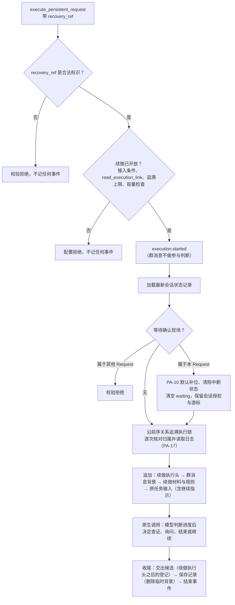

# 崩溃续做与非确认暂停后继续设计方案

## 1. 元信息

| 项 | 值 |
| --- | --- |
| 建档日期 | 2026-10-15 |
| 最近修订日期 | 2026-10-16 |
| 范围 | agent-core `openjiuwen/harness/persistent_agent`：带 `recovery_ref` 的续做；加载最新会话状态记录后处理过期中断现场；沿执行链读取并整理日志（复用 PA-17）；追加续做执行头、续做材料、续做规则、原任务输入与继续指示；续做时的参与判断与文件登记范围；续做材料的分层、日志查询与容量检查；所有正式 execute / resume 的容量配置校验及续做开放条件。不含 AgentServer 的触发、调度、前序关系的保存与恢复引用选择，不含按 execution_id 查询归档（PA-12），不含自动换窗（PA-11），不含正常确认恢复适配（PA-09） |
| 方案成熟度 | 已确认：Q-01～Q-09、D-06、D-08、D-09 与 D-10 方案 A；开发者 2026-10-16 明确三项决定：装配阶段暂不单独计数、每页固定 6000 字符、新任务与正常确认恢复也必须配置容量检查。三项均已实现并有组件验证，不再列为待决 |
| 计划条目 | [开发计划](../designs/persistent-agent-development-plan.md) PA-18 |
| 负责人 | Song Haoran |
| 状态 | 进行中：既有续做与最终检查组件已实现并通过组件验证；所有正式 execute / resume 强制容量配置已实现并有组件验证；2026-10-16 审阅发现的计数正确性问题已修复并补真实计数器用例。正式入口按 D-10 继续拒绝续做（等待 PA-12 按 execution_id 查询归档）；放行还需部署的模型有非估算计数器；core 接缝待 core 维护者评审；装配阶段材料筛选与换窗摘要调用前检查待 PA-06、PA-11；AgentServer 联调与 M2c 未做 |
| 设计依据 | [架构设计](../designs/persistent-agent-architecture.md) §3.4 第 9、13 条，§4.4 窗口组装表，§5.2.4，§8.3；[S_05](../specs/S_05_confirmation-and-continuation.md) 第 4.4、5.3 节；[S_02](../specs/S_02_events-and-result-handoff.md) 第 4.3 节；[S_03](../specs/S_03_context-and-windows.md) |
| 关联 feature | [F_05](F_05_execution-entries.md)（入口）；[F_06](F_06_window-assembly.md)（窗口组装）；[F_07](F_07_group-participation.md)（参与判断）；[F_15](F_15_tool-intent-before-side-effect.md)（意图记账）；[F_17](F_17_session-state-record.md)（会话状态记录与补位）；[F_18](F_18_output-handoff.md)（文件登记，D-12 按本文 Q-03 修订）；[F_19](F_19_execution-log-record.md)（执行日志整理，PA-17） |
| 验证摘要 | 2026-10-16 推送复查后的修复：PA 包与 core 最终检查 779 passed；新增真实本地 tokenizer 的正式配置 / 选择路径、未知容量、计数器更新、取消和询问措辞用例。JSON 快照后的上下文配置已在 Persistent 装配边界还原类型。更广回归、静态与文档检查见第 8.2 节；保留此前验证的历史边界。真实宿主联调与完整验收未完成 |
| Refs | 未关联 issue / PR |

## 2. 背景、目标与范围

### 2.1 背景与问题

崩溃、入口异常中断（架构 §3.4 第 13 条）及非确认暂停（stopped、budget_denied、context_unfit、error）之后，原 Request 只能靠“最新窗口 + 执行日志 + 续做规则”继续。PA-17 提供单次执行的日志整理 `summarize_execution(context, execution_id)`，本特性负责把它接到续做流程中，并在连续中断时沿执行链找回更早执行的未决写操作。

### 2.2 目标与关键场景

| 场景 / 触发条件 | 之前 | 目标行为 |
| --- | --- | --- |
| 服务端以原 Request、新 execution_id 和 `recovery_ref` 调用执行入口 | 拒绝 | 组件：加载最新记录，沿执行链读日志，追加续做材料，由模型判断进度后决定查证、询问、结束或继续；正式入口在 D-10 的条件满足前仍拒绝 |
| 最新记录是本 Request 的等待确认现场（确认恢复后崩溃） | 拒绝 | 为悬空调用补 PA-10 默认补位，清除中断状态，保留会话授权；原生不会重放旧调用 |
| 最新记录是另一 Request 的等待确认现场 | 拒绝 | 仍拒绝，不清除别人的现场 |
| 连续中断（续做本身又中断） | 不支持 | 沿 AgentServer 保存的前序关系追溯，按因果顺序列出各次执行，找回更早的未决写操作 |
| 前序关系读不到、不合规或达到追溯上限 | 不支持 | 停止追溯并写明更早执行未知或未查完，已读到的日志照常使用 |
| 日志读不到或为空 | 拒绝 | 照常续做，材料中写明记录缺失；是否询问发起人由模型判断 |
| 有继续指示 | 拒绝 | 追加在原任务输入之后 |
| 群消息 Request 续做 | 拒绝 | 不重新做参与判断 |
| 续做前登记过、尚未交出的文件 | — | 不自动交出，只作依据；续做中重新登记的文件照常交出 |
| `recovery_ref` 不是合法标识 | 拒绝 | 在任何事件之前校验拒绝 |

### 2.3 本次范围与非目标

- 本次包含：入口参数校验与开放门禁、过期现场处理、执行链追溯、日志整理接入、续做执行头 / 续做材料 / 规则 / 任务输入、续做中的参与判断与文件登记范围；分层材料、日志查询工具与容量检查的方案（D-08、D-09）。
- 本次不包含：服务端的续做触发、调度、停止事实、前序关系的保存与恢复引用选择（AgentServer）；按 execution_id 查询归档（PA-12）；自动换窗（PA-11）；正常确认恢复（PA-09）；群消息读取（PA-23）与知识导航（PA-13）的接入。

## 3. 设计约束、假设与待决问题

- **已确认约束：**
  - 续做沿用原 Request、原 Spec 与原任务输入，新的 execution_id，`recovery_ref` 指向该任务最近一次待接续的 Execution；不新增 continuation 字段（架构 §5.2.4、计划 PA-18）。
  - 加载 Session 最新会话状态记录；中间执行过其他任务时也加载最新的，不回退旧窗口。
  - 补位只修复上下文，不记成 `tool.completed`，不代表工具成功或失败。正常确认恢复保留中断现场，不做续做清理。
  - 所有续做都读日志，即使窗口保存成功。
  - 续做执行头沿用 F_06 格式：`类型：续做`，增加 `recovery_ref：<execution_id>` 字段。
  - 校验拒绝即使晚于 `execution.started`，服务端也不续做；运行异常会被当作崩溃中断再次续做（架构 §3.4 第 13 条、F_06）。
- **已确认的问题（开发者 2026-10-16）：**
  - **Q-01 执行链：** AgentServer 创建 Execution 时、派发前可靠保存前序关系，覆盖确认恢复、崩溃续做与非确认暂停后继续，限于同一 Session、同一 Request。PA-18 沿前序关系追溯，逐次核对归属，调用 PA-17 整理日志；关联断裂、日志缺失或查询未完成时明确标注未知，不推断操作未执行，不宣称取得了完整进度。前序关系是执行元数据，不能只依赖允许缺失的 `execution.started`。接口与约束见 D-06。
  - **Q-02：** 续做跳过群消息参与判断，沿用已受理的原任务。发起续做不意味着必须继续操作，由模型判断任务是否已结束、是否需要查证或询问、是否还需执行操作。
  - **Q-03：** 文件登记从“最后一个结束标记或执行头之后”扫描。新任务、崩溃续做及非确认暂停后继续开启新的登记范围，旧登记只作参考；正常确认恢复沿用本确认链的有效登记；换窗须保留本确认链的有效登记，并确保它们仍位于扫描范围内。
  - **Q-04：** 程序自动提供关键进度、已有成果、所有未决写操作的必要信息，以及记录缺失或不完整的提示；模型需要核实细节时，通过受控工具读取详细日志，仅限当前 Session、当前 Request。续做规则与进度摘要放入临时背景，结束时删除；先处理旧中断现场，再追加续做材料。
  - **Q-05：** 采用 D-10 方案 A。
  - **Q-06 容量（方向）：** PA-06、PA-11、PA-18 共用计数与判断规则；完整计数；预计输入 + 输出预留 + 安全余量 ≤ 模型总容量，且满足模型输入上限；70% 由 PA-11 换窗，超过实际可用上限阻止调用；材料分层，省略须标注，不能静默删除未决写操作；三个检查点；超限时减少可选材料 → 必要时换窗 → 复查，仍放不下则 `context_unfit`；容量未知或计数失败明确报告故障；最终检查在最终请求装配后、预算准入和模型调用前，失败须真正阻断调用。示例数值不作为正式配置。细化见 D-09。
  - **Q-07：** 复用 `patch_stopped_calls(messages)`，默认文案“结果未取得，实际效果需核实”与 `stopped_tool_placeholder` 标记；不增加 `text` 参数。
  - **Q-08：** 加载记录并核对等待现场归属（属于其他 Request 即拒绝）→ 补位 → 写回消息、清除 `__react_agent_interruption__`、清空 waiting，保留会话授权与群消息游标 → 追加续做材料。
  - **Q-09：** 不设“日志缺失就必须先询问”的程序门禁；是否询问由模型判断，但未决写操作仍须先查证、不能盲目重做。
- **实现中发现的问题与处理（开发者 2026-10-16 审阅）：**
  - **装配阶段暂不单独计数（已确认）：** 续做材料只有必需层，没有可筛选的可选材料；装配时系统提示与工具定义尚未定稿。本阶段暂不设置装配计数，超限由最终检查在第一次模型调用之前统一阻断。Q-06 的三个检查点中只完成了“每次模型调用前”这一个；装配阶段的材料筛选随 PA-06 的可选背景接入，换窗摘要调用前的检查随 PA-11 接入，届时补齐。
  - **每页字符上限（已确认）：** 保留 `PAGE_MAX_CHARS = 6000`，暂不新增配置。它是 `read_execution_record` 完整返回 JSON 的字符上限，不是 token 容量保证；完整请求放不放得下由最终容量检查判断。以后有实际需求再支持更小的页。
  - **计数正确性（已修复）：** 审阅复现两点：计数器自报 `estimated=True` 的结果仍被接受；实际的 `TiktokenCounter("gpt-4")` 把普通文本中的长 data URL 替换为短占位后计数（32 tokens，未替换时 63030 tokens），而模型收到的是原文。修复见 D-09“计数可靠性”。
- **三项决定的实施状态（开发者 2026-10-16 明确确认）：**
  - **装配阶段：** 暂不另算容量，由每次模型调用前的最终检查统一把关；可选材料筛选与换窗摘要检查仍按 PA-06、PA-11 的接入安排补齐。
  - **分页：** 保持完整返回 JSON 上限 6000 字符，暂不增加配置；字符上限不代替 token 容量检查。
  - **正式入口容量配置：** 新任务、正常确认恢复与续做均必须具备完整容量配置；缺失、配置不完整或组合不成立时，在任何事件和构造之前拒绝。低层构造的可选默认值和通用 ReActAgent 默认关闭行为不据此改变。execute / resume 的共用入口已强制校验，PA-05、PA-06 的正式入口测试已补完整配置；新增反例覆盖两个字段均缺失时的新任务与确认恢复，均在事件和构造之前拒绝。
  - 此三项不再有待决问题；实现与实际验证见第 8.2 节，真实宿主与 M2c 验收仍未完成。

## 4. 总体方案与设计取舍

### 4.1 方案概览



### 4.2 关键决策

#### D-01 入口接受续做的参数校验（已实现）

- `recovery_ref` 按协议 `Identifier` 严格校验（字符串、1～512 字符、不含空白与控制字符），不合法时在任何事件之前抛 `DEEPAGENT_CONTEXT_PARAM_ERROR`。`ExecutionContext` 本身只检查非空字符串，PA-17 对非标识会抛参数错误；放到运行中才发现，会在 `execution.started` 之后抛出，服务端可能按崩溃再次续做。
- `continue_instruction` 仍只能随 `recovery_ref` 出现。
- 群消息、知识导航的接入门禁不变。正式入口是否开放见 D-10。

#### D-02 过期中断现场（Q-07、Q-08，已实现）

- 加载记录后，等待现场所属 Request 与本次不同则校验拒绝，不改窗口、不保存；相同则用 `patch_stopped_calls(messages)` 为缺结果的调用补位，已有真实结果不变；把补齐后的消息写回 Session，`__react_agent_interruption__` 置空（与原生 `_clear_interruption_state` 写法相同），返回不带 waiting 的加载结果；`__interrupt_auto_confirm__` 与群消息游标保留。
- 补位不产生 `tool.completed`。之后窗口组装的兜底检查（等待现场、未配对调用）照常执行。
- 非等待记录不需要处理：PA-10 加载时已为 stopped / cancelled / error 结局补位，其他结局有未配对调用即为无效记录。

#### D-03 执行日志与记录缺失（Q-09，已实现）

- 每个被追溯的执行都调用 `summarize_execution(context, execution_id)`，整理文本放进续做材料。
- `missing=True` 时照常续做；PA-17 的固定提示写明记录缺失、不能据此认为没有执行。不另加“必须先询问”的规则。
- 归档只列日志中的引用并注明未查询（F_19 D-06）；按 execution_id 查询归档待 PA-12（D-10）。

#### D-04 窗口组装与续做规则（Q-02、Q-04、Q-08，已实现）

- 执行头：`【本次执行】类型：续做；request_id：…；execution_id：…；recovery_ref：<id>；来源：…`，其余字段与新任务相同。结束时保留。
- 临时背景：先放最近群消息（与新任务相同），再放续做材料与续做规则，一条消息，标记为临时背景，结束时删除。续做材料依次为：说明行、执行链（如“execution-0（首次执行） → execution-1（确认恢复） → execution-2（续做） → execution-3（本次续做）”）、追溯停止的说明（如有）、按因果顺序的各次日志整理。
- 任务输入：原任务正文；有继续指示时追加“\n\n【继续指示】<指示>”。任务输入放在最后，不加标记，结束时保留。
- 续做规则：

```text
【续做规则】
1. 续做不等于必须继续操作。先根据窗口、上面的执行记录和归档判断原任务是否已经完成，再决定查证、询问、结束还是继续必要的工作；期间可能执行过其他任务，文件和外部状态可能已经变化。
2. 记录中已成功的步骤不要重做；只读步骤不确定时可以重新读取。
3. 已登记意图但没有结果、结果不明或失败的写操作，先查证实际效果（读取文件状态、查询外部系统），不能直接重做；查不清时可以询问发起人。
4. 工具结果为“结果未取得，实际效果需核实”的调用，是执行中途结束或中断后补上的说明，不代表成功或失败；结合执行记录和实际状态查证，不能认定操作失败，也不能直接重做。
5. 已经产出最终结果的，直接整理交出，不重新生成。以前登记的待交出文件不会自动交出；确认仍需交付时重新登记。
6. 记录缺失、不完整或无法确认时，如实说明，不能据此认为操作没有执行，也不能当作已经掌握完整进度。
7. 上面是摘要；需要核实某一步的细节或候选正文时，用 read_execution_record 按执行 ID 分页读取完整记录。
```

- 各次执行的整理用 D-08 的分层摘要（`detail="brief"`），标题为中性的“执行 X（请求 R）的执行日志摘要”。

#### D-05 续做中的参与判断与收尾（Q-02，已实现）

- 群消息续做不做参与判断：`execution.started` 不带 `decision_event_id`。
- 收尾与新任务相同：交出候选 → 保存记录 → 结束事件。临时背景在保存时删除；执行头、补位结果与任务输入保留。

#### D-06 执行链追溯（Q-01，已实现）

- **接口：** `CommitPort` 上的可选方法 `read_execution_link(execution, execution_id) -> ExecutionLink`（协议 `ExecutionLinkPort`），只读，同一 Session、同一 Request，失败抛异常。`ExecutionLink` 含四项归属（namespace_id、agent_id、session_id、request_id）、`execution_id`、`predecessor_id`（可为空）与 `relation`（`first` / `confirmation_resume` / `continuation`）。模型校验：`first` 必须没有前序，其他关系必须有前序；不能以自身为前序。AgentServer 在派发前保存，不从事件推出。
- **可用性：** 构造时不检查该方法，既有宿主、新任务和构造路径不受影响；续做开放时（D-10）在任何事件之前检查宿主提供了它，否则配置拒绝。
- **追溯：** 从 `recovery_ref` 开始，每一步先读该执行的日志，再读它的链接：核对四项归属与目标 execution_id；沿 `predecessor_id` 继续，直到没有前序。
  - 链接读取失败、不合规或归属不符：只停止继续追溯，已读到的日志照常使用（包括该执行自己的日志），写明“无法确认 X 之前是否还有执行（类别），更早的执行未读取”。
  - 前序指向本次执行或已读过的执行（循环）：停止追溯，写明“停止追溯；更早的执行无法确认”。
  - 某次日志缺失而链接有效：写明该次记录缺失，继续向前。
  - 达到追溯上限：写明“更早执行未查完：已读取 N 次执行（追溯上限），Y 及更早的执行未读取”，不当作链首。
- **展示：** 按执行链的因果顺序（最早的在前）排列，不依赖时间戳；执行链行列出每次执行与前一次的关系。
- **追溯上限：** `PersistentAgentSpec.continuation_chain_limit`（正整数，默认 `None`）。具体数值由运行环境配置，不写死；续做开放时未配置即配置拒绝。新增字段改变 Spec 指纹，与 PA-08 新增 `share_file_max_bytes` 时相同。
- **诊断：** 只记类别与定位身份；链接读取失败记 warning，不合规或归属不符记 error。
- **待联调：** AgentServer 的保存与查询须真实联调验证。

#### D-07 续做后的文件登记范围（Q-03，已实现）

- `handoff.rebuild_registrations` 扫描最后一个结束标记或执行头之后的消息。新任务的执行头紧跟在结束标记之后，范围不变；确认恢复不追加执行头，仍沿用本确认链的登记；续做从续做执行头开始，此前的登记只作依据。续做之后再等待确认、再恢复时，范围仍从续做执行头开始。
- 换窗（PA-11）须把本确认链的有效登记依据（调用与成功结果）放在新窗中最后一个结束标记或执行头之后，否则收尾会漏交；已写入计划 PA-11 验收，需告知 PA-11 负责人。
- 同步修订 F_18 D-12 与 S_04。

#### D-08 分层材料与日志查询（已确认，已实现）

- **PA-17 输出方式：** `summarize_execution` 增加关键字参数 `detail: Literal["full", "brief"] = "full"`，默认保持完整整理；同步修订 F_19 D-01。另增 `record_blocks(context, execution_id)`：在同样的整份校验后返回完整整理的各行与各条目（以换行连接即为完整整理），供分页使用。
- **`brief` 分层规则：**
  - 写操作逐项保留（未决、结果不明、失败、关联有歧义与已成功的都保留），含调用 ID、目标与结果引用。
  - 已有成果（候选）保留 output_id、目标、共享方式、文件引用、文件路径、大小与是否被结束记录引用；正文改为“正文 N 字，未列出”。
  - `share_file` 不参与只读调用次数聚合，逐条保留登记依据（F_19 P-02）。
  - 其余只读调用按工具名给出次数：“[只读操作] read_file 2 次、list_files 1 次（明细未列出）”。
  - 结论逐条保留。
  - 序号缺口（“日志缺少第 N 条记录”）、记录缺失（PA-17 固定提示）、关联断裂（D-06 的停止说明）与材料省略（“本摘要省略了只读操作的明细与候选正文……”）分别说明，不合并为笼统的“不完整”。没有省略时不写省略说明。
- **工具声明：** `read_execution_record` 在配置了 `continuation_chain_limit` 的 Spec 下为每个 Execution 声明（新任务、确认恢复与续做都一样），工具定义由 Spec 固定、所有 Execution 相同（架构 §4.4.3）。只在合法续做中回答：续做追溯时把读到的执行记入本次的已核验执行链（`ExecutionControl.verified_chain`）；不是续做时返回“不可用”。已加入 PA-15 只读名单（需告知 PA-15 负责人 Yan Zhijun）。
- **分页契约：**
  1. 参数为 `execution_id` 与可选的 `cursor`。每次调用都独立核对 `execution_id` 在本次已核验的执行链中（游标的校验值不代替这项检查），再对完整日志重新执行 PA-17 的整份校验、去重与意图 / 结果关联，最后才分页；页外的结果不会被误判为“无结果”，序号缺口不影响分页。
  2. 游标绑定目标执行、整理结果版本（完整整理的校验值）与位置（条目序号、条目内字符偏移），编码为不透明字符串。
  3. 版本不一致（记录在两次读取之间变化）时返回 `reset: true` 与“记录已变化，已从头返回”，本页为新记录的第一页。格式非法、属于其他执行或位置不存在的游标分别拒绝（`invalid_cursor` / `cursor_target` / `cursor_position`），不会悄悄重置。
  4. 每页的 `segments` 标明条目序号、片段起止与条目总长；同一条目的片段按顺序拼接即为原文，各条目以换行连接即为完整整理，无损还原。正常翻页游标必然前进，读完时 `next_cursor` 为空。
  5. 页大小按返回 JSON 的总长计算（正文、游标、状态与其他字段都计入），游标长度按本记录可能的最长游标预留；连一个有效片段都放不下时返回 `page_too_small`，不返回空页。

#### D-09 容量检查（已确认，部分实现）

- **分工：** PA-18 交付共用容量模块（`execution/capacity.py`）、续做材料分层与按实例启用的最终请求检查接缝；PA-11 再接入换窗及摘要调用前检查。
- **core 接缝（`react_agent.py`）：** `ReActAgent.set_final_request_check(check)` 按实例注入，默认 `None`、行为不变。`_railed_model_call` 在最终系统提示、窗口消息与工具定义写入 `ctx.inputs` 之后、调用模型之前调用 `check(ctx)`：返回 `None` 放行；返回结果字典即以该结果结束本轮（与 force-finish 结果相同的通道），不是异常，不进入 Rail 重试或 `_recover_from_model_exception`。core 只提供通用的“允许调用 / 提前结束”，不引入 Persistent 的类型或暂停原因。每次 Rail 重试与恢复重试都会重新生成最终请求并再次检查；取消照常传播。需 core 维护者评审。
- **Persistent 检查（`PersistentModelCallRail.check_final_request`）：** 在 `before_invoke` 为本实例注入；顺序为最终请求 → 容量检查 → 预算准入 → 模型调用。预算准入从 `before_model_call` 移到这里，`before_model_call` 只保留停止检查。容量超限返回 `paused(context_unfit)`，计数不可靠或计数器无法取得返回 `paused(error)`，两者都不准入、不调用模型；准入拒绝返回 `paused(budget_denied)`，不调用模型。
- **配置：** 复用 `model.model_request_config.context_window`（总容量）与 `max_tokens`（输出预留），新增 Spec 字段 `model_input_limit_tokens`（正整数）与 `capacity_safety_margin_tokens`（非负整数），默认 `None`。2026-10-16 已确认所有正式 execute / resume（含新任务、正常确认恢复、续做）均要求四项齐全且组合可行，缺失时也须在任何事件和构造之前拒绝（`DEEPAGENT_CONFIG_PARAM_ERROR`）；输入上限不超过总容量，输出预留加安全余量小于总容量。可用输入为 `min(输入上限, 总容量 − 输出预留 − 安全余量)`。全入口强制校验已实现，两个新字段均未配置时也在事件和构造之前拒绝。低层构造继续保留可选默认值，任一容量字段被设置即校验完整性，不改变通用 core 默认关闭行为。
- **计数可靠性（2026-10-16 修订）：** 每次最终检查从当前 `ModelContext.token_counter()` 取得 core 已按发布配置选择的计数器，沿用 `context_engine_config` 的 tokenizer_spec、tokenizer_registry 与缓存配置；不另建选择器、不在 Rail 缓存计数器。对最终消息与工具定义各计数一次（最终消息已含系统提示）。满足以下全部条件才算可靠：计数器自报非估算（`estimated=False`）、没有降级原因、来源不是已知的降级来源（`string_length_fallback`、`tiktoken_fallback`、`family_tokenizer_fallback`、`not_reported`）；消息内容都是文本，且不会被计数器改写——core 计数器会先把文本中的图片 data URL 换成短占位再计数，而模型收到的是原文，所以凡是 `sanitize_value_for_text` 会改写的内容都按容量未知处理。计数后再检查标记（计数过程中可能降级）。取得计数器失败也按容量未知暂停，取消继续传播。不修改 core 计数器及其质量标记，其他场景的估算行为不变。按此规则，core 当前的 tiktoken 计数自报为估算，一律按未知处理；只有为模型提供原生 tokenizer（`native_tokenizer`，自报非估算）时，配置了容量检查的执行才能通过检查。
- **装配阶段：** 本阶段暂不单独计数，见第 3 节。

#### D-10 开放范围（方案 A，已实现）

- 正式入口继续拒绝带 `recovery_ref` 的执行：`seams.continuation_support(context)` 在 PA-12 按 execution_id 查询归档接入前抛 `DEEPAGENT_CONFIG_PARAM_ERROR`，在任何事件之前。执行链（D-06）与最终容量检查（D-09）已接入，开放后入口还在任何事件之前检查宿主提供 `read_execution_link`、Spec 配置了 `continuation_chain_limit` 与容量检查。
- 组件通过内部接缝打开门禁，用替身验证；在 M2c 与其他条件一起放行。这些是新增条件，不替代 M2c 原有的确认恢复、生命周期、记账和宿主验收要求。
- 不选方案 B（PA-11 换窗接入前先开放）：需要额外维护“换窗能力变化后自动关闭续做”的联动状态，收益不足。

### 4.3 替代方案与排除理由

| 候选 / 关联决策 | 候选目的与关键差异 | 拒绝或暂缓原因 | 重新评估条件 |
| --- | --- | --- | --- |
| R-01 / D-02 让原生按中断状态恢复旧调用 | 少一步处理 | 会话已记住的授权可能让旧写调用直接放行，日志中的“先查证”来不及生效（架构 §5.2.4） | 无 |
| R-02 / D-02 续做时只清中断状态，不补位 | 改动更少 | 工具调用没有结果就追加消息，模型 API 会拒绝 | 无 |
| R-03 / D-02 续做专用补位文案（加 `text` 参数） | 文案直接指向执行日志 | 开发者确认复用 PA-10 默认文案与标记，由续做规则说明怎样理解补位（Q-07） | 无 |
| R-04 / D-04 续做规则写入系统提示词 | 与架构“写入提示词”字面一致 | 规则只对续做有用；改系统提示词会破坏缓存前缀（Q-04） | 无 |
| R-05 / D-05 续做时重新做参与判断 | 与新群消息一致 | 原 Execution 已受理任务，重新判断可能忽略进行中的任务（Q-02） | 无 |
| R-06 / D-03 日志缺失时要求先询问发起人 | 避免在缺少依据时继续 | 开发者确认不设程序门禁，是否询问由模型判断（Q-09） | 无 |
| R-07 / D-06 用 `execution.started` 记录接续关系并沿事件追溯 | 不需要新端口 | 开始事件是普通事件，允许缺失；前序关系须是可靠的执行元数据（Q-01） | 无 |
| R-08 / D-06 无限追溯 | 不会漏掉更早执行 | 材料容量检查控制不了此前的查询次数、耗时与内存；改为可配置上限并写明未查完 | 无 |
| R-09 / D-06 把 `read_execution_link` 列为必需端口 | 构造时即可发现缺失 | 让不使用续做的宿主、新任务和构造路径也失败；改为续做开放时检查 | 无 |
| R-10 / D-08 按序号范围分页（`start_seq`、`limit`） | 参数直观 | 先切页再关联会把页外结果误判为无结果；序号缺口可能让分页停滞；单项超长无法继续读取 | 无 |
| R-13 / D-08 只在续做执行中注册查询工具 | 非续做执行不暴露工具 | 同一 Request 从首次执行到续做时工具定义会变化，与“工具定义由 Spec 固定、所有 Execution 相同”冲突 | 无 |
| R-14 / D-09 用普通异常阻断模型调用 | 不改 core 返回通道 | 异常会进入 Rail 重试与 `_recover_from_model_exception`，可能把阻断重新放行 | 无 |
| R-11 / D-09 在 `BEFORE_MODEL_CALL` Rail 中做最终检查 | 不改 core | 该回调之后原生才生成最终请求，检查的可能不是实际输入；Rail 异常还可能被模型错误重试放行 | 无 |
| R-12 / D-10 换窗接入前先开放续做（方案 B） | 尽早可用 | 需维护换窗能力变化后自动关闭续做的联动状态 | 无 |

## 5. 详细设计

### 5.1 模块责任与关键不变量

- **CI-1 不重放：** 续做进入原生调用前，Session 中没有中断状态；旧的被拦截调用不会被原生自动执行。
- **CI-2 不伪造结果：** 补位不产生 `tool.completed`，说明只表示结果未取得、需核实。
- **CI-3 不碰别人的现场：** 等待现场属于其他 Request 时拒绝，不改窗口、不保存。
- **CI-4 先判断再行动：** 续做材料与规则在任务输入之前；记录缺失不等于没有执行；续做不等于必须继续操作。
- **CI-5 只追加：** 续做内容追加在已加载窗口之后，系统提示词与工具定义不变。
- **CI-6 不自动交出旧登记：** 续做执行头之前的登记只作依据。
- **CI-7 不冒充链首：** 追溯停止或达到上限时写明原因，不当作已经到达首次执行。

### 5.2 关键类与函数

| 名称 | 位置与变更 | 职责 |
| --- | --- | --- |
| `ReActAgent.set_final_request_check(check)`、`FinalRequestCheck` | core `single_agent/agents/react_agent.py`，新增 | 按实例注入的最终请求检查；默认关闭 |
| `ExecutionLink` | `schema/port_results.py`，新增 | 宿主保存的前序关系，校验首次执行与前序的对应 |
| `ExecutionLinkPort` | `ports.py`，新增（可选协议） | `read_execution_link(execution, execution_id)` |
| `PersistentAgentSpec` 的 `continuation_chain_limit`、`model_input_limit_tokens`、`capacity_safety_margin_tokens` | `schema/spec.py`，新增 | 追溯上限与容量配置，默认 `None` |
| `capacity_limits`、`CapacityLimits`、`count_request` | `execution/capacity.py`，新增 | 共用的容量配置解析、可用输入与可靠计数；计数器取自当前 ModelContext |
| `PersistentModelCallRail.check_final_request` | `execution/model_rail.py`，修改 | 容量检查后预算准入；`before_model_call` 只保留停止检查 |
| `summarize_execution(..., detail=...)`、`record_blocks` | `execution/execution_log.py`，修改 | 分层摘要与分页数据源 |
| `ExecutionRecordTool`、`ExecutionRecordRail`、`page`、`encode_cursor` | `execution/record_tool.py`，新增 | `read_execution_record` 工具、声明与分页 |
| `ExecutionControl.verified_chain` | `execution/control.py`，新增 | 本次续做已核验的执行 |
| `continuation_support(context)` | `execution/seams.py`，新增 | 续做开放门禁 |
| `_require_continuation(spec, context)` | `execution/entries.py`，新增 | 续做门禁、`read_execution_link` 与追溯上限；全入口容量配置另由 `_require_supported_modes` 检查 |
| `require_recovery_ref`、`clear_stale_scene`、`continuation_background`、`continued_query` | `execution/continuation.py`，新增 | 续做步骤 |
| `ExecutionWindowAssembler(reader, *, chain_limit)`、`window_assembler(context, *, chain_limit=None)` | `execution/window_assembly.py`、`execution/seams.py`，修改 | 续做分支 |
| `rebuild_registrations` | `execution/handoff.py`，修改 | 扫描范围从最后一个结束标记或执行头开始（D-07） |
| `READ_ONLY_TOOL_ALLOWLIST` | `tools/effect_policy.py`，修改 | 加入 `read_execution_record` |

## 6. 影响面与实施设计

| 实施项 | 模块 / 文件 | 内容 | 状态 | 验证 |
| --- | --- | --- | --- | --- |
| I-01 | `execution/continuation.py`（新增） | D-01～D-04、D-06 的续做步骤 | 已实现 | PA-18-V-01～V-07、V-11～V-14 |
| I-02 | `execution/entries.py`、`execution/seams.py` | 续做门禁与入口检查；参与判断跳过；容量配置的入口校验 | 已实现；新任务与确认恢复强制配置有新增组件测试 | V-02、V-07、V-10、V-19 |
| I-03 | `execution/window_assembly.py` | 续做分支 | 已实现 | V-01、V-03～V-06 |
| I-04 | `execution/handoff.py` | 登记扫描范围 | 已实现 | V-04、V-09、V-15 |
| I-05 | `schema/port_results.py`、`ports.py`、`schema/spec.py` | 执行链接口、追溯上限与容量字段 | 已实现 | V-10～V-13、V-19 |
| I-06 | `execution/execution_log.py`、`execution/record_tool.py`、`execution/control.py`、`tools/effect_policy.py` | 分层摘要、查询工具与分页、只读名单 | 已实现 | V-20～V-23、V-26 |
| I-07 | core `react_agent.py`、`execution/capacity.py`、`execution/model_rail.py` | 最终请求检查接缝与容量检查 | 已实现，core 待评审 | V-16～V-19、V-24、V-25 |
| I-08 | 文档 | 本文；F_19 接口与完整 / 分层整理；F_18 D-12；S_01、S_02、S_03、S_04、S_05、S_07、S_08；F_05、F_06、F_15；既有架构草稿、设计概览及计划的联动内容 | 2026-10-16 已将实现、测试与配套文档同步到项目工作区；保留原有计划修改，PA-18 负责人为 Song Haoran，不新增架构决策 | 本轮文档检查见第 8.2 节 |

## 7. 兼容与迁移

不改记录格式与版本。新增的 `ExecutionLinkPort` 是可选协议，构造不检查；新增的 Spec 字段默认 `None`，但正式 execute / resume 必须完整配置容量，旧宿主须随发布补齐；字段会改变 Spec 指纹（与 PA-08 新增 `share_file_max_bytes` 时相同）。core 接缝默认关闭，未注入时原生行为不变。Persistent 的预算准入从 `before_model_call` 移到最终请求检查，准入次数与结果不变，时点移到最终请求装配之后。配置了 `continuation_chain_limit` 的 Spec 多声明一个只读工具。新任务与确认恢复的登记范围不变。正式入口对续做仍拒绝。

## 8. 验证设计、执行记录与结论

### 8.1 验证设计与通过条件

| 验证 ID | 场景 | 通过条件 |
| --- | --- | --- |
| PA-18-V-01 | 私聊任务续做，日志有已登记无结果的写意图 | 窗口依次为已加载窗口、续做执行头、续做材料与规则、原任务输入；保存时删除续做材料，保留执行头 |
| PA-18-V-02 | `recovery_ref` 非法（含空格、换行、NUL、513 字符） | 校验拒绝，不记任何事件，不读日志 |
| PA-18-V-03 | 有继续指示 | 追加在原任务正文之后 |
| PA-18-V-04 | 最新记录是本 Request 的等待现场，等待前还登记过文件 | PA-10 默认补位，真实结果不变，中断状态清除，会话授权保留；被拦截的工具没有执行，没有 `tool.completed`；规则说明补位含义；重建登记为空，回答照常交出 |
| PA-18-V-05 | 最新记录是另一 Request 的等待现场 | 校验拒绝；窗口与记录不变 |
| PA-18-V-06 | 日志读取失败 | 照常续做；材料写明记录缺失，没有“必须先询问”的门禁 |
| PA-18-V-07 | 群消息 Request 续做 | 不做参与判断；顺序为执行头、群消息、续做材料、任务输入 |
| PA-18-V-08 | 新任务仍拒绝等待现场；正常确认恢复不清除现场 | 现有用例不变 |
| PA-18-V-09 | 登记扫描范围（`test_handoff.py`） | 新任务与确认恢复的范围不变；续做执行头之后重新开始 |
| PA-18-V-10 | 正式入口门禁；宿主没有 `read_execution_link`；Spec 没有追溯上限 | 均配置拒绝，不记任何事件，不读日志 |
| PA-18-V-11 | 三次执行组成的链 | 依次读取三次日志；按因果顺序展示，执行链行写明关系；最早执行的未决写意图出现在材料中 |
| PA-18-V-12 | 追溯上限小于链长 | 只读上限次数；写明更早执行未查完；不出现“首次执行” |
| PA-18-V-13 | 链接读取失败、以自身为前序、循环、指向本次执行、归属不符、返回其他执行的链接、首次执行带前序、确认恢复没有前序 | 停止追溯并写明原因；已读到的日志（含该执行自己的）照常使用 |
| PA-18-V-14 | 中间一次日志缺失而链接有效 | 写明该次记录缺失，继续读取更早执行 |
| PA-18-V-15 | 启用 `workspace_read` 的真实文件交接：等待前登记了文件，续做中重新登记另一个文件 | 只交出回答与续做中登记的文件，等待前的登记不交出；结束事件引用一致 |
| PA-18-V-16 | 最终请求超过可用输入，且预算会拒绝 | `paused(context_unfit)`；准入 0 次，模型 0 次（先检查容量） |
| PA-18-V-17 | 计数只是估算；计数器无法取得 | `paused(error)`，写明容量未知、不含异常正文；准入 0 次，模型 0 次 |
| PA-18-V-18 | 合规请求；预算拒绝 | 每次模型调用准入一次；准入拒绝为 `paused(budget_denied)`，模型不被调用 |
| PA-18-V-19 | 容量配置不完整或不可能成立（缺 `context_window`、输入上限、安全余量，输入上限超过总容量，没有输入余地） | 执行前拒绝，没有事件，未构造 |
| PA-18-V-20 | 同一 Spec 的新任务与续做；不配置追溯上限的 Spec | 前两者声明的工具相同且含 `read_execution_record`；后者不声明 |
| PA-18-V-21 | 续做中读取链内执行与链外执行 | 链内返回完整整理（不是摘要），链外拒绝；不产生 `tool.intent`；每次读取都重新读取日志 |
| PA-18-V-22 | 新任务中调用 `read_execution_record` | 返回不可用，不读取日志 |
| PA-18-V-23 | 分页契约（`test_record_tool.py`） | 多页无损还原、每页不超过上限且不为空、条目内续读、记录变化重置并提示、非法 / 他人 / 越界游标分别拒绝、容量不足以返回片段时报错 |
| PA-18-V-24 | 容量规则（`test_capacity.py`） | 未配置不检查；可用输入取较紧者；不完整或不可能的配置拒绝；精确计数求和；自报估算（含原生来源但 `estimated=True`）、降级、计数失败与非文本内容（含不带 data URL 的块列表）为未知；真实 `NativeTokenizerCounter` 计纯文本可信，遇到会被改写的 data URL 为未知；真实 `TiktokenCounter("gpt-4")` 自报估算，为未知 |
| PA-18-V-25 | core 接缝（`test_final_request_check.py`） | 默认关闭时行为不变；放行时检查看到最终请求再调用模型；阻断时模型、Rail 异常回调与恢复都不发生；Rail 重试与恢复重试都再次检查；取消传播；流式调用同样检查；移除后恢复原行为 |
| PA-18-V-26 | 分层摘要与分页数据源（`test_execution_log.py`） | 写操作、结局、缺口与 `share_file` 逐项保留，只读计次数，正文只给字数，省略单独说明；无省略时不说明；非法 `detail` 在读取前拒绝；`record_blocks` 拼接等于完整整理 |

| PA-18-V-27 | 真实本地 tokenizer 的正式新任务入口（对象 / 字典配置，tokenizer_spec / registry，合规 / 超限） | core 真实选择路径和最终检查连通；合规时准入与本地模型各一次，超限时均零次；发布 JSON 与指纹不变；包含快照后类型还原，不替换计数器 |
| PA-18-V-28 | 缺失 / 损坏 artifact；计数器不存在、获取异常、计数异常、更新与取消 | 未知容量暂停为 error 且不准入、不调用模型、不泄露异常正文；每次读取当前计数器；取消传播 |
| PA-18-V-29 | full / brief / missing 三条实际日志材料路径 | 均明确先查证、不能直接重做；查不清时可以询问、由模型判断，不保留强制询问措辞 |

### 8.2 实际执行与证据

- **固定基线：** jiuwenmate 提交 dd648886 的源码快照（树哈希与仓库 dd648886 一致），依次应用 PA-17 补丁与本特性补丁。
- **工作目录：** 上述快照的根目录，位于开发者本机仓库外的草稿区，不是仓库工作区。
- **环境与版本：** macOS；`$PY` 为项目 `.venv/bin/python`（Python 3.11）；Ruff 0.15.4、Pylint 4.0.5、mypy 1.19.1、codespell 2.4.3（单独安装，以 `PYTHONPATH=<codespell 安装目录> $PY -m codespell_lib` 调用）；设 `PYTHONDONTWRITEBYTECODE=1`；mypy 使用新建的缓存目录。
- **配置：** Ruff、Pylint、mypy 读取快照根目录的 `pyproject.toml`（Pylint 的 `ignore-paths` 排除 `tests/`）；仓库没有 codespell 配置。
- **静态检查的文件范围：** `<源码>` = `execution/` 下的 `continuation.py`、`entries.py`、`window_assembly.py`、`handoff.py`、`seams.py`、`capacity.py`、`model_rail.py`、`record_tool.py`、`execution_log.py`、`control.py`，以及 `schema/port_results.py`、`ports.py`、`schema/spec.py`、`tools/effect_policy.py`（均在 `openjiuwen/harness/persistent_agent/` 下）；`<core>` = `openjiuwen/core/single_agent/agents/react_agent.py`；`<测试>` = `tests/unit_tests/harness/persistent_agent/` 下的 `test_continuation.py`、`test_entries.py`、`test_window_assembly.py`、`test_handoff.py`、`test_capacity.py`、`test_record_tool.py`、`test_execution_log.py`，以及 `tests/unit_tests/core/single_agent/test_final_request_check.py`；`<文档>` = 本文、F_19、F_18、S_02、S_04、S_05、S_08、开发计划、架构、设计概览。静态检查只覆盖这些文件，不代表全仓检查；未执行 `make check` / `make type-check`。完整命令与输出见交付记录中的 `pa18-static-checks.log`。

| 执行日期 / 范围 | 命令 | 结果 | 未覆盖 |
| --- | --- | --- | --- |
| 2026-10-16 / 本特性用例 | `PYTHONPATH=. $PY -m pytest <测试中除 test_entries.py、test_window_assembly.py 外的 6 个文件> -q -p no:cacheprovider -o addopts=` | 165 passed，退出码 0 | — |
| 2026-10-16 / PA 包 | `PYTHONPATH=. $PY -m pytest tests/unit_tests/harness/persistent_agent -q -p no:cacheprovider -o addopts=` | 738 passed，退出码 0 | — |
| 2026-10-16 / 回归 | `PYTHONPATH=. $PY -m pytest tests/unit_tests/harness tests/unit_tests/core/session tests/unit_tests/core/single_agent tests/unit_tests/core/context_engine -q -p no:cacheprovider -o addopts=` | 7044 passed、39 skipped，退出码 0 | 跳过项为既有用例；core 其他目录未运行 |
| 2026-10-16 / Ruff（源码与测试） | `$PY -m ruff check --select I <源码> <测试>`；`$PY -m ruff format --check <源码> <测试>`；`$PY -m ruff check --show-fixes <源码> <测试>` | All checks passed；22 files already formatted；All checks passed；退出码均为 0 | — |
| 2026-10-16 / Ruff（core） | `$PY -m ruff check <core>`；`$PY -m ruff format --diff <core>` 与改动前对照 | 3 条 I001 与整文件格式问题改动前就存在；格式建议与改动前逐行相同，新增代码没有引入格式问题 | 既有问题按“不顺手修改”保留 |
| 2026-10-16 / Pylint | `PYTHONPATH=. $PY -m pylint --rcfile=pyproject.toml <源码>`；对 `<core>` 单独执行并与改动前对照 | 源码 9.95/10，退出码 12：`ports.py` 8 条 W2301 与 `schema/spec.py` 1 条 R0914（17/15），与改动前相同。core：诊断条目与改动前相同，`_railed_model_call` 原有的 R0912 / R0914 / R0915 计数分别由 26 / 36 / 116 增至 27 / 37 / 118，模块行数 3394 增至 3426 | 测试目录按配置不检查 |
| 2026-10-16 / mypy | `MYPYPATH=. $PY -m mypy --config-file pyproject.toml --follow-imports=silent <源码>`；对 4 个新测试文件单独执行；对 `<core>` 单独执行并与改动前对照 | 源码 5 条，退出码 1：`record_tool.py` 4 条 `invoke` / `stream` 覆盖签名诊断，与 `share_file.py`（PA-08）同因；`schema/spec.py` 1 条 `build` 覆盖签名，改动前就存在。新测试：Success，退出码 0。core：诊断条目与改动前相同（仅一条诊断引用的行号随插入的代码变化） | 不报告被导入模块的诊断 |
| 2026-10-16 / codespell | `PYTHONPATH=<codespell 安装目录> $PY -m codespell_lib <源码> <测试> <core> <文档>` | 无输出，退出码 0 | — |
| 2026-10-16 / PA-18 变异检查 | `$PY mutate.py <快照根> $PY`（SHA-256 `8f37b8c3045a43d238b5e643865449965a1f17b4529d663a110a304708a862d3`），每项改写一段唯一原文后运行 PA 包与 core 接缝测试，再恢复原文 | 57/57 被发现，退出码 0；源码差异不变；输出见 `pa18-mutation.log` | 脚本与日志未入库 |
| 2026-10-16 / PA-17 变异检查（在本特性代码上） | `$PY mutate_pa17.py <快照根> $PY`（SHA-256 `d93a8831eb63291de80cdec0fe718ab37da9a062a13639babde9544f940db052`） | 41/41 被发现，退出码 0；输出见 `pa18-mutation-pa17-on-pa18.log` | 同上 |

上表为 Claude 原型阶段的历史记录，不能直接作为最新接管副本的验证结论：后续已修复容量计数可靠性，原 pa18.patch 未更新，变异脚本也有后续版本。Codex 已保留当前仓库的办公空间读取实现、测试与 PA-15 文档更新，再进行接管复核；当前证据如下。

| 2026-10-16 接管复核 | 实际结果与边界 |
| --- | --- |
| PA 包与 core 最终请求接缝 | 752 passed、3 warnings；命令为 `PYTHONDONTWRITEBYTECODE=1 PYTHONPATH=. $PY -m pytest tests/unit_tests/harness/persistent_agent tests/unit_tests/core/single_agent/test_final_request_check.py -q -p no:cacheprovider -o addopts=` |
| harness、core Session / single_agent / context_engine | 7050 passed、39 skipped、89 warnings、4 subtests passed；未运行其他 core 目录和真实宿主联调 |
| 静态检查 | PA 源码与测试 Ruff 及 22 个文件格式检查通过；core 仍有既有 3 条 I001 及整文件格式问题。PA Pylint 9 条既有诊断；core 25 条既有诊断，体量和复杂度计数增加。定向 mypy 有 record_tool.py 4 条新增覆盖诊断及 spec.build 1 条既有诊断。codespell 通过 |
| 文档与差异 | 接管复核时：254 个本地链接无失效，Mermaid 12.2.0 对 14 段图语法解析通过，33 个候选文件差异空白检查通过。2026-10-16 本轮补齐文档后：Python heredoc 校验 16 份关联文档的 469 个本地链接，无失效目标或锚点；Node ESM 加载 jsdom / Mermaid 12.2.0，逐段 await mermaid.parse，19 段语法全部通过；均未做图形渲染。`PYTHONPATH=<codespell 安装目录> $PY -m codespell_lib <16 份文档> <根仓库计划>` 通过；8 份修改文档逐文件 `git diff --no-index --check` 及根仓库 `git diff --check` 通过。负责人核对确认根计划只改 PA-18 单元格，源码和测试哈希未变；本轮未重跑运行测试。过程脚本与输出留在仓外接管目录，不属于仓库交付文件 |
| 生命周期反例 | 使用真实 AbilityManager 替换同名日志工具后，ExecutionRecordRail.uninit 会误删宿主工具；违反 rails/AGENTS.md 的 Card 身份检查要求，待修复，本轮只同步文档 |

以上接管复核表为落仓前的历史记录；其中新增诊断、工具卸载和公开导出问题已在后续收尾修复，最终工作区验证见下表。未覆盖：全仓静态检查、core 维护者评审、AgentServer 联调（M2c）；本轮未重跑原型变异脚本。

#### 2026-10-16 项目工作区收尾验证

本轮在项目工作区执行，基于已包含 PA-17 的 jiuwenmate 当前 HEAD；未重复应用 PA-17 补丁。按文件清单移入 PA-18，并三方合并开发计划、保留原有未提交修改。以下 `$PY` 为项目 `.venv/bin/python`（Python 3.11），工具配置为项目 `pyproject.toml`。实际范围为 16 个源码（含包级导出和 core 接缝）、10 个测试文件（含 conftest）、17 份文档；不将历史检查算作本轮结果。日志与清单保存在仓外接管目录，不加入提交。

| 检查 / 实际命令 | 结果与边界 |
| --- | --- |
| PA 包与 core 接缝：`PYTHONDONTWRITEBYTECODE=1 PYTHONPATH=. $PY -m pytest tests/unit_tests/harness/persistent_agent tests/unit_tests/core/single_agent/test_final_request_check.py -q -p no:cacheprovider -o addopts=` | 759 passed、2 warnings；覆盖新任务与确认恢复缺容量配置的前置拒绝、低层构造兼容、既有执行 / 恢复、Card 身份保护与幂等卸载、公开导出、日志工具流式查询。日志 `fix-pa-suite-final.log` |
| 扩大回归：同一 pytest 参数，目录为 `tests/unit_tests/harness tests/unit_tests/core/session tests/unit_tests/core/single_agent tests/unit_tests/core/context_engine` | 7057 passed、39 skipped、88 warnings、4 subtests passed；日志 `fix-final-regression.log`。随后仅增加包级 TYPE_CHECKING 导入及非法入参测试的 Any 注解，PA 包与 core 接缝已重跑通过，未再次重跑扩大集 |
| 正式入口反例：进程内临时绕过缺失容量配置的拒绝，仅运行新增 execute / resume 两例 | 两例均失败：新任务不再抛错、确认恢复到达了后续 PA-09 门禁，证明用例能发现旧的容量跳过行为。随后正常实现两例及公开导出共 4 例通过。未修改磁盘源码；日志 `fix-capacity-legacy-probe.log`、`fix-final-exports-and-entries.log` |
| Ruff：`$PY -m ruff check --show-fixes <25 个非 core Python 文件>`、`$PY -m ruff format --check <同一范围>`；core 单独 check / format diff 并对照 HEAD | 非 core 全部通过；core 的 3 条 I001 与整文件格式建议为既有问题，未扩大改动。日志 `fix-final-ruff-pa.log`、`fix-final-format-pa.log`、`fix-final-ruff-core.log`、`fix-final-format-core.log` |
| Pylint：`PYTHONPATH=. $PY -m pylint --rcfile=pyproject.toml <15 个 PA 源码>`；core 单独检查并对照 HEAD | PA 53 条诊断与基线相同：包级懒导出 44 条既有 E0603、ports.py 8 条 W2301、spec.py 1 条 R0914；新导出的两符号提供 TYPE_CHECKING 导入。core 25 条既有诊断，模块行数和原函数复杂度计数增加。测试目录按配置跳过；不报告为零诊断 |
| mypy：`MYPYPATH=. $PY -m mypy --config-file pyproject.toml --cache-dir <独立缓存> --follow-imports=silent <各组文件>`，HEAD 基线用 `--shadow-file` 对照 | 15 个 PA 源码仅 spec.build 的 1 条既有 override；5 个新增测试 / conftest 无诊断；5 个既有修改测试 46 条，基线 48 条（两处 ModelClientConfig 字典问题已消除）；core 157 条，基线 157 条，仅一条正文内行号随插入变化。日志工具 4 条新增覆盖诊断已消除；非法 detail 用例显式标为动态坏输入，新增诊断已消除。日志 `fix-final-mypy-*.log`；不报告为全仓类型通过 |
| 文档、拼写与差异 | 最终 17 份文档的 518 个本地链接 / 锚点有效；20 段 Mermaid 经 jsdom 与 Mermaid 12.2.0 逐段 parse 通过（未做图形渲染）。全部 43 个文件的 codespell 与空白检查、git diff --check 通过。spec 日期为 2026-10-16，F/S 编号无冲突；PA-18 负责人 Song Haoran，其他 PA 负责人及原有计划修改保留。记录 `fix-final-doc-checks.json`、`fix-final-mermaid-results.json`、`fix-final-codespell.log`、`fix-final-delivery.json` |

未执行真实模型、AgentServer 前序关系保存 / 查询联调、PA-12 归档接入与 M2c 验收；非估算计数器的部署可用性未验证。未执行全仓 make test；make check / make type-check 默认只看暂存区，本轮保持未暂存，改为显式文件范围执行对应检查。没有提交、推送、创建分支或 PR。

#### 2026-10-16 计数器接入与 Q-09 修复验证

本表是后续修复的当前结果，上述 759 / 7057 等数字保留为当时历史。项目工作区的 43 个文件范围、Python 和工具版本及 pyproject 配置沿用前表；源码本轮只改 PA 内部装配、计数器接入和日志提示，没有进一步修改 core。

| 实际检查 / 命令 | 结果与边界 |
| --- | --- |
| 修复前反例：pytest 选取 native_tokenizer_configuration、unusable_native_artifacts、log_material_leaves | 15 个用例失败：12 个入口用例先暴露 JSON 快照后配置仍是 dict 的构造故障，3 个提示用例发现旧措辞；见 repair2-red.log。不能把全部失败归因于计数器选择 |
| 修正装配后，在独立 pytest 进程中临时恢复旧计数器选择路径，只运行 8 个真实配置用例 | 8 个全部失败，见 repair2-old-selector-probe.log；证明原选择路径忽略配置会使合规和超限都变成未知。仅进程内替换，不改磁盘源码 |
| `PYTHONDONTWRITEBYTECODE=1 PYTHONPATH=. $PY -m pytest tests/unit_tests/harness/persistent_agent tests/unit_tests/core/single_agent/test_final_request_check.py -q -p no:cacheprovider -o addopts=` | 779 passed、2 warnings；新增 20 个用例。首次扩大回归后只给 8 个配置用例增加发布 JSON / 指纹不变的断言，本组已再次通过；见 repair2-pa-suite.log |
| `PYTHONDONTWRITEBYTECODE=1 PYTHONPATH=. $PY -m coverage run --data-file=<仓外>/repair2.coverage --source=openjiuwen/harness/persistent_agent,openjiuwen/core/single_agent/agents -m pytest tests/unit_tests/harness tests/unit_tests/core/session tests/unit_tests/core/single_agent tests/unit_tests/core/context_engine -q -p no:cacheprovider -o addopts=` | 7077 passed、39 skipped、88 warnings、4 subtests passed；见 repair2-regression.log。未运行其他 core 目录或真实模型 / 宿主 |
| `$PY -m coverage json --data-file=<仓外>/repair2.coverage -o <仓外>/repair2-coverage.json`，结合 git diff 的新增可执行行核对 | PA 包 3701/3946 行，93.79%；本批源码变更 434/440 行，98.64%；capacity.py 与配置还原新增行全部覆盖，既有 core 接缝新增行 12/12。ReActAgent 整文件仍约 67.9%，本次局部结果不证明全 core / harness 的 80% 门槛已通过 |
| Ruff / format、Pylint、mypy | 25 个非 core Python 文件的 Ruff / 格式通过；PA Pylint 53 条、core 25 条与已记录基线一致，core 既有复杂度增量保留；PA 源码 mypy 仅 spec.build 的 1 条既有 override，5 个新增测试 / conftest 无诊断，5 个既有修改测试 46 条（基线 48），core 157 条与基线相同。日志 repair2-static-*.log；未声称静态全绿 |
| 文档与差异 | 17 份文档、518 个本地链接 / 锚点和 20 段 Mermaid 语法通过（未渲染）；43 个文件 codespell、差异空白检查通过；日期、编号、PA-18 负责人及其他负责人保持一致。检查脚本留在仓外接管目录 |

这些是真实本地 tokenizer 与正式入口的组件集成证据，模型和宿主仍为替身，不等于真实服务端或模型提供方集成。没有重跑原型变异脚本；core 维护者评审、PA-12、AgentServer 前序关系联调、M2c、部署计数器与全仓覆盖率门槛仍未验收。三项容量 / 分页决定不变，续做入口继续关闭。

### 8.2.1 2026-10-16 v0.1.20 基线重放验证

- **基线与范围：** 按开发者要求，仅将 PA-18 的源码、测试、文档三个提交重放到主仓 `jiuwenmate_v0.1.20` 的 `4b0384c57`；PA-17 与此前迁移修复由新基线提供，不重复重放。保留新 core 的 `_build_model_context_window`、工具用量与事实保留流程；最终请求检查仍在该函数装配完 `ctx.inputs.messages/tools` 后、预算准入与模型调用前执行。
- **冲突处理：** core 合并双方需要的类型导入；F_05 合并修订日期，F_19 保留归档日期、旧基线证据与修正后的范围表述；计划保留 v0.1.20 迁移修复和 PA-18 两组历史，不覆盖其他 PA 的负责人、状态或进展。本地既有未提交计划修改先保存到独立文件、补丁和 Git stash，不混入文档提交。
- **环境与命令：** macOS、项目 `.venv/bin/python`（Python 3.11）；`PYTHONDONTWRITEBYTECODE=1 PYTHONPATH=. $PY -m pytest <范围> -q -p no:cacheprovider -o addopts=`。定向范围为 `tests/unit_tests/harness/persistent_agent` 与 `tests/unit_tests/core/single_agent/test_final_request_check.py`；扩大范围为 `tests/unit_tests/harness`、`tests/unit_tests/core/session`、`tests/unit_tests/core/single_agent`、`tests/unit_tests/core/context_engine`。

| 检查 | 本轮实际结果及边界 |
| --- | --- |
| PA 包与 core 最终检查接缝 | 781 passed、2 warnings |
| 扩大回归 | 8456 passed、128 skipped、93 warnings、4 subtests passed；未扩展为全仓测试或真实宿主联调 |
| Ruff / format | 显式检查本批 26 个 Python 文件，全部通过；新 core 基线已消除旧 I001 / 整文件格式差异 |
| Pylint | PA 源码仍有 53 条既有诊断；core 对照新基线由 27 条变为 28 条：`_railed_model_call` 增加提前返回分支后触发 R0912（26/25）；既有模块长度、局部变量及语句数诊断的计数随接缝增加，不为压低计数重构调用流程 |
| mypy | PA 源码保留 `spec.build` 的 1 条既有覆盖签名诊断；5 个新增测试 / fixture 无诊断；core 实际模块路径下 189 条，基线对照未发现新增类型诊断（隔离副本额外的模块身份诊断不计入运行模块比较，引用行号随插入代码变化） |
| `make check` | 对上述 26 个文件执行；Ruff / format 通过，Pylint 非零；spelling 调用 `python -m codespell` 找不到模块。Makefile 忽略检查器失败，未将退出 0 解释为全部通过 |
| 拼写及差异空白 | 使用已安装的 `codespell_lib` 对本批源码、测试、文档逐一补查通过；`git diff --check` 通过 |
| 文档链接及 Mermaid | 本批 17 份文档的本地链接 / 锚点核对通过；20 个 Mermaid 图语法解析通过，未渲染 |

本轮未重跑变异、覆盖率采集、全仓测试或真实模型联调，不把旧基线覆盖率直接计为新基线结果；PA-12、AgentServer 前序关联、部署 tokenizer、core 维护者评审及 M2c 仍未验收，正式续做门禁与已确认设计保持不变。

### 8.3 验证结论

D-01～D-10 的已实现范围有组件证据。收尾已修复工具卸载的身份保护和日志工具 4 条新增类型诊断，补齐公开导出，落实所有正式 execute / resume 的容量配置校验，并将实现、测试与文档落到项目工作区。推送复查发现并修复了计数器选择配置丢失与实际日志提示未同步 Q-09；真实入口进一步暴露的上下文配置类型丢失也已修复。core 接缝未经 core 维护者评审；AgentServer 的前序关系保存与查询未联调；正式入口按 D-10 在 PA-12 接入前仍拒绝续做。当前静态诊断与未完成项见第 8.2 节；PA-18 与 M2c 均不能标为完成。

## 9. 风险与已知遗留

| 风险 / 遗留 | 影响 | 应对 / 后续入口 |
| --- | --- | --- |
| 归档未按 execution_id 查询 | 换窗后崩溃时看不到当次归档 | D-10；PA-12 接入前续做不开放 |
| 换窗后登记依据移出扫描范围 | 收尾漏交已登记文件 | D-07；PA-11 验收已注明 |
| 容量检查依赖非估算计数器 | core 当前的 tiktoken 计数自报为估算；没有原生 tokenizer 的模型，配置了容量检查时每次调用都会 `paused(error)`，所有正式执行均要求配置，因而该模型的正式调用无法继续 | 按 Q-06 不假定容量足够；部署时为模型提供原生 tokenizer；列为 M2c 放行前提 |
| 文本中含图片 data URL 的请求 | 计数器会改写这类文本，按容量未知处理，暂停为 `paused(error)` | 待按实际发送内容计数的方案；不改 core 计数器 |
| 装配阶段检查与换窗摘要前检查未完成 | Q-06 的三个检查点只完成一个 | PA-06、PA-11 接入时补齐 |
| 全正式入口要求完整容量配置 | 未配置的既有宿主调用正式 execute / resume 会前置拒绝；没有可靠计数器时暂停为 error | 入口与新增拒绝用例已实现；部署须补齐配置与模型原生 tokenizer |
| 日志工具卸载身份保护（已修复） | 原型会误删宿主同名替换工具 | PA-18 ExecutionRecordRail 已按 Card 对象身份核对；真实 AbilityManager 的替换、正常清理和重复卸载用例通过，不改变 core 按名删除语义 |
| 日志工具新增类型诊断（已修复） | core Tool 的方法级类型变量与 stream 注解不表达本工具的具体边界 | invoke / stream 使用兼容的 Any 边界，内部 _read 返回 ToolOutput；定向 mypy 无新增诊断，不扩大为全局 Tool 泛型重构 |
| 执行链公开导出（已同步） | 宿主须能从包级 API 获取查询协议及 DTO | ExecutionLink / ExecutionLinkPort 已加入外层懒导出，并有导出身份测试 |
| core 接缝未评审 | 原生调用路径的改动可能需调整 | core 维护者评审 |
| AgentServer 未按约定保存前序关系 | 追溯在第一步就停止，更早执行未知 | 联调验证；入口只能检查方法存在 |
| 服务端调度错误（未阻塞 Session、未确认旧执行退出） | 可能出现两个执行者或现场被覆盖 | 架构 §3.4 第 1、2、13 条由 AgentServer 保证；联调验证 |

## 10. 设计演进与修订

### 2026-10-16 按开发者决策记录修订

- 原结论与适用范围：Q-01～Q-08 均为建议；补位用续做专用文案并给 `patch_stopped_calls` 加 `text` 参数；日志缺失时要求先向发起人确认；连续中断建议用 `execution.started` 记录接续关系；容量建议本轮不检查；建议先开放续做。
- 新证据与原因：开发者 2026-10-16 的 PA-18 决策记录。
- 最终变化：Q-02、Q-03、Q-04、Q-07、Q-08、Q-09 确认并按此实现（复用 PA-10 默认补位，撤回 `text` 参数；去掉“必须先询问”的规则；规则改为“续做不等于必须继续操作”、说明补位含义；登记扫描范围从执行头开始，同步 F_18、S_04 与计划 PA-11）。Q-01 改为由 AgentServer 可靠保存前序关系、PA-18 沿链追溯；Q-06 改为共享容量判断与最终检查。
- 旧结论的效力：上一版的 Q-01 建议方案（开始事件记录接续关系）、Q-05 建议（先开放续做）、Q-06 建议（本轮不检查）、Q-07 建议（续做专用文案）作废。

### 2026-10-16 按审阅意见修订

- 原结论与适用范围：D-06 建议不设追溯上限；D-08 建议按 `start_seq`、`limit` 分页；D-09 建议在 `PersistentModelCallRail` 预算准入前检查，新增四个容量字段；D-10 待定，原型的正式入口接受续做；Q-03 的入口用例未启用文件交接；新增测试有 1 条 mypy 诊断。
- 新证据与原因：开发者转交的审阅意见。D-06 无限追溯无法控制查询次数、耗时与内存；序号分页会先切页再关联，且处理不了单项超长；`BEFORE_MODEL_CALL` 之后原生才生成最终请求（`react_agent.py` 第 1501 行起）；把扫描规则退回旧行为后，原入口用例仍通过。
- 最终变化：实现 D-06（可选端口 `read_execution_link`、`ExecutionLink` 校验、逐步核对、按因果顺序展示、可配置上限 `continuation_chain_limit`、读取失败只停止追溯）；实现 D-10 方案 A（门禁接缝，正式入口继续拒绝）；D-08 改为按整理条目与字符偏移的游标分页建议；D-09 改为在 core 原生调用路径中注入最终请求检查，并复用 `context_window`、`max_tokens`；新增启用 `workspace_read` 的真实文件交接入口用例（V-15），退回旧扫描规则时该用例失败；新增测试改用 `ModelClientConfig` 对象，消除 mypy 诊断。
- 旧结论的效力：上一条中 D-06 的“建议边界：不设固定次数上限”、D-08 的 `start_seq` / `limit` 建议、D-09 的“在 `PersistentModelCallRail` 预算准入之前检查”与四个新增字段的建议作废。
- 验证：第 8.2 节。

### 2026-10-16 按 D-08、D-09 与架构同步的确认实现

- 原结论与适用范围：D-08、D-09 为方案；查询工具建议只在续做执行中注册；架构文档未同步。
- 新证据与原因：开发者 2026-10-16 确认 D-08 的分页契约与要求（游标绑定执行、版本与位置，变化重置并提示，非法游标拒绝，无损分段，按总长计页）、D-09 的 core 接缝范围与配置，并补正：架构规定工具定义由 Spec 固定、所有 Execution 相同（§4.4.3），工具应始终声明、只在合法续做中回答；同意同步架构文档。
- 最终变化：实现 core 的 `set_final_request_check` 接缝、共用容量模块与 Persistent 最终检查（预算准入移入其中）；实现 `detail="brief"`、`record_blocks`、`read_execution_record` 与分页；工具在配置了追溯上限的 Spec 下始终声明，只读名单加入该工具；续做改用分层摘要并记录已核验执行链；续做门禁只等待 PA-12。同步架构 §3.4 第 5、9 条，§3.5、§4.4、§5.2.2、§5.2.4、§6.1.2、§8.3.3、§9.3 与附录 C，设计概览，S_02、S_05、S_08，F_19，计划 PA-11、PA-15、PA-17、PA-18 与 M2c。架构 §5.2.4 第 3 步的补位文案改为与 Q-07 一致，第 4 步按 Q-09 去掉“由 Agent 向发起人确认”。
- 旧结论的效力：“只在续做执行中注册”作废。
- 验证：第 8.2 节。

### 2026-10-16 按审阅意见修正计数可靠性

- 原结论与适用范围：容量计数只按来源名称（`native_tokenizer`、`tiktoken`）与降级原因判断可靠性；第 3 节三点待确认。
- 新证据与原因：开发者审阅复现：自报 `estimated=True` 的原生来源结果被接受；`TiktokenCounter("gpt-4")` 把文本中的长 data URL 替换为短占位后计数，32 tokens 对比原文 63030 tokens。来源名称不能保证计数可靠。审阅同时确认装配阶段暂不单独计数、保留每页字符上限。
- 最终变化：可靠计数须自报非估算、无降级原因、来源不是已知降级来源，且内容不会被计数器改写，否则容量未知；不修改 core 计数器。补真实 `NativeTokenizerCounter` 与 `TiktokenCounter` 用例。装配阶段记为“本阶段暂不设置装配计数”，不把三个检查点标为全部完成。“续做门禁只差 PA-12”改为：门禁等待 PA-12，放行还需部署的模型有非估算计数器。
- 旧结论的效力：D-09 中“只认 `native_tokenizer` 与 `tiktoken` 两种精确来源”作废。
- 验证：第 8.2 节。

### 2026-10-16 补齐接管副本的关联文档

- 开发者要求：补齐推送前审阅指出的文档遗漏，计划第 4.1 节 PA-18 负责人改为 Song Haoran；询问工具卸载问题归属。本轮只修改文档，不修改卸载代码。
- 同步内容：S_01 的续做参与判断与最终容量 / 预算顺序；S_03 的续做背景、容量阶段和登记扫描范围；S_07 的 Spec 字段与装配；F_05 的共享接缝和门禁；F_06 的组件续做分支与容量接入；F_15 的四项只读名单；F_19 的 detail / record_blocks 接口、full / brief 规则和流程图。更新日期、引用与历史替代说明，不新增架构决策，不改变其他 PA 负责人。
- 落地范围：以上同步在接管副本中，项目根仓库仅修改计划的 PA-18 负责人单元格，保留原有未提交计划改动；原型代码及配套文档尚未应用到根仓库。
- 验证与遗留：本轮文档检查见第 8.2 节。ExecutionRecordRail 的卸载身份检查是 PA-18 新增实现的遗漏，4 条新增 mypy 诊断、ExecutionLink 导出仍待处理；容量配置强制范围在本条修订时待确认，随后由下一条明确决定，入口实现仍待完成。不得将文档同步描述为可推送或 M2c 验收完成。

### 2026-10-16 明确三项容量与分页决定

- 开发者确认：装配时暂不另算容量；每页固定 6000 字符、不增加配置；新任务和正常确认恢复也必须配置容量检查。
- 当前契约：所有正式 execute / resume 都要求完整容量配置，缺失时在任何事件和构造之前拒绝；低层构造与通用 core 默认行为保持原范围，不擅自选取部署数值。
- 实施边界：前两项沿用原型；第三项从待决转为已确认待实现，入口代码和测试未在此次确认中修改。相关 spec、feature 与计划的当前描述已同步；旧修订记录中的待确认状态只保留为当时历史。

### 2026-10-16 收尾修复实施依据

- 开发者已要求修复推送前问题并落仓：统一 execute / resume 的容量前置校验、日志 Rail 卸载身份保护、执行链公开导出、日志工具的新增类型诊断，以及最终仓库差异验证。
- 实现范围：共用入口校验拒绝缺失容量配置；卸载只删除本 Rail 仍拥有的 Card；外层懒导出 ExecutionLink / ExecutionLinkPort。core Tool 当前使用方法级 Input / Output 类型变量且 stream 基类签名不表达异步生成器，本工具入口采用兼容的动态边界，内部 _read 明确返回 ToolOutput，不改共享 Tool 泛型或运行时行为。
- 验证计划：先确认新增反例在修复前失败，再覆盖正式 execute / resume 的无事件拒绝、独立构造兼容、正常执行与确认恢复、宿主替换工具保护及重复卸载，运行 PA 与受影响 core 回归、定向静态检查、文档链接和 Mermaid。最终结果在第 8.2 节补充，当前不预写通过。

### 2026-10-16 收尾修复落仓与验证

- 实现：按上述依据完成四项修复并移入项目工作区；正式入口容量校验在 execute / resume 共用前置路径，缺配置时没有事件和实例构造。包级新增导出保持懒加载；未改 core Tool 泛型或 AbilityManager 按名删除的语义。
- 文档：将当前状态更新为已实现并有组件验证，保留此前待确认、文档单独修改与待实施的历史记录；同步 F_04、F_06、S_01、S_02、S_07、S_08、概览、架构和计划中遗漏的已确认规则。架构时序图补齐前序链、归属保护及最终容量检查；没有新增设计决定。
- 实际验证：PA 包与 core 接缝 759 passed；扩大回归 7057 passed、39 skipped，完整命令与静态基线见第 8.2 节。PA-18 保持进行中，正式续做入口仍关闭，core 维护者评审、PA-12 与真实宿主联调继续列为未完成。

### 2026-10-16 推送审查后两项修复依据

- 开发者确认修复 P1、P2：正式容量检查忽略已发布的 tokenizer 配置，且 PA-17 缺失提示 / 页脚仍含强制询问措辞。此前“仅待部署验证”的判断不足：已用真实本地 tokenizer 复现 core 可靠计数为 38 tokens、PA 路径退回估算并暂停。
- 实施方案：复用当前 ModelContext 的公开 token_counter 接口，删除 PA-18 重复的选择函数与 Rail 缓存；计数可靠性、超限处理、预算顺序、Spec 字段及续做门禁保持已确认约束。统一 _MISSING、_FOOTER 与 F_19 示例，明确查不清时可以询问、由模型判断，不能盲目重做。
- 验证计划：先用真实本地 tokenizer 的正式入口反例与提示用例确认修复前失败；覆盖对象 / 字典配置、直接 tokenizer_spec / registry、超限、缺失或损坏 artifact、估算、获取及计数异常、计数器更新与取消。普通受控测试在 ModelContext 边界注入，不替换选择工厂。测试、静态检查与文档检查结果完成后登记，不预写通过。

- 入口验证补充：真实配置测试暴露 Spec JSON 快照把 context_engine_config 变成字典，通用 DeepAgent 直接赋值后 core 读取 model_copy 会失败。按已有对象 / 字典发布契约，在 Persistent resolve_parts 的运行配置中还原为 ContextEngineConfig，保留 Spec 快照与指纹，不修改通用 DeepAgent/core。此项属于本次计数器接入所需的装配修正。

- 完成结果：当前 ModelContext 计数器接入、配置快照类型还原和日志措辞已落地；779 个 PA / core 接缝用例及 7077 个扩大回归用例通过。F_19 示例、F_15 联动规则、S_07 与计划同步，当前验证及未完成项见第 8.2 节最新表。未提交、推送、创建分支或 PR。

### 2026-10-16 重放至 v0.1.20 基线

- 开发者要求在旧 `jiuwenmate` 的 [PR #82](https://gitcode.com/huenrui_/agent-core/pull/82) 合入后，将 PA-18 rebase 到 `jiuwenmate_v0.1.20`。本轮仅重放 PA-18 的三个提交，保留新基线的 PA-17、core 能力与迁移修复记录；不改动占用该目标分支的另一工作树。
- core 最终检查接缝适配新基线的最终窗口构建位置，功能和职责边界不变；计划、F_05、F_19 的冲突按双方有效记录合并。新基线验证及新增复杂度诊断见第 8.2.1 节；本轮未开放续做或扩大验收结论。
