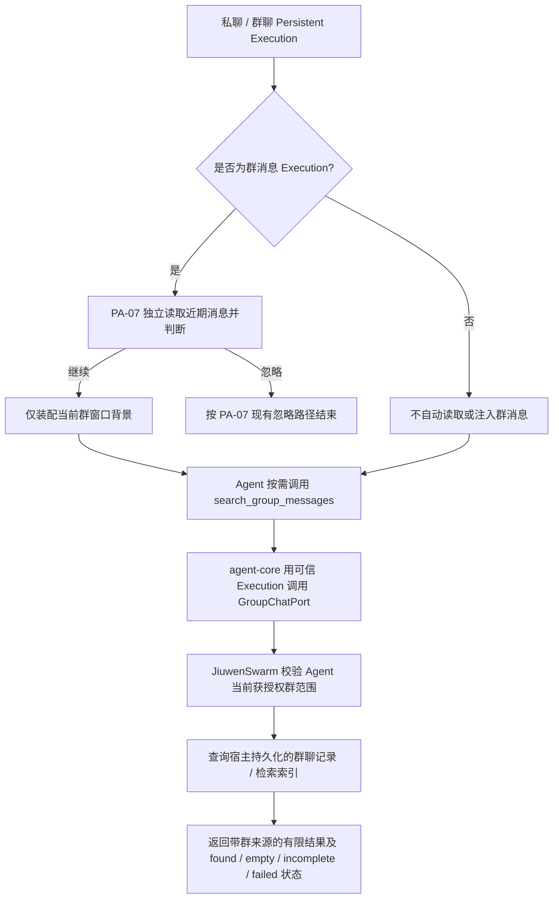

# 群聊历史读取与跨群检索设计方案

## 1. 元信息

| 项 | 值 |
| --- | --- |
| 建档日期 | 2026-10-16 |
| 范围 | agent-core `openjiuwen/harness/persistent_agent`：保留 PA-07 的参与判断读取；在群聊 Execution 中装配当前群背景；提供 Persistent Agent 按需搜索其获授权群聊历史的工具。JiuwenSwarm 提供当前授权范围、群历史存储与检索实现 |
| 方案成熟度 | 跨群范围及授权原则已确认；接口形状、结果细节和宿主适配按本文方案，实施前与 S_09 / JiuwenSwarm 接口核对 |
| 计划条目 | [开发计划](../designs/persistent-agent-development-plan.md) PA-23 |
| 负责人 | 闫祉君 |
| 状态 | agent-core 已实现；宿主适配与跨仓闭环待验证 |
| 设计依据 | [架构设计](../designs/persistent-agent-architecture.md)；[S_09 群聊读取与历史检索](../specs/S_09_group-chat-and-knowledge.md)；PA-04 群消息端口契约；PA-07 参与判断 |
| 关联 feature | [F_04](F_04_contract-convergence.md)（群消息端口）；[F_07](F_07_group-participation.md)（参与判断）；[F_15](F_15_tool-intent-before-side-effect.md)（工具副作用分类） |
| 验证摘要 | 已覆盖 DTO、绑定身份、跨群工具调用、分页失败、窗口补读和模式隔离；本地验证与跨仓未覆盖项见第 8、9 节 |
| Refs | 未关联 issue / PR |

## 2. 背景、目标与范围

### 2.1 背景与问题

PA-23 包含三类不同的群消息读取：PA-07 在群消息进入时读取近期消息、Execution 窗口组装时读取当前群的补充背景，以及模型在需要时搜索已保存的群聊历史。前两项是当前群的执行上下文；第三项是按需检索，范围可以跨越当前私聊或群聊。三者职责分开，跨群历史不会自动注入每次执行的上下文。

用户已确认：**检索范围只校验 Agent 对目标群的授权，不额外要求当前提问者属于目标群。**因此，无论 Agent 是在私聊、群 A 还是其他受支持的入口执行，都可以按需检索该 Agent 当前有权访问的群 B 历史。该选择也意味着任何能够与该 Agent 对话的人，都可能通过 Agent 查询其获授权群的历史；JiuwenSwarm 的产品交互与部署方必须知晓这一隐私边界。

### 2.2 目标场景

| 场景 | 目标行为 |
| --- | --- |
| Bot 收到群 A 的消息 | PA-07 仍独立读取近期群消息并判断是否参与；判断通过后，Execution 背景只装配群 A 当前窗口需要的背景 |
| 用户私聊 Agent：“群 B 昨天决定了什么？” | Agent 显式调用历史搜索工具；宿主只返回该 Agent 当前获授权群中的群 B 匹配记录及来源 |
| 用户在群 A 询问群 B 的历史 | 与私聊场景相同；请求所在群不限制搜索范围，也不额外赋予对群 B 的权限 |
| 指定一个 Agent 未获授权的群 | 不返回该群内容；以不泄露群是否存在的方式返回不可用结果 |
| 某群历史不可读或扫描未完成 | 返回失败或不完整，不伪装成“没有匹配记录” |

### 2.3 本次范围与非目标

- **包含：** 保持 PA-07 现有独立读取；群消息 Execution 的当前群背景读取；Persistent 专用的按需跨群搜索；Agent 级群授权校验；群来源标识、有限结果及明确的空结果 / 不完整 / 失败语义。
- **不包含：** 群历史采集、消息归档及索引存储；飞书 API 与授权快照的具体实现；JiuwenSwarm AgentServer 的请求路由；私聊消息历史搜索；跨 Agent 检索；通用检索引擎；未在 PA-23 计划中的完整上下文邻居读取。
- 搜索仅覆盖宿主已保存且当前可读的记录。Agent 对群有权限，不代表宿主已保存该群全部历史；结果不得声称覆盖未归档的时段。

## 3. 现状与设计边界

### 3.1 新版 agent-core 现状

- `GroupChatPort` 保留当前群近期读取，搜索入口已使用 Agent 级跨群查询契约；搜索结果带来源群身份和稳定消息引用。
- `GroupMessageQuery` 已增加群 ID / 群名过滤；`GroupMessagesResult` 只服务于近期读取，搜索使用独立的 `GroupMessageSearchResult`。近期读取的 `scanned_through` 不充当跨群搜索分页游标或全局扫描完整性证明。
- PA-07 在加载窗口之前直接调用 `GroupChatPort.recent_messages`。这条参与判断链路已经独立于 `group_message_reader`，本方案不合并或替换它。
- 注入 `GroupChatPort` 的 Persistent Execution 已注册 `search_group_messages`；自动背景读取另受 `request.kind == group_message` 保护，私聊和定时任务不因端口存在自动读取群消息。

### 3.2 检索数据来源

历史消息的数据源是 JiuwenSwarm 维护的持久化群聊记录及其检索能力。它必须能够按群定位已保存消息，并保留消息正文状态、稳定消息身份、发送者和服务端接收时间等字段。agent-core 不保存一份副本，也不直接访问 Feishu API、宿主文件或数据库。

本方案不指定 JiuwenSwarm 底层采用哪种数据库、索引或物理路径；这些属于宿主实现。但宿主必须提供可说明的历史覆盖范围和查询完整性，不能把“当前授权了该群”解释成“已拥有该群的完整历史”。未采集、已删除、已撤回或正文暂不可读的记录，按宿主提供的状态准确返回。

## 4. 方案与关键决策

### 4.1 总体流程



历史搜索是模型显式调用的只读工具；跨群范围不作为自动上下文注入，避免每次私聊或群聊 Execution 都读取并暴露所有授权群的历史。

#### 检索步骤与查询方式

1. 模型调用 `search_group_messages`，传入关键词；可选指定群 ID / 群名、时间范围、发送者、分页游标和结果数。关键词按字面子串匹配、大小写不敏感，不按自然语言语义扩展；按服务端接收时间从新到旧排序，同一时间按 `group_id`、`message_id` 稳定排序。
2. agent-core 将查询连同可信 `ExecutionContext` 交给 `GroupChatPort.search_messages`，不从模型参数接收 `agent_id` 或授权列表。
3. JiuwenSwarm 从执行上下文确定 Agent，并读取该 Agent 当前获授权的群集合。无群过滤条件时查询整个授权集合；指定群 ID / 群名时只在该集合内缩小范围，群名精确解析，同名时要求消歧。
4. JiuwenSwarm 在其持久化群聊记录 / 检索索引中按查询条件检索，执行有界排序与分页，并在每次调用（包括后续分页）重新校验授权。
5. 返回有限命中及来源群身份、消息引用和完整性状态。仅当所有目标群和请求范围均已完成扫描且无命中时，才返回 `empty`；部分完成返回 `incomplete`，查询异常返回 `failed`，不能以空结果代替。

因此，跨群检索的逻辑入口与授权边界在方案中已明确；JiuwenSwarm 的具体存储产品、索引结构、保留期限和物理路径仍需由宿主设计确定，并在跨仓联调前记录。

### 4.2 已确认决策

#### D-01 搜索主体和群范围

- 搜索主体是当前可信 `Execution.agent_id` 对应的 Agent。
- 搜索范围是 JiuwenSwarm 当前确认该 Agent 获授权的群。
- 不校验当前提问者是否为目标群成员，也不要求当前 Execution 所属群与目标群相同。该规则由用户明确确认。
- 工具参数中不接受 `agent_id`、`session_id`、所有者 ID 或原始授权列表；这些身份与授权范围由宿主从可信执行上下文解析。

#### D-02 搜索过滤不能扩大授权

- 未指定群 ID / 群名时，搜索 Agent 当前全部获授权的群。
- 指定群 ID 或群名只用于在授权范围内缩小查询集合；不能因参数中出现某群而获得该群权限。
- 群名按精确匹配解析。若授权范围内存在多个同名群，返回需消歧状态并给出安全的可选标识；不得静默随机选择。
- 对未授权或无法解析的显式目标，返回不泄露目标是否存在的通用不可用语义，不返回群记录。

#### D-03 PA-07、窗口背景与历史搜索分离

- PA-07 保留其在群消息入口、窗口加载之前直接读取近期消息的独立参与判断；不依赖本方案的搜索工具或搜索端口。
- 自动窗口背景读取只针对当前群消息 Execution 的当前群，不读取其他授权群。
- 私聊 Execution 可以具备显式历史搜索端口，但不因此自动调用 `recent_messages`，也不自动注入任一群历史。
- 在群 A 的执行上下文中搜索群 B，不改变 PA-07 的参与判断目标。搜索结果作为普通工具消息进入当前窗口，按 PA-10 的既有工具消息规则保存；它不是自动临时背景，PA-23 不另建跨群缓存，也不承诺撤权时自动擦除已经进入窗口的内容。

#### D-04 权限必须反映当前状态并失败关闭

- JiuwenSwarm 在每次搜索调用时依据当前授权状态过滤目标群；不能只依赖 Agent 构建时的快照或历史消息归档中的访问记录。
- 翻页或按引用读取（若后续加入）时再次校验当前授权。撤权后不得通过旧游标或旧引用继续读取。
- 授权来源缺失、过期或不可验证时，拒绝搜索并返回失败 / 不可用；不得按“授权群为空”返回确定无结果。
- 如果一次查询的授权范围或群存储只完成部分扫描，标记 `incomplete`，不得返回确定 `empty`。

#### D-05 结果语义必须区分

- `found`：在授权范围及请求过滤条件内找到匹配记录；每条记录标明来源群与稳定消息引用。
- `empty`：已完整扫描授权范围内全部目标群和请求时间范围，且没有匹配记录。
- `incomplete`：有部分结果，但至少一个目标群、时间段或分页未能完整扫描；同时返回已知结果和未完成原因，不得声称结果完整。
- `forbidden` / `unavailable`：显式目标不在可访问范围，或不能安全解析；不区分暴露其存在性。
- `failed`：授权解析、查询端口或存储检索发生错误；失败不是空结果。

### 4.3 agent-core 契约与实现

以下契约已落地，并与 S_09 同步。

| 契约 | 建议变化 | 要求 |
| --- | --- | --- |
| `GroupMessageQuery` | 增加可选 `group_ids`、`group_names`；保留现有关键词、时间、发送者、游标和 limit 过滤语义 | 查询条件只能缩小宿主确认的授权范围；群过滤采用精确 ID / 名称规则 |
| `GroupMessageSearchHit` | 新增跨群搜索命中值，含 `group_id`、`group_name`、稳定 `message_ref`、消息身份 / 时间 / 发送者 / 正文或有界摘录 | 不复用只代表当前会话消息的结构而丢失来源群；不含宿主内部文件路径或未授权字段 |
| `GroupMessageSearchResult` | 新增搜索专用结果，含状态、命中、可选 `next_cursor`、扫描完整性 / 原因 | 不复用 `GroupMessagesResult.scanned_through` 表示多群搜索完整性；`empty` 只能用于完整扫描 |
| `GroupChatPort.search_messages` | 扩展为宿主在可信 Execution 上下文中执行 Agent 级多群搜索 | `execution` 为身份来源；端口实现负责授权过滤、搜索及状态准确性 |
| `search_group_messages` | 新增 Persistent-only 只读工具 | 模型只能提供关键词和可选过滤条件；不能伪造 Agent 身份或访问列表 |

查询默认 limit=50、上限 500；群 ID / 群名各最多 128 项，名称最多 512 字符且不能全为空白；不指定时间时查询宿主实际保留的历史。结果消息正文沿用 65536 字符契约，模型展示每条正文最多 2048 字符、整个 JSON 最多 32768 字符。`text_truncated`、`display_truncated`、`omitted_hits` 明示摘录与省略；`query_complete` 只描述宿主查询是否完整，不承诺展示完整。展示过长可缩小查询范围或 limit，不伪造分页游标。首期不提供按命中引用读取相邻消息的第二个工具。

实现集中在两个新文件：`tools/group_history.py` 提供绑定 Execution 的搜索工具；`execution/group_history.py` 提供当前群背景读取。工具通过 `PersistentAgentSpec.resolve_parts` 进入既有装配、按执行隔离和清理流程，不新增 Rail 或修改个人版装配。相同工具名的自定义注册在构造时拒绝，避免覆盖身份绑定的内置工具。

模型展示的提及 / 附件引用各最多 8 项；单条序列化结果超过 24000 字符时省略可选引用列表，保留来源与正文摘录，以 `metadata_truncated`、`omitted_metadata` 标明省略。原因展示最多 1024 字符，超出以 `reason_truncated` 标识。整个 JSON 计入转义开销，单条合法消息不会仅因附件引用过多被整条丢弃。

背景读取每次最多 500 条，触发补读最多 32 页，合并后最多保留最近 500 条。首轮增量的 `scanned_through` 固定补读上界；补读按宿主正向扫描分页，只有找到该消息或相同扫描位置才确认区间，超过上界的消息不并入。重复消息以后一次观察为准（包括撤回）；排除触发消息、按接收时间排序。无可信上界、游标循环、超限或边界无法确认均标记 `incomplete`，未证明的补读区间不合并；始终不使用补读的新扫描位置推进当前游标。异常向上传播，不伪装为空。

若补读未完成，对增量已经选中的消息仍保留补读中的新观察，防止已经看到的撤回 / 正文不可用因后续扫描中断恢复成旧正文；不把其他区间消息据此认定为已覆盖。

### 4.4 工具权限与模式隔离

- `search_group_messages` 是只读工具，必须按 F_15 的精确工具名策略登记；不能因名称含 `search` 就在宽泛规则中默认只读。
- 工具仅在 Persistent Agent 构建与执行链中注册。Personal Agent、其他 Harness、非 Persistent 群消息链路不增加该工具，不改变其现有工具策略。
- 所有历史搜索经 `GroupChatPort` 完成；agent-core 不直接依赖 Feishu SDK、JiuwenSwarm 包、文件路径或具体数据库。

## 5. 职责边界

| 能力 | agent-core | JiuwenSwarm |
| --- | --- | --- |
| PA-07 参与判断 | 保留现有入口和 `recent_messages` 调用次序；本方案不改其独立判断语义 | 提供触发群近期消息与稳定扫描位置 |
| 当前群窗口背景 | 仅在群消息 Execution 中调用当前群背景读取接入点 | 按当前群返回已保存消息、游标和完整性状态 |
| 跨群检索工具 | 提供 Persistent-only 工具、过滤参数校验、结果类型与语义处理 | 从可信执行上下文解析 Agent；取当前授权群；执行检索并返回群来源及完整性 |
| 群授权 | 不接收模型传入的身份或权限列表，不自行推导成员授权 | 使用当前 Agent—群绑定 / 授权事实；每次调用检查；撤权后即时拒绝 |
| 群历史存储 | 不实现、不读取宿主文件 | 负责采集、归档、索引、查询、撤回 / 删除语义及底层故障报告 |
| 跨群隐私告知 | 记录工具范围与错误语义 | 明确产品行为：任何能与 Agent 对话的人，可能查询该 Agent 获授权群的历史 |

本方案不把“Bot 曾加入过某群”直接等同于永久有效授权。若 JM-08 的群绑定是授权来源，JiuwenSwarm 必须明确 Bot 被移出、解绑或 Agent 配置变化如何使授权失效，并由搜索端口读取当前有效状态。

## 6. 实施影响

| 实施项 | 模块 / 文件 | 内容 | 验证 |
| --- | --- | --- | --- |
| I-01 | `schema/context.py` 及相应导出 | 增加跨群搜索命中 / 结果类型，并扩展搜索过滤值 | 类型校验、序列化 / 导出测试 |
| I-02 | `ports.py`、`schema/integration.py` | 明确 Agent 级跨群搜索端口及当前群近期背景读取边界 | 端口契约测试、PA-07 回归 |
| I-03 | Persistent Agent 工具注册位置 | 注册 `search_group_messages`，参数不含可信身份字段 | Persistent 模式可用、非 Persistent 模式不可见 |
| I-04 | `tools/effect_policy.py` | 精确登记新工具名为只读 | F_15 副作用分类测试 |
| I-05 | `execution/seams.py`、窗口组装接入点 | 仅在群消息 Execution 安装 / 调用当前群背景读取；私聊只允许显式搜索 | 私聊不自动取群消息；群消息仍按当前群组装 |
| I-06 | `tests/unit_tests/harness/persistent_agent/` | 覆盖结果语义、授权失败、来源群、过滤、分页和模式隔离 | 第 8 节 |
| I-07 | JiuwenSwarm Provider / AgentServer | 提供实时 Agent 授权范围、实际群历史搜索和失败关闭语义 | 跨仓联调；不是 agent-core 单测可替代 |
| I-08 | `S_09`、架构设计、开发计划 | 对齐跨群查询、授权责任、请求上下文端口注入与验收 | 文档契约一致性检查 |

## 7. 兼容性与风险

- **个人版隔离：** 新工具只在 Persistent Agent 注册；当前群自动背景读取按 `request.kind == group_message` 等价条件保护。必须用 Personal / 非 Persistent 构建回归证明无行为变化。
- **既有宿主兼容：** 旧 `GroupChatPort.search_messages` 若只支持当前会话群，不可静默宣称支持跨群。未实现新授权搜索契约的宿主应明确返回不支持 / 失败，不能回空结果。
- **隐私风险：** 用户已选择不校验提问者是否属于目标群，Agent 授权群的历史对所有可与该 Agent 对话的人可被间接查询。若产品后续要求按提问者隔离，需改变已确认的授权模型与 JM 接口，不能仅在工具层补一个不可信的 sender 参数。
- **授权过期风险：** 构建时缓存的群清单和 append-only 历史访问记录不能作为撤权后的最终判断；宿主必须查当前有效授权。
- **完整性风险：** 多群扫描中任何一个目标群未完整查询，都不能把已有零命中宣称为 `empty`。
- **数据范围风险：** PA-23 搜索结果仅代表宿主实际保留的群记录；采集起点之前的历史、删除 / 撤回内容、保存失败记录按宿主契约反映，不虚构完整历史。

## 8. 验收设计

| ID | 场景 | 预期 |
| --- | --- | --- |
| PA-23-V-01 | 私聊 Agent 搜索授权群 B，Execution 不属于群 B | 返回 B 的匹配历史及准确来源；不要求提问者是 B 成员 |
| PA-23-V-02 | 在群 A 向 Agent 查询授权群 B | 与私聊相同；当前群 A 不限制 B 的检索 |
| PA-23-V-03 | 不指定群过滤条件 | 只搜索当前授权列表内的群，不搜索其他 Agent 或全局会话 |
| PA-23-V-04 | 指定授权群 ID / 唯一群名 | 在获授权集合内缩小范围；返回稳定群身份 |
| PA-23-V-05 | 参数指定未授权群，或目标无法解析 | 不返回消息；结果不泄露目标是否存在 |
| PA-23-V-06 | 授权范围内存在同名群 | 返回消歧结果，不静默选择其中一个 |
| PA-23-V-07 | 当前授权源缺失、超时或无法验证 | 失败关闭；不得返回 `empty` 或任何未经确认的群内容 |
| PA-23-V-08 | 多群查询部分成功、部分超时 / 扫描中断 | 可返回已知命中但状态为 `incomplete`；不宣称无遗漏 |
| PA-23-V-09 | 所有目标群已完整扫描且无匹配 | 返回 `empty`；与端口失败明确区分 |
| PA-23-V-10 | 查询翻页期间目标群授权被撤销 | 后续页重新校验；撤权群不再返回数据 |
| PA-23-V-11 | 删除、撤回或正文不可用的消息 | 按宿主状态语义返回；不恢复或泄露已撤回正文 |
| PA-23-V-12 | 群消息进入 PA-07 参与判断 | 仍独立调用近期消息读取；结果不依赖 `search_group_messages` |
| PA-23-V-13 | 群消息 Execution 进行背景装配 | 只装配当前群背景，不自动读取其他 Agent 获授权群 |
| PA-23-V-14 | 私聊 Execution 配置了跨群搜索端口 | 不调用 `recent_messages`、不自动注入群消息；仅模型显式调用搜索时查询 |
| PA-23-V-15 | Personal / 非 Persistent Agent 构建 | 不注册该工具，原有个人版行为和工具策略不变 |
| PA-23-V-16 | `search_group_messages` 经 F_15 副作用分类 | 精确按只读处理；其他未登记工具仍按原策略 |

agent-core 组件测试可以用模拟 `GroupChatPort` 验证工具参数、调用次序与状态处理；跨群授权实时性、飞书消息覆盖和撤权必须在 JiuwenSwarm Provider 联调验证，模拟端口不能作为闭环证据。

### 8.1 本地验证范围

- `test_group_history.py`：查询身份不可由模型伪造、宿主归属核验、完整性状态、每页重新调用宿主、撤权 / 失败响应不当空、正文截断、触发补读去重、固定上界、缺失上界、循环与页数限制、撤回覆盖。
- `test_construction.py`：构造不访问宿主；两个 Execution 的搜索工具实例和资源 ID 隔离，清理互不影响；自定义同名工具拒绝；普通 DeepAgent 不增加搜索工具。
- `test_window_assembly.py`：真实 DeepAgent 流式工具调用、只读查询不产生 `tool.intent`、模型收到带来源的搜索结果、结束后资源清理；真实读取器接入窗口；私聊 / 定时任务不自动读取背景。
- 以上使用本地模型与测试宿主，只证明 agent-core 契约、执行顺序和隔离行为；不证明真实存储覆盖、飞书权限或跨群撤权效果。

### 8.2 实际验证记录（2026-10-16）

环境：Windows，仓库 `.venv` 的 Python 3.11.9，基线 `main/jiuwenmate_v0.1.20` 的 `ea270daca` 加本地未提交改动。

```powershell
.venv/Scripts/python.exe -m pytest tests/unit_tests/harness/persistent_agent tests/unit_tests/harness/test_personal_context_clean_cut.py tests/unit_tests/harness/rails/test_personal_context_rail.py tests/unit_tests/harness/test_build_context_merge.py -q --disable-warnings --maxfail=1
```

结果：**831 passed、10 skipped、2 warnings**。包含 PA-23 的 34 项专门组件测试、真实 DeepAgent 搜索调用与窗口读取接入，以及既有 PA-07、PA-14/15/16、PA-18 和个人版上下文相关回归。跳过项保持原测试条件，未将其视作通过。新增的补读中断撤回保护、单条大元数据和转义后展示容量场景均先复现失败，再修复通过。

`ruff check` 覆盖 `openjiuwen/harness/persistent_agent` 与本次变更的三个测试文件，检查通过；`git diff --check` 通过。未执行真实模型、飞书渠道、JiuwenSwarm Provider 或实际持久化群历史的跨仓测试。独立审查指出的补读中断回退旧正文和大元数据丢失单条命中两项已修复，并由上述回归覆盖。

## 9. 需要同步的文档与未覆盖项

- [S_09](../specs/S_09_group-chat-and-knowledge.md)、S_03、F_06 与架构 §3.5、§4.6、§9.1 已按本方案同步；agent-core 端口、Persistent 工具注册和当前群读取器已实现，JiuwenSwarm Provider 待适配。
- 开发计划 PA-23 已同步为本方案的范围：PA-07 独立读取、当前群背景读取、跨群搜索与 Agent 级授权分开验收。
- JiuwenSwarm 的具体 Agent—群授权事实源、搜索历史 API、授权撤销时机、存储覆盖范围及物理存储方案，需按 JM 文档和代码另行确认。
- PA-23 的 agent-core 侧完成不等于闭环。只有 JiuwenSwarm 实际 Provider 以可信 Agent 身份执行当前授权过滤、历史检索，并完成私聊 / 跨群请求联调后，才能宣称跨群检索闭环。

### 9.1 JiuwenSwarm 对接清单

1. 为需要搜索的 Persistent Execution 注入 `group_chat`。`recent_messages` 按 Session 定位当前群；`search_messages` 按可信 `execution.agent_id` 定位授权主体，返回新的 `GroupMessageSearchResult`，不能沿用旧近期消息结果。
2. 建立实际持久群消息数据源和当前 Agent—群授权事实源；记录历史覆盖起点、删除 / 撤回状态、Bot 被移出或解绑后的失效规则。权限查询失败不能解释为空授权列表。
3. 实现精确 ID / 群名解析及同名消歧、字面子串查询、稳定排序分页；游标绑定 Agent / 查询 / 授权范围，每页重验授权。无权和不存在目标使用相同的安全不可用语义。
4. 使用真实保存的消息验证私聊查群 B、群 A 查群 B、多群部分失败、分页撤权、已撤回正文不可读、排队触发补读；确认普通个人版不接入这条链。上述均未在本次 agent-core 本地测试中完成。
