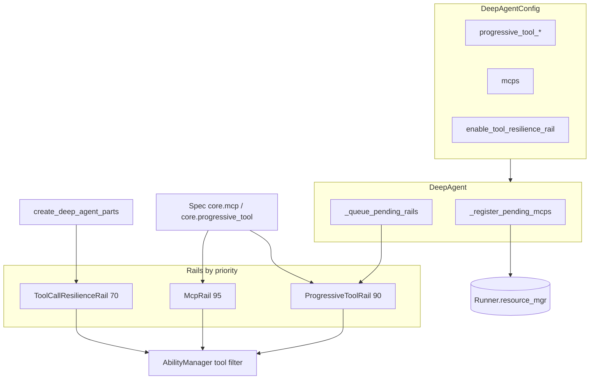

# 总览与边界

## 元信息

| 项 | 值 |
|---|---|
| 类型 | spec |
| 关联模块 | openjiuwen/harness/tool_management |
| 最近一次修订日期 | 2026-10-26 |
| 关联 feature | — |

## 目的

agent-core 工具管理控制：**模型每轮看到多少工具**、**如何发现更多**、**瞬时工具失败如何重试**、**MCP resource（非 server）如何暴露**。建立在 `DeepAgent` + `AbilityManager` + `Runner.resource_mgr` 之上，不替代终端用户教程。

## 范围 / 边界

### 范围内（agent-core）

| 区域 | 主代码 |
|------|--------|
| 渐进式披露 rail | `openjiuwen/harness/rails/progressive_tool_rail.py` |
| 元工具 search / load | `openjiuwen/harness/tools/tool_discovery/` |
| 工具调用韧性 | `openjiuwen/harness/rails/tool_call_resilience_rail.py` |
| MCP resource 工具 rail | `openjiuwen/harness/rails/mcp_rail.py` |
| 配置字段 | `DeepAgentConfig` — `openjiuwen/harness/schema/config.py` |
| Factory 默认 resilience | `openjiuwen/harness/factory.py` |
| DeepAgent 队列 + MCP 注册 | `openjiuwen/harness/deep_agent.py` |
| Manifest 目录 | `core.progressive_tool`、`core.mcp` — `harness/manifest/harness_elements.py` |

### 范围外（另文档说明）

- **工具权限引擎** — `openjiuwen/harness/security/` 与 permission interrupt rails。
- **安全 / prompt 注入 rails** — `openjiuwen/harness/rails/security/`。
- **Sys-operation 工具**（bash/read/write）— `SysOperationRail` 及相关 tools。
- **Team 专用 tool rails** — `openjiuwen/agent_teams/`（可镜像模式；非本模块管辖）。
- **MCP server 编写** — 用户指南 `docs/en|zh/.../MCP Tool.md` 与 foundation MCP client API。
- **完整 harness rail 目录** — `docs/en/.../openjiuwen.harness/rails/rails.md`（仅引用）。

## 双仓管辖

| 关切 | agent-core（本 archive） | jiuwenswarm（姊妹产品仓） |
|------|--------------------------|---------------------------|
| `ProgressiveToolRail` `search_tools` → `load_tools`，priority 90 | **OWNS** | 引用；产品用 **FORK** |
| `tool_discovery` `SearchToolsTool` / `LoadToolsTool` | **OWNS** | — |
| `ToolCallResilienceRail` priority 70，factory 默认 | **OWNS** | 引用 |
| `McpRail` priority 95（仅 resource list/read） | **OWNS** | 引用 |
| `DeepAgentConfig` `progressive_tool_*`、`mcps` on `DeepAgent` | **OWNS** | 产品 MCP 生命周期亦在 swarm common |
| Fork：`tools_search` → `invoke_tool`、`DisabledToolsRail` | 引用 | **OWNS** — `agents/harness/common/tool_management/` |

### Fork 警告（规范）

jiuwenswarm 渐进式路径使用 **不同元工具名与额外 disabled-tools rail**。agent-core 代码、默认 prompt、core 单测须只假设 **`search_tools` 与 `load_tools`**。从未改名就从 swarm 移植资源会破坏 core 渐进流。反之，core 文档不得要求只 ship fork 的产品构建携带 swarm-only 符号。

## 架构位置

## 文档边界

| 受众 | 位置 |
|------|------|
| AI agent / 模块维护者 | `openjiuwen/harness/tool_management/`（本树） |
| 应用开发者 | `docs/en|zh` Development Guide + harness API markdown |
| 与 tool-mgmt 无关的 harness 级 feature | `openjiuwen/harness/docs/features/` |

## 不变量

1. agent-core 默认渐进元工具名为 `search_tools`、`load_tools`（非 swarm fork 名）。
2. MCP server 注册与 `McpRail` resource 工具职责分离（见 [[S_05]]）。
3. 本 archive 维护双仓管辖表；产品 fork 细节在 jiuwenswarm `tool_management/` hub。

## 修改检查单

- [ ] 新增/移动 harness 代码路径是否仍落在上表「范围内」？
- [ ] 双仓表是否与 jiuwenswarm 侧 AGENTS 一致（fork 行未颠倒 OWNS）？
- [ ] 用户向教程是否仅引用、未在本 tree 复制 MCP 全文？
- [ ] 架构图与 factory / DeepAgent 初始化顺序是否与代码一致？

## 与其它 spec 的关系

- [`S_02_progressive-tool-rail.md`](S_02_progressive-tool-rail.md)
- [`S_03_meta-tools-search-and-load.md`](S_03_meta-tools-search-and-load.md)
- [`S_04_tool-call-resilience.md`](S_04_tool-call-resilience.md)
- [`S_05_mcp-rail-vs-server-registration.md`](S_05_mcp-rail-vs-server-registration.md)
- [`S_06_factory-and-manifest-wiring.md`](S_06_factory-and-manifest-wiring.md)
