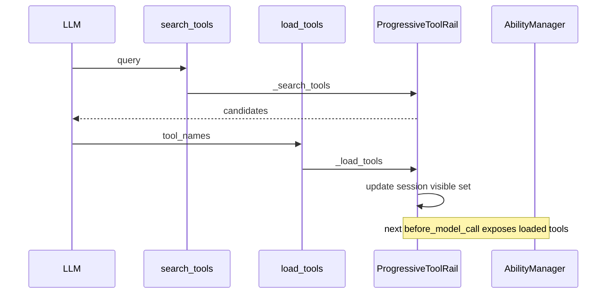

# 元工具：search_tools 与 load_tools

## 元信息

| 项 | 值 |
|---|---|
| 类型 | spec |
| 关联模块 | openjiuwen/harness/tools/tool_discovery/ |
| 最近一次修订日期 | 2026-10-26 |
| 关联 feature | — |

## 目的

两个 harness `Tool` 实现向 LLM 暴露渐进式发现能力。**仅**在 `ProgressiveToolRail` 初始化时注册（或等效测试接线）。公开 export：`openjiuwen.harness.tools` 与 `tool_discovery/__init__.py`。

## 接口契约

### 工具标识（agent-core）

| 类 | `TOOL_NAME`（ability key） | `TOOL_ID` |
|----|---------------------------|-----------|
| `SearchToolsTool` | **`search_tools`** | `SearchToolsTool` |
| `LoadToolsTool` | **`load_tools`** | `LoadToolsTool` |

Card 经 `openjiuwen.harness.prompts.tools.build_tool_card` 构建，可选 `agent_id` qualify。

### search_tools

**输入 schema（`SearchToolsInput`）：**

| 字段 | 默认 | 语义 |
|------|------|------|
| `query` | 必填 | 自然语言或关键词，检索工具 metadata |
| `limit` | `10` | invoke 内 clamp 到 `[1, 20]` |
| `detail_level` | `1` | `1` 名+描述；`2` + 参数摘要；`3` 完整参数 |

**行为：**

- 匹配委托 `ProgressiveToolRail._search_tools`（注入 callable）。
- 经 `append_trace` 追加 trace（`action: search_tools`、query、matches）。
- 返回结构化 `ToolOutput`（payload 形状见实现）。

### load_tools

**输入 schema（`LoadToolsInput`）：**

| 字段 | 默认 | 语义 |
|------|------|------|
| `tool_names` | `[]` | 加入 session 可见集的工具名 |
| `replace` | `False` | `True` 时替换当前可见集而非 merge |

**行为：**

- 委托 `ProgressiveToolRail._load_tools`（session 感知）。
- 遵守 config 的 `progressive_tool_max_loaded_tools`（rail 内 enforcement）。

## 执行路径或数据结构

### 流程（core）

### Fork 对照（jiuwenswarm）

| Core（agent-core） | Swarm fork（core 内无） |
|--------------------|-------------------------|
| `search_tools` | `tools_search`（典型） |
| `load_tools` | `invoke_tool`（典型） |
| core harness 无 `DisabledToolsRail` | swarm `tool_management/` 管辖 |

Core agent、skill、测试须只针对 **左列**，除非明确针对 swarm fork 构建。

## 不变量

1. Meta-tool 名是 core harness 随附 prompt 的稳定公开契约。
2. Progressive rail 激活时 meta-tools 始终在可见 allowlist 内。
3. **Search 本身不** 把工具加入可调用集——须 **load**（always-visible / default-visible 集除外）。

## 修改检查单

- [ ] `TOOL_NAME` / schema 变更是否更新 rail 单测与 prompt？
- [ ] trace 字段形状是否为可观测契约的一部分？
- [ ] 未在 core 文档引入 `tools_search` / `invoke_tool` 作为默认名？

## 测试

- 主要覆盖：`tests/unit_tests/harness/test_progressive_tool_rail.py`（rail + meta-tool 集成）

## 与其它 spec 的关系

- [`S_02_progressive-tool-rail.md`](S_02_progressive-tool-rail.md)
